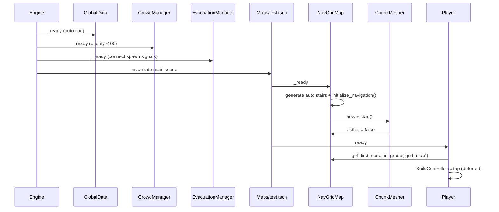
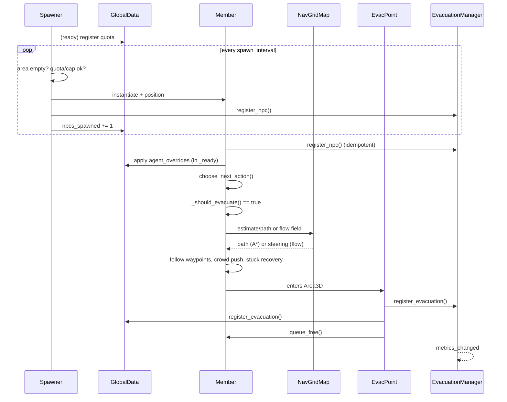

# Codebase Analysis — Evacuation Route Optimizer

> Snapshot: **2026-11-02** · Godot **4.7.2.stable.steam** · Renderer `mobile` · No git repository, no README, no tests.
>
> This revision supersedes the 2026-10-31 audit, kept at `docs/archive/CODEBASE_ANALYSIS_2026-10-31.md`. The older document described the build before the simulation panel, results panel, `EvacuationManager`, and the player/building split existed. It also described `MovementComponent` and stair snapping, which have since been removed.
>
> Claims below were checked against the current source and, where noted, against a live run of the project.

---

## Contents

1. [Executive summary](#1-executive-summary)
2. [What the project is trying to be](#2-what-the-project-is-trying-to-be)
3. [Runtime topology](#3-runtime-topology)
4. [Systems in depth](#4-systems-in-depth)
5. [Data and asset pipeline](#5-data-and-asset-pipeline)
6. [Key execution flows](#6-key-execution-flows)
7. [Complexity and performance profile](#7-complexity-and-performance-profile)
8. [Coupling and boundaries](#8-coupling-and-boundaries)
9. [Findings](#9-findings)
10. [Intent vs. implementation](#10-intent-vs-implementation)
11. [Recommendations](#11-recommendations)
12. [Verification log](#12-verification-log)
- [Appendix A — File inventory](#appendix-a--file-inventory)
- [Appendix B — Input map](#appendix-b--input-map)
- [Appendix C — Project settings](#appendix-c--project-settings)
- [Appendix D — Unused assets](#appendix-d--unused-assets)

---

## 1. Executive summary

**What exists.** A single-scene Godot 4 voxel sandbox with a character controller, block building, a crowd simulator, a simulation control panel, an Agents editor, and an evacuation results panel. The simulation loop now works end-to-end from the UI:

```
Simulation/Agents panel → spawn NPCs → choose an exit → path/flow to it → EvacPoint → metrics
```

**What is measured.** `EvacuationManager` records per-NPC spawn/arrival times, chosen exit, distance travelled, stuck time, failed paths, and peak local density. It derives average, median, p95, min/max evacuation time, per-exit arrivals, share, average time, and throughput per minute. A live 60-NPC run produced 42 evacuations by ~26 s, average 22.5 s, p95 24.8 s, 0 failed paths, 0 stuck strikes.

**What is still missing.** The “optimizer” half of the title: no simulation save/load, no baseline/replay, no before/after layout comparison, no bottleneck heatmap, no obstacle-rich level, and no tests. The shipped map is a flat 4,674-cell platform with nine spawners on one edge and one exit on the opposite corner. It measures throughput, not route quality.

**Overall health.** The core is coherent and runs without script errors or GDScript warnings. The most serious problems are now behavioural rather than missing infrastructure: flow-field mode has no crowd spreading or stuck recovery, exit choice uses straight-line distance instead of path distance, and resetting a run leaves live NPCs that corrupt the next run’s metrics.

**Recent change — stair snapping removed.** `MovementComponent.gd` and its `StairsAhead`/`StairsBelow` raycasts were deleted from `player.tscn` and `Member.tscn`. There is no automatic step-up or snap-down anymore. Player and NPCs rely on `move_and_slide()`, gravity, jumping, and (for NPCs) the obstacle-hop routine. On a flat map this changes nothing; on stairs and half-blocks, expect jumps and possible snags instead of teleporting.

**Biggest risks.**

| Risk | Where |
|---|---|
| NPC collisions are steering-only by default (`Member.allow_collision_disable = true`, mask 1); set it off to force mask 3 | `scenes/npcs/Member.tscn`, `scripts/NPCstuff/Member.gd` |
| Flow-field mode has no lane offsets, stuck detection, or obstacle hop | `scripts/NPCstuff/Member.gd`, `scripts/gridmap.gd` |
| Exit selection ignores path distance | `scripts/NPCstuff/Member.gd:_route_to_closest_evac_point` |
| Reset leaves live NPCs and clears records, producing 0 s arrival times | `scripts/GlobalData.gd`, `evacuation_manager.gd` |
| Default demo spawns 9 × 1,000 at 0.1 s, 9,000 total quota vs. a 700 cap | `Maps/test.tscn`, `scenes/spawner.tscn` |

---

## 2. What the project is trying to be

The evidence still points to a **spatial evacuation sandbox**, not a Minecraft-like survival game:

- The title is *Evacuation Route Optimizer*.
- The block palette is institutional — classroom window frames, floor tiles, warning-coloured concrete brick, off-white walls.
- The meaningful outcome is “NPC reached an `EvacPoint` and was removed”.
- Navigation penalises walls and exposed gaps instead of only minimising distance, and lane offsets spread agents sideways.
- The HUD has a simulation panel for start/reset/quota/cap/mode and a results panel for timing, exit usage, throughput, distance, and failures.
- The HUD has an Agents category that edits the Member exports for live and future NPCs.
- Placeables include a foliage scene generator that creates one billboard or crossed-plane sprite placeable per texture.
- The player has creative building tools and can place `Spawner` and `EvacPoint` as objects.

The implied loop is: **build a floor plan → place crowd sources and exits → run the evacuation → measure how it went → change the layout**. The first three steps and the measurement step now exist. The comparison/optimization step does not.

A second layer of intent is visible in the assets: a 1970s/PSX aesthetic (CRT addon, pixel shader, posterisation shader, PSX shader globals, serif pixel font, day/night plugin). Almost none of it is wired into a scene.

---

## 3. Runtime topology

### 3.1 Autoloads

| Name | Script | Role |
|---|---|---|
| `GlobalData` | `scripts/GlobalData.gd` | Run-wide counters, spawn quotas, spawn gate, evacuation mode, signals |
| `CrowdManager` | `scripts/CrowdManager.gd` | Spatial hash of NPCs, neighbour/density queries |
| `EvacuationManager` | `evacuation_manager.gd` | Per-NPC records, run summary, exit aggregates, metrics signal |

`EvacuationManager` is registered in `project.godot` and was present at runtime.

### 3.2 Main scene (`Maps/test.tscn`, UID `uid://bbtjdcwal7ax6`)

```
Test (Node3D)
├── CycleController (Node3D, day_and_night_cycle)
│   ├── WorldEnvironment
│   └── DirectionalLight3D
├── GridMap (NavGridMap + MeshLibrary, 4,674 embedded cells)
├── Player (CharacterBody3D, player.tscn)
│   ├── HUD (CanvasLayer) → HUD (HUDManager)
│   │   ├── Inventory → Blocks / Placeables / Simulation / Agents
│   │   ├── Label ("Selected Block: …")
│   │   ├── Statistics_Hud (F3)
│   │   ├── EvacuationResults (F4)
│   │   └── Console (Shift+/)
│   ├── CollisionShape3D, head/CameraSmooth/Camera3D, Hand
│   ├── HealthComponent
│   ├── BuildController
│   └── 7 × AudioStreamPlayer3D
├── EvacPoint (Node3D) → Area3D
├── Spawner  … Spawner9 (Node3D, x = 31.33, z = −18.67 … 28, quota 1,000 each)
```

At runtime the grid creates a sibling `ChunkMeshes` node (`ChunkMesher`), and `BuildController` creates a `PlacementGhost` under the current scene.

**Verified default state** (live run):

```
root children : CycleController, GridMap, ChunkMeshes, Player, PlacementGhost,
                EvacPoint, Spawner .. Spawner9
groups        : grid_map=1, player=1, npc=0, Members=0, EvacPoint=2, placeables=10
spawning      : false
used cells    : 4,674
nav points    : 4,674
flow fields   : 0 baked, enable_flow_fields = false
total quota   : 9,000 (9 spawners × 1,000)
live cap      : 700
```

The map spans roughly x −46 … 35 m and z −24 … 32 m (82 × 57 cells at 1.0 m, 4,674 blocks), one block layer high at y = 0. The player starts at `(0, 6, 0)` and settles around `(0, 2.0, 0)`. The evac point is at `(-43.33, 2, 16)`.

The GridMap serialises its cells through the `data` dictionary as a flat `PackedInt32Array` with **3 ints per cell**: `(packed_xy, z, item)`, where `packed_xy = (y << 16) | (x & 0xFFFF)` and the z entry is the signed 16-bit z coordinate. For this single-layer map every triple is `(x & 0xFFFF, z & 0xFFFF, 44)`. Writing `x, y, z, item` (4 ints) or a raw `x, y, z` triple produces a corrupt or empty map — regenerate with the packed format.

### 3.3 Groups

| Group | Producer | Consumer |
|---|---|---|
| `npc` | `Member._ready` | `CrowdManager`, `Statistics_hud`, `EvacuationManager`, `SimulationPanel`, `AgentPanel`, `Member` |
| `Members` | `Member.tscn` | `NPCSpawner` occupancy check, global cap count |
| `player` | `player.gd:_ready` | HUD, console, BuildController |
| `Player` | `player.tscn` | listed in `[global_group]`, not queried by code |
| `grid_map` | `NavGridMap._ready` | player, NPCs, build, console |
| `EvacPoint` | `evac_point.tscn` (root and Area3D) | `Member._route_to_closest_evac_point`, `RandomPopulator` |
| `placeables` | spawner/evac scenes; player on placement | break-block traversal |
| `spawners` | `NPCSpawner._ready` | console/debug, not required by the panel |
| `foliage` | generated foliage scenes | foliage queries/debug |
| `Air_migration_nodes` | configured only | `ParticleAttractorStateMachine` (unused) |

Two NPC identity groups (`npc` and `Members`) and two player groups (`player` and `Player`) remain a recurring source of near-misses. `EvacPoint` deliberately has two nodes in the group (root and Area3D); code that iterates the group therefore sees each exit twice.

### 3.4 Physics layers

| Layer | Used by | Notes |
|---|---|---|
| 1 | GridMap/world | default |
| 2 | `Member` (`collision_layer=2`) | NPC bodies |
| 3 | Player (`collision_layer=3`) | overlaps NPC layer |
| 4 | Spawner/EvacPoint `Area3D` (`collision_layer=7`) | 7 = layers 1+2+3 |
| 5 (bit 16) | Player mask only | no producer found |

| Body | Layer | Mask | Consequence |
|---|---|---|---|
| Player | 1+2 | 1+2+16 | Collides with world, NPCs, and unused layer 5 |
| Member | 2 | **1 (default)** | Collides with world and player, **not with other NPCs** |
| Spawner/Evac area | 1+2+3 | 1+2 | Detects NPC bodies |

The `Member` mask is not set in `Member.tscn`, so Godot’s default mask of 1 applies. `Member._disable_layer_2()` clears a bit that is already absent; it is currently dead code. This is finding **N1**.

---

## 4. Systems in depth

### 4.1 Voxel world — `NavGridMap` (`scripts/gridmap.gd`, 2,275 lines)

A `GridMap` subclass that fuses block storage, navigation graph, flow-field cache, debug drawing, and chunk persistence.

**Block storage.** `place_block` / `remove_block` / `place_blocks` / `remove_blocks` wrap `set_cell_item`, update `_chunk_cells`, mark chunks dirty for meshing, refresh navigation locally, and emit `navigation_changed`.

**Walkability rule.** A cell is walkable when it has a block and the cell above is empty. Agents walk on top of blocks; the corridor level is the block layer.

**Navigation graph.**
- `AStar3D` with bidirectional cell ↔ point-id maps; ids are recycled through `free_ids`.
- 16 movement offsets: 4 orthogonal, 4 flat diagonals, 8 one-block stair steps.
- Flat diagonals are connected only when both orthogonal side cells are walkable, preventing corner cutting.
- Point weight = `max(wall_penalty, gap_penalty)`:
  - wall penalty 1.0 → 2.0 as the four sides become more enclosed;
  - gap penalty 1.0 → 3.0 as sides lose both wall and floor.
- `_refresh_point_weights_around` now updates the changed cell and the cells whose wall/gap tests depend on it. The old “weights lag an edit” finding is resolved.

**Flow fields.**
- `enable_flow_fields` defaults to `true` in the script, but both `scenes/grid_map.tscn` and the `Maps/test.tscn` instance set it to `false`. The shipped map uses per-NPC A*.
- `ensure_flow_field_cell` starts a Dijkstra-like bake from the exit; `_advance_bake_jobs` spends `flow_bake_budget_usec` = 1.5 ms/frame.
- The field stores `cell → next cell`; `get_flow_direction_for_cell` steers from the agent’s current position to the next cell centre.
- Fields are invalidated when an edit touches a field cell, its target, or a neighbour.
- The cache holds 32 fields and evicts the first dictionary key, not the least-recently used.
- The bake queue is a plain FIFO with relaxation on improvement (SPFA-like): correct, but can re-expand cells.

**Path post-processing.**
- `_physics_smooth_path` performs line-of-sight simplification with up to 16 waypoints of lookahead.
- A shortcut is accepted only if the whole segment has walkable ground under it and three rays (centre + one agent radius to each side) are clear.
- `_trim_path_start` removes the initial backwards step toward the cell centre.
- When the request queue is at least 32 entries, `_process` sets `fast_paths = true` and skips **both** smoothing and lane offsets (`gridmap.gd:_process`). This is exactly the mass-spawn case.

**Parallel lanes.**
- If the requester exposes a non-zero `lane_offset`, `_apply_requester_lane` resamples the path and shifts it sideways.
- The shift fades in/out at the ends, is clamped by wall clearance, falls back to the centreline where there is no safe ground, and retries at half offset twice.
- Flow-field steering bypasses this entirely: there is no path object to shift, and `get_flow_direction_for_cell` returns a single next-cell direction. With flow fields on, agents converge into one line.

**Debug drawing.** `debug_show_paths` draws recent A* paths and flow arrows; the console exposes `/show_paths` and `/path_mode astar|flow`. This is the main authoring aid.

**Auto stairs.** `_generate_auto_stairs` refreshes `Auto_Stairs_<texture>` items in the MeshLibrary at runtime from `models/Specialblocks/stair.gltf`. The block generator now also writes stairs into the MeshLibrary, so this is a runtime safety net rather than the only source.

**Chunk API.** `serialize_chunk`, `load_chunk`, `unload_chunk`, `save_dirty_chunks`, `save_all_chunks` exist and are robust (versioned, packed 5 ints per block, batched nav refresh). **No gameplay code calls them.** `saves/` is empty.

### 4.2 Rendering — `ChunkMesher` (`ChunkMesher.gd`, 846 lines)

`ChunkMesher` is a `RefCounted` owned by `NavGridMap` that replaces GridMap rendering with one merged mesh per 16×16 column chunk:

1. On `start()` it hides the GridMap and creates a sibling `ChunkMeshes` node.
2. Block placement/removal marks the owning chunk (and neighbouring border chunks) dirty.
3. `process()` spends up to 4 ms/frame rebuilding dirty chunks.
4. Cube-shaped items are greedy-meshed per face direction and slice; non-cube items (slabs, stairs) are emitted from their source mesh with their transform.
5. Only complete rebuilds are committed to the `MeshInstance3D`.

Item classification is geometric, not metadata-driven: a mesh is a “cube” only if its bounds match the cell size and its triangles cover ≥97 % of all six box faces. That correctly rejects stairs, whose bounding box is a cube.

GridMap collision stays active while rendering is hidden, so physics does not depend on mesh rebuild timing. The visual can lag collision by a frame or more.

### 4.3 Crowd — `CrowdManager` (`scripts/CrowdManager.gd`, 115 lines)

- Spatial hash on X/Z with `cell_size = 1.5`; `get_nearby_npcs` scans the 3×3 neighbourhood and caps at 20 by default.
- The grid is rebuilt from `get_nodes_in_group("npc")` every `crowd_tick_rate = 0.1 s`, not every physics frame.
- The rebuild runs at `process_physics_priority = -100`, before NPC movement.
- `get_density` caps the neighbour list at 20 **before** applying its 2 m radius filter, so it cannot report more than 20.
- `Member._update_crowd_push` computes `neighbor_count = nearby.size() - 1`, assuming the query includes self. Because the query is capped and scan order is arbitrary, self may be absent; the count is not reliable near the threshold.

### 4.4 NPC AI — `Member` (`scripts/NPCstuff/Member.gd`, 1,231 lines)

**State machine:** `IDLE`, `WANDERING`, `SEEKING_FOOD`, `SEEKING_REST`, `SEEKING_EVAC`, `ARRIVED`, `DEAD`.

In practice only `IDLE`, `WANDERING`, `SEEKING_EVAC`, `ARRIVED`, and `DEAD` occur. `SEEKING_FOOD` and `SEEKING_REST` are never entered. `WANDERING` is now reachable when `GlobalData.evacuation_mode` is off (or `set_evacuation_mode(false)` is called), because `_should_evacuate()` returns `is_evacuee and not has_evacuation_target`. Hunger and energy are still decremented/accumulated but never consumed.

**Per-frame motion.**
- Gravity, waypoint advance, direction to waypoint.
- Crowd separation is applied only laterally to the movement direction, capped at 35 % of speed, so pushing cannot reverse navigation.
- Velocity smoothing (15/s on the ground, 6/s in the air), `look_at` toward velocity.
- `move_and_slide()` every physics tick; steering decisions run at `movement_rate = 30 Hz` with a phase-staggered brain tick at `LOGIC_TICK_RATE = 0.15 s`.
- **No stair snapping.** The former `MovementComponent` (probe rays, `try_snap_down`, `try_step_up`) is gone. Agents do not auto-step onto slabs or snap down to stairs. The player must jump; NPCs rely on `_try_obstacle_hop` when blocked by a climbable edge.

**Evacuation selection.**
1. Collect all `EvacPoint` nodes; each exit contributes its root and Area3D, so the group has two entries per exit.
2. Filter out points on personal cooldown (5 s); if all are on cooldown, clear cooldowns and retry after 2 s.
3. Sort by **straight-line** distance and take the closest `evac_shortlist_size = 3`.
4. Within `evac_choice_tolerance = 5×` the best straight-line distance, pick one at random.
5. Request an A* path or start/steer a flow field; after 3 failures, give up and return to `IDLE`.
6. This is no longer A* path distance. On a non-convex floor plan, a “close” exit can be behind a wall. This is **N3**.

**Arrival.** `_finish_path` / `_complete_flow_arrival` set `ARRIVED`, wait `evac_confirm_timeout = 3 s`, and notify `EvacuationManager`. Actual removal is done by the `EvacPoint` area. If the area misses the body, the `ARRIVED` timeout clears `has_evacuation_target` so the NPC can try again instead of wandering forever.

**Flow-field mode.** When `gridmap.enable_flow_fields` is true:
- `current_path` stays empty;
- `_update_stuck_detection` early-returns because `path_index >= current_path.size()`;
- `_try_obstacle_hop` early-returns for the same reason;
- lane offsets are not applied.

So flow mode has no recovery, no step assist, and no crowd spreading. It works on open ground, and a live 40-NPC run did evacuate, but all agents converged to one line. This is **N2**.

**Stuck handling.**
- Detect insufficient progress toward the current waypoint over 0.5 s.
- Strike 1: random hop. Strike 2: hop + repath. Strike 3+: hop and restore collision.
- In `SEEKING_EVAC`, a strike also counts as an evacuation failure.
- **Because NPC masks are 1, the `_disable_layer_2` / `_restore_layer_2` calls do nothing.** The “squeeze through a crowd” mechanic is dead. This is part of **N1**.

**Obstacle hop.** Only when against a wall, the next waypoint is higher (or a strike exists), and a ray at jump apex is clear (or hits another character). Prevents jumping into ceilings while allowing stair edges.

**Runtime map edits.** On `navigation_changed`, if a changed cell lies within 1.2 cells of the remaining path, the NPC schedules a repath after 50–500 ms of jitter. In flow mode it re-ensures the field instead.

**Individuality.** At spawn, each NPC randomises speed (+0–1.5), separation radius (+0–0.5), separation push (+0–1), and `lane_offset` (±1 × `lane_offset_strength` + random extra × cell size). `lane_offset_strength` defaults to 0, but `max_extra_lane_offset = 0.5` adds up to half a cell of extra offset, so small lanes are active by default in A* mode.

**Agent overrides.** `Member._ready` applies `GlobalData.agent_overrides` before recomputing the derived speed/separation/lane values. The public `apply_agent_overrides()` does the same for a live agent and is what the Agents category calls when Apply is pressed. `is_evacuee` is deliberately excluded because the Simulation panel owns evacuation mode.

**Metrics snapshot.** `get_evacuation_snapshot()` returns distance, stuck time, peak density, stuck strikes, state, and last target. `EvacuationManager` consumes it when the NPC enters an exit.

### 4.5 Spawning and evacuation bookkeeping

**`NPCSpawner`** (`scenes/spawner.gd`, 149 lines):
- Registers either an independent quota keyed by instance id or a shared `spawn_section` quota.
- The `spawn_quota` setter updates the registered quota at runtime; quotas are now mutable. The old “snapshot only” finding is resolved.
- Spawns on an interval while the global gate is open, the quota is not exhausted, the Area3D contains no NPC, and the global cap is not reached.
- Spawn position is a random point in a disc of `spawn_radius` around the spawner.
- The area check intentionally serialises spawning in small spaces.
- Unregisters its quota on `_exit_tree`.
- The scene default is `spawn_quota = 5`, `spawn_interval = 0.1`.

**`GlobalData`** (`scripts/GlobalData.gd`, 190 lines):
- `npcs_evacuated`, `npcs_spawned`, `global_unit_cap = 700`, `global_spawn_quota = -1`, `evacuation_mode = true`, `is_spawning_enabled = false`.
- `agent_overrides`: exported `Member` values applied to every new spawn. `set_agent_overrides()` also pushes them to live agents and returns the number updated; `clear_agent_overrides()` only affects future spawns.
- Independent quotas keyed by spawner instance id; shared sections keyed by name with a per-spawner registration set.
- `get_total_max_spawns()` sums quotas, or returns the global cap if one is set; returns -1 (“unlimited”) if any quota is negative.
- `start_spawning()`, `stop_spawning()`, `reset_spawning()`, `reset_all()`, `set_evacuation_mode()`.
- `reset_spawning()` clears counters and emits `spawning_reset` but **does not despawn live NPCs**. `reset_all()` also clears registrations without telling spawners, so `/reset_all` from the console can break quota bookkeeping until reload. This is **N4**.

**`EvacPoint`** (`scenes/evac_point.gd`, 16 lines): an `Area3D` that on `body_entered` checks for group `npc`, calls `EvacuationManager.register_evacuation(body, self)` if present, then `GlobalData.register_evacuation()`, then frees the body. This is the success path. The trigger volume is a 3 m radius, 2 m tall cylinder centred on the marker (local `y = 0`), so it reaches NPCs standing on the 1.0 m floor; a higher centre left them 0.5 m below the volume and no arrival registered.

**`EvacuationManager`** (`evacuation_manager.gd`, 307 lines):
- `_records` keyed by NPC instance id; `_arrivals` for timing stats; `_exits` aggregated by node path.
- `begin_run` on `spawning_started`; `reset_run` on `spawning_reset`.
- `register_npc` is idempotent; both `Member._ready` and `NPCSpawner._try_spawn`/`RandomPopulator` call it.
- `register_evacuation` reads the NPC snapshot, computes `now - spawn_ms`, updates the exit aggregate, and emits `metrics_changed`.
- `get_summary()` returns running/complete, elapsed, spawned/evacuated/alive, quota, active records, failed paths, deaths, peak density, distance, stuck time/strikes, timing statistics, and per-exit rows.
- `complete` requires `spawned > 0`, `total_quota >= 0`, `spawned >= total_quota`, and `alive == 0`. Random-Populate runs on a scene with spawner quotas, and unlimited-quota runs, can therefore never show `COMPLETE`. This is **N9**.
- Records are erased on evacuation and death; an NPC freed by other means leaks a record until reset.

**`SimulationPanel`** (`scenes/inventory/SimulationPanel.gd`, 154 lines):
- Start, Reset, Evacuation Mode toggle.
- Global quota and active cap spin boxes.
- Random Populate: member count, start mode (evacuation/wandering), “needs exit path” filter, Populate button, status line.
- Syncs from `GlobalData` and listens to spawn/reset/evacuation signals.
- The panel lives inside the inventory (`Shift+R`), not on the HUD itself.

**`AgentPanel`** (`scenes/inventory/AgentPanel.gd`, 207 lines):
- Reads the exported properties of `Member.tscn` (primitive types only) and builds one `AdjustableVariableRow` per property.
- Skips `is_evacuee`, because the Simulation panel owns evacuation mode.
- Apply stores the values in `GlobalData.agent_overrides` and calls `apply_agent_overrides()` on every live `npc`; future spawns read the same dictionary in `Member._ready`.
- Reset clears the override dictionary and reapplies the Member scene defaults to live agents.
- The panel lives beside the Simulation panel in the inventory and has Apply / Reset / status footer.

**`RandomPopulator`** (`scripts/RandomPopulator.gd`, 111 lines):
- One-shot population on random walkable nav cells.
- Can filter to cells with a path to any `EvacPoint` using `grid.estimate_path_distance`.
- Respects `global_unit_cap` and `global_spawn_quota`.
- Registers each spawned NPC with `EvacuationManager`.
- The path filter runs a synchronous A* query per candidate per exit; on a map with many unreachable cells this can freeze a frame. Repeated Populate clicks accumulate NPCs. This is **N8**.

### 4.6 Player and building

`scripts/player.gd` (475 lines) owns movement, camera, wall run, wall jump, slide, mantle, zoom, noclip, stamina, health feedback, and audio triggers.

| Subsystem | Behaviour |
|---|---|
| Walk / sprint / crouch | 5 / 8 / 2.5 m/s, acceleration 10, friction 10 |
| Jump | Space, `JUMP_VELOCITY = 4.5`; no step-up assist |
| Slide | crouch while above walk speed → 12 m/s slide, camera tilt, SFX |
| Wall run | ray to each side, near-vertical surface, forward motion; reduced gravity, tilt, stamina |
| Wall jump | normal-based launch, stamina cost 25 (new wall) or 65 (same wall) |
| Ledge mantle | forward wall ray + down ray; computes vertical velocity for the ledge |
| Noclip | debug-only, `V`, mouse wheel adjusts speed |
| Zoom | hold `Z`, FOV 75 → 40 |
| Head bob / camera | procedural, tween-driven, damage tilt, death fall |
| Building | delegated to `BuildController` |

**Stair snapping removed.** `player.gd` no longer looks up a `MovementComponent`, no longer connects a `stepped` signal, and no longer calls `try_snap_down` / `try_step_up`. `player.tscn` no longer has `MovementComponent`, `StairsAhead`, or `StairsBelow`. Low slabs must be jumped onto; walking down a step uses normal gravity.

`scripts/BuildController.gd` (783 lines) owns placement/removal:

- `build_reach = 6`; physics ray from the camera with `collide_with_areas = true`.
- Ghost preview is a `MultiMeshInstance3D` under the current scene; translucent blue for placement, red for destruction/overlap.
- Click-and-hold unlocks a drag-plane selection on a floor or wall plane (`switch_axis` toggles the plane); the anchor stays fixed and the far corner follows the cursor.
- `max_build_area_volume = 512`, with a binary-search clamp so a near-parallel view cannot generate a huge loop.
- Breaking first walks up the collider’s parents looking for group `placeables`; otherwise removes grid blocks. A ray that stops on an NPC or other body does not delete blocks behind it.
- Placeables are instantiated, exported properties are overwritten from the HUD rows, then added to the scene and group.
- Stairs are auto-oriented toward the player (`auto_stairs`, `stair_front_axis`), based on the item name containing “stair”.

### 4.7 UI

**Inventory / HUD** (`scenes/hud.gd`, 674 lines):
- Categories: **Blocks** (MeshLibrary), **Placeables** (spawner, evac point, generated foliage scenes), **Simulation**, **Agents**.
- Block/placeable filtering is derived from item names: strips `Auto_`, recognises `Slab_Top` / `Slab_Bottom` / `Stairs`, treats the first remaining token as a material tag.
- Search matches item names and tags.
- Selecting a placeable builds a property editor from exported script properties and writes values back as text.
- The property editor filters to int/float/bool/string/StringName/Vector2/Vector3, skipping resources and node paths. The old “will corrupt `npc_scene`” finding is resolved.
- The Agents category edits the Member scene’s exports and applies them to live and future NPCs (see 4.5).
- UI font size is at least 16 px everywhere: the theme sets `default_font_size = 16`, and every explicit override is 16 or larger. Block and placeable group headers are uppercase, show their item count, and sit above a thin gold rule.
- Inventory visibility toggles mouse capture and `player.set_movement_enabled()`, and the console does the same independently. Opening one while the other is open can leave movement/mouse in the wrong state.

**Simulation panel** — see 4.5.

**Agents panel** — see 4.5.

**Statistics** (`scenes/Statistics_hud.gd`, 63 lines): toggled with F3; shows alive/cap, spawned, evacuated, total quota, and per-section spawned/quota. Redraws every frame while visible.

**Results** (`scenes/EvacuationResults_hud.gd`, 140 lines): toggled with F4; refreshes at 5 Hz while visible. Shows state (RUNNING / STOPPED / COMPLETE), elapsed, spawned/evacuated/alive, quota, completion %, average/median/p95/min/max time, failed paths, deaths, peak density, total/average distance, stuck time/strikes, and per-exit arrivals, share, average time, throughput.

**Console** (`scenes/console_text.gd`, 201 lines):
- Shift+`/` toggles the overlay and releases/recaptures the mouse.
- Parses `/command args`; `/help`, `/setglobalunitcap`, `/debug_greedy`, `/path_mode`, `/show_paths`, `/clear`.
- Falls back to dynamically calling any public method on `GlobalData` (`/start_spawning`, `/stop_spawning`, `/reset_spawning`, `/reset_all`, …), which makes it a powerful debug backdoor.
- `Outputgetter` tails `user://logs/godot.log` (file logging is enabled) and colours ERROR/WARNING lines.

### 4.8 Presentation

**`LeanAnimator`** (526 lines) extends `ProceduralAnimator` and animates the NPC’s visual child without an `AnimationPlayer`:
- lean into horizontal velocity, walk bob/roll, hurt kickback and red emissive flash, health darkening, death bounce/squash/sink;
- camera culling: skips animation when off-screen or farther than 45 m;
- state read from the parent via `current_state` and the parent script’s `State` constant map.

`ProceduralAnimator` (83 lines) is the base class: syncs parent velocity/floor/state each physics tick and auto-connects a `HealthComponent`’s `damaged` signal. `is_in_state_named()` still returns `false` whenever a `State` map exists (always for `Member`); it is unused but a trap.

**Day/night** (`addons/day_and_night_cycle/scripts/cycle_controller.gd`) drives sun angle, energy curve, sky colours, and optional sky cover. Emits `day_started` / `night_started`; nothing subscribes.

**CRT addon** (`addons/crt/crt.gd`): full-screen `CanvasLayer` shader. Enabled in project settings but never instanced.

**Audio.** The player has 7 `AudioStreamPlayer3D` nodes and plays footsteps, jump, land, slide, wall jump. NPC audio exists only as an orphaned `SoundManager` (still incompatible with the current code).

### 4.9 Foliage scene generator — `foliage_generator.gd` (284 lines)

An `@tool extends EditorScript` modeled on `block_generator.gd`:

- Scans `textures/placeables/foilage/*.png`.
- Creates or updates **one placeable scene per texture** in `scenes/placeables/foilage/` and removes generated scenes whose source texture no longer exists (or whose `_billboard` suffix changed).
- Each generated scene contains a `Node3D` root, one or two `Sprite3D` nodes, and a small `SelectionArea` `Area3D` for build-tool selection/removal.
- Texture names ending in `_billboard` use a single `Sprite3D` with `BILLBOARD_FIXED_Y`. Every other texture uses two `Sprite3D` quads crossed at ±45° with billboarding disabled, like a Minecraft grass/plant cross.
- Sprites use `ALPHA_CUT_DISCARD`, nearest filtering, double-sided rendering, double-sided shadows, and unshaded rendering by default.
- One texture pixel equals one block-texture pixel: `1.0 / 16 = 0.0625 m`. `pixel_size` is set to that value, each sprite is centred at half its world height, and its base sits on the placeable origin.
- `HUDManager` scans `scenes/placeables/foilage/` and appends every generated scene to the **Placeables** category. There is no runtime scatter node or MultiMesh in the final design.
- Generated roots are in the `placeables` and `foliage` groups.
- Run it from the editor (`Script > Run`) or call `FoliageSceneGenerator.generate_all()`.
- Foliage is visual only: the sprite has no collision and does not affect navigation or evacuation.

Because the voxel scale is 1.0 m per 16 px, the generated heights are exact: the 144 px bush is 9 m, the 431–475 px trees are roughly 26.9–29.7 m tall, and the small/tall grass are 1.125 m and 2.5625 m. Change `VOXEL_TEXTURE_SIZE` (or the source texture resolution) if the intended art scale differs. The seven current textures have no `_billboard` suffix, so they generate as crossed sprites; rename a texture to `..._billboard.png` and rerun the generator to switch that one to a billboard.

---

## 5. Data and asset pipeline

```
textures/blocks/*.png  (38 textures, 16×16 pixel art)
        │
        │  scripts/block_generator.gd  (EditorScript, run manually)
        ▼
models/Blocks/blocks.tscn  (154 nodes: full block + top/bottom slab + stairs per texture)
        │
        │  BlockUVMapper.apply()  (cell-space UVs: partial faces crop, never stretch)
        │
        │  BlockMeshLibrarySync.sync_from_blocks()  (automatic)
        ▼
resources/blocks/.tres  (MeshLibrary, 154 items; all with previews)
        │
        ▼
scenes/grid_map.tscn  →  GridMap.mesh_library
        │
        │  runtime safety net
        ▼
NavGridMap._generate_auto_stairs()  →  refreshes Auto_Stairs_<texture> items
```

**Item IDs.** `0 = Debug_Box`, `1 = Stair_Echidna`, then the generated full blocks, slabs, and stairs. Existing IDs are preserved when the library syncs; new nodes are appended with fresh IDs. IDs are stored raw in the GridMap’s embedded data, so inserting or reordering items invalidates existing scenes.

**Naming conventions encoded in code.**
- `Auto_` prefix = generated.
- `Slab_Top_` / `Slab_Bottom_` = half-height block, recognised by HUD and inventory labels.
- `Stairs_` / `Stair_` = stair shape tag.
- Remaining token = material tag used by the filter UI.
- `Stair_Echidna` and `Debug_Box` are hand-made exceptions.

**MeshLibrary sync.** `block_generator.gd` now calls `BlockMeshLibrarySync.sync_from_blocks()` after saving `blocks.tscn`. It matches items by name, updates meshes, mesh transforms, and collision shapes in place, preserves existing item IDs/previews/navigation data, and appends fresh IDs for new nodes. It renders new/changed block previews through `EditorInterface.make_mesh_previews()` so the inventory keeps scene previews rather than flat texture thumbnails; if that is unavailable, it falls back to a nearest-filtered, decompressed 64×64 texture preview. The saved `.tres` is the same resource the GridMap references, so the library stays in sync automatically; the generator also runs the sync when no blocks changed.

**Slab/stair UVs.** `BlockUVMapper` replaces the BoxMesh UVs with a cell-space planar projection. A full block still samples the whole texture; a slab or stair face samples only the part of the texture that lies under it. The bottom slab samples the bottom half of the texture and the top slab the top half, so faces are cropped rather than stretched.

**Runtime stair generation.** `NavGridMap._generate_auto_stairs` refreshes missing `Auto_Stairs_*` items from `models/Specialblocks/stair.gltf`, but `scenes/grid_map.tscn` now sets `auto_stair_replace_existing = false`. Existing synced stairs keep the cropped UVs and box collision from the block generator. The library file has 154 items (38 textures × 4 shapes + `Debug_Box` + `Stair_Echidna`), all with previews.

**Collision shapes must match the visual mesh.** A collider larger than its mesh makes the build ray stop on the invisible collider *before* the visual face, so `get_hit_cell()` reports the empty neighbour cell and `get_place_cell()` returns the cell after it — the ghost then appears exactly one block away from the face the player aimed at. This was live for `Debug_Box` (item 0, the default build item) and all 38 `Auto_Stairs_*` items, whose colliders were still 1.5 m while their meshes were 1.0 m. `BlockUVMapper.normalize_block_collisions()` repairs the scene and resyncs the library: stairs get the two-box step collider rebuilt from the current cell size, full-cube items get one cell-sized box, legacy 1.5 m meshes are scaled onto the cell, and items with an authored concave hull (`Stair_Echidna`) keep it. `_update_stairs()` now rebuilds stair collision instead of only moving it, so regeneration cannot reintroduce the drift.

**Fragile filename.** The MeshLibrary is `resources/blocks/.tres` (leading dot), hidden from casual browsing and only resolvable by UID. It is 2.6 MB.

**Foliage assets.** `textures/placeables/foilage/` contains seven transparent cutouts (large bush, four thin trees, small grass, tall grass). `foliage_generator.gd` turns each one into a separate placeable scene under `scenes/placeables/foilage/`; the inventory loads those scenes directly.

---

## 6. Key execution flows

### 6.1 Boot



`GlobalData.is_spawning_enabled` stays `false`, so a fresh run has no NPCs until the Simulation panel or the console starts spawning.

### 6.2 Spawn → evacuate → metrics



### 6.3 Block edit → nav + mesh update

1. `BuildController` calls `grid.place_blocks(cells, item, orientation)` or `grid.remove_blocks(cells)`.
2. `NavGridMap` mutates the GridMap, updates `_chunk_cells`, marks chunks dirty.
3. `_refresh_nav_region` refreshes walkability in an expanded neighbourhood, rebuilds connections, updates weights, invalidates affected flow fields, emits `navigation_changed`.
4. Every NPC checks whether the change is near its remaining path; if so it repaths after jitter, or re-ensures its flow field.
5. Next frame, `ChunkMesher.process()` rebuilds the dirty chunk(s) within 4 ms.

### 6.4 Console command

`Shift+/` → type `/start_spawning` → `console_text` splits tokens → special-case handlers for `/path_mode`, `/show_paths`, etc. → otherwise `GlobalData.has_method(name)` → `callv` → effect. The console also owns mouse capture and player movement while visible.

---

## 7. Complexity and performance profile

| System | Cost | Bound / mitigation |
|---|---|---|
| Crowd grid rebuild | O(N) allocation + insert every 0.1 s | N ≤ 700; ~7 k inserts/s |
| Density pass | O(N × K), K ≤ 20, every 0.1 s | ~140 k distance checks/s at cap |
| Per-NPC brain | O(K) every 0.15 s, staggered | phase offset at spawn |
| Path requests | global queue, 2 ms/frame budget | `path_budget_usec` |
| Path smoothing | 3 rays per candidate + ground sampling every half cell | lookahead 16, skipped when queue ≥ 32 |
| Lane generation | resample + 1 ray per sample + validation | up to 3 attempts; skipped when queue ≥ 32 |
| Flow bake | Dijkstra with FIFO queue, 1.5 ms/frame | `flow_field_max_cells = 10 000`, 32 cached fields |
| Flow invalidation | O(fields × affected cells) | can spike on chunk load |
| Chunk meshing | greedy quads, 4 ms/frame | `build_budget_usec` |
| Foliage placeables | one or two `Sprite3D` nodes per placed item; generated once, no per-frame cost | seven generated scenes available in Placeables |
| Random Populate | synchronous A* per candidate per exit | unbounded; can freeze a frame |
| Results refresh | sort all arrivals + scan group at 5 Hz | grows with arrivals (≤ quota) |

**Observations.**

- The crowd hash is no longer rebuilt every frame, but it is still a full rebuild rather than incremental.
- The density value is capped at 20 and is used both for crush damage (disabled by default) and the results panel’s “peak density”.
- Flow-field baking uses a FIFO queue rather than a priority queue. It is correct but can revisit cells; the 1.5 ms budget hides this at the cost of more frames.
- `fast_paths` makes mass-spawn routing cheaper by dropping smoothing and lane offsets, which also drops the crowd-spreading behaviour when it is most needed.
- Large terrain edits are still the worst case: `_refresh_nav_region` expands thousands of cells, then `_invalidate_flow_fields` loops every cached field over every affected cell. `load_chunk` suppresses `navigation_changed`, which avoids the NPC-side cost but not the field-loop cost.
- With the current 4,674-cell flat map these costs are modest. None has been measured at the 700-NPC cap.

---

## 8. Coupling and boundaries

| From | To | Mechanism | Assessment |
|---|---|---|---|
| `Member` | `GlobalData`, `CrowdManager`, `EvacuationManager` | `/root/...` lookups in `_ready` | acceptable for three autoloads |
| `Member` | `NavGridMap` | group lookup + signal | good, cached per NPC |
| `EvacPoint` | `GlobalData`, `EvacuationManager` | direct singleton calls | simple and fine |
| `NPCSpawner` | `GlobalData`, `EvacuationManager` | direct calls | quota bookkeeping fixed; reset semantics still weak |
| `player` | `NavGridMap` | group lookup | fine |
| `BuildController` | `HUDManager`, `NavGridMap` | node path + group lookup | clean ownership split from `player` |
| `HUDManager` | `player` | group lookup + `set_movement_enabled` | UI reaches back into gameplay; conflicts with console |
| `SimulationPanel` | `GlobalData`, `RandomPopulator` | signals + direct calls | good |
| `AgentPanel` | `GlobalData`, live `Member` nodes | `set_agent_overrides` + `apply_agent_overrides` | single writer for agent tuning |
| `FoliageSceneGenerator` | textures, `ResourceSaver` | one-shot scene generation | editor tool; no runtime coupling |
| `EvacuationResults_hud` | `EvacuationManager` | `/root` + signal | good |
| `console_text` | `GlobalData` | dynamic method call | powerful debug tool; also a backdoor |
| `LeanAnimator` | parent script | reads `current_state`, `State`, `velocity` | implicit, documented, works |
| `SoundManager` | parent, `GlobalData.RPS` | implicit + missing enum | broken and orphaned |
| `CycleController` | `WorldEnvironment`, `DirectionalLight3D` | exported node paths | clean |

**General pattern:** direct singleton access and group lookups dominate; signals are used for `navigation_changed`, `npc_evacuated`, `npc_spawned`, `spawning_started/stopped/reset`, `metrics_changed`, health, and flow-field baked. There is no event bus or dependency injection. For this size that is workable, but almost every system knows about `GlobalData`.

**Two NPC identity groups** (`npc` and `Members`) and two player groups (`player` and `Player`) remain a recurring source of near-misses. `EvacPoint`’s two group members per exit are also a trap for selection code.

---

## 9. Findings

Severity: **Critical** = blocks the intended product loop; **High** = broken behaviour or data loss risk; **Medium** = correctness/perf debt; **Low** = hygiene.

### 9.1 Current findings

**N1 — NPCs do not collide with each other.** (High) — **Resolved.**
`Member` now exposes `allow_collision_disable` (default `true`) in the **Collision** group; the Agents panel lists it automatically. With `true`, a stuck NPC may drop NPC-vs-NPC collision (`_disable_layer_2()` clears mask bit 2) and `_restore_layer_2()` brings it back after recovery. With `false`, `_apply_collision_policy()` forces mask bit 2 on and `_disable_layer_2()` is a no-op, so the NPC always collides with every other NPC. The default keeps the previous crowd-steering behaviour: mask 1 at spawn, bit 2 only after the third stuck strike.

**N2 — Flow-field mode has no lane spreading and no recovery.** (High)
With `enable_flow_fields = true`, `current_path` stays empty, so `_update_stuck_detection()` and `_try_obstacle_hop()` return early. `get_flow_direction_for_cell()` gives one next cell and ignores `lane_offset`, so all agents converge into a single line. A live 40-NPC flow run confirmed positions clustered around z ≈ 24.75. Either make flow mode first-class (lane offsets, stuck/hop handling, per-agent offset via cell steering) or delete the toggle and keep A* + lanes as the supported path.

**N3 — Exit selection ignores path distance.** (High)
`_route_to_closest_evac_point()` sorts by straight-line distance and randomly picks among points within 5× the best straight-line distance. It never asks A* for path cost until the route is requested. On a non-convex floor plan this can choose an exit that is close through a wall. The old audit describes A* path distance here; the code has regressed. Restore A* distance for the shortlist (cache per exit) or rename the feature to “nearest exit as the crow flies.”

**N4 — Reset is not a clean new run.** (High)
`GlobalData.reset_spawning()` zeroes counters but leaves live NPCs. `EvacuationManager.reset_run()` clears records, so surviving NPCs that later reach an exit are registered with `spawn_ms = now` and a duration of 0 s. `evacuated` can grow while `spawned` restarts at 0, so completion can exceed 100 %. `reset_all()` is worse: it clears quota registrations while spawners still believe they are registered, so `get_total_max_spawns()` / quota updates stop matching reality until reload. Make Reset stop spawning, despawn live NPCs, clear metrics, and reset spawners atomically. Make `/reset_all` either do the same or be removed.

**N5 — Lane spreading and smoothing are skipped during spawn bursts.** (Medium)
`gridmap.gd:_process` sets `fast_paths = request_queue.size() >= 32` and then skips both `_physics_smooth_path` and `_apply_requester_lane`. Nine spawners at 0.1 s create exactly that burst. The crowd-spreading feature is therefore off when a crowd is forming. Keep lane offsets (or at least deterministic per-agent offsets) in fast mode, or raise/remove the threshold.

**N6 — “Peak density” is a capped neighbour count.** (Medium)
`CrowdManager.get_density()` caps the neighbour query at 20 before filtering by radius, so it cannot report more than 20. `Member.set_local_density()` stores that as `_peak_density`, and the results panel labels it “Peak density.” It is not a density per unit area and saturates. Either compute the true count within the radius (no result cap, or a coarse density grid) or relabel it “peak neighbours.”

**N7 — The shipped demo is a stress test.** (Medium)
`Maps/test.tscn` places nine spawners, each with `spawn_quota = 1000`, and `spawner.tscn` sets `spawn_interval = 0.1`. Total quota is 9,000 against a 700 live cap; Start can flood the platform in seconds. The map is flat and has one exit, so it demonstrates throughput rather than route optimization. Provide a small default simulation (2–4 spawners, quota 50–100, interval 0.5–1 s) and put the stress preset behind a separate action.

**N8 — Random Populate blocks the frame on path queries.** (Medium)
`RandomPopulator.populate()` runs `grid.estimate_path_distance()` per candidate per exit synchronously. On a map with many unreachable cells, up to `candidates.size() * 2` A* queries can run in one frame. Repeated Populate clicks also accumulate NPCs rather than setting a target population. Budget/defer the queries, or precompute a reachable-cell set once per exit.

**N9 — COMPLETE is quota-based, not outcome-based.** (Medium)
`EvacuationManager.get_summary()` only marks `complete` when `spawned >= total_quota` and `alive == 0`. On the shipped scene, Random-Populate runs (50–100 spawned vs. 9,000 spawner quota) and unlimited-quota runs can never show `COMPLETE` even after every NPC evacuated. Derive completeness from spawned/evacuated/alive (and a “spawning finished” flag), not only quota.

**N10 — Small correctness/hygiene issues.** (Low)
- `Member`’s exported `is_evacuee` is overwritten from `GlobalData.evacuation_mode` in `_ready`, so a designer-set per-instance value is inert.
- `_fail_evacuation` skips cooldown marking when the last target is `Vector3.ZERO` (an exit at the world origin).
- `EvacuationManager._records` leaks if an NPC is freed without evacuation or death.
- The inventory and console independently capture/release the mouse and player movement; closing one while the other is open restores the wrong state.
- No README or in-game hint; the Simulation panel is hidden behind `Shift+R`.
- `ProceduralAnimator.is_in_state_named()` is inverted.
- `Member.tscn` and `LeanAnimator` each create a `VisibleOnScreenNotifier3D`.
- `sfx_wall_slide_loop` points at `$WallRunStart`.
- `DEBUG_MODE = true` and `ui_noclip` still ship enabled.
- Movement rays (player wall/ledge, NPC obstacle hop) use default collision masks; `_get_build_hit` enables areas and bodies, which is correct for building but not for movement probes.

### 9.2 Carried over from the 2026-10-31 audit

**Resolved:** F1 (`EvacuationManager` missing), F3 (no simulation controls), F5 (property editor corrupting resources), F6 (immutable quotas), F10 (crowd hash every frame), F14 (incomplete weight refresh), F15 (`has_evacuation_target` never cleared), F21 (collision/mesh divergence; every library collider now fits its cell). The P2 items “instrument the run” and “results panel” are also done.

**Partially resolved:** F4 (the map is now large, but flat and single-exit), F7 (wandering is reachable; food/rest are still dead), F24 (runtime stair generation partly compensates for generator/library drift).

**Still open:** F2 (`SoundManager` references `GlobalData.RPS` and `read_state_flags`), F8 (density capped at 20), F9 (chunk save/load unused), F11 (duplicate groups), F12 (FIFO flow bake), F13 (arbitrary cache eviction), F16 (`neighbor_count = size - 1`), F17 (console/inventory mouse+movement conflict), F18 (wall-slide SFX alias), F19 (debug noclip), F20 (untyped movement rays), F22 (inverted `is_in_state_named`), F23 (duplicate on-screen notifier), F25 (hidden `.tres`), F26 (editor `.tmp` files), F27 (orphan scenes), F28 (orphan scripts; `evacuation_manager.gd` is no longer empty), F29 (unused shaders), F30 (CRT not instanced), F31 (~70 unused audio files), F32 (`Forward Plus` feature vs `mobile` renderer), F33 (unused input actions), F34 (sprint/crouch inverted), F35 (mixed folder/file naming), F36 (no README/tests/CI/export presets), F37 (empty `hand_item.gd`), F38 (unused `Boid_attractor`).

**Removed:** the `MovementComponent` stair-snapping system (probe rays, snap-down, step-up) and its scene wiring. It is no longer a finding, but it is a design decision: there is no automatic step traversal left.

---

## 10. Intent vs. implementation

| Inferred goal | Implemented? | Evidence |
|---|---|---|
| Voxel building sandbox | **Yes** | GridMap, 154-item palette + runtime stairs, ghost preview, drag placement, break/place, filters |
| Crowd simulation | **Yes** | 700 cap, spatial hash, separation, stuck recovery, optional crush damage |
| Multi-exit route choice | **Partial** | Multiple exits, but straight-line shortlist rather than path cost |
| Route quality (avoid walls/drops) | **Yes** | Wall/gap cost weights, A* smoothing, lane offsets (A* mode only) |
| Shared-destination performance | **Optional** | Baked flow fields exist and are time-sliced, but are disabled in the shipped map |
| Evacuation success accounting | **Yes** | `EvacuationManager` + `EvacPoint` + results panel |
| Simulation controls | **Yes** | Simulation panel: start/reset/quota/cap/mode/populate |
| Agent configuration | **Yes** | Agents category edits Member exports for live and future NPCs |
| Foliage placeables | **Yes** | Billboard or crossed-plane `Sprite3D` placeables, selected by the texture `_billboard` suffix |
| Level / simulation content | **Partial** | Large flat platform with nine spawners and one exit; no floor plan |
| Evacuation metrics (time, rate, bottlenecks) | **Partial** | Timing, per-exit throughput/share, distance, failures; no bottleneck heatmap |
| Simulation save/load | **No** | Chunk API unused; `saves/` empty |
| Comparison / optimization loop | **No** | No baseline, replay, or layout diff |
| NPC audio/personality | **Abandoned** | `SoundManager` targets removed systems |
| PSX/CRT art direction | **Assets only** | Shaders and addon installed, never used |

The gap is still clearest in the name: routing is optimised locally (per-path cost, lanes, flow fields), but the route network is never compared across layouts. The tool can now answer “how did this run go?” but not yet “is exit B better than exit A?”

---

## 11. Recommendations

### P0 — Make the current loop trustworthy (1–2 days)

1. **Decide NPC collision.** Set `Member.collision_mask = 3` if bodies should collide, then re-test crowd jams. Otherwise delete `_disable_layer_2` / `_restore_layer_2` and document steering-only crowds.
2. **Make flow mode first-class or remove it.** Add per-agent lateral offsets, stuck detection, and obstacle-hop support to flow steering; or delete the toggle and keep A* + lanes as the single supported route model.
3. **Restore path-distance-based exit choice.** Cache A* distance per exit for the shortlist; keep straight-line only as a prefilter.
4. **Make Reset atomic.** Stop spawning, despawn live NPCs, clear `EvacuationManager`, reset spawner counters, and never leave surviving NPCs to pollute the next run. Align `/reset_all` or remove it.
5. **Calm the demo scene.** Two to four spawners, quota 50–100, interval 0.5–1 s, global quota set to a sane number. Add a visible `Shift+R` / `F4` hint.

### P1 — Correctness and performance (3–5 days)

6. Replace the capped density with a true radius/area density (or relabel it).
7. Keep lane offsets during mass-spawn bursts; raise or remove the 32-request fast-path threshold.
8. Make the crowd hash incremental; add an LRU flow-field cache and a priority queue for bakes.
9. Budget or defer `RandomPopulator` path queries; make Populate set a target population.
10. Derive `COMPLETE` from spawned/evacuated/alive and a “spawning finished” flag.
11. Add simulation save/load using the chunk API, plus one real floor plan (classrooms, corridors, two stairwells, a blocked alternative).
12. Add a compare-layout mode: freeze a baseline, edit, re-run, show deltas.

### P2 — Product and content (1–2 weeks)

13. Build the obstacle-rich level the title implies; the current flat platform cannot demonstrate route optimization.
14. Add authoring aids: exit capacity labels, spawner presets, a top-down overview camera, and a path/flow visualisation toggle on the HUD.
15. Add a bottleneck heatmap or per-cell congestion sampling.
16. Write headless tests for walkability, diagonal rules, cost weights, quota math, lane clamping, chunk round-trip, and reset semantics.

### P3 — Hygiene (ongoing)

17. Write a `README.md` with controls, the Simulation/Results workflow, and current limitations.
18. Archive or fix `SoundManager`; remove the RPS references and `read_state_flags()` dependency.
19. Delete or archive unused scenes/scripts/shaders/audio; remove `*.tmp` files; rename `resources/blocks/.tres` to something discoverable.
20. Make `config/features` agree with `rendering_method`; prune unused input actions.
21. Initialize git so the next one-day drift is visible and revertible.

---

## 12. Verification log

Checks were run on 2026-11-02 with Godot 4.7.2 (Steam build) through the Godot MCP runtime bridge. No project source files were modified by the runtime scripts.

| Check | Result |
|---|---|
| `check_project` | Godot 4.7.2, project recognized, 30 scenes / 40 scripts / 135 assets |
| Script validation | `scenes/hud.gd`, `scripts/GlobalData.gd`, `scripts/player.gd`, `scripts/foliage_generator.gd` valid; `scenes/player.tscn`, `scenes/npcs/Member.tscn`, `scenes/inventory/Inventory.tscn`, `scenes/inventory/AgentPanel.tscn`, `Maps/test.tscn` valid. `Member.gd`, `AgentPanel.gd`, and `SimulationPanel.gd` standalone validation report `Identifier not found: GlobalData` because the offline validator does not inject autoloads; the game resolves them at runtime. |
| Default run | scene `Test`, 0 NPCs, 0 flow fields, 9 spawners, 1 evac point, spawning disabled |
| Grid introspection | `used_cells = 4,674`, `nav_points = 4,674`, `cell_size = (1.0, 1.0, 1.0)` |
| Default layout | 9 spawners at x = 31.33, z = −18.67 … 28; evac at (−43.33, 2, 16); total quota 9,000; live cap 700 |
| Player | settled at `(0, 2.0, 0)`; layer 3, mask 19 |
| NPC body | layer 2; default mask **1** (may disable NPC collision), mask **3** when `allow_collision_disable = false` |
| NPC collision toggle | Default `true`: `_disable_layer_2()` clears bit 2, `_reset`/`_restore_layer_2()` restores it. With the toggle off the mask is forced to 3, `_disable_layer_2()` leaves it at 3, and `_layer_2_disabled` stays false. Three NPCs spawned with the override off all reported mask 3 and could not disable it. |
| A* run, quota 10 (restored 4,674-cell map) | 10 spawned; 10 evacuated by ~19 s; average 16.50 s; median 16.53 s; p95 18.86 s; throughput ~31.6/min; 0 failed paths; 0 stuck; peak density 4; complete |
| GDScript warnings | All 35 project scripts checked with every default-enabled warning promoted to an error (`--check-only`, `debug/gdscript/warnings/*=2`): **0 warnings**. Fixed 51 findings across `ChunkMesher`, `gridmap`, `player`, `GlobalData`, `LeanAnimator`, `hand_item`, `Statistics_hud` (unused parameter/variable, shadowed `Node3D`/`GridMap` members, incompatible ternaries). |
| A* run, quota 20 (1.0 m map) | 20 spawned; 20 evacuated by ~20 s; average 16.11 s; median 16.30 s; p95 18.77 s; throughput ~60.5/min; 0 failed paths; 0 stuck; peak density 5; complete |
| Flow-field run, quota 40 (previous 1.5 m build) | 1 field baked; 40 spawned; 11 evacuated by ~24 s (5 by 22 s); 29 alive; all sampled NPCs `flow_active = true`, `path_len = 0`; positions converged to z ≈ 24.75 |
| Post-stair-removal smoke test (previous 1.5 m build) | 30 spawned; 21 evacuated in ~27 s; 9 alive; all on floor; 0 fallen; 0 failed paths; no script errors |
| Reset observation | `reset_spawning()` does not despawn live NPCs; `EvacuationManager` records clear, so later arrivals would use `spawn_ms = now` |
| Agents panel | 30 exported Member properties listed (no `is_evacuee`); Apply stored `movement_speed = 7.5`, a spawned NPC inherited base 7.5 / actual 8.05; Reset restored base 4.0 and cleared overrides |
| UI font/header check | Theme default font size 16; SearchBar, Simulation count label, Agents Info/Status and block group headers all report 16. Block headers now render as e.g. `CONCRETE  (48)` with a gold rule. |
| MeshLibrary sync | Started from the 138-item library, synced the 154 mesh nodes in `blocks.tscn`; new `Auto_grass_dirty` / `Auto_grass_rocky` full blocks, slabs and stairs were appended, existing IDs/names/previews preserved, new items received previews, and stair collision became the two box shapes from the blocks scene. The live GridMap then reported 154 items, all with previews, and the Grass block group counted 20 items. |
| Slab/stair UV crop | Remapped 152 `Auto_*` meshes. Slab top side UVs sample `v = 0.0–0.5`, slab bottom `v = 0.5–1.0`; stair side faces sample the matching partial ranges instead of the full texture. `auto_stair_replace_existing = false` keeps the synced stair mesh at runtime (AABB 1.0³, two `BoxShape3D`). |
| Collision/visual alignment | Before the fix, `Debug_Box` (item 0, default build item) had a 1.5 m collider on a 1.0 m mesh; a ray at its `+X` face hit 0.25 m outside the mesh, reported hit cell `(21,3,20)` and place cell `(22,3,20)` — a one-cell gap. All 38 `Auto_Stairs_*` items had the same 1.5 m boxes. After `normalize_block_collisions()`: 154 items, 154 previews, 0 items without shapes, 0 boxes larger than the cell. Rays at the `+X` and `+Y` faces of `Debug_Box`, `Auto_dirt_flat`, `Auto_Slab_Top_dirt_flat` and `Auto_Stairs_dirt_flat` all hit at exactly the visual face (offset 0.000 m) and returned the adjacent cell. Two chained placements of `Debug_Box` and of stairs put the ghost at `(1.5,1.5,0.5)`/`(2.5,1.5,0.5)` and placed at `(1,1,0)`/`(2,1,0)`. |
| Foliage mode switch | `_ensure_sprites(..., true)` produced one `Sprite3D` with `billboard = FIXED_Y`; `false` produced `Sprite3D_A`/`Sprite3D_B` with `billboard = DISABLED` and yaw ±45°. |
| Foliage generator | Generated seven scenes under `scenes/placeables/foilage/`: bush + four trees + small/tall grass. Since none of the current texture names ends in `_billboard`, each scene has two crossed `Sprite3D` nodes (`Sprite3D_A` / `Sprite3D_B`, `billboard = DISABLED`, ±45° yaw) with `pixel_size = 0.0625`; `thin_tree_1` is 26.9375 m tall and the grass is 1.125/2.5625 m. The Placeables category lists all 9 placeables (evac, spawner, 7 foliage) with fitted 48 px icons; a generated tree placed through `BuildController` landed at the hit position and joined `placeables`. |
| `SoundManager` | still references `GlobalData.RPS` and `read_state_flags()`; not instanced |

**Caveat:** the post-removal smoke test is on a flat platform, so it cannot exercise stairs, slabs, or ledges. The removal is verified to not break flat-ground movement; step/slab behaviour should be checked in a built level.

---

## Appendix A — File inventory

### Core (used at runtime)

| File | Lines | Role |
|---|---:|---|
| `scripts/block_generator.gd` | 525 | Editor block/slab/stair generator; syncs the MeshLibrary |
| `scripts/block_mesh_library_sync.gd` | 141 | Mirrors blocks.tscn nodes into the MeshLibrary |
| `scripts/block_uv_mapper.gd` | 461 | Cell-space UV cropping, 1.0 m rescale and collision normalization |
| `scripts/gridmap.gd` | 2,274 | Blocks, A*, flow fields, path smoothing, lanes, debug draw, auto stairs, chunk API |
| `scripts/NPCstuff/Member.gd` | 1,253 | NPC movement, state machine, evacuation logic, stuck recovery, agent overrides, metrics snapshot |
| `ChunkMesher.gd` | 852 | Greedy chunk meshing; replaces GridMap rendering |
| `scripts/BuildController.gd` | 783 | Drag-plane building, ghost preview, placeables, auto stairs |
| `scripts/foliage_generator.gd` | 284 | EditorScript: generates billboard/cross foliage placeable scenes |
| `scenes/placeables/foilage/*.tscn` | 7 scenes | Generated billboard/cross foliage placeables |
| `scenes/hud.gd` | 674 | Inventory, filters, simulation/agents panel hookup, placeable property editor, group headers |
| `scripts/player.gd` | 479 | Player controller (movement, wall run, slide, mantle, noclip, audio) |
| `evacuation_manager.gd` | 307 | Per-run records, timing/exit/throughput metrics |
| `scenes/console_text.gd` | 201 | Console command parser and debug toggles |
| `scripts/GlobalData.gd` | 190 | Counters, quotas, spawn gate, evacuation mode, agent overrides |
| `scenes/inventory/AgentPanel.gd` | 207 | Edits Member exports for live and future NPCs |
| `scenes/inventory/SimulationPanel.gd` | 154 | Start/reset/quota/cap/mode/populate UI |
| `scenes/spawner.gd` | 149 | NPC spawner with mutable quotas |
| `scenes/EvacuationResults_hud.gd` | 140 | F4 results panel |
| `scripts/CrowdManager.gd` | 115 | Spatial hash, density |
| `scripts/RandomPopulator.gd` | 111 | One-shot random population |
| `scenes/Statistics_hud.gd` | 63 | F3 statistics panel |
| `scenes/Outputgetter.gd` | 54 | Tails `user://logs/godot.log` into the console |
| `scripts/NPCstuff/ProceduralAnimator.gd` | 83 | Animator base class |
| `scenes/evac_point.gd` | 16 | Evacuation success trigger |
| `scenes/hand_item.gd` | 12 | Empty placeholder |
| `addons/day_and_night_cycle/scripts/cycle_controller.gd` | 167 | Sun/sky cycle |
| `scripts/NPCstuff/LeanAnimator.gd` | 526 | Procedural NPC animation, hurt/death, culling |
| `scripts/NPCstuff/SoundManager.gd` | 497 | **Orphaned**, incompatible audio system |
| `scripts/NPCstuff/HealthComponent.gd` | 29 | Health/damage signals |
| `scenes/inventory/inventory_item.gd` | 83 | Inventory cell UI; square aspect-fit icons |
| `scenes/console_output.gd` | 16 | Console text pane |
| `scenes/inventory/inventory_check_box.gd` | 12 | Filter checkbox |
| `Maps/Boid_attractor.gd` | 146 | **Unused** particle attractor state machine |
| `scripts/hint.gd` | 14 | **Unused** hint label helper |
| `scripts/interactables/InteractableComponent.gd` | 18 | **Unused** interaction component |
| `inventory_slot.gd` (repo root) | 59 | **Unused** older slot UI |
| `scenes/scatter.gd` | 37 | **Unused** scatter helper |

### Scenes

| Scene | Role |
|---|---|
| `Maps/test.tscn` | **Main scene**: 4,674-cell platform, 9 spawners, 1 evac point |
| `scenes/player.tscn` | Player, HUD, BuildController, health, audio (no MovementComponent) |
| `scenes/grid_map.tscn` | GridMap with MeshLibrary and 4,674 embedded cells |
| `scenes/npcs/Member.tscn` | NPC body, glTF visual, health, animator (no stair probes) |
| `scenes/spawner.tscn` | Spawner placeable |
| `scenes/evac_point.tscn` | Evacuation area placeable (3 m × 2 m cylinder trigger) |
| `scenes/hud.tscn` | HUD with inventory, statistics, results, console |
| `scenes/console.tscn` | Console overlay |
| `scenes/inventory/*.tscn` | Inventory item, filter, property row, SimulationPanel, AgentPanel |
| `scenes/menu/*.tscn` | **Unused** menu/handy scenes |
| `scenes/scatter.tscn` | **Unused** empty scene |
| `utils/CSGStairMaker3D.tscn` | **Unused** CSG utility |
| `models/Blocks/blocks.tscn` | Source scene for MeshLibrary (154 mesh nodes) |
| `models/wiggly_hair.tscn` | **Unused** hair model |

### Resources

| File | Role |
|---|---|
| `resources/blocks/.tres` | MeshLibrary, 154 items (all with previews) |
| `scenes/inventory/Hud_element.tres` | Theme + pixel font |
| `textures/environment/brick.tres` | **Unused** material |
| `default_bus_layout.tres` | Default audio bus layout |

### Removed in this revision

| File / nodes | Note |
|---|---|
| `scripts/MovementComponent.gd` (+ `.uid`) | Deleted with the stair-snapping system |
| `Player/MovementComponent`, `Player/StairsAhead`, `Player/StairsBelow` | Removed from `player.tscn` |
| `Member/MovementComponent`, `Member/StairsAhead`, `Member/StairsBelow` | Removed from `Member.tscn` |

---

## Appendix B — Input map

| Action | Binding | Used by |
|---|---|---|
| `left` / `right` / `up` / `down` | A / D / W / S (+ left stick) | movement |
| `jump` | Space (+ A/joy 0) | jump, wall jump, ledge |
| `sprint` | Ctrl (+ joy 7) | speed 8 |
| `crouch` | Shift | slide, height |
| `look_left/right/up/down` | right stick | unused |
| `zoom` | Z | FOV zoom |
| `interact` | E | unused |
| `drop` | Q | unused |
| `reload` | R | unused |
| `scroll_up/down` | `,` / `.` | unused |
| `primary_use` | LMB | unused (build uses `break_block`) |
| `secondary_use` | RMB | unused (build uses `place_block`) |
| `place_block` | RMB | building |
| `break_block` | LMB | building |
| `next_block` / `prev_block` | 1 / 2 | item cycle |
| `toggle_build_mode` | B | building |
| `toggle_inventory` | Shift+R | inventory + Simulation/Agents categories |
| `switch_axis` | `/` (keycode 4194328) | floor/wall build plane |
| `ui_noclip` | V | debug noclip |
| `ui_statistics_toggle` | F3 | statistics |
| `ui_results_toggle` | F4 | results panel |
| `ui_console_toggle` | Shift+`/` | console |
| `ui_maximize` | Up | unused |
| `ui_minimize` | Down | unused |
| `ui_1..4` | 1..4 | unused |

Note: `next_block` / `prev_block` share keys 1/2 with `ui_1`/`ui_2`; the build actions win while in build mode.

---

## Appendix C — Project settings

| Setting | Value | Note |
|---|---|---|
| Main scene | `uid://bbtjdcwal7ax6` (`Maps/test.tscn`) | 4,674-cell test platform |
| Features | `4.7`, `Forward Plus` | conflicts with `mobile` renderer |
| Render method | `mobile` | Forward Mobile |
| Textures | Nearest filter, repeat on | pixel-art intent |
| Physics gravity | 12.0 | heavier than default 9.8 |
| Occlusion culling | on | no occluders authored |
| Window | mode 2 (maximised), stretch `viewport` | |
| Custom cursor | `cursor.png` | |
| File logging | on | feeds `Outputgetter` |
| Autoloads | `GlobalData`, `CrowdManager`, `EvacuationManager` | |
| Editor plugins | `crt`, `day_and_night_cycle` | CRT unused |
| Shader globals | `psx_affine_strength`, `psx_bit_depth`, `psx_fog_*`, `psx_snap_distance` | no shader reads them |
| Global groups | `Player`, `Members`, `Air_migration_nodes`, `EvacPoint`, `placeables` | capitalisation drift |

---

## Appendix D — Unused assets

Summarised from a reference scan of every `.tscn`, `.tres`, `.gd`, and `project.godot`:

- **Audio (~70 files):** the entire `sounds/entities/Members/` set (TV/Sax voices, RPS hits, parade marches, gunshots, footsteps), `sounds/entities/False Boids/`, `sounds/terminal/*`, `sounds/items/*`, and two extra player footsteps (`hollow_step`, `metal_step`). None is referenced by a scene; `SoundManager` is the only consumer and is not instanced.
- **Models:** `models/hair.glb`, `models/disguise-glasses.glb`, `models/wiggly_hair.tscn`, `models/Member_0.png`. `models/Specialblocks/stair.gltf` is now used by runtime auto stairs; `models/Member.gltf` is used by `Member.tscn`.
- **Scenes:** `scenes/menu/main_menu.tscn`, `scenes/menu/handy.tscn`, `scenes/scatter.tscn`, `utils/CSGStairMaker3D.tscn`.
- **Shaders:** `shaders/pixel.gdshader`, `shaders/posterization.gdshader`, `shaders/Sprite_Extruder.gdshader`, `shaders/televisor.gdshader`.
- **Textures:** `textures/environment/cobblestone.png`, `concrete.png`, `dirt.png`, `Red_Brick_Wall.png`, `debug_star.png`, `textures/environment/brick.tres`, `textures/Edge_overlay.png`, `textures/double_edge_overlay.png`. The seven `textures/placeables/foilage/*` cutouts are now used by the generated foliage placeables.
- **Misc:** `preview.png`, `icon.png`, `cursor.png` (used by project setting), `font/Notetoselfcredit the fotnslater.txt`, and the ~100 generated scripts under `.mcp/godot-runtime/scripts/` (tooling artifacts, gitignored).
- **Editor temp files:** 17 `*.tmp` files under `Maps/`, `scenes/`, `scenes/npcs/`, plus `.godot/imported/*.tmp`.

---

*End of document.*
