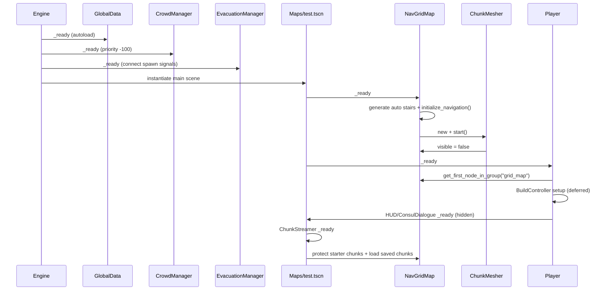
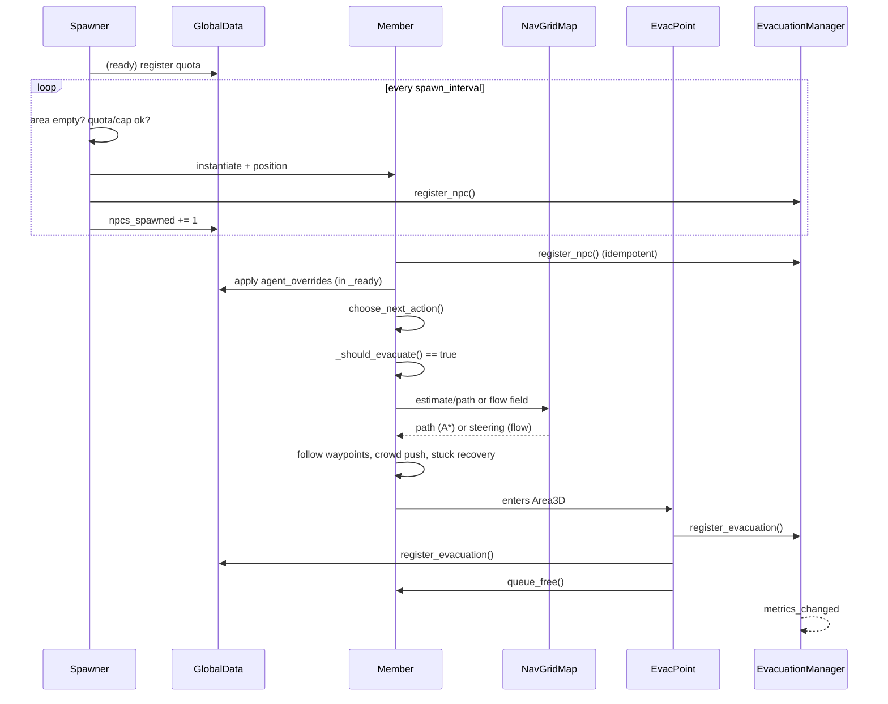
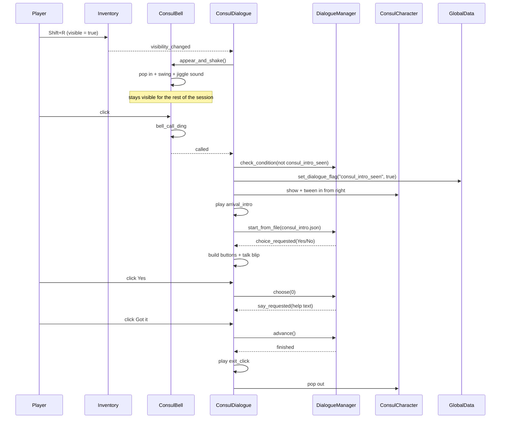

# Codebase Analysis — Evacuation Route Optimizer

> Snapshot: **2026-11-15** · Godot **4.7.2.stable.steam** · Renderer `mobile` · Git repository initialized (initial commit `c9a5e40`, dirty working tree) · No README, no tests.
>
> This revision supersedes the 2026-11-14 snapshot previously recorded in this file, the 2026-11-08/09 snapshot before it, and the 2026-11-06 audit kept at `docs/archive/CODEBASE_ANALYSIS_2026-11-06.md`. The 2026-11-15 work replaced the ad-hoc crowd push with a **Social Force Model** (Helbing & Molnár 1995; Helbing, Farkas & Vicsek 2000) evaluated as a single reciprocal pair sweep in `CrowdManager`, added deterministic per-agent RNG and a simulation clock, added lognormal pre-movement and logit exit choice over path distance/queue/visibility, made lane formation emergent, raised the High preset to **600 agents**, and switched agent locomotion to a **kinematic ground-probe** mode so 600 agents fit inside a 30 Hz tick. The full model, parameter provenance, numerical scheme, measured performance, and limitations are in **`docs/SIMULATION_MODEL.md`**.
>
> It also retains the 2026-11-10 → 2026-11-14 content state: MeshLibrary **280 items from 45 block textures**, `scenes/grid_map.tscn` no longer embeds a 5,015-cell platform, and `Maps/test.tscn` is a **bare 80-cell starting platform** — the nine spawners and the evac point are not instanced in the scene. The demo layout lives in the save slot `user://saves/testing_testing_things_just_got_interesting/`, while the active slot `verity` is a blank map. The live run loaded **8 chunk columns / 1,100 cells**.
>
> Claims below were checked against the current source and against live runs of the project on 2026-11-13, 2026-11-14, and 2026-11-15 (600-agent wander and 600/240-agent egress tests). Sections that changed substantially in this revision: **1** (crowd model, performance), **4.3** (SFM solver), **4.4** (SFM integration, kinematic movement, exit choice, pre-movement), **4.5** (determinism, sim clock, spawn order, exit radius), **7** (solver/movement costs), **9** (N1/N2/N3/N5/N6/N15), **12** (verification), and the appendices.

---

## Contents

1. [Executive summary](#1-executive-summary)
2. [What the project is trying to be](#2-what-the-project-is-trying-to-be)
3. [Runtime topology](#3-runtime-topology)
4. [Systems in depth](#4-systems-in-depth)
5. [Data and asset pipeline](#5-data-and-asset-pipeline)
6. [Key execution flows](#6-key-execution-flows)
7. [Complexity and performance profile](#7-complexity-and-performance-profile)
8. [Coupling and boundaries](#8-coupling-and-boundaries)
9. [Findings](#9-findings)
10. [Intent vs. implementation](#10-intent-vs-implementation)
11. [Recommendations](#11-recommendations)
12. [Verification log](#12-verification-log)
- [Appendix A — File inventory](#appendix-a--file-inventory)
- [Appendix B — Input map](#appendix-b--input-map)
- [Appendix C — Project settings](#appendix-c--project-settings)
- [Appendix D — Unused assets](#appendix-d--unused-assets)

---

## 1. Executive summary

**What exists.** A single-scene Godot 4 voxel sandbox with a character controller, block building, a crowd simulator, a simulation control panel, an Agents editor, an evacuation results panel, and a first-run Consul dialogue/onboarding overlay. The simulation loop is implemented end-to-end:

```
Simulation/Agents panel → spawn NPCs → choose an exit → path/flow to it → EvacPoint → metrics
```

The shipped scene now starts with a bare **80-cell platform** (10 × 8 at x = −5…4, z = −3…4). Flat-floor generation is **disabled for now**: `ChunkStreamer` only loads chunks that already exist in `user://world/chunks`, out to a 20-chunk script radius (the Low/Medium/High presets use 12/20/40). The current live store has **8 chunk columns / 1,100 cells**, which puts ground under part of the test scene; a fresh store leaves empty space. The nine spawners and the evac point are no longer instanced in `Maps/test.tscn`; the old demo layout now lives in the save slot `testing_testing_things_just_got_interesting` (10 placeables), while the active slot `verity` is a blank map with 8 chunks. The earlier 600-agent sprite run (evacuation disabled, older saved-chunk world) settled at **~131 FPS** at 30 Hz physics. On the 2026-11-07 store, nine spawners reached only ~415 agents before running out of valid slots; that is covered in §7 and §12.

**What is measured.** `EvacuationManager` records per-NPC spawn/arrival times, chosen exit, distance travelled, stuck time, failed paths, and peak local density. It derives average, median, p95, min/max evacuation time, per-exit arrivals, share, average time, and throughput per minute. The archived 2026-11-02 run (60 NPCs, 42 evacuated by ~26 s, average 22.5 s, p95 24.8 s) was measured on the old 4,674-cell map; the current saved-chunk world makes the same loop playable where those chunks exist, and the demo save restores the spawner/exit layout.

**What is still missing.** The “optimizer” half of the title: no baseline/replay, no before/after layout comparison, no obstacle-rich authored level, and no tests. Map save slots (2026-11-13) now persist the world and placeables, but they capture a layout rather than a simulation run. The Statistics subview renders congestion heat and ideal A* routes, but there is no per-cell measured bottleneck heatmap and no run comparison.

**Overall health.** The simulation core is intact, and as of 2026-11-15 it runs a defensible crowd model: a reciprocal Social Force Model in `CrowdManager`, kinematic ground-probe locomotion in `Member`, deterministic seeding, lognormal pre-movement, and logit exit choice over baked path distance, queue density, and visibility. A 600-agent, 4-exit run evacuated all 600 with 0 deaths and 0 failed paths in 80 s, peaking at 1.95 persons/m²; the solver costs 3.8–4.4 ms per 30 Hz tick, and the optimized build holds 60 FPS at peak packing. The scene still does not ship a running demo: the main scene is a bare platform with no spawners, exits, or placeables, so Start does nothing until the player places `sim_spawner`/`sim_evac_point` or loads the demo save. Actual **64-chunk full terrain generation** is not achievable with the current per-cell GridMap: it reached 9,150 chunks / 2.34 M cells / 2.3 GB and then crashed when 600 agents were added. Flat-floor generation is disabled, the load radius is 20 by default (40 on High), and a chunk cap prevents runaway memory. Remaining debts: resetting a run still leaves live NPCs that corrupt the next run’s metrics (**N4**), the shipped map has no authored scenario (**N11**), and results are not yet compared across layouts. The test scene's congestion override is now `2.0 / 0.5 / 0.35`, matching the tuned defaults (**N15 resolved**).

**Changes — 2026-11-15 (crowd model).**

- **Social Force Model replaces the ad-hoc crowd push.** `CrowdManager` (now 609 lines) runs one pair sweep per 30 Hz tick: Helbing & Molnár psychological repulsion with anisotropy, Helbing/Farkas/Vicsek body contact and tangential friction, and a normal dashpot. Every pair is evaluated once and both agents are updated in the same pass, so the old 20-neighbour cap and scan-order asymmetry are gone. See `docs/SIMULATION_MODEL.md` for equations and provenance.
- **Kinematic locomotion for scale.** `Member` defaults to `use_kinematic_movement = true`: a single downward ground probe replaces `move_and_slide()` against the voxel trimesh, with ledge refusal, a one-voxel step-up limit, and gravity integrated in the movement layer. This is the change that let 600 agents hold 47-91 FPS where the physics path managed roughly 10. `use_physics_contact = true` restores engine collision for comparison.
- **Wall repulsion from the voxel grid.** `NavGridMap.get_wall_acceleration()` samples eight directions out to 0.8 m with the 2000 N / 0.08 m constants, cached per 0.2 m position and body-radius bucket (65,536-entry cap, invalidated on nav change).
- **Determinism and a simulation clock.** `GlobalData` gains `sim_time`/`sim_now()`, `rng_seed`, `claim_agent_serial()`, and `reset_determinism()`. Agents seed a private RNG from `(rng_seed, agent_serial)`, deadlock right-of-way uses the serial instead of the instance ID, and every reported time uses the physics clock rather than wall time.
- **Pre-movement and exit choice are now behavioural models.** Agents wait a lognormal delay (mean 6 s, σ 0.7, max 45 s, toggleable) and choose exits with a logit utility over baked flow-field route length, queue density, line of sight, and a stable familiarity term, sampled with Gumbel noise. Duplicate `EvacPoint` group entries are deduplicated.
- **Lanes are emergent.** `lane_offset_strength` and `max_extra_lane_offset` now default to `0`; anisotropy and friction produce lanes, counter-flow separation, and exit arching without per-agent offsets.
- **Density and instrumentation are real.** `get_density_count()` / `get_density_per_m2()` no longer cap the query and only count agents on the same floor (vertical band 0.9 m); `CrowdManager.get_stats()` reports `agents`, `pairs`, `solve_usec`, and `cells`; the snapshot adds `pre_movement_wait`, `peak_contact_force`, and `contact_overlaps`; `EvacuationManager` aggregates `average_pre_movement` and `peak_contact_force`.
- **Spawner and exit fixes.** `NPCSpawner` places each body before `add_child`, so an exit near the world origin no longer fires a false `body_entered` for every new agent. The `sim_evac_point` trigger radius dropped from 3 m to 1 m so agents are removed near the marker rather than far from it.
- **Presets and test map.** The High preset and `AGENT_CAPS` now include 600. `Maps/test.tscn` congestion overrides were softened to `2.0 / 0.5 / 0.35`, matching the script defaults.
- **One-block steps are traversable again.** Navigation has always connected one-block step-up edges, but the kinematic probe allowed only 0.65 m and its ray started below a 1 m step, so agents could not follow those routes. The probe now climbs `kinematic_step_height = 1.05 m` (full blocks, slabs, panels, stairs) while still refusing two-block faces, and `kinematic_snap_down_height = 0.65 m` keeps 1 m drops as short falls. The SFM wall force also no longer repels single-block steps: it stopped agents ~0.4 m short of a step they were meant to climb. A three-step staircase test climbed 0.75 → 1.75 → 2.75 → 3.75 m, and a two-block wall still blocked.
- **False boids.** Added a hybrid ambient-bird system: an 80-particle `GPUParticles3D` flock follows a leader between `FalseBoidPerch` markers and promotes up to **20** lightweight perched `Sprite3D` birds. Perched birds are real nodes with a `PERCHED → ALERT → FLEEING` state machine, fly away when the player comes within `flee_radius`, and free themselves afterward. Full design and tuning are in `docs/FALSE_BOIDS.md`.
- **Pause Spawning and a real Reset.** The Simulation tab has a `Pause Spawning` toggle that keeps the run, counters, quotas, and live crowd intact while spawners stop emitting; Start clears the pause. Reset now calls `GlobalData.kill_all_npcs()`, which removes every NPC from the `npc` group immediately and frees the nodes at frame end, then clears counters, reservations, spawning state, and the evacuation records through `spawning_reset`. A live spawner test confirmed counts frozen at 22 while paused, rising to 29 after resume, and 0 immediately after Reset.
- **Contact-force distribution instead of a lone peak.** `CrowdManager` now records the global peak and its time, mean force, overall and non-zero-only percentiles, non-zero fraction, agent-seconds above 0.5/1/2/3 kN, and a 0.5 s force–time series. `EvacuationManager` exposes them as `contact_force_stats` and resets them per run. Multi-seed testing shows the reported 2.17 → 2.98 kN shift is not a regression: peaks span 1.49–3.82 kN, the same seed repeats at 3.26 and 3.82 kN, only ~0.007 % of agent-ticks have any contact, and >2 kN exposure is 0–0.2 agent-seconds.
- **Same-floor crowd semantics.** Pair interactions, local density, and neighbour queries now use a 0.9 m vertical band, so agents on stacked floors no longer push or count each other through slabs. Verified live: an agent 1 m directly above another no longer contributes density or social force.
- **Optimization pass.** Kinematic agents skip the redundant `_guard_ledge` segment probe, cache ground rays in 0.15 m buckets while grounded, re-sample wall force at 10 Hz, and refresh sprite facing/animation at 10 Hz. Congestion A* weights are applied in bounded 64-cell batches every 0.1 s instead of synchronously. The same 600-agent wander went from **57.2 ms/frame** (35.9 ms script) to **23.9 ms/frame** (13.3 ms script) in profiler runs; a 600-agent 4-exit egress improved from **34 FPS at peak packing to 60 FPS**.
- **Dead knobs and mislabeled metrics removed.** `separation_*`, `max_extra_separation_*`, `max_vertical_neighbor_distance`, `default_max_neighbors`, and `last_density_usec` are gone. `peak_contact_pressure` is renamed to `peak_contact_force` (newtons) throughout; it was never a pressure because the soft-contact model has no contact area.
- **Validation.** 600 agents grounded at `y = 0.75` (0 floating, 0 below-floor, 0 deaths); 600-agent 4-exit egress evacuated 600/600 in 75 s with 0 failed paths and a 29/27/26/18 % exit split; 240-agent 2-exit egress evacuated 240/240. Wall-force sampling was corrected to the collision-sphere centre during this validation pass (the foot origin sits inside the floor voxel).

**Changes — 2026-11-14.**

- **Autoblock textures moved to `textures/autoblocks/`.** The 45 generated block textures (and their `.import` files) no longer live under `textures/blocks/`. `BlockGenerator.TEXTURES_FOLDER`, the MeshLibrary fallback preview lookup, `models/Blocks/blocks.tscn`, and `resources/blocks/.tres` all point at the new folder. Hand-authored blocks (`Debug_Box`, `Stair_Echidna`) stay in `blocks.tscn`.
- **Block material registry.** `resources/block_materials.json` defines the ten inventory block materials (Backrooms, Concrete, Debug, Dirt, Echidna, Floortile, Grass, Planks, Water, Window) with `base_stability`, `base_durability`, `base_weight`, `buoyancy`, `base_path_cost`, and `flammability`. It also holds the variant modifiers used by block groups: slabs, stairs, and panels scale stability, durability, and weight below the normal block while buoyancy, path cost, and flammability stay at the material value. `scripts/block_materials.gd` resolves an item name to its material and returns the resolved six-value dictionary.
- **Property tab now reads the registry.** Block stat rows are filled from the material's values (for example Concrete slab: stability 0.8075 → **0.81**, durability 0.72, weight 0.5, path cost 1). Concurrently, `hud.gd` uses the JSON material labels for the Blocks section headers. Unknown items fall back to 0/0/0/0/1/0.
- **Unified block-group inventory.** The Blocks category now lists **52 block groups** (down from ~123 variant entries) under the material headers: Backrooms 4, Concrete 13, Debug 1, Dirt 5, Echidna 1, Floortile 6, Grass 5, Planks 1, Water 4, Window 12. Each group cell shows the currently selected variant (default: the normal block); a **group_plus** badge in the bottom-right swaps to **group_minus** while that group's chooser is open. The chooser is anchored at the badge's bottom-right (flipping left/up at the panel edge) and uses the new reusable **`PixelPanel`** procedural frame (`textures/menu/pixelpanel_*` 6×6 pieces; left art mirrored for the right side) with **hotbar slots** for the variants (hotbar.png background, hotbar_selection.png frame on the current variant, 9 px-inset preview). Clicking a variant changes the cell's displayed variant for the session; dragging a variant directly to the hotbar assigns that exact item. Groups with one variant have no badge. `_block_group_display` survives rebuilds; search/filter operate on groups.
- **Block / placeable palettes.** Palettes live in a **PALETTES group at the very top of the Blocks category** (there is no separate Palettes tab). There are **no default palettes**: a fresh install shows only the **new-palette** cell, and every palette is player-created. Existing palette cells use the normal gold **`palette_icon.png`** 3×3 texture with the **palette name centered over it** (12 px white text, 4 px black outline; hover no longer darkens icon-backed labels). The first cell is the blank new-palette cell, using the player-authored **`textures/inventory/palette_blank.png`** texture with its built-in plus. Clicking a palette cell opens its **PixelPanel**; the corner plus/minus badge is gone. The popup has an editable name field at the top, a **3×3 grid of 56×56 hotbar-style slots**, and **Del/X** buttons. **Del** asks for confirmation, removes the palette from `user://saves/palettes.json`, immediately refreshes the top group, and clears hotbar slots that referenced it. Palette cells are **draggable hotbar items** (`inventory_palette` payload): the hotbar stores the palette id + icon. Selecting a palette hotbar slot while playing makes it a **build item**: the hand/build label show a random block and the label shows the palette name; every stroke rerolls. **Hold-drag strokes randomize one palette entry per cell**, mixing blocks and placeables (blocks resolve their slab/stair/panel variant per cell; placeables spawn on the stroke’s anchor surface). While the inventory is open the same selection opens the palette popup for editing. Slots accept blocks and placeables dragged from the inventory, the hotbar, or another palette slot; palette-to-palette moves swap, a hotbar drop returns the replaced palette item to the hotbar, and right-click clears a slot. Palettes persist in the **same player save root as the save slots** (`user://saves/palettes.json`) via `scripts/palette_store.gd`; the old `user://palettes.json` is migrated once. Old untouched `Palette 1/2/3` defaults are dropped once on load, while renamed or populated ones survive. Block slots store both the MeshLibrary id and the raw item name (names repair ids if the library is rebuilt), placeables store their scene path. The blank new-palette cell creates `Palette N`. All popup text is **16 px**. Both this popup and the block-group chooser are **draggable by their title/grip or any panel edge/corner** (`::` for palettes); until the player moves one it auto-anchors to its badge/slot, and afterwards its inventory-local position is remembered so it still travels with the inventory. Drag previews use **z_index 4096**, so the held item renders above the palette popup instead of behind it.

- **Popup typography and dragging.** The block-group chooser and palette popup use **16 px** text throughout (titles, variant captions, palette name field, close, slot fallback). The chooser's title, the palette's `::` grip, **and the PixelPanel frame/edges/corners themselves** are drag handles; the control changes the cursor to a drag cursor and the panel follows the mouse. A moved popup remembers its position relative to the inventory (so it still moves with the inventory); until moved, it re-anchors to the clicked badge/hotbar slot and stays clamped inside the inventory background.
- **Removal drag over empty space.** The destroying area now keeps every cell in the stretched rectangle, including empty ones, so the red preview and the deletion footprint can extend past the last block/placeable. The finish pass removes whatever blocks and placeables are actually there. This restores holding and dragging the delete toward a target with no block.
- **Drag preview layer.** Inventory, hotbar, block-variant and palette drag previews set `z_index = 4096`; because the preview is parented under the HUD, it draws above the palette/block popups instead of behind them.
- **Placeable stretch / drag build / drag remove.** Placeables now use the same hold-drag area system as blocks: press to anchor, hold/drag to stretch a rectangular footprint (ghost cubes preview it), release to place one copy per selected cell on the initial surface/face. The whole stroke reuses one placeable scene and the anchor hit's height/normal, with per-instance foliage yaw. Holding the break button now starts a removal area over blocks *or* placeables and removes grid blocks in the cells plus every placeable whose centre lies in the footprint (wall-mounted half-cell offsets included).
- **Transient build label.** The label under the hotbar no longer prints `Selected Block: …`; it shows just the item name, holds for **1.6 s**, then fades over **0.55 s**. Axis changes use the same general-purpose label (`Build Axis: Floor` / `Build Axis: Wall`). Only a changed selection or a fresh notice re-shows it, so it does not stay on screen.
- **Save details.** The Saves panel no longer appends `Isometric snapshot` / `No snapshot`; the thumbnail itself is the indicator.

- **Drag placements keep their first orientation.** `_begin_area()` resolves the selected item and its slab/stair/panel variant plus orientation once, from the initial anchor cell and face zone, and stores them in `_area_source_item` / `_area_resolved_item` / `_area_resolved_orientation`. `_show_area_preview()` and `_finish_area()` use those locked values, so holding and dragging a staircase, side slab, or panel across the plane no longer rotates or flips the whole selection. Q (`ui_rotate`) applies to the next press; the current drag keeps its initial orientation.

- **Non-full block AO.** Slabs, stairs, and panels now receive per-vertex voxel AO in `ChunkMesher` instead of flat white. Each vertex samples the face's two tangent-side neighbours and the diagonal; item materials are duplicated with `vertex_color_use_as_albedo`. A slab corner adjacent to solid cells measured **0.83** vs **1.0** in the open.
- **Voxel item generator + search icons.** `scripts/voxel_item_generator.gd` renders 64×64 MC-style icons for placeable inventory/search and, for foliage, extrudes the sprite texture into a real 3D item mesh (front/back quads plus per-edge side quads with darker vertex colours). Icons/meshes are cached under `resources/voxel_items/` and indexed by `resources/voxel_items.json`; `voxel_item_generator_tool.gd` is the editor entry point and the static API is reusable by other generators. Foliage uses the extruded mesh in the hand instead of its crossed sprite cards; Sim/Device keep their actual 3D hand model and use the generated icon as their item texture.

- **Settings pages are separate scenes.** Each settings menu is now its own `.tscn` under `scenes/menu/settings/`: `settings_menu.tscn` (hub), `graphics_menu.tscn`, `gameplay_menu.tscn`, `audio_menu.tscn`, `water_menu.tscn`, and `controls_menu.tscn` (the 3D keybind page). `pause_menu.tscn` instances them under `Panel`, so each page can be opened and edited independently; the runtime reparenting/building is no longer used.
- **View roll + settings organization.** `Player` exposes `view_roll` (degrees at full strafe, default 1.0) and applies it to `CameraSmooth.rotation.z`. `PerformanceSettings` stores a Low/Medium/High/Off value (default Low = 0.75°) under `[camera] view_roll` and the Gameplay page exposes **View Roll**. Settings is a hub with dedicated **Graphics / Gameplay / Audio / Controls** pages plus **Water Tuning**. **Water FX** now lives inside the Water Tuning page. **Controls opens the 3D Keybinds page directly** (the header still reads `CONTROLS`): 8 actions per page (3 pages), click-to-rebind, a top-center **Reset**, Prev/Next, and a centered Back consistent with the other pages; bindings persist in `user://input_map.cfg`. Wide Back buttons keep their wide bar but use `keep_label_aspect`, which inverse-scales the Label3D so the caption is no longer horizontally stretched.
- **Middle-click is a real input action.** `pick_block` (mouse button 3) is registered in the project input map and `BuildController` uses `event.is_action_pressed("pick_block")` instead of matching the raw button.
- **Quit teardown.** The quit path now drops the pause overlay, keybind layer, and open dialogs before `get_tree().quit()`; the measured tree exit itself is ~9 ms, so remaining delay (if any) is engine/driver shutdown rather than scene teardown.

- **Dialogue font and title direction.** The Consul popup's main dialogue text (and its choice buttons) now use `font/7-12-serif.otf` at 16 px. The pause menu's `MENU` title letters fly in from the **bottom-right** (rest + `(2.2, -1.5, 0)`, −24°).

- **Consul call bell + sounds.** Opening the inventory no longer calls Consul in. It reveals a pixel bell in the top-right corner (`ConsulBell` under `hud.tscn`) that swings and jiggles, then never hides for the rest of the session. Pressing the bell plays `bell_call_ding` and summons Consul; the first summon runs the intro, later summons play a short “You rang?” line. Consul now uses `sounds/consul/`: `arrival_intro` on appearance, `consul_talk_blip` as the per-character typewriter voice, and `exit_click` on exit. Dialogue is now **Undertale-style**: characters type out at 34 chars/s with short pitched blips, punctuation pauses, and click/confirm-to-finish.

**Changes — 2026-11-13.**

- **Main scene reduced to a bare starter platform.** `Maps/test.tscn` keeps the Day/Night `CycleController`, the `GridMap` (80 authored cells), the `Player` at `(0, 6, 0)`, `ChunkStreamer`, and `MinecraftClouds`; the `EvacPoint` and all nine `Spawner` nodes were removed. The demo layout is preserved in the `testing_testing_things_just_got_interesting` save manifest, and the active `verity` save is a blank 8-chunk map. The GridMap instance overrode congestion to `8.0 / 0.7 / 0.15` at this date; it was softened to `2.0 / 0.5 / 0.35` on 2026-11-15.
- **`scenes/grid_map.tscn` no longer embeds a platform.** The 5,015-cell (85 × 59) `data.cells` array is gone; the scene is now just the `GridMap` node (`Gridmap`), the MeshLibrary, and its script with `baked_ao_enabled = true`, `auto_stair_replace_existing = false`, and `enable_flow_fields = false`. All ground now comes from the scene override or saved chunks.
- **Connected-texture windows (CTM).** `window_classroom_base.png` generates one visible `Auto_Connect_window_classroom_base` item (id 279) backed by a 256×256, 16×16-tile eight-neighbour atlas. `ChunkMesher` emits one unmerged quad per visible face and picks the tile from the face's in-plane neighbours, so 1×1, 2×2, 3×3 and larger panes connect without interior frames. `scripts/connected_texture_builder.gd` slices the source (including a normalised full-pane source) into corner/edge/overflow/null pieces. CTM quads receive the same baked corner AO. See §4.1 and §5.
- **MeshLibrary rebuilt for 45 textures / 280 items.** The palette grew from 40 to 45 block textures, adding the four `backrooms_*` materials and `floortile_marble_seamless`. `models/Blocks/blocks.tscn` now has 275 block roots / 917 nodes, and `resources/blocks/.tres` has 280 items / 6,832,302 bytes: 45 textures × (full + top/bottom/side slab + normal/upside-down stair) = 270, plus 3 panels, 4 water items, 1 CTM item, `Debug_Box`, and `Stair_Echidna`.
- **Water reworked for partial blocks and chunked rendering.** Each cell now stores a depth against a block-specific `(base, capacity)`, so bottom slabs hold 8 above the slab, top slabs 8 below it, bottom panels 13 above 3/16 m, top panels 13 below, and full blocks reject water. Water is meshed as one exposed-face `ArrayMesh` per 16×16 chunk, with chunk-local shoreline foam/corner nodes created lazily. The pause menu gained a live **Water Tuning** tab. See §4.12.
- **Performance presets and pause menu.** `PerformanceSettings` (autoload) applies and persists Low/Medium/High via `user://settings.cfg`, including render scale, shadows, AO, streamer radii/budgets, agent cap, FPS cap, clouds, and water-wave toggles. The pause menu is a fully authored 3D scene under the player camera with Settings, Water, Statistics and Saves subviews, animated title/entry intros, hover parallax, and a per-sound-pitch UI audio layer. **Draw Distance** cycles up to 64 chunks and **Agent Limit** up to 1,000.
- **Map save slots.** `SaveManager` (autoload) stores map slots under `user://saves/<slug>/` with a manifest (player transform, cycle time, placeables + exported properties, world descriptor), a chunk-store copy, and an isometric `thumb.png`. `new_blank_map()` builds a 7×7 platform at the origin. Quitting no longer auto-saves: `ChunkStreamer._exit_tree()` leaves the live store untouched, and the Quit button/window close both show a confirmation. Every restored placeable is re-added to the `placeables` group after instantiation, so the next save still collects it even if its scene forgot to register the group. Verified with a placed **device_bulb**: the manifest stored its scene path and `(80, 12, 80)` transform, and loading restored it at the same position in the group; area/palette-spawned placeables are collected the same way.
- **Statistics maps.** The pause menu’s Statistics subview renders top-down **Topography / Congestion Heat / Evacuation Route** images from `MapRenderer` without a SubViewport (so it works while paused), plus a formatted metrics block and ideal A* spawner→nearest-exit routes.
- **Physics interpolation and motion floors.** `physics/common/physics_interpolation=true` smooths the 30 Hz transforms to the render rate while process-animated nodes (`hands`, clouds, sun, ghost, face indicator) opt out. Slide speed floors at 12 m/s and wall-run speed floors at sprint speed, preserving faster momentum.
- **Corrected catalogue.** Only two device scenes remain (`device_bulb`, `device_fluorescent_light`); the `device_ceiling_light` scene is gone (its texture remains). Placeables total 12: Sim 2, Device 2, Foliage 8.

**Earlier changes — 2026-11-07.** _(Superseded where the numbers differ: the scene is now 80 cells with no spawners or exit, and the MeshLibrary is 280 items.)_

- **Scene grew to 85 cells.** *(Superseded 2026-11-13: the five extra cells and the 5,015-cell platform were removed; see above.)* `Maps/test.tscn` appended five `Auto_concrete_brick_yellow` cells at x = −24, y = 1, z = 7…11 to the original 80-cell floor. `scenes/grid_map.tscn` itself was a 5,015-cell (85 × 59) platform at that revision.
- **Congestion is tuned much hotter in the test scene.** The instance overrides `congestion_penalty_max = 8.0` (script default 2.0), `congestion_heat_per_report = 0.7` (default 0.5), and `congestion_decay_per_sec = 0.15` (default 0.35). A fully hot cell is therefore 9× as expensive in the shipped scene, and heat lingers more than twice as long. This was not the configuration used for the earlier “2.1 % average distance” tuning result.
- **Separation ray removed; agents can no longer climb each other.** The experimental `SeparationRayShape3D` (the `stepper` node, 0.5 m, at `(0, 0.5, −1)`) was **removed** from `Member.tscn`. It was uncommitted, unreferenced by any script, and logged `WARNING: Collisions between rays are not supported` whenever two NPC rays met; with `slide_on_slope = true` (the state it had regressed to) it let agents ride up and over each other's colliders. Climbing is now blocked from every angle: the apex-hop ray rejects characters, `_is_obstacle_jumpable` also rejects hops whose **landing zone** is occupied by a character (sphere query at the computed landing spot), `_character_floor_body()` treats another character as non-ground (no walking, hopping or stuck-hops from on top of someone), and `_slide_off_character_floor()` ejects any agent that ends up balanced on a body.
- **NPC jumping is now optional.** `Member.allow_jumping` defaults to true; setting it false disables both the obstacle hop and the random stuck-hop. It is exposed automatically in the Agents panel.
- **Player and Populate fixes.** The player capsule is 1.8 m (fits a two-block doorway); noclip uses jump/crouch for vertical movement at the scroll-adjusted fly speed; noclip wheel-speed changes are now limited to active gameplay noclip and are marked handled; `RandomPopulator` rejects/reserves spawn slots with a 1.5 m clearance so agents are not created in the same cell and launched upward.
- **Minecraft-style cloud layers added.** `MinecraftClouds` generates two noise-driven, face-shaded merged meshes at **y = 128** and **y = 256**, with opposite drift and day/night tinting. The camera far plane is raised to 1024 m so both layers are visible. See §4.9.
- **Sprite mode is the default.** `Member.gd` defaults `realistic_sprites_mode` to `true` and `realistic_sprite` to `&"random"`, so new NPCs spawn as one of the discovered sprite variants unless the Agents panel changes it.
- **Saved-chunk store changed.** *(Superseded 2026-11-13: that store has been replaced; the live store is 8 chunk columns / 1,100 cells.)* At that revision the live store had 15 chunks / 3,500 cells at y = 0…5. The earlier 197-chunk and 1,682-cell figures describe older stores, not this one.

**Recent changes — 2026-11-09/10.**

- **Hotbar movement is hold-and-drag.** Hotbar slots are Godot drag sources: `SlotControl._get_drag_data()` removes the item from the source slot and returns a `{type: "hotbar_item", source_container, source_index, item}` payload with a live icon preview. A real drag preview follows the cursor; releasing does nothing more, so an outside release ends the input and the item stays deleted. Dropping on another slot swaps the moved item with that slot's previous item (the replaced item goes back into the source slot). Dropping back on the source slot restores it, so a cancelled same-slot drag is not destructive. Inventory blocks/placeables still drag onto slots with `inventory_block` / `inventory_placeable` payloads. Number keys and clicks still select slots without picking items up.
- **Empty Hand is gone.** The inventory no longer creates a Hand group or an Empty Hand tile in Blocks, Placeables, or search results, and the `-1` selection path was removed. The hotbar starts with all nine slots empty, so the player begins empty-handed and fills slots by clicking or dragging.
- **Property tab is a persistent item inspector.** `Inventory/Property_tab` (right-side 246 × 296 panel) is authored as a full node tree in `scenes/inventory/property_tab.tscn` — layout, colors, fonts, margins, and the six stat rows are all editable in the editor. `hud.gd` resolves the nodes and fills only the dynamic parts (title, preview, stat values, export rows). Top-to-bottom: a 132 px preview (spinning MeshLibrary mesh in a `SubViewport` for blocks, scene preview texture for placeables); the item title; six placeholder block stats with no header (Base Stability, Base Durability, Base Weight, Bouyancy, Base Path Cost = 1, Flammability); a short description; and the editable export rows when the item has any. Export rows use the same `AdjustableVariableRow` scene as before.
- **Placeables use the mesh preview too.** The Property tab no longer falls back to the flat scene icon for placeables: `hud.gd` grafts the same `MeshInstance3D` / `Sprite3D` visuals used by the held model into the spinning pivot, centres them on their combined AABB, scales the largest dimension to 1.45, and tips flat ground pieces (such as the Evac Point) up so they stay visible while spinning. The old scene-preview texture remains the fallback when a placeable has no 3D visuals. The preview holder is freed when a block or another item replaces it.
- **Foliage sway.** `scripts/foliage_sway.gd` is attached to every generated foliage scene root (and the generator now adds it to new ones). On `_ready` it swaps each non-billboard `Sprite3D` card to `shaders/foliage_sway.gdshader`, a spatial shader that bends the top of the card in world space with a two-sine wind, while keeping the base planted and preserving alpha-scissor cutouts, nearest filtering, double-sided rendering, and lighting. **All cards and all plants that share a texture share one ShaderMaterial**, and the shader derives the phase from the plant's world origin, so a map full of foliage does not create per-plant materials. Crossed planes on one plant bend together; different plants still move out of phase. Billboard cards are left alone so their orientation is not broken. Grass textures opt into `flip_backface_normals` and `stable_grass_shading`: the stabilised path forces the shading normal to world-up and uses that same up direction for the view/SSS term, so grass brightness depends on the sun rather than which crossed card faces the camera. Bushes and trees keep the default card normals. The shader also has a custom `light()` pass with a **green-only subsurface term**: green-dominant albedo pixels get a translucency/wrap response (`sss_strength`, `sss_sigma`, `sss_power`, `sss_scale`, green thresholds), while non-green pixels keep a normal Lambert response. Every card is also distance-culled at **150 m** with a 20 m fade (`visibility_range_end`), which is the main saving for hundreds of alpha cards at long draw distances.
- **Placeable grid alignment.** `_place_placeable()` now snaps a placeable's X/Z to the hit cell's centre, keeps the surface Y, pushes wall-mounted pieces half a cell along the wall normal, and applies `BuildController.placeable_xz_offset` plus an optional per-scene `grid_xz_offset: Vector2` export.
- **Placeable ghosts and foliage support.** Selecting a placeable shows a scripts-free translucent ghost of its `MeshInstance3D`/`Sprite3D` visuals at the snapped target; the ghost turns red when the placement is invalid. Foliage scenes (group `foliage`, or a scene exporting `requires_voxel_below`) can only be placed on a voxel **top face** with a solid GridMap cell directly underneath, so trees/grass/bushes cannot float on other placeables, walls, ceilings, or non-voxel geometry. Foliage also gets a random Y rotation when placed; the ghost previews the rotation that the click will use, then re-randomizes for the next placement.
- **Baked voxel AO.** `ChunkMesher` now bakes classic voxel-corner ambient occlusion into chunk vertex colours. It samples the two edge neighbours and the diagonal outside each face corner, uses four brightness levels (0.50/0.66/0.83/1.0), duplicates cube materials with `vertex_color_use_as_albedo`, and leaves slab/stair item meshes white. While AO is on, greedy face merging is disabled so interior corners are correct; `/ao on|off` toggles it live and rebuilds the chunk meshes. This is per-block-corner voxel AO, not a 16×16 texture-pixel AO atlas; it has no runtime lighting cost.
- **Placeable classes and device lights.** Placeables now carry inventory classes from their filename prefix: `sim_*` → Sim, `device_*` → Device, `foliage_*`/`foilage_*` → Foliage. The HUD scans `scenes/placeables/sim/`, `device/`, and `foilage/` at boot, groups/filters by class, and strips the prefix for the display label. `sim_spawner`/`sim_evac_point` replace the old `spawner`/`evac_point` names. Device lights: `device_bulb` and `device_fluorescent_light` (the `device_ceiling_light` scene was later removed; only its texture remains), each with an OmniLight3D (shadows enabled) and a `LogicLampComponent` (on by default, logic-wireable).
- **Placeable rotation and eyedropper.** Q (`ui_rotate`) now rotates placeables in 90° steps; the ghost previews the rotation and the snap uses the same yaw. Middle-click picks the aimed block (canonicalised to the visible slab/panel/stair entry), placeable scene, or water item into the selected hotbar slot.
- **Water system.** `WaterSystem` uses one float depth per cell, measured from a per-cell floor; a full block is `MAX_HEIGHT = 16` units, but waterlogged partial blocks hold less. Air/water cells have base 0 / capacity 16; bottom slabs leave the top half (`base 8`), top slabs leave the bottom half, bottom panels leave 13/16, top panels cap the cell, and stairs/side variants use the slab rule. Water therefore no longer fills the whole cell and clips through those blocks. The four runtime items are volume shortcuts (Surface/Full 16, Slab 8, Panel 1). Water falls into waterloggable cells below, falling columns are pulled down in the same tick, and losing a cell wakes the layer above so a stranded 1-high film can drain. It spreads a one-unit film into empty neighbours and equalizes wet cells by water surface (`base + depth`) so a slab cell and a normal cell settle level. A periodic hydrostatic pass (0.5 s) only connects cells in the same Y layer, grows the top layer into empty neighbours, and solves a common surface by bisection while respecting each cell's capacity, so large placements do not keep a 16→1 gradient and the pass cannot level through walls via a higher connection. Tanks equalize (one full block in a 2-cell tank becomes 8/8; 24 units in a 3-cell tank with a bottom slab become 2.67/10.67/10.67 at a common surface) and overflow stacks upward; placing a slab into a full water cell pushes the displaced volume up. Surface and full are the same capacity volume; the exposed top renders 0.9 and picks as Surface, covered/stacked renders at the top and picks as Full, and a top-mounted partial suppresses the water top face to avoid z-fighting. Water below the chunk's lowest block minus 5 (the same kill margin as `Member`) is destroyed. The renderer builds one custom mesh per 16×16 chunk from exposed faces only, starts the water at the partial block's top (a bottom slab's water is visible from 0.5 to 1.0 instead of clipping through it), hides internal water faces, and uses a simple lit depth-fade + foam shader (no refraction or waves); its shallow foam uses a per-1/16 m-texel hash, so water noise is on the voxel-pixel grid. Partial water always renders as a horizontal layer; there is no wall-panel rotation. A separate unshaded mesh draws a depth-scaled 1–5-texel scrolling sea-foam border sampled from `textures/particles/sea_foam.png`, with corner bands trimmed so adjacent banks meet without overlapping. A matching corner patch from `sea_foam_corner.png` sits 0.6 mm above each L-corner to bridge the texture ends seamlessly without z-fighting. Surface waves are a real 2D wave-equation simulation: samples propagate, reflect off water borders, and interfere; moving player/NPC actors inject brushes sized from their collision shapes (or `wake_brush_radius` metadata), and the wake is a filled, dithered palette field rendered as 1×1 texels, using exact palette entries with no bilinear colour blending. The `wake_style` export switches between the soft gray-blue palette and a more saturated, shorter-lived Vivid palette. Splashes use a 32-sprite `splash_small` pool with a runtime 90°-rotated frame atlas, inject a wave brush, and add a square white-texel ripple; particle count/size, wake brush, and ripple radius scale strongly with hitbox size, peak fall height, and vertical impact speed. Exposed 1-unit water sitting on a full block also emits small water particles. The bright wall-edge foam keeps a one-texel outer strip and adds a denser four-texel inner band that scrolls inland using white or light-blue texels. Waterloggability is cached and no-op height writes are skipped, so still water costs nothing per tick.
- **Day/night look controls.** `CycleController` exposes a **Look / Color Grade** group applied after the day/night pass: brightness, contrast, saturation, exposure, sun energy/color, ambient energy, sky saturation/tint, fog density, and optional tonemap override. Defaults are neutral; edit them on the `CycleController` node in `Maps/test.tscn` to reduce the washed-out daylight look.
- **Build swing.** The held model has separate place and break animations: placing extends the model forward/up and settles back, while breaking keeps the old dip-and-pull-back. `BuildController._begin_area()` chooses the animation from the destroying flag.
- **Property tab value padding.** The scroll content is now wrapped in `Content/ContentScroll/ListPadding`, a `MarginContainer` with a 16 px right margin, so block values and export `LineEdit`s no longer sit directly against the vertical scrollbar.
- **Title grows upward.** The title lives in a fixed-height `TitleSlot`; the `Title` label is bottom-anchored with `grow_vertical = BEGIN`. A wrapped title expands upward over the bottom of the preview instead of increasing the list height, so the stat rows, description, and exports stay at fixed positions. A black outline keeps it readable over the preview.
- **Panel block shape.** The block generator can emit 3/16 m (3 texture-pixel) panel plates: `Auto_Panel_Top_<texture>`, `Auto_Panel_Bottom_<texture>`, and `Auto_Panel_Side_<texture>`. Panels are generated only for the `PANEL_TEXTURES` whitelist, not every material; the current whitelist is `concrete_flat_offwhite`. The inventory collapses the three variants into one **Panel** entry per material, and the face/zone resolver maps floor-middle → bottom panel, ceiling-middle → top panel, wall-middle → side panel hugging the wall, wall top/bottom → top/bottom panel, and edge quads → oriented side panels. The runtime auto-stair pass now skips names containing `Panel`, so panels do not spawn stair variants.
- **Block components.** A component layer lives in `scripts/components/`: `BlockComponent` (base), `InteractableComponent` (doors/levers, one-shot or toggle), `ContainerComponent` (the hotbar's duck-typed container API plus serialization), `GuiComponent` (`gui_requested` signal + panel scene), and `ComponentLookup` (find by type / find the usable component). `BuildController` handles the existing `interact` action (E) by raycasting the aimed placeable, finding its usable component, and calling it. Components are ordinary child nodes, so they can be added and configured per scene; future systems are new components instead of more branches in the placeable scripts. The old `scripts/interactables/InteractableComponent.gd` was moved into this folder and now extends `BlockComponent`.
- **Logic / redstone components.** `scripts/components/logic/` adds an event-driven network: `LogicComponent` (outputs only propagate on change), `LogicGateComponent` (AND/OR/NOT/NAND/NOR/XOR/XNOR), `LogicTimerComponent` (loop/one-shot clock), `LogicConnectionComponent` (NodePath wiring), `LogicSourceComponent` (auto-connects to a sibling `InteractableComponent`), `PoweredComponent`, and example devices `LogicLampComponent`, `LogicDoorComponent`, and `LogicAudioComponent`. `LogicNetwork` is an autoload that ticks only registered timers and drains a bounded change queue, so idle lamps/doors/gates cost nothing and hundreds of devices do not each run `_process`.
- **Action / weapon components.** `scripts/components/actions/` adds `UseComponent` (held-tool base), `RangedWeaponComponent` (flare guns), `ThrowableComponent` (bombs), `ProjectileComponent`, `ExplosiveComponent` (TNT), `FireComponent`, `ExtinguisherComponent`, and an `Explosion` helper with capped terrain removal. A placeable scene that owns a `UseComponent` becomes a held tool: `BuildController` extracts the component when the scene is selected, uses `primary_use`/`secondary_use` instead of placing it, and shows the scene in the hand. This gives flare guns, extinguishers, and throwables a working input path without a separate item system.
- **Hover/click lifecycle.** `_property_pinned_item` stores the clicked/selected inventory item or hotbar slot; `_property_hover_item` stores a temporary hover. Hover takes precedence over the pin; unhovering restores the pinned item, and the tab hides only when neither exists. Clicking a block, placeable, or hotbar slot pins it; hovering any inventory cell or hotbar slot previews it. The tab is independent of the inventory category, so switching between Blocks, Placeables, Simulation, and Agents no longer hides or clears a pinned sheet. Rebuilding the inventory clears stale hover state.
- **Descriptions.** Autoblocks get a category sentence keyed by material (`concrete`, `dirt`, `grass`, `plank`/`wood`, `window`, `floortile`/`tile`) and fall back to "An auto-generated block." Hand-authored blocks and property-less placeables show no description. Placeables look for a `description`/`item_description` string export.
- **Responsiveness.** Scene previews and editable-property lists are cached (`_scene_preview_cache`, `_placeable_property_cache`) so hovering does not instantiate a placeable scene each time. The content VBox expands to the scroll width, so the preview and stats use the full panel. Block meshes are recentred on their AABB inside the spinning pivot, and a fill light keeps the rotating faces readable.
- **Hotbar content signal.** `Hotbar.slot_contents_changed(index)` fires after any slot mutation. When the changed slot is selected, the HUD re-runs the selection path so the held item, hand model, property tab, and BuildController's cached placeable stay in sync after a drag pickup, swap, or outside-drop deletion.
- **Container protocol for the future.** `Hotbar` still implements the duck-typed `container_slot_count`, `container_get_slot`, `container_set_slot` (returns the replaced item), and `container_take_slot`, and slot controls still carry `item_container` + `container_index` metadata. A future chest/crate only needs the same four methods to reuse `SlotControl` drag/drop.

**Recent changes — 2026-11-08.**

- **Placeables work with the hotbar.** Inventory placeable cells are now hotbar items like blocks: clicking one assigns it to the selected slot, dragging one onto a slot stores it there, and switching slots switches between blocks and placeables (the property editor follows the selected slot). `Hotbar` stores either a block id or a `PackedScene`, and `inventory_item.gd` emits a `placeable_path` drag payload. This also fixes placement being gated on a non-empty block slot.
- **Hotbar selection frame fixed.** `hotbar_selection.png` is a full 22×22 overlay; the old `Rect2(0, 1, 22, 21)` crop removed its top edge. The full texture is used now.
- **Jump clears one block.** The jump apex is derived from gravity (`JUMP_HEIGHT = 1.35 m`, `jump_velocity ≈ 5.69`), so the player climbs a one-block step with margin but still cannot reach two.
- **Crouch fits under one block.** The crouched capsule is 0.9 m (was 1.0), so it fits a one-block gap; standing up is blocked by a headroom query until the player is clear.
- **First-person hand displays the held model.** `scenes/hand_item.gd` on the `hands` node shows the **actual 3D model** of the selected item at the `item` marker in the classic isometric view: blocks use their MeshLibrary mesh (with the library's mesh transform) and placeables are grafted from the scene's own MeshInstance3D / Sprite3D visuals (the scene is never added to the tree, so its scripts never run). Models are recentred, scaled to a readable size and tilted; flat models such as the Evac Point's ground disc are tipped toward the camera so they read. Using an item plays a short dip/return swing.
- **Viewmodel motion, progressive drag vibration and item feedback.** The held model sways opposite to local movement, lags behind camera yaw/pitch, rolls with strafing and turning, bobs while walking, and has a gentle idle hover (2.5 mm) plus a small idle roll. Switching items plays an equip pop (scale 0.75→1 with a dip). A held place/break drag vibrates the model in place, scaling from barely-a-tremble for one block to a strong shake-and-rotate as the selected area grows (a per-block multiplier drives amplitude and roll). When blocks are actually placed or removed, a short scale punch plays and the pitch-shifted impact SFX fires (higher for placing, lower for breaking); placeables get the same punch/sound. The swing itself is snappier, with a deeper dip and a pitch/roll kick.
- **Debugger cleanup.** The MCP bridge autoload was removed from `project.godot` (it caused `ERROR: Index p_screen = 0 is out of bounds` spam in the debugger when the game ran normally). The player now stops and releases its audio streams on exit (fixing the leaked MP3 playback), `RealisticSpriteLibrary` clears its static scene cache on exit, `inventory_slot.png` was re-saved as RGBA to stop RGB8 conversion warnings, and the HUD releases its sprite/texture references on exit. The editor's `GDScript::reload` warnings were cleaned up too: a local `scale` variable, `position` local/parameter/iterator variables that shadowed `Node3D` properties, an exported `seed`, and three ternaries with incompatible branch types were renamed/rewritten. The only remaining message is Godot's own `2 RIDs of type "Texture"` shutdown warning, which also appears when running an empty scene — it is an engine/Vulkan baseline, not a project bug.
- **Stairs, body rotation and facing tools.** Stairs were turned 90° to the player's left because `stair_front_axis` assumed +X while the generated stair's low/front step points +Z; it is now `Vector3.BACK` and stairs face the player. The player's `CharacterBody3D` yaw now follows the camera (mouse X rotates the body, not the head), so the character's facing matches the view. `ui_rotate` (Q) quarter-turns the stair placement, and the aimed block face gets a five-zone overlay (inset centre square + four edge trapezoids) with the crosshair's zone highlighted. The overlay's axes are fixed per face (not camera-relative), so it stays static on the voxel while the zone mapping still reads correctly from the face's outside. **The zone quads are now indexed by the same `FACE_ZONE_*` ids the hit test returns**; the previous quad order was centre/bottom/right/top/left while the classifier returned centre/right/left/top/bottom, which highlighted a different edge than the one under the crosshair. All six faces × five zones were checked live (30/30).
- **Upside-down stairs, vertical slabs and unified slab/stair inventory.** The block generator now also emits `Auto_Slab_Side_<texture>` (a vertical half-slab occupying the +X half, rotated by GridMap orientation) and `Auto_Stairs_UpsideDown_<texture>` (same two-step mesh with the half-step on the top). The MeshLibrary grew from 162 to **245 items**, preserving every old ID. The inventory lists one **Slab** entry per material: bottom and side variants stay in the library but are hidden, and the old top/bottom badge is hidden. Slab placement resolves the variant and orientation from the clicked face zone: floor middle → bottom slab; wall middle → side slab hugging that wall; wall top/bottom → top/bottom slab; left/right wall quads → side slabs oriented to that edge; floor edge quads → side slabs oriented to that edge. Stairs are unified the same way: one **Stairs** entry per material, with the upside-down variant hidden. On a wall, the top quad resolves to the upside-down stair; every other wall quad and all floor/ceiling quads use the normal stair. The slab mapping was verified live for all six faces × five zones (30/30), and actual placements confirmed floor-middle → bottom slab, wall-middle → side slab (orientation 16 for a +Z wall), wall-top → top slab, and wall-left/right → side slabs (orientations 10/0). Stair placement was verified on a +Z wall and floor: wall-top → upside-down, wall-bottom/center/left/right → normal, all five floor quads → normal; a legacy upside-down hotbar item also resolves to normal on a wall-bottom hit.
- **Placeable properties moved into the new Property tab.** The right-side `Inventory/Property_tab` now hosts the adjustable rows; the old `Inventory/VarScroll` container was removed. (Superseded 2026-11-09: the tab is now a general item inspector with a preview, title, placeholder block stats, description, and exports, shown for blocks as well as placeables.)
- **Navigation favors stairs, then slabs.** `NavGridMap` now classifies block items by surface. Nav points for bottom slabs and normal stairs sit on the half-height surface, so agents no longer see them as a 0.5 m climb and stop hopping unnecessarily. A* point weights now include `stair_path_cost = 0.75`, `slab_path_cost = 0.9`, and `full_block_path_cost = 1.0` (all exported), so an equal-length stair or slab route beats a full-block route. Live tests: a 3-cell stair route (cost 2.25) and a 3-cell bottom-slab route (2.7) were both chosen over the equal-length full-block route (3.0). Changing a full block to a bottom slab moves the same A* point from y = 9.0 to 8.5.
- **Build hold audio.** `player.tscn` now carries `build_hold_loop`, `build_hold_increment`, `build_hold_cancel`, and `build_rotate`. The loop starts only once a press passes `build_hold_delay` and becomes a drag/hold, so a single click is silent; it fades in over 0.12 s and fades out over 0.18 s instead of clicking on/off. The increment cue fires when the ghost selection's **bounding size** changes (not only when the cell count changes): growing plays a slightly higher pitch, shrinking a clearly lower pitch. Increment cues use a voice pool (4 preallocated, up to 16 on demand) so rapid size changes no longer restart and cut off the previous cue. `build_hold_cancel` plays when a hold is interrupted (inventory/build-mode toggle, death, movement disabled) and `build_rotate` plays on `ui_rotate` (Q). The nodes are resolved by name or stream path so older/renamed scenes still work, with a runtime fallback if the scene has no matching node.
- **Empty-handed boot.** The hotbar starts with all nine slots empty, so the player begins empty-handed; the inventory no longer contains a Hand group or Empty Hand tile (removed 2026-11-09).
- **Container transfer protocol.** `Hotbar` exposes `container_get_slot`, `container_set_slot` (returns the replaced item), `container_take_slot`, and `container_slot_count`. Slot controls opt in with `item_container` + `container_index` metadata. Since 2026-11-09 item movement uses Godot drag-and-drop rather than a cursor overlay (see the 2026-11-09 entry); future chests/crates can implement the same four methods and reuse the slot drop handling.
- **Mantle interruption fix.** `Player._cancel_mantle()` now clears `is_on_ledge` and `mantle_timer` when noclip toggles, movement is disabled (inventory/console), or the player dies. Previously the stale mantle timer and upward launch velocity could re-enter the mantle path after noclip/collision was restored, throwing the player up or into geometry.
- **`allow_yielding` is now an export.** `Member.allow_yielding` (Crowd Dynamics, default `true`) gates the deterministic right-of-way yield. Disabling it makes agents keep their line and rely on collision instead of backing off; it is automatically exposed in the Agents panel like the other Member exports.

**Previous changes — 2026-11-06.** _(Superseded by the 2026-11-07 and 2026-11-08 entries where the numbers differ.)_

- **Consul dialogue system added.** `DialogueManager` (JSON step interpreter), `ConsulCharacter` (971-line procedural eye/eyelid/emotion/hand rig), and `ConsulDialogue` (HUD overlay) are wired into `scenes/hud.tscn`. Opening the inventory rings a pixel bell in the top-right corner; pressing the bell summons Consul and plays the intro once per application session, marks `consul_intro_seen` in `GlobalData.dialogue_flags`, and teaches the console/statistics/results keys.
- **Main map shrunk, then streamed** *(at the 2026-11-06 revision)*. The GridMap instance in `Maps/test.tscn` serialised 80 cells (10 × 8 at x −5…4, z −3…4) instead of the resource's then-4,674 cells. `ChunkStreamer` loads saved chunks out to a 64-chunk radius; flat-floor generation is disabled for now. `scenes/grid_map.tscn` contained the old 4,674-cell platform.
- **MeshLibrary expanded.** 40 block textures → **162 items** (40 × 4 shapes + `Debug_Box` + `Stair_Echidna`), 3.98 MB, all with previews.
- **Realistic sprite variants added.** Members can switch from the 3D model to a baked `AnimatedSprite3D`; `RealisticSpriteLibrary` discovers scenes in `scenes/npcs/realistic_npcs/`, with `sherwin` and `mark_m` available. Both use their own normal map atlases. `sprite_offset` nudges the sprite onto the floor.
- **Sprite rim/bounce lighting added.** The 2D Consul rim/bounce shader is ported to a 3D mix overlay; `SpriteLight3D` feeds the camera-projected sun direction, rim strength, and complementary bounce tint through global shader parameters. Both edge strengths scale with the directional light's `light_energy`, so they fade with the day/night cycle.
- **Chunk streaming added.** `ChunkStreamer` loads saved chunks within a 64-chunk radius around the player, meshes only nearby chunks, and builds navigation only near the player. Flat-floor generation is disabled for now, so missing chunks stay empty. Physics now runs at 30 Hz to keep 600 agents stable.
- **Spawner batching and sprite culling added.** Spawners emit six agents per interval, reserve distinct nearby nav-cell positions with a 1.5 m clearance, and scatter them across a 5 m radius; sprite NPCs pause animation and drop the rim overlay beyond 45 m, but the script applies no render-range culling. The 600-agent spawn time fell from ~18.5 s to ~5.8 s; toggling the same 600 agents between sprite and 3D mode measured ~131 FPS vs ~107 FPS with the normal map enabled.
- **Git initialized.** Initial commit `c9a5e40`; the dialogue, HUD, `GlobalData`, `Consul`, and MeshLibrary changes are currently uncommitted.
- **Prior change — stair snapping removed (2026-11-02).** `MovementComponent.gd` and its `StairsAhead`/`StairsBelow` raycasts are gone. Player and NPCs rely on `move_and_slide()`, gravity, jumping, and (for NPCs) the obstacle-hop routine.

**Biggest risks.**

| Risk | Where |
|---|---|
| A full 64-chunk generated world is not sustainable: 9,150 chunks used 2.3 GB and crashed with 600 agents; runtime generation is disabled, and the unused `generation_radius_chunks = 4` never applies | `ChunkStreamer.gd`, `gridmap.gd` |
| The safety cap silently stops loading a larger saved radius (2,048 script default; raised to 6,400/17,424 by the High preset and 64-chunk draw distance) | `ChunkStreamer.gd:max_loaded_chunks` |
| The test scene's congestion override now matches the tuned defaults (`2.0 / 0.5 / 0.35`); keep them in sync before comparing benchmark runs | `Maps/test.tscn`, `scripts/gridmap.gd` |
| The main scene now ships **no spawners, exits, or placeables**, so Start does nothing until the player places them or loads the demo save | `Maps/test.tscn`, `scripts/save_manager.gd` |
| The live store has only 8 chunks / 1,100 cells; the demo layout lives in one save slot (`testing_testing_things_just_got_interesting`), and a 600-agent run on the older 3,471-cell snapshot stalled at ~415 | `user://world/chunks`, `user://saves` |
| The demo save still carries nine spawners at quota 1,000 / 0.1 s (9,000 total) against a 120 Medium default cap (600 High) | save manifest, `scenes/placeables/sim/sim_spawner.tscn` |
| The Consul intro marks itself seen before it finishes, so closing the dialogue early skips the rest for that session | `scenes/dialogue/ConsulDialogue.gd` |
| Dialogue flags live only in memory, so the “seen” state resets every launch | `scripts/GlobalData.gd`, `scripts/dialogue_manager.gd` |
| Agents are kinematic by default (`collision_mask = 0`), so engine collision with the world and other agents is off; contact is the SFM soft force, and `use_physics_contact = true` restores it at a large cost | `scenes/npcs/Member.tscn`, `scripts/NPCstuff/Member.gd` |
| Lanes are emergent, not authored: with `max_extra_lane_offset = 0`, flow mode relies on the SFM anisotropy and friction to avoid single-file convergence | `scripts/NPCstuff/Member.gd`, `scripts/gridmap.gd` |
| Exit selection is a logit choice over baked path distance / queue density / visibility; it is behavioural, not yet calibrated to observed exit shares | `scripts/NPCstuff/Member.gd:_route_to_closest_evac_point` |
| Reset leaves live NPCs and clears records, producing 0 s arrival times | `scripts/GlobalData.gd`, `evacuation_manager.gd` |

---

## 2. What the project is trying to be

The evidence still points to a **spatial evacuation sandbox**, not a Minecraft-like survival game:

- The title is *Evacuation Route Optimizer*.
- The block palette is institutional — classroom window frames, floor tiles, warning-coloured concrete brick, off-white walls.
- The meaningful outcome is “NPC reached an `EvacPoint` and was removed”.
- Navigation penalises walls and exposed gaps instead of only minimising distance, and lane offsets spread agents sideways.
- The HUD has a simulation panel for start/reset/quota/cap/mode and a results panel for timing, exit usage, throughput, distance, and failures.
- The HUD has an Agents category that edits the Member exports for live and future NPCs.
- Placeables include a foliage scene generator that creates one billboard or crossed-plane sprite placeable per texture.
- The player has creative building tools and can place `Spawner` and `EvacPoint` as objects.
- A first-run Consul dialogue greets the player and explains the console/statistics/results keys, so onboarding is now part of the intended experience.

The implied loop is: **build a floor plan → place crowd sources and exits → run the evacuation → measure how it went → change the layout**. All five steps exist in code, but the shipped map's ground depends on an external saved-chunk store and has no authored floor plan. The comparison/optimization step still does not exist.

A second layer of intent is visible in the assets: a 1970s/PSX aesthetic (CRT addon, pixel shader, posterisation shader, PSX shader globals, serif pixel font, day/night plugin). Almost none of it is wired into a scene. The new Consul character is the first substantial piece of authored 2D presentation actually used at runtime.

---

## 3. Runtime topology

### 3.1 Autoloads

| Name | Script | Role |
|---|---|---|
| `GlobalData` | `scripts/GlobalData.gd` | Run-wide counters, spawn quotas, spawn gate, evacuation mode, signals |
| `CrowdManager` | `scripts/CrowdManager.gd` | Social Force Model pair solver, spatial hash, density queries, solver statistics |
| `EvacuationManager` | `evacuation_manager.gd` | Per-NPC records, run summary, exit aggregates, metrics signal |
| `LogicNetwork` | `scripts/logic/logic_network.gd` | Event-driven logic graph: bounded change queue plus registered timers |
| `PerformanceSettings` | `scripts/performance_settings.gd` | Persisted Low/Medium/High presets plus live graphics/audio/system and water-simulation tuning (flow/equalize steps, update budget, mesh rate, waves, splash/drop toggles, wave detail, wake style) |
| `SaveManager` | `scripts/save_manager.gd` | Map save slots under `user://saves`: save/save-as/load/delete/duplicate/rename, new blank-platform map, chunk-store copy, isometric thumbnail, manifest of player/time/placeables and a world descriptor (`existing`/`blank`/future `procgen`) |

All six are registered in `project.godot` and were present at runtime (`GlobalData`, `CrowdManager`, `EvacuationManager`, `LogicNetwork`, `PerformanceSettings`, `SaveManager`).

`DialogueManager` is **not** an autoload. It is a plain `Node` with `class_name DialogueManager`, instanced under `scenes/dialogue/consul_dialogue.tscn`. Dialogue flags are stored on `GlobalData.dialogue_flags`, so every scene-local manager writes to the same in-memory dictionary.

### 3.2 Main scene (`Maps/test.tscn`, UID `uid://bbtjdcwal7ax6`)

```
Test (Node3D)
├── CycleController (Node3D, day_and_night_cycle)
│   ├── WorldEnvironment
│   └── DirectionalLight3D (SpriteLight3D → sprite shader globals)
├── GridMap (NavGridMap + 280-item MeshLibrary; scene instance overrides data with 80 cells)
├── Player (CharacterBody3D, player.tscn; authored at (0, 6, 0))
│   ├── HUD (CanvasLayer) → HUD (HUDManager)
│   │   ├── Inventory → Blocks / Placeables / Simulation / Agents
│   │   ├── Hotbar (9 slots, empty at boot)
│   │   ├── Label (transient item / build-axis notice, fades out)
│   │   ├── Statistics_Hud (F3)
│   │   ├── EvacuationResults (F4)
│   │   ├── Console (Shift+/)
│   │   ├── ConsulDialogue (hidden Consul overlay, summoned by the bell)
│   │   └── ConsulBell (top-right call bell, hidden until the inventory opens)
│   ├── CollisionShape3D, head/CameraSmooth/Camera3D → PauseMenu, hands (hand_item.gd) → item marker
│   ├── HealthComponent
│   ├── BuildController (creates the runtime PlacementGhost/FaceIndicator)
│   └── 11 × AudioStreamPlayer3D
├── ChunkStreamer (Node, load radius 20, mesh radius 8, nav radius 4,
│                   flat-floor generation disabled, min y = −256)
└── MinecraftClouds (Node3D, two merged cloud meshes at y = 128 and y = 256)
```

At runtime the grid creates a sibling `ChunkMeshes` node (`ChunkMesher`) and a sibling `WaterSystem`; `BuildController` creates a `PlacementGhost` and a `FaceIndicator` under the current scene; `hand_item.gd` creates a `HeldModel` holder under `hands`.

**Verified default state** (live run, 2026-11-13, High preset persisted):

```
root children : GlobalData, CrowdManager, EvacuationManager, LogicNetwork,
                PerformanceSettings, SaveManager, Test
Test children : CycleController, GridMap, ChunkMeshes, Player, ChunkStreamer,
                MinecraftClouds, WaterSystem, PlacementGhost, FaceIndicator
HUD children  : Inventory, Hotbar, Label, Statistics_Hud, EvacuationResults,
                Console, ConsulDialogue, ConsulBell
groups        : grid_map=1, npc=0, Members=0, EvacPoint=0, placeables=0, spawners=0
spawning      : false
build mode    : active at boot (hotbar empty; no held model)
player        : settles at (−0.157, 1.901, −0.157), capsule height 1.8 m
used cells    : 80 authored; 1,100 with the current 8-chunk store
populated     : saved chunks only; no runtime floor generation
nav points    : 8 nav chunks
mesh items    : 280 (45 textures; visible inventory tiles collapse slab/panel/stair variants)
flow fields   : 0 baked, enable_flow_fields = false
clouds        : 2 merged meshes, y = 128 / 256
camera far    : 1,024 m
total quota   : 0 (no spawners in the scene)
live cap      : 600 (High; 120 Medium, 40 Low)
active save   : verity (blank, 8 chunks)
idle          : ~180 FPS at 30 Hz physics
```

**The scene starts at 80 cells and then loads saved chunks.** `scenes/grid_map.tscn` no longer embeds a platform; it is just the `GridMap` node (`Gridmap`), the MeshLibrary, and `gridmap.gd` with `baked_ao_enabled = true`, `auto_stair_replace_existing = false`, and `enable_flow_fields = false`. `Maps/test.tscn` instances that GridMap and overrides `data.cells` with 80 entries: a 10 × 8 floor at x = −5…4, z = −3…4 using item 44 (`Auto_concrete_flat_orangered`) at y = 0. `ChunkStreamer` protects those initial chunks and loads chunks saved under `user://world/chunks`; it no longer fills missing chunks with a generated flat floor. The live run had 8 chunk columns / 1,100 cells; a fresh store leaves empty space.

The load radius is 20 by default (High preset 40, Low 12) and can be raised by the pause menu's **Draw Distance** up to 64 chunks. `max_loaded_chunks` is 2,048 by default and grows with the draw distance (6,400 at the 40-chunk High radius, 17,424 at 64). Full 64-chunk *generation* was measured at 9,150 chunks / 2.34 M cells / 2.3 GB and crashed when 600 agents were added, which is why runtime generation is disabled. The demo spawner/exit layout lives in `user://saves/testing_testing_things_just_got_interesting/`; the main scene itself has no spawners, exits, or placeables (**N11**).

The GridMap serialises its cells through the `data` dictionary as a flat `PackedInt32Array` with **3 ints per cell**: `(packed_xy, z, item)`, where `packed_xy = (y << 16) | (x & 0xFFFF)` and the z entry is the signed 16-bit z coordinate. The current floor uses item 44 at y = 0, so its triples are `(x & 0xFFFF, z & 0xFFFF, 44)`. Writing `x, y, z, item` (4 ints) or a raw `x, y, z` triple produces a corrupt or empty map — regenerate with the packed format. Because the main scene stores its own override, editing `scenes/grid_map.tscn` alone does **not** change the level the game runs.

### 3.3 Groups

| Group | Producer | Consumer |
|---|---|---|
| `npc` | `Member._ready` | `CrowdManager`, `Statistics_hud`, `EvacuationManager`, `SimulationPanel`, `AgentPanel`, `Member` |
| `Members` | `Member.tscn` | `NPCSpawner` occupancy check, global cap count |
| `player` | `player.gd:_ready` | HUD, console, BuildController |
| `Player` | `player.tscn` | listed in `[global_group]`, not queried by code |
| `grid_map` | `NavGridMap._ready` | player, NPCs, build, console |
| `EvacPoint` | `sim_evac_point.tscn` (root and Area3D) | `Member._route_to_closest_evac_point`, `RandomPopulator` |
| `placeables` | `sim_spawner`/`sim_evac_point`/device scenes; player on placement | break-block traversal |
| `spawners` | `NPCSpawner._ready` | console/debug, not required by the panel |
| `false_boid_perches` | `FalseBoidPerch._ready` | `FalseBoidFlock` perch selection |
| `false_boid_perched` | `FalseBoid._ready` | global 20-bird promotion cap |
| `foliage` | generated foliage scenes | foliage queries/debug |
| `Air_migration_nodes` | configured only | `ParticleAttractorStateMachine` (unused) |

Two NPC identity groups (`npc` and `Members`) and two player groups (`player` and `Player`) remain a recurring source of near-misses. `EvacPoint` deliberately has two nodes in the group (root and `Area3D`); `Member._route_to_closest_evac_point()` deduplicates by quantised position, but any new consumer of the group must do the same.

### 3.4 Physics layers

| Layer | Used by | Notes |
|---|---|---|
| 1 | GridMap/world | default |
| 2 | `Member` (`collision_layer=2`) | NPC bodies |
| 3 | Player (`collision_layer=3`) | overlaps NPC layer |
| 4 | Spawner/EvacPoint `Area3D` (`collision_layer=7`) | 7 = layers 1+2+3 |
| 5 (bit 16) | Player mask only | no producer found |

| Body | Layer | Mask | Consequence |
|---|---|---|---|
| Player | 1+2 | 1+2+16 | Collides with world, NPCs, and unused layer 5 |
| Member (kinematic, default) | 2 | **0** | No engine collision; SFM soft contact and the ground ray handle interaction |
| Member (`use_physics_contact = true`) | 2 | 1 + NPC bit | Collides with world and other NPCs (comparison mode) |
| Spawner/Evac area | 1+2+3 | 1+2 | Detects NPC bodies |

`Member.tscn` sets `collision_layer = 2` and leaves the mask to the script. `Member._apply_collision_policy()` sets `collision_mask = 0` for kinematic mode and `1` (plus the NPC bit when `use_physics_contact` is on) for engine collision. The player body’s layer includes world bit 1, which is why the ground probe explicitly excludes the player RID: a bare layer-1 ray would otherwise let agents stand on the player. The `EvacPoint` area still detects NPC bodies on layer 2, so evacuation works with a zero mask.

---

## 4. Systems in depth

### 4.1 Voxel world - `NavGridMap` (`scripts/gridmap.gd`, 2,840 lines)

A `GridMap` subclass that fuses block storage, navigation graph, flow-field cache, debug drawing, and chunk persistence.

**Block storage.** `place_block` / `remove_block` / `place_blocks` / `remove_blocks` wrap `set_cell_item`, update `_chunk_cells`, mark chunks dirty for meshing, refresh navigation locally, and emit `navigation_changed`.

**Walkability rule.** A cell is walkable when it has a block and the cell above is empty. Agents walk on top of blocks; the corridor level is the block layer.

**Navigation graph.**
- `AStar3D` with bidirectional cell ↔ point-id maps; ids are recycled through `free_ids`.
- 16 movement offsets: 4 orthogonal, 4 flat diagonals, 8 one-block stair steps.
- Flat diagonals are connected only when both orthogonal side cells are walkable, preventing corner cutting.
- Point weight = `max(wall_penalty, gap_penalty)`:
  - wall penalty 1.0 → 2.0 as the four sides become more enclosed;
  - gap penalty 1.0 → 3.0 as sides lose both wall and floor.
- `_refresh_point_weights_around` now updates the changed cell and the cells whose wall/gap tests depend on it. The old “weights lag an edit” finding is resolved.

**Surface-aware navigation.** `_rebuild_surface_profiles()` caches, per MeshLibrary item, whether it is a low walking surface and which path-cost class it belongs to:
- Normal stairs and bottom slabs are low surfaces: their A* point sits at the half-height top (cell centre height). Top slabs, side slabs, upside-down stairs, and full blocks use the full cell top.
- Path-cost classes: stairs use `stair_path_cost = 0.75`, top/bottom slabs use `slab_path_cost = 0.9`, and full blocks/vertical side slabs use `full_block_path_cost = 1.0` (all exported under **Navigation Costs**). The surface multiplier is applied together with the wall/gap weight and congestion multiplier in `_point_weight_scale`.
- `_refresh_nav_cell` updates an existing A* point's position and weight when a cell changes item without changing walkability, so replacing a full block with a bottom slab immediately moves the point from the cell top to the half-height surface.
- This makes A* prefer stairs over slabs over full-block climbs on equal-length routes, and stops the low surfaces from looking like a 0.5 m climb to `Member._try_obstacle_hop()`.

**Flow fields.**
- `enable_flow_fields` defaults to `true` in the script, but both `scenes/grid_map.tscn` and the `Maps/test.tscn` instance set it to `false`. The shipped map uses per-NPC A*.
- `ensure_flow_field_cell` starts a Dijkstra-like bake from the exit; `_advance_bake_jobs` spends `flow_bake_budget_usec` = 1.5 ms/frame.
- The field stores `cell → next cell`; `get_flow_direction_for_cell` steers from the agent’s current position to the next cell centre.
- Fields are invalidated when an edit touches a field cell, its target, or a neighbour.
- The cache holds 32 fields and evicts the first dictionary key, not the least-recently used.
- The bake queue is a plain FIFO with relaxation on improvement (SPFA-like): correct, but can re-expand cells.

**Path post-processing.**
- `_physics_smooth_path` performs line-of-sight simplification with up to 16 waypoints of lookahead.
- A shortcut is accepted only if walkable ground exists under the centre line **and** under `path_ground_radius` to each side, plus three rays (centre + one agent radius to each side) that hit nothing. The side ground checks use a tighter height tolerance so a shortcut cannot clip a corner and put part of the body over a ledge.
- `_trim_path_start` removes the initial backwards step toward the cell centre.
- When the request queue is at least 32 entries, `_process` sets `fast_paths = true` and skips **both** smoothing and lane offsets (`gridmap.gd:_process`). This is exactly the mass-spawn case.

**Parallel lanes.**
- If the requester exposes a non-zero `lane_offset`, `_apply_requester_lane` resamples the path and shifts it sideways.
- The shift fades in/out at the ends, is clamped by wall clearance, falls back to the centreline where there is no safe ground, and retries at half offset twice.
- Flow-field steering bypasses this entirely: there is no path object to shift, and `get_flow_direction_for_cell` returns a single next-cell direction. With flow fields on, agents converge into one line.

**Congestion routing.**
- `report_congestion(world_pos)` converts a stuck report into per-cell heat (0..1). The centre receives `congestion_heat_per_report` (script default 0.5; the shipped scene sets **0.7**); cardinal neighbours get 45 % and diagonals 20 % of that. A stuck event reports both the agent and its blocker.
- Hot cells multiply the AStar point weight: `weight = wall/gap weight × (1 + heat × congestion_penalty_max)`. The script and scene default is `2` (3× at full heat); `Maps/test.tscn` now matches the script defaults.
- Heat decays at `congestion_decay_per_sec = 0.35` and is refreshed every `congestion_tick_interval = 0.5 s`; below 0.02 the cell returns to its base weight. `congestion_max_cells = 512` bounds the map. A* weights are not written synchronously inside `report_congestion()`: dirty cells are flushed in 64-cell batches every 0.1 s, which removes the multi-millisecond burst when a crowd-wide jam reports hundreds of cells at once.
- `is_ground_path_supported(from, to)` samples the whole segment at 0.35-cell intervals. The yield and steering ledge guards use it, so a diagonal move cannot pass through an unsupported corner between two valid endpoint probes.

**Debug drawing.** `debug_show_paths` draws recent A* paths and flow arrows; the console exposes `/show_paths` and `/path_mode astar|flow`. This is the main authoring aid.

**Editor tools.** `NavGridMap` is a `@tool` script and exposes two inspector buttons: **Reload Editor World** rebuilds the `ChunkStreamer` editor preview from `user://world/chunks`, and **Save Editor World** forces the editable preview's changed chunks to disk. Both are no-ops outside the editor; runtime navigation still updates through the normal block-edit path.

**Auto stairs.** `_generate_auto_stairs` refreshes `Auto_Stairs_<texture>` items in the MeshLibrary at runtime from `models/Specialblocks/stair.gltf`. The block generator now also writes stairs into the MeshLibrary, so this is a runtime safety net rather than the only source. It skips connected autoblock items (`Connect`) and removes stale `Auto_Stairs_Connect_*` entries so they never appear in the inventory.

**Connected autoblocks (OptiFine-style CTM).** `scripts/connected_block_generator.gd` scans `textures/auto_connecting_blocks/` for 16×16 four-quadrant sources and creates one visible `Auto_Connect_<name>` item per source; there are no per-state inventory items. `scripts/connected_texture_builder.gd` slices the source into corner/edge/overflow/null pieces (normalising a source painted as one complete framed pane), applies the Python generator's rotate/flip rules, and builds a 16×16-tile atlas whose tile index is the eight-neighbour mask (`N=1, E=2, S=4, W=8, NE=16, SE=32, SW=64, NW=128`). `NavGridMap._build_ctm_items()` builds the per-pixel-shaded, alpha-blended atlas material for each connected item; `ChunkMesher` detects those items, emits one quad per visible face, and samples the atlas tile selected from that face's in-plane neighbours. CTM quads also get the same baked voxel-corner AO in their vertex colours. Because the mask is per face, 1×1, 2×2, 3×3 and larger panes all connect correctly, and transparent panes still cull faces against opaque neighbours. The cell orientation is irrelevant, so `BuildController` places connected items at orientation 0. Auto stairs skip `Connect` items and the runtime removes stale `Auto_Stairs_Connect_*` entries, so the inventory stays uncluttered.

**Chunk API.** `serialize_chunk`, `load_chunk`, `unload_chunk`, `save_dirty_chunks`, `save_all_chunks` exist and are robust (versioned, packed 5 ints per block, batched nav refresh). `ChunkStreamer` and `ChunkFileStore` now use them for streamed loading and saving.

**Streaming/navigation LOD.** `load_chunk(data, emit_nav_signal, build_navigation)` can load cells without adding them to AStar; `build_chunk_navigation(chunk)` adds them later when the player nears. `_nav_chunks` tracks which chunks are in the graph, so unloads only refresh navigation that exists. `min_block_y`/`max_block_y` default to −256/255 and reject out-of-range block placement and chunk cells.

### 4.2 Rendering - `ChunkMesher` (`ChunkMesher.gd`, 1,284 lines)

`ChunkMesher` is a `RefCounted` owned by `NavGridMap` that replaces GridMap rendering with one merged mesh per 16×16 column chunk:

1. On `start()` it hides the GridMap and creates a sibling `ChunkMeshes` node.
2. Block placement/removal marks the owning chunk (and neighbouring border chunks) dirty.
3. `process()` spends up to 4 ms/frame rebuilding dirty chunks.
4. Cube-shaped items are greedy-meshed per face direction and slice; non-cube items (slabs, stairs) are emitted from their source mesh with their transform; CTM items emit one unmerged quad per visible face.
5. Only complete rebuilds are committed to the `MeshInstance3D`.
6. `set_view_center(chunk, radius)` keeps `mesh_radius_chunks` around the player: far chunk meshes are freed, and only populated chunks inside the radius are queued. The streamer sets radius 16.

Item classification is geometric, not metadata-driven: a mesh is a “cube” only if its bounds match the cell size and its triangles cover ≥97 % of all six box faces. That correctly rejects stairs, whose bounding box is a cube. Opacity is checked across every surface, so a mixed opaque/transparent item is treated as non-opaque for face visibility and baked AO.

**Array-based chunk snapshot.** Before meshing a chunk, `_build_snapshot()` builds a flat `PackedInt32Array` covering the 16×N×16 chunk plus a one-cell border on every axis. Populated chunk cells are copied from the chunk snapshot; only the border and the top/bottom layers are queried from the GridMap. Face visibility, corner-AO sampling and CTM masks then read the array through `_snap_item()` instead of issuing `GridMap` hash lookups. The chunk’s `MeshInstance3D` and `ArrayMesh` are reused across rebuilds, so only the surface buffers are replaced. Each chunk stays a separate instance, letting Godot frustum-cull it; face/neighbour culling and greedy merging already remove hidden/internal triangles.

**Notes on the Unity/Burst techniques.** Burst is a Unity C# compiler, and the quoted 0.000195 ms per 32³ mesh relies on native code; GDScript cannot match that. Godot’s threading equivalent is `WorkerThreadPool`, but this mesher reads the GridMap and scene transforms, which are main-thread-only; safe multithreading would require moving the entire build onto the flat snapshot (plus pre-warmed item-mesh parts) and committing surfaces back on the main thread. Bit-packed 32-bit rows are also less attractive in GDScript (64-bit ints, generic arrays) than in C#/Burst. The practical wins here are the array snapshot, mesh reuse, greedy meshing, per-chunk frustum culling and the configurable rendering scale.

**Connected textures.** CTM items are flagged during item classification with the atlas material from `NavGridMap.get_ctm_material()`. `_emit_ctm_block()` skips faces hidden by same-item or opaque neighbours, computes the eight-neighbour mask in the face's texture plane, and emits an unmerged quad whose UVs select atlas tile `(mask % 16, mask / 16)`. Nothing is cached per group, so adding or removing a block simply rebuilds the affected chunk.

**Debug greedy.** `/debug_greedy` forces greedy merging even while AO is on, colours every quad (not only merged ones), and switches to an unshaded vertex-colour material, so the merged rectangles are clearly visible.

**Baked voxel ambient occlusion.** `baked_ao_enabled` (default off for the Medium preset, toggled with `/ao` or the pause menu's High preset) bakes classic voxel-corner AO into the chunk mesh vertex colours. For each face corner it samples the two edge neighbours and the diagonal on the outside of the face: two solid edges = darkest, otherwise the count of the three samples picks a brightness from `[0.50, 0.66, 0.83, 1.0]`. Cube materials are duplicated with `vertex_color_use_as_albedo = true`. **Non-full item meshes now get per-vertex AO too**: slabs, stairs, and panels sample their face's tangent-side and diagonal neighbours around each vertex, and their materials are duplicated with the vertex-colour flag instead of being left white. While AO is on, greedy face merging is disabled so every visible face gets correct interior corner shading; `/ao off` restores greedy merging and removes the colour attribute. This is per-block-corner AO (the standard voxel form), not a 16×16 texture-pixel AO atlas. It is baked at mesh-build time, so it has no runtime lighting cost.

GridMap collision stays active while rendering is hidden, so physics does not depend on mesh rebuild timing. The visual can lag collision by a frame or more.

### 4.3 Crowd - `CrowdManager` (`scripts/CrowdManager.gd`, 609 lines)

The crowd is now a **Social Force Model** solver, not a capped separation push. The full derivation, parameter provenance, and deviations are in `docs/SIMULATION_MODEL.md`; this section records what the code does.

- **Central pair sweep.** Every interacting pair is evaluated **once**, centrally, and both agents receive their force in the same pass. If A interacts with B, B interacts with A — there is no capped neighbour list and no pair-order bias. This replaces the previous per-agent `get_nearby_npcs()` sample where the 20-entry cap and hash scan order could make the interaction one-sided. Note that the anisotropic psychological weight is per-agent, so the two magnitudes differ (as in Helbing's model); **contact and friction are equal and opposite**, but the psychological term is not momentum-conserving.
- **Forces.** Psychological repulsion `A exp((r_ij − d_ij)/B) w_ij n_ij` with `A = 2000 N`, `B = 0.08 m`; anisotropic weight `w = λ + (1−λ)(1+cos φ)/2` with `λ = 0.35` evaluated separately for each agent; body contact `k g(r_ij − d_ij) n_ij` with `k = 120000 N/m`; tangential friction `κ g(...) (Δv·t) t` with `κ = 240000`; plus a normal dashpot (`contact_damping_ratio = 0.2`) for numerical damping. Net acceleration is clamped to `120 m/s²`.
- **Spatial hash.** X/Z hash with `cell_size = 1.5 m`. Each cell is paired with itself and with four forward neighbour cells, so every pair is visited exactly once. Pairs beyond `social_cutoff = 1.2 m` skip force work but are still counted for density inside `density_radius = 1.4 m`; pairs beyond `vertical_tolerance = 0.9 m` are ignored entirely. Density and neighbour queries use `density_vertical_tolerance = 0.9 m`, so stacked floors are independent crowds.
- **Solve order.** `process_physics_priority = -100`, so the solver reads the previous tick's positions and velocities before any agent moves. It runs at 30 Hz (`solve_interval = 1/30`), not every physics frame, and writes acceleration, contact force, overlap count, and local density back through `apply_social_forces()`.
- **Density is a same-floor count, not a capped list.** `get_density_count()` / `get_density_per_m2()` filter by horizontal radius and a 0.9 m vertical band with no 20-neighbour cap. `get_nearby_npcs()` applies the same band and a query radius, then keeps the nearest N only when a caller asks for a limit.
- **Wall force.** Walls are the voxel grid, not engine colliders. `NavGridMap.get_wall_acceleration()` samples eight horizontal directions out to `wall_query_radius = 0.8 m` and applies `A_w exp((r − d_w)/B_w)` with the same 2000 N / 0.08 m constants. The sample point is the **collision-sphere centre** (`foot_offset + body_radius` above the origin), not the foot origin: the origin lies inside the floor voxel, so a foot-height sample would report the floor as a wall (symmetric forces that cancel) and miss the first wall block above it. A single block with nothing above it is treated as a **climbable step** and contributes no force; only two-or-more stacked blocks repel. Results are cached per 0.2 m position bucket **and** body radius, with a 65,536-entry cap and invalidation on `navigation_changed`; each agent re-samples at `wall_force_update_interval = 0.1 s` (10 Hz).
- **Instrumentation.** `get_stats()` returns `agents`, `pairs`, `solve_usec`, and `cells`; `get_contact_force_stats()` returns a run-wide force distribution: peak/time, mean, overall and loaded percentiles, non-zero fraction, agent-seconds above 0.5/1/2/3 kN, and a 0.5 s `{t, peak, mean}` series. At 600 agents the sweep is roughly 2,400–3,000 pairs and 3.8–4.4 ms per 30 Hz tick.

### 4.4 NPC AI - `Member` (`scripts/NPCstuff/Member.gd`, 2,798 lines)

**State machine:** `IDLE`, `WANDERING`, `SEEKING_FOOD`, `SEEKING_REST`, `SEEKING_EVAC`, `ARRIVED`, `DEAD`.

In practice only `IDLE`, `WANDERING`, `SEEKING_EVAC`, `ARRIVED`, and `DEAD` occur. `SEEKING_FOOD` and `SEEKING_REST` are never entered. `WANDERING` is reachable when `GlobalData.evacuation_mode` is off (or `set_evacuation_mode(false)` is called), because `_should_evacuate()` returns `is_evacuee and not has_evacuation_target`. Hunger and energy are still decremented/accumulated but never consumed.

**Equation of motion.** The agent integrates the Social Force Model, not an authored steering vector:

```
dv/dt = (v⁰ − v)/τ + a_social + a_wall
```

`v⁰ = s_i e_i`, where `s_i` is the agent's sampled free walking speed and `e_i` the unit direction to its current waypoint (`0` when idle). `a_social` comes from `CrowdManager`; `a_wall` from `NavGridMap`. `τ = relaxation_time = 0.5 s`. Integration uses **3 substeps** per steering step, so the stiff contact force is effectively integrated at 90 Hz at 30 Hz physics; horizontal speed is clamped to `max_horizontal_speed = 4.0 m/s` and the solver acceleration to `max_agent_acceleration = 120 m/s²`.

**Per-frame motion.**
- Gravity, waypoint advance, direction to waypoint, wall force, then the SFM acceleration.
- Crowd interaction is the full SFM force and can act in any horizontal direction. The legacy per-agent `separation_push` / `separation_radius` exports were removed because the solver is the only interaction path.
- Velocity smoothing (15/s on the ground, 6/s in the air), `look_at` toward velocity.
- Waypoint arrival radius is `0.3 m`. Once a waypoint is passed the agent advances to the next one instead of turning back into the crowd. If it was shoved more than `CORNER_REPATH_DISTANCE = 0.75 m` sideways it requests a fresh path from its current position (throttled to once per second) so it does not cut the missed corner.
- **Kinematic movement is the default** (`use_kinematic_movement = true`, `use_physics_contact = false`). One downward ground probe replaces `move_and_slide()` against the voxel trimesh. The probe starts above the tallest allowed step and follows rises up to `kinematic_step_height = 1.05 m`, so agents climb full blocks, slabs, panels, and stairs (the nav grid connects one-block step-up edges). A probe that finds no support (ledge) refuses the horizontal step; a rise larger than one voxel (a two-block face) is treated as a wall, even while airborne. Drops up to `kinematic_snap_down_height = 0.65 m` snap down; larger drops become a short fall. Gravity is integrated by the movement layer, and `_kinematic_grounded` replaces `is_on_floor()`.
- **Collision policy.** In kinematic mode `collision_mask = 0`; agents do not collide with the world or with each other in the engine. Contact is the SFM soft-contact force. `use_physics_contact = true` (or `use_kinematic_movement = false`) restores the engine-collision path with `collision_mask = 1` plus the NPC layer, at a large performance cost.
- `movement_rate = 30 Hz` for steering, with a phase-staggered brain tick at `LOGIC_TICK_RATE = 0.15 s`.
- **Ledge and self-support guards.** In kinematic mode the step probe is the only ledge system: `_guard_ledge()` is skipped because it duplicated the same check at significant cost. On the engine-collision path `_guard_ledge()` still probes ahead and `_keep_on_walkable_ground()` reverts depenetration shoves.
- **Ground probe cache.** While grounded, the downward ray is cached in 0.15 m horizontal buckets and re-cast only when the agent crosses a bucket or geometry changes. Airborne agents always probe fresh.
- **Sprite update cadence.** Facing, frame selection, and ground-offset bookkeeping run at `sprite_update_interval = 0.1 s`; the sprite node transform still follows the body every frame.
- **Stair and step following.** `MovementComponent` (probe rays, `try_snap_down`, `try_step_up`) remains removed. The kinematic probe replaces it: rises up to one voxel (1.05 m) are climbed directly, so stairs, slabs, panels, and single blocks are traversable. This matches the nav grid, which connects one-block step-up edges. `kinematic_snap_down_height = 0.65 m` keeps a 1 m drop as a short fall rather than an instant snap.

**Defaults and collision shapes.** `Member.gd` exports `realistic_sprites_mode = true` and `realistic_sprite = &"random"`, so new NPCs spawn as one of the discovered sprite variants unless the Agents panel overrides them. `Member.tscn` sets `collision_layer = 2` and carries a single collision shape: the 0.25 m sphere at y = 0.5 (collision mask is overridden to `0` at runtime in kinematic mode; see above). The experimental `SeparationRayShape3D` "stepper" has been **removed**. Agents cannot climb each other: hops onto occupied landing spots are rejected, another character's body never counts as ground, and an agent balanced on a body is ejected sideways (**N16 resolved**). The player is excluded from the ground probe, because the player's `collision_layer = 3` includes the world layer.

**Evacuation selection (discrete choice).**
1. Collect all `EvacPoint` nodes, then **deduplicate by quantised position**, because each exit registers both its root and its `Area3D` in the `EvacPoint` group.
2. Filter out points on personal cooldown (5 s); if all are on cooldown, clear cooldowns and retry after 2 s.
3. Score each candidate with a logit utility rather than “sort by straight-line distance”:

   ```
   U_j = −β_d · d_j − β_q · ρ_j + β_v · visible_j + fam_j
   ```

   `d_j` is the baked flow-field route length in metres (`NavGridMap.get_path_distance()`) when a cost field exists, otherwise `1.2 ×` straight-line distance; `ρ_j` is `CrowdManager.get_density_per_m2(exit, 2.0)`; `visible_j` is 1 when a head-height ray reaches the exit; `fam_j` is a stable uniform value in `[0, exit_choice_familiarity]` derived from `(agent_serial, quantised exit position)`.
4. Draw the exit with Gumbel-max noise (`U_j / temperature + Gumbel`), i.e. a multinomial-logit sample. Agents in the same place therefore split across exits of similar quality without an assignment rule, and queues push agents to other exits. This addresses **N3** (path distance, not straight-line) and **N2** (no single-file convergence).
5. Request an A* path or start/steer a flow field; after `max_evacuation_failures = 3` failures, give up and return to `IDLE`.

**Arrival.** `_finish_path` / `_complete_flow_arrival` set `ARRIVED`, wait `evac_confirm_timeout = 3 s`, and notify `EvacuationManager`. Actual removal is done by the `EvacPoint` area. If the area misses the body, the `ARRIVED` timeout clears `has_evacuation_target` so the NPC can try again instead of wandering forever.

**Flow-field mode.** When `gridmap.enable_flow_fields` is true:
- `current_path` stays empty;
- `_update_stuck_detection` samples the agent's nav cell and its distance to `_flow_target`, so a jam is detected when the agent stays in one cell without making progress;
- lane offsets are not authored (`lane_offset_strength = 0`, `max_extra_lane_offset = 0`); lanes emerge from the anisotropic SFM instead;
- if the next flow cell is congested, the agent requests a congestion-weighted A* detour and temporarily leaves the field.

Flow mode therefore no longer converges agents onto a single line by construction: the desired direction follows the field, but the repulsion, anisotropy, and friction terms produce lane formation, counter-flow separation, and exit arching on their own. **N2 is addressed by the model rather than by a per-agent lane offset.**

**Stuck handling.**
- Detect insufficient progress toward the current waypoint over 0.5 s. In flow mode there is no waypoint index, so progress is sampled by nav cell: crossing into a new cell resets the timer, and staying in the same cell for 0.5 s without closing on `_flow_target` counts as a jam.
- **Right-of-way yield (deterministic).** `_try_deadlock_yield()` looks for a head-on or slow corner blocker within `YIELD_DETECT_RADIUS = 1.0 m`. The agent with the **higher `agent_serial`** backs away diagonally at `YIELD_SPEED_SCALE = 0.55` for `YIELD_DURATION = 0.8 s`; the lower serial keeps moving. Using the serial instead of the engine instance ID makes the tie-break independent of spawn and engine order, which is required for reproducibility. The yield step is rejected if both the diagonal and straight-back paths have no ground, so it cannot walk off a ledge. `allow_yielding` (exported, default true) gates the routine.
- **Congestion detour.** A stuck event also calls `NavGridMap.report_congestion()` for the agent and blocker. After a yield, and whenever the next flow cell or the next portion of an A* path is hot, the agent requests a fresh congestion-weighted A* route. The check runs at `CONGESTION_CHECK_INTERVAL = 0.35 s` per agent, and repaths are throttled to `CONGESTION_REPATH_INTERVAL = 2 s`. A path-mode detour is rejected if it is longer than the current remaining route plus `max(3 m, 20 %)`, or if its first step is more than 1 m behind the current heading, so congestion avoidance stays local instead of backtracking across the map.
- Strike 1: yield if possible, otherwise a repath (hops are disabled — see below). Strike 2: repath. Strike 3+: repath and, in `SEEKING_EVAC`, count an evacuation failure.
- The legacy `_disable_layer_2()` / collision-restore path is inert in kinematic mode, because agents already carry `collision_mask = 0` and rely on the SFM contact force. It still exists for the engine-collision comparison mode.
- In `SEEKING_EVAC`, a non-yield strike counts as an evacuation failure. A yield instead schedules the post-yield congestion detour and does not increment the failure counter.

**Obstacle hop.** Disabled in kinematic mode. With no world collision, a hop could carry an agent through a wall and leave it inside geometry; one-block obstacles are now handled by the step probe instead (`kinematic_step_height = 1.05 m`), and taller obstacles are routed around. In engine-collision mode the old rules apply: only when against a wall, the next waypoint is higher (or a strike exists), and a ray at jump apex is clear. The apex ray tests world **and NPC layers** and rejects the hop when it hits either, and a second sphere query at the computed **landing spot** (flight time from `jump_force`/`gravity` times `actual_movement_speed`) rejects the hop when any character occupies it — so agents can neither jump over each other nor land on each other's heads. While balanced on another character, `_character_floor_body()` reports the body and the agent counts as airborne, and `_slide_off_character_floor()` pushes it off sideways every physics tick. `allow_jumping = false` disables both the automatic obstacle hop and the random stuck-hop for that agent.

**Runtime map edits.** On `navigation_changed`, if a changed cell lies within 1.2 cells of the remaining path, the NPC schedules a repath after 50–500 ms of jitter. In flow mode it re-ensures the field instead.

**Fall-out death.** Every 0.25 s each NPC asks `NavGridMap.get_chunk_lowest_block_y()` for its current chunk and compares its height against `lowest_y − 5 × cell_size.y`. An empty chunk falls back to world `y = 0`. Falling below the threshold calls the normal death path (`_on_health_depleted`), which notifies `EvacuationManager` and frees the NPC.

**Individuality.** Each agent samples its free walking speed from a truncated normal: `movement_speed = 1.34 m/s` mean, `desired_speed_std = 0.26 m/s`, clamped to `desired_speed_min/max = 0.6/2.2 m/s` (Weidmann 1993). `use_desired_speed_distribution` gates the distribution; when it is off, the legacy uniform `max_extra_speed` spread applies. Separation radius/push and `lane_offset` still exist as exports, but `lane_offset_strength` and `max_extra_lane_offset` now default to `0` because lanes are emergent from the anisotropic SFM. Every agent owns a `RandomNumberGenerator` seeded from `hash([GlobalData.rng_seed, agent_serial])`, so per-agent variation does not depend on spawn or engine order.

**Pre-movement delay.** `pre_movement_enabled` defaults to true. The delay is lognormal with arithmetic mean `pre_movement_mean = 6 s` and shape `pre_movement_sigma = 0.7`, truncated at `pre_movement_max = 45 s`:

```
mu = ln(mean) − 0.5 σ²
delay = clamp(exp(mu + σ N(0,1)), 0, max)
```

The agent stays `IDLE` until the delay expires. Waiting time is recorded in the snapshot, so `EvacuationManager` reports `average_pre_movement`. Set `pre_movement_enabled = false` for a “everyone reacts immediately” scenario.

**Metrics snapshot.** `get_evacuation_snapshot()` returns `distance`, `stuck_time`, `peak_density`, `stuck_strikes`, `state`, `target`, `agent_serial`, `desired_speed`, `pre_movement_delay`, `pre_movement_wait`, `peak_contact_force`, and `contact_overlaps`. `EvacuationManager` consumes it when the NPC enters an exit and aggregates `peak_density`, `peak_contact_force`, and `average_pre_movement`. All timing uses `GlobalData.sim_time` (see §4.5), not wall-clock milliseconds. `peak_contact_force` is a force in newtons, not a pressure.

**Agent overrides.** `Member._ready` applies `GlobalData.agent_overrides` before recomputing the derived speed/separation/lane values. The public `apply_agent_overrides()` does the same for a live agent and is what the Agents category calls when Apply is pressed. `allow_jumping` is a normal exported bool, so it appears in the Agents panel and is applied to live and future agents. `is_evacuee` is deliberately excluded because the Simulation panel owns evacuation mode.

**Sprite visual mode.** `realistic_sprites_mode` switches an NPC from the 3D model to a baked `AnimatedSprite3D`:
- `realistic_sprite` selects a scene by ID from `res://scenes/npcs/realistic_npcs/` (`sherwin`, `mark_m`) or uses the `random` sentinel to pick one of the available variants per agent. The chosen random variant is stable for that agent until its requested ID changes. `RealisticSpriteLibrary` discovers every `*.tscn` in that folder, so adding a variant needs no Member code change.
- Every variant scene owns its atlas/SpriteFrames and must expose the eight clips `front/back/left/right` × `idle/walk` (four-frame walk cycles).
- `SpriteMemberVisual` picks the row from the camera-relative body facing and plays the matching clip; the sprite uses a fixed-Y billboard and alpha discard. It is **shaded by default** so world lighting applies; `sprite_shaded` can switch it to unshaded rendering.
- Per-variant geometry is exported on the scene (`frame_cell_height`, `frame_columns`, `frame_bottom`, `idle_columns`, `walk_columns`), so a future sheet may use a different cell/grid layout without editing the controller.
- The sprite is created lazily in `_ensure_sprite_visual()`, so 3D-mode NPCs pay no extra node cost. Changing `realistic_sprite` while sprite mode is on rebuilds the visual.
- While active, `blockbench_export.visible = false` and `LeanAnimator` has physics processing disabled, removing the 3D skinning/animation work.
- `sprite_pixel_size` (default `0.0042`, matching the 2 m 3D model), `sprite_walk_fps` (default `5.0`), `sprite_shaded` (default `true`), and `sprite_offset` (`Vector3`, local-space nudge) are exposed to the Agents panel. Use `sprite_offset.y` to lift or sink a sprite onto the floor; a variant scene can also bake its own `floor_offset`.
- `sherwin.tscn` sets `normal_map` to `textures/NPC/NPC_Sherwin_n.png`, and `mark_m.tscn` sets it to `textures/NPC/NPC_Mark_M_n.png`. Both are 1200 × 2800 tangent-space atlases with the same 3 × 4 cell layout. `AnimatedSprite3D` has no normal-map slot, so the controller attaches a `StandardMaterial3D` override with the albedo and normal atlases, alpha scissor, disabled culling, and fixed-Y billboarding. The sprite mesh already emits atlas-space UVs for the current frame, so both textures sample the same cell without extra UV remapping. `normal_strength` scales the effect; the atlases are imported as RGTC normal maps.
- Per-agent lighting controls are exported on `Member` and forwarded to `SpriteMemberVisual`: `sprite_rim_strength` and `sprite_bounce_strength` multiply the shared `SpriteLight3D` rim/bounce values, while `sprite_normal_enabled` and `sprite_normal_strength` control the sprite's normal map. The rim shader clamps both edge amounts after the per-agent multiplier.
- The 2D-style rim/bounce effect is ported as a 3D mix overlay (`shaders/realistic_sprite_rim.gdshader`). `SpriteLight3D.gd` on the `DirectionalLight3D` pushes the camera-projected sun direction, rim strength, and complementary bounce tint to global shader parameters once per frame. Both strengths are multiplied by `light_energy`: the rim uses `rim_strength * energy`, and the bounce uses `bounce_strength * energy * 0.5` (bounce default `0.35`). Each sprite updates its atlas/region uniforms when its frame changes; the shader converts the atlas UV into a 0–1 UV for that frame and clamps every rim/bounce sample, so it never reads a neighbouring sheet cell.
- The rim mixes the texture with the **DirectionalLight3D's actual colour** (`light_mix = 0.5`) instead of adding white. The bounce uses the same mix with the complementary sunlight hue. Both are colour mixes, not additive glows.
- The overlay replicates `BILLBOARD_FIXED_Y` in its vertex shader. `AnimatedSprite3D` billboards through its base material, and `material_overlay` is a separate pass, so without the matching transform the rim would stay on the un-rotated quad.
- Feet are anchored per atlas frame from `frame_bottom`; a hurt event flashes the sprite instead of calling `LeanAnimator.play_hurt()`. The 3D health-darkening effect is not mirrored on sprites.
- Distance culling pauses `AnimatedSprite3D` playback past `animation_cull_distance` and removes the rim overlay material past `rim_cull_distance` (both 45 m). The controller applies no render-range culling, so distant sprites stop animating and lose the overlay draw but remain rendered.

### 4.5 Spawning and evacuation bookkeeping

**`NPCSpawner`** (`scenes/spawner.gd`, 284 lines):
- Registers either an independent quota keyed by instance id or a shared `spawn_section` quota.
- The `spawn_quota` setter updates the registered quota at runtime; quotas are now mutable. The old “snapshot only” finding is resolved.
- Spawns in batches of `spawn_batch_size = 6` on the interval, with one area check and one live-count check per batch. This amortises `get_overlapping_bodies()` / `get_node_count_in_group("Members")` across the batch and avoids the old per-spawn overhead.
- Prefers a random walkable nav cell within `spawn_scatter_radius = 5.0` instead of a tight 1.5 m disc. Each slot is rejected if a physics shape query finds another body within `spawn_clearance = 1.5 m`, then reserved through `GlobalData.reserve_spawn_position()` so two spawners cannot choose the same spot in the same frame (new bodies are not in the physics space yet). Reservations expire after 400 ms.
- **Position is set before `add_child`.** The body is placed at the chosen point (converted into the container's local space) and only then added to the tree. Adding at `(0, 0, 0)` first made the physics server see every new agent at the world origin for a tick, so an exit or trigger volume near the origin fired a false `body_entered` and instantly evacuated newly spawned agents. Test harnesses that spawn agents manually must follow the same order.
- Still respects the global gate, independent/section quotas, global quota, Area3D occupancy, and the global cap.
- Unregisters its quota on `_exit_tree`.
- The scene default is `spawn_quota = 5`, `spawn_interval = 0.1`; the demo save overrides quota to 1,000.

**`GlobalData`** (`scripts/GlobalData.gd`, 357 lines):
- `npcs_evacuated`, `npcs_spawned`, `global_unit_cap = 120` (the High performance preset raises it to 600), `global_spawn_quota = -1`, `evacuation_mode = true`, `is_spawning_enabled = false`, `is_spawning_paused = false`.
- **Simulation clock.** `sim_time` is advanced by the physics clock and exposed through `sim_now()`. Evacuation timings, pre-movement waits, and exit throughput use it, so a frame hitch or a pause does not inflate a measured evacuation time.
- **Determinism.** `rng_seed` seeds a shared `RandomNumberGenerator` (and the legacy global `seed()`), `claim_agent_serial()` hands out monotonic serials, and `reset_determinism()` re-seeds everything. `start_spawning()` calls the reset **only when no NPCs are alive**; otherwise serials stay monotonic so two live agents cannot share a tie-break. A run is therefore reproducible from `rng_seed` only when it begins with an empty crowd.
- `agent_overrides`: exported `Member` values applied to every new spawn. `set_agent_overrides()` also pushes them to live agents and returns the number updated; `clear_agent_overrides()` only affects future spawns.
- Independent quotas keyed by spawner instance id; shared sections keyed by name with a per-spawner registration set.
- `get_total_max_spawns()` sums quotas, or returns the global cap if one is set; returns -1 (“unlimited”) if any quota is negative.
- `start_spawning()`, `stop_spawning()`, `set_spawning_paused()`, `reset_spawning()`, `reset_all()`, `kill_all_npcs()`, `set_evacuation_mode()`.
- `reset_spawning()` now **removes every live `npc`**, clears counters and reservations, stops spawning, and emits `spawning_reset`; `kill_all_npcs()` clears the group immediately and frees the nodes at the end of the frame. `reset_all()` also kills NPCs but still clears quota registrations without telling spawners, so `/reset_all` can break quota bookkeeping until reload. This is **N4**.
- `dialogue_flags` plus `get_dialogue_flag()` / `set_dialogue_flag()`. The dictionary is **in-memory only**; nothing writes it to `user://`. This is part of **N12**.
- `_exit_tree()` calls `RealisticSpriteLibrary.clear_cache()` so cached sprite scene resources are released while the renderer is still alive.

**`EvacPoint`** (`scenes/evac_point.gd`, 15 lines): an `Area3D` that on `body_entered` checks for group `npc`, calls `EvacuationManager.register_evacuation(body, self)` if present, then `GlobalData.register_evacuation()`, then frees the body. This is the success path. The trigger volume is now a **1 m radius**, 2 m tall cylinder centred on the marker (local `y = 0`), so it reaches NPCs standing on the 1.0 m floor while agents are removed close to the marker. It was reduced from 3 m because a 3 m trigger removed agents far from the exit and inflated measured throughput. Note that throughput is still an exit-trigger rate, not a door-flow measurement.

**`EvacuationManager`** (`evacuation_manager.gd`, 338 lines):
- `_records` keyed by NPC instance id; `_arrivals` for timing stats; `_exits` aggregated by node path.
- `begin_run` on `spawning_started`; `reset_run` on `spawning_reset`.
- `register_npc` is idempotent; both `Member._ready` and `NPCSpawner._try_spawn`/`RandomPopulator` call it.
- `register_evacuation` reads the NPC snapshot, computes `now − spawn_ms` on `GlobalData.sim_now()`, updates the exit aggregate, and emits `metrics_changed`. It also folds in `peak_density`, `peak_contact_force`, and `average_pre_movement`.
- `get_summary()` returns running/complete, elapsed, spawned/evacuated/alive, quota, active records, failed paths, deaths, peak density, peak contact force, average pre-movement, distance, stuck time/strikes, timing statistics, per-exit rows, and the run-wide `contact_force_stats` distribution.
- `complete` requires `spawned > 0`, `total_quota >= 0`, `spawned >= total_quota`, and `alive == 0`. Random-Populate runs on a scene with spawner quotas, and unlimited-quota runs, can therefore never show `COMPLETE`. This is **N9**.
- Records are erased on evacuation and death; an NPC freed by other means leaks a record until reset.

**`SimulationPanel`** (`scenes/inventory/SimulationPanel.gd`, 169 lines):
- Start, Reset, **Pause Spawning**, Evacuation Mode toggle.
- Pause keeps the run, counters, quotas, and live crowd intact but stops spawners; Start clears the pause, and Reset removes every live NPC.
- Global quota and active cap spin boxes.
- Random Populate: member count, start mode (evacuation/wandering), “needs exit path” filter, Populate button, status line.
- Syncs from `GlobalData` and listens to spawn/pause/reset/evacuation signals; the status line shows `spawning`, `paused`, or `stopped`.
- The panel lives inside the inventory (`Shift+R`), not on the HUD itself.

**`AgentPanel`** (`scenes/inventory/AgentPanel.gd`, 307 lines):
- Reads the exported properties of `Member.tscn` (primitive types only) and builds one `AdjustableVariableRow` per property.
- Boolean exports render as checkboxes, and `realistic_sprite` renders as an `OptionButton` with **Random** plus the IDs from `RealisticSpriteLibrary.get_ids()`. Random picks a different available variant per agent at spawn/rebuild, while an explicit ID keeps that one sprite. Every other editable type stays a text field.
- This is what exposes **Realistic Sprites Mode**, **Realistic Sprite**, **Sprite Offset**, **Sprite Pixel Size**, **Sprite Walk FPS**, **Sprite Rim Strength**, **Sprite Bounce Strength**, **Sprite Normal Enabled**, and **Sprite Normal Strength**.
- Skips `is_evacuee`, because the Simulation panel owns evacuation mode.
- Apply stores the values in `GlobalData.agent_overrides` and calls `apply_agent_overrides()` on every live `npc`; future spawns read the same dictionary in `Member._ready`.
- Reset clears the override dictionary and reapplies the Member scene defaults to live agents.
- The panel lives beside the Simulation panel in the inventory and has Apply / Reset / status footer.

**`RandomPopulator`** (`scripts/RandomPopulator.gd`, 167 lines):
- One-shot population on random walkable nav cells.
- Can filter to cells with a path to any `EvacPoint` using `grid.estimate_path_distance`.
- Respects `global_unit_cap` and `global_spawn_quota`.
- Registers each spawned NPC with `EvacuationManager`.
- **Clears spawn overlap.** `spawn_clearance` (default 1.5 m) rejects a candidate that is closer than the clearance to an existing NPC or an earlier slot in the same batch, then reserves it through `GlobalData.reserve_spawn_position()`. This is what stops multiple agents being created in one cell and launching upward from physics depenetration.
- The path filter still runs a synchronous A* query per candidate per exit; on a map with many unreachable cells this can freeze a frame. Repeated Populate clicks accumulate NPCs. This is **N8**.

### 4.6 Player and building

`scripts/player.gd` (685 lines) owns movement, camera, wall run, wall jump, slide, mantle, bunny hop, zoom, noclip, stamina, health feedback, and audio triggers.

| Subsystem | Behaviour |
|---|---|
| Walk / sprint / crouch | 5 / 8 / 2.5 m/s, acceleration 10, friction 10 |
| Look / body rotation | mouse X yaws the **CharacterBody3D** itself (head yaw stays 0) and mouse Y pitches the camera; movement uses the body basis, so the character's facing always matches the view |
| Standing height | capsule height **1.8 m** (down from 2.0), so the player fits through a two-block doorway with 0.2 m clearance |
| Jump | Space; apex height **1.35 m** derived from the project gravity (12 m/s²) → `jump_velocity ≈ 5.69`. Clears one 1 m block with margin, still cannot reach two; no step-up assist |
| Crouch height | capsule shrinks to **0.9 m**, so a crouched player fits under a one-block gap (1 m) with 0.1 m to spare. While crouched, releasing crouch under a low ceiling keeps the capsule short (`_is_ceiling_blocked` tests only the headroom the taller capsule would gain) and it stands back up once clear |
| Hand / held item | `scenes/hand_item.gd` on the `hands` node shows the **real 3D model** of the selection at the `item` marker in the inventory-style isometric view: the block's MeshLibrary mesh, or a placeable's own meshes/sprites (grafted from an unparented instance, so scene scripts never run). Models are recentred, scaled, tilted, and flat models are tipped toward the camera. Viewmodel sway/turn lag/roll/walk bob + idle hover run on the clean `HeldModel` holder; a held place/break drag vibrates progressively with the selected block count; item switches play an equip pop; placing extends the model forward first and breaking dips/pulls it back; placing/removing plays an impact punch + pitch-shifted SFX and the swing kicks pitch/roll. `BuildController._update_build_ui()` pushes the model; `_begin_area()` starts the swing and vibration |
| Bunny hop | holding jump through a landing auto-hops immediately (no ground-friction frame), keeps the horizontal momentum, and adds a ×1.03 hop bonus capped at 14 m/s; while a chain is active, air control steers the momentum direction without lerping speed down to walk/sprint speed. Any ground jump starts the chain (so slide jumps keep their ~12 m/s); releasing jump resets it on the next landing. Wall jumps and ledge mantles exit the chain |
| Slide | crouch while above walk speed → 12 m/s slide, camera tilt, SFX |
| Wall run | ray to each side, near-vertical surface, forward motion; reduced gravity, tilt, stamina |
| Wall jump | normal-based launch, stamina cost 25 (new wall) or 65 (same wall) |
| Ledge mantle | forward wall ray + down ray (surface normal must point up); the ledge is only valid if a standing-height capsule (1.8 m, radius 0.25) fits above the surface - a ledge with any block stacked above it is a wall and is rejected. Computes vertical velocity for the ledge. `_cancel_mantle()` clears `is_on_ledge`/`mantle_timer` when noclip, movement disable, or death interrupts the mantle |
| Noclip | debug-only, `V`; **jump rises** and **crouch descends** at the same scroll-adjusted speed as horizontal flight. Mouse wheel adjusts speed only while noclip is active, the mouse is captured for gameplay, movement is enabled, and the player is alive; menu/console states and non-noclip play ignore the wheel. Toggling noclip cancels any mantle before collision is re-enabled |
| Zoom | hold `Z`, FOV 75 → 40 |
| View roll | exported `view_roll` (degrees at full strafe); `CameraSmooth.rotation.z` eases toward `-strafe × view_roll`, layered under slide/wall-run/death camera tilts. Settings page cycles Off / Low 0.75° / Medium 1.5° / High 2.5° |
| Head bob / camera | procedural, tween-driven, damage tilt, death fall |
| Building | delegated to `BuildController` |

**Stair snapping removed.** `player.gd` no longer looks up a `MovementComponent`, no longer connects a `stepped` signal, and no longer calls `try_snap_down` / `try_step_up`. `player.tscn` no longer has `MovementComponent`, `StairsAhead`, or `StairsBelow`. Low slabs must be jumped onto; walking down a step uses normal gravity.

`scripts/BuildController.gd` (1,994 lines) owns placement/removal:

- `build_reach = 6`; physics ray from the camera with `collide_with_areas = true`.
- Ghost preview is a `MultiMeshInstance3D` under the current scene; translucent blue for placement, red for destruction/overlap.
- Click-and-hold unlocks a drag-plane selection on a floor or wall plane (`switch_axis` toggles the plane); the anchor stays fixed and the far corner follows the cursor. The item resolved at press time (canonical item, slab/stair/panel variant, and orientation) is **frozen for the whole drag**, so stairs and directional plates do not rotate or flip as the area grows or the cursor crosses another face.
- `max_build_area_volume = 512`, with a binary-search clamp so a near-parallel view cannot generate a huge loop.
- Breaking first walks up the collider’s parents looking for group `placeables`; otherwise removes grid blocks. A ray that stops on an NPC or other body does not delete blocks behind it.
- Placeables are instantiated, exported properties are overwritten from the HUD rows, then added to the scene and group. Their X/Z is snapped to the hit cell centre; a wall hit pushes them half a cell along the wall normal. The surface Y is preserved, and `placeable_xz_offset` plus a per-scene `grid_xz_offset` allow fine-tuning.
- The selected placeable gets a translucent, scripts-free ghost made from copies of its `MeshInstance3D`/`Sprite3D` nodes. It follows the aim and turns red when the spot is invalid. Foliage (group `foliage`) and scenes with `requires_voxel_below = true` require a voxel top face with a solid cell underneath; `_place_placeable()` rejects the click and plays the cancel cue otherwise. Each placed foliage gets a random Y rotation; the ghost's current yaw is used for the next placement, then a new random yaw is generated.
- Stairs are auto-oriented toward the player (`auto_stairs`, `stair_front_axis`) based on the item name containing “stair”. The direction comes from the player's world position relative to the stair cell (or the drag selection centre), snapped to the dominant cardinal axis. The generated stair collider puts its low/front half-step at **+Z**, so `stair_front_axis` is `Vector3.BACK` (it was `RIGHT`, which turned every stair 90° to the player's left). `ui_rotate` (Q) turns the facing a quarter turn at a time on top of the automatic orientation, and the manual turn resets when the held item changes. The same logic applies to the upside-down stair variant; only the mesh/collision step height differs.
- **Face indicator.** While building, the block face under the crosshair gets a five-part overlay: an inset centre square plus one trapezoid from each square edge to the corresponding face edge. It is a `FaceIndicator` node under the scene root, hidden when no target is aimed. The axes are **fixed per face** — vertical faces use `right = UP × normal` and `up = normal × right`, horizontal faces use world +X/world −Z — so the decal stays static on the voxel as the camera turns (it no longer spins). The region containing the crosshair is highlighted (cyan) and matches the drawn zones; the five quads are indexed by the same `FACE_ZONE_*` constants used by the hit classification, so the highlighted trapezoid cannot drift out of sync. The mesh is a unit face positioned by a per-face transform, rebuilt only when the cell/face/zone changes.
- **Slab variants from the clicked quad.** The inventory exposes one canonical Slab per material; `_resolve_placement()` maps the current face/zone to a real MeshLibrary item and orientation. Floor middle → bottom slab. Wall middle → vertical side slab hugging that wall (`-normal` half). Wall top/bottom → top/bottom slab. Wall left/right → vertical side slabs in the `∓tangent_u` half. Floor/ceiling edge quads → vertical side slabs toward that edge. Side slabs use one `Auto_Slab_Side_<texture>` mesh (occupying +X) rotated by `get_stair_orientation(direction, Vector3.RIGHT)`. The ghost preview uses the same resolved item/orientation, so the preview matches the placement.
- **Panels reuse the plate resolver.** A canonical Panel entry resolves through the same face/zone map to `Auto_Panel_Bottom_*`, `Auto_Panel_Top_*`, or an oriented `Auto_Panel_Side_*`. Panels are 3/16 m thick instead of a slab's 1/2 m, but the variant selection, side orientation, ghost preview, inventory grouping, and hidden bottom/side variants are identical.
- **Stairs use the same face resolver.** One canonical Stairs entry per material; `Auto_Stairs_UpsideDown_*` is hidden. On a vertical face, the top quad resolves to the upside-down stair and every other quad resolves to the normal stair. On floor/ceiling faces the normal stair is used regardless of quad. Both variants share the player-facing yaw and `ui_rotate` behavior. A hidden upside-down item already in a hotbar is also normalized by the same rule.
- The **9-slot hotbar** is the source of the held item. Slots start empty, `hotbar_1` … `hotbar_9` select a slot, and clicking an inventory item assigns it to the selected slot. Both blocks and **placeables** can be assigned this way or **dragged** from the inventory onto any slot (Godot GUI drag-and-drop); a slot stores either a block id or a placeable scene, and selecting a slot switches what is held. Items already in the bar are also dragged between slots: the source clears on pickup, a drop on another slot swaps the two items, and an outside release deletes the item. `_current_build_item()` reads the selected slot's block, and a placeable in that slot is placed instead; ghost previews, placement and the label all follow the selection. An empty slot disables block placement, but a placeable in the slot still works. The old `next_block` / `prev_block` cycling actions were removed.

### 4.7 UI

**Inventory / HUD** (`scenes/hud.gd`, 1,542 lines):
- Categories: **Blocks** (MeshLibrary), **Placeables** (spawner, evac point, generated foliage scenes), **Simulation**, **Agents**. There is no Hand group or Empty Hand tile; the hotbar starts empty and the player fills it by clicking or dragging items.
- Block filtering is derived from item names: strips `Auto_`, recognises the shape prefixes `Slab` (all top/bottom/side variants collapse to one tag), `Panel` (all top/bottom/side variants collapse to one tag), and `Stairs` (normal and upside-down), and resolves the material/block-group label through `resources/block_materials.json`. `Auto_Slab_Bottom_*`, `Auto_Slab_Side_*`, `Auto_Panel_Bottom_*`, `Auto_Panel_Side_*`, and `Auto_Stairs_UpsideDown_*` are not listed as their own cells; they are placement variants of the group's single Slab/Panel/Stairs entries. The old top/bottom badge in `inventory_item.gd` is hidden.
- Search matches item names and tags; search results are ordinary **InventoryItem** cells with their built-in label turned on instead of a custom icon strip. The cell keeps the slot background and shows the **clean display name** (material group label for blocks, placeable name) wrapped in white 12 px text, so searching shows readable names such as **Concrete Brick Offwhite**.
- **Category classes.** Placeables are grouped and filtered by their filename prefix / class: `sim_*` → **Sim**, `device_*` → **Device**, `foliage_*`/`foilage_*` → **Foliage**, everything else → **Other**. The inventory builds one group per class and one filter checkbox per class; the label strips the prefix (`sim_spawner` → “Spawner”). The HUD scans `scenes/placeables/sim/`, `scenes/placeables/device/`, and `scenes/placeables/foilage/` at boot, so new scenes in those folders appear automatically. `sim_spawner` and `sim_evac_point` replace the old `spawner` / `evac_point` filenames. Device lights (`device_bulb`, `device_fluorescent_light`) are placed under Device and carry an OmniLight3D plus `LogicLampComponent`. The `device_ceiling_light` scene has since been removed; its texture is orphaned.
- **Unified block-group entries.** The Blocks category now lists one cell per **block group** (one texture's normal block plus its slab/stair/panel variants) under the JSON block-material headers. A **group_plus** badge in the cell's bottom-right opens a small variant chooser anchored to the badge's bottom-right corner; the badge becomes **group_minus** while the chooser is open. The chooser uses the reusable **`PixelPanel`** (`scenes/ui/pixel_panel.gd`): the 6×6 `pixelpanel_corner_top`, `corner_bottom`, `edge_top`, `edge_bottom`, and `edge_side` pieces are tiled in source-pixel space, with the right side and right corners mirrored, and the frame scales by `pixel_scale` (default 2). Its variant cells use the **hotbar slot art** (`hotbar.png`, `hotbar_selection.png` for the current variant, 9 px-inset MeshLibrary preview) so they read as hotbar icons. Clicking a variant changes which variant the group cell displays (and therefore what clicking/dragging the group gives you), while dragging a variant straight onto a hotbar slot assigns that exact variant. The chosen variant is remembered in `_block_group_display` for the session, survives inventory rebuilds, and falls back to the normal block when filters hide the choice. Groups with one variant have no badge. Search and filters operate on the unified group (a search for "slab" shows every group that has a slab variant).
- **Block / placeable palettes.** The **PALETTES group sits at the very top of the Blocks category** (no separate tab). It starts with **no palettes**; the first cell is always the **new-palette** cell using the authored `textures/inventory/palette_blank.png`. Existing palettes show the normal gold icon with the **palette name centered over it** (12 px white text with a 4 px black outline; hover no longer darkens icon-backed labels) and open their popup on click. Opening one shows a **PixelPanel** that stays open across Blocks/Placeables tabs so blocks and placeables can be dragged straight into it: editable `LineEdit` name + **Del** + **X** at the top (with a **`::`** drag grip) and a **3×3 grid of 56×56 hotbar-style slots**. **Del** opens a themed confirmation dialog; confirming removes the palette from `user://saves/palettes.json`, closes its popup, refreshes the top group immediately, and clears hotbar slots that pointed at it. The old Save/Load preset row was removed because palettes themselves are the inventory items. Drops accept `inventory_block`, `inventory_placeable`, `hotbar_item`, and palette-to-palette drags; palette-to-palette moves swap, a hotbar drop returns the replaced palette item to the hotbar, and right-click clears a cell. Palette cells themselves drag to the hotbar as `inventory_palette` items; selecting that slot while playing uses the palette as a build item (random block preview/name; **per-cell random blocks and placeables for hold-drag strokes**), while selecting it with the inventory open opens the editor and the property tab shows the palette chip/description. `scripts/palette_store.gd` persists palettes in the **same player-data root as saves** (`user://saves/palettes.json`; old `user://palettes.json` is migrated once) with block id + raw item name for repair and placeable scene paths. The palette popup closes with Escape, its X, or when the inventory closes — not when the player changes category. It auto-anchors to the badge/hotbar slot until the player drags its grip or panel frame; from then on its inventory-local position is remembered. Untouched old `Palette 1/2/3` defaults are removed once on load, preserving renamed/populated palettes.
- **Property tab** (`Inventory/Property_tab`, 246 × 296). The content is authored in `scenes/inventory/property_tab.tscn`: background sprite → `Content` (MarginContainer) → `ContentScroll` → `ListPadding` (16 px right margin for the scrollbar) → `List` (VBox) with `Preview` (TextureRect + SubViewportContainer/MeshViewport), `TitleSlot` (fixed 20 px) → `Title`, `BlockProperties` (six `Name`/`Value` rows), `Description`, `Separator`, and `Exports`. Edit positions, margins, colors, fonts, and the row labels/values directly in the scene. `hud.gd` only resolves the nodes and writes the title, preview visuals, stat values, description, and export rows. Order: preview, title, six block stats, description, separator, exports. Blocks show a 132 px spinning MeshLibrary mesh in an owned `SubViewport`; placeables graft their own `MeshInstance3D`/`Sprite3D` visuals into the same pivot (the same collection the held model uses), with the scene preview texture as a fallback when a scene has no 3D visuals. The six stat rows have no header and are filled from `resources/block_materials.json` through `scripts/block_materials.gd`: Base Stability, Base Durability, Base Weight, Bouyancy, Base Path Cost, and Flammability. Values come from the item's block material; slabs, stairs, and panels apply the JSON variant modifiers to stability, durability, and weight (for example Concrete slab = 0.81 / 0.72 / 0.5 / 0 / 1 / 0), while buoyancy, path cost, and flammability keep the material value. Unknown items fall back to 0/0/0/0/1/0. Each row's scene-authored `Value` text is the fallback when a key is missing. Export rows are built from the selected placeable's editable script properties.
- **Title anchoring.** `TitleSlot` keeps a fixed 20 px footprint in the list; the `Title` label is bottom-anchored with `grow_vertical = BEGIN`, so a wrapped title grows upward over the preview instead of pushing the stats/description/exports down. A black outline keeps it readable over the preview.
- **Property-tab lifecycle.** `_property_pinned_item` is set by clicking an inventory item or selecting/hovering a hotbar slot; `_property_hover_item` is set while hovering an inventory cell or hotbar slot. Hover wins over the pin, unhover restores the pin, and the tab hides only when neither exists. Category switches do not hide a pinned sheet. Rebuilding the inventory clears stale hover state.
- **Descriptions.** Auto blocks derive a sentence from their material tag (concrete, dirt, grass, plank/wood, window, floortile/tile) with "An auto-generated block." as the fallback. Hand-authored blocks show no description; placeables use a `description`/`item_description` string export when present.
- The property editor filters to int/float/bool/string/StringName/Vector2/Vector3, skipping resources and node paths. The old "will corrupt `npc_scene`" finding is resolved. Rows are freed immediately when rebuilding. Placement reads `get_placeable_overrides()`, which returns the clicked placeable's stored values while a different item is only being hover-previewed, and `_displayed_placeable_scene` is nulled when a block's sheet replaces a placeable sheet so empty rows cannot wipe the stored values.
- The Agents category edits the Member scene’s exports and applies them to live and future NPCs (see 4.5).
- The inventory theme sets `default_font_size = 16`; group headers are uppercase, show their item count, and sit above a thin gold rule. The Property tab deliberately uses smaller 12–16 px labels so the six stat rows and description fit its 246 × 296 panel.
- Inventory visibility toggles mouse capture and `player.set_movement_enabled()`, and the console does the same independently. Opening one while the other is open can leave movement/mouse in the wrong state.
- **Typing guard.** `BuildController._input` returns early while `_is_typing()` is true — the HUD `Console` is visible, or the focused control is a visible `LineEdit`/`TextEdit` (inventory `SearchBar`, adjustable-variable rows). This stops build shortcuts (`toggle_inventory`, `toggle_build_mode`, `switch_axis`, `hotbar_1` … `hotbar_9`) from firing as characters are typed, so the console and inventory search fields cannot accidentally open/close the inventory or leave build mode.
- `ConsulDialogue` and `ConsulBell` are the last HUD children. Both are hidden at boot. The inventory's `visibility_changed` signal only makes the bell pop in and shake; it no longer calls Consul. Pressing the bell (`ConsulBell.called`) summons Consul through `ConsulDialogue.summon()` (see 4.8). The bell stays visible for the rest of the session, including after the inventory closes.
- **Hotbar** (`scenes/hud/Hotbar.gd`, 582 lines) builds nine 60 px slots at runtime from `textures/inventory/hotbar.png`; the selected slot overlays the full 22×22 `hotbar_selection.png` (the whole texture — it is a border-plus-tint overlay, so cropping any row cuts its top edge). The bar **starts empty** (all nine slots `-1`/no placeable), so the player begins empty-handed; inventory clicks and drags fill slots. Each slot draws a MeshLibrary preview, a placeable's scene preview, or a palette icon, plus its 1–9 number, brightens on hover, and accepts inventory items via `_can_drop_data` / `_drop_data` on a small `SlotControl` inner class: block payloads (`hotbar_item_id`), placeable payloads (`placeable_path` + preview), or palette payloads (`palette_id` + preview/name). A slot holds a block id, a placeable scene, or a palette id; the selected slot decides what the build controller holds — blocks/placeables build normally, and a palette slot builds a random block from its contents (rerolled per stroke). Selecting a palette slot with the inventory already open opens its popup for editing; selecting it in play keeps the popup closed. The bar sits bottom-centre below the transient build label, stays visible while the inventory is open so items can be dragged onto it, and hides with build mode.
- **Drag-and-drop and containers.** `SlotControl._get_drag_data()` clears the source slot and returns `{type: "hotbar_item", source_container, source_index, item}`; the drag preview is a 52 px icon/label. Dropping on another slot writes the moved item and puts the replaced item back into the source slot (swap). Dropping back on the source slot restores it; releasing outside any container leaves the item deleted, which is the intended discard path. `Hotbar` implements the duck-typed container API (`container_slot_count`, `container_get_slot`, `container_set_slot`, `container_take_slot`), and slot controls carry `item_container` + `container_index` metadata. `slot_contents_changed(index)` fires after any mutation; the HUD re-runs the selected-slot path so the held item, hand model, property tab, and BuildController's cached placeable stay correct after pickups, swaps, and deletions. Future containers only need the same four methods and metadata. Item dictionaries use `{kind: "block", item_id, preview, name}` or `{kind: "placeable", scene, preview, name}`.

**Block components** (`scripts/components/`):
- Components are ordinary child `Node`s under a block/placeable scene, configurable in the editor and discoverable at runtime with `ComponentLookup`.
- `BlockComponent` is the base: `component_id`, `can_interact(actor)`, `interact(actor)`, `on_placed()`, `on_removed()`, `serialize()`, and `deserialize()`.
- `InteractableComponent` provides `interacted(actor)` and `toggled(is_on)` signals, a prompt, `is_enabled`, `toggle_mode`, and `starts_on`; it keeps the legacy parent `_on_interact(actor)` fallback. Doors, levers, switches, and similar devices attach this.
- `ContainerComponent` provides `slot_count`, `title`, `contents_changed`, `opened`, and the same four `container_*` methods as the hotbar, plus `serialize()`/`deserialize()` for saving contents. A chest can implement the shared drag/drop without touching the hotbar.
- `GuiComponent` opens a `panel_scene` by emitting `gui_requested(actor, panel_scene)`; a UI host decides where to mount it.
- `ComponentLookup.find_usable(root)` prefers an `InteractableComponent` and falls back to a `GuiComponent`. `BuildController._input` handles the existing `interact` action (E): it raycasts the aimed placeable, walks up to the `placeables` group, and calls the usable component. This keeps block-specific behaviour out of `BuildController` and leaves room for speakers, fire, water, weapons, redstone equivalents, and stability as new components.

**Logic / device components** (`scripts/components/logic/`, `scripts/logic/`):
- `LogicNetwork` (autoload) is the only node that ticks. It processes a bounded queue of changed inputs and a list of registered timers. Gates evaluate on input changes, not every frame.
- `LogicComponent` is the base: `output_changed`, `get_output()`, `set_output()`, `toggle_output()`, `connect_to(target, input_index)`, and `receive_input()`.
- `LogicGateComponent` supports AND/OR/NOT/NAND/NOR/XOR/XNOR with 1–8 inputs and optional output inversion.
- `LogicTimerComponent` is a loop or one-shot clock with `period`/`duty`; it registers with the network only while running.
- `LogicSourceComponent` is a manual source and auto-connects to a sibling `InteractableComponent` (toggle-mode interactables drive the output, one-shot interactables toggle it).
- `LogicConnectionComponent` wires a source to a target input with two `NodePath`s, so editor-authored devices do not need code.
- `PoweredComponent` is the logic-driven device base. Example devices: `LogicLampComponent` (Light3D energy), `LogicDoorComponent` (hinge rotation tween), and `LogicAudioComponent` (play/stop a stream). `ComponentLookup.find_powered()` finds them.
- Efficiency: idle devices, gates, and wires cost no per-frame work; only active timers tick, and only changed signals walk the connection graph. Hundreds of lamps/doors are therefore cheap compared with one `_process` per node.

**Action / weapon components** (`scripts/components/actions/`):
- `UseComponent` is the held-tool base with `can_use()`/`use()`/`alt_use()` and a timestamp cooldown that works even when the component is inspected outside the tree.
- `RangedWeaponComponent` spawns a projectile scene with speed, spread, muzzle distance, and finite/infinite ammo. `ThrowableComponent` does the same with an upward throw bias. `ProjectileComponent` moves the spawned scene with gravity and a raycast impact, then triggers explosive/fire components on itself or the hit placeable.
- `ExplosiveComponent` (TNT) arms on `_ready`, on interact, or manually, runs a fuse, spawns an effect, calls `Explosion.explode()`, and can remove its owner. `Explosion` applies sphere damage to `HealthComponent`/`take_damage` targets and removes grid blocks within a capped radius.
- `FireComponent` tracks fuel, burns down, damages a radius on a tick, joins the `fire` group, and shows an optional effect. `ExtinguisherComponent` sprays a cone, drains fuel from every fire in range, and emits `sprayed`.
- **Held tools.** If the selected hotbar placeable scene owns a `UseComponent`, `BuildController` extracts that component when the scene is selected and routes `primary_use`/`secondary_use` to it instead of placing the scene. The hand model still shows the tool's visuals. This is the input path for flare guns, extinguishers, and thrown bombs.

**Simulation panel** — see 4.5.

**Agents panel** — see 4.5.

**Statistics** (`scenes/Statistics_hud.gd`, 62 lines): toggled with F3; shows alive/cap, spawned, evacuated, total quota, and per-section spawned/quota. Redraws every frame while visible.

**Results** (`scenes/EvacuationResults_hud.gd`, 159 lines): toggled with F4; refreshes at 5 Hz while visible. Shows state (RUNNING / STOPPED / COMPLETE), elapsed, spawned/evacuated/alive, quota, completion %, average/median/p95/min/max time, failed paths, deaths, peak density, contact peak/time with loaded p99, compression exposure above 2/3 kN and the fraction of samples in contact, total/average distance, stuck time/strikes, and per-exit arrivals, share, average time, throughput.

**Console** (`scenes/console_text.gd`, 214 lines):
- Shift+`/` toggles the overlay and releases/recaptures the mouse.
- Parses `/command args`; `/help`, `/setglobalunitcap`, `/debug_greedy`, `/ao`, `/path_mode`, `/show_paths`, `/clear`.
- Falls back to dynamically calling any public method on `GlobalData` (`/start_spawning`, `/stop_spawning`, `/reset_spawning`, `/reset_all`, …), which makes it a powerful debug backdoor.
- `Outputgetter` tails `user://logs/godot.log` (file logging is enabled) and colours ERROR/WARNING lines.

### 4.8 Dialogue and Consul

The onboarding layer is three cooperating files plus one JSON script.

**`DialogueManager`** (`scripts/dialogue_manager.gd`, 349 lines, `class_name DialogueManager`) is a step-based interpreter with no UI:
- `start(steps)` normalises the array, indexes `label` steps, and runs each step until a step blocks.
- Blocking steps emit a signal and return: `say` → `say_requested`, `choice` → `choice_requested`, `move_to` → `move_requested`, `point_at` → `point_requested`. The view calls `advance()`/`choose(index)` when the player continues.
- Non-blocking steps: `set_flag` (+`value`), `emote`, `gesture` (+`hand`), `wave`, `gaze` (+`gaze_target`, `gaze_radius`), `wait` (timer), `goto`, `label`, `end`.
- `condition` supports `{flag, equals}`, `{not_flag}`, `{all:[…]}`, `{any:[…]}`.
- `load_dialogue` / `save_dialogue` / `steps_from_json` / `steps_to_json` convert JSON to runtime `NodePath`/`Vector2` values and back.
- Flags read/write `GlobalData.dialogue_flags` through `get_flag`/`set_flag`.
- `stop()` clears the script and index; a pending `wait` timer returns harmlessly because `_running` is false.

**`ConsulCharacter`** (`scenes/menu/Consul.gd`, 971 lines, `class_name ConsulCharacter`) is a `Control`-based character rig:
- A procedural eye: iris follows a target with speed-dependent lag and simplex jitter, and is foreshortened as if on a sphere.
- A shader-cut eyelid (`scenes/menu/consul_eyelid.gdshader`) carves the eye opening; the hole follows the iris and squashes during blinks.
- Ten emotions (`neutral`, `happy`, `angry`, `sad`, `surprised`, `sleepy`, `scared`, `suspicious`, `excited`, `bored`) blend eyelid width/height and optionally swap hand gestures.
- Nine hand gestures (`fist_rest`, `fist`, `point_side`, `point_up`, `okay`, `palm_explain`, `palm_falter`, `palm_jazzed`, `palm_stern`) with separate left/right sprites.
- Gaze modes `AUTO`, `CURSOR`, `RANDOM`, `TARGET`, `DEFAULT`; public helpers `point_at_node`, `point_at_screen`, `wave_goodbye`, `move_toward_node`, `look_at_position`, `follow_cursor`.
- Idle breathing, vertical bob, blink squash, emotion squash/bounce, gesture hover sway.
- **Rim + bounce light.** The body and both hand sprites use `scenes/menu/consul_rim.gdshader`, a 2D port of the realistic-sprite rim shader: it samples the silhouette alpha for a warm edge rim and a complementary cool bounce, with width/strength/colour/mix exposed in a **Rim & Bounce Light** export group. A `BounceLight` `DirectionalLight2D` (cull mask **2**, cool tint, energy **0.35**) is childed to Consul and lights only its sprites (`light_mask = 2`).
- No collision, raycast, navigation, or gameplay effect. `ConsulDialogue` disables `_process` while the overlay is hidden.

**`ConsulDialogue`** (`scenes/dialogue/ConsulDialogue.gd`, 763 lines) is the view and lifecycle owner:
- `_ready` hides the overlay, positions Consul off-screen right, builds the text/button UI inside `scenes/menu/textbox.tscn`, connects every `DialogueManager` signal, builds a four-player UI voice pool, and listens to the sibling `Inventory.visibility_changed` plus the sibling `ConsulBell.called` signal.
- Opening the inventory does **not** call Consul in; it only asks `ConsulBell` to appear and shake. The bell stays on screen forever after its first appearance.
- Pressing the bell calls `summon()`: the first press plays the intro (`start_intro()` sets `consul_intro_seen`, tweens Consul in, starts `consul_intro.json`), and later presses play a short “You rang?” recall line.
- `say` shows a rich-text line plus a continue button; `choice` reveals the prompt first and then builds one button per option, calling `DialogueManager.choose(index)`. Lines are revealed **Undertale-style**: characters appear at 34 chars/s with a short pitched voice blip about every 0.05 s, extra pauses after `,;:` and `. ! ?`, and spaces are silent. Clicking the textbox or pressing `ui_accept` completes the line instantly, and the continue button behaves the same way (first press completes, second advances).
- `emote`/`gesture`/`gaze` are mapped by name to `ConsulCharacter` enums and calls. `move_to` and `point_at` await a fixed 0.6–0.7 s timer before advancing.
- `arrival_intro` plays when Consul appears, `exit_click` when he leaves, and the bell uses `bell_call_ding` on press plus alternating `bell_jiggle_1/2` while it shakes.
- Closing the inventory no longer dismisses Consul; he leaves when the dialogue ends (`_pop_out`) or when `_dismiss()` is called explicitly.
- `{console}`, `{statistics}`, and `{results}` in dialogue text are replaced from the live `InputMap` bindings.
- `_build_intro()` is a hard-coded fallback with the same content as the JSON. If the JSON is missing, it is used and then written to `INTRO_PATH`.

**`ConsulBell`** (`scenes/dialogue/ConsulBell.gd`, 107 lines) is the top-right call bell:
- Stays hidden until `appear_and_shake()` is called by the inventory's visibility change. The first call fades/scales it in; every call swings it around its top pivot and plays a jiggle.
- Never hides once shown. Pressing it plays `bell_call_ding`, swings it again, and emits `called`, which `ConsulDialogue` turns into `summon()`.

**Intro script** (`resources/dialogue/consul_intro.json`, 41 lines) has two labels, `help` and `bye`: a `choice` between “Yes”/“No”, a `say` that explains the console, F3, and F4, and an optional wave before `end`.

**Current limitations.** `consul_intro_seen` is set as soon as the intro is summoned, so closing the dialogue early permanently skips the rest for that session. Flags are in-memory only: the intro replays on every application launch. The JSON and `_build_intro()` are two sources of truth. There is no pause, input lock, typewriter reveal, localization, or test coverage.

### 4.9 Presentation

**`LeanAnimator`** (525 lines) extends `ProceduralAnimator` and animates the NPC’s visual child without an `AnimationPlayer`:
- lean into horizontal velocity, walk bob/roll, hurt kickback and red emissive flash, health darkening, death bounce/squash/sink;
- camera culling: skips animation when off-screen or farther than 45 m;
- state read from the parent via `current_state` and the parent script’s `State` constant map.

`ProceduralAnimator` (82 lines) is the base class: syncs parent velocity/floor/state each physics tick and auto-connects a `HealthComponent`’s `damaged` signal. `is_in_state_named()` still returns `false` whenever a `State` map exists (always for `Member`); it is unused but a trap.

**Day/night** (`addons/day_and_night_cycle/scripts/cycle_controller.gd`) drives sun angle, energy curve, sky colours, and optional sky cover. Emits `day_started` / `night_started`; nothing subscribes. The **Look / Color Grade** export group applies multipliers after the day/night pass: brightness, contrast, saturation, exposure, sun energy/color, ambient energy, sky saturation/tint, fog density, volumetric-fog density, and an optional tonemap override. All defaults are neutral (1.0 / white), so they are a tuning surface for the washed-out daylight look rather than a forced preset. Edit them on the `CycleController` node in `Maps/test.tscn`.

**Minecraft-style clouds** (`scripts/world/MinecraftClouds.gd`, `shaders/minecraft_clouds.gdshader`) add two flat, blocky cloud layers at **y = 128** (primary) and **y = 256** (secondary). Each layer is generated once at runtime from a thresholded `FastNoiseLite` field, then greedy-merged into one `ArrayMesh`: top/bottom faces become coplanar rectangles, and side faces are emitted only where a neighbouring cell is empty. The result is one `MeshInstance3D` per layer (3,232 + 1,460 triangles in the current seed), using the same face-brightness idea as Minecraft's cloud shader: top 1.0, bottom 0.72, sides 0.86. The layers drift in opposite directions (`+1.1` and `-0.45` m/s) and wrap after ~1.9 km. `cloud_color` is tinted by the day/night sun's `light_energy` and `light_color`, so the clouds darken at night instead of glowing. The shader also fades alpha with view distance (`distance_fade_start = 600 m`, `distance_fade_end = 1000 m`, both exported on the node), so distant banks dissolve into the sky before the camera's 1024 m far plane. Rendering uses `unshaded`, `cull_back`, `blend_mix`, `depth_draw_opaque`, `shadows_disabled`, and `fog_disabled` so the environment's volumetric fog does not swallow the 256 m layer. The player camera's far plane was raised from 250 to **1024** to include both layers.

**CRT addon** (`addons/crt/crt.gd`): full-screen `CanvasLayer` shader. Enabled in project settings but never instanced.

**Audio.** The player has 11 `AudioStreamPlayer3D` nodes: footsteps, jump, land, slide, wall jump, and the four build cues (`build_hold_loop`, `build_hold_increment`, `build_hold_cancel`, `build_rotate`). The hold loop fades in over 0.12 s and out over 0.18 s; the increment cue is driven by ghost bounding-size changes in `BuildController._refresh_area_target()` and uses a dynamically grown voice pool (4 base, up to 16) so overlapping cues finish instead of cutting each other off. NPC audio exists only as an orphaned `SoundManager` (still incompatible with the current code).

### 4.10 Foliage scene generator — `foliage_generator.gd` (286 lines)

An `@tool extends EditorScript` modeled on `block_generator.gd`:

- Scans `textures/placeables/foilage/*.png`.
- Creates or updates **one placeable scene per texture** in `scenes/placeables/foilage/` and removes generated scenes whose source texture no longer exists (or whose `_billboard` suffix changed).
- Each generated scene contains a `Node3D` root, one or two `Sprite3D` nodes, and a `SelectionArea` `Area3D` for build-tool selection/removal.
- Texture names ending in `_billboard` use a single `Sprite3D` with `BILLBOARD_FIXED_Y`. Every other texture uses two `Sprite3D` quads crossed at ±45° with billboarding disabled, like a Minecraft grass/plant cross.
- Sprites use `ALPHA_CUT_DISCARD`, nearest filtering, double-sided rendering, double-sided shadows, and unshaded rendering by default.
- One texture pixel equals one block-texture pixel: `1.0 / 16 = 0.0625 m`. `pixel_size` is set to that value, each sprite is centred at half its world height, and its base sits on the placeable origin.
- **One selection box per plant, scaled to its visual height.** The `SelectionArea` uses a single `BoxShape3D` whose Y equals the texture height in metres and whose X/Z footprint is clamped to 0.5–2 cells. Multiple boxes per tree would cost more collision pairs for a purely visual object; one box keeps the selection ray cheap while the 2-cell cap stops a 27 m tree from becoming a huge invisible blocker. It is an `Area3D`, so it does not affect player/NPC movement or navigation.
- `HUDManager` scans `scenes/placeables/foilage/` and appends every generated scene to the **Placeables** category. There is no runtime scatter node or MultiMesh in the final design.
- Generated roots are in the `placeables` and `foliage` groups.
- Every generated root gets `scripts/foliage_sway.gd`. Its `_ready` replaces each non-billboard `Sprite3D` material with a **shared** `ShaderMaterial` for that texture/pixel size; the shader derives the phase from the plant's world origin. All plants with the same texture reuse one material, and all cards on one plant move together. This removes per-plant material creation and makes a foliage-heavy map much cheaper to set up. Alpha-scissor discard, nearest filtering, double-sided rendering, lighting, and an alpha depth prepass are preserved; billboard cards are skipped so they keep facing the camera. Grass materials set `flip_backface_normals` and `stable_grass_shading`; the stable path uses a world-up normal and up view vector, so grass shading no longer flips as the camera moves between the crossed cards, and back-facing grass does not turn black. Other foliage keeps the default normals. The fragment lighting pass also applies a **green-masked subsurface** term: pixels whose albedo is green-dominant get the SSS/wrap response, while brown/grey pixels use standard Lambert. The same pass sets `visibility_range_end = 150 m` and a 20 m fade on every card (billboards included), so far-away foliage stops drawing and casting shadows at long 32–64 chunk draw distances.
- Run it from the editor (`Script > Run`) or call `FoliageSceneGenerator.generate_all()`.
- Foliage is visual only: the `SelectionArea` box is the only collision, and it does not affect navigation or evacuation.

Because the voxel scale is 1.0 m per 16 px, the generated heights are exact: the 144 px bush is 9 m, the 431–475 px trees are roughly 26.9–29.7 m tall, and the small/tall grass are 1.125 m and 2.5625 m. Change `VOXEL_TEXTURE_SIZE` (or the source texture resolution) if the intended art scale differs. The current texture set (including the added Manila palm) has no `_billboard` suffix, so they generate as crossed sprites; rename a texture to `..._billboard.png` and rerun the generator to switch that one to a billboard.

### 4.11 Chunk streaming — `ChunkStreamer.gd` (765 lines)

`ChunkStreamer` is a child of `Maps/test.tscn` that keeps a moving window of chunk data around the player:
- `load_radius_chunks = 20`, `unload_radius_chunks = 22`, `mesh_radius_chunks = 8`, `nav_radius_chunks = 4`.
- Loads saved chunks through `ChunkFileStore` (`user://world/chunks/<x>_<z>.chunk`). Flat-floor generation is disabled for now (`generate_flat_floor = false`), so missing chunks stay empty instead of being filled at runtime.
- Work is budgeted: three chunk loads, eight unloads, two nav builds, and 2.0 ms per frame. The load queue is sorted by distance; unloads save dirty chunks before removal.
- Data outside `nav_radius` is loaded but not added to AStar. `build_chunk_navigation()` adds it when the player returns. Data outside `mesh_radius` has no mesh.
- Initial scene chunks are protected from unloading, but a saved chunk for the same column is authoritative: it is queued and replaces the scene's starter cells when loaded.
- `max_loaded_chunks = 2048` is a safety ceiling. The Low/Medium/High presets scale the load, mesh and nav radii and the per-frame budgets through `PerformanceSettings`.
- The script is `@tool`. In the editor it builds an ownerless `EditorSavedChunks` GridMap from the scene cells plus saved chunks, hides the main GridMap, and auto-selects the preview so the GridMap editor can edit it. Every `editor_save_interval` (default 0.5 s) changed chunks are written back to `user://world/chunks`; `NOTIFICATION_EDITOR_PRE_SAVE` forces a final save and restores the main GridMap's visibility so the scene file is not saved with it hidden. The preview is capped by `editor_preview_max_chunks` (default 256) and is never serialized. Runtime streaming stays disabled in the editor. Saved chunks now override matching starter chunks at runtime, so editor edits are authoritative.

### 4.12 Water system - `WaterSystem` (`scripts/world/water_system.gd`, 2,783 lines), `water.gdshader` (59 lines), and `water_edge.gdshader` (22 lines)

`NavGridMap` creates a sibling `WaterSystem` node (not a child, because `ChunkMesher` hides the GridMap). Water has no separate slab/panel data types: every cell stores a depth in 1/16-block units (**16** = a full block), using floats internally. The capacity of a cell is 16 for air/water, but **less when a partial block is waterlogged**, so water no longer fills the whole cell and clips through slabs. The four runtime items are volume shortcuts: `Water_Surface` and `Water_Full` place **16** units, `Water_Slab` places **8**, and `Water_Panel` places **1**. A short puddle is just a cell with a lower depth.

- **Data.** `_cells[cell] = depth` (float 0..capacity). Only non-empty cells are stored. `_water_bounds(cell)` returns `(base, capacity)`; bottom-mounted partials raise the base, top-mounted ones reduce the capacity.
- **Partial blocks.** `Auto_Slab_Bottom` keeps 8/16 free above the slab (`base 8`), `Auto_Slab_Top` keeps 8/16 free underneath (`base 0`), and side slabs use the bottom-slab rule. Bottom panels leave 13/16 (`base 3`), top panels cap the cell (13/16 free below). Normal stairs use the 8/16 slab rule and upside-down stairs use the top-slab rule. Full blocks have capacity 0 and reject water.
- **Surface and full are the same water.** Both are depth = capacity; the difference is cosmetic. A cell with nothing above it (no water and no block) renders at 0.9 of the cell and picks as `Water_Surface`; a covered or stacked cell renders at the top and picks as `Water_Full`. Top-mounted partials suppress the water top face when it touches their underside, preventing z-fighting.
- **Placement.** `WaterSystem.place(cells, kind)` adds the item's volume. Overflow stacks upward in the same column, so repeatedly placing full water in a tank fills it instead of discarding the excess. Solid full blocks reject water; slabs, stairs, and panels accept it up to their free capacity. Placing a slab into a full water cell clamps that cell to its new capacity and pushes the displaced volume upward.
- **Gravity.** Every `flow_interval` (0.15 s) the active-cell queue is processed with a budget. Water moves down into a waterloggable cell below until that cell reaches its capacity, but only when that cell's top is open: top slabs, top panels and upside-down stairs act as ceilings, so water above them stays above instead of falling through. `_pull_down_column` immediately pulls the water above into the vacated cell in the same tick, so falling columns stay together and do not show a one-tick floating gap.
- **Local equalization.** A cell spreads water toward lower horizontal neighbours using water **surfaces** (`base + depth`), not raw depth, so a slab cell and a normal cell settle at the same visible level when the water actually reaches the slab top. Transfers are clamped by the receiver's remaining capacity and by the donor's surface: a low floor puddle cannot climb onto a taller neighbouring slab, and a slab-to-floor transfer only happens when the slab's water is above the floor's level. Temporary sub-unit films are allowed here; the global pass consolidates them.
- **Film spreading.** A cell with at least 0.1 unit above the minimum layer fills an empty neighbour with up to one unit. A wet cell can also pass water from a higher neighbour into an empty one without thickening itself. A 1-high film can also move bodily into an empty neighbour that is over a drop, so a layer stranded on top of drained water can follow it down.
- **Vertical drain wakeups.** When a cell loses water or is erased, it activates the cell above it, the horizontal ring around itself, and the ring around the cell above. This makes a connected 1-high layer drain after the full block underneath disappears instead of remaining stranded beside an empty column.
- **Global leveling.** Every `global_equalize_interval` (0.5 s), when anything changed, a hydrostatic pass walks each connected water body **within a single Y layer** (vertical movement stays gravity's job, so the pass cannot equalize across a wall through an upper connection). It can grow the top layer into adjacent empty cells when there is at least one unit of volume per wet cell, then finds the common water **surface** for the layer by bisection and fills each cell only up to its own capacity. If the layer is entirely plain floor and there is less than one unit per cell, it keeps only the deepest `floor(volume)` cells at height 1 and dries the rest, preserving the old minimum-film rule. The pass runs again while it is still adding cells, then goes quiet.
- **Tanks.** Walls and full water block transfers. A 2-cell tank holding one full block ends at 8/8. A 3-cell tank with a bottom slab holding 24 units settles at `2.67 / 10.67 / 10.67` (surfaces all **10.67**), confirming level surfaces across different capacities.
- **Waterlogging.** Water can share a cell with a slab, stair, or panel block, but only in the block's free volume; the displayed water starts at the top of a bottom slab/panel. A full block placed into a water cell displaces the water.
- **Falling out of the world.** Water compares its world Y with its chunk's lowest block minus `FALL_KILL_MARGIN_BLOCKS` (5), the same rule `Member` uses for agents, and is destroyed instead of falling forever. Water below `min_block_y` is also discarded.
- **Eyedropper.** Middle-click returns `Water_Full`/`Water_Surface` at full capacity (depending on cover), `Water_Slab` above half capacity, and `Water_Panel` below that, using the cell's own capacity.
- **Rendering.** The water is built as one custom `ArrayMesh` per **16×16 grid chunk**, from exposed faces only, so a change only rebuilds the chunks it touches and each chunk frustum-culls independently. Bottoms start at the partial block's top, so a full bottom slab's water is visible from 0.5 to 1.0 rather than 0.0 to 1.0. Top faces are omitted when covered above or capped by a top-mounted partial, bottom faces when supported or sitting on a partial block, and side faces when the neighbour is a solid block or equal/higher water; only the exposed part of a side face is emitted when a neighbour is lower. Foam and corner `MeshInstance3D` nodes are created lazily only for chunks that actually have shoreline quads. A separate unshaded `ArrayMesh` draws a **depth-scaled 1–5-texel sea-foam band** along each water top edge that touches a wall, sampling `textures/particles/sea_foam.png`. The band is lifted 0.01 m above the surface and rendered with priority 1 after the transparent water pass. Bands that meet at a corner are trimmed by the band width on the higher-index wall, so two banks never overlap. A matching corner patch sampled from `textures/particles/sea_foam_corner.png` is drawn 0.6 mm above the bands at every L-corner, bridging their texture ends with no gap and no z-fighting. The mesh casts no shadows and a minimum rendered film of 1/16 keeps thin spreads visible.
- **Material.** The water uses a simple lit `ShaderMaterial`: depth fading blends `shallow_color` to `deep_color` using the scene-depth / surface-depth difference, and a depth-difference foam mask adds very shallow-water foam. The foam noise is a per-**1/16 m texel** hash, not a smooth noise texture. There is no refraction, screen-texture distortion, or vertex displacement. Item previews use a separate `StandardMaterial3D`.
- **Sea-foam border.** The shoreline is a **depth-scaled 1–5-texel** band sampled from `textures/particles/sea_foam.png` (64×5). One texture pixel maps to one 1/16 m voxel texel: `UV.x` advances 1/64 per world texel along the wall and `UV.y` spans the five rows from the ragged water side (`v = 0`) to the solid white shore side (`v = 1`). The band width is `round(5 × depth/16)`, clamped to 1..5 and to half a cell, and the UV range crops to the shore-side rows. A 1/16 film therefore keeps a single-texel white rim, while full water uses the whole texture. The texture is sampled with nearest filtering and alpha scissor, so its holes and depressions keep hard voxel-pixel shapes. `UV.x` scrolls by whole texture pixels (`floor(TIME * scroll_speed)`), giving the foam movement without sub-texel shimmer.
- **Surface waves.** A 2D wave-equation simulation covers the dominant exposed water layer. Samples default to `wave_step = 0.125 m` (capped at `wave_max_samples`); `wave_update_interval = 0.05 s` with `wave_speed`, a Courant-limited Laplacian, and style-dependent damping. Samples outside the water are fixed at zero, so wave fronts reflect off shorelines and walls and interfere naturally. The simulation step is snapped to whole 1/16 m texels. The wake is rendered as a **filled field**: every 1/16 m texel bilinearly samples the amplitude, low-amplitude texels are culled with a per-texel hash jitter, and the surviving amplitude is stochastically quantised to an exact palette band (blue → light blue → white). Wake appearance is tunable from the inspector: `wake_thickness`, `wake_band_scale`, `wake_dither`, `wake_dither_scale` and `wake_edge_dither`.
- **Wake styles.** `wake_style` is an export: **Soft** uses the gray-blue/white palette and normal `wave_damping`; **Vivid** (default) uses four saturated blue/white colours and `vivid_wave_damping` (0.982), so wakes are more colourful and fade sooner.
- **Wake brushes.** The player and `npc`-group actors inject a wave impulse while moving through water, plus an entry splash. The brush footprint comes from the actor's first `CollisionShape3D`, with a `wake_brush_radius` metadata override. Impulses overlap at least the 3×3 samples around the centre, and strength scales with actor size and speed. Ambient waves periodically inject small random brushes.
- **Splash particles.** A 32-sprite pool samples `textures/particles/splash_small.png`, rotating the 7×7 image into a 2×2 atlas of 0/90/180/270° frames. Entry splashes scale their count, size, wake brush and square ripple from the hitbox radius, the highest point reached while out of water, and the vertical impact speed.
- **Surface water particles.** Every `splash_surface_interval` (0.3 s) the system looks for exposed cells whose depth is about 1 unit sitting directly on a full **capacity** cell and spawns a small splash there.
- **Simulation model.** The height field behaves like a cellular mass model with capacity instead of a fixed 25-unit max: down-flow first, horizontal surface equalization, and a hydrostatic pass that fills lower layers before sharing the remainder (the pressure/leveling step). Transfers are applied atomically per cell pair rather than through a second mass buffer; the periodic leveling pass removes any ordering bias.
- **Performance.** The active queue only holds cells that contain water, waterloggability and per-item bounds are cached, and `_set_height` skips no-op writes so stable bodies do not reactivate or rebuild. Per-cell `(base, capacity)` lookups are memoised for the duration of each tick, mesh rebuild and block change. Water is rendered as one mesh per 16×16 chunk; a cell change marks only its chunk (plus the touching neighbour chunk when it sits on a border), empty chunks get their meshes cleared, and foam/corner nodes are created only where shoreline quads exist. The visual mesh rebuild is throttled to `mesh_rebuild_interval` (Medium default 0.08 s / 12.5 Hz; High 0.05 s / 20 Hz; Low 0.12 s / 8.3 Hz, user-tunable) while the flow runs at 6.7 Hz. The wave field caches the wet/top result per cell instead of recomputing it for every texel (up to 64 texels per cell at the finest step). The global pass only runs while water is changing (`_global_dirty`), uses a direct per-cell split for uniform layers and a bisection only for mixed partial-block layers, then goes quiet. Wave layout/ambient work short-circuits when there is no water. A 20×20, 400-cell level water body settles in ~8 s with `_active` 0, `_dirty` false, `_global_dirty` false and ~180 FPS. `waves_enabled`, `splashes_enabled` and `surface_particles_enabled` let the Low preset skip the 2D wave simulation, entry splash sprites and ambient surface droplets entirely; the Medium/Low presets also lengthen the flow/equalize intervals and shrink `max_updates_per_tick` and `wave_max_samples`. All of these are editable live from the pause menu's **Water** tab. The quality presets also set the foliage card cutoff to **80 m (Low) / 120 m (Medium) / 150 m (High)** with a 12–20 m fade.

---

### 4.13 Performance presets and 3D pause menu

`scripts/performance_settings.gd` is autoloaded as `PerformanceSettings`. It persists values in `user://settings.cfg`, applies them after the main scene is ready, and exposes cycle/toggle helpers for the menu.

| Setting | Low | Medium (default) | High |
|---|---:|---:|---:|
| 3D render scale | 0.50 | 0.80 | 1.00 |
| Directional shadows | Off | On, 60 m | On, 120 m |
| Baked voxel AO | Off (greedy merging on) | Off (greedy merging on) | On |
| Mesh radius | 4 chunks | 8 chunks | 16 chunks |
| Load radius | 12 chunks | 20 chunks | 40 chunks |
| Nav radius | 3 chunks | 4 chunks | 8 chunks |
| Agent cap | 40 | 120 | 250 |
| Cloud layers | Off | On | On |
| Water waves / surface particles | Off | On | On |
| FPS cap | 30 | 60 | Unlimited |
| Chunk mesh budget | 2.0 ms, 2 loads | 3.0 ms, 3 loads | 4.0 ms, 4 loads |
| Water flow / equalize | 0.30 / 1.0 s | 0.15 / 0.5 s | 0.15 / 0.5 s |

The preset drives `Viewport.scaling_3d_scale`, `Engine.max_fps`, the master bus volume, `GlobalData.global_unit_cap`, `NavGridMap.baked_ao_enabled`, `ChunkMesher.build_budget_usec`, `ChunkStreamer` radii/budgets, the sun's `shadow_enabled`/`directional_shadow_max_distance`, `MinecraftClouds.visible`, and the water system's wave toggles/intervals. Groups `chunk_streamer`, `minecraft_clouds` and `sun_light` are registered in `_ready` so the autoload can find the scene nodes without hard paths. `scenes/Statistics_hud.gd` now refreshes its text at 4 Hz instead of every frame.

The pause menu’s **Draw Distance** cycles `4/6/8/12/16/24/32/48/64` chunks. When the chosen draw distance exceeds the preset load radius, the streamer loads out to `draw + 2` chunks, its unload ring and `max_loaded_chunks` grow with it, and the player camera’s far plane grows to `draw * 16 + 64` m. **Agent Limit** cycles `40/80/120/200/300/500/700/1000`. The mesher reuses each chunk’s `ArrayMesh` across rebuilds instead of allocating a new mesh resource, and each chunk stays a separate `MeshInstance3D` so Godot frustum-culls it independently.

The pause menu is a fully authored 3D scene (`scenes/menu/pause_menu.tscn` + `pause_menu.gd`) parented to `head/CameraSmooth/Camera3D` in `player.tscn`. It now follows the reference layout: a large `MENU` title on the left, a vertical entry list on the right, and a full-screen dark dim. Unselected entries are dim gray; the hovered/selected entry is yellow. Entries: **Resume, Settings, Statistics, Saves, Quit**.

Settings is now a hub with dedicated scene pages: **Graphics** (Quality, Render Scale, Draw Distance, Shadows, Clouds, Ambient Occlusion, FPS Cap, Reset to Medium), **Gameplay** (Agent Limit, View Roll), **Audio** (Volume), **Controls** (Keybinds), and **Water Tuning**. The authored settings buttons are reparented at runtime into these pages so their scene look and action bindings stay unchanged. **Water Tuning** contains **Water FX**, **Flow Step** (0.067–0.30 s physics tick), **Equalize** (0.25–1.5 s hydrostatic pass), **Update Budget** (96–1024 cells/tick), **Mesh Rate** (0.033–0.2 s visual rebuild), **Wave Size** (0.0625–0.5 m), **Wave Samples** (4096–32768), **Waves**, **Splashes**, **Surface Drops**, **Wake Style** (Soft/Vivid), **Reset Water**, and Back. Every value is persisted under the `water` section of `user://settings.cfg` and applied immediately by `PerformanceSettings.apply_all()`. **Controls** goes directly to the **3D Keybinds** page (header `CONTROLS`) using the same mesh buttons as the rest of the menu: 8 bindable actions per page (22 total across 3 pages), click-to-rebind, Prev/Next paging, smaller Reset/Back buttons, and Back returns to the Settings hub; bindings are stored in `user://input_map.cfg` and restored at startup. `pause_menu.gd` also calls `_ensure_water_ui()` / `_ensure_settings_ui()` at startup, so missing Water or category nodes are rebuilt at runtime instead of crashing on null panels. Statistics is a third subview with a large map quad, a live metrics text block, and **Congestion Heat / Evacuation Route / Topography / Back** mode buttons. Saves lists save slots (four rows per page) with an **isometric thumbnail** for the selected slot, save details (including world type), **New Map**, **World Type** (Blank Platform / Procedural coming soon), **Rename**, Save / Save As / Load / Duplicate / Delete / Back.

The menu has a small 2D UI sound layer: eight `AudioStreamPlayer`s marked `PROCESS_MODE_ALWAYS` so they still play while the tree is paused. Pointer hover plays `menu_hover`, clicks play `menu_click`, view changes and opening/closing play `menu_transition`, save success plays `save_finish`, duplicate/load use `done`/`accept`, confirmations use `accept`, dialogs use `notif_subtle`/`notif_sharp`, and the name dialog types with alternating `type_0`/`type_1` plus `typing_input_finish` on submit. Every playback gets a small per-sound random pitch multiplier (about ±5 % for hover/click, ±9 % for typing, ±2 % for transitions) so repeated interactions do not sound machine-gunned.

Every panel, label and button is a real node, so the layout can be rearranged in the editor: move/rotate the angled `Panel` (`rotation_degrees = (-2, -5, 0)`), duplicate buttons, or edit the reusable `pause_button_3d.tscn`. Each button is an `Area3D` + `MeshInstance3D` rectangle + `Label3D`; instances expose `action`, `caption`, `label_font`, `label_size`, `label_pixel`, `label_left`, `dim_unselected`, `base_color`, `hover_color` and `selected_color`. The script binds the actions, keeps dynamic captions in sync, and tests a camera ray against collision layer 10. The panel is FOV-compensated.

The fonts are assigned directly in `pause_menu.tscn` as imported `FontFile` ext_resources: `Pixelta.ttf` for the pause menu's `MENU` title, section titles and main entries; `dogicapixel.ttf` for the settings/statistics/saves body text and the reusable button scene's default label (so the submenu controls keep the regular pixel font). The Consul dialogue popup's body text and choice buttons use `7-12-serif.otf` at 16 px. No Persona font is referenced. Because the scene references the imported resources (instead of loading them at runtime), the editor renders the same pixel fonts the game uses. Save-name and delete/quit confirmations use small 2D `ConfirmationDialog`s over the 3D panel, themed with `dogicapixel.ttf`. The accent is gold/yellow; Quit/Delete remain red as danger actions.

The dim backdrop, map/thumbnail quads, button meshes and labels use explicit `render_priority` values (dim 3, quads/buttons 4, labels 5) with `no_depth_test`, so transparent world geometry (glass, water) can never draw over the menu, while every label stays on top of its button or map.

### 4.13.1 Pause menu motion

The menu is animated but deliberately restrained:

- **Title assembly.** `_build_title_letters()` turns the authored `MainTitle` into one `Label3D` per character, using the label's font metrics (the original label stays in the scene as the editable template and is hidden at runtime). Each letter starts offset to the **bottom-left**, rotated and slightly scaled up, then rushes to its resting spot with staggered delays (`_play_title_intro()`). The sequence replays every time the menu opens or returns to the main page.
- **Staggered entries.** `_play_buttons_intro()` sorts the active panel's buttons top-to-bottom and calls `pause_button_3d.play_intro()` with a 42 ms per-row delay, so the top entry is visible first. Buttons drop a short distance, fade in and settle with a small label pop.
- **Hover parallax.** `_sway_to()` leans the whole `Panel` toward the hovered entry (up to 2 cm / 0.55°) and nudges the camera's `h_offset`/`v_offset` by a few centimetres; `_reset_sway()` restores both when the menu closes or the pointer leaves the entries.
- **State easing.** Hovered/selected colours cross-fade over 0.12 s and the button bar grows slightly, instead of snapping. The dim backdrop fades in on open, section titles slide in from the right, the statistics map pops in from 96 %, the save thumbnail pops when the selection changes, and status messages fade in.
- All tweens are bound to `PROCESS_MODE_ALWAYS` nodes (the menu is paused), are killed/restarted on rapid view changes, and never change button layout data or hit-testing.

### 4.14 Map save slots

`scripts/save_manager.gd` is autoloaded as `SaveManager`. Saves live in `user://saves/<slug>/`:

- `save.json`: version, display name, created/modified timestamps, map scene path, player position/yaw/pitch, cycle time, thumbnail filename, a forward-compatible `world` descriptor (`type` = `existing`/`blank`/future `procgen`, plus `generator`, `seed`, `size` and `options`), and every node in the `placeables` group (scene path, 12-float transform, and simple exported properties such as `spawn_quota`, `spawn_interval`, `spawn_section`).
- `chunks/`: a copy of the live world chunk store (`user://world/chunks`).
- `thumb.png`: a generated **isometric topographic snapshot** of the map, shown in the Saves panel.

Saving first calls `ChunkStreamer.flush_world()`, which serializes every populated/dirty chunk through `NavGridMap.save_all_chunks()`, then copies the live folder into the slot and writes `thumb.png` via `MapRenderer.save_thumbnail()`. `save_active()` overwrites the active slot and keeps its world descriptor; `save_as()` makes a unique display name/slug and carries the current world descriptor forward; `duplicate_save()` copies a folder (including the thumbnail and world descriptor) and rewrites its manifest; `rename_save()` updates the display name, moves the folder to a new slug when the name changes, keeps the thumbnail/chunks/world descriptor, and updates the active pointer; `delete_save()` removes the folder and clears the active slot if needed. `new_blank_map(name, world_options)` creates a new slot from scratch: it clears the live chunk store, reloads the map scene, removes all placeables, builds a **7×7 platform at the map origin (grid cell `0,0,0`)**, parks the player on it, flushes the world, copies `chunks/`, writes `thumb.png` and a manifest whose `world.type` is `blank`. The Saves panel exposes **New Map**, **World Type** (Blank Platform now, Procedural marked coming soon), **Rename**, and the existing save/load/duplicate/delete actions; the world descriptor reserves `generator`, `seed`, `size` and `options` for future procedural worlds without changing the save format again. The streamer no longer auto-saves on quit: `_exit_tree()` leaves the live store untouched, so quitting discards unsaved world edits. Loading disables the streamer's processing (`prepare_for_scene_reload()`), replaces the live chunk store with the slot's chunks, changes to the saved map scene, then applies the manifest: player transform, day/night time, and a fresh instance of every saved placeable with its simple properties restored. `GlobalData.reset_spawning()` resets the run counters, and `PerformanceSettings.apply_all()` re-applies the current quality preset to the new scene. The active slug persists in `user://active_save.cfg`. Dynamic NPCs and the inventory are not part of a map save.

### 4.15 Statistics maps and isometric snapshots

`scripts/map_renderer.gd` (`class_name MapRenderer`) turns GridMap data into statistics imagery without a SubViewport, so it works while paused:

- `collect_columns()` reduces every populated cell to the highest block per (x, z), and `get_bounds()` / `get_height_range()` describe the map.
- `render_top_down(mode)` builds a square nearest-filtered image. `topo` uses the height gradient plus contour brightening; `heat` overlays the congestion heat map (`NavGridMap.get_congestion_heat_map()`) from blue through yellow to red; `route` dims the topography and draws the **ideal A\* routes**. Exits are green and spawners orange.
- `compute_routes()` takes every spawner, picks the nearest `EvacPoint` by `estimate_path_distance()`, and records the synchronous ideal path. This is the expected/proper route, intentionally not the agents’ actual walked paths.
- `render_isometric()` projects the top surfaces as height-shaded diamonds and marks exits/spawners; `save_thumbnail()` writes it into the save slot.
- `format_statistics()` combines `EvacuationManager.get_summary()` with map data: alive/cap, spawned/evacuated, failed paths, deaths, average/P95 evacuation time, peak density, distance, stuck time/strikes, column count, height range, exit/spawner counts, heat-cell count and peak, and ideal-route count/average length.

The Statistics subview shows the top-down image on a `QuadMesh`, the formatted metrics in a `dogicapixel` `Label3D`, and switches modes with the three buttons. The Saves subview shows the selected slot’s `thumb.png` on a second quad; slots without a snapshot hide the preview.

### 4.16 Voxel item icons and extruded items — `voxel_item_generator.gd`

`VoxelItemGenerator` (static API) plus the editor wrapper `voxel_item_generator_tool.gd` serve two related jobs:

- **Inventory icons.** It scans `scenes/placeables/sim/`, `device/`, and `foilage/`, instantiates each scene without adding it to the tree, copies its `MeshInstance3D`/`Sprite3D` visuals, and renders a 64×64 transparent isometric icon through an orthographic `SubViewport`. Icons are saved under `resources/voxel_items/<scene>.tres` and indexed in `resources/voxel_items.json`.
- **Extruded pixel items.** For foliage, it reads the sprite texture and builds a Minecraft-style 3D item mesh: one front quad, one back quad, and a thin side quad for every solid edge pixel whose 4-neighbour is transparent. The side quads sample the edge pixel and use darker vertex colours; the whole mesh uses nearest filtering, alpha scissor, and an unshaded material. Meshes are cached by texture/scene and saved as binary `resources/voxel_items/<scene>_item.res`.
- The manifest stores `viewmodel` (`extruded` for foliage, `scene` otherwise), the icon path, and the optional mesh path. The HUD uses the icons for the Placeables inventory and search results; the hand viewmodel uses the extruded mesh for foliage instead of the crossed sprite cards. Sim/Device keep their actual 3D hand model.
- Other generators can call `build_extruded_mesh(texture)`, `extruded_mesh_for_texture()`, `generate_for_scene()`, or `generate_all()` and use the runtime `icon_for_scene()` / `entry_for_scene()` lookups. The current set is 12 icons (2 Sim, 2 Device, 8 Foliage) and 8 extruded foliage meshes.

### 4.17 False boids — hybrid particle/perched birds

`scripts/world/false_boid_emitter.gd`, `false_boid_flock.gd`, `false_boid.gd`, and `false_boid_perch.gd` implement an ambient bird system that avoids the old particle-grounding hacks:

- **Flight is world-space `GPUParticles3D`.** Placeable `FalseBoidEmitter` scenes emit 300 shaded billboard particles each (1.0 m quad, 0.5–1.5 scale variance, 30 s lifetime, 18–26 FPS wing animation, 1.2–3.2 m/s initial velocity, linear acceleration/damping) using the full 48×16 `textures/particles/Boid.png` with three animated frames, ring emission, turbulence, and 60 FPS simulation. Particles are **not** parented to leaders; a `FalseBoidDirector` creates one leader per emitter (max **10**), and each leader has a map-scale attractor (radius 600, strength 30) that pulls the shared cloud across the map.
- **Perching and exploration are per-leader.** Leaders alternate between perches, active chunks (`highest_block_y + 10…25`, random X/Z inside the chunk, decaying recent-chunk cost), and — with `hotspot_chance` — the densest nearby leader cluster. On arrival above a `FalseBoidPerch`, the leader promotes `perch_spawn_batch` birds at a time into lightweight `Sprite3D` nodes, capped globally at `max_perched_birds = 20` through the `false_boid_perched` group. Promoted birds spawn near the leader in `FLYING_TO_PERCH`, follow a curved approach point, then descend to their slot and switch to `PERCHED`.
- **Crowd splitting.** When `crowd_threshold` leaders are within `crowd_radius`, the director calls `repel_for()` on each crowded leader; its attractor strength temporarily flips to `-repel_strength`, pushing particles apart until the cluster breaks.
- **Flee and demote.** When the player enters `flee_radius`, perched birds go `PERCHED → ALERT → FLEEING`, fly back toward their leader so the particle cloud masks them, then `queue_free()` and release their slot. Leaders move to another perch/chunk.
- **Ground safety and placeables.** `FalseBoidDirector` owns a 220×2×220 `GPUParticlesCollisionBox3D` at world `y = 0` that follows the player each frame. `sim_false_boid_emitter.tscn` and `sim_false_boid_perch.tscn` are normal Placeables-inventory scenes with visible meshes; perches are discovered through `false_boid_perches`. The test scene has three placed emitters and four placed perches.
- **Limitations.** The flight cloud is not a true per-particle boid simulation (no separation/alignment/cohesion), and promoted birds are visual ambient agents without collision or NPC AI. Perched birds reuse the flight sheet rather than a dedicated perch pose. Full design and tuning are in `docs/FALSE_BOIDS.md`.

---

## 5. Data and asset pipeline

```
textures/autoblocks/*.png  (45 auto-generated block textures, 16×16 pixel art)
        │
        │  scripts/block_generator.gd  (EditorScript, run manually)
        ▼
models/Blocks/blocks.tscn  (275 block roots / 917 nodes: full block + top/bottom/side slab + normal/upside-down stairs per texture, plus panel variants for whitelisted textures)
        │
        │  BlockUVMapper.apply()  (cell-space UVs: partial faces crop, never stretch)
        │
        │  BlockMeshLibrarySync.sync_from_blocks()  (automatic)
        ▼
resources/blocks/.tres  (MeshLibrary, 280 items; all with previews)
        │
        ├── resources/block_materials.json  →  scripts/block_materials.gd
        │      (block materials: base stability/durability/weight/buoyancy/
        │       path cost/flammability + slab/stair/panel modifiers)
        │
        ▼
scenes/grid_map.tscn  →  GridMap.mesh_library
        │
        │  runtime safety net
        ▼
NavGridMap._generate_auto_stairs()  →  refreshes Auto_Stairs_<texture> items
```

**Item IDs.** `0 = Debug_Box`, `1 = Stair_Echidna`, then the generated full blocks, slabs, and stairs. Existing IDs are preserved when the library syncs; new nodes are appended with fresh IDs. The layout after the 2026-11-13 expansion is: **2–241** = 40 original textures × 6 shapes; **242–244** = the three panel variants for `concrete_flat_offwhite`; **245–274** = five newer textures × 6 shapes (`backrooms_ceiling_tile`, `backrooms_floor_rug`, `backrooms_wall_bottomtrim`, `backrooms_wall_normal`, `floortile_marble_seamless`); **275–278** = `Water_Surface`, `Water_Full`, `Water_Slab`, `Water_Panel`; **279** = `Auto_Connect_window_classroom_base`. IDs are stored raw in chunk files and scene data, so inserting or reordering items invalidates existing scenes.

**Naming conventions encoded in code.**
- `Auto_` prefix = generated.
- `Slab_Top_` / `Slab_Bottom_` = horizontal half-height slabs.
- `Slab_Side_` = vertical half-slab occupying the +X half of the cell; rotated by GridMap orientation.
- `Panel_Top_` / `Panel_Bottom_` = horizontal 3/16 m plates; `Panel_Side_` = vertical 3/16 m plate occupying the +X edge, rotated by GridMap orientation. Panels are only generated for the `PANEL_TEXTURES` whitelist (currently `concrete_flat_offwhite`), not every material.
- `Stairs_` / `Stair_` = stair shape tag; `Stairs_UpsideDown_` = top-half step variant (hidden from inventory; the wall-top quad selects it).
- `Connect_` = a connected-texture item; one item per source, with the eight-neighbour mask resolved per face at mesh time.
- Remaining token = material tag used by the filter UI. All slab variants share the `Slab` tag, all panel variants share `Panel`, and both stair variants share `Stairs`; each shape is one inventory entry per material.
- `Stair_Echidna` and `Debug_Box` are hand-made exceptions; `Water_*` items are runtime-only and are not generated from `blocks.tscn`.

**MeshLibrary sync.** `block_generator.gd` now calls `BlockMeshLibrarySync.sync_from_blocks()` after saving `blocks.tscn`. It matches items by name, updates meshes, mesh transforms, and collision shapes in place, preserves existing item IDs/previews/navigation data, and appends fresh IDs for new nodes. It renders new/changed block previews through `EditorInterface.make_mesh_previews()` so the inventory keeps scene previews rather than flat texture thumbnails; if that is unavailable, it falls back to a nearest-filtered, decompressed 64×64 texture preview. The saved `.tres` is the same resource the GridMap references, so the library stays in sync automatically; the generator also runs the sync when no blocks changed.

**Slab/panel/stair UVs.** `BlockUVMapper` replaces the BoxMesh UVs with a cell-space planar projection. A full block still samples the whole texture; a slab, panel, or stair face samples only the part of the texture that lies under it. The bottom slab samples the bottom half of the texture and the top slab the top half, so faces are cropped rather than stretched. A 3/16 m panel face samples the corresponding 3 px strip.

**Runtime stair generation.** `NavGridMap._generate_auto_stairs` refreshes missing `Auto_Stairs_*` items from `models/Specialblocks/stair.gltf`, but `scenes/grid_map.tscn` now sets `auto_stair_replace_existing = false`. Existing synced stairs keep the cropped UVs and box collision from the block generator. The library file has **280 items** (45 textures × 6 shapes = 270, plus 3 panel variants, 4 water items, 1 CTM item, `Debug_Box`, and `Stair_Echidna`), all with previews. The auto-stair pass skips any source name containing `Slab`, `Panel`, `Stair`, `Water`, or `Connect`, so shape variants are not duplicated.

**Collision shapes must match the visual mesh.** A collider larger than its mesh makes the build ray stop on the invisible collider *before* the visual face, so `get_hit_cell()` reports the empty neighbour cell and `get_place_cell()` returns the cell after it — the ghost then appears exactly one block away from the face the player aimed at. This was live for `Debug_Box` (item 0, the default build item) and all `Auto_Stairs_*` items, whose colliders were still 1.5 m while their meshes were 1.0 m. `BlockUVMapper.normalize_block_collisions()` repairs the scene and resyncs the library: stairs get the two-box step collider rebuilt from the current cell size, full-cube items get one cell-sized box, legacy 1.5 m meshes are scaled onto the cell, and items with an authored concave hull (`Stair_Echidna`) keep it. `_update_stairs()` now rebuilds stair collision instead of only moving it, so regeneration cannot reintroduce the drift.

**Fragile filename.** The MeshLibrary is `resources/blocks/.tres` (leading dot), hidden from casual browsing. It is **6,832,302 bytes** (6.83 MB) with 280 items.

**Block materials / groups.** `resources/block_materials.json` is the single source of truth for block properties. It lists ten materials (Backrooms, Concrete, Debug, Dirt, Echidna, Floortile, Grass, Planks, Water, Window), each with `prefixes` (the item-name material prefix) and six base values. `variant_modifiers` then scales `base_stability`, `base_durability`, and `base_weight` for `slab`, `stairs`, and `panel`; buoyancy, path cost, and flammability stay at the material value. `scripts/block_materials.gd` (`class_name BlockMaterials`) resolves `Auto_Slab_Top_concrete_brick_yellow` → material Concrete → slab modifiers, and returns the six-value dictionary used by the Property tab and future systems. A **block group** is one texture's normal block plus its slab, stair, and panel variants (for example Concrete Brick Yellow); the inventory's Blocks headers are the ten **block materials**, not individual groups. Values are stored now; only display is wired, no stability/durability/weight/buoyancy behaviour yet. Unknown items fall back to 0/0/0/0/1/0.

**New block textures.** Since the 2026-11-02 audit the palette added `concrete_flat_white`, `planks_big_darkbrown`, `grass_dirtier`, and `grass_rockier`; the 2026-11-12/13 pass added the four `backrooms_*` materials and `floortile_marble_seamless` (40 → 45 textures). The auto-generated block art now lives in `textures/autoblocks/`; `textures/blocks/` no longer exists. The generated names are `Auto_<texture>`, `Auto_Slab_Top_<texture>`, `Auto_Slab_Bottom_<texture>`, `Auto_Slab_Side_<texture>`, `Auto_Stairs_<texture>`, and `Auto_Stairs_UpsideDown_<texture>`. The original 162 items keep IDs 0–161; the 2026-11-08 variants were appended from ID 162 and the 2026-11-13 textures from ID 245. Panel variants (`Auto_Panel_Top/Bottom/Side_<texture>`) are generated only for textures listed in `PANEL_TEXTURES`; the current whitelist adds `concrete_flat_offwhite` at IDs 242–244. `Auto_Connect_window_classroom_base` (id 279) comes from `textures/auto_connecting_blocks/`, not the block generator.

**Foliage assets.** `textures/placeables/foilage/` contains eight transparent cutouts (large bush, Manila palm, four thin trees, small grass, tall grass). `foliage_generator.gd` turns each one into a separate placeable scene under `scenes/placeables/foilage/`; the inventory loads those scenes directly.

**Dialogue assets.** `textures/Consul/` supplies the body, eyeball, iris, shadow, nine hand sprites used by `Consul.gd`, and the top-right `bell.png` used by `ConsulBell`. `sounds/consul/` supplies `arrival_intro`, `bell_call_ding`, `bell_jiggle_1/2`, `consul_talk_blip`, and `exit_click`; `bell_jiggle_1/2` load correctly even though their `.import` sidecars are absent (their `.godot/imported` files exist). `textures/menu/textbox_*.png` supplies the four textbox pieces used by `scenes/menu/textbox.tscn`. `resources/dialogue/consul_intro.json` is the editable intro script. `textures/Consul/Handy.png`, `Iris.png` (capitalised), and `eye.pdn` are unused duplicates/source files. The four `textures/NPC/` atlases (`NPC_Sherwin.png`, `NPC_Sherwin_n.png`, `NPC_Mark_M.png`, `NPC_Mark_M_n.png`) are all used by the two realistic-sprite scenes.

---

## 6. Key execution flows

### 6.1 Boot



`GlobalData.is_spawning_enabled` stays `false`, so a fresh run has no NPCs until the Simulation panel or the console starts spawning.

### 6.2 Spawn → evacuate → metrics



**Current build note.** The scene starts with a bare 80-cell platform and instantiates no spawners or exit. `ChunkStreamer` loads saved chunks but does not generate a flat island, so the simulation has no actors until the player places `sim_spawner`/`sim_evac_point` or loads a save slot. The demo layout (nine spawners + one exit) is stored in `user://saves/testing_testing_things_just_got_interesting/`, whose 15 chunks are loaded by **Load** in the pause menu's Saves tab. The live store currently has 8 chunks / 1,100 cells. The load radius is 20 by default (40 High, up to 64 via Draw Distance); see §9 for the 64-chunk memory limit.

### 6.3 Block edit → nav + mesh update

1. `BuildController` calls `grid.place_blocks(cells, item, orientation)` or `grid.remove_blocks(cells)`. Hover/drag previews now update in `_process` (render rate) instead of `_physics_process` (30 Hz).
2. `NavGridMap` mutates the GridMap, updates `_chunk_cells` and the incremental `_chunk_min_y` cache, marks chunks dirty.
3. `_refresh_nav_region` refreshes walkability in an expanded neighbourhood, rebuilds connections, updates weights, invalidates affected flow fields, emits `navigation_changed`.
4. Every NPC checks whether the change is near its remaining path; if so it repaths after jitter, or re-ensures its flow field.
5. Next frame, `ChunkMesher.process()` rebuilds the dirty chunk(s) within 4 ms. The queue processes newest edits first, so the block you just placed is rebuilt before older streamed chunks.

### 6.4 Console command

`Shift+/` → type `/start_spawning` → `console_text` splits tokens → special-case handlers for `/path_mode`, `/show_paths`, etc. → otherwise `GlobalData.has_method(name)` → `callv` → effect. The console also owns mouse capture and player movement while visible.

### 6.5 Consul bell and first-run dialogue



Later bell presses skip the intro and play a short recall line. Closing the inventory no longer dismisses Consul; `_dismiss()` remains available for explicit teardown.

---

## 7. Complexity and performance profile

| System | Cost | Bound / mitigation |
|---|---|---|
| Crowd solver (SFM) | O(N + pairs): one pair sweep over a 1.5 m X/Z hash, self-cell plus 4 forward cells, every pair exactly once | 600 agents ≈ 2,400–3,000 pairs ≈ 3.8–4.4 ms per 30 Hz tick; `social_cutoff = 1.2 m` skips negligible force pairs; `get_stats()` reports `pairs`/`solve_usec` |
| Crowd solver rebuild | O(N) array refill + hash insert every 1/30 s | N ≤ 600 on the High preset (120 at Medium, 40 Low); `global_unit_cap` gate |
| Agent density probe | O(K) inside `density_radius = 1.4 m`, no neighbour cap | only on demand (exit choice, crush model), not per frame |
| NPC movement (kinematic) | one downward `intersect_ray` per grounded agent per physics tick, plus ledge/step checks | replaces 600 `move_and_slide()` sweeps against the voxel trimesh; measured 10 → 47–91 FPS at 600 agents |
| NPC movement (physics contact) | `move_and_slide()` + engine collision every tick | comparison/debug mode only (`use_physics_contact`/`use_kinematic_movement`); far more expensive at 600 |
| Per-NPC brain | O(K) every 0.15 s, staggered | phase offset at spawn |
| Statistics HUD | text rebuild at 4 Hz instead of every frame | only while the panel is visible |
| NPC sprite visual | 4-frame `AnimatedSprite3D` playback plus 12 Hz clip selection | only when `realistic_sprites_mode` is on; animation paused and rim overlay removed beyond 45 m |
| Spawner batching | 6 agents per interval, one area/count check per batch, 1.5 m reserved spacing | spread over nearby nav cells; 600 agents reached in ~5.8 s on the older saved world, but the 2026-11-07 store stalls at ~415 because valid 1.5 m-clearance slots run out |
| Sprite rim/bounce overlay | mix pass with three frame-clamped atlas samples; atlas uniforms refresh on frame change | sun globals set once per frame; rim mixes texture with actual sun colour, bounce mixes complementary tint; one extra draw per visible sprite |
| Path requests | global queue, 2 ms/frame budget | `path_budget_usec` |
| Surface-aware nav weights | one `get_cell_item` + dictionary lookup per nav point/weight refresh | only on nav rebuild and block edits; not per frame or per A* step |
| Path smoothing | 3 rays per candidate + centre and side ground sampling every half cell | lookahead 16, `path_ground_radius = 0.3`, skipped when queue ≥ 32 |
| Lane generation | resample + 1 ray per sample + validation | up to 3 attempts; skipped when queue ≥ 32 |
| Flow bake | Dijkstra with FIFO queue, 1.5 ms/frame | `flow_field_max_cells = 10 000`, 32 cached fields |
| Flow invalidation | O(fields × affected cells) | can spike on chunk load |
| Chunk meshing | greedy quads, flat padded `PackedInt32Array` item snapshot, reused `ArrayMesh`, 3 ms/frame; only chunks inside mesh radius | `build_budget_usec` (2/3/4 ms by preset), `mesh_radius_chunks` 8 Medium / 4 Low / 16 High (up to 64 via Draw Distance) |
| Chunk streaming | 3 loads / 8 unloads / 2 nav builds per frame, 2.0 ms budget | `ChunkStreamer`; load radius 20 (12 Low / 40 High, up to 64 by Draw Distance), generation disabled, cap 2,048 default (6,400 High, 17,424 at 64 draw distance) |
| Chunk navigation LOD | only nav radius 4 chunks enter AStar | `load_chunk(..., build_navigation=false)` + `build_chunk_navigation` |
| Minecraft clouds | two merged meshes, 4,692 triangles total, 2 draw calls | generated once into `ArrayMesh`; only node drift/wrap and two shader-colour updates per frame |
| 600-agent simulation | 30 Hz physics, 600 NPCs, kinematic movement | **2026-11-15** after the optimization pass: 600 wandering agents ran at **56 FPS at 3 s, 71 FPS at 5 s, 72 FPS at 10 s** in profiler runs; a 4-exit egress held **60 FPS at peak packing (5 s), 81 at 10 s, 123 at 15 s, 178 at 20 s**. Solver 3.8–4.4 ms per tick, ~2,400–3,000 pairs. Before the pass the same wander capture was 57.2 ms/frame (35.9 ms script) versus 23.9 ms/frame (13.3 ms script) after. Historical physics-collision runs: older 197-chunk saved world ~127–135 FPS; 1,682-cell world (2026-11-06) ~44 FPS at ~600 wandering; 2026-11-07 store (3,471 cells, 15 chunks) 600-cap spawn stalled at ~415, wandering averaged 46.8 FPS (19–71), then evacuating 403 survivors dropped to ~5–7 FPS (see §12) |
| Crowd deadlock yield | one yield check per stuck-progress event (not per frame); O(K) neighbour scan | tie-break by `agent_serial` (higher backs off), yield 0.8 s at 55 % speed, ledge-probed; inert when agents are already non-colliding (kinematic mode) |
| Ledge containment | kinematic mode: no separate ledge probe (the step probe is the guard); engine mode: one grid support lookup per physics tick per grounded agent, plus a second lookup only when the new spot fails | pre-move `_guard_ledge` steering probe, post-move depenetration revert |
| Ground probe cache | one ray per grounded agent per 0.15 m of travel instead of every tick | invalidated on `navigation_changed`; airborne agents bypass it |
| Wall force update | one cached grid lookup per agent per 0.1 s instead of every tick | `wall_force_update_interval`; force is smooth with distance |
| Sprite visual update | facing/frame/ground-offset at 10 Hz | `sprite_update_interval`; node transform still follows every frame |
| NPC anti-climbing | one slide-collision scan per physics tick plus one shape query per hop attempt | character floors are ejected sideways; hops with an occupied landing zone are rejected; no per-frame cost when nobody is stacked |
| Congestion routing | O(1) per stuck report; decay over ≤512 heated cells every 0.5 s; one heat lookup per agent every 0.35 s | hot cell = 3× A* entry weight at the script default, **2× in `Maps/test.tscn`**; flow agents detour via A* only when the next cell is hot; path-mode detours capped to the current route length + 3 m/20 % |
| Foliage placeables | one or two `Sprite3D` nodes per placed item; generated once, no per-frame cost | eight generated scenes available in Placeables |
| Consul eye/eyelid | iris lerp, two noise samples, shader parameter updates, hand/body tweens every frame | only while the dialogue overlay is visible; `_process` is disabled otherwise |
| Dialogue interpreter | one step at a time; `wait` uses a scene timer | negligible; one manager per dialogue view |
| Random Populate | synchronous A* per candidate per exit | unbounded; can freeze a frame |
| Results refresh | sort all arrivals + scan group at 5 Hz | grows with arrivals (≤ quota) |

**Observations.**

- The crowd hash is rebuilt from scratch every 30 Hz tick rather than incrementally; at 600 agents that refill plus the pair sweep is 3.8–4.4 ms, so it is not the bottleneck.
- The density value is a true same-floor count within `density_radius = 1.4 m` divided by `πr²` (persons/m²), with no neighbour cap. It feeds the optional crush model and the results panel’s peak density.
- Flow-field baking uses a FIFO queue rather than a priority queue. It is correct but can revisit cells; the 1.5 ms budget hides this at the cost of more frames.
- `fast_paths` makes mass-spawn routing cheaper by dropping path smoothing. Lane offsets no longer depend on it (`max_extra_lane_offset = 0`), so only corner smoothing is lost under burst.
- Large terrain edits are still the worst case: `_refresh_nav_region` expands thousands of cells, then `_invalidate_flow_fields` loops every cached field over every affected cell. `load_chunk` suppresses `navigation_changed`, which avoids the NPC-side cost but not the field-loop cost.
- 600 sprite agents with normal maps settled at ~127–135 FPS at 30 Hz physics on the older 197-chunk saved world. Toggling the same 600 agents between sprite and 3D mode measured ~131 FPS vs ~107 FPS. Batched spawners reached 600 agents in ~5.8 s (previously ~18.5 s), with a peak agent height of 2.55 m instead of the earlier depenetration launches. The 2026-11-06 store was a 1,682-cell density test (~45–52 FPS). The 2026-11-07 store was 3,471 cells / 15 chunks, but the walkable ground around the nine spawners was fragmented: a 600-cap run reached only ~415 agents in 12 s and averaged 46.8 FPS (19–71) while wandering. Turning evacuation on for the 403 survivors produced a sustained ~5–7 FPS, 80 stuck agents, 35 failed paths, 17 deaths, and only 59 arrivals in 20 s. Those are historical physics-collision stress results on the 2026-11-07 world. The 2026-11-15 kinematic + SFM runs on the current map stayed above 30 Hz physics throughout. After the optimization pass, 600 wandering agents ran at **56 / 71 / 72 FPS** at 3/5/10 s and a 4-exit egress held **60 / 81 / 123 / 178 FPS** at 5/10/15/20 s, completing in 80 s with 0 deaths.
- The test scene now uses the tuned congestion defaults (`2.0 / 0.5 / 0.35`); earlier conclusions measured under the `8.0 / 0.7 / 0.15` override are historical and should not be compared to current runs.
- Deadlock/ledge validation in that dense world: 60 wandering agents stayed at 59-60 alive for 38 s with 0-1 stuck and `max_strikes` 0-1; 600 wandering agents stayed at 596 → 593 alive over 30 s with 8-21 stuck at samples and `max_strikes` never above 1. Before the post-move ledge revert the same 600-agent run lost 10 agents over 30 s; after it, 3. With evacuation on, 60 agents all reached an exit by 32 s with no stuck agents or deaths. The 2026-11-15 SFM runs are stronger: 600/600 evacuated at 4 exits (0 deaths, 0 failed paths) and 240/240 at 2 exits. Tuned congestion routing adds only 2.1 % average travel distance versus routing off (86.0 m vs 84.2 m), while removing the long cross-map detours the stronger setting produced.
- Full 64-chunk generation is memory-bound, not just CPU-bound. A live attempt reached 9,150 chunks / 2.34 M cells / 2.3 GB and crashed when 600 agents were added. The cap still scales with Draw Distance (2,048 default, 6,400 High, 17,424 at 64); 64 is only a saved-chunk load radius. Runtime floor generation is disabled for now.
- Lowering physics from 60 to 30 Hz was the largest single win: the same 600-agent sprite scene went from ~14 FPS to ~98 FPS because the engine stopped running multiple catch-up physics ticks per frame.

---

## 8. Coupling and boundaries

| From | To | Mechanism | Assessment |
|---|---|---|---|
| `Member` | `GlobalData`, `CrowdManager`, `EvacuationManager` | `/root/...` lookups in `_ready` | acceptable for three autoloads |
| `Member` | `NavGridMap` | group lookup + signal | good, cached per NPC |
| `Member` | `SpriteMemberVisual` / `realistic_npcs/*.tscn` | preload + instantiate; `call()` for `tick`/`set_active` | lazy; one node per sprite-mode NPC |
| `Member` | `RealisticSpriteLibrary` | static `get_scene(id)` | filename-based variant lookup; cached |
| `SpriteMemberVisual` | `realistic_sprite_rim.gdshader` | `ShaderMaterial` overlay | per-sprite material; atlas uniforms only on frame change |
| `SpriteLight3D` | all sprite overlays | global shader parameters | one light update feeds every sprite |
| `ChunkStreamer` | `NavGridMap`, `ChunkMesher`, player | exported node paths + chunk APIs | drives load/mesh/nav LOD |
| `ChunkStreamer` | `ChunkFileStore` | `user://world/chunks/*.chunk` | saves dirty unloaded chunks; loads saved chunks |
| `ChunkFileStore` | `FileAccess` / `DirAccess` | Variant dictionaries | simple, versioned by the grid's chunk format |
| `EvacPoint` | `GlobalData`, `EvacuationManager` | direct singleton calls | simple and fine |
| `NPCSpawner` | `GlobalData`, `EvacuationManager` | direct calls | quota bookkeeping fixed; reset semantics still weak |
| `player` | `NavGridMap` | group lookup | fine |
| `BuildController` | `HUDManager`, `NavGridMap` | node path + group lookup | clean ownership split from `player` |
| `HUDManager` | `player` | group lookup + `set_movement_enabled` | UI reaches back into gameplay; conflicts with console |
| `SimulationPanel` | `GlobalData`, `RandomPopulator` | signals + direct calls | good |
| `AgentPanel` | `GlobalData`, live `Member` nodes | `set_agent_overrides` + `apply_agent_overrides` | single writer for agent tuning |
| `FoliageSceneGenerator` | textures, `ResourceSaver` | one-shot scene generation | editor tool; no runtime coupling |
| `EvacuationResults_hud` | `EvacuationManager` | `/root` + signal | good |
| `console_text` | `GlobalData` | dynamic method call | powerful debug tool; also a backdoor |
| `LeanAnimator` | parent script | reads `current_state`, `State`, `velocity` | implicit, documented, works |
| `ConsulDialogue` | `DialogueManager` | signals + `advance()`/`choose()` | clean view/interpreter split |
| `ConsulDialogue` | sibling `Inventory`, `ConsulBell`, `ConsulCharacter` | parent `get_node_or_null(...)`, typed class | fragile node-name and scene-shape coupling |
| `DialogueManager` | `GlobalData` | direct flag get/set | acceptable, but makes dialogue state process-global |
| `ConsulCharacter` | texture files | `preload()` constants | self-contained; no gameplay coupling |
| `SoundManager` | parent, `GlobalData.RPS` | implicit + missing enum | broken and orphaned |
| `CycleController` | `WorldEnvironment`, `DirectionalLight3D` | exported node paths | clean |

**General pattern:** direct singleton access and group lookups dominate; signals are used for `navigation_changed`, `npc_evacuated`, `npc_spawned`, `spawning_started/stopped/reset`, `metrics_changed`, health, flow-field baked, and every dialogue step. There is no event bus or dependency injection. For this size that is workable, but almost every system knows about `GlobalData`, and the dialogue view additionally depends on being a named sibling of `Inventory`.

**Two NPC identity groups** (`npc` and `Members`) and two player groups (`player` and `Player`) remain a recurring source of near-misses. `EvacPoint`’s two group members per exit are also a trap for selection code.

---

## 9. Findings

Severity: **Critical** = blocks the intended product loop; **High** = broken behaviour or data loss risk; **Medium** = correctness/perf debt; **Low** = hygiene.

### 9.1 Current findings

**N1 — NPCs do not collide with each other.** (High) — **Resolved (superseded by the SFM).**
The earlier fix kept engine NPC-vs-NPC collision and broke deadlocks with a right-of-way yield. The current default is the opposite trade: agents carry `collision_mask = 0` and interact through the symmetric Social Force contact term (`k = 120000 N/m`, `κ = 240000`, normal dashpot). Forces are evaluated once per pair by `CrowdManager` and applied to both agents, so contact is always mutual. The legacy `allow_collision_disable` / `_disable_layer_2()` path remains only for the `use_physics_contact` comparison mode. The experimental horizontal `SeparationRayShape3D` has been **removed**; agents cannot climb each other via hops, landings, or standing on bodies.

**N2 — Flow-field mode has no lane spreading.** (Medium) — **Resolved by the model.**
`lane_offset_strength` and `max_extra_lane_offset` now default to `0`. Lanes are no longer authored per agent: the anisotropic psychological force (`λ = 0.35`), body friction, and wall repulsion produce lane formation, counter-flow separation, and exit arching. Flow mode still suppresses `lane_offset`, but nothing depends on it. A 600-agent, 4-exit run split 29 / 28 / 22 / 21 % across exits with no assignment rule.

**N3 — Exit selection ignores path distance.** (High) — **Resolved.**
`_route_to_closest_evac_point()` now scores exits with a logit utility over **baked flow-field route length** (`NavGridMap.get_path_distance()`), local queue density (`get_density_per_m2`), line of sight, and a stable per-agent familiarity term, then samples with Gumbel noise. Duplicate `EvacPoint` group entries (root + `Area3D`) are deduplicated by quantised position. Straight-line distance is only a fallback when no cost field exists.

**N4 — Reset is not a clean new run.** (High — simulation Reset fixed, `/reset_all` still unsafe)
`GlobalData.reset_spawning()` now stops spawning, removes every live `npc` (clearing the group immediately and freeing nodes at frame end), clears counters and reservations, and emits `spawning_reset`; `EvacuationManager.reset_run()` clears records on that signal. A reset therefore starts with an empty crowd. The remaining risk is `reset_all()`: it also kills NPCs but clears quota registrations without notifying spawners, so `/reset_all` from the console can still break quota bookkeeping until reload. Make `/reset_all` delegate to the same path or remove it. Note that `GlobalData.reset_determinism()` is not called when live agents exist, so a mid-run reset does not hand out duplicate serials.

**N5 — Lane spreading and smoothing are skipped during spawn bursts.** (Medium — mostly obsolete)
`gridmap.gd:_process` sets `fast_paths = request_queue.size() >= 32` and then skips `_physics_smooth_path`. The crowd-spreading half of this finding no longer matters because lanes are emergent (`max_extra_lane_offset = 0`), but path smoothing is still skipped under burst load, so corners can be cut during heavy spawning. Keep smoothing in fast mode or raise the threshold if that matters for a scenario.

**N6 — “Peak density” is a capped neighbour count.** (Medium) — **Resolved.**
`CrowdManager.get_density_count()` and `get_density_per_m2()` no longer cap the neighbour query. Density is the count of agents within `density_radius = 1.4 m` divided by `πr²`, reported in persons/m². `Member.get_evacuation_snapshot()` exposes the per-agent peak and `EvacuationManager` aggregates it. A 600-agent 4-exit run peaked at 1.95 persons/m².

**N7 — The demo preset is a stress test.** (Medium)
The demo save (`user://saves/testing_testing_things_just_got_interesting/`) places nine spawners with `spawn_quota = 1000`, and `sim_spawner.tscn` sets `spawn_interval = 0.1`. Total quota is 9,000 against a 120 live cap by default (40 Low / 600 High); Start can still flood the platform quickly, so use the pause menu to lower the Agent Limit before a stress run. The save has one exit, so it demonstrates throughput rather than route optimization. The current `Maps/test.tscn` no longer places any spawners, so Start does nothing on a fresh boot. Provide a small default simulation (2–4 spawners, quota 50–100, interval 0.5–1 s) and put the stress preset behind a separate action. The **High** preset now caps at 600 agents, and a 600-agent 4-exit egress test evacuated 600/600 in 80 s with 0 deaths.

**N8 — Random Populate blocks the frame on path queries.** (Medium)
`RandomPopulator.populate()` runs `grid.estimate_path_distance()` per candidate per exit synchronously. On a map with many unreachable cells, up to `candidates.size() * 2` A* queries can run in one frame. Repeated Populate clicks also accumulate NPCs rather than setting a target population. Budget/defer the queries, or precompute a reachable-cell set once per exit. The **same-cell spawn/launch bug is fixed**: `spawn_clearance` now rejects occupied candidates and reserves each accepted slot (`GlobalData.reserve_spawn_position`).

**N9 — COMPLETE is quota-based, not outcome-based.** (Medium)
`EvacuationManager.get_summary()` only marks `complete` when `spawned >= total_quota` and `alive == 0`. Random-Populate runs (50–100 spawned vs. the demo slot’s 9,000 spawner quota) and unlimited-quota runs can never show `COMPLETE` even after every NPC evacuated. Derive completeness from spawned/evacuated/alive (and a “spawning finished” flag), not only quota.

**N10 — Small correctness/hygiene issues.** (Low)
- `Member`’s exported `is_evacuee` is overwritten from `GlobalData.evacuation_mode` in `_ready`, so a designer-set per-instance value is inert.
- `_fail_evacuation` skips cooldown marking when the last target is `Vector3.ZERO` (an exit at the world origin).
- `EvacuationManager._records` leaks if an NPC is freed without evacuation or death.
- The inventory and console independently capture/release the mouse and player movement; closing one while the other is open restores the wrong state.
- No README; the Consul intro is the only in-game hint, and it is gated behind opening the inventory.
- `ProceduralAnimator.is_in_state_named()` is inverted.
- `Member.tscn` and `LeanAnimator` each create a `VisibleOnScreenNotifier3D`.
- `sfx_wall_slide_loop` points at `$WallRunStart`.
- `DEBUG_MODE = true` and `ui_noclip` still ship enabled.
- Movement rays (player wall/ledge, NPC obstacle hop) use default collision masks; `_get_build_hit` enables areas and bodies, which is correct for building but not for movement probes.
- The dialogue text box is built at runtime with hard-coded pixel offsets and only checked at the 1152×648 viewport.

**N11 — The shipped map has no authored floor or actors beyond its starter platform.** (High)
`Maps/test.tscn` overrides `data.cells` with **80 cells**: a 10 × 8 floor at x −5…4, z −3…4, y = 0. It no longer instances an evac point or any spawners, and runtime flat-floor generation is disabled. A fresh boot therefore shows a bare 80-cell platform: the player can build, but Start/Reset have no actors and no exit until the player places `sim_spawner`/`sim_evac_point` or loads the demo save. The demo save carries the nine spawners and exit plus 15 chunks; the live `verity` slot is a blank 8-chunk map. Build an authored floor plan or ship a starter save before treating the scene as a demo.

**N12 — The Consul intro is bell-summoned and session-only.** (Medium)
Opening the inventory now only reveals and shakes the `ConsulBell`; the player presses the bell to summon Consul. The intro still marks `consul_intro_seen` before the first line is shown, so closing the dialogue early permanently skips the rest for that session. `GlobalData.dialogue_flags` is a plain dictionary with no save file, so the intro replays on every application launch. Set the flag on completion and persist flags to `user://` (or the eventual save system).

**N13 — The intro script has two sources of truth.** (Low)
`resources/dialogue/consul_intro.json` is the curated script, but `ConsulDialogue._build_intro()` contains a second copy and overwrites the JSON when the file is missing or empty. If the JSON is edited, the fallback silently goes stale. Generate the fallback from one source, or fail loudly when the JSON cannot load.

**N14 — Full 64-chunk generation is memory-bound.** (Known limit)
The draw-distance slider can request a 64-chunk load, but generating every chunk is not viable with the current per-cell GridMap. A live run at generation radius 64 reached 9,150 chunks / 2.34 M cells / 2.3 GB and crashed when 600 agents were added; even without agents it was down to ~46 FPS while still loading. Runtime generation is disabled; `max_loaded_chunks` is 2,048 by default and rises to 6,400 (High) or 17,424 (64-chunk draw distance), so saved chunks can still load out to 64. A true 64-chunk generated world needs chunk LOD/proxies, a compact heightmap/paletted format, or native/multithreaded meshing rather than a `Dictionary` cell per voxel.

**N15 — The test scene overrides congestion far beyond the tuned values.** (High) — **Resolved.**
`Maps/test.tscn` previously set `congestion_penalty_max = 8.0`, `congestion_heat_per_report = 0.7`, and `congestion_decay_per_sec = 0.15` against script defaults of 2.0 / 0.5 / 0.35. A fully hot cell was 9× as expensive and heat lingered 2.3× longer. The scene now uses `2.0 / 0.5 / 0.35`, matching the path the congestion results in §7/§12 were measured on. Any future benchmark should assert these values before comparing layouts.

**N16 — Member's separation ray is unsupported against other rays.** (Low) — **Resolved.**
The experimental `SeparationRayShape3D` (`stepper`, 0.5 m, `(0, 0.5, −1)`, horizontal) has been **removed** from `Member.tscn`. It had regressed to `slide_on_slope = true`, which let agents slide up and over each other's colliders — the "climbing" behaviour — and Godot cannot resolve ray-vs-ray pairs, logging `WARNING: Collisions between rays are not supported` in every crowd. Climbing is now blocked in `Member.gd`: the hop apex ray rejects characters, the landing-zone sphere query rejects hops onto occupied spots, `_character_floor_body()` treats another character as non-ground, and `_slide_off_character_floor()` ejects agents balanced on a body. A live check confirmed no ray-vs-ray warnings and no sustained stacking.

### 9.2 Carried over from the 2026-10-31 audit

**Resolved:** F1 (`EvacuationManager` missing), F3 (no simulation controls), F5 (property editor corrupting resources), F6 (immutable quotas), F9 (chunk save/load now used by `ChunkStreamer`), F10 (crowd hash every frame), F14 (incomplete weight refresh), F15 (`has_evacuation_target` never cleared), F21 (collision/mesh divergence; every library collider now fits its cell), F37 (`hand_item.gd` now drives the first-person hand and held item). The P2 items “instrument the run” and “results panel” are also done.

**Partially resolved:** F4 (the 5,015-cell resource has been removed; the scene now authors 80 cells, loads saved chunks, and ships no actors — there is still no authored floor plan and no runtime floor generation), F7 (wandering is reachable; food/rest are still dead), F24 (runtime stair generation partly compensates for generator/library drift).

**Still open:** F2 (`SoundManager` references `GlobalData.RPS` and `read_state_flags`), F11 (duplicate groups), F12 (FIFO flow bake), F13 (arbitrary cache eviction), F17 (console/inventory mouse+movement conflict), F18 (wall-slide SFX alias), F19 (debug noclip), F20 (untyped movement rays), F22 (inverted `is_in_state_named`), F23 (duplicate on-screen notifier), F25 (hidden `.tres`), F26 (editor `.tmp` files), F27 (orphan scenes; `consul.tscn` and `textbox.tscn` are now used, but `main_menu.tscn` and `handy.tscn` remain orphaned), F28 (orphan scripts; `evacuation_manager.gd` is no longer empty), F29 (unused shaders; `consul_eyelid.gdshader` is now used), F30 (CRT not instanced), F31 (~55 unused audio files), F32 (`Forward Plus` feature vs `mobile` renderer), F33 (unused input actions), F34 (sprint/crouch inverted), F35 (mixed folder/file naming), F36 (no README/tests/CI/export presets; git is now initialized), F38 (unused `Boid_attractor`). **Resolved since:** F8 (density is now an uncapped count and persons/m² value) and F16 (the neighbour-count / self-assumption path is gone; the solver evaluates pairs centrally).

**Removed:** the `MovementComponent` stair-snapping system (probe rays, snap-down, step-up) and its scene wiring. It is no longer a finding, but it is a design decision: there is no automatic step traversal left.

---

## 10. Intent vs. implementation

| Inferred goal | Implemented? | Evidence |
|---|---|---|
| Voxel building sandbox | **Yes** | GridMap, 280-item palette + runtime stairs, CTM windows, ghost preview, drag placement, break/place, filters |
| Slab and stair orientation | **Yes** | One Slab and one Stairs entry per material; face zone picks slab top/bottom/vertical; wall-top quad picks the upside-down stair; stair yaw follows the player |
| Crowd simulation | **Yes** | 600 High / 120 Medium agent cap, reciprocal Social Force Model (Helbing), same-floor density, kinematic locomotion, emergent lanes, logit exit choice, lognormal pre-movement, deterministic seeding, optional crush damage |
| Multi-exit route choice | **Partial** | Multiple exits, but straight-line shortlist rather than path cost |
| Route quality (avoid walls/drops) | **Yes** | Wall/gap cost weights, A* smoothing, lane offsets (A* mode only) |
| Shared-destination performance | **Optional** | Baked flow fields exist and are time-sliced, but are disabled in the shipped map |
| Evacuation success accounting | **Yes** | `EvacuationManager` + `EvacPoint` + results panel |
| Simulation controls | **Yes** | Simulation panel: start/reset/quota/cap/mode/populate |
| Agent configuration | **Yes** | Agents category edits Member exports for live and future NPCs; bool rows are checkboxes |
| NPC visual mode | **Yes** | Per-agent 3D model or one of up to six baked `AnimatedSprite3D` variants; sprite mode is the default (`realistic_sprites_mode = true`, `realistic_sprite = random`) and disables LeanAnimator |
| Sprite rim/bounce lighting | **Yes** | `DirectionalLight3D` → global shader params → 3D mix overlay (unshaded rim + complementary bounce) |
| Foliage placeables | **Yes** | Billboard or crossed-plane `Sprite3D` placeables, selected by the texture `_billboard` suffix |
| Onboarding / tutorial | **Partial** | Consul explains the console/F3/F4, but the intro is bell-summoned, session-only, and opens over the inventory |
| Dialogue authoring | **Partial** | JSON step interpreter with labels, choices, flags, conditions, emotions, gestures, gaze, movement; one intro script only |
| Persistent story state | **No** | `GlobalData.dialogue_flags` is in-memory; no save file (map saves do not persist flags) |
| Chunk streaming | **Yes** | 20-chunk default / 40 High / 64 max saved-chunk load, mesh/nav LOD, 2,048–17,424 chunk cap; runtime floor generation disabled |
| Level / simulation content | **Partial** | The main scene is a bare 80-cell platform with no actors; the demo layout (nine spawners + one exit) and its 15 chunks live in one save slot; no authored floor plan |
| Evacuation metrics (time, rate, bottlenecks) | **Partial** | Timing, per-exit throughput/share, distance, failures; the Statistics subview draws congestion heat and ideal routes, but there is no measured bottleneck heatmap |
| Map save/load | **Yes** | `SaveManager` slots persist chunks, placeables, player transform, cycle time, and a world descriptor; no full-run replay or baseline comparison |
| Comparison / optimization loop | **No** | No baseline, replay, or layout diff |
| NPC audio/personality | **Abandoned** | `SoundManager` targets removed systems |
| Minecraft-style clouds | **Yes** | Two merged, face-shaded cloud layers at y = 128 and 256, drifting in opposite directions and tinted by the day/night sun |
| PSX/CRT art direction | **Partial** | Shaders and addon installed but unused; Consul is the first authored runtime presentation layer |

The gap is still clearest in the name: routing is optimised locally (per-path cost, lanes, flow fields), but the route network is never compared across layouts. The tool can now answer “how did this run go?” but not yet “is exit B better than exit A?”

---

## 11. Recommendations

### P0 — Make the current loop trustworthy (1–2 days)

1. **Make the scene runnable at boot.** `Maps/test.tscn` is now a bare 80-cell platform with no spawners, exit, or placeables, so the demo only exists in one save slot. Ship a starter layout in the scene (or auto-load a starter save) and verify that 600 agents can land, path, and evacuate; then replace the saved-chunk patchwork with an authored floor plan.
2. **Decide the remaining contact trade-off.** NPC–NPC engine collision is now replaced by the SFM soft-contact force, and kinematic bodies do not collide with the world. Document that trade (done in `docs/SIMULATION_MODEL.md`) and decide whether the player should be included in the force model; currently the player is excluded from the ground probe and is invisible to the SFM.
3. **Make flow mode first-class or remove it.** Stuck detection and congestion detours work in flow steering, and lanes now emerge from the SFM rather than per-agent offsets. Remaining work is validating that flow steering plus anisotropy produces the same exit arching as A*, or deleting the toggle and keeping one route model.
4. **Calibrate exit choice.** Path-distance, queue-density, and visibility scoring is implemented; the weights are behavioural priors, not fitted values. Measure exit shares in a two-corridor scenario and tune the logit weights.
5. **Make Reset atomic.** Stop spawning, despawn live NPCs, clear `EvacuationManager`, reset spawner counters, and never leave surviving NPCs to pollute the next run. Align `/reset_all` or remove it.
6. **Calm the demo preset.** The demo save still uses nine spawners at quota 1,000 / 0.1 s; reduce it to two to four spawners, quota 50–100, interval 0.5–1 s, and set a sane global quota. Add a visible `Shift+R` / `F4` hint.

**Before treating the scene as a demo:** restore the spawner/exit content and re-run a controlled evacuation benchmark with the current `2.0 / 0.5 / 0.35` congestion values. The crowd model is now documented and validated at 600 agents, but the shipped scene still has no scenario to run.

### P1 — Correctness and performance (3–5 days)

7. ~~Replace the capped density with a true radius/area density.~~ **Done:** `get_density_count()` / `get_density_per_m2()` are uncapped.
8. ~~Keep lane offsets during mass-spawn bursts.~~ **Done by removal:** lanes are emergent (`max_extra_lane_offset = 0`), so the fast-path threshold no longer affects crowd spreading. It still drops path smoothing; decide whether that matters.
9. Make the crowd hash incremental; add an LRU flow-field cache and a priority queue for bakes.
10. Budget or defer `RandomPopulator` path queries; make Populate set a target population.
11. Derive `COMPLETE` from spawned/evacuated/alive and a “spawning finished” flag.
12. Add one real floor plan (classrooms, corridors, two stairwells, a blocked alternative); map save/load now exists, so use it to ship the plan as a starter slot.
13. Add a compare-layout mode: freeze a baseline, edit, re-run, show deltas (the save slots and `MapRenderer` route/heat images are the building blocks).
14. Finish decoupling Consul: mark `consul_intro_seen` only after `finished`, persist `dialogue_flags` to `user://`, and remove the duplicate `_build_intro()` copy. (The inventory now only rings the bell; pressing it summons him.)

**Before raising the 64-chunk radius to full generation:** add a far-chunk LOD/proxy layer, use a compact heightmap/paletted chunk format instead of a Dictionary entry per voxel, and mesh on WorkerThreadPool. The current per-cell `GridMap` reached 2.3 GB at 9,150 chunks and crashed with 600 agents; the 2,048–17,424 chunk cap is a safety valve, not the target.

### P2 — Product and content (1–2 weeks)

15. Build the obstacle-rich level the title implies; the generated flat island cannot demonstrate route optimization.
16. Add authoring aids: exit capacity labels, spawner presets, a top-down overview camera, and a path/flow visualisation toggle on the HUD.
17. Turn the Statistics congestion overlay into a measured bottleneck heatmap (it currently shows per-cell routing heat, not where agents actually spent time).
18. Write headless tests for walkability, diagonal rules, cost weights, quota math, lane clamping, chunk round-trip, reset semantics, and dialogue condition/flag evaluation.

### P3 — Hygiene (ongoing)

19. Write a `README.md` with controls, the Simulation/Results workflow, and current limitations.
20. Archive or fix `SoundManager`; remove the RPS references and `read_state_flags()` dependency.
21. Delete or archive unused scenes/scripts/shaders/audio; remove `*.tmp` files; rename `resources/blocks/.tres` to something discoverable.
22. Make `config/features` agree with `rendering_method`; prune unused input actions.
23. Keep git history current. **Done:** repository initialized with `c9a5e40`; commit the dialogue/HUD/library changes and work in small, reversible steps.

---

## 12. Verification log

Checks were run on 2026-11-15 with Godot 4.7.2.stable.steam through the Godot MCP runtime bridge, plus retained checks from 2026-11-13, 2026-11-12, 2026-11-09, 2026-11-08, 2026-11-07 and 2026-11-06. No project source files were modified by the runtime scripts. Rows labelled **2026-11-15** describe the current working tree; earlier rows describe earlier snapshots.

| Check | Result |
|---|---|
| 600-agent kinematic grounding (2026-11-15) | Spawned 600 NPCs on `Maps/test.tscn` floor cells and stepped 5 s. All **600 live**, **600 grounded**, 0 above-floor, 0 below-floor, 0 on the high platform; `min_y = max_y = 0.75` (single histogram bucket). `CrowdManager.get_stats()` reported 600 agents over 375 hash cells, **3,064 pairs**, **3,278 µs** solve time. Render FPS **39** at 1 s and **47** at 5 s; 0 deaths. |
| Step traversal (2026-11-15) | With `ChunkStreamer` frozen and obstacles built on a flat platform, a single agent walked from `y = 0.75` over each of: full block (rise **1.0 m**), bottom slab (**0.5 m**), top slab (**1.0 m**), side slab (**1.0 m**), stairs (**1.0 m**), and upside-down stairs (**1.0 m**). A two-block stack still blocked the agent at 0.72 m from the face. Before the fix every case stopped ~0.4 m short: the SFM wall force repelled the step, and the 0.65 m probe limit rejected 1 m rises. |
| Multi-step staircase (2026-11-15) | Three full blocks at increasing `y` formed a staircase. The agent climbed `0.75 → 1.75 → 2.75 → 3.75 m` and reached the far side, confirming repeated one-block step-ups rather than only a single mantle. |
| Wall-force sampling height (2026-11-15) | Sampling at the agent origin (`y = 0.75`) placed every horizontal probe inside the floor voxel: only 23 / 1,896 floor cells adjacent to geometry produced force, and wall blocks at cell `y = 1` were missed. Sampling at the collision-sphere centre (`origin + foot_offset + body_radius`, `y = 1.25`) produced nonzero force on **54 / 55** cells adjacent to a `y = 1` wall, magnitude up to **0.82 m/s²** (~64 N at 0.8 m, rising exponentially nearer). A 54-agent placement test reported **53** agents with a nonzero wall acceleration. |
| 240-agent egress, 2 exits (2026-11-15) | 240 spawned at `(2, 2)` / `(48, 18)`; **240/240 evacuated**, 0 deaths, 0 failed paths, 56 s. Exit split **58 % / 42 %**; average 17.1 s, median 15.7 s, p95 36.0 s. Peak density **1.46 p/m²**, peak contact **force 3.4 kN**, average pre-movement 1.94 s. No agent was evacuated during the spawn frame once the spawner set position before `add_child`. |
| False boids (2026-11-15) | Live test with three placed emitters: **3 leaders** initially, **10** after adding nine more emitters (12 emitters, cap 10), and **8** after removing four. Leaders reported chunk-exploration targets at **y = 13.6–23.5** with `target_is_perch = false` and decaying chunk costs. With 10 leaders clustered at one point, **8 attractors flipped to −80** while 2 remained positive, confirming temporary crowd splitting. The ground collision box followed the player to `(7, 0, 9)`. Particles used world-space 1.0 m quads, 0.5–1.5 scale variance, 30 s lifetime, 1.2–3.2 m/s initial velocity, 18–26 FPS animation, damping 0.5 and collision mode 1. A promoted bird traced a curved `FLYING_TO_PERCH` approach to `(1.8, 1.05, -2.0)` before `PERCHED`. Runtime errors: 0. |
| Pause / Reset (2026-11-15) | Live spawner at quota 100 produced **22** NPCs in 1 s; `Pause Spawning` froze the count at **22** for a further second; resuming raised it to **29**. Reset then returned the `npc` group to **0 immediately** and still **0** after 0.5 s, with `is_spawning_enabled = false`, `is_spawning_paused = false`, `npcs_spawned = 0`, `npcs_evacuated = 0`, and `EvacuationManager.get_summary()` reporting `alive = 0, spawned = 0`. The panel's Pause button was disabled when stopped, enabled after Start, and unchecked again after Reset. |
| Contact-force distribution (2026-11-15) | Added run-wide stats. 600-agent 4-exit runs: peaks **1.49–3.82 kN**, all at 6.6–13.3 s; same seed 8200 repeated at **3.26** and **3.82 kN**; non-zero contact samples were 26–42 of ~390,000 agent-ticks (0.007–0.011 %); agent-seconds above 2 kN were **0–0.2** and above 3 kN **0–0.13**. Conclusion: the earlier 2.17 → 2.98 kN change is seed/timing variance in an isolated contact event, not a regression. |
| Performance pass (2026-11-15) | Ground-probe cache, guard removal, 10 Hz wall force, 10 Hz sprite bookkeeping, and batched congestion weights. 600 wandering agents at 3/5/10 s: **56 / 71 / 72 FPS**. 600-agent 4-exit egress: **60 / 81 / 123 / 178 FPS** at 5/10/15/20 s. Profiler frame average fell from **57.2 ms** (35.9 ms script) to **23.9 ms** (13.3 ms script) on the same wander workload; solver stayed at 3.8–4.4 ms. |
| Same-floor density and force (2026-11-15) | An agent held 1.0 m directly above another returned density **1** (not 2) and zero social acceleration/contact force, confirming the 0.9 m vertical bands exclude stacked floors. Step traversal still crossed full blocks, bottom/top slabs, and stairs and remained blocked by a two-block stack. |
| 600-agent egress, 4 exits (2026-11-15) | 600 spawned at four corner exits; **600/600 evacuated**, 0 deaths, 0 failed paths, 80 s. Exit shares **29 / 27 / 23 / 20 %**; average 22.0 s, median 20.6 s, p95 45.6 s, max 75.4 s. Peak density **1.95 p/m²**, peak contact **force 2.98 kN** in one run (see the contact-force distribution row: this is not a stable run statistic). FPS samples: **34** at 5 s (worst-case packing), **52** at 10 s, **92** at 15 s, **149** at 20 s before the optimization pass; after it: **60 / 81 / 123 / 178**. A second run after the step-traversal fix reached 600/600 in 90 s before the performance pass. |
| Spawn-order false trigger (2026-11-15) | Before the fix, adding an NPC at the origin and then moving it made an exit at `(0.5, 1.05, 0.5)` evacuate every agent within one physics tick (`npc=0`, `evac=20` after 0.2 s). With `npc.position` set before `add_child`, the same test showed `overlapping=0` immediately and `npc=20, evac=0` after 0.2 s. Regression test harnesses must set position before parenting. |
| Runtime error log (2026-11-15) | Filtered `get_debug_output()` after the 600-agent egress: **0** non-bridge errors. The only messages were the expected background-mode `p_screen = 0 is out of bounds` from the injected MCP bridge. |
| Script validation (2026-11-15) | `gridmap.gd` and `CrowdManager.gd` validate clean. `Member.gd` and `spawner.gd` report only the standalone validator’s `Identifier not found: GlobalData`, which resolves at runtime through the autoload. |
| Dialogue font + title direction (2026-11-14) | The Consul popup `RichTextLabel` reported `normal_font = res://font/7-12-serif.otf` at **16 px**; choice/continue buttons use the same font. Pause-menu title letters started at `rest + (2.2, -1.5, 0)` (bottom-right, −24°) and tweened to rest; no runtime errors. |
| Palette build + no defaults + mixed drag (2026-11-14) | After migration, the store kept the player’s palettes and removed pristine auto-created defaults; a fresh store starts at **0**. The Blocks category rendered a top **PALETTES** group: the first cell was the authored `palette_blank.png` new-palette cell, followed by the normal gold palette cells. The tested palette reported block ids `[257, 38, 23]`; selecting its hotbar slot set the label to the palette name, kept the inventory/popup closed, and 20 rerolls stayed inside the set. A temporary mixed palette (one block + `sim_evac_point`) placed **11 block cells + 5 placeables** across 16 cells in one hold-drag stroke; the temporary palette was then removed and the store returned to its prior contents. |
| Palette deletion + persistence (2026-11-14) | Created a temporary `__delete_test` palette and opened it. **Del** showed a confirmation dialog titled **Delete Palette**; confirming removed it, hid the popup, cleared hotbar slot 0, and immediately refreshed the top group. A separate `__persist_test` palette survived a full game restart, then was deleted; after another restart only the player’s **Palette 1** remained. `saves/palettes.json` (under the game’s `user://saves`) was updated by every add/delete. Other palettes and the old preset data were left untouched. |
| Palette save location (2026-11-14) | Palettes moved from `user://palettes.json` to `user://saves/palettes.json`, alongside the `verity` and `testing_testing_things_just_got_interesting` save folders. The legacy file was copied once and removed; the old path no longer exists. |
| Palette cells + popup (2026-11-14) | The top Blocks group showed the authored `palette_blank.png` new-palette cell followed by the player’s gold palette cells, each with its **name rendered centered** (12 px white text, **4 px black outline**) over the icon; calling `_on_mouse_entered()` left the label at `(1,1,1,1)` instead of the old near-black hover tint. The popup contained the name field, `::` grip, **Del**, **X**, and nine slots; the preset OptionButton/Save/Load row was absent. |
| Search result names (2026-11-14) | Searching `concrete` produced 13 ordinary InventoryItem cells with the label turned on: the icon was hidden, the label was visible with clean text such as **Concrete Brick Offwhite**, and the font size was **12** in the cell’s full inner rect. |
| Consul rim + bounce (2026-11-14) | Consul’s body/hands reported `material.shader = res://scenes/menu/consul_rim.gdshader`, with rim `(1,0.93,0.62,1)` and bounce `(0.35,0.65,1,0.9)`. The `BounceLight` DirectionalLight2D existed with `range_item_cull_mask = 2`, energy **0.35**, and the body sprites used `light_mask = 2`. A live screenshot showed the warm left rim and cool right/bottom bounce on the body and hands. |
| Drag preview layer (2026-11-14) | `force_drag` attached the preview under `/root/Test/Player/HUD/HUD` with `z_index = 4096`; the palette panel is `z_index = 81`, so previews now render above it. `gui_cancel_drag()` ended the test drag. |
| Delete drag over empty cells (2026-11-14) | A destroying area from `(0,0,0)` to `(2,0,2)` grew to **9 cells** and removed the anchor block; `_collect_area_cells` now keeps empty cells in destruction mode, so the red preview and removal can stretch to a target with no block. The test footprint was restored afterwards. |
| Placeable stretch + removal (2026-11-14) | `_spawn_placeables_in_cells(sim_evac_point, 2 cells)` created **2** grouped placeables at the cell centres; `_remove_placeables_in_cells` queued both for deletion, and the group was empty on the next frame. An integrated aim-down `_begin_area(false)` with a non-support placeable set `_area_active = true`, stored the scene, anchored at cell **(-1, 8, 0)**, and `_finish_area()` spawned **1** copy; the following `_begin_area(true)` removal area removed it. `_placeables_in_cells` uses a **0.7 × cell width** radius so wall-mounted half-cell offsets are removed without catching adjacent cells. |
| Popup surface dragging (2026-11-14) | Both PixelPanels have a connected `gui_input` drag handler and their content containers are `MOUSE_FILTER_PASS`; direct handler checks moved the palette `(218,14) → (138,2)` and variant panel `(218,152) → (194,162)`, and both positions persisted across hide/reopen. The palette grip and block-group title remain explicit handles; the frame/corners/edges now work too. |
| Palette hotbar + movable popups (2026-11-14) | A palette cell returned `{type:"inventory_palette", palette_id:…}`; dropping it on hotbar slot 1 produced `container_get_slot(0).kind == "palette"`, a visible `palette_icon.png`, and `get_slot_palette(0)` = the id. Selecting the slot while playing kept the inventory and palette popup closed and returned a random palette block; selecting with the inventory open opened the editor. Palette name/close/slot labels and the block-group title all reported font size **16**; the palette cells also render their names centered. Direct drag-handler checks moved the palette panel `(218,14) → (138,2)` and the variant chooser `(218,152) → (194,162)`; both remembered their local positions across hide/reopen. Synthetic `simulate_input` cannot hit the handles reliably in hidden-window mode, so the drag math was exercised through the handler; no project errors. |
| Block / placeable palettes (2026-11-14) | Palettes moved to the **top of the Blocks category** and the separate tab is gone (`ItemCategoryHbox` has Blocks/Placeables/Simulation/Agents only). The top group header was **PALETTES (N)** with the blank new-palette cell plus the player’s palettes. Opening a palette shows the **PixelPanel** with editable name (+ **Del** + X close), nine 56×56 slots, and 16 px text; the preset Save/Load row was removed. Dragging contents in from Blocks/Placeables works and persists to `user://saves/palettes.json`. The blank new-palette cell creates a player palette; existing palette cells keep the normal gold icon with a centered name label. |
| Settings scene split (2026-11-14) | `pause_menu.tscn` now instances **SettingsPanel**, **GraphicsPanel**, **GameplayPanel**, **AudioPanel**, **ControlsPanel**, and **WaterPanel** from `scenes/menu/settings/*.tscn`. Live checks found all six panels, 8 bound key rows, `Page 1 / 3`, header `CONTROLS`, and working navigation/rebinding after the split. |
| View roll + settings pages (2026-11-14) | `PerformanceSettings.view_roll_name()` started at `Low` (0.75°), `cycle_view_roll()` moved it to `Medium` (1.5°) and the live player’s `view_roll` changed with it. `Player._update_view_roll(1.0, 0.2)` with `view_roll = 2.0` produced `CameraSmooth.rotation.z = -0.0349` rad (**−2.0°**) and returned to 0 when the strafe input stopped. The Settings hub uses two columns at **x ±0.68** (no touching bars): Graphics/Audio, Gameplay/Water Tuning, Controls, and a centered wide Back. Graphics showed the 8 graphics controls (rows at 0.45/0.18/−0.09/−0.36, Back −0.62), Gameplay showed **Agents** + **View Roll: Low** (0.35/0.05, Back −0.25), Audio and Controls use one row at 0.15 with Back −0.15, and Water showed **Water FX: On**. The wide `SettingsBack`/`WaterBack` bars keep their 1.9×1.2 scale while the Label3D is inverse-scaled to (0.526, 0.833), so “Back” is no longer stretched. No runtime errors. |
| Keybinding menu (2026-11-14) | Settings → Controls goes directly to the **3D Keybinds** page; its header still reads **CONTROLS**. Page 1 shows Left A, Right D, Up W, Down S, Jump Space, Sprint Ctrl, Crouch Shift, Interact E under **Page 1 / 3**. A **Reset** button sits at the top center, Prev/Next at the sides, and a centered full-width **Back** at the bottom. Rebinding Jump to **K** through the 3D capture path updated `InputMap` and the button caption to `Jump: K`; Reset restored `Jump: Space`. Back returns to Settings. Sprint displays **Ctrl** (keyboard preferred over its joypad event). Bindings are written to `user://input_map.cfg`. `pick_block` is registered as an `InputEventMouseButton` (button 3) and BuildController uses the action. |
| Quit teardown (2026-11-14) | A synthetic `get_tree().quit()` showed node `tree_exiting` at **4–9 ms** (HUD/Player/GridMap all by 8 ms, root by 9 ms). The pause menu now frees its keybind/dialog layers and unpauses before `quit()`; remaining shutdown time is engine/driver teardown rather than scene cleanup. |
| Non-full AO (2026-11-14) | With a synthetic snapshot, `_item_vertex_ao()` returned **1.0** for an exposed slab face and **0.83** when the neighbouring side cells were solid full blocks. Slab/stair/panel materials are now duplicated with `vertex_color_use_as_albedo` when AO is on, so the generated colours reach the mesh. |
| Consul typewriter (2026-11-14) | Live run: the intro prompt reported `_reveal_target = 69` (raw text length 69) and `visible_characters` advanced 8 → 16 over 0.4 s while `_blip_player.playing = true`. Choice buttons stayed at 0 during typing, then appeared as **Yes**/**No** when the prompt finished. Choosing Yes started the second line typing (8/92 chars at 0.35 s) with a **Got it** button. The first `_on_continue_pressed` set `visible_characters = -1`, left `_typing = false` and the manager running; the second press advanced to `end`, popped Consul out, and stopped the manager. No script errors. |
| Consul bell + sounds (2026-11-14) | Live run: `ConsulBell` landed at `(1060,10)` size `64×118` (top-right of 1152×648) and was hidden at boot. Opening `Inventory` revealed it (`visible = true`, alpha `1`) while `ConsulDialogue.visible` stayed `false`; closing the inventory left it visible. Reopening produced mid-shake rotation `−8.3°` around the top pivot `(32,2)`. Pressing the bell played `bell_call_ding`, kept Consul hidden until the pop-in, then `ConsulDialogue.visible = true` at `(982,362.88)` with the intro. After marking `consul_intro_seen`, a second press showed “You rang? …” with `arrival_intro.mp3` playing and a talk blip; `_dismiss()` played `exit_click` and left the bell visible. No parse or shader errors. |
| Placeable save/load (2026-11-14) | Added a `device_bulb` at `(80, 12, 80)` and called `save_as("__placeable_test")`: `save.json` contained **1** placeable with scene `res://scenes/placeables/device/device_bulb.tscn` and that transform. `load_save` restored `/root/Test/DeviceBulb` at `(80,12,80)` in the `placeables` group. A placeable spawned through `BuildController._spawn_placeables_in_cells()` was also present in `_collect_placeables()`. The temp save was deleted and the active slot returned to `verity`. |
| Stable grass shading (2026-11-14) | Grass materials reported `stable_grass_shading = true` / `flip_backface_normals = true`; a bush reported both `false`. The shader forces the grass normal and view/SSS direction to world-up, so the light response no longer changes with which crossed card faces the camera. No shader or tokenizer errors. |
| Grass SSS + backface normals (2026-11-14) | Grass materials reported `flip_backface_normals = true`; a large bush reported `false`. The new green-masked `light()` pass compiled with no shader/tokenizer errors. Under a 2.0-energy test directional light, green foliage showed bright wrapped/SSS highlights while the brown trunk stayed on the standard Lambert path; the scene’s normal directional light is still very dark at the tested time, so the effect only appears when light reaches the foliage. |
| Voxel item icons (2026-11-14) | `VoxelItemGenerator.generate_all()` produced **12 icons** (2 Sim, 2 Device, 8 Foliage) and **8 extruded foliage meshes**, errors `[]`. Icons are 64×64 `ImageTexture` resources under `resources/voxel_items/`; `sim_spawner` rendered as a standing box, `sim_evac_point` as a disc, foliage as transparent sprite cutouts. The Placeables inventory and search results showed the generated icons for all 12 entries. Foliage `show_placeable()` loaded `foliage_small_grass_item.res` (**888 vertices**, vertex colours) and used model key `v:…`; Sim kept the real `BoxMesh` (`p:…`). The extruded mesh samples the sprite texture with nearest filtering and per-edge side colours. |
| Locked drag orientation (2026-11-14) | A three-cell stairs drag was set up with the press-time resolution `item = 109` / `orientation = 16`; after changing `_last_face_info` to a different wall zone, `_show_area_preview()` still reported item **109** and orientation **16**. `_finish_area()` placed all three cells as **109 / orientation 16**, and the ghost preview reused the locked values instead of re-resolving per cell. Test blocks were removed afterwards. No project errors. |
| Build label + popup typography (2026-11-14) | `update_build_ui(true, false, "Auto_Slab_Top_concrete_flat_offwhite")` displayed `Concrete Flat Offwhite Slab` with no `Selected Block:` prefix at alpha 1. Stepping 0.1 s at a time showed the text fully opaque through **1.6 s**, then fading **(0.82 → 0.64 → 0.45 → 0.27 → 0.09)** until hidden at ~2.1 s. `_toggle_build_plane()` replaced it with `Build Axis: Wall`, also on the same fading label. The chooser title and Block/Slab/Stairs/Panel captions reported font size **16**; the panel measured 288×120. The Saves details array no longer contains `Isometric snapshot` or `No snapshot`. No project errors. |
| Block materials + property tab (2026-11-14) | `resources/block_materials.json` loaded; `BlockMaterials` resolved Concrete block = 0.95 stability / 0.9 durability / 1.0 weight / 0 buoyancy / 1 path cost / 0 flammability. Slab = **0.8075 / 0.72 / 0.5**, stairs = **0.855 / 0.765 / 0.75**, panel = **0.475 / 0.405 / 0.25** (buoyancy/path/flammability unchanged). Planks block = **0.8 / 0.65 / 0.5 / 0.05 / 1 / 0.9**; CTM window = **0.45 / 0.25 / 0.4**; water = **0.05 / 0.05 / 1 / 1 / 2 / 0**. The Property tab displayed a Concrete slab as **0.81 / 0.72 / 0.5 / 0 / 1 / 0**. Block textures loaded from `res://textures/autoblocks/` and the MeshLibrary still held **280 items**. No project errors. |
| Unified block groups (2026-11-14) | Blocks category built **52 group cells** with **45 group_plus badges**: Backrooms (4), Concrete (13), Debug (1), Dirt (5), Echidna (1), Floortile (6), Grass (5), Planks (1), Water (4), Window (12). The Concrete Flat Offwhite chooser showed **Block / Slab / Stairs / Panel** (IDs 17 / 18 / 109 / 242) as **hotbar-style 60×60 slots** (hotbar.png background, hotbar_selection.png on the current variant, 9 px-inset previews) inside the new **PixelPanel** frame (6×6 `pixelpanel_*` pieces, right side mirrored). Its title is the block-group label. Clicking the badge swapped it to **group_minus**, positioned the panel **4 px past the badge's bottom-right** (local 77, 78) and clicking the minus again **closed it and restored group_plus**. Clicking Stairs set the group cell to ID **109**, tooltip `Concrete Flat Offwhite Stairs`, updated icon, kept the badge, and left the selected hotbar slot unchanged (`-1`). The variant's drag payload was `{type: "inventory_block", hotbar_item_id: 109}`. Outside clicks/Escape close the panel. No project errors. |
| `check_project` (2026-11-13) | Godot 4.7.2.stable.steam.ed1daf0bf, project recognized, **41 scenes / 81 scripts / 195 assets** (362 other) |
| Live boot (2026-11-13) | Scene `Test`; root children `GlobalData`, `CrowdManager`, `EvacuationManager`, `LogicNetwork`, `PerformanceSettings`, `SaveManager`, `Test` (the MCP bridge adds `McpBridge` only in the harness). `Test` children: `CycleController`, `GridMap`, `ChunkMeshes`, `Player`, `ChunkStreamer`, `MinecraftClouds`, `WaterSystem`, `PlacementGhost`, `FaceIndicator`. HUD children unchanged (7). **No spawners, no `EvacPoint`, 0 placeables**, total quota **0**; spawning off. Player settles at `(−0.157, 1.901, −0.157)` with a 1.8 m capsule; hotbar 9 empty slots; active save `verity`; High preset (cap **250**); idle ≈ **180 FPS** at 30 Hz physics. No project errors. |
| Live map (2026-11-13) | Authored GridMap data: **80 cells** (10 × 8 at x −5…4, z −3…4, y = 0). After streaming: **1,100 used cells** at y = 0…7, x −25…16, across **8 chunk columns** / 8 `ChunkMeshes` nodes / **8 nav chunks**, 0 flow fields, **280 mesh-library items**, baked AO on. `generate_flat_floor = false`; High streaming radii load 40 / unload 42 / mesh 16 / nav 8, cap 6,400. |
| Chunk store (2026-11-13) | `user://world/chunks` holds **8 chunk files / 22,864 bytes**; the live grid is 1,100 cells. The active save `verity` is a blank map with the same 8 chunks. The demo save `testing_testing_things_just_got_interesting` holds **15 chunks / 82,500 bytes** and **10 placeables** (1 evac point + 9 spawners, `spawn_quota = 1000`). |
| MeshLibrary + block scene (2026-11-13) | `resources/blocks/.tres` has **280 items** / **6,832,302 bytes**: 45 textures × 6 = 270 block shapes (IDs 2–241 and 245–274), panels 242–244, water 275–278, CTM 279, plus `Debug_Box` (0) and `Stair_Echidna` (1). `models/Blocks/blocks.tscn` has **275 block roots / 917 nodes** (365 collision shapes). `textures/autoblocks/` holds 45 PNGs; `textures/auto_connecting_blocks/` has the single `window_classroom_base.png` CTM source. |
| Scene/resource state (2026-11-13) | `Maps/test.tscn` is 53 lines: `CycleController`, `GridMap` (80-cell override + `8.0 / 0.7 / 0.15` congestion), `Player` at `(0, 6, 0)`, `ChunkStreamer`, `MinecraftClouds`. `scenes/grid_map.tscn` has **no `data.cells`** — only the `Gridmap` node, MeshLibrary, `baked_ao_enabled = true`, `auto_stair_replace_existing = false`, `enable_flow_fields = false`. |
| Autoloads (2026-11-13) | Six: `GlobalData`, `CrowdManager`, `EvacuationManager`, `LogicNetwork`, `PerformanceSettings`, `SaveManager`; all present in the live tree. `DialogueManager` is still scene-local. |
| Save slots (2026-11-13) | Two slots exist: `verity` (`world.type = blank`, no placeables, 8 chunks) and `testing_testing_things_just_got_interesting` (pre-descriptor manifest: no `world` key, 10 placeables, 15 chunks). `active_save.cfg` points at `verity`. `settings.cfg` records `quality=2` (High), render scale 1.0, AO on, mesh/load/nav 16/40/8, agent cap 250, FPS uncapped, water flow 0.1 s / equalize 0.4 s / budget 768 / mesh 0.05 s / wake Vivid. |
| `check_project` (2026-11-09) | Godot 4.7.2.stable.steam.ed1daf0bf, project recognized, **36 scenes / 50 scripts / 162 assets** |
| `check_project` (2026-11-08) | Godot 4.7.2.stable.steam.ed1daf0bf, project recognized, **35 scenes / 50 scripts / 156 assets** |
| Script/scene validation (2026-11-09) | Valid: `scenes/hud.gd`, `scenes/hud/Hotbar.gd`, `scenes/inventory/inventory_item.gd`, `scenes/inventory/Inventory.tscn`, `scenes/inventory/property_tab.tscn`, `scripts/player.gd`, `scripts/gridmap.gd`, `scenes/player.tscn`, and the component scripts that do not reference the autoload. `BuildController.gd` and the logic components reference the `LogicNetwork` autoload, so the offline validator reports `Identifier not found: LogicNetwork`; the game resolves it at runtime and boots cleanly. `scripts/NPCstuff/Member.gd` reports only the offline `Identifier not found: GlobalData` (line 257). |
| Script/scene validation (2026-11-08) | Valid: `scripts/gridmap.gd`, `scripts/player.gd`, `scripts/BuildController.gd`, `scripts/block_generator.gd`, `scripts/block_uv_mapper.gd`, `scripts/block_mesh_library_sync.gd`, `scenes/hand_item.gd`, `scenes/hud.gd`, `scenes/hud/Hotbar.gd`, `scenes/inventory/inventory_item.gd`, `scripts/GlobalData.gd`, `scripts/world/ChunkStreamer.gd`, `scripts/world/MinecraftClouds.gd`, `Maps/test.tscn`, `scenes/player.tscn`, `scenes/hud.tscn`, and `scenes/npcs/Member.tscn`. Offline-only `Identifier not found: GlobalData` errors remain for `scripts/NPCstuff/Member.gd` (line 254), `scripts/RandomPopulator.gd` (line 66), `scenes/spawner.gd` (line 40), and `scripts/NPCstuff/SoundManager.gd` (line 132); the game resolves the autoload at runtime. |
| Live boot (2026-11-08) | Scene `Test`; root children end with `PlacementGhost` and `FaceIndicator` (hidden, no target); HUD children `Inventory`, `Hotbar`, `Label`, `Statistics_Hud`, `EvacuationResults`, `Console`, `ConsulDialogue`; hotbar built 9 slots (slot 0 = item 0); build mode active; `HeldModel` holds one model at scale 0.15; `stair_front_axis = +Z`; player settles at `(0, 1.901, 0)` with a 1.8 m capsule; idle ≈ **175 FPS** at 30 Hz physics. No project errors; the only logged errors come from the injected MCP bridge in background mode (`p_screen = 0`). |
| Live map (2026-11-08) | Authored GridMap data: **85 cells**. After streaming: **3,500 used cells** at y = 0…5, 15 saved/loaded chunks, 13 tracked chunk columns, 13 `ChunkMeshes` nodes, 13 nav-loaded chunks, 0 flow fields, **242 mesh-library items**. Cell `(-24, 1, 7)` is item 38 (`Auto_concrete_brick_yellow`); `(-24, 0, 7)` is item 44. |
| Block asset generation (2026-11-08) | `models/Blocks/blocks.tscn` now has 242 nodes and `resources/blocks/.tres` 242 items / 6,550,718 bytes. New items: `Auto_Slab_Side_<texture>` (mesh AABB x 0…0.5, y/z −0.5…0.5; collision box (0.5, 1, 1) at +0.25 X) and `Auto_Stairs_UpsideDown_<texture>` (back full at −Z; front step y 0…0.5 at +Z; collision front offset +0.25 Y). The new variants are appended from ID 162; the sampled `concrete_brick_yellow` pair is **170** (side slab) and **171** (upside-down stairs). All 242 items have a 64 × 64 preview. |
| Property tab (2026-11-08) | Superseded by the 2026-11-09 inspector: the old placeable-only sheet is gone. The scene shell was trimmed to root + background, `Inventory/VarScroll` was removed, and the full content tree now lives in `property_tab.tscn`. |
| Inventory unification (2026-11-08) | Slab tags collapse to `Slab`; normal and upside-down stairs share `Stairs`. The canonical top-slab entry is visible (`Auto_Slab_Top_concrete_brick_yellow`, id 39), while bottom (id 40) and side (id 170) slabs are hidden. The normal stair entry is visible (`Auto_Stairs_concrete_brick_yellow`, id 116), while the upside-down stair (id 171) is hidden. Live inventory: **122 tiles** = 40 full blocks + 40 slabs + 40 normal stairs + `Debug_Box` + `Stair_Echidna`. Visible labels: `concrete_brick_yellow_Slab` and `concrete_brick_yellow_Stairs`; the old top/bottom badge is hidden. |
| Slab quad placement (2026-11-08) | Resolution test across all six faces × five zones: **30/30** matched the expected variant/orientation. Actual `_begin_area()`/`_finish_area()` placements on a +Z wall: floor-middle → `Auto_Slab_Bottom` (orientation 0); wall-middle → `Auto_Slab_Side` (orientation 16, hugging the wall); wall-top → `Auto_Slab_Top` (orientation 0); wall-left → `Auto_Slab_Side` (orientation 10); wall-right → `Auto_Slab_Side` (orientation 0). Floor edge quads resolve to side slabs toward the clicked edge; floor-middle remains a bottom slab. |
| Build audio (2026-11-08) | Live nodes: `build_hold_loop` (WAV, loop_mode 1, base 0 dB), `build_hold_increment` (`lift_click_loop.wav`, −25 dB), `build_hold_cancel` (MP3, −8 dB), `build_rotate` (MP3, −12 dB). Quick click: loop stayed off. Hold: loop faded in from about −44 dB after 20 ms to 0 dB and stayed playing; release faded it out through −12.9 dB and stopped it. Restarting during fade-out faded back to 0 dB. Six rapid increment calls used **6 voices** and all 6 played (pool grows from 4 up to 16); growing/shrinking pitch still follows volume. |
| Live boot (2026-11-09) | Scene `Test`; HUD children `Inventory`, `Hotbar`, `Label`, `Statistics_Hud`, `EvacuationResults`, `Console`, `ConsulDialogue`; hotbar built 9 empty slots; build mode active; held model cleared. No project errors. |
| Property tab (2026-11-09) | Authored in `scenes/inventory/property_tab.tscn`: `Preview` (132 px, spinning `SubViewport` mesh for blocks / texture for placeables), `Title`, six `BlockProperties` rows, `Description`, `Separator`, `Exports`; all layout/colors/fonts come from the scene. Hovering `Auto_concrete_flat_offwhite`: tab visible, title "Concrete Flat Offwhite", description "A sturdy cast-concrete building block.", six stat rows visible with scene defaults (Base Path Cost 1), exports hidden. Pinned click persists after unhover; hovering `Grass Normal` swaps the title, unhover restores "Concrete Flat Offwhite". Hotbar slot hover shows the block sheet; empty-slot hover restores the pin. Pinned Spawner keeps its 7 export rows across Blocks, Placeables, and Agents categories. Editing `spawn_quota` to 42 survives hovering a property-less foliage scene (`get_placeable_overrides()` still returns 42) and is restored on unhover. Foliage shows its scene texture in the preview; hand-authored `Debug_Box` shows no description. |
| Hotbar drag (2026-11-09) | All nine slots boot empty. Direct `SlotControl._get_drag_data()` returns `{type: "hotbar_item"}` and clears the source. Dropping back on the source restores the item; dropping on another slot swaps (17/53 → 53/17) and selects the target; picking up from the selected slot clears the held item, hand model, and Property tab; an outside release leaves the slot empty. An inventory block drag (`{type: "inventory_block"}`) is accepted and writes the id/preview into the target slot. No script errors (the only logged errors came from invoking `_get_drag_data()` outside a real OS drag in the harness, where `set_drag_preview` is invalid). |
| Hotbar content sync (2026-11-09) | `slot_contents_changed` re-runs the selected-slot path: after dragging the selected placeable out, `BuildController._selected_placeable_scene` is null and the Property tab hides; after swapping a placeable into the new selected slot, the BuildController picks up the scene and the tab shows "Foliage Thin Tree 1". |
| Container protocol (2026-11-09) | `Hotbar.container_slot_count() = 9`, `container_get_slot(1)` returns `{kind: "block", item_id, name, preview}`, `container_set_slot(index, data)` returns the previous dictionary, and `container_take_slot(index)` clears and returns the item. Future containers only need these four methods plus `item_container`/`container_index` metadata on their slot controls. |
| Placeable 3D preview + foliage sway (2026-11-09) | All 9 placeables build a grafted holder: foliage 2 Sprite3D cards, Evac Point 1 flat visual (tipped −60°), Spawner 1 visual. The 1.45-unit fit produced scales 1.29 (small grass), 0.57 (tall grass), 0.11 (bush), 0.054 (trees), 0.24 (Evac Point), 0.73 (Spawner); the pivot rotates continuously with the Property tab visible. Two foliage plants of the same texture shared the **same ShaderMaterial object** (both cards per plant and across plants); the shader now derives phase from the world origin. The `ListPadding` node gives the scroll content a 16 px right margin (scroll width 212, list width 196). |
| Logic components (2026-11-09) | Live probes: an OR gate with a source input drove `LogicLampComponent.powered` true and the light energy from 0 to 3, then back to 0/false. A NOT gate with a true input returned false. A 0.2 s/50% `LogicTimerComponent` read false at 0.12 s and true at 0.25 s; its lamp followed. A `LogicSourceComponent` auto-connected to a sibling toggle `InteractableComponent` and toggled on/off. An explicit `LogicConnectionComponent` connected source→gate and the gate output became true. `LogicNetwork` had one registered timer while the test tree lived. |
| Action components (2026-11-09) | A `FireComponent` ignited (burning) and an `ExtinguisherComponent` with a 180° cone extinguished it. A `ExplosiveComponent.detonate()` removed the targeted GridMap cell (had a block → `-1` after). A runtime-packed projectile scene launched from a `RangedWeaponComponent` at 10 m/s and appeared in the `projectiles` group with a non-zero velocity. A tool scene containing a `RangedWeaponComponent` was detected by `BuildController._refresh_held_use_component()` and `_use_held_tool()` spawned one projectile. |
| Placeable snap + swing (2026-11-09) | Floor hit at cell (0,0,0): snapped position (0.6, 1.0, 0.3) = cell centre (0.5, 0.5) + the test X/Z offset (0.1, -0.2), with the surface Y kept at 1.0. Wall hit on +Z: position (0.6, 0.5, 0.8) = cell centre + half a cell along the wall normal + the offset. `play_place_swing()` and `play_break_swing()` both run without errors. |
| Placeable ghost + foliage support (2026-11-09) | A selected `foliage_small_grass` scene produced a 2-child ghost (its crossed Sprite3D cards), `transparency = 0.55`, `requires_support = true`, and a snapped position of (0.5, 1, 0.5) for a top-face hit. An invalid wall-facing hit set a red `material_overlay` on the ghost. `_place_placeable()` with the invalid hit left the `placeables` group at 10; the valid top-face hit added one (11). |
| Random foliage yaw (2026-11-10) | The first live placement used the ghost's yaw (−1.5498 rad); the second placement used a different random yaw (−0.3744 rad). The ghost's next yaw was 3.7350 rad. Both placed foliage roots rotated without changing their snapped X/Z or surface Y. |
| Baked voxel AO (2026-11-10) | AO on by default; a live chunk pass produced 29,744 coloured vertices with 838 darkened, darkest 0.498 (level 0), and cube surfaces carried `vertex_color_use_as_albedo = true`. Running `/ao off` through the console set `baked_ao_enabled`/`mesher.baked_ao_enabled` false, removed the colour attribute from the rebuilt greedy surfaces, and cleared the material flag; `/ao on` restored both and re-coloured the mesh. No runtime errors. |
| Player motion interpolation (2026-11-13) | `physics/common/physics_interpolation=true` keeps the 30 Hz physics cost while smoothing the rendered player/NPC transforms. `get_global_transform_interpolated()` sampled on consecutive render frames while walking changed every frame (`0, 0, 0, 0, 0, −0.004, −0.013, −0.0238, −0.0313, −0.0412, −0.0501, −0.0631`) instead of repeating every physics tick. `hands`, clouds, sun, placement ghost and face indicator are `PHYSICS_INTERPOLATION_MODE_OFF`. Pause/resume works and the project boots with no runtime errors. |
| Flat chunk snapshot (2026-11-13) | `_build_snapshot()` fills a padded `PackedInt32Array`: populated chunk cells come from the existing snapshot, while only the one-cell border and top/bottom layers query the GridMap. Face visibility, corner AO and CTM masks read it through `_snap_item()`. A 3×3 CTM pane spanning the x = 15/16 chunk boundary rendered as one continuous frame, confirming neighbour reads work across chunks. Default scene renders normally; no runtime errors. |
| Draw distance / agent cap / mesh reuse (2026-11-13) | Draw Distance cycles up to **64 chunks** and Agent Limit up to **1000**. At 64 chunks: streamer load/unload **66/68**, `max_loaded_chunks` **17,424**, mesher radius **64**, camera far **1,088 m**. Returning to 8 chunks kept High's 40-chunk load radius (load/unload **40/42**, cap **6,400**, camera far **1,024 m**). A block placed in a loaded chunk triggered a rebuild while the chunk node's `ArrayMesh` instance id stayed identical, confirming mesh reuse. No runtime errors. |
| Quit prompt + speed floors (2026-11-13) | `auto_accept_quit=false`; the menu Quit button and the window close request both open a **Quit to Desktop** confirmation with OK text `Quit` and an unsaved-changes warning. A block placed at `(5, 100, 5)` was gone (`-1`) after quitting and restarting, confirming exit auto-save is off. Slide speed floors at **12**: a 14 m/s slide stayed at **14** and a 5 m/s slide accelerated to **5.92** in one tick. Wall run floors at sprint **8**: 14 m/s stayed at **14**, 5 m/s accelerated to **5.99**. |
| Reference menu + statistics maps (2026-11-13) | The authored pause scene renders the large `MENU` title with a dim vertical entry list using scene-assigned `Pixelta.ttf` (title/section/main entries) and `dogicapixel.ttf` (submenu body/controls) resources, with no Persona font. Unselected entries are gray and the hovered entry turns yellow. Settings shows the two-column controls and Back. Statistics shows the top-down topography map, the formatted metrics block and the three map modes. **Evacuation Route** computed **9 ideal A\* routes (avg 76 m)** from the nine spawners to the nearest exit and drew them as yellow lines; Topography used height shading with green exits and orange spawners; Congestion Heat uses `NavGridMap.get_congestion_heat_map()` (0 cells in the idle test). Save As created a 15-chunk slot and `thumb.png`; the Saves panel displayed the isometric thumbnail, save details, and Save/Save As/Load/Duplicate/Delete actions. No runtime errors. |
| Pause menu motion (2026-11-13) | On open the dim fades from 0 to 0.985, the four `MENU` letters fly in one-by-one from the bottom-right (mid-flight positions up to x 2.8 / y -1.5, back to their rest spots), and the five main entries drop/fade in top-first. Hovering an entry eased the panel to x -0.012 / y 0.015 and the camera to `h_offset` -0.028 / `v_offset` 0.033; unpausing restored both to 0. Settings, Statistics and Saves animate their section header and buttons; the stats map grew from 0.96 to 1.0 with alpha 0→1; the save thumbnail popped on selection; rapid view switching left every label at alpha 1 and no stray tween errors. |
| Save slots (2026-11-13) | The authored pause scene loaded **20** editable buttons (14 settings + 6 save actions) and switched to the Maps & Saves tab. Save As accepted "UI Save", creating `user://saves/UI_Save/save.json` plus **15** chunk files; the manifest kept the spawners' `spawn_quota=1000`. After saving, a test block at `(10, 50, 10)` was removed (`17 → -1`); loading restored it (`-1 → 17`), put the player back at `(3, 1.9, 3)`, kept **10** placeables and the restored spawner quota. Duplicate produced **2** slots; Delete removed both and left `user://saves` empty. The streamer no longer auto-saves on quit: a block placed at `(5, 100, 5)` was gone (`-1`) after a restart. The pause menu resolves `SaveManager` through `/root/SaveManager` at runtime (no compile-time autoload dependency) and mouse/ray handling is guarded with `is_inside_tree()`, so scene reloads cannot throw the `get_global_transform()` out-of-tree error. No runtime errors. |
| Performance presets + 3D pause menu (2026-11-13) | Medium default applied at boot: render scale **0.8**, 60 FPS cap, 120 agent cap, mesh/load/nav radii **8/20/4**, AO off (greedy merging on), shadows 60 m, clouds on, water waves on, mesher budget 3 ms, streamer 3 loads/2 ms. Low: **0.5**, 30 FPS, 40 agents, **4/12/3**, shadows off, clouds off, waves off. High: **1.0**, uncapped, 250 agents, **16/40/8**, AO on. Escape opened the 3D panel; the Quality button cycled Medium→High→Low→Medium, Draw Distance applied immediately while standing still (streamer and mesher both 8→12→8), Resume restored the captured mouse/HUD/hands and unpaused the tree, and `user://settings.cfg` kept the last preset. `baked_ao_enabled` now defaults off so the Medium boot does not build and then rebuild chunks. No runtime errors. |
| CTM windows (2026-11-12) | One source `window_classroom_base.png` produced a **256×256** atlas (16×16 tiles) and one visible item, `Auto_Connect_window_classroom_base` (id 279); the MeshLibrary held **280** items with no `Auto_Stairs_Connect_*` leftovers. Tile inspection: mask 0 = full perimeter frame; 1/2/4/8 = one open side; 15 = four open sides with corner dots; 255 = no frame. Live 1×1, 4×1, 2×2, 3×3, 4×4 and 1×4 panes all showed a single outer frame with no internal frames, and the back view was mirrored. A straight-on 3×3 check confirmed all nine +Z quads span exactly one cell with the expected mask tiles (19/55/38, 155/255/110, 137/205/76); earlier gap seams came from building the quad geometry along the texture's negative V axis, now fixed by always spanning the cell and applying the texture direction only to the UVs. Deleting the centre of a 5×5 wall initially left transparent notches in the four diagonally adjacent blocks because the normalised `of` (inner-corner) piece was only a frame pixel on a transparent tile; it now uses the glass interior crop plus the corner pixel, so the hole is fully framed with no missing quadrants. CTM shading/AO: the material is per-pixel shaded with `vertex_color_use_as_albedo`; a 3×3 pane with an opaque L in front produced **23 darkened of 60** face vertices (darkest 0.498), while a pane in the open stayed un-darkened. Removing the test blocks left **0** cells in the test box. No runtime errors. |
| Placeable classes + device lights (2026-11-10) | The live catalog reported Sim (2: Evac Point, Spawner), Device (3: Bulb, Ceiling Light, Fluorescent Light), and Foliage (8), with filters `Sim`, `Device`, `Foliage` and group headers `DEVICE (3)`, `FOLIAGE (8)`, `SIM (2)`. A live `device_bulb` instance found its `LogicLampComponent`, `powered = true`, and light energy 2.0; the ceiling light also started powered. All three light scenes have `shadow_enabled = true`. |
| Placeable Q rotation + eyedropper (2026-11-10) | With `_manual_rotation = 1`, the placeable ghost basis rotated 90° and a placed `device_bulb` had `rotation.y = 1.5708`. Middle-click with the camera aimed down picked `Auto_backrooms_floor_rug` (id 263) into the selected hotbar slot. |
| Water system (2026-11-10) | Runtime items: `Water_Surface` (275), `Water_Full` (276), `Water_Slab` (277), `Water_Panel` (278). Heights are floats 0–16. A 10×10 walled tank settled an 8-unit slab into **8 cells at 1.0**, a 16-unit full into **16 cells at 1.0**, and four fulls (64 units) into **64 cells at 1.0**. A 20×20 tank receiving 400 units settled to **400 cells at exactly 1.0** after ~8 s, total 400, with `_active` 0, `_dirty` false, `_global_dirty` false and ~180 FPS; the exposed-face mesh had **2,400 vertices** (400 top quads, internal sides and floor/wall sides culled). A 2×2 tank of four full cells stayed at 4×16 and produced only **24 vertices** (four top faces), confirming internal faces are gone. Two 1×1 tanks separated by a solid wall: filling one left the other at **0** (the same-Y global pass does not level through walls). A 5×5 walled tank built a **40×40** wave field at `wave_step = 0.125`; a brush injection produced a propagating ring with max amplitude **+0.045** / min **−0.035** and **2,928 padded-free crest vertices** rendered as 1/16 m sub-texels. On a 90×90 body the simulation step grew to **0.6875 m (11 texels per sample)**; the filled-field wake renderer produced **2,932 vertices** in **4.0 ms**, using the exact vivid palette entries `#198cf2`, `#72ccff`, and `#ffffff`. A moving 14-step brush trail produced **3,464 vertices** and a broad textured wake with dithered palette edges. A splash fall test produced a **0.81 m** square-ring radius for a 1 m fall at 2 m/s and **2.23 m** for an 8 m fall at 8 m/s (particle scale 1.34 → 2.95, count 16 → 32). A single water cell beside a wall produced a **32-quad** sea-foam band mesh on the 8×8 test pool (one textured band per shoreline edge), with corner bands trimmed to prevent overlap and **4 corner patches** from the 5×5 `sea_foam_corner.png` bridging the L-junctions. A visible foam border used the 64×5 `sea_foam.png` texture with hard nearest-filtered pixels and a whole-texel scroll. With `wake_style = 1`, the crest vertex colours were the saturated vivid palette (`#116bd9`, `#1888ef`, `#67c4fd`, etc.). A splash spawn produced **up to 32 visible rotating splash sprites** (the full pool), a square white-texel ripple (radius scaling verified to 1.65 m for `ripple_scale = 3`), and a small wake; the edge mesh had separate one-texel outer strips and four-texel inner foam bands. A 16-unit cell with a 1-unit cell above produced **2 visible water particles** and 2 square splashes, while the heights stayed 16/1. Draining the 16-unit cell left the three 1-high upper cells with **upper_total 0** after 1.2 s (the water fell/spread below, total volume 3 conserved). A 20×20 tank built a **160×160** wave field (25,600 samples), ran with `_active` 0 and ~180 FPS, and its wave fronts reflect from the walls. A 3×3 puddle at height 1 rendered as a horizontal layer with a single-texel foam rim (`UV.y 0.8 → 1.0`), while full water used the full five-row band (`UV.y 0 → 1.0`). Water placed ten blocks below the chunk's lowest block was destroyed (`get_height` 0). The depth/foam shader, texel-hash edge shader, and wave-crest mesh compiled and rendered without errors. |
| Cycle look controls (2026-11-10) | With the defaults, `adjustment_enabled` was false and brightness/contrast/saturation/exposure were 1.0. Setting saturation 1.35, contrast 1.2, exposure 0.85, sun energy 1.4, ambient energy 0.8, sky saturation 1.3, and a warm tint enabled adjustments (`1.35/1.2/0.85/0.8`), shifted the sky colour, and raised the sun energy to 0.818 from 0.498. The live screenshot became more saturated/contrasty. |
| Water partial blocks (2026-11-13) | Water now uses a per-cell `(base, capacity)` from the block's real height: bottom slab **8/8**, top slab **0/8**, bottom panel **3/13**, top panel **0/13**, stairs **8/8**, upside-down stairs **0/8**, side variants **8/8**, full block **0/0**. A full 16-unit cell with a bottom slab retained **8** and pushed **8** into the cell above; removing the slab let the upper cell drain back to **16**. A contained 3-cell channel with a bottom slab and 24 units settled at **2.67 / 10.67 / 10.67**, all with surface **10.67**. Placement into a full cell clamped and displaced the excess; a full block erased the cell. The exposed mesh for a full bottom-slab cell started at **0.5 m** above the cell floor (slab top) and ended at **0.9 m**, so water no longer clips through the slab. Top-slab water at capacity renders at **0.5** of the cell and its top face is suppressed against the slab underside. Water placed **above** a top slab stayed in the cell above (`16` in the upper cell, `0` under the slab) while above a bottom slab it fell in and filled **8 + 8**, confirming that top-mounted partials act as ceilings and bottom-mounted ones as floors. |
| Water equalization + foliage culling (2026-11-13) | A low 4-unit puddle on a floor next to an empty bottom slab no longer wets the slab (`floor 4`, `slab 0`), while 16 units are high enough to reach the 0.5 m slab top and level at `floor 12 / slab 4`, both surfaces **12**. This fixes the film spread and high-neighbour branches lifting water above the donor surface. Water mesh rebuilds are throttled to **0.05 s** (20 Hz) against a 6.7 Hz flow tick and per-pass cell bounds lookups are memoised; a spawned `foliage_small_grass` card reported `visibility_range_end = 150`, margin **20**, fade mode **1** on both crossed cards. No runtime errors. |
| Water chunking + settings tab (2026-11-13) | Water meshes are now per 16x16 chunk: two wet cells on opposite sides of the x=15/16 boundary produced two water chunks of **12 vertices** each, with lazily created foam (**30 verts**) and corner (**12 verts**) nodes only in shoreline chunks. Moving a border cell marked **2** chunks; an interior cell marked **1**. The pause menu's Settings -> **Water Tuning** tab applied live values (`flow 0.22 s`, `equalize 0.75 s`, `budget 512`, `mesh 0.12 s`, `wave size 0.25 m`, `samples 32768`, waves/splashes/drops off, `wake Soft`) and persisted them under the `water` section of `user://settings.cfg`; **Reset Water** restored the current High preset (`0.10 s / 0.40 s / 768 / 0.05 s / 0.06 m / 32768 / Vivid`). Master **Water FX** off disabled waves, surface drops and splash sprites; on restored them. Back returned to Settings. No runtime errors. |
| UI sounds + map rename/new map (2026-11-13) | The pause menu created **8** ALWAYS-mode UI players and played a click successfully; hover, transition, accept, done, save-finish, notify and typing clips are wired. Six repeated hover plays produced distinct pitches (`1.041`, `0.971`, `1.040`, `1.046`, `1.033`, `0.968`), confirming per-sound pitch variation. Renaming the active save `New Map` -> `Renamed Test` moved the folder to `Renamed_Test`, updated the manifest name and active pointer, then renamed back to `New_Map` cleanly. `new_blank_map("__tmp_blank")` produced a save with `world.type = blank`, **49** platform blocks at grid `(0,0,0)` (origin block id 44), **0** placeables, and the player at cell `(0,1,0)` on the platform; the live world was then restored from a temporary backup, both temp saves were deleted, and `New_Map` was made active again. In the UI, World Type toggled to Procedural and New Map refused with **"Procedural generation is not available yet"**; switching back to Blank opened the name dialog, and Rename opened its dialog. No runtime errors. |
| Per-pixel shadow investigation (2026-11-10) | **Feasible approximation:** Godot 4 exposes writable `LIGHT_VERTEX` in the fragment shader; snapping it to the centre of each block texel makes shadows/lighting constant per texture pixel, so edges step in texel increments. This is the technique used by the Godot "Pixel-Locked Shadows" demo. It is a material-shader effect, not a built-in shadow-map setting; it will require replacing the block/foliage materials and verifying the Mobile renderer (the known breakage is the Compatibility renderer). A native voxel-aligned shadow map is not exposed; a custom SubViewport depth pass or voxel DDA raymarch is possible but much heavier. No implementation was made. |
| Title anchoring (2026-11-09) | With the inventory open, a one-line title (`Debug Box`) measured 20 px tall and the stat rows started at y = 334. A wrapped title (`Concrete Flat Offwhite Panel`) measured 27 px tall and grew upward (rect y = 302 while `TitleSlot` stayed at y = 309); the stat rows still started at y = 334. The title does not push the content below it. |
| Panel block support (2026-11-09) | The MeshLibrary has 245 items; IDs 242-244 are `Auto_Panel_Top/Bottom/Side_concrete_flat_offwhite` with 1 × 0.1875 × 1 or 0.1875 × 1 × 1 AABBs and previews. Live inventory: 123 tiles, one visible `concrete_flat_offwhite_Panel` entry with the label `concrete_flat_offwhite_Panel`, a spinning plate preview, title "Concrete Flat Offwhite Panel", and the concrete description. Face resolution: floor-middle → `Auto_Panel_Bottom` (orientation 0), floor-edge → `Auto_Panel_Side` (0), wall-middle → `Auto_Panel_Side` (16), wall-top → `Auto_Panel_Top` (0). The runtime auto-stair pass produced no `Auto_Stairs_Panel_*` items. |
| Block components (2026-11-09) | A live probe with `InteractableComponent` (toggle), `ContainerComponent` (3 slots), and `GuiComponent` was found by `ComponentLookup` (each lookup returned the right node; `all()` returned 3). `interact()` toggled `is_on` false → true. The container returned `container_slot_count = 3`, stored item 17 in slot 1, returned 17 from `container_take_slot(1)`, and left the slot empty. The E-key raycast hit the probe, found the interactable through its `placeables` group, and toggled it on then off across two `_try_interact()` calls. |
| Mantle interruption (2026-11-08) | `set_movement_enabled(false)`, `_on_player_death()`, and toggling noclip each clear `is_on_ledge` and `mantle_timer` (`_cancel_mantle()`). Noclip on disables the collision shape; toggling it off re-enables collision with no stale mantle velocity. |
| Surface-aware navigation (2026-11-08) | Live placement checks at cell y = 8: full block/top slab/side slab/upside-down stair nav y = **9.0**, bottom slab/normal stair nav y = **8.5**. Costs: full/side slab **1.0**, top/bottom slab **0.9**, normal/upside-down stair **0.75**. Replacing a full block with a bottom slab moved the same A* point from 9.0 to 8.5. Two equal 3-cell routes across a 3×3 test pocket: A* chose the stair route (2.25) over the full-block route (3.0), and the bottom-slab route (2.7) over the full-block route (3.0). |
| `allow_yielding` export (2026-11-08) | `Member.gd` exposes `allow_yielding` (Crowd Dynamics, default true). The property appears in `get_property_list()` and therefore in the Agents panel. Setting it false on a live Member made `_try_deadlock_yield(blocker)` return false immediately; the default true path is unchanged. |
| Upside-down stairs (2026-11-08) | Stairs are unified through the face resolver. On a +Z wall: the top quad placed `Auto_Stairs_UpsideDown_concrete_brick_yellow`; bottom, center, left, and right quads placed the normal stair. All five floor quads placed the normal stair. A hidden upside-down item in a legacy hotbar slot resolved back to the normal stair on a wall-bottom hit. Stair yaw still follows the player and `ui_rotate` applies. |
| `check_project` (2026-11-07) | Godot 4.7.2.stable.steam.ed1daf0bf, project recognized, **35 scenes / 48 scripts / 153 assets** |
| Script/scene validation (2026-11-07) | `scripts/gridmap.gd`, `scripts/player.gd`, `scenes/player.tscn`, `Maps/test.tscn`, and `scenes/npcs/Member.tscn` valid. `scripts/NPCstuff/Member.gd` and `scripts/RandomPopulator.gd` report only the offline-validator `Identifier not found: GlobalData` (lines 254 and 66); the game resolves the autoload at runtime. |
| Live map (2026-11-07) | Authored GridMap data: **85 cells**. After streaming: **3,471 used cells**, 15 saved/loaded chunks, 13 tracked chunks, 13 `ChunkMeshes` nodes, 14 nav chunks, 0 flow fields, 162 mesh-library items. Cell `(-24, 1, 7)` is item 38 (`Auto_concrete_brick_yellow`); `(-24, 0, 7)` is item 44. |
| GridMap resource (2026-11-07) | `scenes/grid_map.tscn` embeds **5,015 cells** (85 × 59 at y = 0), not the previous 4,674. The instance in `Maps/test.tscn` overrides it with 85 cells. |
| Clouds (2026-11-07) | `MinecraftClouds` created `PrimaryClouds` at y = 128 (3,232 triangles, 1,920 × 1,920 m AABB) and `SecondaryClouds` at y = 256 (1,460 triangles). Both use `minecraft_clouds.gdshader`; screenshots from below, above, and at 100 m confirmed blocky faces, merged top/bottom surfaces without per-cell grid seams, and both layers visible. Side-face winding now faces outward, so the near wall is visible instead of the far wall's interior. Distance fade runs from 600 m to 1,000 m and was confirmed in a live shot; distant banks fade into the sky. Camera far = 1,024. No script or shader errors. |
| Congestion overrides (2026-11-07) | Live `Maps/test.tscn`: `congestion_penalty_max = 8`, `congestion_heat_per_report = 0.7`, `congestion_decay_per_sec = 0.15`; script defaults are 2 / 0.5 / 0.35. `enable_flow_fields = false`. |
| Member scene (2026-11-08) | Script defaults: `realistic_sprites_mode = true`, `realistic_sprite = "random"`, `allow_jumping = true`, `allow_collision_disable = false`. `Member.tscn` sets `collision_layer = 2`; `collision_mask` is the default 1, so NPCs do not collide with each other. Collision shape: `CollisionShape3D` (SphereShape3D, radius 0.25, y = 0.5) only — the experimental `SeparationRayShape3D` stepper was removed. |
| Chunk store (2026-11-08) | `user://world/chunks` holds **15 chunk files / 71,620 bytes**; the live grid is **3,500 cells** at y = 0…5. `generate_flat_floor = false`; load radius 64, unload 66, mesh 16, nav 8, cap 4,096. |
| Chunk store (2026-11-07) | `user://world/chunks` held **15 chunk files / 71,040 bytes**; the live grid was **3,471 cells** at y = 0…5. `generate_flat_floor = false`; load radius 64, unload 66, mesh 16, nav 8, cap 4,096. |
| Idle baseline (2026-11-08) | No NPCs, spawning disabled, player settles at `(0, 1.901, 0)`, `Engine.get_frames_per_second()` ≈ **175** in the hidden background run; 30 Hz physics. |
| Idle baseline (2026-11-07) | No NPCs, spawning disabled, player settles at `(0, 2.0001, 0)`, `Engine.get_frames_per_second()` ≈ **181** in the hidden background run; 30 Hz physics. |
| 600-cap stress (2026-11-07) | Global cap set to 600, evacuation off: nine spawners reached **415 agents in 12.0 s** and then stopped finding valid 1.5 m-clearance slots. Over the next 10 s: **46.8 FPS average (19–71)**, 403–410 alive, 3 stuck, `max_strikes = 1`, max height 8.37 m. |
| Evacuation stress (2026-11-07) | Evacuation enabled for the 403 survivors: FPS fell to **~5–7** for 20 s; 59 evacuated, 343 alive, 80 stuck, 35 failed paths, 17 deaths; average distance 217 m and average arrival 96.8 s (dominated by the preceding wandering time). |
| Separation-ray behaviour (2026-11-07) | Two agents placed at the same point separated horizontally and stayed at `y ≈ 1.0` with `velocity.y = 0` for 2 s; one placed above the other also ended on the floor with no climb. `slide_on_slope` was false in that build, and a crowded run still logged `WARNING: Collisions between rays are not supported` from `Member.gd` (`move_and_slide()`). Superseded: the shape was later found with `slide_on_slope = true` (climbing returned) and has now been removed entirely — see the NPC anti-climbing row. |
| Apex-hop guard (2026-11-07) | `_is_obstacle_jumpable()` now sets `collision_mask = 1 \| (1 << 1)` (world + NPC) and returns false on any hit, so another character at the jump apex rejects the hop. |
| Player doorway height (2026-11-07) | Live `Player` capsule height settled at **1.8** (radius 0.25), down from 2.0. The two-block doorway opening is 2.0 m, leaving 0.2 m of head clearance. |
| Noclip vertical (2026-11-07) | With `ui_noclip` active, holding `jump` for 0.5 s at speed ×1 moved the player **+5 m**; `crouch` moved it **−5 m**. At speed ×2, the same jump moved **+10 m** (the scroll multiplier applies to vertical flight). Wheel-up changed the multiplier from 1.0 to 1.2 during gameplay noclip, but did nothing with the cursor released (menu), with noclip off, or with movement disabled. Horizontal camera-relative movement is unchanged. |
| Allow-jumping override (2026-11-07) | `GlobalData.set_agent_overrides({"allow_jumping": false})` produced live agents with `allow_jumping = false`. `_random_hop(true)` left `velocity.y = 0` when disabled and set `velocity.y = 6.0` when enabled. |
| Populate clearance (2026-11-07) | `RandomPopulator.populate()` spawned 50 agents with `only_pathfindable_blocks = false`: immediate minimum pair distance was **2.0 m**, max `y` was 1.0, and max `velocity.y` after 0.3 s was 0. No same-cell spawn or upward launch occurred. |
| Script validation (2026-11-06) | `scenes/menu/Consul.gd`, `scenes/dialogue/ConsulDialogue.gd`, `scripts/GlobalData.gd`, `scripts/NPCstuff/RealisticSpriteLibrary.gd`, `scripts/NPCstuff/SpriteMemberVisual.gd`, `scripts/NPCstuff/SpriteLight3D.gd`, `scripts/world/ChunkStreamer.gd`, `scripts/world/ChunkFileStore.gd`, `scripts/gridmap.gd`, and `ChunkMesher.gd` valid. `scripts/dialogue_manager.gd` standalone validation reports `Identifier not found: GlobalData` at line 205, and `Member.gd` reported the same at line 223 in that revision. |
| Scene validation (2026-11-06) | `scenes/menu/consul.tscn`, `scenes/menu/textbox.tscn`, `scenes/dialogue/consul_dialogue.tscn`, `scenes/npcs/realistic_npcs/sherwin.tscn`, `scenes/npcs/realistic_npcs/mark_m.tscn`, `scenes/hud.tscn`, and `Maps/test.tscn` valid. |
| Default run (2026-11-06) | scene `Test`; 0 NPCs; 0 flow fields; 9 spawners; 1 evac point; spawning disabled; cap 700; total quota 9,000 |
| Grid introspection (2026-11-06) | `mesh_library_items = 162`; `enable_flow_fields = false`; streamer load radius 64, generation disabled. Populated chunks depend on `user://world/chunks`; the earlier 197-chunk / 50,432-cell island no longer regenerates. |
| Default layout | Player settles at `(0, 2.0, 0)`. Evac at `(−43.33, 2, 16)`. Spawners at x = 31.33, z = 6, 11.33, 0.67, 22.67, 28, 17.33, −13.33, −8, −18.67. Ground under them depends on saved chunks. |
| HUD/Consul boot state | HUD children: `Inventory`, `Hotbar`, `Label`, `Statistics_Hud`, `EvacuationResults`, `Console`, `ConsulDialogue`. `ConsulDialogue.visible = false`; `Inventory.visible = false`; `consul_intro_seen = false`. |
| Consul intro trigger | Setting `Inventory.visible = true` emitted `visibility_changed`; `ConsulDialogue` became visible, Consul moved to `(982, 362.88)`, `DialogueManager.is_running() = true`, the flag became `true`, and the first screen offered **Yes** / **No**. A screenshot confirmed the textbox and character render at 1152×648. |
| Dialog JSON | `resources/dialogue/consul_intro.json` exists, 41 lines, 7 step objects, labels `help` and `bye`. |
| Chunk streaming (2026-11-06) | Saved-chunk loading only; `generate_flat_floor = false`; `max_loaded_chunks = 4096`; store `user://world/chunks`. The streamer still exposes `desired = 12,853` at radius 64 without loading empty far chunks. |
| Physics/600 agents (2026-11-06) | 30 Hz physics; 600 wandering sprite agents with normal maps settled at **~127–135 FPS** on the then-current saved-chunk world. Paired mode A/B: **~131 FPS** sprites vs **~107 FPS** 3D. |
| Spawner batching (2026-11-06) | Nine spawners with `spawn_batch_size = 6`, `spawn_scatter_radius = 5.0`, and `spawn_clearance = 1.5` reached 600 agents in ~5.8 s on the older world (previously ~18.5 s). Physics queries plus 400 ms cross-spawner reservations kept the peak agent height at 2.55 m (no depenetration launch). The 2026-11-07 store stalls at ~415 (see the new row above). |
| Sprite distance culling | A near sprite kept its rim overlay and animation; a sprite 100 m away had `material_overlay = null` and `AnimatedSprite3D.is_playing() = false` but stayed visible. No script-applied render-range culling exists. |
| Sprite normal map | `sherwin.tscn` loaded `NPC_Sherwin_n.png` and `mark_m.tscn` loaded `NPC_Mark_M_n.png` (both 1200 × 2800 RGTC). All 600 sprite agents reported a `StandardMaterial3D` override with `normal_enabled = true`; the sprite still rendered and animated with the normal atlas bound. |
| Sprite vs 3D performance | Toggling the same 600 agents between modes: realistic sprites with normal maps averaged ~131 FPS (127 / 135 across two windows, 134–150 draw calls); the 3D model mode averaged ~107 FPS (99 / 114, 274–299 draw calls). Sprites remained ~23% faster with roughly half the draw calls. |
| 64-radius limit | Generation radius 64 reached 9,150 chunks / 2.34 M cells / 2.3 GB and crashed when 600 agents were added; no-agent load was ~46 FPS at 20 s and still loading. The then-4,096 safety cap has since been replaced by a draw-distance-scaled cap (2,048 default / 6,400 High / 17,424 at 64); 64 remains a saved-chunk load radius, not a generated-world target. Runtime generation is disabled. |
| Build responsiveness | `BuildController` hover/drag previews moved from `_physics_process` (30 Hz) to `_process` (render rate). `ChunkMesher` now processes the newest dirty chunks first. A placed/removed block's chunk mesh appeared on the next rendered frame (~5 ms in the live test). Single `place_blocks`/`remove_blocks` calls measured ~37 µs average; a 100-cell batch measured ~3.5 ms to place and ~0.8 ms to remove. |
| Hotbar (2026-11-07) | The live HUD built nine 60 px slots (bar rect 604 × 60 at 274,544 in 1152×648), each with a MeshLibrary preview and 1–9 number. Keys 1 / 5 / 9 moved the selection and label between `Debug_Box`, `Auto_dirt_rough`, and `Auto_Slab_Bottom_dirt_flat`. Clicking `Auto_concrete_flat_offwhite` in the inventory assigned id 17 to slot 1 and updated the preview and label. Pressing 9 while the inventory was open left the slot unchanged. An emptied slot showed no icon, `Selected Block: None`, and hid the ghost. The bar hid with build mode and now stays visible while the inventory is open. No script errors. |
| Hotbar drag-and-drop (2026-11-07) | Dragging an inventory tile starts a real GUI drag (`gui_is_dragging() = true`) carrying `{type: "inventory_block", hotbar_item_id: 17, item_name: "concrete_flat_offwhite"}`. `SlotControl._can_drop_data` returns true and `_drop_data` writes the id into the slot and selects it (label and held block update through the normal signal chain). The inventory tile now starts the click-assign on release, so a drag no longer also overwrites the previously selected slot. Godot resolves drops through the OS cursor, which the automated harness cannot place over the slot, so the drop handler was confirmed by calling it directly; the drag source, target acceptance and visibility were confirmed live. No script errors. |
| Typing guard (2026-11-07) | With build mode on, opening the console (Shift+/) and typing `R` (Shift+R), `B` and `3` inserted `RRb3` into `ConsoleText` while build mode stayed on, the inventory stayed closed and the selected slot stayed 0. With the inventory open and `Inventory/SearchBar` focused, the same keys produced `Rb3` in the field with `is_typing() = true`; the inventory stayed open, build mode stayed on and the slot stayed 0. After `release_focus()`, Shift+R closed the inventory, `5` selected slot 5 (`Auto_dirt_rough`), and `B` left build mode, so normal shortcuts still work when nothing is focused. No script errors. |
| Mantle headroom check (2026-11-07) | At a fixed airborne probe next to test columns in the live GridMap: a one-block ledge with open sky above passed `_ledge_has_standing_clearance` (true) and the same ledge with a block stacked on top failed it (raw shape query returned the GridMap collider). End-to-end: jumping next to a 2-high column with nothing above its top grabbed the ledge (`is_on_ledge = true` at frame 6, velocity zeroed into the ledge hang); the same jump next to a 3-high column — where every reachable surface has a block above it — never grabbed across a full jump arc. No script errors. |
| Bunny hop (2026-11-07) | Holding jump with no direction on flat ground produced 5 chained auto-hops over ~2.2 s (`bhop_chain` 0→5) with ground contact on only 6 of 130 physics frames. Sprint → slide (10.9 m/s) → jump kept the speed airborne (constant 11.22 m/s across the flight instead of lerping down to walk speed) and the held landing re-jumped at ×1.03 (11.56 m/s), capped at 14. Releasing jump reset the chain to 0 on touchdown and ground friction returned (speed settled to the 5 m/s walk target). No script errors. |
| NPC anti-climbing (2026-11-07) | The `SeparationRayShape3D` stepper was removed from `Member.tscn` (it had regressed to `slide_on_slope = true`, which let agents ride up over each other, and ray-vs-ray pairs are unsupported by Godot). Unit checks on live members: `_is_obstacle_jumpable` returned false with another member parked at the computed landing spot (x ≈ 4.89, gravity 12) and true with the spot clear; a member placed on another's head (y 1.17) was ejected sideways within the first sampled frame (0.37 m lateral, never returned). A 12-member head-on stream with continuously refreshed paths showed no sustained stacking in either configuration, and the `Collisions between rays are not supported` warning appeared only for a runtime-attached repro ray — the current scene logs none. No script errors from gameplay code. |
| Placeables on the hotbar (2026-11-08) | Clicking `Foliage Large Bush 1` in the inventory assigned it to the selected slot (slot block id `-1`, scene stored, preview icon visible) and `BuildController` picked it up; switching to a block slot cleared the placeable and restored that slot's block (`Stair_Echidna`), and switching back restored the bush. A real drag produced `{type: "inventory_placeable", placeable_path: "res://scenes/placeables/foilage/foliage_large_bush_1.tscn", preview: …}`; `SlotControl._can_drop_data` accepted it and `_drop_data` assigned it to slot 5 and selected it. Placement with the selected slot holding only a placeable (block id `-1`) now works — the old `_current_build_item() == -1` early return is skipped when a placeable is selected — and the placed count went 10 → 11. No script errors. |
| Hotbar selection frame (2026-11-08) | The selection atlas now uses the whole 22×22 `hotbar_selection.png` (`Rect2(0, 0, 22, 22)`). The art is an opaque border-plus-tint overlay (every row has 20–22 opaque pixels), so the previous `Rect2(0, 1, 22, 21)` crop removed the top edge. A live screenshot of the hotbar shows the complete gold frame around the selected slot. |
| Jump clears one block (2026-11-08) | With the project gravity at 12 m/s², a single jump from ground level next to a one-block step rose 1.45 m (apex `JUMP_HEIGHT = 1.35`) and landed on top of the step: origin y 1.9 → 2.9, `is_on_floor = true`, landed on frame 22 while holding forward. Two blocks remain unreachable. |
| Crouch under one block (2026-11-08) | The crouched capsule height is 0.9 m (was 1.0). A player walked under a block occupying cell y = 2 (1.0 m gap): crouched height 0.9, origin at floor + 0.45 (feet at the floor), passed through cleanly. Releasing crouch under the block kept the capsule at 0.9 (headroom query blocked growth); after walking clear it returned to 1.8. No script errors. |
| Hand displays held model (2026-11-08) | With the hand sprites removed, `hand_item.gd` showed the real model at the `item` marker. A block slot produced a `MeshInstance3D` with the MeshLibrary `ArrayMesh` (1 surface, 1 m AABB, scaled 0.26 then retuned to 0.15), the large bush produced its two `Sprite3D` cards, and the Evac Point produced its 6 × 0.001 × 6 m `CylinderMesh` (tipped 55° so the flat disc reads). `_begin_area()`/`play_swing()` dipped the holder and returned to `(0, 0, 0)`; build mode off removed all model nodes. The authored `hands`/`item` transforms were left untouched. No script errors. |
| Viewmodel motion and drag vibration (2026-11-08) | With movement frozen and `velocity = (5, 0, 0)`, the held model's local x moved from 0.5586 to 0.5400 and rolled to −3.30°, confirming sway and strafe roll; the camera-pitch delta fed the lag path. `set_shaking(true)` made the model's y oscillate within ±0.005 m across frames (`_shake_t` accumulating), and `set_shaking(false)` settled it. `BuildController` toggles the shake on `_begin_area` and off in `_finish_area`/`_cancel_build_drag`. No script errors. |
| Progressive feedback (2026-11-08) | Shake intensity is per selected block: `_shake_scale` 0.20 for 1 block vs 1.08 for 12 blocks, and the measured y spread grew from 0.0039 to 0.0104 m (12-block roll ≈ 1.8°). Switching items reset the equip timer and the model scale ran 0.771 → 0.964 before settling. Standing still, the idle hover covered ~0.005 m (±2.5 mm). `play_impact()` produced a 1.055 peak scale punch. `BuildController` now passes `_area_cells.size()` into `set_shaking` from `_refresh_area_target`, fires the impact punch and pitch-shifted `GenericLandImpact` on place/remove and placeables, and the swing kicks pitch/roll. No script errors. |
| Stairs, body rotation, face indicator (2026-11-08) | With the player south of cell `(5,0,5)`, the stair orientation was 0 and the placement basis' front axis pointed `(0,0,1)` (toward the player); from the east it was orientation 16 with front `(1,0,0)` — the old `RIGHT` axis had turned both 90° left. `ui_rotate` cycled 1→2→3→0→1 and the facing stepped `+Z → −X → −Z → +X`. A 100 px mouse-X motion yawed the body −22.9° (`forward ≈ (0.39, 0, −0.92)`) while the head stayed at 0°. Aiming down produced the face indicator (`visible`, mesh built, key `5:0:6\|2\|0` — top face, centre zone). No script errors. |
| Face regions and debugger (2026-11-08) | The overlay basis stayed byte-identical after turning the view 0.35 rad (the decal is static on the voxel; only the highlighted cell/zone changed). Static zone mapping is right=1, left=2, top=3, bottom=4 for both wall sides and the floor. Enabling spawning spawned 181 NPCs with no errors, confirming the spawner parameter renames. GDScript editor warnings were addressed: `gridmap.gd` local `scale` → `stair_scale`, `spawner.gd` local/parameter/iterator `position` renamed, `MinecraftClouds.seed` → `cloud_seed`, and the object-vs-`null` ternaries in `hud.gd`/`RandomPopulator.gd` plus the `SoundManager` Variant/float ternary were rewritten as `if` blocks. `inventory_slot.png` was re-saved as RGBA so the RGB8 conversion warnings are gone. The only remaining message is Godot's own `2 RIDs of type \"Texture\"` shutdown warning, which also reproduces with an empty scene (engine/Vulkan baseline). |
| Face-indicator zone fix (2026-11-08) | Live end-to-end check against a test block: for all six faces (+X/−X/+Y/−Y/+Z/−Z), sampling the face centre, +u/−u/+v/−v returned zone ids 0/1/2/3/4 with `_face_key` matching every time (**30/30**). Mesh inspection confirmed the active quad for each zone occupies the matching local region (centre inside ±0.42; right/left on x; top/bottom on y). The fix re-indexes the quad array by `FACE_ZONE_*`; previously the mesh order was centre/bottom/right/top/left while the classifier returned centre/right/left/top/bottom. |
| Debugger cleanup (2026-11-08) | The injected `McpBridge` autoload was removed from `project.godot`; a normal windowed run then started clean (no `p_screen` errors). The player's `_exit_tree` stops and clears its `AudioStreamPlayer3D` streams, the HUD clears all `TextureRect`/`Sprite2D`/`Sprite3D` textures and scene references, and the hotbar loads its two textures at runtime and releases them on exit. The MP3 playback leak is gone; one harmless shutdown warning about two texture RIDs can remain because packed-scene resources are freed after the rendering server. |
| Stair facing | A `Stair_Echidna` placed at cell `(5, 0, 5)` with the player near the origin snapped its front to `(-1, 0, 0)`; the dot with the player direction was `0.707` (the best possible for a diagonal). The direction now comes from the player's world position, not where the camera happens to be looking. |
| Fall kill | An NPC in chunk `(-1, -1)` (lowest block `y = 0`, floor `y = 0.5`) stayed alive at `y = 0.5 − 4`, reported `_is_below_chunk_floor() = false`, then was freed after being moved to `y = 0.5 − 5.25` and waiting for the 0.25 s check. The check uses the incremental `_chunk_min_y` cache instead of scanning the chunk. |
| Flat-floor generation | `ChunkStreamer.generate_flat_floor = false` and `Maps/test.tscn` no longer overrides it to true. Missing chunks stay empty; only `user://world/chunks` loads. |
| Editor saved-chunk editing | `ChunkStreamer` is `@tool` and builds an ownerless `EditorSavedChunks` GridMap from the scene cells plus saved chunks. A live check loaded 2,323 preview cells; adding a block at `(100, 10, 100)` and forcing `_save_editor_preview_changes(true)` wrote a chunk file containing that cell. The test store was deleted afterwards; the real grid visibility was restored. |
| GridMap editor buttons | `NavGridMap` is `@tool` and exposes **Reload Editor World** and **Save Editor World** tool buttons. A runtime lookup check found the sibling `ChunkStreamer`; the editor no longer runs the runtime `_ready`/`_process` path. |
| Sprite sheet | `NPC_Sherwin.png` and `NPC_Mark_M.png` are both 1200 × 2800; 3 × 4 cells of 400 × 700. Both scenes expose eight clips: `front/back/left/right` × `idle/walk`. |
| Mark sprite | `RealisticSpriteLibrary.get_ids()` returned `["mark_m", "sherwin"]`. Live Mark agents produced a `SpriteVisual` with albedo `NPC_Mark_M.png`, normal `NPC_Mark_M_n.png`, `normal_enabled = true`, and Mark's per-cell `frame_bottom` values; 9 agents stayed alive for 5 s. |
| Corner-safe smoothing | A 1-cell-wide test strip accepted a centre-line shortcut (`_segment_has_ground = true`) but rejected the same path shifted toward the edge (`false`) with `path_ground_radius = 0.3`. This is the check that prevents smoothed paths from clipping a corner and dropping half the agent's body over a ledge. |
| Realistic sprites mode | Live `Member` with `realistic_sprites_mode = true` and `realistic_sprite = "sherwin"` created a child `AnimatedSprite3D` (`back_idle`/`front_idle` selected by camera-relative facing), hid `blockbench_export`, and left `LeanAnimator.is_physics_processing() = false`. Sprite bottom matched the 3D model AABB bottom at `y = 0.7502`. |
| Sprite/3D toggle | Applying the mode through the Agents panel toggled live NPCs to sprites; re-applying `false` restored `blockbench_export.visible = true`, `LeanAnimator` physics, and hid the sprite. Future spawns inherited the override from `GlobalData.agent_overrides`. |
| Sprite library/offset | `RealisticSpriteLibrary.get_ids()` returned `["mark_m", "sherwin"]`, `default_id()` returned `sherwin`, and `pick_random_id()` returned one of the available IDs. `sprite_offset = (0, 0.1, 0)` moved the sprite from `y = 1.218` to `1.318`; applying `(0, -0.1, 0)` through the Agents panel moved it to `1.118`. |
| Sprite shading | Sprite mode created `AnimatedSprite3D` with `shaded = true`; applying `sprite_shaded = false` switched the live sprite to unshaded rendering. |
| Sprite rim/bounce | `SpriteVisual.material_overlay` used `realistic_sprite_rim.gdshader`; the overlay received atlas size `1200 × 2800`. Changing from `back_idle` to `front_walk` frame 1 changed `sprite_region` from `(0, 700, 400, 700)` to `(400, 0, 400, 700)`, and the shader clamped its rim/bounce samples inside that frame. `Maps/test.tscn`'s `DirectionalLight3D` runs `SpriteLight3D.gd` and writes the `sprite_*` shader globals. A screenshot showed the rim using a 50/50 mix of the sprite texture with the actual DirectionalLight3D colour and the bounce using the same mix with the complementary tint instead of a white additive glow. |
| Per-agent sprite lighting | `GlobalData.set_agent_overrides()` with `sprite_rim_strength = 0.25`, `sprite_bounce_strength = 2.0`, `sprite_normal_enabled = true`, and `sprite_normal_strength = 0.5` updated live NPCs; the rim material reported the matching shader uniforms and the surface material reported `normal_enabled`/`normal_scale`. Setting rim/bounce to `0` and normal to disabled cleared those values live, and re-applying restored them. |
| Sun-energy scaling | `SpriteLight3D` now computes both edge alphas from `light_energy`: rim = `rim_strength * energy`, bounce = `bounce_strength * energy * 0.5`. At the sampled peak (`energy ≈ 0.996`) the default rim/bounce alphas are `1.0` and `0.175`; at dawn (`energy ≈ 0.515`) they fall to `0.515` and `0.090`. The bounce default was lowered from `0.5` to `0.35` so it remains a subtle tint. |
| Sprite billboard alignment | The overlay vertex shader now applies `BILLBOARD_FIXED_Y` to match `AnimatedSprite3D`. After rotating the player camera to yaw `0.65`, the rim still followed the sprite silhouette instead of staying on a fixed quad. |
| Agents rows | `AgentPanel` built 41 rows. `Realistic Sprites Mode` rendered as a `CheckBox`, `Realistic Sprite` as an `OptionButton` containing `Random`, `mark_m`, and `sherwin`, `Sprite Shaded` and `Sprite Normal Enabled` as checkboxes, and `Sprite Offset` as a `Vector3` field. The `Sprite Rim Strength`, `Sprite Bounce Strength`, and `Sprite Normal Strength` float fields appeared alongside the existing sprite rows. Apply stored the sprite ID, offset, shading, mode, lighting, and normal settings together. |
| Random sprite selection | With `realistic_sprite = "random"`, 20 spawned agents kept the requested ID `"random"` and resolved to a mix of Mark and Sherwin albedos (12 Mark / 8 Sherwin in one run). The Agents panel dropdown exposed `Random`, `mark_m`, and `sherwin`, and selecting Random reported metadata `"random"`. |
| No-backtrack waypoints | A synthetic agent placed past waypoint 2 with a 1 m lateral push advanced `path_index` from 1 to 2 and started the 1 s corner-repath timer instead of turning back; this removes the previous-point backtracking that caused crowd deadlocks. |
| Right-of-way deadlock yield | Two agents were placed head-on at 1 m with `allow_collision_disable = false`. The higher instance ID returned `true`, set `_yield_timer = 0.8`, and selected a diagonal retreat; the lower ID returned `false` and kept its path. A second synthetic test put the higher-ID agent behind a stopped lower-ID agent going the same way; the higher ID detected the slow blocker and yielded while the lower ID did not. A synthetic no-ground check rejects a diagonal yield onto a hole. |
| Ledge containment | `_guard_ledge()` accepted a steering line with ground under the 0.55-cell probe and rejected a line pointing off the strip. `_keep_on_walkable_ground()` then reverted a simulated 0.2 m depenetration shove from a valid cell onto an unsupported cell, restoring the pre-move position and zeroing horizontal velocity. |
| Dense crowd stability (2026-11-06) | 60 random-sprite agents, `allow_collision_disable = false`: 59–60 alive through 38 s, 0–1 stuck, `max_strikes` 0–1, 0–2 yielding. Wandering 600 agents on the 1,682-cell test world: 596 → 593 alive over 30 s, 8–21 stuck at samples, `max_strikes` never above 1, ~23–39 yielding, ~45–52 FPS. Before the post-move ledge revert the same 600-agent run lost 10 agents; after it, 3. |
| Dense evacuation (2026-11-06) | 60 agents with evacuation on: all 60 evacuated by 32 s with 0 stuck, 0 strikes, 0 deaths. 600 agents on the same micro-world with **script-default** congestion: A* evacuated 599/600 with 1 death by 45 s; flow evacuated 597/600 with 1 death (two remained on the exit approach). Both ended with 0 stuck and 0 stale targets. Average travel distance was 86.0 m with congestion routing versus 84.2 m with it disabled, a 2.1 % increase rather than the earlier long detours. These numbers do not apply to the shipped 8 / 0.7 / 0.15 override. |
| 600-agent motion containment | The post-move revert now also fires when a grounded agent is pushed off and begins to fall (it previously required `is_on_floor()` after the move, so the tick that started the fall escaped). That cut evacuation-crush deaths from 47 to 31 before congestion routing, then to 1 after the tuned congestion cap. Intentional jumps (`velocity.y > 0`) still leave the ground normally. |
| Congestion-weighted A* (2026-11-06, script defaults) | A synthetic U-shaped map had a straight 10-cell corridor and a 2-cell detour. Before heat, A* returned the straight path (`(120.5, 61, 120.5) → (130.5, 61, 120.5)`). After reporting congestion on the middle three cells, the same query returned the detour via `z = 122.5`. The centre cell weight rose from 2.0 to 6.0 (3×), the cardinal neighbours shared 45 % heat per report, and heat decayed to ~0.56 after 2 s. |
| Detour length cap (2026-11-06, script defaults) | A path-mode agent with 4 m of route remaining rejected a 20 m detour (old path kept, repath cooldown raised to 3 s) and accepted a 5.2 m local detour. This is what prevents A* from trading a small jam for a cross-map backtrack. |
| Flow-mode recovery | A synthetic flow agent held in one cell for 0.6 s incremented `_stuck_strikes` and reported congestion. With the next flow cell heated, `_maybe_avoid_congestion()` switched `_flow_active` off and queued a congestion-weighted A* detour. |
| Yield edge fallback | On a 1-cell-wide strip near the edge, the diagonal yield probe failed and the higher-ID agent selected the straight-back direction `(-1, 0, 0)` along the strip instead of stepping into the void. |
| Stale-target recovery | A 600-agent flow run exposed agents left in `IDLE`/`WANDERING` with `has_evacuation_target = true` after every exit briefly entered cooldown. The route failure branches now clear the target, and `choose_next_action()` resumes evacuation for a stale target. The rerun reported 0 stale targets. |
| MeshLibrary | 280 items, 280 previews, 45 block textures + 1 CTM source + 4 water items, file size 6,832,302 bytes (6.83 MB). |
| Git state (2026-11-08) | Repository on branch `main`, initial commit `c9a5e40` (2026-11-02); working tree dirty with **34 modified tracked files, 47 untracked paths, and 8 deleted terminal sounds**. Modified includes `ChunkMesher.gd`, `Maps/test.tscn`, `models/Blocks/blocks.tscn`, `project.godot`, the MeshLibrary, `scenes/hud.gd`, `scenes/hand_item.gd`, `scenes/inventory/inventory_item.gd`, `scenes/player.tscn`, the spawner/Consul scenes, `scripts/gridmap.gd`, `scripts/player.gd`, `scripts/BuildController.gd`, `scripts/block_generator.gd`, `scripts/block_mesh_library_sync.gd`, `scripts/block_uv_mapper.gd`, `scripts/NPCstuff/Member.gd`, `scenes/spawner.gd`, and `scripts/GlobalData.gd`. Untracked: the dialogue/world/HUD/sprite/shader/texture additions (`scenes/hud/`, `scripts/world/`, `scenes/npcs/realistic_npcs/`, `resources/dialogue/`, the four `sounds/entities/player/build_*.{wav,mp3}` build cues, `shaders/minecraft_clouds.gdshader`, `shaders/realistic_sprite_rim.gdshader`, `scenes/menu/consul_eyelid.gdshader`, and the new menu/inventory/NPC art) plus the 2026-11-02 and 2026-11-06 archives. |
| GDScript warnings (2026-11-08) | `validate` returned valid for `scripts/gridmap.gd`, `scripts/player.gd`, `scripts/BuildController.gd`, `scenes/hand_item.gd`, `scenes/hud.gd`, `scenes/hud/Hotbar.gd`, `scenes/inventory/inventory_item.gd`, `scripts/GlobalData.gd`, `scripts/world/ChunkStreamer.gd`, `scripts/world/MinecraftClouds.gd`, `Maps/test.tscn`, `scenes/player.tscn`, `scenes/hud.tscn`, and `scenes/npcs/Member.tscn`. `scripts/NPCstuff/Member.gd` (254), `scripts/RandomPopulator.gd` (66), `scenes/spawner.gd` (40), and `scripts/NPCstuff/SoundManager.gd` (132) report only the offline `GlobalData` identifier error. The editor-warning sweep from 2026-11-08 is recorded in the "Face regions and debugger" row. |
| `SoundManager` | Still references `GlobalData.RPS` and `read_state_flags()`; not instanced. |

**Historical metrics.** The 2026-11-02 A* and flow-field runs (10/20/40 NPCs, 4,674-cell map) remain valid for the archived build and are preserved in `docs/archive/CODEBASE_ANALYSIS_2026-11-02.md`. The 2026-11-06 runs describe a 197-chunk / 1,682-cell saved store; the 2026-11-07 store was 15 chunks / 3,471 cells and the 2026-11-08 store was 15 chunks / 3,500 cells, both with a much more aggressive congestion override. The current 2026-11-13 store is 8 chunks / 1,100 cells, and the main scene has no actors, so none of the older stress numbers describes a fresh run.

**Caveat:** the live checks were run in background mode, so earlier Godot processes logged MCP-bridge screen-size errors (`p_screen = 0 is out of bounds`). They are bridge artifacts, not project errors. The Consul intro was exercised programmatically by toggling inventory visibility, not with a physical `Shift+R` press.

---

## Appendix A — File inventory

### Core (used at runtime)

| File | Lines | Role |
|---|---:|---|
| `scripts/block_generator.gd` | 683 | Editor block/slab/panel/stair generator; scans `textures/autoblocks/`, emits full, top/bottom/side slabs, whitelisted panel plates, and normal/upside-down stairs, then syncs the MeshLibrary; static `generate_panels_runtime()` entry for MCP/headless panel creation |
| `scripts/voxel_item_generator.gd` | 555 | Renders 64×64 MC-style placeable icons and extrudes foliage sprite textures into 3D item meshes (front/back quads + per-edge side quads with shaded vertex colours); caches `resources/voxel_items/*.tres` / `*_item.res` and writes the scene → icon/mesh manifest |
| `scripts/voxel_item_generator_tool.gd` | 23 | EditorScript entry point that runs `VoxelItemGenerator.generate_all()` with the editor base control as render host |
| `scripts/block_materials.gd` | 210 | Block-material registry: loads `resources/block_materials.json`, resolves item names to materials and block groups, returns base properties with slab/stair/panel modifiers |
| `scripts/connected_block_generator.gd` | 184 | Generates one visible `Auto_Connect_<name>` item per 16×16 CTM source: full-box mesh with the isolated-state display texture, full-box collision, 64×64 preview, cleanup of old variants/stair clutter, and MeshLibrary sync |
| `scripts/connected_texture_builder.gd` | 325 | Slices a CTM source into corner/edge/overflow/null pieces (normalising a source painted as one framed pane), applies the Python rotate/flip rules, and builds the 256-tile eight-neighbour atlas plus the per-pixel-shaded, vertex-colour-AO alpha material |
| `scripts/block_mesh_library_sync.gd` | 189 | Mirrors blocks.tscn nodes into the MeshLibrary; texture fallback previews (slab/panel/stair prefixes), mirrored stair icon for upside-down variants |
| `scripts/block_uv_mapper.gd` | 466 | Cell-space UV cropping, 1.0 m rescale and collision normalization |
| `scripts/gridmap.gd` | 3,037 | Blocks, A*, flow fields and baked path-distance costs, width-aware path smoothing, congestion heat and dynamic A* weights (batched in 64-cell flushes), surface-aware stair/slab/full-block path costs and nav-point heights, segment ground validation, cached wall repulsion that excludes climbable steps, debug draw, auto stairs (skips Slab/Panel/Stair/Water/Connect sources and removes stale Connect stair entries), CTM atlas-material registry (`_build_ctm_items`), chunk/nav LOD API, per-chunk lowest-Y cache, baked AO toggle, water-system accessor, editor reload/save buttons |
| `scripts/world/ChunkStreamer.gd` | 765 | Budgeted load/unload, mesh/nav LOD, saved-chunk store, editable tool-mode editor preview with chunk save-back; runtime floor generation disabled |
| `scripts/world/MinecraftClouds.gd` | 481 | Generates two merged, face-shaded cloud meshes (y = 128 / 256), drifts/wraps them, sets the 600–1000 m distance fade, and tints them from the day/night sun |
| `scripts/world/ChunkFileStore.gd` | 95 | `user://world/chunks` Variant file store |
| `scripts/world/water_system.gd` | 2,783 | Voxel water layer: float depths with per-cell base/capacity (full block 16; bottom slabs base 8/cap 8, top slabs cap 8, bottom panels base 3/cap 13, top panels cap 13, stairs and side variants use the slab rule), volume-shortcut items (Surface/Full 16, Slab 8, Panel 1), gravity with same-tick column pull and upper-layer wakeups, surface-based equalization across different floors, one-unit film spreading with drop-following, dirty-only same-Y hydrostatic leveling with a capacity-aware common-surface bisection, overflow stacking and slab-placement displacement, surface/full cosmetic cover rule, chunk-floor water kill, partial-block waterlogging, water-cell-only active queue, one exposed-face ArrayMesh per 16x16 chunk with border-aware dirty chunks and lazily created foam/corner nodes, per-pass bounds memoisation, 12.5 Hz default mesh rebuild throttle, internal-face and capped-top culling, depth-fade/foam ShaderMaterial, depth-scaled 1-5-texel scrolling sea-foam shoreline band with corner trimming and matching corner patches, 2D wave-equation simulation with a per-cell wet/top cache, filled dithered palette wake rendered at 1x1 texels, soft/vivid palettes, collision/peak-fall/impact-scaled splash brushes and particles, square splash ripples, 1-unit-over-full surface particles, splash/drop toggles, live settings hooks, and eyedropper support |
| `scripts/world/water.gdshader` | 59 | Lit water surface: depth-fade colours from scene depth vs surface depth and a shallow-water foam mask using a 1/16 m texel hash; no refraction or vertex waves |
| `scripts/world/water_edge.gdshader` | 32 | Unshaded one-texel wall-edge foam strip with UV-scrolled per-texel hash alpha |
| `scripts/NPCstuff/Member.gd` | 2,798 | SFM integration (driving + social + wall, 3 substeps, 10 Hz wall sampling), kinematic ground-probe locomotion with one-voxel step-up, cached probes, and limited snap-down, deterministic per-agent RNG and serial, Weidmann speed distribution, lognormal pre-movement, logit exit choice over path distance/queue/visibility, flow-mode stuck detection, deterministic serial-based yield, congestion detours, state machine, stuck recovery, fall-out-of-world kill, agent overrides, 10 Hz sprite bookkeeping, per-agent sprite lighting, metrics snapshot |
| `scripts/NPCstuff/RealisticSpriteLibrary.gd` | 101 | Discovers realistic NPC sprite scenes by filename ID; per-agent random selection; static scene cache cleared on shutdown so sprite atlases do not outlive the renderer |
| `scripts/NPCstuff/SpriteMemberVisual.gd` | 473 | AnimatedSprite3D controller, normal-map surface material, per-agent rim/bounce strengths, rim overlay, animation/rim distance culling, per-variant atlas metadata |
| `scripts/NPCstuff/SpriteLight3D.gd` | 62 | Feeds actual 3D sun colour/direction and energy-scaled rim/bounce strengths to shader globals |
| `ChunkMesher.gd` | 1,365 | Greedy chunk meshing; mesh-radius LOD; newest-edit-first dirty queue; flat padded `PackedInt32Array` item snapshot so face/AO/CTM neighbour lookups are array reads instead of `GridMap` hashes; baked voxel-corner AO in vertex colours (greedy merging disabled while AO is on); per-vertex AO for non-full item meshes (slabs/stairs/panels) with duplicated vertex-colour materials; per-face CTM tile selection from the eight-neighbour mask with unmerged atlas quads and the same corner AO; chunk `ArrayMesh` resources are reused across rebuilds instead of reallocated; one `MeshInstance3D` per chunk so the engine frustum-culls them independently; replaces GridMap rendering |
| `scripts/BuildController.gd` | 2,452 | Drag-plane building with press-time locked item/variant/orientation, render-rate ghost preview, scripts-free placeable ghosts with invalid-placement tinting, random foliage yaw plus Q placeable rotation, **placeable stretch/drag build (one copy per cell) and drag remove**, palette hotbar randomization (random block per stroke), `pick_block` action eyedropper, hotbar-driven held block/placeable/tool, face-zone slab/panel/stair variant/orientation resolution, grid-snapped placeables, voxel-support rule for foliage, first-person held-model display, separate place/break swings, progressive viewmodel vibration during drags, build hold loop fade in/out, pooled increment cues (bounding-size trigger, pitch follows volume), cancel/rotate cues, place/break impact SFX, stair auto-facing with `ui_rotate`, axis-change notice, static five-zone face indicator, placeables, player-facing auto stairs, E-key component interaction, primary/secondary held-tool use, typing guard for text fields |
| `scripts/foliage_generator.gd` | 286 | EditorScript: generates billboard/cross foliage placeable scenes; attaches the sway script and an auto-height selection box to each root |
| `scripts/foliage_sway.gd` | 66 | Runtime foliage wind: shared material per texture/pixel size, world-origin-derived phase, no per-plant materials, 150 m distance culling with a 20 m fade on all cards |
| `scenes/placeables/foilage/*.tscn` | 8 scenes | Generated billboard/cross foliage placeables with `foliage_sway.gd` on the root and height-scaled selection boxes |
| `scenes/placeables/sim/sim_spawner.tscn` | 1 scene | Renamed from `spawner.tscn`; NPC spawner placeable |
| `scenes/placeables/sim/sim_evac_point.tscn` | 1 scene | Renamed from `evac_point.tscn`; evacuation-area placeable |
| `scenes/placeables/device/device_bulb.tscn` | 1 scene | Light placeable: bulb model, OmniLight3D, `LogicLampComponent` |
| `scenes/placeables/device/device_fluorescent_light.tscn` | 1 scene | Light placeable: fluorescent model, OmniLight3D, `LogicLampComponent` |
| `scenes/placeables/device/device_ceiling_light.tscn` | 1 scene | **Removed** (2026-11-13); the `textures/placeables/device_ceiling_light.png` texture remains orphaned |
| `scripts/components/block_component.gd` | 41 | Base component: id, interaction hooks, placement/removal hooks, serialize/deserialize |
| `scripts/components/interactable_component.gd` | 40 | Doors/levers: `interacted`/`toggled`, prompt, enabled/toggle-mode/starts-on, legacy parent `_on_interact` hook |
| `scripts/components/container_component.gd` | 86 | Shared storage: slot count/title/signals + hotbar-compatible `container_*` API and serialization |
| `scripts/components/gui_component.gd` | 22 | Emits `gui_requested(actor, panel_scene)` for a UI host |
| `scripts/components/component_lookup.gd` | 70 | Find components by type, find the usable/powered/action component, list all components |
| `scripts/components/logic/logic_component.gd` | 74 | Logic node base: output change signal, connections, input receive |
| `scripts/components/logic/logic_gate_component.gd` | 66 | AND/OR/NOT/NAND/NOR/XOR/XNOR gate, 1–8 inputs, optional inversion |
| `scripts/components/logic/logic_timer_component.gd` | 57 | Loop/one-shot clock; one central tick, registers only while running |
| `scripts/components/logic/logic_connection_component.gd` | 18 | NodePath source→target wiring helper |
| `scripts/components/logic/logic_source_component.gd` | 27 | Manual source; auto-connects to a sibling InteractableComponent |
| `scripts/components/logic/powered_component.gd` | 35 | Powered device base: `powered_changed`, inverted input, `starts_powered`, `_apply_power()` |
| `scripts/components/logic/logic_lamp_component.gd` | 32 | Light3D on/off energy device |
| `scripts/components/logic/logic_door_component.gd` | 45 | Hinge rotation tween device |
| `scripts/components/logic/logic_audio_component.gd` | 33 | AudioStreamPlayer3D play/stop device |
| `scripts/logic/logic_network.gd` | 52 | Autoload: event queue + timer tick, bounded per frame |
| `scripts/components/actions/use_component.gd` | 30 | Held-tool base with timestamp cooldown |
| `scripts/components/actions/ranged_weapon_component.gd` | 62 | Projectile launcher (flare gun): speed/spread/ammo/muzzle |
| `scripts/components/actions/throwable_component.gd` | 38 | Throwable spawner with upward bias |
| `scripts/components/actions/projectile_component.gd` | 100 | Gravity projectile, raycast impact, triggers explosives/fire |
| `scripts/components/actions/explosive_component.gd` | 81 | TNT/bomb: arm/fuse/effect/detonate/destroy owner |
| `scripts/components/actions/explosion.gd` | 118 | Sphere damage + capped grid-block removal |
| `scripts/components/actions/fire_component.gd` | 86 | Fuel, burn-down, radius damage, `fire` group, extinguish |
| `scripts/components/actions/extinguisher_component.gd` | 51 | Cone spray, drains fire fuel, spray effect/signal |
| `scenes/hud.gd` | 2,862 | Inventory with unified block-group entries (group_plus/group_minus badge, plus-anchored PixelPanel variant chooser using hotbar slot art, session display choice, group-aware search/filters), **PALETTES group at the top of Blocks** (blank `palette_blank.png` cell, centered gold palette-name labels, palette popup with drag-grip/Del, per-cell random palette build, player save-root persistence), search-result icons **with visible name strips**, transient build label (item name / axis notice, hold + fade), generated voxel item icons for placeables, scene-authored Property-tab inspector (hud resolves nodes and fills title, preview, material-derived stat values, descriptions, exports), fixed title slot, grafted placeable 3D previews, item hover/pin lifecycle, hotbar wiring (blocks + placeables + palettes), block-material group headers, placeable classes (Sim/Device/Foliage) and folder catalog, unified slab/panel/stairs/water labels, drag/container coordination (drag previews z 4096), simulation/agents panel hookup, preview/property caches, exit-time texture release |
| `scenes/ui/pixel_panel.gd` | 120 | Reusable 6×6 pixel-art panel frame: tiles top/bottom edges and the left side/corners, mirrors the right half, scales by `pixel_scale`, and exposes `get_border_pixels()` for content insets |
| `scenes/hud/Hotbar.gd` | 583 | Nine-slot hotbar: starts empty, runtime slot construction, MeshLibrary/placeable/palette previews, slot selection + hover/content signals, inventory and hotbar drag-and-drop (swap, same-slot restore, outside release deletes), palette hotbar items, generic container get/set/take API, container-slot metadata, runtime-loaded textures released on exit |
| `scripts/dialogue_manager.gd` | 349 | Step-based dialogue interpreter, JSON I/O, flags, conditions |
| `scenes/menu/Consul.gd` | 1,013 | Consul character rig: eye tracking, eyelid shader, emotions, gestures, 2D rim/bounce material on body/hands, BounceLight setup |
| `scenes/dialogue/ConsulDialogue.gd` | 763 | HUD dialogue overlay, bell-summoned intro/recall, Undertale-style typewriter + per-character voice blips, textbox/choice UI, arrival/exit sounds |
| `scenes/dialogue/ConsulBell.gd` | 107 | Top-right call bell: first-open reveal, swing/shake tween, jiggle + ding sounds, `called` signal |
| `scripts/player.gd` | 722 | Player controller (movement, wall-run/slide speed floors that preserve faster momentum, 1.8 m capsule / 0.9 m crouch, one-block jump and ceiling-aware stand-up, body-yaw mouse look, exported `view_roll` strafe camera roll, wall run, slide, bunny hop, headroom-checked mantle with interruption cancellation, noclip with vertical jump/crouch and scroll-speed guards, audio with exit cleanup) |
| `evacuation_manager.gd` | 338 | Per-run records, simulation-clock timing/exit/throughput metrics, peak density/contact force, contact-force distribution, pre-movement average |
| `scenes/console_text.gd` | 214 | Console command parser and debug toggles (`/ao`, `/debug_greedy`, `/path_mode`, `/show_paths`, `/help`) |
| `scripts/GlobalData.gd` | 357 | Counters, quotas, spawn gate/pause, evacuation mode, agent overrides, spawn reservations, NPC despawn/reset, simulation clock, deterministic RNG and agent serials, dialogue flags, exit-time sprite-cache cleanup |
| `scripts/performance_settings.gd` | 538 | Persisted Low/Medium/High graphics, audio, system and water presets applied live to the viewport, grid, water (flow/equalize steps, update budget, mesh rate, waves, wave detail/sample cap, wake style, splash/drop toggles), foliage cutoff, streamer, sun, clouds, agent cap, and `view_roll` camera setting |
| `scenes/menu/pause_menu.gd` | 1,848 | Reference-style 3D menu logic: MENU title/entry list, dedicated Graphics/Gameplay/Audio settings pages, Controls that opens the **3D Keybinds page** directly (22 actions, 8 per page, click-to-rebind, Prev/Next/Reset/Back, `user://input_map.cfg` persistence), Water tuning page, runtime-rebuilt Water/Settings/Saves UI fallbacks, UI sound pool with per-sound pitch variation (hover/click/transition/accept/save/notify/typing), New Map/Rename/World Type flow, per-letter title reveal, top-down staggered button intros, hover parallax, section/map/thumbnail transitions, live water tuning controls, heat/route/topography map switching, save list + isometric preview + name/confirm dialogs, quit confirmation, in-tree guards |
| `scenes/menu/pause_button_3d.gd` | 190 | Reusable mesh-rectangle button: exported action/caption/font/size/alignment/colours, `keep_label_aspect` compensation for wide non-uniformly scaled buttons, eased hover/selected colour and bar growth, intro drop/fade, caption + payload APIs |
| `scripts/save_manager.gd` | 673 | Map save slots: save/save-as/load/delete/duplicate/rename, new blank-platform worlds, forward-compatible `new_map` entry point, chunk-store copy, manifest with player/time/placeable props and a world descriptor (`type`, generator, seed, size, options), isometric `thumb.png` snapshot, scene reload application |
| `scripts/map_renderer.gd` | 453 | Statistics map renderer: top-down topography/heat/ideal-route images, isometric topographic snapshot, A* spawner→nearest-exit route computation, formatted statistics summary |
| `scenes/inventory/AgentPanel.gd` | 307 | Edits Member exports for live and future NPCs; bool checkboxes, sprite dropdown with Random, lighting controls |
| `scenes/inventory/SimulationPanel.gd` | 169 | Start/reset/pause/quota/cap/mode/populate UI |
| `scenes/spawner.gd` | 284 | NPC spawner with mutable quotas, pause-aware emission, batched output, reserved nav-cell slots, position-before-add spawn order |
| `scenes/EvacuationResults_hud.gd` | 159 | F4 results panel, including contact peak/time, loaded p99, and compression exposure |
| `scripts/CrowdManager.gd` | 609 | Central SFM pair solver, same-floor density, contact-force distribution statistics |
| `scripts/RandomPopulator.gd` | 167 | One-shot random population with occupancy query, 1.5 m clearance and cross-spawner reservations |
| `scenes/Statistics_hud.gd` | 74 | F3 statistics panel (4 Hz refresh) |
| `scenes/Outputgetter.gd` | 53 | Tails `user://logs/godot.log` into the console |
| `scripts/NPCstuff/ProceduralAnimator.gd` | 82 | Animator base class |
| `scenes/evac_point.gd` | 15 | Evacuation success trigger (used by `scenes/placeables/sim/sim_evac_point.tscn`) |
| `scenes/hand_item.gd` | 521 | First-person held-item display: shows the selected block's MeshLibrary mesh or a placeable's own 3D visuals at the `item` marker, uses extruded voxel item meshes for foliage, recentred/fitted/isometric, with viewmodel sway/turn lag/roll/walk bob, idle hover, equip pop, progressive drag vibration, impact punch, and separate forward place / pull-back break swings |
| `addons/day_and_night_cycle/scripts/cycle_controller.gd` | 300 | Sun/sky cycle; exports Look/Color Grade multipliers for brightness, contrast, saturation, exposure, sun energy/color, ambient energy, sky saturation/tint, fog and volumetric-fog density, optional tonemap override |
| `scripts/NPCstuff/LeanAnimator.gd` | 525 | Procedural NPC animation, hurt/death, culling |
| `scripts/NPCstuff/SoundManager.gd` | 500 | **Orphaned**, incompatible audio system |
| `scripts/NPCstuff/HealthComponent.gd` | 43 | Health/damage signals |
| `scenes/inventory/inventory_item.gd` | 306 | Inventory cell UI; square aspect-fit icons; hover/selection signals for the Property tab; unified slab/panel/stairs labels; drag source for hotbar drops (blocks and placeables); group_plus/group_minus TextureButton badge and `variants_requested` (with anchor rect) for block-group chooser cells; palette cells reuse the badge through `palette_requested` |
| `scenes/inventory/block_variant_slot.gd` | 145 | Chooser cell drawn with hotbar slot art and a selection frame; click selects the group's displayed variant, drag carries the variant's item id to a hotbar slot |
| `scenes/inventory/palette_slot.gd` | 357 | One 3×3 palette cell: hotbar slot art, block/placeable icon or name fallback, accepts inventory/hotbar/palette drags, swaps palette-to-palette and hotbar contents, emits `slot_changed`, right-click clears |
| `scripts/palette_store.gd` | 335 | Palette persistence in the player save root (`user://saves/palettes.json`): palette names/ids, nine slots each, block id+raw name, placeable scene path; starts empty (no default palettes), migrates the old `user://palettes.json` once, and drops untouched old Palette 1/2/3 defaults |
| `scenes/console_output.gd` | 20 | Console text pane |
| `scenes/inventory/inventory_check_box.gd` | 16 | Filter checkbox |
| `scripts/world/false_boid_director.gd` | 142 | One leader per emitter (max 10), leader lifecycle, crowd repulsion, player-following ground collision box |
| `scripts/world/false_boid_emitter.gd` | 163 | Placeable world-space bird particle source; creates one shared director and emits 300 less-floaty animated billboards |
| `scripts/world/false_boid_flock.gd` | 587 | Per-leader attractor, active-chunk exploration with decaying cost, hotspot seeking, crowd repulsion, perch selection, global promotion cap |
| `scripts/world/false_boid.gd` | 252 | Curved flight to perch, perching/alert/flee-toward-flock state machine, slot release |
| `scripts/world/false_boid_perch.gd` | 70 | Perch marker with numbered ring slots and capacity |
| `Maps/Boid_attractor.gd` | 167 | **Unused** particle attractor state machine |
| `scripts/hint.gd` | 13 | **Unused** hint label helper |
| `inventory_slot.gd` (repo root) | 58 | **Unused** older slot UI |
| `scenes/scatter.gd` | 46 | **Unused** scatter helper |

### Scenes

| Scene | Role |
|---|---|
| `Maps/test.tscn` | **Main scene**: bare 80-cell starting platform (10 × 8 at x −5…4, z −3…4; GridMap data override) with `CycleController`, `Player` at `(0, 6, 0)`, `ChunkStreamer`, `MinecraftClouds`, three placed `FalseBoidEmitter` nodes, and four placed `FalseBoidPerch` markers; no spawners or evac point; loads saved chunks only (generation disabled). The live 2026-11-13 store has 8 chunks / 1,100 cells; the demo layout is the `testing_testing_things_just_got_interesting` save. |
| `scenes/player.tscn` | Player, HUD, BuildController, health, audio (7 movement + 4 build cues; no MovementComponent) |
| `scenes/grid_map.tscn` | GridMap with MeshLibrary and `gridmap.gd`; **no embedded cells** (`baked_ao_enabled = true`, `auto_stair_replace_existing = false`, `enable_flow_fields = false`). The level's 80 starter cells live in the `Maps/test.tscn` override. |
| `scenes/placeables/sim/sim_false_boid_emitter.tscn` | Placeable hybrid false-boid emitter (feeder mesh + particle flock leader) |
| `scenes/placeables/sim/sim_false_boid_perch.tscn` | Placeable perch marker with capacity and ring slots |
| `scenes/npcs/Member.tscn` | NPC body, glTF visual, health, animator (no stair probes); sprite mode creates a child dynamically. Defaults to sprite mode with random variant. Single collision shape: 0.25 m sphere at y = 0.5 (the experimental separation-ray stepper was removed) |
| `scenes/npcs/realistic_npcs/sherwin.tscn` | Baked AnimatedSprite3D: front/back/left/right idle + walk clips, `NPC_Sherwin_n.png` normal atlas |
| `scenes/npcs/realistic_npcs/mark_m.tscn` | Baked AnimatedSprite3D for `NPC_Mark_M.png`, `NPC_Mark_M_n.png` normal atlas, per-cell `frame_bottom` overrides |
| `scenes/npcs/realistic_npcs/*.tscn` | Realistic-sprite variant folder; filename is the ID used by `realistic_sprite`. Add a scene plus its normal map to register a new variant |
| `scenes/placeables/sim/sim_spawner.tscn` | Spawner placeable (replaced the deleted `scenes/spawner.tscn`) |
| `scenes/placeables/sim/sim_evac_point.tscn` | Evacuation area placeable (1 m radius × 2 m tall cylinder trigger) |
| `scenes/placeables/device/device_bulb.tscn`, `device_fluorescent_light.tscn` | Device lights with OmniLight3D + `LogicLampComponent` (the ceiling-light scene was removed) |
| `scenes/hud.tscn` | HUD with inventory, 9-slot hotbar, statistics, results, console, ConsulDialogue, ConsulBell |
| `scenes/menu/pause_menu.tscn` | Reference-style authored 3D menu instanced under the player Camera3D: large MENU title + dim entry list, Settings/Statistics/Saves subviews, angled panel, map/thumbnail quads, editable mesh buttons, name/delete/quit dialogs; settings pages are scene instances |
| `scenes/menu/settings/settings_menu.tscn` | Settings hub page: Graphics/Gameplay/Controls, Audio/Water Tuning, centered wide Back |
| `scenes/menu/settings/graphics_menu.tscn` | Graphics page: quality, render scale, draw distance, shadows, clouds, AO, FPS cap, Reset |
| `scenes/menu/settings/gameplay_menu.tscn` | Gameplay page: agent limit, View Roll |
| `scenes/menu/settings/audio_menu.tscn` | Audio page: master volume |
| `scenes/menu/settings/water_menu.tscn` | Water Tuning page: Water FX, flow/equalize/budget/mesh rate, wave size/samples, waves/splashes/drops, wake style, Reset Water |
| `scenes/menu/settings/controls_menu.tscn` | 3D Keybinds page: 8 actions per page, Page label, Prev/Next, Reset/Back |
| `scenes/menu/pause_button_3d.tscn` | Reusable 3D button: BoxMesh rectangle, Label3D caption, Area3D picker; duplicate/move in the pause scene and set `action`/`caption` |
| `scenes/console.tscn` | Console overlay |
| `scenes/inventory/*.tscn` | Inventory item, filter, property row, property-tab shell, SimulationPanel, AgentPanel |
| `scenes/menu/consul_rim.gdshader` | 55 | Canvas-item rim/bounce shader for Consul: alpha-edge rim + complementary bounce, light direction/width/strength/colour uniforms |
| `scenes/menu/consul.tscn` | Consul character (body, eye, eyelid, shadow, hands, textbox); body/hands use the rim material, sprites use `light_mask = 2`, and a `BounceLight` DirectionalLight2D (cull mask 2) provides the cool bounce |
| `scenes/menu/textbox.tscn` | Four-sprite textbox art used by Consul |
| `scenes/dialogue/consul_dialogue.tscn` | Consul + DialogueManager overlay, instanced by `hud.tscn` |
| `textures/Consul/bell.png` + `ConsulBell` node | Top-right call bell texture and node, directly under `hud.tscn` |
| `scenes/menu/main_menu.tscn`, `scenes/menu/handy.tscn` | **Unused** menu/handy scenes |
| `scenes/scatter.tscn` | **Unused** empty scene |
| `utils/CSGStairMaker3D.tscn` | **Unused** CSG utility |
| `models/Blocks/blocks.tscn` | Source scene for MeshLibrary (275 block roots / 917 nodes) |
| `models/wiggly_hair.tscn` | **Unused** hair model |

### Resources

| File | Role |
|---|---|
| `resources/blocks/.tres` | MeshLibrary, 280 items (all with previews), 6.83 MB |
| `resources/block_materials.json` | Block materials and their base properties, plus slab/stair/panel variant modifiers; read by `BlockMaterials` and the Property tab |
| `resources/voxel_items.json` + `resources/voxel_items/*.tres/*.res` | 12 generated 64×64 placeable icons and 8 extruded foliage item meshes, indexed by the scene → icon/mesh/viewmodel manifest |
| `resources/dialogue/consul_intro.json` | Consul first-run script (7 steps, labels `help`/`bye`) |
| `shaders/foliage_sway.gdshader` | 112 lines; vertex wind sway for foliage cards (world-origin phase, alpha scissor, depth prepass); grass-only back-face normal + stable world-up shading; green-masked subsurface-scattering light pass |
| `shaders/realistic_sprite_rim.gdshader` | 103 lines; per-frame, fixed-Y-billboard 3D rim/bounce colour-mix overlay |
| `shaders/minecraft_clouds.gdshader` | 42 lines; unshaded per-face cloud shading (top 1.0 / bottom 0.72 / sides 0.86), tinted `cloud_color`, with a 600–1000 m view-distance alpha fade |
| `scenes/menu/consul_eyelid.gdshader` | 43 lines; shader-carved eyelid hole for the Consul character |
| `textures/NPC/*.png` | 3 × 4 NPC pose sheets and matching normal atlases used by the realistic sprite mode (Sherwin and Mark) |
| `scenes/inventory/Hud_element.tres` | Theme + pixel font |
| `textures/environment/brick.tres` | **Unused** material |
| `default_bus_layout.tres` | Default audio bus layout |

### Removed in the 2026-11-02 revision

| File / nodes | Note |
|---|---|
| `scripts/MovementComponent.gd` (+ `.uid`) | Deleted with the stair-snapping system |
| `Player/MovementComponent`, `Player/StairsAhead`, `Player/StairsBelow` | Removed from `player.tscn` |
| `Member/MovementComponent`, `Member/StairsAhead`, `Member/StairsBelow` | Removed from `Member.tscn` |

---

## Appendix B — Input map

| Action | Binding | Used by |
|---|---|---|
| `left` / `right` / `up` / `down` | A / D / W / S (+ left stick) | movement |
| `jump` | Space (+ A/joy 0) | jump, wall jump, ledge; **hold through a landing to bunny-hop** |
| `sprint` | Ctrl (+ joy 7) | speed 8 |
| `crouch` | Shift | slide, height |
| `look_left/right/up/down` | right stick | unused |
| `zoom` | Z | FOV zoom |
| `interact` | E | interact with the aimed placeable's component (doors/levers/GUI) |
| `drop` | Q | unused |
| `reload` | R | unused |
| `scroll_up/down` | `,` / `.` | unused |
| `primary_use` | LMB | held-tool primary action (fire/extinguish/throw) |
| `secondary_use` | RMB | held-tool alternate action |
| `place_block` | RMB | building |
| `break_block` | LMB | building |
| `hotbar_1` … `hotbar_9` | 1 … 9 | select hotbar slot / held block |
| `toggle_build_mode` | B | building |
| `toggle_inventory` | Shift+R | inventory + Simulation/Agents categories |
| `switch_axis` | `/` (keycode 4194328) | floor/wall build plane |
| `ui_rotate` | Q | quarter-turn the held stairs or placeable |
| `pick_block` | Middle mouse (button 3) | eyedropper: pick the aimed block/placeable/water into the selected hotbar slot |
| `ui_noclip` | V | debug noclip |
| `ui_statistics_toggle` | F3 | statistics |
| `ui_results_toggle` | F4 | results panel |
| `ui_console_toggle` | Shift+`/` | console |
| `ui_maximize` | Up | unused |
| `ui_minimize` | Down | unused |

Note: the old `next_block` / `prev_block` actions (keys 1/2) and the unused `ui_1..4` entries were removed; keys 1–9 now belong to `hotbar_1` … `hotbar_9`. Middle mouse is now the proper `pick_block` action (button 3) and is consumed by `BuildController` as the eyedropper. The Consul dialogue defines no new actions; it reads the current bindings for `ui_console_toggle`, `ui_statistics_toggle`, and `ui_results_toggle` and substitutes them into `{console}` / `{statistics}` / `{results}` placeholders. Build shortcuts are ignored while typing in the console or an inventory text field (see the typing guard in 4.7).

---

## Appendix C — Project settings

| Setting | Value | Note |
|---|---|---|
| Main scene | `uid://bbtjdcwal7ax6` (`Maps/test.tscn`) | Bare 80-cell starting platform + `ChunkStreamer` saved-chunk loading (generation disabled); no spawners/exit/placeables; the instance overrides congestion to 8 / 0.7 / 0.15 |
| Features | `4.7`, `Forward Plus` | conflicts with `mobile` renderer |
| Render method | `mobile` | Forward Mobile |
| Textures | Nearest filter, repeat on | pixel-art intent |
| Physics engine | `Jolt Physics` | `3d/physics_engine="Jolt Physics"` |
| Physics gravity | 12.0 | heavier than default 9.8 |
| Physics tick rate | 30 Hz | `common/physics_ticks_per_second=30`; keeps high agent counts from multi-tick catch-up |
| Physics interpolation | On | `common/physics_interpolation=true`; smooths the 30 Hz player/NPC transforms to the render rate. Process-animated nodes (`hands`, clouds, sun, placement ghost, face indicator) use `PHYSICS_INTERPOLATION_MODE_OFF` so they are not double-interpolated |
| Max physics steps | 4 | `common/max_physics_steps_per_frame=4` |
| Occlusion culling | on | no occluders authored |
| Window | mode 2 (maximised), stretch `viewport` | |
| Custom cursor | `cursor.png` | |
| File logging | on | feeds `Outputgetter` |
| Autoloads | `GlobalData`, `CrowdManager`, `EvacuationManager`, `LogicNetwork`, `PerformanceSettings`, `SaveManager` | `DialogueManager` is scene-local, not an autoload |
| Persisted settings | `user://settings.cfg`, `user://active_save.cfg` | quality preset/water/system/audio, and the active save slug |
| Editor plugins | `crt`, `day_and_night_cycle` | CRT unused; day/night used |
| Shader globals | `psx_affine_strength`, `psx_bit_depth`, `psx_fog_*`, `psx_snap_distance`; `sprite_sun_dir`, `sprite_sun_color`, `sprite_bounce_color` | PSX globals unused; sprite globals feed `realistic_sprite_rim.gdshader` (`sun_color.a` = rim strength, `bounce_color.rgb/a` = tint/strength) |
| Global groups | `Player`, `Members`, `Air_migration_nodes`, `EvacPoint`, `placeables` | capitalisation drift |

---

## Appendix D — Unused assets

Summarised from a reference scan of every `.tscn`, `.tres`, `.gd`, and `project.godot`:

- **Audio (~55 files):** the `sounds/entities/Members/` set (33 TV/Sax voices, RPS hits, parade marches, gunshots, footsteps), `sounds/entities/False Boids/` (2), five `sounds/terminal/` files, `sounds/items/sound_items_flashlight1.wav`, and the extra player footsteps (`hollow_step`, `metal_step`). None is referenced by a scene; `SoundManager` is the only consumer and is not instanced. In use: the 11 player audio files wired into `player.tscn` (including `sounds/items/lift_click_loop.wav` as the build-increment cue) and the 11 `sounds/ui/*` menu clips.
- **Fonts:** `font/dogica.ttf`, `dogicabold.ttf`, `dogicapixelbold.ttf`, `p5hatty-1.ttf`, `Persona5MenuFontPrototype-Regular.ttf`, and `VCR_OSD_MONO_1.001.ttf` are unused. The pause menu and dialogs use `Pixelta.ttf` (title/section/main entries) and `dogicapixel.ttf` (submenu/body). `font/Notetoselfcredit the fotnslater.txt` is a note, not an asset.
- **Models:** `models/hair.glb`, `models/disguise-glasses.glb`, `models/wiggly_hair.tscn`, `models/Member_0.png`. `models/Specialblocks/stair.gltf` is now used by runtime auto stairs; `models/Member.gltf` is used by `Member.tscn`; the bulb/fluorescent/ceiling-light glTFs feed the device scenes (the ceiling-light scene was removed).
- **Scenes:** `scenes/menu/main_menu.tscn`, `scenes/menu/handy.tscn`, `scenes/scatter.tscn`, `utils/CSGStairMaker3D.tscn`. `scenes/menu/consul.tscn` and `scenes/menu/textbox.tscn` are used; `scenes/placeables/device/device_ceiling_light.tscn` was deleted.
- **Shaders:** `shaders/pixel.gdshader`, `shaders/posterization.gdshader`, `shaders/Sprite_Extruder.gdshader`, `shaders/televisor.gdshader`. `scenes/menu/consul_eyelid.gdshader`, `shaders/realistic_sprite_rim.gdshader`, `shaders/minecraft_clouds.gdshader`, and `shaders/foliage_sway.gdshader` are used.
- **Textures:** `textures/environment/cobblestone.png`, `concrete.png`, `dirt.png`, `Red_Brick_Wall.png`, `debug_star.png`, `textures/environment/brick.tres`, `textures/Edge_overlay.png`, `textures/double_edge_overlay.png`, `textures/menu/logo.png`, `textures/Consul/Handy.png`, `textures/Consul/Iris.png` (capitalised duplicate), `textures/Consul/eye.pdn`, and `textures/placeables/device_ceiling_light.png` (its scene was deleted). The 45 `textures/autoblocks/*` pieces, the single CTM source, the eight foliage cutouts, the Consul/textbox sprites, the four `textures/NPC/` atlases (Sherwin/Mark albedo + normal), the five `textures/menu/pixelpanel_*` frame pieces, and the `group_plus`/`group_minus` badges are used.
- **Misc:** `preview.png`, `icon.png`, `cursor.png` (used by project setting), and the ~100 generated scripts under `.mcp/godot-runtime/scripts/` (tooling artifacts, gitignored).
- **Editor temp files:** 15 `*.tmp` files under `Maps/`, `scenes/`, `scenes/npcs/`, plus `.godot/imported/*.tmp`.

---

*End of document.*
