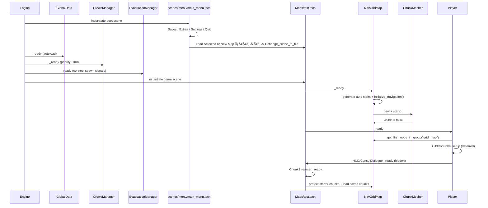
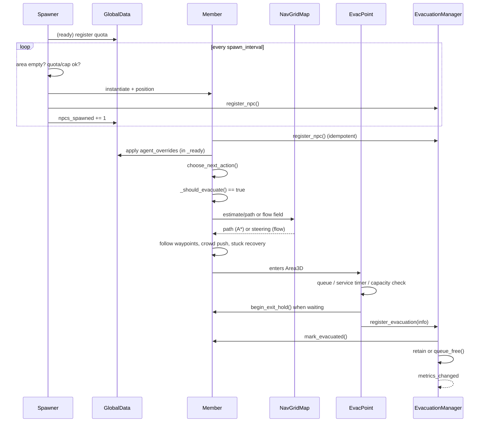
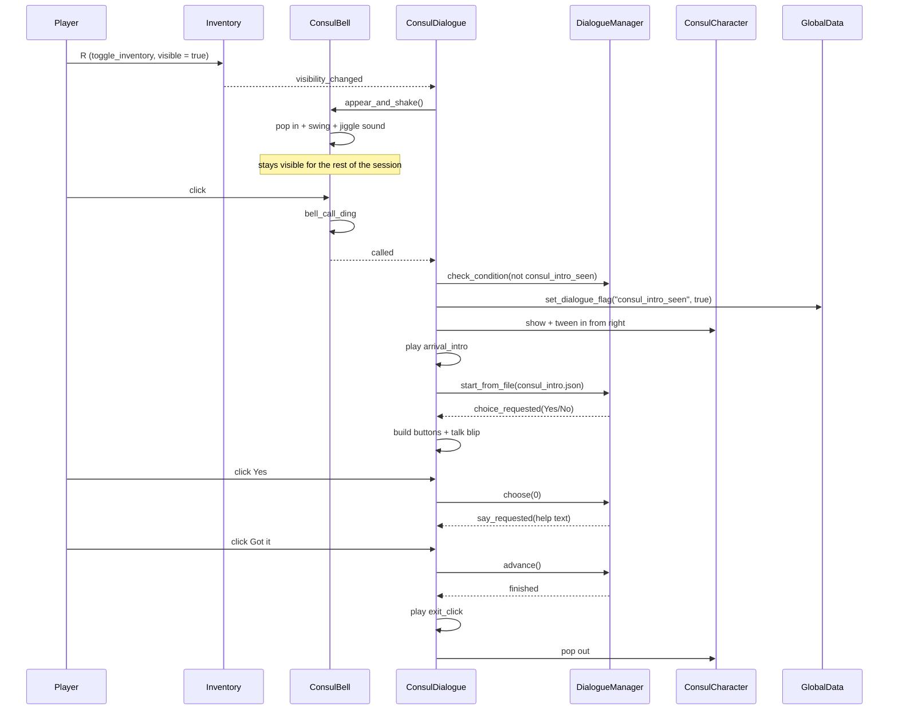

# Codebase Analysis — Evacuation Route Optimizer

> **Snapshot:** 2026-11-21 · Godot **4.7.2.stable.steam** · `mobile` renderer · source baseline `0df7d6a` (working tree: optimizer phases 1–3, packed procgen storage and opt-in chunk LOD).
> **Scope:** what the code *is now* — topology, systems, data flow, findings, and recommendations.
> **Not here:** dated change history lives in [`archive/CHANGELOG.md`](archive/CHANGELOG.md); the full dated verification table lives in [`archive/VERIFICATION_LOG.md`](archive/VERIFICATION_LOG.md).
> **Subsystem docs:** [`SIMULATION_MODEL.md`](SIMULATION_MODEL.md) (crowd model) · [`EVACUATION_POINTS.md`](EVACUATION_POINTS.md) (exit throughput/capacity) · [`FALSE_BOIDS.md`](FALSE_BOIDS.md) (ambient birds) · [`SIM_MEASUREMENTS.md`](SIM_MEASUREMENTS.md) (recorder and metrics) · [`OPTIMIZER.md`](OPTIMIZER.md) (planned decision layer: contracts, objective, roadmap) · [`MAIN_MENU_AND_CREDITS.md`](MAIN_MENU_AND_CREDITS.md) (boot menu, saves, music, credits). Start at [`README.md`](README.md).
>
> Current content state: MeshLibrary **316 items** referencing **51 block textures** (`textures/autoblocks/`), `scenes/grid_map.tscn` embeds no cells, and `Maps/test.tscn` is a **bare 80-cell starter platform** plus three false-boid emitters and four perches — no spawners or evac point. The demo layout lives in the save slot `user://saves/testing_testing_things_just_got_interesting/`; the recorded active slot `verity` is a blank map; the last recorded live store was **8 chunk columns / 1,100 cells**. The boot scene is the 3D `scenes/menu/main_menu.tscn`; `MusicManager` drives the top-left BGM credit pop-up; Extras opens the 3D credits screen.
>
> Claims were checked against the current source and against live runs on 2026-11-13 → 2026-11-18. See §12 for the current verification snapshot and the archive for earlier rows.

---

## Contents

1. [Executive summary](#1-executive-summary)
2. [What the project is trying to be](#2-what-the-project-is-trying-to-be)
3. [Runtime topology](#3-runtime-topology)
4. [Systems in depth](#4-systems-in-depth)
5. [Data and asset pipeline](#5-data-and-asset-pipeline)
6. [Key execution flows](#6-key-execution-flows)
7. [Complexity and performance profile](#7-complexity-and-performance-profile)
8. [Coupling and boundaries](#8-coupling-and-boundaries)
9. [Findings](#9-findings)
10. [Intent vs. implementation](#10-intent-vs-implementation)
11. [Recommendations](#11-recommendations)
12. [Verification log](#12-verification-log)
- [Appendix A — File inventory](#appendix-a--file-inventory)
- [Appendix B — Input map](#appendix-b--input-map)
- [Appendix C — Project settings](#appendix-c--project-settings)
- [Appendix D — Unused assets](#appendix-d--unused-assets)

---

## 1. Executive summary

**What exists.** A Godot 4 voxel sandbox with a 3D boot menu, a character controller, drag-place building, a crowd simulator, simulation/Agents control panels, an evacuation results panel, an optional first-run Consul dialogue, map save slots, day/night, water, logic components, and ambient false boids. The simulation loop is implemented end-to-end:

```
Simulation/Agents panel → spawn NPCs → choose an exit → path/flow to it → EvacPoint → metrics
```

The game scene starts with a bare **80-cell platform** (10 × 8 at x = −5…4, z = −3…4) and three false-boid emitters with four perches. Flat-floor generation is **disabled**: `ChunkStreamer` loads only chunks that already exist in `user://world/chunks`, out to a 20-chunk script radius (Low/Medium/High presets use 12/20/40). The last recorded live store was **8 chunk columns / 1,100 cells**; a fresh store leaves empty space. The nine spawners and the evac point exist only in the save slot `testing_testing_things_just_got_interesting` (10 placeables); the active `verity` slot is a blank 8-chunk map. The **placeable catalogue** now contains **15 placeable scenes** (Sim 4, Device 2, Foliage 9), but the generated-icon manifest still has **13** entries, so the two false-boid placeables show scene-preview fallbacks until `VoxelItemGenerator.generate_all()` is re-run.

**What is measured.** `EvacuationManager` records per-NPC spawn/arrival times, chosen exit, distance travelled, stuck time, failed paths, and peak local density. It derives average, median, p95, min/max evacuation time, per-exit arrivals, share, average time, and throughput per minute. Finite exits additionally report queue length/peak, average and maximum wait, service rate, receiving occupancy/peak/capacity, capacity waits and rejections, queue-full rejections, retained-agent count, and a per-agent evacuation record (spawn/evacuation timestamps, exit id, wait, desired speed, distance, stuck time/strikes, peak density/contact, pre-movement, route changes/switches). It also exposes the **top 5 latest agents** with speed, pre-movement wait, distance, stuck time and route changes, so a late tail can be diagnosed from the summary and F4 panel. `SimRecorder` turns that into per-run files: 0.25 s agent/exit/simulation samples, per-tick spawner counters/timers, route assignments, evacuation events, environment/disruption events with before/after routes, initial layout and navigation snapshots. See `docs/SIM_MEASUREMENTS.md`. The archived 2026-11-02 run (60 NPCs, 42 evacuated by ~26 s, average 22.5 s, p95 24.8 s) was measured on the old 4,674-cell map; the demo save restores a comparable spawner/exit layout.

**What is still missing.** The optimizer's later phases: the multi-objective terms
and modes, disruption-driven re-solve, the hazard layer, and Pareto/robustness
analysis. ACO and PSO are implemented as hybrids (local-search seed + ants or
particles + polish); see `docs/OPTIMIZER.md` §8.2–8.3. There is also no automatic
layout ranking, no obstacle-rich authored level, and no general test suite beyond
the optimizer harnesses. `SimRecorder` captures replay-ready runs,
the pause menu has a Demo Player and a synchronized **Demo Comparer** (metrics,
trajectories, exit assignments, disruption responses and configuration deltas),
but nothing ranks or chooses a layout. The Statistics subview renders congestion
heat and ideal A* routes, but there is no per-cell measured bottleneck heatmap.

The decision layer is **implemented through phase 3b** ([`OPTIMIZER.md`](OPTIMIZER.md)): `optimization/` contains the snapshot/request/result contracts, a spatial cohort builder, per-exit path analysis, a deterministic FIFO queue model, a demand-to-capacity congestion predictor, the objective function, `nearest` / `equal_split` / `greedy` / `greedy_congestion` / `exhaustive` / `local_search` / `aco` / `pso` / `network_flow` / `time_expanded`, and a pure manager. `OptimizerBridge` captures a live snapshot, validates the result, applies it through `Member.set_optimizer_assignment()`, covers late spawns (8 m immediate adoption plus pending spawns in the next solve), and re-solves periodically or on queue/exit/environment/spawn triggers while skipping unchanged assignments. The right-side **Optimizer** panel (beside the inventory, like the property tab) owns the bridge and describes every method and objective. The recorder writes the optimizer configuration, event and measured summary into the demo. Thirteen harnesses pass **542 assertions**; a 600-agent scale test solves 28 cohorts in ~113 ms and applies 600/600 assignments (`tests/README.md`).

What remains: the multi-objective terms and modes (contact force, switching, hazard), hazard routing, Pareto/robustness analysis, and a measured predicted-congestion-vs-actual-density study. ACO/PSO are hybrids (local-search seed + search + polish) and must be reported as such; the two min-cost flow models are relaxations whose rounded assignment and seed guard are recorded. A disabled exit invalidates stale results and releases its agents; periodic and triggered re-solves now reconcile the plan.

**Overall health.** The simulation core is intact and runs a defensible crowd model: a reciprocal Social Force Model in `CrowdManager`, kinematic ground-probe locomotion in `Member`, deterministic seeding, lognormal pre-movement, and logit exit choice over route length, queue density, and visibility. A 600-agent, 4-exit run evacuated all 600 with 0 deaths and 0 failed paths in 80 s, peaking at 1.95 persons/m²; the solver costs 3.8–4.4 ms per 30 Hz tick, and the optimized build holds 60 FPS at peak packing. The game scene still does not ship a runnable scenario: Start does nothing until the player places `sim_spawner`/`sim_evac_point` or loads the demo save. **64-chunk full terrain generation** was not achievable with the old per-cell GridMap (9,150 chunks / 2.34 M cells / 2.3 GB, then a crash with 600 agents). Since 2026-11-21 cells are packed 3D sections and the runtime GridMap mirror is dropped (see [`PROCGEN.md`](PROCGEN.md)), so cell memory is no longer the blocker; generation is still disabled pending procgen generators. Remaining debts: `/reset_all` bypasses spawner bookkeeping (**N4**), the shipped map has no authored scenario (**N11**), the icon manifest lags the placeable catalogue (**N17**), flow fields are off so exit choice falls back to straight-line estimates (**N3**), and results are not compared across layouts. The test scene no longer overrides congestion values; it inherits the tuned `2.0 / 0.5 / 0.35` defaults (**N15 resolved**).

**Changes since the 2026-11-15 snapshot.** Full dated entries are in [`archive/CHANGELOG.md`](archive/CHANGELOG.md).

- **2026-11-20 — optimizer consistency pass: PSO, min-cost flow, objective scale.** Added `greedy_congestion`, `pso`, static `network_flow` and `time_expanded` min-cost-flow models, a small `MinCostFlow` solver and shared flow rounding. The objective now divides congestion and queue agent-seconds by the assigned-agent count (the unnormalised queue total had dominated every decision), and the congestion predictor uses peak platoon crossing time instead of route-average flow. Local search gained pair swaps; ACO gained a congestion-priced heuristic, dynamic per-exit load, stagnation resets and a cheap seed; ACO/PSO/flow keep a `nearest`/seed guard. UI exposes the new methods, PSO parameters and a shared ACO/PSO time budget. Benchmark at 600 agents / 40 cohorts / 250 ms: local search 96.16, ACO/PSO 89.43, time-expanded flow 89.29, static flow 97.05, greedy 96.16; at 2 s ACO/PSO reach 84.4 vs local search 86.97. Tests: 151 new assertions (`optimizer_phase4_test.gd`), total 407 across nine harnesses.

- **2026-11-20 — optimizer phase 3, side panel, comparer readability.** ACO (`aco_optimizer.gd`) uses a local-search seed, ACS construction (16 ants / 40 iterations), pheromone updates and a short polish; it never returns worse than its seed, matched exact in 3/5 seeded 6-cohort instances, is deterministic per seed and respects a 250 ms default budget. The optimizer UI moved from a runtime popup to a **right-side panel** beside the inventory, modelled on the property tab, with descriptions for every method and objective and ACO parameters. Late spawns are adopted by the nearest cohort of the last result within 8 m. The Demo Comparer gained per-demo cursor/delta tables and collapsed detail differences; the player and comparer transport bars now scroll horizontally. Tests: 27 ACO assertions, 23 demo-UI assertions, 52 phase-2 assertions.

- **2026-11-20 — optimizer phase 2.** `OptimizerBridge` captures a live snapshot, validates and applies assignments through the new `Member.set_optimizer_assignment()` override; `GlobalData` gains `optimizer_enabled` and `environment_version`; `EvacPoint` and `GlobalData.report_environment_change()` invalidate stale results. The optimizer panel exposes enable, algorithm, objective, cohort size, auto-solve, Run once and status. `SimRecorder` now writes the optimizer configuration into `manifest.metadata.optimizer`, an `optimizer` event per solve and an optimizer summary block; route rows carry reason `optimizer`. Tests: 52 phase-2 assertions (real agents/exits, adoption, recorded run, side panel) and a 600-agent scale test (28 cohorts, ~113 ms solve, 600/600 applied).
- **2026-11-20 — optimizer phase 1.** `optimization/` contains the pure analysis layer: `SimulationSnapshot`/`OptimizationRequest`/`OptimizationResult`, `CohortBuilder`, `PathAnalyzer`, `CongestionEstimator`, `ExitCostAnalyzer`, `ObjectiveFunction`, five algorithms (`nearest`, `equal_split`, `greedy`, `exhaustive`, `local_search`) and `OptimizerManager`. `NavGridMap` gained read-only `build_cost_field_to()`, `get_path_cells()` and `get_nav_point_count()`. Headless tests: 51 pure assertions + 18 real-nav assertions, all passing; benchmark at 600 agents / 40 cohorts: nearest 15 ms, greedy 185 ms, local search ~0.95 s.

- **2026-11-20 — optimizer design and doc refresh.** `docs/OPTIMIZER.md` records the gap analysis against the proposed feature set, the simulation/optimization boundary, the data contracts, the objective function, the algorithm order (baselines before ACO), the dynamic-reoptimization guards, the roadmap and the risks. No runtime behaviour changed by the design pass.

- **2026-11-18 - simulation recorder and measurement.** `SimRecorder` records per-save demos (`user://saves/<slug>/demos`) and the pause menu **Demos** page/player inspects them; `Member`/`EvacPoint`/`NavGridMap`/`CrowdManager`/`EvacuationManager`/`GlobalData`/`BuildController` gained route, availability, navigation, contact and environment instrumentation. See `DEMOS.md` and `SIM_MEASUREMENTS.md`.

- **2026-11-17 — boot menu and media.** `scenes/menu/main_menu.tscn` is the boot scene (Saves overlay, Extras → 3D credits, Settings hub, Quit); `MusicManager` autoloads with the `credits.json` catalogue; `scenes/ui/bgm_popup.tscn` announces tracks in the menus and HUD. See `MAIN_MENU_AND_CREDITS.md`.
- **2026-11-16 — false boids.** Hybrid ambient birds: 500-bird world-space particle clouds per placeable emitter, one true-boid leader per emitter (max 10), up to 20 promoted `FalseBoid` sprites that perch, flee, and demote into the cloud, plus periodic map-wide migration. See `FALSE_BOIDS.md`.
- **2026-11-16 — finite evacuation points.** `EvacPoint` gained an optional service rate/FIFO queue, receiving-area capacity with QUEUE/REJECT, retained agents in an `EvacuatedAgents` container, and the corresponding queue/occupancy metrics. See `EVACUATION_POINTS.md`.
- **2026-11-15 — crowd model and performance.** Social Force Model pair solver, kinematic ground-probe locomotion, deterministic per-agent RNG and simulation clock, lognormal pre-movement, logit exit choice, emergent lanes, High preset raised to 600 agents, contact-force distributions, and the Pause Spawning/Reset fixes. See `SIMULATION_MODEL.md`.

**Biggest risks.**

| Risk | Where |
|---|---|
| A full 64-chunk generated world is not sustainable: 9,150 chunks used 2.3 GB and crashed with 600 agents; runtime generation is disabled, and the unused `generation_radius_chunks = 4` never applies. **Cell storage superseded 2026-11-21** by packed 3D sections + per-chunk collision; generation is still disabled pending procgen generators | `ChunkStreamer.gd`, `gridmap.gd`, `VoxelSectionStore.gd` |
| The safety cap silently stops loading a larger saved radius (2,048 script default; raised to 6,400/17,424 by the High preset and 64-chunk draw distance) | `ChunkStreamer.gd:max_loaded_chunks` |
| The test scene no longer overrides congestion values, so benchmarks inherit `2.0 / 0.5 / 0.35` from `gridmap.gd`; changing those defaults silently changes every saved-map benchmark | `Maps/test.tscn`, `scripts/gridmap.gd` |
| The game scene ships **no spawners or exits**, so Start does nothing until the player places them or loads the demo save | `Maps/test.tscn`, `scripts/save_manager.gd` |
| The last recorded live store had only 8 chunks / 1,100 cells; the demo layout lives in one save slot (`testing_testing_things_just_got_interesting`), and a 600-agent run on the older 3,471-cell snapshot stalled at ~415 | `user://world/chunks`, `user://saves` |
| The demo save still carries nine spawners at quota 1,000 / 0.1 s (9,000 total) against a 120 Medium default cap (600 High) | save manifest, `scenes/placeables/sim/sim_spawner.tscn` |
| The voxel-icon manifest lists 13 of the 15 placeable scenes; the two false-boid placeables fall back to scene previews until `VoxelItemGenerator.generate_all()` is re-run | `resources/voxel_items.json`, `scripts/voxel_item_generator.gd` |
| Run recordings grow quickly: 600 agents at 0.25 s sampling writes ~2,400 agent rows per simulated second; long runs should raise `sampling_interval` or disable path/layout capture | `scripts/sim_recorder.gd`, `user://saves/<slug>/demos` |
| The Consul intro marks itself seen before it finishes, so closing the dialogue early skips the rest for that session | `scenes/dialogue/ConsulDialogue.gd` |
| Dialogue flags live only in memory, so the “seen” state resets every launch | `scripts/GlobalData.gd`, `scripts/dialogue_manager.gd` |
| Agents are kinematic by default (`collision_mask = 0`), so engine collision with the world and other agents is off; contact is the SFM soft force, and `use_physics_contact = true` restores it at a large cost | `scenes/npcs/Member.tscn`, `scripts/NPCstuff/Member.gd` |
| Lanes are emergent, not authored: with `max_extra_lane_offset = 0`, flow mode relies on the SFM anisotropy and friction to avoid single-file convergence | `scripts/NPCstuff/Member.gd`, `scripts/gridmap.gd` |
| Exit selection is a logit choice over route length (baked cost field when present, otherwise straight-line ×1.2), queue density, and visibility; it is behavioural, not yet calibrated to observed exit shares | `scripts/NPCstuff/Member.gd:_choose_evacuation_point` |
| `reset_spawning()` is clean, but the debug `/reset_all` path kills NPCs without notifying spawners, so quotas can drift until reload | `scripts/GlobalData.gd`, `evacuation_manager.gd` |

---

## 2. What the project is trying to be

The evidence still points to a **spatial evacuation sandbox**, not a Minecraft-like survival game:

- The title is *Evacuation Route Optimizer*.
- The block palette is institutional — classroom window frames, floor tiles, warning-coloured concrete brick, off-white walls.
- The meaningful outcome is “NPC reached an `EvacPoint` and was removed”.
- Navigation penalises walls and exposed gaps instead of only minimising distance; counter-flow lanes emerge from the crowd model rather than per-agent offsets.
- The HUD has a simulation panel for start/reset/quota/cap/mode and a results panel for timing, exit usage, throughput, distance, and failures.
- The HUD has an Agents category that edits the Member exports for live and future NPCs.
- Placeables include a foliage scene generator that creates one billboard or crossed-plane sprite placeable per texture.
- The player has creative building tools and can place `Spawner` and `EvacPoint` as objects.
- A first-run Consul dialogue greets the player and explains the console/statistics/results keys, so onboarding is now part of the intended experience.

The implied loop is: **build a floor plan → place crowd sources and exits → run the evacuation → measure how it went → change the layout**. All five steps exist in code, but the shipped map's ground depends on an external saved-chunk store and has no authored floor plan. Comparison is available through the Demo Comparer, and optimized runs are available through the Simulation panel's optimizer; choosing and ranking *layouts* is still manual.

A second layer of intent is visible in the assets: a 1970s/PSX aesthetic (CRT addon, pixel shader, posterisation shader, PSX shader globals, serif pixel font, day/night plugin). Almost none of it is wired into a scene. The new Consul character is the first substantial piece of authored 2D presentation actually used at runtime.

---

## 3. Runtime topology

### 3.1 Autoloads

| Name | Script | Role |
|---|---|---|
| `GlobalData` | `scripts/GlobalData.gd` | Run-wide counters, spawn quotas, spawn gate, evacuation mode, signals |
| `CrowdManager` | `scripts/CrowdManager.gd` | Social Force Model pair solver, spatial hash, density queries, solver statistics |
| `EvacuationManager` | `evacuation_manager.gd` | Per-NPC records, run summary, exit aggregates, metrics signal |
| `LogicNetwork` | `scripts/logic/logic_network.gd` | Event-driven logic graph: bounded change queue plus registered timers |
| `PerformanceSettings` | `scripts/performance_settings.gd` | Persisted Low/Medium/High presets plus live graphics/audio/system and water-simulation tuning (flow/equalize steps, update budget, mesh rate, waves, splash/drop toggles, wave detail, wake style), including a separate music level |
| `MusicManager` | `scripts/music_manager.gd` | Central BGM player, menu-theme playlist, credits.json catalog, live music-level setting, same-track guard, now-playing metadata signals for the BGM pop-up |
| `SaveManager` | `scripts/save_manager.gd` | Map save slots under `user://saves`: save/save-as/load/delete/duplicate/rename, new blank-platform or heightmap-procgen map, chunk-store copy, isometric thumbnail, manifest of player/time/placeables, `runtime_exports` and a world descriptor (`existing`/`blank`/`procgen`) |
| `SimRecorder` | `scripts/sim_recorder.gd` | Per-run measurement recorder: timed agent/exits/simulation ticks, route/evacuation/queue/contact/nav events, environment/disruption records, layout/nav snapshots, metadata; manual/automatic start/stop, completion finalization and Load State continuation; writes to the active save's demo library |
| `RuntimeExports` | `scripts/runtime_exports.gd` | Per-save player-changeable exports (`runtime_exports` in `save.json`) plus the global `user://export_defaults.json` used by new saves |
| `DemoStore` | `scripts/demo_store.gd` | Per-save demo library: create/list/rename/describe/folder/duplicate/delete demo folders under `user://saves/<slug>/demos` |
| `DemoPlayer` | `scripts/demo_player.gd` | In-map playback of a recorded demo: timeline, speed, stepping, noclip free-flight camera, agent inspector, route/exit/density/contact views, event timeline |
| `DemoComparer` | `scripts/demo_comparer.gd` | Synchronized comparison of 2–6 recordings: shared timeline/speed, overlaid agents, metric charts, trajectory/exit/disruption/config differences |

All twelve are registered in `project.godot` and are present in any live tree (`GlobalData`, `CrowdManager`, `EvacuationManager`, `LogicNetwork`, `PerformanceSettings`, `MusicManager`, `SaveManager`, `DemoStore`, `SimRecorder`, `RuntimeExports`, `DemoPlayer`, `DemoComparer`).

`DialogueManager` is **not** an autoload. It is a plain `Node` with `class_name DialogueManager`, instanced under `scenes/dialogue/consul_dialogue.tscn`. Dialogue flags are stored on `GlobalData.dialogue_flags`, so every scene-local manager writes to the same in-memory dictionary.

### 3.2 Boot scene (`scenes/menu/main_menu.tscn`) and game scene (`Maps/test.tscn`, UID `uid://bbtjdcwal7ax6`)

The project boots into a standalone 3D main menu. **Saves** opens the pause menu's Saves page as a `saves_only` overlay; **Extras** opens `scenes/menu/credits.tscn`; **Settings** reuses the pause menu's Graphics/Gameplay/Audio pages; **Quit** exits. The menu tilts toward the cursor and shares the pause menu's panel/button language. The menu and credits extension points are documented in `docs/MAIN_MENU_AND_CREDITS.md`. The rest of this section describes the game scene that a save or **New Map** loads.

```
Test (Node3D)
├── CycleController (Node3D, day_and_night_cycle)
│   ├── WorldEnvironment
│   └── DirectionalLight3D (SpriteLight3D → sprite shader globals)
├── GridMap (NavGridMap + 316-item MeshLibrary; scene instance overrides data with 80 cells)
├── Player (CharacterBody3D, player.tscn; authored at (0, 6, 0))
│   ├── HUD (CanvasLayer) → HUD (HUDManager)
│   │   ├── Inventory → Blocks / Placeables / Simulation / Agents
│   │   ├── Hotbar (9 slots, empty at boot)
│   │   ├── Label (transient item / build-axis notice, fades out)
│   │   ├── Statistics_Hud (F3)
│   │   ├── EvacuationResults (F4)
│   │   ├── Console (`/`)
│   │   ├── ConsulDialogue (hidden Consul overlay, summoned by the bell)
│   │   ├── ConsulBell (top-right call bell, hidden until the inventory opens)
│   │   └── BgmPopup (top-left now-playing panel)
│   ├── CollisionShape3D, head/CameraSmooth/Camera3D → PauseMenu, hands (hand_item.gd) → item marker
│   ├── HealthComponent
│   ├── BuildController (creates the runtime PlacementGhost/FaceIndicator)
│   └── 11 × AudioStreamPlayer3D
├── ChunkStreamer (Node, load radius 20, mesh radius 8, nav radius 4,
│                   flat-floor generation disabled, min y = −256)
├── MinecraftClouds (Node3D, two merged cloud meshes at y = 128 and y = 256)
├── FalseBoidEmitter ×3, FalseBoidPerch ×4 (ambient-bird placeables)
└── (runtime) ChunkMeshes, WaterSystem, PlacementGhost, FaceIndicator
```

At runtime the grid creates a sibling `ChunkMeshes` node (`ChunkMesher`) and a sibling `WaterSystem`; `BuildController` creates a `PlacementGhost` and a `FaceIndicator` under the current scene; `hand_item.gd` creates a `HeldModel` holder under `hands`.

**Default state** (source-checked 2026-11-17; live values retained from the 2026-11-13 run where they are unchanged):

```
root children : GlobalData, CrowdManager, EvacuationManager, LogicNetwork,
                PerformanceSettings, MusicManager, SaveManager, DemoStore,
                SimRecorder, RuntimeExports, DemoPlayer, Test
Test children : CycleController, GridMap, ChunkMeshes, Player, ChunkStreamer,
                MinecraftClouds, WaterSystem, PlacementGhost, FaceIndicator,
                FalseBoidEmitter x3, FalseBoidPerch x4
HUD children  : Inventory, Hotbar, Label, Statistics_Hud, EvacuationResults,
                Console, ConsulDialogue, ConsulBell, BgmPopup
groups        : grid_map=1, npc=0, Members=0, EvacPoint=0, placeables=7, spawners=0
spawning      : false
build mode    : active at boot (hotbar empty; no held model)
player        : settles at (−0.157, 1.901, −0.157), capsule height 1.8 m
used cells    : 80 authored; 1,100 with the recorded 8-chunk store
populated     : saved chunks only; no runtime floor generation
nav points    : 8 nav chunks (recorded store)
mesh items    : 316 (51 textures; visible inventory tiles collapse slab/panel/stair variants)
flow fields   : 0 baked, enable_flow_fields = false
clouds        : 2 merged meshes, y = 128 / 256
camera far    : 1,024 m
total quota   : 0 (no spawners in the scene)
live cap      : 600 (High; 120 Medium, 40 Low)
active save   : verity (blank, 8 chunks)
idle          : ~180 FPS at 30 Hz physics
```

**The scene starts at 80 cells and then loads saved chunks.** `scenes/grid_map.tscn` no longer embeds a platform; it is just the `GridMap` node (`Gridmap`), the MeshLibrary, and `gridmap.gd` with `baked_ao_enabled = true`, `auto_stair_replace_existing = false`, and `enable_flow_fields = false`. `Maps/test.tscn` instances that GridMap and overrides `data.cells` with 80 entries: a 10 × 8 floor at x = −5…4, z = −3…4 using item 44 (`Auto_concrete_flat_orangered`) at y = 0. `ChunkStreamer` protects those initial chunks and loads chunks saved under `user://world/chunks`; it no longer fills missing chunks with a generated flat floor. The recorded run had 8 chunk columns / 1,100 cells; a fresh store leaves empty space.

The load radius is 20 by default (High preset 40, Low 12) and can be raised by the pause menu's **Draw Distance** up to 64 chunks. `max_loaded_chunks` is 2,048 by default and grows with the draw distance (6,400 at the 40-chunk High radius, 17,424 at 64). Full 64-chunk *generation* was measured at 9,150 chunks / 2.34 M cells / 2.3 GB and crashed when 600 agents were added, which is why runtime generation is disabled. Since 2026-11-21 the cell store is packed 3D sections and GridMap is empty at runtime (see [`PROCGEN.md`](PROCGEN.md)); generation stays disabled until a generator is wired to the streamer. The demo spawner/exit layout lives in `user://saves/testing_testing_things_just_got_interesting/`; the main scene instantiates no spawner or evac point, only the false-boid emitters/perches (**N11**).

The GridMap serialises its cells through the `data` dictionary as a flat `PackedInt32Array` with **3 ints per cell**: `(packed_xy, z, item)`, where `packed_xy = (y << 16) | (x & 0xFFFF)` and the z entry is the signed 16-bit z coordinate. The current floor uses item 44 at y = 0, so its triples are `(x & 0xFFFF, z & 0xFFFF, 44)`. Writing `x, y, z, item` (4 ints) or a raw `x, y, z` triple produces a corrupt or empty map — regenerate with the packed format. Because the main scene stores its own override, editing `scenes/grid_map.tscn` alone does **not** change the level the game runs.

### 3.3 Groups

| Group | Producer | Consumer |
|---|---|---|
| `npc` | `Member._ready` | `CrowdManager`, `Statistics_hud`, `EvacuationManager`, `SimulationPanel`, `AgentPanel`, `Member` |
| `Members` | `Member.tscn` | `NPCSpawner` occupancy check, global cap count |
| `player` | `player.gd:_ready` | HUD, console, BuildController |
| `Player` | `player.tscn` | listed in `[global_group]`, not queried by code |
| `grid_map` | `NavGridMap._ready` | player, NPCs, build, console |
| `EvacPoint` | `sim_evac_point.tscn` (root and Area3D) | `Member._route_to_closest_evac_point`, `RandomPopulator` |
| `placeables` | `sim_spawner`/`sim_evac_point`/device scenes; player on placement | break-block traversal |
| `spawners` | `NPCSpawner._ready` | console/debug, not required by the panel |
| `false_boid_perches` | `FalseBoidPerch._ready` | `FalseBoidFlock` perch selection |
| `false_boid_perched` | `FalseBoid._ready` | global 20-bird promotion cap |
| `foliage` | generated foliage scenes | foliage queries/debug |
| `Air_migration_nodes` | configured only | `ParticleAttractorStateMachine` (unused) |

Two NPC identity groups (`npc` and `Members`) and two player groups (`player` and `Player`) remain a recurring source of near-misses. `EvacPoint` deliberately has two nodes in the group (root and `Area3D`); `Member._route_to_closest_evac_point()` deduplicates by quantised position, but any new consumer of the group must do the same.

### 3.4 Physics layers

| Layer | Used by | Notes |
|---|---|---|
| 1 | GridMap/world | default |
| 2 | `Member` (`collision_layer=2`) | NPC bodies |
| 3 | Player (`collision_layer=3`) | overlaps NPC layer |
| 4 | Spawner/EvacPoint `Area3D` (`collision_layer=7`) | 7 = layers 1+2+3 |
| 5 (bit 16) | Player mask only | no producer found |

| Body | Layer | Mask | Consequence |
|---|---|---|---|
| Player | 1+2 | 1+2+16 | Collides with world, NPCs, and unused layer 5 |
| Member (kinematic, default) | 2 | **0** | No engine collision; SFM soft contact and the ground ray handle interaction |
| Member (`use_physics_contact = true`) | 2 | 1 + NPC bit | Collides with world and other NPCs (comparison mode) |
| Spawner/Evac area | 1+2+3 | 1+2 | Detects NPC bodies |

`Member.tscn` sets `collision_layer = 2` and leaves the mask to the script. `Member._apply_collision_policy()` sets `collision_mask = 0` for kinematic mode and `1` (plus the NPC bit when `use_physics_contact` is on) for engine collision. The player body’s layer includes world bit 1, which is why the ground probe explicitly excludes the player RID: a bare layer-1 ray would otherwise let agents stand on the player. The `EvacPoint` area still detects NPC bodies on layer 2, so evacuation works with a zero mask.

---

## 4. Systems in depth

### 4.1 Voxel world - `NavGridMap` (`scripts/gridmap.gd`, 3,224 lines)

A `GridMap` subclass that fuses block storage, navigation graph, flow-field cache, debug drawing, and chunk persistence.

**Block storage.** `place_block` / `remove_block` / `place_blocks` / `remove_blocks` wrap `set_cell_item`, update `_chunk_cells`, mark chunks dirty for meshing, refresh navigation locally, and emit `navigation_changed`.

**Walkability rule.** A cell is walkable when it has a block and the cell above is empty. Agents walk on top of blocks; the corridor level is the block layer.

**Navigation graph.**
- `AStar3D` with bidirectional cell ↔ point-id maps; ids are recycled through `free_ids`.
- 16 movement offsets: 4 orthogonal, 4 flat diagonals, 8 one-block stair steps.
- Flat diagonals are connected only when both orthogonal side cells are walkable, preventing corner cutting.
- Point weight = `max(wall_penalty, gap_penalty)`:
  - wall penalty 1.0 → 2.0 as the four sides become more enclosed;
  - gap penalty 1.0 → 3.0 as sides lose both wall and floor.
- `_refresh_point_weights_around` now updates the changed cell and the cells whose wall/gap tests depend on it. The old “weights lag an edit” finding is resolved.

**Optimizer cost fields.** `build_cost_field_to(target_world, cell_limit)` runs one synchronous label-correcting flood from a destination over the weighted graph and returns `{Vector3i: cost}`. Step cost is real distance × the entered cell's weight, matching AStar3D and the flow bake, so the optimizer's predictions agree with the routes agents walk. It does not touch `_flow_fields`/`_flow_costs`, works with `enable_flow_fields = false`, and is uncapped unless `cell_limit` is passed. `get_path_cells(from, to)` returns the unsmoothed cell route via `AStar3D.get_id_path()` for congestion prediction, and `get_nav_point_count()` is a diagnostic. These three methods are the only simulation-side API the optimizer needs; see [`OPTIMIZER.md`](OPTIMIZER.md) §4.3.

**Surface-aware navigation.** `_rebuild_surface_profiles()` caches, per MeshLibrary item, whether it is a low walking surface and which path-cost class it belongs to:
- Normal stairs and bottom slabs are low surfaces: their A* point sits at the half-height top (cell centre height). Top slabs, side slabs, upside-down stairs, and full blocks use the full cell top.
- Path-cost classes: stairs use `stair_path_cost = 0.75`, top/bottom slabs use `slab_path_cost = 0.9`, and full blocks/vertical side slabs use `full_block_path_cost = 1.0` (all exported under **Navigation Costs**). The surface multiplier is applied together with the wall/gap weight and congestion multiplier in `_point_weight_scale`.
- `_refresh_nav_cell` updates an existing A* point's position and weight when a cell changes item without changing walkability, so replacing a full block with a bottom slab immediately moves the point from the cell top to the half-height surface.
- This makes A* prefer stairs over slabs over full-block climbs on equal-length routes, and stops the low surfaces from looking like a 0.5 m climb to `Member._try_obstacle_hop()`.

**Flow fields.**
- `enable_flow_fields` defaults to `true` in the script, but both `scenes/grid_map.tscn` and the `Maps/test.tscn` instance set it to `false`. The shipped map uses per-NPC A*.
- `ensure_flow_field_cell` starts a Dijkstra-like bake from the exit; `_advance_bake_jobs` spends `flow_bake_budget_usec` = 1.5 ms/frame.
- The field stores `cell → next cell`; `get_flow_direction_for_cell` steers from the agent’s current position to the next cell centre.
- Fields are invalidated when an edit touches a field cell, its target, or a neighbour.
- The cache holds 32 fields and evicts the first dictionary key, not the least-recently used.
- The bake queue is a plain FIFO with relaxation on improvement (SPFA-like): correct, but can re-expand cells.

**Path post-processing.**
- `_physics_smooth_path` performs line-of-sight simplification with up to 16 waypoints of lookahead.
- A shortcut is accepted only if walkable ground exists under the centre line **and** under `path_ground_radius` to each side, plus three rays (centre + one agent radius to each side) that hit nothing. The side ground checks use a tighter height tolerance so a shortcut cannot clip a corner and put part of the body over a ledge.
- `_trim_path_start` removes the initial backwards step toward the cell centre.
- When the request queue is at least 32 entries, `_process` sets `fast_paths = true` and skips **both** smoothing and lane offsets (`gridmap.gd:_process`). This is exactly the mass-spawn case.

**Parallel lanes.**
- If the requester exposes a non-zero `lane_offset`, `_apply_requester_lane` resamples the path and shifts it sideways.
- The shift fades in/out at the ends, is clamped by wall clearance, falls back to the centreline where there is no safe ground, and retries at half offset twice.
- Flow-field steering bypasses this entirely: there is no path object to shift, and `get_flow_direction_for_cell` returns a single next-cell direction. With flow fields on, agents converge into one line.

**Congestion routing.**
- `report_congestion(world_pos)` converts a stuck report into per-cell heat (0..1). The centre receives `congestion_heat_per_report` (default 0.5; the shipped scene no longer overrides it); cardinal neighbours get 45 % and diagonals 20 % of that. A stuck event reports both the agent and its blocker.
- Hot cells multiply the AStar point weight: `weight = wall/gap weight × (1 + heat × congestion_penalty_max)`. The default penalty is `2` (3× at full heat); `Maps/test.tscn` inherits it.
- Heat decays at `congestion_decay_per_sec = 0.35` and is refreshed every `congestion_tick_interval = 0.5 s`; below 0.02 the cell returns to its base weight. `congestion_max_cells = 512` bounds the map. A* weights are not written synchronously inside `report_congestion()`: dirty cells are flushed in 64-cell batches every 0.1 s, which removes the multi-millisecond burst when a crowd-wide jam reports hundreds of cells at once.
- `is_ground_path_supported(from, to)` samples the whole segment at 0.35-cell intervals. The yield and steering ledge guards use it, so a diagonal move cannot pass through an unsupported corner between two valid endpoint probes.

**Debug drawing.** `debug_show_paths` draws recent A* paths and flow arrows; the console exposes `/show_paths` and `/path_mode astar|flow`. This is the main authoring aid.

**Editor tools.** `NavGridMap` is a `@tool` script and exposes two inspector buttons: **Reload Editor World** rebuilds the `ChunkStreamer` editor preview from `user://world/chunks`, and **Save Editor World** forces the editable preview's changed chunks to disk. Both are no-ops outside the editor; runtime navigation still updates through the normal block-edit path.

**Auto stairs.** `_generate_auto_stairs` refreshes `Auto_Stairs_<texture>` items in the MeshLibrary at runtime from `models/Specialblocks/stair.gltf`. The block generator now also writes stairs into the MeshLibrary, so this is a runtime safety net rather than the only source. It skips connected autoblock items (`Connect`) and removes stale `Auto_Stairs_Connect_*` entries so they never appear in the inventory.

**Connected autoblocks (OptiFine-style CTM).** `scripts/connected_block_generator.gd` scans `textures/auto_connecting_blocks/` for 16×16 four-quadrant sources and creates one visible `Auto_Connect_<name>` item per source; there are no per-state inventory items. `scripts/connected_texture_builder.gd` slices the source into corner/edge/overflow/null pieces (normalising a source painted as one complete framed pane), applies the Python generator's rotate/flip rules, and builds a 16×16-tile atlas whose tile index is the eight-neighbour mask (`N=1, E=2, S=4, W=8, NE=16, SE=32, SW=64, NW=128`). `NavGridMap._build_ctm_items()` maps every `Auto_Connect_*` item (full block and slab/stair variants) to one shared per-source, per-pixel-shaded atlas material and records its CTM base group; `ChunkMesher` emits one quad per visible face for full blocks and keeps the authored triangles for slabs/stairs, sampling the atlas tile selected from each face's in-plane neighbours. Masks compare the CTM base group, so all shapes of one source connect; partial faces use cell-space UVs, so they sample the matching slice of the tile instead of stretching it. CTM quads also get the same baked voxel-corner AO in their vertex colours. Because the mask is per face, 1×1, 2×2, 3×3 and larger panes all connect correctly, and transparent panes still cull faces against opaque neighbours. The cell orientation is irrelevant, so `BuildController` places connected items at orientation 0. Auto stairs skip `Connect` items and the runtime removes stale `Auto_Stairs_Connect_*` entries, so the inventory stays uncluttered.

**Chunk API.** `serialize_chunk`, `load_chunk`, `unload_chunk`, `save_dirty_chunks`, `save_all_chunks` exist and are robust (versioned, packed 5 ints per block, batched nav refresh). `ChunkStreamer` and `ChunkFileStore` now use them for streamed loading and saving.

**Streaming/navigation LOD.** `load_chunk(data, emit_nav_signal, build_navigation)` can load cells without adding them to AStar; `build_chunk_navigation(chunk)` adds them later when the player nears. `_nav_chunks` tracks which chunks are in the graph, so unloads only refresh navigation that exists. `min_block_y`/`max_block_y` default to −256/255 and reject out-of-range block placement and chunk cells.

### 4.2 Rendering - `ChunkMesher` (`ChunkMesher.gd`, 1,958 lines)

`ChunkMesher` is a `RefCounted` owned by `NavGridMap` that replaces GridMap rendering with one merged mesh per 16×16 column chunk:

1. On `start()` it hides the GridMap and creates a sibling `ChunkMeshes` node.
2. Block placement/removal marks the owning chunk (and neighbouring border chunks) dirty.
3. `process()` rebuilds dirty chunks under `build_budget_usec`; generated worlds set `max_builds_per_frame = 1` so a heavy full-detail chunk cannot pair with another and double the frame time. Dirty chunks are selected **nearest-first**, so a far streamed/LOD chunk cannot jump ahead of the chunk under the player.
4. Cube-shaped items are greedy-meshed per face direction and slice; non-cube items (slabs, stairs) are emitted from their source mesh with their transform, and the cell orientation is read from the packed section store (`get_block_orientation()`) because the runtime GridMap mirror has no cells; Full CTM blocks emit one unmerged quad per visible face; CTM slabs/stairs keep their authored triangles but pick a per-face atlas tile, so partial faces get the same dynamic borders.
5. Only complete rebuilds are committed to the `MeshInstance3D`.
6. `set_view_center(chunk, radius)` keeps `mesh_radius_chunks` around the player: far chunk meshes are freed, and only populated chunks inside the radius are queued. The streamer sets radius 16.

Item classification is geometric, not metadata-driven: a mesh is a “cube” only if its bounds match the cell size and its triangles cover ≥97 % of all six box faces. That correctly rejects stairs, whose bounding box is a cube. Opacity is checked across every surface, so a mixed opaque/transparent item is treated as non-opaque for face visibility and baked AO.

**Array-based chunk snapshot.** Before meshing a chunk, `_build_snapshot()` builds a flat `PackedInt32Array` covering the 16×N×16 chunk plus a one-cell border on every axis. Populated chunk cells are copied from the chunk snapshot (cells and item ids are read from the packed sections in one pass by `get_chunk_cells_and_items()`); only the x/z border columns are queried from the GridMap, because an interior column cannot contain a cell above/below the chunk's own min/max Y. Face visibility, corner-AO sampling and CTM masks then read the array through `_snap_item()` instead of issuing `GridMap` hash lookups. The chunk’s `MeshInstance3D` and `ArrayMesh` are reused across rebuilds, so only the surface buffers are replaced. Each chunk stays a separate instance, letting Godot frustum-cull it; face/neighbour culling and greedy merging already remove hidden/internal triangles.

**Distance LOD (2026-11-21, opt-in).** The mesher can render three bands around the view centre: a full greedy mesh within 8 chunks (baked AO within 3 chunks, greedy merging beyond), a 4× heightfield to 14 chunks, and an 8× heightfield beyond. Coarse columns are cached per chunk/step; heights snap up to the 4/8-block band and a short edge skirt covers transitions, so far terrain uses genuinely larger voxels. Only the full band gets a `ConcavePolygonShape3D` collision body. LOD is off by default so authored and existing saves keep full detail; `/lod on` enables it and `/lod off` disables it. `set_view_center()` queues only new or LOD-changed chunks instead of every populated chunk in the radius. `process()` builds the nearest full chunk first, then up to four cached far-LOD chunks under a separate budget, so the outer ring does not lag behind the player. For generated worlds the streamer sets the mesh radius to `max(mesh_radius, load_radius)` so a bounded footprint is fully meshed. A Large 384×384 heightmap world meshes 576 chunks; with LOD on that is 197 full / 338 mid / 41 far and 197 collision bodies, and either mode settles at 180 FPS after a ~17 s one-time fill. Generated heightmap slopes place a bottom slab at each exposed riser (`PROCGEN.md` section 4.1), so a Large world holds 452,794 cells including 10,426 step slabs. The 2026-11-21 performance pass reduced fill frames from ~39 ms to **~17.4 ms (57 FPS)**, clamped the streamer's desired set to the recipe footprint (17k → 576 chunks), added one-pass snapshot reads and a fast sparse-section import, capped generated-world meshing at one chunk/frame, cut initial nav builds from ~134 ms to ~25 ms, and skipped the nav pump entirely when no NPCs/spawners/exits exist. See [`PROCGEN.md`](PROCGEN.md) §5.2. Renderer/engine rationale is in [`RENDERER_AND_ENGINE.md`](RENDERER_AND_ENGINE.md).

**Notes on the Unity/Burst techniques.** Burst is a Unity C# compiler, and the quoted 0.000195 ms per 32³ mesh relies on native code; GDScript cannot match that. Godot’s threading equivalent is `WorkerThreadPool`, but this mesher reads the GridMap and scene transforms, which are main-thread-only; safe multithreading would require moving the entire build onto the flat snapshot (plus pre-warmed item-mesh parts) and committing surfaces back on the main thread. Bit-packed 32-bit rows are also less attractive in GDScript (64-bit ints, generic arrays) than in C#/Burst. The practical wins here are the array snapshot, mesh reuse, greedy meshing, per-chunk frustum culling and the configurable rendering scale.

**Connected textures.** CTM items are flagged during item classification with the atlas material from `NavGridMap.get_ctm_material()`. `_emit_ctm_block()` skips faces hidden by same-item or opaque neighbours, computes the eight-neighbour mask in the face's texture plane, and emits an unmerged quad whose UVs select atlas tile `(mask % 16, mask / 16)`; both components are whole tile indices (integer division of the row), not fractional atlas coordinates. The atlas builder accepts a 16x16 four-quadrant source (q1-q4) or a 32x16 source that adds q5, a full 16x16 background layer, in its right half; q5 is alpha-composited behind the composed q1-q4 tile, not treated as a fifth state. The material culls backfaces (the CTM quad winding matches the cube path) and selects transparency from `Image.detect_alpha()`: disabled for an opaque atlas, alpha scissor for a 0/255 cutout, alpha blending only for partial alpha. Nothing is cached per group, so adding or removing a block simply rebuilds the affected chunk.

**Debug greedy.** `/debug_greedy` forces greedy merging even while AO is on, colours every quad (not only merged ones), and switches to an unshaded vertex-colour material, so the merged rectangles are clearly visible.

**Baked voxel ambient occlusion.** `baked_ao_enabled` (default off for the Medium preset, toggled with `/ao` or the pause menu's High preset) bakes classic voxel-corner AO into the chunk mesh vertex colours. For each face corner it samples the two edge neighbours and the diagonal on the outside of the face: two solid edges = darkest, otherwise the count of the three samples picks a brightness from `[0.50, 0.66, 0.83, 1.0]`. Cube materials are duplicated with `vertex_color_use_as_albedo = true`. **Non-full item meshes now get per-vertex AO too**: slabs, stairs, and panels sample their face's tangent-side and diagonal neighbours around each vertex, and their materials are duplicated with the vertex-colour flag instead of being left white. While AO is on, greedy face merging is disabled so every visible face gets correct interior corner shading; `/ao off` restores greedy merging and removes the colour attribute. This is per-block-corner AO (the standard voxel form), not a 16×16 texture-pixel AO atlas. It is baked at mesh-build time, so it has no runtime lighting cost.

GridMap collision stays active while rendering is hidden, so physics does not depend on mesh rebuild timing. The visual can lag collision by a frame or more.

### 4.3 Crowd - `CrowdManager` (`scripts/CrowdManager.gd`, 681 lines)

The crowd is now a **Social Force Model** solver, not a capped separation push. The full derivation, parameter provenance, and deviations are in `docs/SIMULATION_MODEL.md`; this section records what the code does.

- **Central pair sweep.** Every interacting pair is evaluated **once**, centrally, and both agents receive their force in the same pass. If A interacts with B, B interacts with A — there is no capped neighbour list and no pair-order bias. This replaces the previous per-agent `get_nearby_npcs()` sample where the 20-entry cap and hash scan order could make the interaction one-sided. Note that the anisotropic psychological weight is per-agent, so the two magnitudes differ (as in Helbing's model); **contact and friction are equal and opposite**, but the psychological term is not momentum-conserving.
- **Forces.** Psychological repulsion `A exp((r_ij − d_ij)/B) w_ij n_ij` with `A = 2000 N`, `B = 0.08 m`; anisotropic weight `w = λ + (1−λ)(1+cos φ)/2` with `λ = 0.35` evaluated separately for each agent; body contact `k g(r_ij − d_ij) n_ij` with `k = 120000 N/m`; tangential friction `κ g(...) (Δv·t) t` with `κ = 240000`; plus a normal dashpot (`contact_damping_ratio = 0.2`) for numerical damping. Net acceleration is clamped to `120 m/s²`.
- **Spatial hash.** X/Z hash with `cell_size = 1.5 m`. Each cell is paired with itself and with four forward neighbour cells, so every pair is visited exactly once. Pairs beyond `social_cutoff = 1.2 m` skip force work but are still counted for density inside `density_radius = 1.4 m`; pairs beyond `vertical_tolerance = 0.9 m` are ignored entirely. Density and neighbour queries use `density_vertical_tolerance = 0.9 m`, so stacked floors are independent crowds.
- **Solve order.** `process_physics_priority = -100`, so the solver reads the previous tick's positions and velocities before any agent moves. It runs at 30 Hz (`solve_interval = 1/30`), not every physics frame, and writes acceleration, contact force, overlap count, and local density back through `apply_social_forces()`.
- **Density is a same-floor count, not a capped list.** `get_density_count()` / `get_density_per_m2()` filter by horizontal radius and a 0.9 m vertical band with no 20-neighbour cap. `get_nearby_npcs()` applies the same band and a query radius, then keeps the nearest N only when a caller asks for a limit.
- **Wall force.** Walls are the voxel grid, not engine colliders. `NavGridMap.get_wall_acceleration()` samples eight horizontal directions out to `wall_query_radius = 0.8 m` and applies `A_w exp((r − d_w)/B_w)` with the same 2000 N / 0.08 m constants. The sample point is the **collision-sphere centre** (`foot_offset + body_radius` above the origin), not the foot origin: the origin lies inside the floor voxel, so a foot-height sample would report the floor as a wall (symmetric forces that cancel) and miss the first wall block above it. A single block with nothing above it is treated as a **climbable step** and contributes no force; only two-or-more stacked blocks repel. Results are cached per 0.2 m position bucket **and** body radius, with a 65,536-entry cap and invalidation on `navigation_changed`; each agent re-samples at `wall_force_update_interval = 0.1 s` (10 Hz).
- **Instrumentation.** `get_stats()` returns `agents`, `pairs`, `solve_usec`, and `cells`; `get_contact_force_stats()` returns a run-wide force distribution: peak/time, mean, overall and loaded percentiles, non-zero fraction, agent-seconds above 0.5/1/2/3 kN, and a 0.5 s `{t, peak, mean}` series. At 600 agents the sweep is roughly 2,400–3,000 pairs and 3.8–4.4 ms per 30 Hz tick.

### 4.4 NPC AI - `Member` (`scripts/NPCstuff/Member.gd`, 3,427 lines)

**State machine:** `IDLE`, `WANDERING`, `SEEKING_FOOD`, `SEEKING_REST`, `SEEKING_EVAC`, `ARRIVED`, `DEAD`.

In practice only `IDLE`, `WANDERING`, `SEEKING_EVAC`, `ARRIVED`, and `DEAD` occur. `SEEKING_FOOD` and `SEEKING_REST` are never entered. `WANDERING` is reachable when `GlobalData.evacuation_mode` is off (or `set_evacuation_mode(false)` is called), because `_should_evacuate()` returns `is_evacuee and not has_evacuation_target`. Hunger and energy are still decremented/accumulated but never consumed.

**Equation of motion.** The agent integrates the Social Force Model, not an authored steering vector:

```
dv/dt = (v⁰ − v)/τ + a_social + a_wall
```

`v⁰ = s_i e_i`, where `s_i` is the agent's sampled free walking speed and `e_i` the unit direction to its current waypoint (`0` when idle). `a_social` comes from `CrowdManager`; `a_wall` from `NavGridMap`. `τ = relaxation_time = 0.5 s`. Integration uses **3 substeps** per steering step, so the stiff contact force is effectively integrated at 90 Hz at 30 Hz physics; horizontal speed is clamped to `max_horizontal_speed = 4.0 m/s` and the solver acceleration to `max_agent_acceleration = 120 m/s²`.

**Per-frame motion.**
- Gravity, waypoint advance, direction to waypoint, wall force, then the SFM acceleration.
- Crowd interaction is the full SFM force and can act in any horizontal direction. The legacy per-agent `separation_push` / `separation_radius` exports were removed because the solver is the only interaction path.
- Velocity smoothing (15/s on the ground, 6/s in the air), `look_at` toward velocity.
- Waypoint arrival radius is `0.3 m`. Once a waypoint is passed the agent advances to the next one instead of turning back into the crowd. If it was shoved more than `CORNER_REPATH_DISTANCE = 0.75 m` sideways it requests a fresh path from its current position (throttled to once per second) so it does not cut the missed corner.
- **Kinematic movement is the default** (`use_kinematic_movement = true`, `use_physics_contact = false`). One downward ground probe replaces `move_and_slide()` against the voxel trimesh. The probe starts above the tallest allowed step and follows rises up to `kinematic_step_height = 1.05 m`, so agents climb full blocks, slabs, panels, and stairs (the nav grid connects one-block step-up edges). A probe that finds no support (ledge) refuses the horizontal step; a rise larger than one voxel (a two-block face) is treated as a wall, even while airborne. Drops up to `kinematic_snap_down_height = 0.65 m` snap down; larger drops become a short fall. Gravity is integrated by the movement layer, and `_kinematic_grounded` replaces `is_on_floor()`.
- **Collision policy.** In kinematic mode `collision_mask = 0`; agents do not collide with the world or with each other in the engine. Contact is the SFM soft-contact force. `use_physics_contact = true` (or `use_kinematic_movement = false`) restores the engine-collision path with `collision_mask = 1` plus the NPC layer, at a large performance cost.
- `movement_rate = 30 Hz` for steering, with a phase-staggered brain tick at `LOGIC_TICK_RATE = 0.15 s`.
- **Ledge and self-support guards.** In kinematic mode the step probe is the only ledge system: `_guard_ledge()` is skipped because it duplicated the same check at significant cost. On the engine-collision path `_guard_ledge()` still probes ahead and `_keep_on_walkable_ground()` reverts depenetration shoves.
- **Ground probe cache.** While grounded, the downward ray is cached in 0.15 m horizontal buckets and re-cast only when the agent crosses a bucket or geometry changes. Airborne agents always probe fresh.
- **Sprite update cadence.** Facing, frame selection, and ground-offset bookkeeping run at `sprite_update_interval = 0.1 s`; the sprite node transform still follows the body every frame.
- **Stair and step following.** `MovementComponent` (probe rays, `try_snap_down`, `try_step_up`) remains removed. The kinematic probe replaces it: rises up to one voxel (1.05 m) are climbed directly, so stairs, slabs, panels, and single blocks are traversable. This matches the nav grid, which connects one-block step-up edges. `kinematic_snap_down_height = 0.65 m` keeps a 1 m drop as a short fall rather than an instant snap.

**Defaults and collision shapes.** `Member.gd` exports `realistic_sprites_mode = true` and `realistic_sprite = &"random"`, so new NPCs spawn as one of the discovered sprite variants unless the Agents panel overrides them. `Member.tscn` sets `collision_layer = 2` and carries a single collision shape: the 0.25 m sphere at y = 0.5 (collision mask is overridden to `0` at runtime in kinematic mode; see above). The experimental `SeparationRayShape3D` "stepper" has been **removed**. Agents cannot climb each other: hops onto occupied landing spots are rejected, another character's body never counts as ground, and an agent balanced on a body is ejected sideways (**N16 resolved**). The player is excluded from the ground probe, because the player's `collision_layer = 3` includes the world layer.

**Evacuation selection (discrete choice).**
1. Collect all `EvacPoint` nodes, then **deduplicate by quantised position**, because each exit registers both its root and its `Area3D` in the `EvacPoint` group.
2. Filter out points on personal cooldown (5 s); if all are on cooldown, clear cooldowns and retry after 2 s.
3. Score each candidate with a logit utility rather than “sort by straight-line distance”:

   ```
   U_j = −β_d · d_j − β_q · ρ_j + β_v · visible_j + fam_j
   ```

   `d_j` is the baked flow-field route length in metres (`NavGridMap.get_path_distance()`) when a cost field exists, otherwise `1.2 ×` straight-line distance; `ρ_j` is `CrowdManager.get_density_per_m2(exit, 2.0)`; `visible_j` is 1 when a head-height ray reaches the exit; `fam_j` is a stable uniform value in `[0, exit_choice_familiarity]` derived from `(agent_serial, quantised exit position)`.
4. Draw the exit with Gumbel-max noise (`U_j / temperature + Gumbel`), i.e. a multinomial-logit sample. Agents in the same place therefore split across exits of similar quality without an assignment rule, and queues push agents to other exits. This addresses **N3** (path distance, not straight-line) and **N2** (no single-file convergence).
5. Request an A* path or start/steer a flow field; after `max_evacuation_failures = 3` failures, give up and return to `IDLE`.

**Optimizer override.** `set_optimizer_assignment(exit_id, target)` stores an external assignment and suppresses the per-cycle logit choice while it is valid. It cancels pending path requests and calls `request_evacuation_target(target, "optimizer")`, so the route row's `reason` is `optimizer`. Pre-movement agents store the assignment and keep their delay; the assignment is used when the delay expires. The override clears on rejection, path failure, exit unavailability, admission and `set_evacuation_mode()`. With the optimizer disabled this path is never taken and the logit model above is unchanged.

**Tail stability (2026-11-20).** Exit-failure cooldowns now persist across a successful path request; previously every successful path cleared them, so an agent could alternate between two exits every retry. When every exit is on cooldown the agent waits for the earliest expiry (0.5–2 s) instead of clearing all cooldowns. A navigation refresh re-paths to the **same** target (optimizer assignment first, then the last target) rather than re-running the exit choice. These changes do not alter the baseline model; they remove a repath/flip-flop loop that could cost a late agent 10–30 s.

**Arrival.** `_finish_path` / `_complete_flow_arrival` set `ARRIVED`, wait `evac_confirm_timeout = 3 s`, and notify `EvacuationManager`. Actual admission is done by the `EvacPoint` area. If the exit has a finite service rate or is at receiving capacity, the point calls `begin_exit_hold()`: the agent stays `ARRIVED` with `_exit_hold_active` and keeps its queue position instead of timing out, so the normal 3 s confirmation cannot make it abandon a valid queue. `on_exit_area_exited()` clears the hold if the agent leaves the trigger, `reject_evacuation()` puts the exit on cooldown and retries elsewhere, and `max_exit_hold_time` (120 s) expires the hold through `resume_evacuation()`. If the area misses the body entirely, the `ARRIVED` timeout clears `has_evacuation_target` so the NPC can try again instead of wandering forever.

**Flow-field mode.** When `gridmap.enable_flow_fields` is true:
- `current_path` stays empty;
- `_update_stuck_detection` samples the agent's nav cell and its distance to `_flow_target`, so a jam is detected when the agent stays in one cell without making progress;
- lane offsets are not authored (`lane_offset_strength = 0`, `max_extra_lane_offset = 0`); lanes emerge from the anisotropic SFM instead;
- if the next flow cell is congested, the agent requests a congestion-weighted A* detour and temporarily leaves the field.

Flow mode therefore no longer converges agents onto a single line by construction: the desired direction follows the field, but the repulsion, anisotropy, and friction terms produce lane formation, counter-flow separation, and exit arching on their own. **N2 is addressed by the model rather than by a per-agent lane offset.**

**Stuck handling.**
- Detect insufficient progress toward the current waypoint over 0.5 s. In flow mode there is no waypoint index, so progress is sampled by nav cell: crossing into a new cell resets the timer, and staying in the same cell for 0.5 s without closing on `_flow_target` counts as a jam.
- **Right-of-way yield (deterministic).** `_try_deadlock_yield()` looks for a head-on or slow corner blocker within `YIELD_DETECT_RADIUS = 1.0 m`. The agent with the **higher `agent_serial`** backs away diagonally at `YIELD_SPEED_SCALE = 0.55` for `YIELD_DURATION = 0.8 s`; the lower serial keeps moving. Using the serial instead of the engine instance ID makes the tie-break independent of spawn and engine order, which is required for reproducibility. The yield step is rejected if both the diagonal and straight-back paths have no ground, so it cannot walk off a ledge. `allow_yielding` (exported, default true) gates the routine.
- **Congestion detour.** A stuck event also calls `NavGridMap.report_congestion()` for the agent and blocker. After a yield, and whenever the next flow cell or the next portion of an A* path is hot, the agent requests a fresh congestion-weighted A* route. The check runs at `CONGESTION_CHECK_INTERVAL = 0.35 s` per agent, and repaths are throttled to `CONGESTION_REPATH_INTERVAL = 2 s`. A path-mode detour is rejected if it is longer than the current remaining route plus `max(3 m, 20 %)`, or if its first step is more than 1 m behind the current heading, so congestion avoidance stays local instead of backtracking across the map.
- Strike 1: yield if possible, otherwise a repath (hops are disabled — see below). Strike 2: repath. Strike 3+: repath and, in `SEEKING_EVAC`, count an evacuation failure.
- The legacy `_disable_layer_2()` / collision-restore path is inert in kinematic mode, because agents already carry `collision_mask = 0` and rely on the SFM contact force. It still exists for the engine-collision comparison mode.
- In `SEEKING_EVAC`, a non-yield strike counts as an evacuation failure. A yield instead schedules the post-yield congestion detour and does not increment the failure counter.

**Obstacle hop.** Disabled in kinematic mode. With no world collision, a hop could carry an agent through a wall and leave it inside geometry; one-block obstacles are now handled by the step probe instead (`kinematic_step_height = 1.05 m`), and taller obstacles are routed around. In engine-collision mode the old rules apply: only when against a wall, the next waypoint is higher (or a strike exists), and a ray at jump apex is clear. The apex ray tests world **and NPC layers** and rejects the hop when it hits either, and a second sphere query at the computed **landing spot** (flight time from `jump_force`/`gravity` times `actual_movement_speed`) rejects the hop when any character occupies it — so agents can neither jump over each other nor land on each other's heads. While balanced on another character, `_character_floor_body()` reports the body and the agent counts as airborne, and `_slide_off_character_floor()` pushes it off sideways every physics tick. `allow_jumping = false` disables both the automatic obstacle hop and the random stuck-hop for that agent.

**Runtime map edits.** On `navigation_changed`, if a changed cell lies within 1.2 cells of the remaining path, the NPC schedules a repath after 50–500 ms of jitter. In flow mode it re-ensures the field instead.

**Fall-out death.** Every 0.25 s each NPC asks `NavGridMap.get_chunk_lowest_block_y()` for its current chunk and compares its height against `lowest_y − 5 × cell_size.y`. An empty chunk falls back to world `y = 0`. Falling below the threshold calls the normal death path (`_on_health_depleted`), which notifies `EvacuationManager` and frees the NPC.

**Individuality.** Each agent samples its free walking speed from a truncated normal: `movement_speed = 1.34 m/s` mean, `desired_speed_std = 0.26 m/s`, clamped to `desired_speed_min/max = 0.6/2.2 m/s` (Weidmann 1993). `use_desired_speed_distribution` gates the distribution; when it is off, the legacy uniform `max_extra_speed` spread applies. Separation radius/push and `lane_offset` still exist as exports, but `lane_offset_strength` and `max_extra_lane_offset` now default to `0` because lanes are emergent from the anisotropic SFM. Every agent owns a `RandomNumberGenerator` seeded from `hash([GlobalData.rng_seed, agent_serial])`, so per-agent variation does not depend on spawn or engine order.

**Pre-movement delay.** `pre_movement_enabled` defaults to true. The delay is lognormal with arithmetic mean `pre_movement_mean = 6 s` and shape `pre_movement_sigma = 0.7`, truncated at `pre_movement_max = 45 s`:

```
mu = ln(mean) − 0.5 σ²
delay = clamp(exp(mu + σ N(0,1)), 0, max)
```

The agent stays `IDLE` until the delay expires. Waiting time is recorded in the snapshot, so `EvacuationManager` reports `average_pre_movement`. Set `pre_movement_enabled = false` for a “everyone reacts immediately” scenario.

**Metrics snapshot.** `get_evacuation_snapshot()` returns `distance`, `stuck_time`, `peak_density`, `stuck_strikes`, `state`, `target`, `agent_serial`, `desired_speed`, `pre_movement_delay`, `pre_movement_wait`, `peak_contact_force`, and `contact_overlaps`. `EvacuationManager` consumes it when the NPC enters an exit and aggregates `peak_density`, `peak_contact_force`, and `average_pre_movement`. All timing uses `GlobalData.sim_time` (see §4.5), not wall-clock milliseconds. `peak_contact_force` is a force in newtons, not a pressure.

**Agent overrides.** `Member._ready` applies `GlobalData.agent_overrides` before recomputing the derived speed/separation/lane values. The public `apply_agent_overrides()` does the same for a live agent and is what the Agents category calls when Apply is pressed. `allow_jumping` is a normal exported bool, so it appears in the Agents panel and is applied to live and future agents. `is_evacuee` is deliberately excluded because the Simulation panel owns evacuation mode.

**Sprite visual mode.** `realistic_sprites_mode` switches an NPC from the 3D model to a baked `AnimatedSprite3D`:
- `realistic_sprite` selects a scene by ID from `res://scenes/npcs/realistic_npcs/` (`sherwin`, `mark_m`) or uses the `random` sentinel to pick one of the available variants per agent. The chosen random variant is stable for that agent until its requested ID changes. `RealisticSpriteLibrary` discovers every `*.tscn` in that folder, so adding a variant needs no Member code change.
- Every variant scene owns its atlas/SpriteFrames and must expose the eight clips `front/back/left/right` × `idle/walk` (four-frame walk cycles).
- `SpriteMemberVisual` picks the row from the camera-relative body facing and plays the matching clip; the sprite uses a fixed-Y billboard and alpha discard. It is **shaded by default** so world lighting applies; `sprite_shaded` can switch it to unshaded rendering.
- Per-variant geometry is exported on the scene (`frame_cell_height`, `frame_columns`, `frame_bottom`, `idle_columns`, `walk_columns`), so a future sheet may use a different cell/grid layout without editing the controller.
- The sprite is created lazily in `_ensure_sprite_visual()`, so 3D-mode NPCs pay no extra node cost. Changing `realistic_sprite` while sprite mode is on rebuilds the visual.
- While active, `blockbench_export.visible = false` and `LeanAnimator` has physics processing disabled, removing the 3D skinning/animation work.
- `sprite_pixel_size` (default `0.0042`, matching the 2 m 3D model), `sprite_walk_fps` (default `5.0`), `sprite_shaded` (default `true`), and `sprite_offset` (`Vector3`, local-space nudge) are exposed to the Agents panel. Use `sprite_offset.y` to lift or sink a sprite onto the floor; a variant scene can also bake its own `floor_offset`.
- `sherwin.tscn` sets `normal_map` to `textures/NPC/NPC_Sherwin_n.png`, and `mark_m.tscn` sets it to `textures/NPC/NPC_Mark_M_n.png`. Both are 1200 × 2800 tangent-space atlases with the same 3 × 4 cell layout. `AnimatedSprite3D` has no normal-map slot, so the controller attaches a `StandardMaterial3D` override with the albedo and normal atlases, alpha scissor, disabled culling, and fixed-Y billboarding. The sprite mesh already emits atlas-space UVs for the current frame, so both textures sample the same cell without extra UV remapping. `normal_strength` scales the effect; the atlases are imported as RGTC normal maps.
- Per-agent lighting controls are exported on `Member` and forwarded to `SpriteMemberVisual`: `sprite_rim_strength` and `sprite_bounce_strength` multiply the shared `SpriteLight3D` rim/bounce values, while `sprite_normal_enabled` and `sprite_normal_strength` control the sprite's normal map. The rim shader clamps both edge amounts after the per-agent multiplier.
- The 2D-style rim/bounce effect is ported as a 3D mix overlay (`shaders/realistic_sprite_rim.gdshader`). `SpriteLight3D.gd` on the `DirectionalLight3D` pushes the camera-projected sun direction, rim strength, and complementary bounce tint to global shader parameters once per frame. Both strengths are multiplied by `light_energy`: the rim uses `rim_strength * energy`, and the bounce uses `bounce_strength * energy * 0.5` (bounce default `0.35`). Each sprite updates its atlas/region uniforms when its frame changes; the shader converts the atlas UV into a 0–1 UV for that frame and clamps every rim/bounce sample, so it never reads a neighbouring sheet cell.
- The rim mixes the texture with the **DirectionalLight3D's actual colour** (`light_mix = 0.5`) instead of adding white. The bounce uses the same mix with the complementary sunlight hue. Both are colour mixes, not additive glows.
- The overlay replicates `BILLBOARD_FIXED_Y` in its vertex shader. `AnimatedSprite3D` billboards through its base material, and `material_overlay` is a separate pass, so without the matching transform the rim would stay on the un-rotated quad.
- Feet are anchored per atlas frame from `frame_bottom`; a hurt event flashes the sprite instead of calling `LeanAnimator.play_hurt()`. The 3D health-darkening effect is not mirrored on sprites.
- Distance culling pauses `AnimatedSprite3D` playback past `animation_cull_distance` and removes the rim overlay material past `rim_cull_distance` (both 45 m). The controller applies no render-range culling, so distant sprites stop animating and lose the overlay draw but remain rendered.

### 4.5 Spawning and evacuation bookkeeping

**`NPCSpawner`** (`scenes/spawner.gd`, 284 lines):
- Registers either an independent quota keyed by instance id or a shared `spawn_section` quota.
- The `spawn_quota` setter updates the registered quota at runtime; quotas are now mutable. The old “snapshot only” finding is resolved.
- Spawns in batches of `spawn_batch_size = 6` on the interval, with one area check and one live-count check per batch. This amortises `get_overlapping_bodies()` / `get_node_count_in_group("Members")` across the batch and avoids the old per-spawn overhead.
- Prefers a random walkable nav cell within `spawn_scatter_radius = 5.0` instead of a tight 1.5 m disc. Each slot is rejected if a physics shape query finds another body within `spawn_clearance = 1.5 m`, then reserved through `GlobalData.reserve_spawn_position()` so two spawners cannot choose the same spot in the same frame (new bodies are not in the physics space yet). Reservations expire after 400 ms.
- **Position is set before `add_child`.** The body is placed at the chosen point (converted into the container's local space) and only then added to the tree. Adding at `(0, 0, 0)` first made the physics server see every new agent at the world origin for a tick, so an exit or trigger volume near the origin fired a false `body_entered` and instantly evacuated newly spawned agents. Test harnesses that spawn agents manually must follow the same order.
- Still respects the global gate, independent/section quotas, global quota, Area3D occupancy, and the global cap.
- Unregisters its quota on `_exit_tree`.
- The scene default is `spawn_quota = 5`, `spawn_interval = 0.1`; the demo save overrides quota to 1,000.

**`GlobalData`** (`scripts/GlobalData.gd`, 384 lines):
- `npcs_evacuated`, `npcs_spawned`, `global_unit_cap = 120` (the High performance preset raises it to 600), `global_spawn_quota = -1`, `evacuation_mode = true`, `is_spawning_enabled = false`, `is_spawning_paused = false`.
- **Simulation clock.** `sim_time` is advanced by the physics clock and exposed through `sim_now()`. Evacuation timings, pre-movement waits, and exit throughput use it, so a frame hitch or a pause does not inflate a measured evacuation time.
- **Determinism.** `rng_seed` seeds a shared `RandomNumberGenerator` (and the legacy global `seed()`), `claim_agent_serial()` hands out monotonic serials, and `reset_determinism()` re-seeds everything. `start_spawning()` calls the reset **only when no NPCs are alive**; otherwise serials stay monotonic so two live agents cannot share a tie-break. A run is therefore reproducible from `rng_seed` only when it begins with an empty crowd.
- `agent_overrides`: exported `Member` values applied to every new spawn. `set_agent_overrides()` also pushes them to live agents and returns the number updated; `clear_agent_overrides()` only affects future spawns.
- Independent quotas keyed by spawner instance id; shared sections keyed by name with a per-spawner registration set.
- `get_total_max_spawns()` sums quotas, or returns the global cap if one is set; returns -1 (“unlimited”) if any quota is negative.
- `start_spawning()`, `stop_spawning()`, `set_spawning_paused()`, `reset_spawning()`, `reset_all()`, `kill_all_npcs()`, `set_evacuation_mode()`.
- `reset_spawning()` now **removes every live `npc`**, clears counters and reservations, stops spawning, and emits `spawning_reset`; `kill_all_npcs()` clears the group immediately, frees the nodes at the end of the frame, and calls `EvacuationManager.clear_retained_agents()`. `reset_all()` also kills NPCs but still clears quota registrations without telling spawners, so `/reset_all` can break quota bookkeeping until reload. This is **N4**.
- `dialogue_flags` plus `get_dialogue_flag()` / `set_dialogue_flag()`. The dictionary is **in-memory only**; nothing writes it to `user://`. This is part of **N12**.
- `_exit_tree()` calls `RealisticSpriteLibrary.clear_cache()` so cached sprite scene resources are released while the renderer is still alive.

**`EvacPoint`** (`scenes/evac_point.gd`, 592 lines): an `Area3D` that owns per-exit admission. Defaults preserve the original path: an NPC entering the 1 m radius, 2 m tall trigger is recorded, marked evacuated and despawned. Optional `exit_service_rate` models people/second through the exit; `receiving_capacity` caps retained occupants past it; `receiving_full_behavior` chooses **QUEUE** or **REJECT**; `max_queue_length` bounds the exit queue. `retain_evacuated` + `keep_retained_visible` + `retained_hold_time` keep evacuated agents as visible/invisible inactive nodes; `track_evacuation` controls per-agent/per-exit records. Throughput and receiving capacity are independent: the service timer admits agents through the trigger, while occupancy is consumed only by retained agents in the receiving area. Slots are assigned by the point and released through `release_receiving_slot()` when the manager expires a retained agent. Deleting the point releases any queued or service-held agents and drops the retained agents owned by that exit instead of stranding or orphaning them. Configuration and invariants are documented in `docs/EVACUATION_POINTS.md`.

**`EvacuationManager`** (`evacuation_manager.gd`, 798 lines):
- `_records` keyed by NPC instance id; `_arrivals` for timing stats; `_exits` aggregated by stable exit id (`exit_id` or node path); `_evacuations` for per-agent records.
- `begin_run` on `spawning_started`; `reset_run` on `spawning_reset`.
- `register_npc` is idempotent; both `Member._ready` and `NPCSpawner._try_spawn`/`RandomPopulator` call it.
- `register_evacuation(npc, exit_node, info)` reads the NPC snapshot before deactivation, computes `now − spawn_ms` on `GlobalData.sim_now()`, records exit id/name, evacuation time, queue wait and desired speed, updates the exit aggregate, and emits `metrics_changed`. It then calls `Member.mark_evacuated()` and either retains the node in a separate `EvacuatedAgents` container or frees it. `info` carries the point's `track`, `retain`, `visible`, `retain_seconds`, `wait_time` and `receiving_slot`.
- `get_summary()` returns running/complete, elapsed, spawned/evacuated/alive, quota, active records, failed paths, deaths, peak density, peak contact force, average pre-movement, distance, stuck time/strikes, timing statistics, per-exit rows (including service rate, capacity, occupancy, queue, wait, capacity events), total/peak receiving occupancy, retained count, and the run-wide `contact_force_stats` distribution.
- `get_evacuation_records()` returns a copy of the per-agent evacuation rows for optimizer/replay use.
- Retained agents are removed from the `npc` **and `Members`** groups, have physics/process/collision disabled by `Member.mark_evacuated()`, and are expired after `retained_hold_time` (0 = forever). Expiry is scanned at most every 0.25 s; when a retained agent is freed its receiving slot is released and the exit queue can advance. `clear_retained_agents()` is also called by `GlobalData.kill_all_npcs()`, so retained visuals do not survive a full crowd kill.
- `notify_receiving_occupancy_changed()` keeps an O(1) running occupancy total and peak across exits instead of rescanning every exit on each admission.
- `complete` requires `spawned > 0`, `total_quota >= 0`, `spawned >= total_quota`, and `alive == 0`. Random-Populate runs on a scene with spawner quotas, and unlimited-quota runs, can therefore never show `COMPLETE`. This is **N9**.
- Records are erased on evacuation and death; an NPC freed by other means leaks a record until reset.

**`SimulationPanel`** (`scenes/inventory/SimulationPanel.gd`, 195 lines):
- Start, Reset, **Pause Spawning**, Evacuation Mode toggle, **Record On Start** and **Start/Stop Recording**.
- Pause keeps the run, counters, quotas, and live crowd intact but stops spawners; Start clears the pause, and Reset removes every live NPC.
- Global quota and active cap spin boxes.
- **Seed** spin box + **Random** button. Start applies the seed and, on a clean run, calls `GlobalData.reset_determinism()`; Populate reseeds before candidate selection, so the same seed/layout/parameters reproduce serials, speeds and spawn cells. The seed is written to the run metadata and to the save manifest (`sim_seed`/`runtime_exports`) and restored on load.
- Random Populate: member count, start mode (evacuation/wandering), “needs exit path” filter, Populate button, status line. These settings are per-save.
- Syncs from `GlobalData` and listens to spawn/pause/reset/evacuation/recording signals; the status line shows `spawning`, `paused`, or `stopped`, plus the recording state.
- The panel lives inside the inventory (`toggle_inventory`, `R` by default), not on the HUD itself.

**`AgentPanel`** (`scenes/inventory/AgentPanel.gd`, 307 lines):
- Reads the exported properties of `Member.tscn` (primitive types only) and builds one `AdjustableVariableRow` per property.
- Boolean exports render as checkboxes, and `realistic_sprite` renders as an `OptionButton` with **Random** plus the IDs from `RealisticSpriteLibrary.get_ids()`. Random picks a different available variant per agent at spawn/rebuild, while an explicit ID keeps that one sprite. Every other editable type stays a text field.
- This is what exposes **Realistic Sprites Mode**, **Realistic Sprite**, **Sprite Offset**, **Sprite Pixel Size**, **Sprite Walk FPS**, **Sprite Rim Strength**, **Sprite Bounce Strength**, **Sprite Normal Enabled**, and **Sprite Normal Strength**.
- Skips `is_evacuee`, because the Simulation panel owns evacuation mode.
- Apply stores the values in `GlobalData.agent_overrides` and calls `apply_agent_overrides()` on every live `npc`; future spawns read the same dictionary in `Member._ready`.
- Reset clears the override dictionary and reapplies the Member scene defaults to live agents.
- The panel lives beside the Simulation panel in the inventory and has Apply / Reset / status footer.

**`RandomPopulator`** (`scripts/RandomPopulator.gd`, 167 lines):
- One-shot population on random walkable nav cells.
- Can filter to cells with a path to any `EvacPoint` using `grid.estimate_path_distance`.
- Respects `global_unit_cap` and `global_spawn_quota`.
- Registers each spawned NPC with `EvacuationManager`.
- **Clears spawn overlap.** `spawn_clearance` (default 1.5 m) rejects a candidate that is closer than the clearance to an existing NPC or an earlier slot in the same batch, then reserves it through `GlobalData.reserve_spawn_position()`. This is what stops multiple agents being created in one cell and launching upward from physics depenetration.
- The path filter still runs a synchronous A* query per candidate per exit; on a map with many unreachable cells this can freeze a frame. Repeated Populate clicks accumulate NPCs. This is **N8**.

### 4.6 Player and building

`scripts/player.gd` (722 lines) owns movement, camera, wall run, wall jump, slide, mantle, bunny hop, zoom, noclip, stamina, health feedback, and audio triggers.

| Subsystem | Behaviour |
|---|---|
| Walk / sprint / crouch | 5 / 8 / 2.5 m/s, acceleration 10, friction 10 |
| Look / body rotation | mouse X yaws the **CharacterBody3D** itself (head yaw stays 0) and mouse Y pitches the camera; movement uses the body basis, so the character's facing always matches the view |
| Standing height | capsule height **1.8 m** (down from 2.0), so the player fits through a two-block doorway with 0.2 m clearance |
| Jump | Space; apex height **1.35 m** derived from the project gravity (12 m/s²) → `jump_velocity ≈ 5.69`. Clears one 1 m block with margin, still cannot reach two; no step-up assist |
| Crouch height | capsule shrinks to **0.9 m**, so a crouched player fits under a one-block gap (1 m) with 0.1 m to spare. While crouched, releasing crouch under a low ceiling keeps the capsule short (`_is_ceiling_blocked` tests only the headroom the taller capsule would gain) and it stands back up once clear |
| Hand / held item | `scenes/hand_item.gd` on the `hands` node shows the **real 3D model** of the selection at the `item` marker in the inventory-style isometric view: the block's MeshLibrary mesh, or a placeable's own meshes/sprites (grafted from an unparented instance, so scene scripts never run). Models are recentred, scaled, tilted, and flat models are tipped toward the camera. Viewmodel sway/turn lag/roll/walk bob + idle hover run on the clean `HeldModel` holder; a held place/break drag vibrates progressively with the selected block count; item switches play an equip pop; placing extends the model forward first and breaking dips/pulls it back; placing/removing plays an impact punch + pitch-shifted SFX and the swing kicks pitch/roll. `BuildController._update_build_ui()` pushes the model; `_begin_area()` starts the swing and vibration |
| Bunny hop | holding jump through a landing auto-hops immediately (no ground-friction frame), keeps the horizontal momentum, and adds a ×1.03 hop bonus capped at 14 m/s; while a chain is active, air control steers the momentum direction without lerping speed down to walk/sprint speed. Any ground jump starts the chain (so slide jumps keep their ~12 m/s); releasing jump resets it on the next landing. Wall jumps and ledge mantles exit the chain |
| Slide | crouch while above walk speed → 12 m/s slide, camera tilt, SFX |
| Wall run | ray to each side, near-vertical surface, forward motion; reduced gravity, tilt, stamina |
| Wall jump | normal-based launch, stamina cost 25 (new wall) or 65 (same wall) |
| Ledge mantle | forward wall ray + down ray (surface normal must point up); the ledge is only valid if a standing-height capsule (1.8 m, radius 0.25) fits above the surface - a ledge with any block stacked above it is a wall and is rejected. Computes vertical velocity for the ledge. `_cancel_mantle()` clears `is_on_ledge`/`mantle_timer` when noclip, movement disable, or death interrupts the mantle |
| Noclip | debug-only, `V`; **jump rises** and **crouch descends** at the same scroll-adjusted speed as horizontal flight. Mouse wheel adjusts speed only while noclip is active, the mouse is captured for gameplay, movement is enabled, and the player is alive; menu/console states and non-noclip play ignore the wheel. Toggling noclip cancels any mantle before collision is re-enabled |
| Zoom | hold `Z`, FOV 75 → 40 |
| View roll | exported `view_roll` (degrees at full strafe); `CameraSmooth.rotation.z` eases toward `-strafe × view_roll`, layered under slide/wall-run/death camera tilts. Settings page cycles Off / Low 0.75° / Medium 1.5° / High 2.5° |
| Head bob / camera | procedural, tween-driven, damage tilt, death fall |
| Building | delegated to `BuildController` |

**Stair snapping removed.** `player.gd` no longer looks up a `MovementComponent`, no longer connects a `stepped` signal, and no longer calls `try_snap_down` / `try_step_up`. `player.tscn` no longer has `MovementComponent`, `StairsAhead`, or `StairsBelow`. Low slabs must be jumped onto; walking down a step uses normal gravity.

`scripts/BuildController.gd` (3,619 lines) owns placement/removal:

- `build_reach = 6`; physics ray from the camera with `collide_with_areas = true`.
- Ghost preview is a `MultiMeshInstance3D` under the current scene; translucent blue for placement, red for destruction/overlap.
- Click-and-hold unlocks a drag-plane selection on a floor or wall plane (`switch_axis` toggles the plane); the anchor stays fixed and the far corner follows the cursor. The item resolved at press time (canonical item, slab/stair/panel variant, and orientation) is **frozen for the whole drag**, so stairs and directional plates do not rotate or flip as the area grows or the cursor crosses another face.
- `max_build_area_volume = 512`, with a binary-search clamp so a near-parallel view cannot generate a huge loop.
- Breaking first walks up the collider's parents looking for group `placeables`; otherwise removes grid blocks. A ray that stops on an NPC or other body does not delete blocks behind it. With **Brushes** enabled, breaking applies the Clear action to the same brush shape (Cuboid/Sphere/Cylinder/Surface/Cluster) instead of starting a rectangular drag, centred on the aimed block; the Clear tool uses that same centred volume. Clearing removes both grid blocks in the brush cells and placeables inside the brush volume.
- Placeables are instantiated, exported properties are overwritten from the HUD rows, then added to the scene and group. Their X/Z is snapped to the hit cell centre; a wall hit pushes them half a cell along the wall normal. The surface Y is preserved, and `placeable_xz_offset` plus a per-scene `grid_xz_offset` allow fine-tuning.
- The selected placeable gets a translucent, scripts-free ghost made from copies of its `MeshInstance3D`/`Sprite3D` nodes. It follows the aim and turns red when the spot is invalid. With **Brushes** enabled the single-model ghost is replaced by the brush footprint, and a placeable-only palette shows the same footprint overlay. Foliage (group `foliage`) and scenes with `requires_voxel_below = true` require a voxel top face with a solid cell underneath; `_place_placeable()` rejects the click and plays the cancel cue otherwise. Each placed foliage gets a random Y rotation; the ghost's current yaw is used for the next placement, then a new random yaw is generated.
- Stairs are auto-oriented toward the player (`auto_stairs`, `stair_front_axis`) based on the item name containing “stair”. The direction comes from the player's world position relative to the stair cell (or the drag selection centre), snapped to the dominant cardinal axis. The generated stair collider puts its low/front half-step at **+Z**, so `stair_front_axis` is `Vector3.BACK` (it was `RIGHT`, which turned every stair 90° to the player's left). `ui_rotate` (Q) turns the facing a quarter turn at a time on top of the automatic orientation, and the manual turn resets when the held item changes. The same logic applies to the upside-down stair variant; only the mesh/collision step height differs.
- **Face indicator.** While building, the block face under the crosshair gets a five-part overlay: an inset centre square plus one trapezoid from each square edge to the corresponding face edge. It is a `FaceIndicator` node under the scene root, hidden when no target is aimed. The axes are **fixed per face** — vertical faces use `right = UP × normal` and `up = normal × right`, horizontal faces use world +X/world −Z — so the decal stays static on the voxel as the camera turns (it no longer spins). The region containing the crosshair is highlighted (cyan) and matches the drawn zones; the five quads are indexed by the same `FACE_ZONE_*` constants used by the hit classification, so the highlighted trapezoid cannot drift out of sync. The mesh is a unit face positioned by a per-face transform, rebuilt only when the cell/face/zone changes.
- **Slab variants from the clicked quad.** The inventory exposes one canonical Slab per material; `_resolve_placement()` maps the current face/zone to a real MeshLibrary item and orientation. Floor middle → bottom slab. Wall middle → vertical side slab hugging that wall (`-normal` half). Wall top/bottom → top/bottom slab. Wall left/right → vertical side slabs in the `∓tangent_u` half. Floor/ceiling edge quads → vertical side slabs toward that edge. Side slabs use one `Auto_Slab_Side_<texture>` mesh (occupying +X) rotated by `get_stair_orientation(direction, Vector3.RIGHT)`. The ghost preview uses the same resolved item/orientation, so the preview matches the placement.
- **Panels reuse the plate resolver.** A canonical Panel entry resolves through the same face/zone map to `Auto_Panel_Bottom_*`, `Auto_Panel_Top_*`, or an oriented `Auto_Panel_Side_*`. Panels are 3/16 m thick instead of a slab's 1/2 m, but the variant selection, side orientation, ghost preview, inventory grouping, and hidden bottom/side variants are identical.
- **Stairs use the face quadrant.** One canonical Stairs entry per material; `Auto_Stairs_UpsideDown_*` is hidden. `_stair_orientation_from_face()` puts the stair's taller back half on the clicked quadrant: floor/ceiling quadrants yaw the normal stair, wall left/right quadrants roll it sideways, and wall top/bottom quadrants roll it so the back is up/down; the step projects along the face normal. `ui_rotate` turns the back direction around the face normal. The basis is a full 3D rotation, so the same item covers upright, upside-down and sideways stairs and the mesher applies it from the section-store orientation.
- **Color palettes.** `textures/color_palettes/*.png` are 16×1 strips (bright_default, terra). `BlockGenerator` expands every `_colorbase` autoblock into one full/slab/stair set per palette color, naming items with `_cNN`. The color is **not baked into a new texture**: the mesh keeps the shared base texture and the material's `albedo_color` supplies the tint, so the asset stays texture-light. `BlockMaterials` strips `_colorbase_cNN` so all colors stay in one inventory group and `block_mesh_library_sync` tints only the small 64×64 previews. The block-group chooser filters to the chosen color and draws the palette as colored squares at the bottom-right; clicking a square updates the group's displayed block/slab/stairs. Adding a palette is data-only, then re-run **Generate Blocks**. CTM `_colorbase` sources (for example `hardwood_cornered_colorbase` and `sheetmetal_clean_colorbase`) keep `_colorbase` in their **group id**, so they no longer merge with a separate non-colorbase CTM source of the same stem; they still generate one uncolored CTM item because palette expansion currently runs only through `BlockGenerator`, so CTM color variants are a remaining gap. The panel rebuild is deferred (`call_deferred`) because the clicked color button is locked while `pressed` is emitting.
- **Left build tab (brushes).** `scenes/inventory/BuildTab.tscn` is the authored UI (all labels, options, spin boxes, sliders and section boxes are editable in the editor); `BuildPanel.gd` only resolves the nodes and binds them to `BuildController`. The panel sits opposite the property tab and stays visible whenever the inventory is open. A **Brushes** toggle switches between one-click Worldshaper brushes and the normal stretch/drag plane; brushes disable stretch/drag entirely. Brush shapes are **Cuboid** (W/H/L 1–32), **Sphere** (radius 1–10), **Cylinder** (radius/height 1–8), **Surface** (range 1–10, surface flood) and **Cluster** (range 1–10, connected same-material). Tools are **Fill** (air only), **Place** (overwrite), **Overlay** (above solid), **Flatten** (level to the target Y), **Replace** (solid only) and **Clear**. Placement is **Merged** (centre on target), **Attached** (default; out along the hit face) or **Inserted** (through the block). A **Pattern** row provides Solid, 25/50/75 % rolls, and checker/inverse checker. **Tool, Placement and Pattern apply to the normal drag too**: the drag is a flat cell set, Merged/Attached/Inserted choose the target/face-adjacent/opposite layer, and the same pattern filter (Solid/25/50/75/checker/inverse) runs on placement. **Clear** applies to every brush shape and to the drag plane, and **break (right-click) with Brushes enabled removes the same brush shape** rather than falling back to a drag; removal is centred on the aimed block while placement still uses the selected Placement layer. **Placeables** use the brush footprint: one copy is spawned per footprint column on the aimed surface (support rules still apply), and brush clearing removes placeables in the volume. **Palettes** roll a fresh entry for **every affected cell** rather than once per shape; the brush and the normal drag share the same Tool/Placement/Pattern path, so Fill/Place/Replace/Overlay/Pattern apply to palette strokes too. Palette placeables are deduplicated per column. The hover ghost is always drawn when there is a target: blue when the click changes something, red for Clear, and white when nothing would change (occupied fill cell, empty replace cell, no selected block, player overlap).
- The **9-slot hotbar** is the source of the held item. Slots start empty, `hotbar_1` … `hotbar_9` select a slot, and clicking an inventory item assigns it to the selected slot. Both blocks and **placeables** can be assigned this way or **dragged** from the inventory onto any slot (Godot GUI drag-and-drop); a slot stores either a block id or a placeable scene, and selecting a slot switches what is held. Items already in the bar are also dragged between slots: the source clears on pickup, a drop on another slot swaps the two items, and an outside release deletes the item. `_current_build_item()` reads the selected slot's block, and a placeable in that slot is placed instead; ghost previews, placement and the label all follow the selection. An empty slot disables block placement, but a placeable in the slot still works. The old `next_block` / `prev_block` cycling actions were removed.

### 4.7 UI

**Inventory / HUD** (`scenes/hud.gd`, 2,985 lines):
- Categories: **Blocks** (MeshLibrary), **Placeables** (spawner, evac point, generated foliage scenes), **Simulation**, **Agents**. There is no Hand group or Empty Hand tile; the hotbar starts empty and the player fills it by clicking or dragging items.
- Block filtering is derived from item names: strips `Auto_`, recognises the shape prefixes `Slab` (all top/bottom/side variants collapse to one tag), `Panel` (all top/bottom/side variants collapse to one tag), and `Stairs` (normal and upside-down), and resolves the material/block-group label through `resources/block_materials.json`. `Auto_Slab_Bottom_*`, `Auto_Slab_Side_*`, `Auto_Panel_Bottom_*`, `Auto_Panel_Side_*`, and `Auto_Stairs_UpsideDown_*` are not listed as their own cells; they are placement variants of the group's single Slab/Panel/Stairs entries. The old top/bottom badge in `inventory_item.gd` is hidden.
- Search matches item names and tags; search results are ordinary **InventoryItem** cells with their built-in label turned on instead of a custom icon strip. The cell keeps the slot background and shows the **clean display name** (material group label for blocks, placeable name) wrapped in white 12 px text, so searching shows readable names such as **Concrete Brick Offwhite**.
- **Category classes.** Placeables are grouped and filtered by their filename prefix / class: `sim_*` → **Sim**, `device_*` → **Device**, `foliage_*`/`foilage_*` → **Foliage**, everything else → **Other**. The inventory builds one group per class and one filter checkbox per class; the label strips the prefix (`sim_spawner` → “Spawner”). The HUD scans `scenes/placeables/sim/`, `scenes/placeables/device/`, and `scenes/placeables/foilage/` at boot, so new scenes in those folders appear automatically (the current catalogue is 15: Sim 4, Device 2, Foliage 9). `sim_spawner` and `sim_evac_point` replace the old `spawner` / `evac_point` filenames; `sim_false_boid_emitter` and `sim_false_boid_perch` are the ambient-bird placeables. Device lights (`device_bulb`, `device_fluorescent_light`) are placed under Device and carry an OmniLight3D plus `LogicLampComponent`. The `device_ceiling_light` scene has since been removed; its texture is orphaned.
- **Unified block-group entries.** The Blocks category now lists one cell per **block group** (one texture's normal block plus its slab/stair/panel variants) under the JSON block-material headers. A **group_plus** badge in the cell's bottom-right opens a small variant chooser anchored to the badge's bottom-right corner; the badge becomes **group_minus** while the chooser is open. The chooser uses the reusable **`PixelPanel`** (`scenes/ui/pixel_panel.gd`): the 6×6 `pixelpanel_corner_top`, `corner_bottom`, `edge_top`, `edge_bottom`, and `edge_side` pieces are tiled in source-pixel space, with the right side and right corners mirrored, and the frame scales by `pixel_scale` (default 2). Its variant cells use the **hotbar slot art** (`hotbar.png`, `hotbar_selection.png` for the current variant, 9 px-inset MeshLibrary preview) so they read as hotbar icons. Clicking a variant changes which variant the group cell displays **and assigns that exact item to the active hotbar slot**, so the held item follows immediately; dragging a variant straight onto a hotbar slot assigns it there instead. The chosen variant is remembered in `_block_group_display` for the session, survives inventory rebuilds, and falls back to the normal block when filters hide the choice. Groups with one variant have no badge. Search and filters operate on the unified group (a search for "slab" shows every group that has a slab variant).
- **Block / placeable palettes.** The **PALETTES group sits at the very top of the Blocks category** (no separate tab). It starts with **no palettes**; the first cell is always the **new-palette** cell using the authored `textures/inventory/palette_blank.png`. Existing palettes show the normal gold icon with the **palette name centered over it** (12 px white text with a 4 px black outline; hover no longer darkens icon-backed labels) and open their popup on click. Opening one shows a **PixelPanel** that stays open across Blocks/Placeables tabs so blocks and placeables can be dragged straight into it: editable `LineEdit` name + **Del** + **X** at the top (with a **`::`** drag grip) and a **3×3 grid of 56×56 hotbar-style slots**. **Del** opens a themed confirmation dialog; confirming removes the palette from `user://saves/palettes.json`, closes its popup, refreshes the top group immediately, and clears hotbar slots that pointed at it. The old Save/Load preset row was removed because palettes themselves are the inventory items. Drops accept `inventory_block`, `inventory_placeable`, `hotbar_item`, and palette-to-palette drags; palette-to-palette moves swap, a hotbar drop returns the replaced palette item to the hotbar, and right-click clears a cell. Palette cells themselves drag to the hotbar as `inventory_palette` items; selecting that slot while playing uses the palette as a build item (random block preview/name; **per-cell random blocks and placeables for hold-drag strokes**), while selecting it with the inventory open opens the editor and the property tab shows the palette chip/description. `scripts/palette_store.gd` persists palettes in the **same player-data root as saves** (`user://saves/palettes.json`; old `user://palettes.json` is migrated once) with block id + raw item name for repair and placeable scene paths. The palette popup closes with Escape, its X, or when the inventory closes — not when the player changes category. It auto-anchors to the badge/hotbar slot until the player drags its grip or panel frame; from then on its inventory-local position is remembered. Untouched old `Palette 1/2/3` defaults are removed once on load, preserving renamed/populated palettes.
- **Property tab** (`Inventory/Property_tab`, 246 × 296). The content is authored in `scenes/inventory/property_tab.tscn`: background sprite → `Content` (MarginContainer) → `ContentScroll` → `ListPadding` (16 px right margin for the scrollbar) → `List` (VBox) with `Preview` (TextureRect + SubViewportContainer/MeshViewport), `TitleSlot` (fixed 20 px) → `Title`, `BlockProperties` (six `Name`/`Value` rows), `Description`, `Separator`, and `Exports`. Edit positions, margins, colors, fonts, and the row labels/values directly in the scene. `hud.gd` only resolves the nodes and writes the title, preview visuals, stat values, description, and export rows. Order: preview, title, six block stats, description, separator, exports. Blocks show a 132 px spinning MeshLibrary mesh in an owned `SubViewport`; placeables graft their own `MeshInstance3D`/`Sprite3D` visuals into the same pivot (the same collection the held model uses), with the scene preview texture as a fallback when a scene has no 3D visuals. The six stat rows have no header and are filled from `resources/block_materials.json` through `scripts/block_materials.gd`: Base Stability, Base Durability, Base Weight, Bouyancy, Base Path Cost, and Flammability. Values come from the item's block material; slabs, stairs, and panels apply the JSON variant modifiers to stability, durability, and weight (for example Concrete slab = 0.81 / 0.72 / 0.5 / 0 / 1 / 0), while buoyancy, path cost, and flammability keep the material value. Unknown items fall back to 0/0/0/0/1/0. Each row's scene-authored `Value` text is the fallback when a key is missing. Export rows are built from the selected placeable's editable script properties.
- **Title anchoring.** `TitleSlot` keeps a fixed 20 px footprint in the list; the `Title` label is bottom-anchored with `grow_vertical = BEGIN`, so a wrapped title grows upward over the preview instead of pushing the stats/description/exports down. A black outline keeps it readable over the preview.
- **Property-tab lifecycle.** `_property_pinned_item` is set by clicking an inventory item or selecting/hovering a hotbar slot; `_property_hover_item` is set while hovering an inventory cell or hotbar slot. Hover wins over the pin, unhover restores the pin, and the tab hides only when neither exists. Category switches do not hide a pinned sheet. Rebuilding the inventory clears stale hover state.
- **Descriptions.** Auto blocks derive a sentence from their material tag (concrete, dirt, grass, plank/wood, window, floortile/tile) with "An auto-generated block." as the fallback. Hand-authored blocks show no description; placeables use a `description`/`item_description` string export when present.
- The property editor filters to int/float/bool/string/StringName/Vector2/Vector3, skipping resources and node paths. The old "will corrupt `npc_scene`" finding is resolved. Rows are freed immediately when rebuilding. Placement reads `get_placeable_overrides()`, which returns the clicked placeable's stored values while a different item is only being hover-previewed, and `_displayed_placeable_scene` is nulled when a block's sheet replaces a placeable sheet so empty rows cannot wipe the stored values.
- The Agents category edits the Member scene’s exports and applies them to live and future NPCs (see 4.5).
- The inventory theme sets `default_font_size = 16`; group headers are uppercase, show their item count, and sit above a thin gold rule. The Property tab deliberately uses smaller 12–16 px labels so the six stat rows and description fit its 246 × 296 panel.
- Inventory visibility toggles mouse capture and `player.set_movement_enabled()`, and the console does the same independently. Opening one while the other is open can leave movement/mouse in the wrong state.
- **Typing guard.** `BuildController._input` returns early while `_is_typing()` is true — the HUD `Console` is visible, or the focused control is a visible `LineEdit`/`TextEdit` (inventory `SearchBar`, adjustable-variable rows). This stops build shortcuts (`toggle_inventory`, `toggle_build_mode`, `switch_axis`, `hotbar_1` … `hotbar_9`) from firing as characters are typed, so the console and inventory search fields cannot accidentally open/close the inventory or leave build mode.
- `ConsulDialogue` and `ConsulBell` are the last HUD children. Both are hidden at boot. The inventory's `visibility_changed` signal only makes the bell pop in and shake; it no longer calls Consul. Pressing the bell (`ConsulBell.called`) summons Consul through `ConsulDialogue.summon()` (see 4.8). The bell stays visible for the rest of the session, including after the inventory closes.
- **Hotbar** (`scenes/hud/Hotbar.gd`, 583 lines) builds nine 60 px slots at runtime from `textures/inventory/hotbar.png`; the selected slot overlays the full 22×22 `hotbar_selection.png` (the whole texture — it is a border-plus-tint overlay, so cropping any row cuts its top edge). The bar **starts empty** (all nine slots `-1`/no placeable), so the player begins empty-handed; inventory clicks and drags fill slots. Each slot draws a MeshLibrary preview, a placeable's scene preview, or a palette icon, plus its 1–9 number, brightens on hover, and accepts inventory items via `_can_drop_data` / `_drop_data` on a small `SlotControl` inner class: block payloads (`hotbar_item_id`), placeable payloads (`placeable_path` + preview), or palette payloads (`palette_id` + preview/name). A slot holds a block id, a placeable scene, or a palette id; the selected slot decides what the build controller holds — blocks/placeables build normally, and a palette slot builds a random block from its contents (rerolled per stroke). Selecting a palette slot with the inventory already open opens its popup for editing; selecting it in play keeps the popup closed. The bar sits bottom-centre below the transient build label, stays visible while the inventory is open so items can be dragged onto it, and hides with build mode.
- **Drag-and-drop and containers.** `SlotControl._get_drag_data()` clears the source slot and returns `{type: "hotbar_item", source_container, source_index, item}`; the drag preview is a 52 px icon/label. Dropping on another slot writes the moved item and puts the replaced item back into the source slot (swap). Dropping back on the source slot restores it; releasing outside any container leaves the item deleted, which is the intended discard path. `Hotbar` implements the duck-typed container API (`container_slot_count`, `container_get_slot`, `container_set_slot`, `container_take_slot`), and slot controls carry `item_container` + `container_index` metadata. `slot_contents_changed(index)` fires after any mutation; the HUD re-runs the selected-slot path so the held item, hand model, property tab, and BuildController's cached placeable stay correct after pickups, swaps, and deletions. Future containers only need the same four methods and metadata. Item dictionaries use `{kind: "block", item_id, preview, name}` or `{kind: "placeable", scene, preview, name}`.

**Block components** (`scripts/components/`):
- Components are ordinary child `Node`s under a block/placeable scene, configurable in the editor and discoverable at runtime with `ComponentLookup`.
- `BlockComponent` is the base: `component_id`, `can_interact(actor)`, `interact(actor)`, `on_placed()`, `on_removed()`, `serialize()`, and `deserialize()`.
- `InteractableComponent` provides `interacted(actor)` and `toggled(is_on)` signals, a prompt, `is_enabled`, `toggle_mode`, and `starts_on`; it keeps the legacy parent `_on_interact(actor)` fallback. Doors, levers, switches, and similar devices attach this.
- `ContainerComponent` provides `slot_count`, `title`, `contents_changed`, `opened`, and the same four `container_*` methods as the hotbar, plus `serialize()`/`deserialize()` for saving contents. A chest can implement the shared drag/drop without touching the hotbar.
- `GuiComponent` opens a `panel_scene` by emitting `gui_requested(actor, panel_scene)`; a UI host decides where to mount it.
- `ComponentLookup.find_usable(root)` prefers an `InteractableComponent` and falls back to a `GuiComponent`. `BuildController._input` handles the existing `interact` action (E): it raycasts the aimed placeable, walks up to the `placeables` group, and calls the usable component. This keeps block-specific behaviour out of `BuildController` and leaves room for speakers, fire, water, weapons, redstone equivalents, and stability as new components.

**Logic / device components** (`scripts/components/logic/`, `scripts/logic/`):
- `LogicNetwork` (autoload) is the only node that ticks. It processes a bounded queue of changed inputs and a list of registered timers. Gates evaluate on input changes, not every frame.
- `LogicComponent` is the base: `output_changed`, `get_output()`, `set_output()`, `toggle_output()`, `connect_to(target, input_index)`, and `receive_input()`.
- `LogicGateComponent` supports AND/OR/NOT/NAND/NOR/XOR/XNOR with 1–8 inputs and optional output inversion.
- `LogicTimerComponent` is a loop or one-shot clock with `period`/`duty`; it registers with the network only while running.
- `LogicSourceComponent` is a manual source and auto-connects to a sibling `InteractableComponent` (toggle-mode interactables drive the output, one-shot interactables toggle it).
- `LogicConnectionComponent` wires a source to a target input with two `NodePath`s, so editor-authored devices do not need code.
- `PoweredComponent` is the logic-driven device base. Example devices: `LogicLampComponent` (Light3D energy), `LogicDoorComponent` (hinge rotation tween), and `LogicAudioComponent` (play/stop a stream). `ComponentLookup.find_powered()` finds them.
- Efficiency: idle devices, gates, and wires cost no per-frame work; only active timers tick, and only changed signals walk the connection graph. Hundreds of lamps/doors are therefore cheap compared with one `_process` per node.

**Action / weapon components** (`scripts/components/actions/`):
- `UseComponent` is the held-tool base with `can_use()`/`use()`/`alt_use()` and a timestamp cooldown that works even when the component is inspected outside the tree.
- `RangedWeaponComponent` spawns a projectile scene with speed, spread, muzzle distance, and finite/infinite ammo. `ThrowableComponent` does the same with an upward throw bias. `ProjectileComponent` moves the spawned scene with gravity and a raycast impact, then triggers explosive/fire components on itself or the hit placeable.
- `ExplosiveComponent` (TNT) arms on `_ready`, on interact, or manually, runs a fuse, spawns an effect, calls `Explosion.explode()`, and can remove its owner. `Explosion` applies sphere damage to `HealthComponent`/`take_damage` targets and removes grid blocks within a capped radius.
- `FireComponent` tracks fuel, burns down, damages a radius on a tick, joins the `fire` group, and shows an optional effect. `ExtinguisherComponent` sprays a cone, drains fuel from every fire in range, and emits `sprayed`.
- **Held tools.** If the selected hotbar placeable scene owns a `UseComponent`, `BuildController` extracts that component when the scene is selected and routes `primary_use`/`secondary_use` to it instead of placing the scene. The hand model still shows the tool's visuals. This is the input path for flare guns, extinguishers, and thrown bombs.

**Simulation panel** — see 4.5.

**Agents panel** — see 4.5.

**Statistics** (`scenes/Statistics_hud.gd`, 74 lines): toggled with F3; shows alive/cap, spawned, evacuated, total quota, and per-section spawned/quota. Redraws every frame while visible.

**Results** (`scenes/EvacuationResults_hud.gd`, 236 lines): toggled with F4; refreshes at 5 Hz while visible. Shows state (RUNNING / STOPPED / COMPLETE), elapsed, spawned/evacuated/alive, quota, completion %, average/median/p95/min/max time, failed paths, deaths, peak density, contact peak/time with loaded p99, compression exposure above 2/3 kN and the fraction of samples in contact, total/average distance, stuck time/strikes, per-exit arrivals/share/average time/throughput with service rate, receiving occupancy/capacity, queue and wait, aggregate safe-area occupancy/peak/queue, capacity waits/rejections and retained-agent count.

**Console** (`scenes/console_text.gd`, 222 lines):
- Shift+`/` toggles the overlay and releases/recaptures the mouse.
- Parses `/command args`; `/help`, `/setglobalunitcap`, `/debug_greedy`, `/ao`, `/path_mode`, `/show_paths`, `/clear`.
- Falls back to dynamically calling any public method on `GlobalData` (`/start_spawning`, `/stop_spawning`, `/reset_spawning`, `/reset_all`, …), which makes it a powerful debug backdoor.
- `Outputgetter` tails `user://logs/godot.log` (file logging is enabled) and colours ERROR/WARNING lines.

### 4.8 Dialogue and Consul

The onboarding layer is three cooperating files plus one JSON script.

**`DialogueManager`** (`scripts/dialogue_manager.gd`, 349 lines, `class_name DialogueManager`) is a step-based interpreter with no UI:
- `start(steps)` normalises the array, indexes `label` steps, and runs each step until a step blocks.
- Blocking steps emit a signal and return: `say` → `say_requested`, `choice` → `choice_requested`, `move_to` → `move_requested`, `point_at` → `point_requested`. The view calls `advance()`/`choose(index)` when the player continues.
- Non-blocking steps: `set_flag` (+`value`), `emote`, `gesture` (+`hand`), `wave`, `gaze` (+`gaze_target`, `gaze_radius`), `wait` (timer), `goto`, `label`, `end`.
- `condition` supports `{flag, equals}`, `{not_flag}`, `{all:[…]}`, `{any:[…]}`.
- `load_dialogue` / `save_dialogue` / `steps_from_json` / `steps_to_json` convert JSON to runtime `NodePath`/`Vector2` values and back.
- Flags read/write `GlobalData.dialogue_flags` through `get_flag`/`set_flag`.
- `stop()` clears the script and index; a pending `wait` timer returns harmlessly because `_running` is false.

**`ConsulCharacter`** (`scenes/menu/Consul.gd`, 1,013 lines, `class_name ConsulCharacter`) is a `Control`-based character rig:
- A procedural eye: iris follows a target with speed-dependent lag and simplex jitter, and is foreshortened as if on a sphere.
- A shader-cut eyelid (`scenes/menu/consul_eyelid.gdshader`) carves the eye opening; the hole follows the iris and squashes during blinks.
- Ten emotions (`neutral`, `happy`, `angry`, `sad`, `surprised`, `sleepy`, `scared`, `suspicious`, `excited`, `bored`) blend eyelid width/height and optionally swap hand gestures.
- Nine hand gestures (`fist_rest`, `fist`, `point_side`, `point_up`, `okay`, `palm_explain`, `palm_falter`, `palm_jazzed`, `palm_stern`) with separate left/right sprites.
- Gaze modes `AUTO`, `CURSOR`, `RANDOM`, `TARGET`, `DEFAULT`; public helpers `point_at_node`, `point_at_screen`, `wave_goodbye`, `move_toward_node`, `look_at_position`, `follow_cursor`.
- Idle breathing, vertical bob, blink squash, emotion squash/bounce, gesture hover sway.
- **Rim + bounce light.** The body and both hand sprites use `scenes/menu/consul_rim.gdshader`, a 2D port of the realistic-sprite rim shader: it samples the silhouette alpha for a warm edge rim and a complementary cool bounce, with width/strength/colour/mix exposed in a **Rim & Bounce Light** export group. A `BounceLight` `DirectionalLight2D` (cull mask **2**, cool tint, energy **0.35**) is childed to Consul and lights only its sprites (`light_mask = 2`).
- No collision, raycast, navigation, or gameplay effect. `ConsulDialogue` disables `_process` while the overlay is hidden.

**`ConsulDialogue`** (`scenes/dialogue/ConsulDialogue.gd`, 763 lines) is the view and lifecycle owner:
- `_ready` hides the overlay, positions Consul off-screen right, builds the text/button UI inside `scenes/menu/textbox.tscn`, connects every `DialogueManager` signal, builds a four-player UI voice pool, and listens to the sibling `Inventory.visibility_changed` plus the sibling `ConsulBell.called` signal.
- Opening the inventory does **not** call Consul in; it only asks `ConsulBell` to appear and shake. The bell stays on screen forever after its first appearance.
- Pressing the bell calls `summon()`: the first press plays the intro (`start_intro()` sets `consul_intro_seen`, tweens Consul in, starts `consul_intro.json`), and later presses play a short “You rang?” recall line.
- `say` shows a rich-text line plus a continue button; `choice` reveals the prompt first and then builds one button per option, calling `DialogueManager.choose(index)`. Lines are revealed **Undertale-style**: characters appear at 34 chars/s with a short pitched voice blip about every 0.05 s, extra pauses after `,;:` and `. ! ?`, and spaces are silent. Clicking the textbox or pressing `ui_accept` completes the line instantly, and the continue button behaves the same way (first press completes, second advances).
- `emote`/`gesture`/`gaze` are mapped by name to `ConsulCharacter` enums and calls. `move_to` and `point_at` await a fixed 0.6–0.7 s timer before advancing.
- `arrival_intro` plays when Consul appears, `exit_click` when he leaves, and the bell uses `bell_call_ding` on press plus alternating `bell_jiggle_1/2` while it shakes.
- Closing the inventory no longer dismisses Consul; he leaves when the dialogue ends (`_pop_out`) or when `_dismiss()` is called explicitly.
- `{console}`, `{statistics}`, and `{results}` in dialogue text are replaced from the live `InputMap` bindings.
- `_build_intro()` is a hard-coded fallback with the same content as the JSON. If the JSON is missing, it is used and then written to `INTRO_PATH`.

**`ConsulBell`** (`scenes/dialogue/ConsulBell.gd`, 107 lines) is the top-right call bell:
- Stays hidden until `appear_and_shake()` is called by the inventory's visibility change. The first call fades/scales it in; every call swings it around its top pivot and plays a jiggle.
- Never hides once shown. Pressing it plays `bell_call_ding`, swings it again, and emits `called`, which `ConsulDialogue` turns into `summon()`.

**Intro script** (`resources/dialogue/consul_intro.json`, 41 lines) has two labels, `help` and `bye`: a `choice` between “Yes”/“No”, a `say` that explains the console, F3, and F4, and an optional wave before `end`.

**Current limitations.** `consul_intro_seen` is set as soon as the intro is summoned, so closing the dialogue early permanently skips the rest for that session. Flags are in-memory only: the intro replays on every application launch. The JSON and `_build_intro()` are two sources of truth. There is no pause, input lock, typewriter reveal, localization, or test coverage.

### 4.9 Presentation

**`LeanAnimator`** (525 lines) extends `ProceduralAnimator` and animates the NPC’s visual child without an `AnimationPlayer`:
- lean into horizontal velocity, walk bob/roll, hurt kickback and red emissive flash, health darkening, death bounce/squash/sink;
- camera culling: skips animation when off-screen or farther than 45 m;
- state read from the parent via `current_state` and the parent script’s `State` constant map.

`ProceduralAnimator` (82 lines) is the base class: syncs parent velocity/floor/state each physics tick and auto-connects a `HealthComponent`’s `damaged` signal. `is_in_state_named()` still returns `false` whenever a `State` map exists (always for `Member`); it is unused but a trap.

**Day/night** (`addons/day_and_night_cycle/scripts/cycle_controller.gd`) drives sun angle, energy curve, sky colours, and optional sky cover. Emits `day_started` / `night_started`; nothing subscribes. The **Look / Color Grade** export group applies multipliers after the day/night pass: brightness, contrast, saturation, exposure, sun energy/color, ambient energy, sky saturation/tint, fog density, volumetric-fog density, and an optional tonemap override. All defaults are neutral (1.0 / white), so they are a tuning surface for the washed-out daylight look rather than a forced preset. Edit them on the `CycleController` node in `Maps/test.tscn`.

**Minecraft-style clouds** (`scripts/world/MinecraftClouds.gd`, `shaders/minecraft_clouds.gdshader`) add two flat, blocky cloud layers at **y = 128** (primary) and **y = 256** (secondary). Each layer is generated once at runtime from a thresholded `FastNoiseLite` field, then greedy-merged into one `ArrayMesh`: top/bottom faces become coplanar rectangles, and side faces are emitted only where a neighbouring cell is empty. The result is one `MeshInstance3D` per layer (3,232 + 1,460 triangles in the current seed), using the same face-brightness idea as Minecraft's cloud shader: top 1.0, bottom 0.72, sides 0.86. The layers drift in opposite directions (`+1.1` and `-0.45` m/s) and wrap after ~1.9 km. `cloud_color` is tinted by the day/night sun's `light_energy` and `light_color`, so the clouds darken at night instead of glowing. The shader also fades alpha with view distance (`distance_fade_start = 600 m`, `distance_fade_end = 1000 m`, both exported on the node), so distant banks dissolve into the sky before the camera's 1024 m far plane. Rendering uses `unshaded`, `cull_back`, `blend_mix`, `depth_draw_opaque`, `shadows_disabled`, and `fog_disabled` so the environment's volumetric fog does not swallow the 256 m layer. The player camera's far plane was raised from 250 to **1024** to include both layers.

**CRT addon** (`addons/crt/crt.gd`): full-screen `CanvasLayer` shader. Enabled in project settings but never instanced.

**Audio.** The player has 11 `AudioStreamPlayer3D` nodes: footsteps, jump, land, slide, wall jump, and the four build cues (`build_hold_loop`, `build_hold_increment`, `build_hold_cancel`, `build_rotate`). The hold loop fades in over 0.12 s and out over 0.18 s; the increment cue is driven by ghost bounding-size changes in `BuildController._refresh_area_target()` and uses a dynamically grown voice pool (4 base, up to 16) so overlapping cues finish instead of cutting each other off. NPC audio exists only as an orphaned `SoundManager` (still incompatible with the current code).

### 4.10 Foliage scene generator — `foliage_generator.gd` (289 lines)

An `@tool extends EditorScript` modeled on `block_generator.gd`:

- Scans `textures/placeables/foilage/*.png`.
- Creates or updates **one placeable scene per texture** in `scenes/placeables/foilage/` and removes generated scenes whose source texture no longer exists (or whose `_billboard` suffix changed).
- Each generated scene contains a `Node3D` root, one or two `Sprite3D` nodes, and a `SelectionArea` `Area3D` for build-tool selection/removal.
- Texture names ending in `_billboard` use a single `Sprite3D` with `BILLBOARD_FIXED_Y`. Every other texture uses two `Sprite3D` quads crossed at ±45° with billboarding disabled, like a Minecraft grass/plant cross.
- Sprites use `ALPHA_CUT_DISCARD`, nearest filtering, double-sided rendering, double-sided shadows, and unshaded rendering by default.
- One texture pixel equals one block-texture pixel: `1.0 / 16 = 0.0625 m`. `pixel_size` is set to that value, each sprite is centred at half its world height, and its base sits on the placeable origin.
- **One selection box per plant, scaled to its visual height.** The `SelectionArea` uses a single `BoxShape3D` whose Y equals the texture height in metres and whose X/Z footprint is clamped to 0.5–2 cells. Multiple boxes per tree would cost more collision pairs for a purely visual object; one box keeps the selection ray cheap while the 2-cell cap stops a 27 m tree from becoming a huge invisible blocker. It is an `Area3D`, so it does not affect player/NPC movement or navigation.
- `HUDManager` scans `scenes/placeables/foilage/` and appends every generated scene to the **Placeables** category. There is no runtime scatter node or MultiMesh in the final design.
- Generated roots are in the `placeables` and `foliage` groups.
- Every generated root gets `scripts/foliage_sway.gd`. Its `_ready` replaces each non-billboard `Sprite3D` material with a **shared** `ShaderMaterial` for that texture/pixel size; the shader derives the phase from the plant's world origin. All plants with the same texture reuse one material, and all cards on one plant move together. This removes per-plant material creation and makes a foliage-heavy map much cheaper to set up. Alpha-scissor discard, nearest filtering, double-sided rendering, lighting, and an alpha depth prepass are preserved; billboard cards are skipped so they keep facing the camera. Grass materials set `flip_backface_normals` and `stable_grass_shading`; the stable path uses a world-up normal and up view vector, so grass shading no longer flips as the camera moves between the crossed cards, and back-facing grass does not turn black. Other foliage keeps the default normals. The fragment lighting pass also applies a **green-masked subsurface** term: pixels whose albedo is green-dominant get the SSS/wrap response, while brown/grey pixels use standard Lambert. The same pass applies a **three-stage foliage LOD**: crossed plants keep both cards near, switch the primary card to a single fixed-Y billboard at mid distance (the secondary fades and stops casting shadows), and fade the billboard at far. Trees, palms and bushes extend to 160/240/300 m at Low/Medium/High; grass keeps 80/120/150 m.
- Run it from the editor (`Script > Run`) or call `FoliageSceneGenerator.generate_all()`.
- Foliage is visual only: the `SelectionArea` box is the only collision, and it does not affect navigation or evacuation.

Because the voxel scale is 1.0 m per 16 px, the generated heights are exact: the 144 px bush is 9 m, the 431–475 px trees are roughly 26.9–29.7 m tall, and the small/tall grass are 1.125 m and 2.5625 m. Change `VOXEL_TEXTURE_SIZE` (or the source texture resolution) if the intended art scale differs. The current texture set (including the added Manila palm) has no `_billboard` suffix, so they generate as crossed sprites; rename a texture to `..._billboard.png` and rerun the generator to switch that one to a billboard.

### 4.11 Chunk streaming — `ChunkStreamer.gd` (765 lines)

`ChunkStreamer` is a child of `Maps/test.tscn` that keeps a moving window of chunk data around the player:
- `load_radius_chunks = 20`, `unload_radius_chunks = 22`, `mesh_radius_chunks = 8`, `nav_radius_chunks = 4`.
- Loads saved chunks through `ChunkFileStore` (`user://world/chunks/<x>_<z>.chunk`). Flat-floor generation is disabled for now (`generate_flat_floor = false`), so missing chunks stay empty instead of being filled at runtime.
- Work is budgeted: three chunk loads, eight unloads, two nav builds, and 2.0 ms per frame. The load queue is sorted by distance; unloads save dirty chunks before removal.
- Data outside `nav_radius` is loaded but not added to AStar. `build_chunk_navigation()` adds it when the player returns. Data outside `mesh_radius` has no mesh.
- Initial scene chunks are protected from unloading, but a saved chunk for the same column is authoritative: it is queued and replaces the scene's starter cells when loaded.
- `max_loaded_chunks = 2048` is a safety ceiling. The Low/Medium/High presets scale the load, mesh and nav radii and the per-frame budgets through `PerformanceSettings`.
- The script is `@tool`. In the editor it builds an ownerless `EditorSavedChunks` GridMap from the scene cells plus saved chunks, hides the main GridMap, and auto-selects the preview so the GridMap editor can edit it. Every `editor_save_interval` (default 0.5 s) changed chunks are written back to `user://world/chunks`; `NOTIFICATION_EDITOR_PRE_SAVE` forces a final save and restores the main GridMap's visibility so the scene file is not saved with it hidden. The preview is capped by `editor_preview_max_chunks` (default 256) and is never serialized. Runtime streaming stays disabled in the editor. Saved chunks now override matching starter chunks at runtime, so editor edits are authoritative.

### 4.12 Water system - `WaterSystem` (`scripts/world/water_system.gd`, 2,783 lines), `water.gdshader` (59 lines), and `water_edge.gdshader` (22 lines)

`NavGridMap` creates a sibling `WaterSystem` node (not a child, because `ChunkMesher` hides the GridMap). Water has no separate slab/panel data types: every cell stores a depth in 1/16-block units (**16** = a full block), using floats internally. The capacity of a cell is 16 for air/water, but **less when a partial block is waterlogged**, so water no longer fills the whole cell and clips through slabs. The four runtime items are volume shortcuts: `Water_Surface` and `Water_Full` place **16** units, `Water_Slab` places **8**, and `Water_Panel` places **1**. A short puddle is just a cell with a lower depth.

- **Data.** `_cells[cell] = depth` (float 0..capacity). Only non-empty cells are stored. `_water_bounds(cell)` returns `(base, capacity)`; bottom-mounted partials raise the base, top-mounted ones reduce the capacity.
- **Partial blocks.** `Auto_Slab_Bottom` keeps 8/16 free above the slab (`base 8`), `Auto_Slab_Top` keeps 8/16 free underneath (`base 0`), and side slabs use the bottom-slab rule. Bottom panels leave 13/16 (`base 3`), top panels cap the cell (13/16 free below). Normal stairs use the 8/16 slab rule and upside-down stairs use the top-slab rule. Full blocks have capacity 0 and reject water.
- **Surface and full are the same water.** Both are depth = capacity; the difference is cosmetic. A cell with nothing above it (no water and no block) renders at 0.9 of the cell and picks as `Water_Surface`; a covered or stacked cell renders at the top and picks as `Water_Full`. Top-mounted partials suppress the water top face when it touches their underside, preventing z-fighting.
- **Placement.** `WaterSystem.place(cells, kind)` adds the item's volume. Overflow stacks upward in the same column, so repeatedly placing full water in a tank fills it instead of discarding the excess. Solid full blocks reject water; slabs, stairs, and panels accept it up to their free capacity. Placing a slab into a full water cell clamps that cell to its new capacity and pushes the displaced volume upward.
- **Gravity.** Every `flow_interval` (0.15 s) the active-cell queue is processed with a budget. Water moves down into a waterloggable cell below until that cell reaches its capacity, but only when that cell's top is open: top slabs, top panels and upside-down stairs act as ceilings, so water above them stays above instead of falling through. `_pull_down_column` immediately pulls the water above into the vacated cell in the same tick, so falling columns stay together and do not show a one-tick floating gap.
- **Local equalization.** A cell spreads water toward lower horizontal neighbours using water **surfaces** (`base + depth`), not raw depth, so a slab cell and a normal cell settle at the same visible level when the water actually reaches the slab top. Transfers are clamped by the receiver's remaining capacity and by the donor's surface: a low floor puddle cannot climb onto a taller neighbouring slab, and a slab-to-floor transfer only happens when the slab's water is above the floor's level. Temporary sub-unit films are allowed here; the global pass consolidates them.
- **Film spreading.** A cell with at least 0.1 unit above the minimum layer fills an empty neighbour with up to one unit. A wet cell can also pass water from a higher neighbour into an empty one without thickening itself. A 1-high film can also move bodily into an empty neighbour that is over a drop, so a layer stranded on top of drained water can follow it down.
- **Vertical drain wakeups.** When a cell loses water or is erased, it activates the cell above it, the horizontal ring around itself, and the ring around the cell above. This makes a connected 1-high layer drain after the full block underneath disappears instead of remaining stranded beside an empty column.
- **Global leveling.** Every `global_equalize_interval` (0.5 s), when anything changed, an incremental hydrostatic pass walks each connected water body **within a single Y layer** (vertical movement stays gravity's job, so the pass cannot equalize across a wall through an upper connection). It can grow the top layer into adjacent empty cells when there is at least one unit of volume per wet cell, then finds the common water **surface** for the layer by bisection and fills each cell only up to its own capacity. If the layer is entirely plain floor and there is less than one unit per cell, it keeps only the deepest `floor(volume)` cells at height 1 and dries the rest, preserving the old minimum-film rule. The body BFS and levelling stop at a **2 ms per-frame budget** and resume next frame, so a 1,600–2,000-cell pool no longer causes a 17–30 ms hitch. It keeps running while it is still adding cells, then goes quiet.
- **Tanks.** Walls and full water block transfers. A 2-cell tank holding one full block ends at 8/8. A 3-cell tank with a bottom slab holding 24 units settles at `2.67 / 10.67 / 10.67` (surfaces all **10.67**), confirming level surfaces across different capacities.
- **Waterlogging.** Water can share a cell with a slab, stair, or panel block, but only in the block's free volume; the displayed water starts at the top of a bottom slab/panel. A full block placed into a water cell displaces the water.
- **Falling out of the world.** Water compares its world Y with its chunk's lowest block minus `FALL_KILL_MARGIN_BLOCKS` (5), the same rule `Member` uses for agents, and is destroyed instead of falling forever. Water below `min_block_y` is also discarded.
- **Eyedropper.** Middle-click returns `Water_Full`/`Water_Surface` at full capacity (depending on cover), `Water_Slab` above half capacity, and `Water_Panel` below that, using the cell's own capacity.
- **Rendering.** The water is built as one custom `ArrayMesh` per **16×16 grid chunk**, from exposed faces only, so a change only rebuilds the chunks it touches and each chunk frustum-culls independently. Bottoms start at the partial block's top, so a full bottom slab's water is visible from 0.5 to 1.0 rather than 0.0 to 1.0. Top faces are omitted when covered above or capped by a top-mounted partial, bottom faces when supported or sitting on a partial block, and side faces when the neighbour is a solid block or equal/higher water; only the exposed part of a side face is emitted when a neighbour is lower. Foam and corner `MeshInstance3D` nodes are created lazily only for chunks that actually have shoreline quads. A separate unshaded `ArrayMesh` draws a **depth-scaled 1–5-texel sea-foam band** along each water top edge that touches a wall, sampling `textures/particles/sea_foam.png`. The band is lifted 0.01 m above the surface and rendered with priority 1 after the transparent water pass. Bands that meet at a corner are trimmed by the band width on the higher-index wall, so two banks never overlap. A matching corner patch sampled from `textures/particles/sea_foam_corner.png` is drawn 0.6 mm above the bands at every L-corner, bridging their texture ends with no gap and no z-fighting. The mesh casts no shadows and a minimum rendered film of 1/16 keeps thin spreads visible.
- **Material.** The water uses a simple lit `ShaderMaterial`: depth fading blends `shallow_color` to `deep_color` using the scene-depth / surface-depth difference, and a depth-difference foam mask adds very shallow-water foam. The foam noise is a per-**1/16 m texel** hash, not a smooth noise texture. There is no refraction, screen-texture distortion, or vertex displacement. Item previews use a separate `StandardMaterial3D`.
- **Sea-foam border.** The shoreline is a **depth-scaled 1–5-texel** band sampled from `textures/particles/sea_foam.png` (64×5). One texture pixel maps to one 1/16 m voxel texel: `UV.x` advances 1/64 per world texel along the wall and `UV.y` spans the five rows from the ragged water side (`v = 0`) to the solid white shore side (`v = 1`). The band width is `round(5 × depth/16)`, clamped to 1..5 and to half a cell, and the UV range crops to the shore-side rows. A 1/16 film therefore keeps a single-texel white rim, while full water uses the whole texture. The texture is sampled with nearest filtering and alpha scissor, so its holes and depressions keep hard voxel-pixel shapes. `UV.x` scrolls by whole texture pixels (`floor(TIME * scroll_speed)`), giving the foam movement without sub-texel shimmer.
- **Surface waves.** A 2D wave-equation simulation covers the dominant exposed water layer. Samples default to `wave_step = 0.125 m` (capped at `wave_max_samples`); `wave_update_interval = 0.05 s` with `wave_speed`, a Courant-limited Laplacian, and style-dependent damping. Samples outside the water are fixed at zero, so wave fronts reflect off shorelines and walls and interfere naturally. The simulation step is snapped to whole 1/16 m texels. The wake is rendered as a **filled field**: every 1/16 m texel bilinearly samples the amplitude, low-amplitude texels are culled with a per-texel hash jitter, and the surviving amplitude is stochastically quantised to an exact palette band (blue → light blue → white). Wake appearance is tunable from the inspector: `wake_thickness`, `wake_band_scale`, `wake_dither`, `wake_dither_scale` and `wake_edge_dither`.
- **Wake styles.** `wake_style` is an export: **Soft** uses the gray-blue/white palette and normal `wave_damping`; **Vivid** (default) uses four saturated blue/white colours and `vivid_wave_damping` (0.982), so wakes are more colourful and fade sooner.
- **Wake brushes.** The player and `npc`-group actors inject a wave impulse while moving through water, plus an entry splash. The brush footprint comes from the actor's first `CollisionShape3D`, with a `wake_brush_radius` metadata override. Impulses overlap at least the 3×3 samples around the centre, and strength scales with actor size and speed. Ambient waves periodically inject small random brushes.
- **Splash particles.** A 32-sprite pool samples `textures/particles/splash_small.png`, rotating the 7×7 image into a 2×2 atlas of 0/90/180/270° frames. Entry splashes scale their count, size, wake brush and square ripple from the hitbox radius, the highest point reached while out of water, and the vertical impact speed.
- **Surface water particles.** Every `splash_surface_interval` (0.3 s) the system looks for exposed cells whose depth is about 1 unit sitting directly on a full **capacity** cell and spawns a small splash there.
- **Simulation model.** The height field behaves like a cellular mass model with capacity instead of a fixed 25-unit max: down-flow first, horizontal surface equalization, and a hydrostatic pass that fills lower layers before sharing the remainder (the pressure/leveling step). Transfers are applied atomically per cell pair rather than through a second mass buffer; the periodic leveling pass removes any ordering bias.
- **Performance.** The active queue only holds cells that contain water, waterloggability and per-item bounds are cached, and `_set_height` skips no-op writes so stable bodies do not reactivate or rebuild. Per-cell `(base, capacity)` lookups are memoised for the duration of each tick, mesh rebuild and block change. Water is rendered as one mesh per 16×16 chunk; a cell change marks only its chunk (plus the touching neighbour chunk when it sits on a border), empty chunks get their meshes cleared, and foam/corner nodes are created only where shoreline quads exist. The visual mesh rebuild is throttled to `mesh_rebuild_interval` (Medium default 0.08 s / 12.5 Hz; High 0.05 s / 20 Hz; Low 0.12 s / 8.3 Hz, user-tunable) while the flow runs at 6.7 Hz. The wave field caches the wet/top result per cell instead of recomputing it for every texel (up to 64 texels per cell at the finest step). The global pass only runs while water is changing (`_global_dirty`), uses a direct per-cell split for uniform layers and a bisection only for mixed partial-block layers, then goes quiet. Wave layout/ambient work short-circuits when there is no water. A 20×20, 400-cell level water body settles in ~8 s with `_active` 0, `_dirty` false, `_global_dirty` false and ~180 FPS. The 2026-11-21 water pass measured a 40×40, 1,600–2,000-cell pool: **water processing 2.58 → 0.59 ms/frame**, worst frame **38 → 10.8 ms**, hydrostatic pass **30 → 3.9 ms/call** (incremental, 2 ms budget), ambient surface droplets no longer scan the whole pool (was 17 ms/call), splash-ripple mesh updates are 10 Hz and capped at 12 ripples (1.05 → 0.11 ms/frame), and crest mesh updates are 10 Hz. `waves_enabled`, `splashes_enabled` and `surface_particles_enabled` let the Low preset skip the 2D wave simulation, entry splash sprites and ambient surface droplets entirely; the Medium/Low presets also lengthen the flow/equalize intervals and shrink `max_updates_per_tick` and `wave_max_samples`. All of these are editable live from the pause menu's **Water** tab. The quality presets also set the foliage card cutoff to **80 m (Low) / 120 m (Medium) / 150 m (High)** with tree/palm/bush far ranges of 160/240/300 m (grass 80/120/150 m) and fixed-Y billboard LOD at mid.

---

### 4.13 Performance presets and 3D pause menu

`scripts/performance_settings.gd` is autoloaded as `PerformanceSettings`. It persists values in `user://settings.cfg`, applies them after the main scene is ready, and exposes cycle/toggle helpers for the menu.

| Setting | Low | Medium (default) | High |
|---|---:|---:|---:|
| 3D render scale | 0.50 | 0.80 | 1.00 |
| Directional shadows | Off | On, 60 m | On, 120 m |
| Baked voxel AO | Off (greedy merging on) | Off (greedy merging on) | On |
| Mesh radius | 4 chunks | 8 chunks | 16 chunks |
| Load radius | 12 chunks | 20 chunks | 40 chunks |
| Nav radius | 3 chunks | 4 chunks | 8 chunks |
| Agent cap | 40 | 120 | 600 |
| Cloud layers | Off | On | On |
| Water waves / surface particles | Off | On | On |
| FPS cap | 30 | 60 | Unlimited |
| Chunk mesh budget | 2.0 ms, 2 loads | 3.0 ms, 3 loads | 4.0 ms, 4 loads |
| Water flow / equalize | 0.30 / 1.0 s | 0.15 / 0.5 s | 0.15 / 0.5 s |

The preset drives `Viewport.scaling_3d_scale`, `Engine.max_fps`, the master bus volume, `GlobalData.global_unit_cap`, `NavGridMap.baked_ao_enabled`, `ChunkMesher.build_budget_usec`, `ChunkStreamer` radii/budgets, the sun's `shadow_enabled`/`directional_shadow_max_distance`, `MinecraftClouds.visible`, and the water system's wave toggles/intervals. Groups `chunk_streamer`, `minecraft_clouds` and `sun_light` are registered in `_ready` so the autoload can find the scene nodes without hard paths. `scenes/Statistics_hud.gd` now refreshes its text at 4 Hz instead of every frame.

The pause menu’s **Draw Distance** cycles `4/6/8/12/16/24/32/48/64` chunks. When the chosen draw distance exceeds the preset load radius, the streamer loads out to `draw + 2` chunks, its unload ring and `max_loaded_chunks` grow with it, and the player camera’s far plane grows to `draw * 16 + 64` m. **Agent Limit** cycles `40/80/120/200/300/500/600/700/1000`. The mesher reuses each chunk’s `ArrayMesh` across rebuilds instead of allocating a new mesh resource, and each chunk stays a separate `MeshInstance3D` so Godot frustum-culls it independently.

The pause menu is a fully authored 3D scene (`scenes/menu/pause_menu.tscn` + `pause_menu.gd`) parented to `head/CameraSmooth/Camera3D` in `player.tscn`. It now follows the reference layout: a large `MENU` title on the left, a vertical entry list on the right, and a full-screen dark dim. Unselected entries are dim gray; the hovered/selected entry is yellow. Entries: **Resume, Settings, Statistics, Demos, Saves, Quit**.

Settings is now a hub with dedicated scene pages: **Graphics** (Quality, Render Scale, Draw Distance, Shadows, Clouds, Ambient Occlusion, FPS Cap, Reset to Medium), **Gameplay** (Agent Limit, View Roll), **Audio** (Volume), **Controls** (Keybinds), and **Water Tuning**. The authored settings buttons are reparented at runtime into these pages so their scene look and action bindings stay unchanged. **Water Tuning** contains **Water FX**, **Flow Step** (0.067–0.30 s physics tick), **Equalize** (0.25–1.5 s hydrostatic pass), **Update Budget** (96–1024 cells/tick), **Mesh Rate** (0.033–0.2 s visual rebuild), **Wave Size** (0.0625–0.5 m), **Wave Samples** (4096–32768), **Waves**, **Splashes**, **Surface Drops**, **Wake Style** (Soft/Vivid), **Reset Water**, and Back. Every value is persisted under the `water` section of `user://settings.cfg` and applied immediately by `PerformanceSettings.apply_all()`. **Controls** goes directly to the **3D Keybinds** page (header `CONTROLS`) using the same mesh buttons as the rest of the menu: 8 bindable actions per page (22 total across 3 pages), click-to-rebind, Prev/Next paging, smaller Reset/Back buttons, and Back returns to the Settings hub; bindings are stored in `user://input_map.cfg` and restored at startup. `pause_menu.gd` also calls `_ensure_water_ui()` / `_ensure_settings_ui()` at startup, so missing Water or category nodes are rebuilt at runtime instead of crashing on null panels. Statistics is a third subview with a large map quad, a live metrics text block, and **Congestion Heat / Evacuation Route / Topography / Back** mode buttons. Saves lists save slots (six rows per page) with compact scaled buttons and an **isometric thumbnail** for the selected slot. The authored layout uses the full panel: New Map / World Type top-left, Sort / Rename top-right, the save list on the left, thumbnail + details on the right, and Save / Save As / Load plus Duplicate / Delete / Back in two bottom columns. Long save names are shortened in the list (the details panel still shows the full name). Details include world type and timestamps. **Sort** cycles Last Played / Date Created / Alphabetically / Date Modified; the choice is persisted and defaults to last played. The same page is reused by the main menu with `saves_only = true`: Save/Save As are hidden, World Type stays available for New Map, Load moves into the first action row, Back closes the overlay, and New Map falls back to `Maps/test.tscn`.

The menu has a small 2D UI sound layer: eight `AudioStreamPlayer`s marked `PROCESS_MODE_ALWAYS` so they still play while the tree is paused. Pointer hover plays `menu_hover`, clicks play `menu_click`, view changes and opening/closing play `menu_transition`, save success plays `save_finish`, duplicate/load use `done`/`accept`, confirmations use `accept`, dialogs use `notif_subtle`/`notif_sharp`, and the name dialog types with alternating `type_0`/`type_1` plus `typing_input_finish` on submit. Every playback gets a small per-sound random pitch multiplier (about ±5 % for hover/click, ±9 % for typing, ±2 % for transitions) so repeated interactions do not sound machine-gunned.

Every panel, label and button is a real node, so the layout can be rearranged in the editor: move/rotate the angled `Panel` (`rotation_degrees = (-2, -5, 0)`), duplicate buttons, or edit the reusable `pause_button_3d.tscn`. Each button is an `Area3D` + `MeshInstance3D` rectangle + `Label3D`; instances expose `action`, `caption`, `label_font`, `label_size`, `label_pixel`, `label_left`, `dim_unselected`, `base_color`, `hover_color` and `selected_color`. Non-uniformly scaled buttons (the compact Saves page) set `keep_label_aspect`; `pause_button_3d.gd:refresh_label_aspect()` counter-scales the Label3D against the parent transform, so glyphs keep their aspect ratio regardless of the button's X/Y scale. The script binds the actions, keeps dynamic captions in sync, and tests a camera ray against collision layer 10. The panel is FOV-compensated.

The fonts are assigned directly in `pause_menu.tscn` as imported `FontFile` ext_resources: `Pixelta.ttf` for the pause menu's `MENU` title, section titles and main entries; `dogicapixel.ttf` for the settings/statistics/saves body text and the reusable button scene's default label (so the submenu controls keep the regular pixel font). The Consul dialogue popup's body text and choice buttons use `7-12-serif.otf` at 16 px. No Persona font is referenced. Because the scene references the imported resources (instead of loading them at runtime), the editor renders the same pixel fonts the game uses. Save-name and delete/quit confirmations use small 2D `ConfirmationDialog`s over the 3D panel, themed with `dogicapixel.ttf`. The accent is gold/yellow; Quit/Delete remain red as danger actions.

The dim backdrop, map/thumbnail quads, button meshes and labels use explicit `render_priority` values (dim 3, quads/buttons 4, labels 5) with `no_depth_test`, so transparent world geometry (glass, water) can never draw over the menu, while every label stays on top of its button or map.

### 4.13.1 Pause menu motion

The menu is animated but deliberately restrained:

- **Title assembly.** `_build_title_letters()` turns the authored `MainTitle` into one `Label3D` per character, using the label's font metrics (the original label stays in the scene as the editable template and is hidden at runtime). Each letter starts offset to the **bottom-left**, rotated and slightly scaled up, then rushes to its resting spot with staggered delays (`_play_title_intro()`). The sequence replays every time the menu opens or returns to the main page.
- **Staggered entries.** `_play_buttons_intro()` sorts the active panel's buttons top-to-bottom and calls `pause_button_3d.play_intro()` with a 42 ms per-row delay, so the top entry is visible first. Buttons drop a short distance, fade in and settle with a small label pop.
- **Hover parallax.** `_sway_to()` leans the whole `Panel` toward the hovered entry (up to 2 cm / 0.55°) and nudges the camera's `h_offset`/`v_offset` by a few centimetres; `_reset_sway()` restores both when the menu closes or the pointer leaves the entries.
- **State easing.** Hovered/selected colours cross-fade over 0.12 s and the button bar grows slightly, instead of snapping. The dim backdrop fades in on open, section titles slide in from the right, the statistics map pops in from 96 %, the save thumbnail pops when the selection changes, and status messages fade in.
- All tweens are bound to `PROCESS_MODE_ALWAYS` nodes (the menu is paused), are killed/restarted on rapid view changes, and never change button layout data or hit-testing.

### 4.14 Map save slots

`scripts/save_manager.gd` is autoloaded as `SaveManager`. Saves live in `user://saves/<slug>/`:

- `save.json`: version, display name, created/modified/last-played timestamps, map scene path, player position/yaw/pitch, cycle time, **`sim_seed`** (the Simulation panel's run seed, restored on load), **`runtime_exports`** (cap/quota/seed/mode, agent overrides, Random Populate and optimizer configuration), thumbnail filename, a forward-compatible `world` descriptor (`type` = `existing`/`blank`/`procgen`, plus `generator`, `generator_version`, `seed`, `size` and `options`), and every node in the `placeables` group (scene path, 12-float transform, and simple exported properties such as `spawn_quota`, `spawn_interval`, `spawn_section`).
- `chunks/`: a copy of the live world chunk store (`user://world/chunks`).
- `thumb.png`: a generated **isometric topographic snapshot** of the map, shown in the Saves panel.

Saving first calls `ChunkStreamer.flush_world()`, which serializes every populated/dirty chunk through `NavGridMap.save_all_chunks()`, then copies the live folder into the slot and writes `thumb.png` via `MapRenderer.save_thumbnail()`. `save_active()` overwrites the active slot and keeps its world descriptor; `save_as()` makes a unique display name/slug and carries the current world descriptor forward; `duplicate_save()` copies a folder (including the thumbnail and world descriptor) and rewrites its manifest; `rename_save()` updates the display name, moves the folder to a new slug when the name changes, keeps the thumbnail/chunks/world descriptor, and updates the active pointer; `delete_save()` removes the folder and clears the active slot if needed. `new_blank_map(name, world_options)` creates a new slot from scratch: for **blank** it reloads the map scene, removes all placeables, builds a **7×7 platform at the map origin**, and parks the player on it; for **procgen** it resets the scene world (`NavGridMap.reset_world()` + `ChunkStreamer.reset_streaming()`), applies a `WorldRecipe`, waits for the origin chunk, and places the player above the generated surface. It then flushes the world, copies `chunks/`, writes `thumb.png` and a manifest with the world descriptor (`type`, `generator`, `generator_version`, `seed`, `size`, `options`). The Saves panel exposes **New Map**, **World Type** (opens the shared World Settings dialog: Blank Platform or any registered generator, size where supported, seed), **Rename**, **Sort** (Last Played / Date Created / Alphabetically / Date Modified) and the existing save/load/duplicate/delete actions. `load_save()` stamps `last_played` in the manifest before reloading, and the chosen sort mode is stored in `user://active_save.cfg`; the default is **Last Played**, falling back to `modified` for older manifests without the field. The streamer no longer auto-saves on quit: `_exit_tree()` leaves the live store untouched, so quitting discards unsaved world edits. Loading disables the streamer's processing (`prepare_for_scene_reload()`), replaces the live chunk store with the slot's chunks, changes to the saved map scene, then applies the manifest: player transform, day/night time, and a fresh instance of every saved placeable with its simple properties restored. `GlobalData.reset_spawning()` resets the run counters, and `PerformanceSettings.apply_all()` re-applies the current quality preset to the new scene. The active slug persists in `user://active_save.cfg`. Dynamic NPCs and the inventory are not part of a map save.

### 4.15 Statistics maps and isometric snapshots

`scripts/map_renderer.gd` (`class_name MapRenderer`) turns GridMap data into statistics imagery without a SubViewport, so it works while paused:

- `collect_columns()` reduces every populated cell to the highest block per (x, z), and `get_bounds()` / `get_height_range()` describe the map.
- `render_top_down(mode)` builds a square nearest-filtered image. `topo` uses the height gradient plus contour brightening; `heat` overlays the congestion heat map (`NavGridMap.get_congestion_heat_map()`) from blue through yellow to red; `route` dims the topography and draws the **ideal A\* routes** (nearest exit per spawner, not the optimizer plan). Exits are green and spawners orange.
- `compute_routes()` takes every spawner, picks the nearest `EvacPoint` by `estimate_path_distance()`, and records the synchronous ideal path. This is the expected/proper route, intentionally not the agents' actual walked paths.
- `render_isometric()` projects the top surfaces as height-shaded diamonds and marks exits/spawners; `save_thumbnail()` writes it into the save slot.
- `format_statistics()` combines `EvacuationManager.get_summary()` with map data: alive/cap, spawned/evacuated, failed paths, deaths, average/P95 evacuation time, peak density, distance, stuck time/strikes, column count, height range, exit/spawner counts, heat-cell count and peak, and ideal-route count/average length.

The Statistics subview shows the top-down image on a `QuadMesh`, the formatted metrics in a `dogicapixel` `Label3D`, and switches modes with the three buttons. The Saves subview shows the selected slot’s `thumb.png` on a second quad; slots without a snapshot hide the preview.

### 4.16 Voxel item icons and extruded items — `voxel_item_generator.gd`

`VoxelItemGenerator` (static API, runtime-safe `RefCounted`) plus the editor wrapper `voxel_item_generator_editor.gd` serve two related jobs:

- **Inventory icons.** It scans `scenes/placeables/sim/`, `device/`, and `foilage/`, instantiates each scene without adding it to the tree, copies its `MeshInstance3D`/`Sprite3D` visuals, and renders a 64×64 transparent isometric icon through an orthographic `SubViewport`. Icons are saved under `resources/voxel_items/<scene>.tres` and indexed in `resources/voxel_items.json`.
- **Extruded pixel items.** For foliage, it reads the sprite texture and builds a Minecraft-style 3D item mesh: one front quad, one back quad, and a thin side quad for every solid edge pixel whose 4-neighbour is transparent. The side quads sample the edge pixel and use darker vertex colours; the whole mesh uses nearest filtering, alpha scissor, and an unshaded material. Meshes are cached by texture/scene and saved as binary `resources/voxel_items/<scene>_item.res`.
- The manifest stores `viewmodel` (`extruded` for foliage, `scene` otherwise), the icon path, and the optional mesh path. The HUD uses the icons for the Placeables inventory and search results; the hand viewmodel uses the extruded mesh for foliage instead of the crossed sprite cards. Sim/Device keep their actual 3D hand model.
- Other generators can call `build_extruded_mesh(texture)`, `extruded_mesh_for_texture()`, `generate_for_scene()`, or `generate_all()` and use the runtime `icon_for_scene()` / `entry_for_scene()` lookups. The manifest currently has **13 entries** (2 Sim, 2 Device, 9 Foliage) and 9 extruded foliage meshes, i.e. coverage of 13 of the 15 placeable scenes — the two false-boid placeables were added after the last batch and need `generate_all()`.

### 4.17 False boids — hybrid particle/perched birds

`scripts/world/false_boid_emitter.gd`, `false_boid_flock.gd`, `false_boid.gd`, and `false_boid_perch.gd` implement an ambient bird system that avoids the old particle-grounding hacks:

- **Flight is world-space `GPUParticles3D`.** Placeable `FalseBoidEmitter` scenes emit 500 shaded billboard particles each (1.0 m quad, 0.5–1.5 scale variance, 90 s lifetime, 210–280 FPS wing animation, 3–6 m/s initial velocity, radial/tangential swell, turbulence, no damping and no collision) using the full 48×16 `textures/particles/Boid.png` with three animated frames and 60 FPS simulation. Particles are **not** parented to leaders; a `FalseBoidDirector` creates one leader per emitter (max **10**), and each leader has a much smaller attractor (radius 180, strength 12) that gathers the shared cloud without crushing it into a ball.
- **Leaders are boids with visible sprites.** Each leader carries a velocity, steers with bounded acceleration, keeps a minimum speed, adds separation/alignment/cohesion against the other leaders, and displays a slightly larger flapping bird sprite that mirrors with the camera. It circles its target at a 5–12 m loiter radius instead of arriving and stopping, so leaders never hover. Leaders alternate between perches, active chunks (`highest_block_y + 18…35`, random X/Z inside the chunk, decaying recent-chunk cost), and — with `hotspot_chance` — the densest nearby leader cluster. They also stay above terrain + 9 m.
- **Bird promotion is boid flight with a cloud transition.** On arrival above a `FalseBoidPerch`, the leader promotes `perch_spawn_batch` birds at a time, capped globally at `max_perched_birds = 20` through the `false_boid_perched` group. Each bird spawns at a sampled dense point in the particle cloud (not the leader point), fades/scales in, then flies to its perch with separation/alignment/cohesion and a short direct settle for the last 2 m. After a random 7–18 s perch dwell it leaves on its own, flies into a freshly sampled dense cloud point, fades out, and frees its slot.
- **Crowd splitting.** When `crowd_threshold` leaders are within `crowd_radius`, the director calls `repel_for()` on each crowded leader; its attractor strength temporarily flips to `-repel_strength`, pushing particles apart until the cluster breaks.
- **Flee and demote.** When the player enters `flee_radius`, perched birds go `PERCHED → ALERT → FLEEING`, fly to the densest cloud point near the flock (found by the flock's density sampler, not the leader position), fade into the cloud, then `queue_free()` and release their slot. Leaders move to another perch/chunk.
- **No player-following collision box.** The old 220×2×220 `GPUParticlesCollisionBox3D` that tracked the player has been removed; the cloud flies high enough and particles use no collision mode. `sim_false_boid_emitter.tscn` and `sim_false_boid_perch.tscn` are normal Placeables-inventory scenes with visible meshes; perches are discovered through `false_boid_perches`. The test scene has three placed emitters and four placed perches.
- **Cross-map migration.** Every 30–55 s the director starts a 16–26 s migration window. It picks the active chunk farthest from the flock centroid and sends every leader there (with offsets); leaders stop perching during the window and their attractors expand from 180 / 12 to 396 / 19.2 so the particle cloud follows across the map. When the window ends, local perching/exploration resumes.
- **Directional facing.** Promoted birds mirror their side-view sprite according to the horizontal flight direction relative to the camera (Cosy Critters-style), with a deadband to avoid flicker. They look around while perched and face the player during the alert state. Emitters keep normal and mirrored particle draw passes and switch the whole cloud based on the flock's average heading (with a hold), because Godot's particle draw shader has no per-particle velocity input.
- **Limitations.** The emitted particle cloud itself is still a GPU particle system, not a per-particle CPU boid simulation (no particle-particle separation/alignment/cohesion); the boid simulation covers the leaders and the promoted `FalseBoid` sprites. Promoted birds remain visual ambient agents without world collision or NPC AI, and reuse the flight sheet rather than a dedicated perch pose. Full design and tuning are in `docs/FALSE_BOIDS.md`.

### 4.18 Simulation recorder — `scripts/sim_recorder.gd` (autoload `SimRecorder`)

The measurement layer for the demo player and comparer. It starts
automatically on `GlobalData.spawning_started` when **Record On Start** is
enabled, or immediately through `start_manual_recording()`; `stop_manual_recording()`
finalizes it. It samples at `sampling_interval` (default 0.25 s of simulation
time) and writes `recording.jsonl`, `demo.json`, `manifest.json`, and
`summary.json` under `user://saves/<save_slug>/demos/<demo_id>/`. A run
auto-finalizes once every configured quota has been spawned and no member is
alive. Load State uses `prepare_continuation()` to copy the source recording
through the load tick into a new demo, then appends the live continuation. It
records:

- **Agents:** position/velocity/speed/acceleration, destination exit (with an
  event at the moment it changes), route id plus path cells and polyline,
  travelled distance, status, route changes and destination switches, contact
  force, local density, evacuation time.
- **Exits:** availability, accepted count, queue/peak queue, queue enter/leave
  events, receiving occupancy, average/max wait, configured service rate,
  measured admission rate, utilization, assigned agents, share.
- **Simulation:** sim time, active/spawned/evacuated counts, time-weighted mean
  and peak density, peak contact force, pair/agent contact counters and
  threshold-crossing events, navigation/path timings and completion events,
  optimizer/hazard capability flags.
- **Environment/disruptions:** coalesced block edits, placeable/water edits, exit
  enable/disable events, initial layout and nav graph, affected/rerouted agents,
  before/after routes and destinations, navigation refresh duration.

The recorder is a consumer of instrumentation added to `Member`
(`route_changed`, `get_measurement_state()`, `is_route_affected()`),
`EvacPoint` (`operational`, admission timestamps, status fields), `NavGridMap`
(nav/path timers, connectivity/graph snapshots, `nav_refresh_measured`),
`CrowdManager` (contact-pair and agent-contact counters),
`EvacuationManager` (`evacuation_recorded`, `npc_died`), `GlobalData`
(`agent_spawned`, `environment_changed`), and `BuildController`
(placeable/water edit reports). Full field definitions and file schema are in
`docs/SIM_MEASUREMENTS.md`. The **player** and **comparer** are implemented
(4.19); `manifest.capabilities` marks `replay` and `comparison` true.

The optimizer contract is now live. `OptimizerBridge` calls
`SimRecorder.set_optimizer_configuration()` before a run and
`record_optimizer_execution()` after each solve, so `manifest.metadata.optimizer`,
the summary optimizer block, `capabilities.optimizer` and the `optimizer` event
carry the algorithm, mode, weights, environment version, estimate, convergence
and applied/skipped counts. Predicted costs stay out of the measured summary
fields. Field details are in [`OPTIMIZER.md`](OPTIMIZER.md) §11.

### 4.19 Demo library, player and comparer — `DemoStore`, `DemoPlayer`, `DemoComparer`

Demos are per-save experiments: `user://saves/<slug>/demos/<id>/` containing
`demo.json`, `recording.jsonl`, `manifest.json` and `summary.json`. Duplicating,
renaming or deleting a save carries, moves or removes its demos. The pause menu's
**Demos** page lists only the active save's recordings and supports rename,
multi-line description, folder labels/filtering, duplicate, delete, play and
**Compare**.

`DemoPlayer` leaves the tree paused, overlays proxy agents on the map, restores
the camera on close, and provides play/pause, scrubbing, speed, frame stepping,
agent selection, a noclip free-flight camera (WASD + mouse, Space/Ctrl, wheel
speed; tap to toggle, hold to reset the camera to the overview),
route/exit/density/contact colour modes and an event timeline.

`DemoComparer` accepts 2–6 selected demos from the same save, aligns them on
run-relative simulation time (`tick.sim.elapsed`), and drives one timeline,
speed, overlay and free-flight camera (the same tap/hold noclip controls as the
player) for all of them. Each demo gets a letter/colour and a toggle;
the panel shows six synchronized charts (evacuated, active, mean density, 5 s
exit throughput, cumulative peak contact force, route changes), current values
and deltas, and a differences report: interpolated trajectory divergence for
shared serials (mean/max/worst), exit assignments and assignment mismatches,
disruption responses with paired reroute counts, configuration differences from
the experiment metadata (seed, counts, sampling, agent/crowd/navigation, exits,
scenario), environment edits, and final summaries. Experiment metadata is also
written when a run starts, and the comparer falls back to the run header for
files whose `demo.json` predates that. Cumulative metrics use step samples. The
comparer reports differences only; it does not optimize, diff grid geometry, or
export. See `docs/DEMOS.md` and `docs/SIM_MEASUREMENTS.md`.

The read-only panel now leads with **per-demo tables**: an *At cursor* grid (one
column per recording, rows for evacuated/active/density/throughput/peak
contact/routes) and a *Deltas vs A* grid. Detailed differences (trajectory
divergence, exit assignments, disruptions, environment edits, configuration and
summaries) are collapsed behind **Show detailed differences**, which keeps the
panel readable at 3–6 recordings. Both the comparer and the Demo Player wrap
their bottom transport bars in a horizontal `ScrollContainer`, so controls are
never cut off on the right.

### 4.20 Optimizer bridge and panel - `OptimizerBridge`, `OptimizerPanel`

The optimizer's analysis layer lives in `optimization/` and is documented in
[`OPTIMIZER.md`](OPTIMIZER.md). This section records the simulation-side
integration added in phase 2.

- **Ownership.** `OptimizerBridge` (`scripts/optimization/optimizer_bridge.gd`)
  is a `Node` created by `OptimizerPanel`, not an autoload. The panel is a
  right-side sibling of the inventory (the old runtime popup is gone), so a
  project without it and with the optimizer disabled runs the baseline with no
  dependency on the optimizer.
- **Capture.** On **Run once**, or automatically 1 s after Start when enabled, it
  builds a `SimulationSnapshot` from the `npc` group, the deduplicated
  `EvacPoint` group, the live `NavGridMap` and `GlobalData`. It skips
  non-evacuees, pre-movement agents are included, and `arrived`/`queued`/
  `evacuated`/`dead` agents are excluded. One `build_cost_field_to()` per
  available exit supplies all distances.
- **Solve.** It calls `OptimizerManager.solve()` in a deferred idle frame. The
  solve is synchronous; a 600-agent / 28-cohort greedy solve measured **~113 ms**
  (~356 ms wall including capture, two idle frames and applying 600
  assignments). ACO/PSO use the same path with a 250 ms default budget and a
  local-search seed; the flow models run in 0.15–0.4 s. It never runs inside
  `_physics_process`.
- **Validation.** It rejects the whole result when the `environment_version`
  changed, an assigned exit is no longer available, or the result is infeasible.
  Individual agents are skipped rather than invalidating the plan if they were
  admitted, are queued, or are within the 4 m commitment radius of their current
  exit.
- **Application.** Accepted assignments go through
  `Member.set_optimizer_assignment()`, which cancels the pending path, requests
  a route with reason `"optimizer"`, and suppresses the local logit choice until
  rejection, path failure, exit unavailability, admission or an evacuation-mode
  change. Pre-movement agents store the assignment and keep their delay.
- **Late spawns.** `GlobalData.agent_spawned` is adopted by the nearest cohort of
  the last feasible result when the new agent appears within **8 m** of that
  cohort and the environment version still matches. Farther spawns are counted
  as pending and included in the next periodic or triggered solve. See
  [`OPTIMIZER.md`](OPTIMIZER.md) §4.4.
- **Invalidation.** `GlobalData.environment_version` is bumped by
  `report_environment_change()` (placeables/water), exit availability changes and
  resets, and the bridge bumps it on `block_placed`/`block_removed`. Chunk
  streaming does not bump it.
- **Recording.** The manifest metadata optimizer block is filled from
  `SimRecorder.set_optimizer_configuration()`; each solve writes an `optimizer`
  event with the estimate, convergence, method-specific detail, applied/skipped
  counts, adopted spawns and rejection reason. Predicted costs stay out of the
  measured summary fields.
- **UI.** The Simulation title row has an **Optimizer** button that opens the
  right-side panel. It exposes enable, method, objective, cohort size/max,
  ACO ant/iteration parameters, PSO swarm/iteration parameters, a shared time
  budget, auto-solve, keep re-solving with an interval, the assignment overlay,
  **Run once**, status and the last result, with a plain description of each
  method and objective. See [`OPTIMIZER.md`](OPTIMIZER.md)
  §12.
- **Limits.** Assignments remain exit-only over shared flow fields: the planner
  does not choose a corridor, so parallel corridors to one exit still collapse
  onto the cheapest field. Route authoring is parked after a prototype, and the
  optimizer does not select routes. There are no weight sliders, convergence
  chart or cohort->route assignment yet. ACO/PSO are hybrids; the flow models
  are relaxations with a rounding step and a seed guard.

### 4.21 Optimizer algorithm order

`nearest`, `equal_split`, `greedy`, `greedy_congestion`, `exhaustive`,
`local_search`, `aco`, `pso`, `network_flow` and `time_expanded` are implemented.
The exact reference is bounded by `max_combinations` and a time budget and
reports `exact = false` when it stops. Local search now includes pair swaps and
reaches the exact optimum on the five seeded six-cohort test instances. ACO and
PSO are hybrids: a local-search seed seeded by `greedy_congestion`, then ACS
ants / random-key particles and a polish, all inside one budget. ACO is never
worse than its seed or `nearest`; PSO has the same guard. The two flow models are
agent-level min-cost flows rounded to one exit per cohort; they report
`flow_cost`, `seed_cost`, `kept_seed` and `split_cohorts`. At 600 agents / 40
cohorts / 250 ms: local search 96.16, ACO/PSO 89.43, time-expanded flow 89.29,
static flow 97.05, greedy 96.16, nearest 110.93; at 2 s ACO/PSO reach 84.4 vs
local search 86.97. See [`OPTIMIZER.md`](OPTIMIZER.md) §8.4.

### 4.22 Demo state import - `DemoPlayer` Load State

The Demo Player's **Load State** button imports the current playback tick into
the live scene:

- It confirms with a dialog, then calls `GlobalData.kill_all_npcs()` so the
  crowd is removed **without stopping spawners or clearing their quotas**.
- It replays the recorder's earlier `evacuation` events through
  `EvacuationManager.restore_evacuation_history()`, restores each exit's
  admission totals with `EvacPoint.restore_counters()`, and restores each
  spawner's spawned count, section count and interval phase with
  `Spawner.restore_measurement_state()`.
- It instantiates `Member` nodes for every live recorded row, skipping
  `evacuated`/`dead` agents. `Member.apply_demo_state()` restores the recorded
  serial, position, desired speed, state, chosen exit, pre-movement remainder,
  distance, stuck time/strikes, route changes/switches, peak density/contact,
  spawn time and optimizer assignment. Missing recorded exits fall back to the
  local choice.
- It sets `GlobalData.npcs_spawned`/`npcs_evacuated` from the tick, raises the
  serial floor, and calls `GlobalData.start_spawning()`. With imported agents
  alive, the serial counter stays monotonic and the spawners continue from their
  restored counts.
- It prepares a continuation recording before Start: `SimRecorder` copies the
  source demo through the load tick into a new demo, then records live from
  there. The source demo is untouched; the new run header carries
  `resumed_from`/`resumed_at`.
- It closes the player, hides the pause menu, freezes simulation time with
  `Engine.time_scale = 0`, and opens the inventory so the Simulation/Optimizer
  tools are available. Closing the inventory restores `time_scale` and resumes
  time. The loaded popup is a clamped, scrollable window, so its buttons stay
  on screen.
- `tests/recording_control_test.tscn` covers manual/automatic recording,
  continuation prefix copy and completion finalization (31 assertions).

Limits: this is a best-effort restore, not a bit-exact replay. Exact path
geometry, queue order, velocity-dependent contact state and clones of
already-evacuated agents are not recreated. The live layout should match the
demo. It is a scenario-editing/optimizer-testing tool, not a replay.
`tests/demo_restore_test.tscn` covers the restore semantics (22 assertions),
including a spawner that keeps spawning after the crowd is replaced.

The pause menu's demo list also accepts the **mouse wheel** (one row per notch),
so libraries longer than the four visible rows are reachable without paging.

### 4.23 Per-save runtime exports - `RuntimeExports`

`scripts/runtime_exports.gd` (autoload `RuntimeExports`) owns the exports the
player can change during a session and stores them with the map:

- `RuntimeExports.collect_live()` captures the global simulation limits
  (`global_unit_cap`, `global_spawn_quota`, `rng_seed`, evacuation mode,
  record-on-start), `GlobalData.agent_overrides`, the Random Populator settings
  and the optimizer bridge configuration.
- `SaveManager` writes that object to `save.json` as `runtime_exports` and
  applies it after `reset_spawning()` on load. Old saves without the block fall
  back to the global defaults.
- Vector and Color values are encoded as tagged `{__export_type, value}`
  objects so JSON round-trips them; `apply_live()` revives them before calling
  `GlobalData.set_agent_overrides()` or the placeable/optimizer setters.
- `user://export_defaults.json` holds the defaults for *new* saves. Settings →
  Gameplay → **Simulation Defaults** opens a scrollable editor with the global
  fields and the full Member export list, plus **Use Current Session**, which
  captures every live runtime export (global + agents + Random Populate +
  optimizer) at once. The inventory Agents panel resets to these defaults
  instead of hard-coded scene values.
- Placeable exports are stored per node too. `_collect_child_script_properties()`
  reads scripts on child nodes, so an EvacPoint's `exit_service_rate`,
  `max_queue_length`, `receiving_capacity`, `operational` and related exports
  survive a save even though the script lives on its `Area3D` child.

`SimRecorder` recording control:

- `start_manual_recording()` / `stop_manual_recording()` capture without using
  Start; the Simulation panel exposes **Start/Stop Recording**.
- **Record On Start** keeps the original behaviour: `spawning_started` begins a
  demo. A manual recording survives a later Start.
- A run finalizes automatically when `GlobalData.get_total_max_spawns()` is
  non-negative, every quota has been spawned and the `npc` group is empty.
  Unlimited-quota runs stay open until the player stops them.

---

## 5. Data and asset pipeline

```
textures/autoblocks/*.png  (51 auto-generated block textures, 16×16 pixel art)
        │
        │  scripts/block_generator.gd  (EditorScript, run manually)
        â–¼
models/Blocks/blocks.tscn  (312 block roots / 1,037 nodes: full block + top/bottom/side slab + normal/upside-down stairs per texture, plus panel variants for whitelisted textures)
        │
        │  BlockUVMapper.apply()  (cell-space UVs: partial faces crop, never stretch)
        │
        │  BlockMeshLibrarySync.sync_from_blocks()  (automatic)
        â–¼
resources/blocks/.tres  (MeshLibrary, 316 items; all with previews)
        │
        ├── resources/block_materials.json  →  scripts/block_materials.gd
        │      (block materials: base stability/durability/weight/buoyancy/
        │       path cost/flammability + slab/stair/panel modifiers)
        │
        â–¼
scenes/grid_map.tscn  →  GridMap.mesh_library
        │
        │  runtime safety net
        â–¼
NavGridMap._generate_auto_stairs()  →  refreshes Auto_Stairs_<texture> items
```

**Item IDs.** `0 = Debug_Box`, `1 = Stair_Echidna`, then the generated full blocks, slabs, and stairs. Existing IDs are preserved when the library syncs; new nodes are appended with fresh IDs. The layout after the 2026-11-17 regeneration is: **2–241** = 40 original textures × 6 shapes; **242–244** = the three panel variants for `concrete_flat_offwhite`; **245–274** = five newer textures × 6 shapes (`backrooms_ceiling_tile`, `backrooms_floor_rug`, `backrooms_wall_bottomtrim`, `backrooms_wall_normal`, `floortile_marble_seamless`); **275–278** = `Water_Surface`, `Water_Full`, `Water_Slab`, `Water_Panel`; **279** = `Auto_Connect_window_classroom_base`; **280–315** = six newer textures × 6 shapes (`concrete_brick_aquamarine`, `concrete_brick_offwhite_bottomtrim_alt`, `concrete_brick_tealblue`, `concrete_flat_aquamarine`, `concrete_flat_offwhite_bottomtrim_alt`, `concrete_flat_tealblue`). IDs are stored raw in chunk files and scene data, so inserting or reordering items invalidates existing scenes.

**Naming conventions encoded in code.**
- `Auto_` prefix = generated.
- `Slab_Top_` / `Slab_Bottom_` = horizontal half-height slabs.
- `Slab_Side_` = vertical half-slab occupying the +X half of the cell; rotated by GridMap orientation.
- `Panel_Top_` / `Panel_Bottom_` = horizontal 3/16 m plates; `Panel_Side_` = vertical 3/16 m plate occupying the +X edge, rotated by GridMap orientation. Panels are only generated for the `PANEL_TEXTURES` whitelist (currently `concrete_flat_offwhite`), not every material.
- `Stairs_` / `Stair_` = stair shape tag; `Stairs_UpsideDown_` = top-half step variant (hidden from inventory; the wall-top quad selects it).
- `Connect_` = a connected-texture item; one item per source, with the eight-neighbour mask resolved per face at mesh time.
- Remaining token = material tag used by the filter UI. All slab variants share the `Slab` tag, all panel variants share `Panel`, and both stair variants share `Stairs`; each shape is one inventory entry per material.
- `Stair_Echidna` and `Debug_Box` are hand-made exceptions; `Water_*` items are runtime-only and are not generated from `blocks.tscn`.

**MeshLibrary sync.** `block_generator.gd` now calls `BlockMeshLibrarySync.sync_from_blocks()` after saving `blocks.tscn`. It matches items by name, updates meshes, mesh transforms, and collision shapes in place, preserves existing item IDs/previews/navigation data, and appends fresh IDs for new nodes. It renders new/changed block previews through `EditorInterface.make_mesh_previews()` so the inventory keeps scene previews rather than flat texture thumbnails; if that is unavailable, it falls back to a nearest-filtered, decompressed 64×64 texture preview. The saved `.tres` is the same resource the GridMap references, so the library stays in sync automatically; the generator also runs the sync when no blocks changed.

**Slab/panel/stair UVs.** `BlockUVMapper` replaces the BoxMesh UVs with a cell-space planar projection. A full block still samples the whole texture; a slab, panel, or stair face samples only the part of the texture that lies under it. The bottom slab samples the bottom half of the texture and the top slab the top half, so faces are cropped rather than stretched. A 3/16 m panel face samples the corresponding 3 px strip.

**Runtime stair generation.** `NavGridMap._generate_auto_stairs` refreshes missing `Auto_Stairs_*` items from `models/Specialblocks/stair.gltf`, but `scenes/grid_map.tscn` now sets `auto_stair_replace_existing = false`. Existing synced stairs keep the cropped UVs and box collision from the block generator. The library file has **316 items** (51 textures × 6 shapes = 306, plus 3 panel variants, 4 water items, 1 CTM item, `Debug_Box`, and `Stair_Echidna`), all with previews. The auto-stair pass skips any source name containing `Slab`, `Panel`, `Stair`, `Water`, or `Connect`, so shape variants are not duplicated.

**Collision shapes must match the visual mesh.** A collider larger than its mesh makes the build ray stop on the invisible collider *before* the visual face, so `get_hit_cell()` reports the empty neighbour cell and `get_place_cell()` returns the cell after it — the ghost then appears exactly one block away from the face the player aimed at. This was live for `Debug_Box` (item 0, the default build item) and all `Auto_Stairs_*` items, whose colliders were still 1.5 m while their meshes were 1.0 m. `BlockUVMapper.normalize_block_collisions()` repairs the scene and resyncs the library: stairs get the two-box step collider rebuilt from the current cell size, full-cube items get one cell-sized box, legacy 1.5 m meshes are scaled onto the cell, and items with an authored concave hull (`Stair_Echidna`) keep it. `_update_stairs()` now rebuilds stair collision instead of only moving it, so regeneration cannot reintroduce the drift.

**Fragile filename.** The MeshLibrary is `resources/blocks/.tres` (leading dot), hidden from casual browsing. It is **7,720,939 bytes** (7.72 MB) with 316 items.

**Block materials / groups.** `resources/block_materials.json` is the single source of truth for block properties. It lists ten materials (Backrooms, Concrete, Debug, Dirt, Echidna, Floortile, Grass, Planks, Water, Window), each with `prefixes` (the item-name material prefix) and six base values. `variant_modifiers` then scales `base_stability`, `base_durability`, and `base_weight` for `slab`, `stairs`, and `panel`; buoyancy, path cost, and flammability stay at the material value. `scripts/block_materials.gd` (`class_name BlockMaterials`) resolves `Auto_Slab_Top_concrete_brick_yellow` → material Concrete → slab modifiers, and returns the six-value dictionary used by the Property tab and future systems. A **block group** is one texture's normal block plus its slab, stair, and panel variants (for example Concrete Brick Yellow); the inventory's Blocks headers are the ten **block materials**, not individual groups. Values are stored now; only display is wired, no stability/durability/weight/buoyancy behaviour yet. Unknown items fall back to 0/0/0/0/1/0.

**New block textures.** Since the 2026-11-02 audit the palette added `concrete_flat_white`, `planks_big_darkbrown`, `grass_dirtier`, and `grass_rockier`; the 2026-11-12/13 pass added the four `backrooms_*` materials and `floortile_marble_seamless` (40 → 45 textures); the 2026-11-17 pass added six more (`concrete_brick_aquamarine`, `concrete_brick_tealblue`, `concrete_flat_aquamarine`, `concrete_flat_tealblue`, `concrete_brick_offwhite_bottomtrim_alt`, `concrete_flat_offwhite_bottomtrim_alt`) and regenerated the library to 51 textures / 316 items. The auto-generated block art lives in `textures/autoblocks/`; `textures/blocks/` no longer exists. The generated names are `Auto_<texture>`, `Auto_Slab_Top_<texture>`, `Auto_Slab_Bottom_<texture>`, `Auto_Slab_Side_<texture>`, `Auto_Stairs_<texture>`, and `Auto_Stairs_UpsideDown_<texture>`. The original 162 items keep IDs 0–161; the 2026-11-08 variants were appended from ID 162, the 2026-11-13 textures from ID 245, and the 2026-11-17 textures from ID 280. Panel variants (`Auto_Panel_Top/Bottom/Side_<texture>`) are generated only for textures listed in `PANEL_TEXTURES`; the current whitelist adds `concrete_flat_offwhite` at IDs 242–244. `Auto_Connect_window_classroom_base` (id 279) comes from `textures/auto_connecting_blocks/`, not the block generator.

**Foliage assets.** `textures/placeables/foilage/` contains nine transparent cutouts (large bush, Manila palm, four thin trees, short grass, small grass, tall grass). `foliage_generator.gd` turns each one into a separate placeable scene under `scenes/placeables/foilage/`; the inventory loads those scenes directly.

**Dialogue assets.** `textures/Consul/` supplies the body, eyeball, iris, shadow, nine hand sprites used by `Consul.gd`, and the top-right `bell.png` used by `ConsulBell`. `sounds/consul/` supplies `arrival_intro`, `bell_call_ding`, `bell_jiggle_1/2`, `consul_talk_blip`, and `exit_click`; `bell_jiggle_1/2` load correctly even though their `.import` sidecars are absent (their `.godot/imported` files exist). `textures/menu/textbox_*.png` supplies the four textbox pieces used by `scenes/menu/textbox.tscn`. `resources/dialogue/consul_intro.json` is the editable intro script. `textures/Consul/Handy.png`, `Iris.png` (capitalised), and `eye.pdn` are unused duplicates/source files. The four `textures/NPC/` atlases (`NPC_Sherwin.png`, `NPC_Sherwin_n.png`, `NPC_Mark_M.png`, `NPC_Mark_M_n.png`) are all used by the two realistic-sprite scenes.

---

## 6. Key execution flows

### 6.1 Boot



`GlobalData.is_spawning_enabled` stays `false`, so a fresh run has no NPCs until the Simulation panel or the console starts spawning.

### 6.2 Spawn → evacuate → metrics



**Current build note.** The scene starts with a bare 80-cell platform and instantiates no spawners or exit. `ChunkStreamer` loads saved chunks but does not generate a flat island, so the simulation has no actors until the player places `sim_spawner`/`sim_evac_point` or loads a save slot. The demo layout (nine spawners + one exit) is stored in `user://saves/testing_testing_things_just_got_interesting/`, whose 15 chunks are loaded by **Load** in the pause menu's Saves tab. The live store currently has 8 chunks / 1,100 cells. The load radius is 20 by default (40 High, up to 64 via Draw Distance); see §9 for the 64-chunk memory limit.

### 6.3 Block edit → nav + mesh update

1. `BuildController` calls `grid.place_blocks(cells, item, orientation)` or `grid.remove_blocks(cells)`. Hover/drag previews now update in `_process` (render rate) instead of `_physics_process` (30 Hz).
2. `NavGridMap` mutates the GridMap, updates `_chunk_cells` and the incremental `_chunk_min_y` cache, marks chunks dirty.
3. `_refresh_nav_region` refreshes walkability in an expanded neighbourhood, rebuilds connections, updates weights, invalidates affected flow fields, emits `navigation_changed`.
4. Every NPC checks whether the change is near its remaining path; if so it repaths after jitter, or re-ensures its flow field.
5. Next frame, `ChunkMesher.process()` rebuilds the dirty chunk(s) within 4 ms. The queue processes newest edits first, so the block you just placed is rebuilt before older streamed chunks.

### 6.4 Console command

`/` (`ui_console_toggle`) → type `/start_spawning` → `console_text` splits tokens → special-case handlers for `/path_mode`, `/show_paths`, etc. → otherwise `GlobalData.has_method(name)` → `callv` → effect. The console also owns mouse capture and player movement while visible.

### 6.5 Consul bell and first-run dialogue



Later bell presses skip the intro and play a short recall line. Closing the inventory no longer dismisses Consul; `_dismiss()` remains available for explicit teardown.

---

## 7. Complexity and performance profile

| System | Cost | Bound / mitigation |
|---|---|---|
| Crowd solver (SFM) | O(N + pairs): one pair sweep over a 1.5 m X/Z hash, self-cell plus 4 forward cells, every pair exactly once | 600 agents ≈ 2,400–3,000 pairs ≈ 3.8–4.4 ms per 30 Hz tick; `social_cutoff = 1.2 m` skips negligible force pairs; `get_stats()` reports `pairs`/`solve_usec` |
| Crowd solver rebuild | O(N) array refill + hash insert every 1/30 s | N ≤ 600 on the High preset (120 at Medium, 40 Low); `global_unit_cap` gate |
| Agent density probe | O(K) inside `density_radius = 1.4 m`, no neighbour cap | only on demand (exit choice, crush model), not per frame |
| NPC movement (kinematic) | one downward `intersect_ray` per grounded agent per physics tick, plus ledge/step checks | replaces 600 `move_and_slide()` sweeps against the voxel trimesh; measured 10 → 47–91 FPS at 600 agents |
| NPC movement (physics contact) | `move_and_slide()` + engine collision every tick | comparison/debug mode only (`use_physics_contact`/`use_kinematic_movement`); far more expensive at 600 |
| Per-NPC brain | O(K) every 0.15 s, staggered | phase offset at spawn |
| Statistics HUD | text rebuild at 4 Hz instead of every frame | only while the panel is visible |
| NPC sprite visual | 4-frame `AnimatedSprite3D` playback plus 10 Hz clip selection | only when `realistic_sprites_mode` is on; animation paused and rim overlay removed beyond 45 m |
| Spawner batching | 6 agents per interval, one area/count check per batch, 1.5 m reserved spacing | spread over nearby nav cells; 600 agents reached in ~5.8 s on the older saved world, but the 2026-11-07 store stalls at ~415 because valid 1.5 m-clearance slots run out |
| Sprite rim/bounce overlay | mix pass with three frame-clamped atlas samples; atlas uniforms refresh on frame change | sun globals set once per frame; rim mixes texture with actual sun colour, bounce mixes complementary tint; one extra draw per visible sprite |
| Path requests | global queue, 2 ms/frame budget | `path_budget_usec` |
| Surface-aware nav weights | one `get_cell_item` + dictionary lookup per nav point/weight refresh | only on nav rebuild and block edits; not per frame or per A* step |
| Path smoothing | 3 rays per candidate + centre and side ground sampling every half cell | lookahead 16, `path_ground_radius = 0.3`, skipped when queue ≥ 32 |
| Lane generation | resample + 1 ray per sample + validation | up to 3 attempts; skipped when queue ≥ 32 |
| Flow bake | Dijkstra with FIFO queue, 1.5 ms/frame | `flow_field_max_cells = 10 000`, 32 cached fields |
| Flow invalidation | O(fields × affected cells) | can spike on chunk load |
| Chunk meshing | greedy quads, flat padded `PackedInt32Array` item snapshot read from cells+items in one pass, reused `ArrayMesh`, time-budgeted; recipe worlds cap full detail at 1 chunk/frame and build up to 4 cached far-LOD chunks/frame; only chunks inside the mesh radius; opt-in distance LOD (full ≤8 / 4× ≤14 / 8× beyond, snapped heights + edge skirts, `/lod on`) and collision only on full detail | `build_budget_usec` (2/3/4 ms by preset), `max_builds_per_frame` (1 for recipes), `max_lod_builds_per_frame` 4, `mesh_radius_chunks` 8 Medium / 4 Low / 16 High (up to 64 via Draw Distance); recipe worlds use `max(mesh_radius, load_radius)` and clamp the desired set to `get_footprint_chunk_rect()` |
| Chunk streaming | 3 loads / 8 unloads / 2 nav builds per frame, 2.0 ms budget | `ChunkStreamer`; load radius 20 (12 Low / 40 High, up to 64 by Draw Distance), generation disabled, cap 2,048 default (6,400 High, 17,424 at 64 draw distance) |
| Chunk navigation LOD | only nav radius 3 / 4 / 8 chunks (Low/Medium/High) enter AStar | `load_chunk(..., build_navigation=false)` + `build_chunk_navigation` |
| Minecraft clouds | two merged meshes, 4,692 triangles total, 2 draw calls | generated once into `ArrayMesh`; only node drift/wrap and two shader-colour updates per frame |
| 600-agent simulation | 30 Hz physics, 600 NPCs, kinematic movement | **2026-11-15** after the optimization pass: 600 wandering agents ran at **56 FPS at 3 s, 71 FPS at 5 s, 72 FPS at 10 s** in profiler runs; a 4-exit egress held **60 FPS at peak packing (5 s), 81 at 10 s, 123 at 15 s, 178 at 20 s**. Solver 3.8–4.4 ms per tick, ~2,400–3,000 pairs. Before the pass the same wander capture was 57.2 ms/frame (35.9 ms script) versus 23.9 ms/frame (13.3 ms script) after. Historical physics-collision runs: older 197-chunk saved world ~127–135 FPS; 1,682-cell world (2026-11-06) ~44 FPS at ~600 wandering; 2026-11-07 store (3,471 cells, 15 chunks) 600-cap spawn stalled at ~415, wandering averaged 46.8 FPS (19–71), then evacuating 403 survivors dropped to ~5–7 FPS (see §12) |
| Crowd deadlock yield | one yield check per stuck-progress event (not per frame); O(K) neighbour scan | tie-break by `agent_serial` (higher backs off), yield 0.8 s at 55 % speed, ledge-probed; inert when agents are already non-colliding (kinematic mode) |
| Ledge containment | kinematic mode: no separate ledge probe (the step probe is the guard); engine mode: one grid support lookup per physics tick per grounded agent, plus a second lookup only when the new spot fails | pre-move `_guard_ledge` steering probe, post-move depenetration revert |
| Ground probe cache | one ray per grounded agent per 0.15 m of travel instead of every tick | invalidated on `navigation_changed`; airborne agents bypass it |
| Wall force update | one cached grid lookup per agent per 0.1 s instead of every tick | `wall_force_update_interval`; force is smooth with distance |
| Sprite visual update | facing/frame/ground-offset at 10 Hz | `sprite_update_interval`; node transform still follows every frame |
| NPC anti-climbing | one slide-collision scan per physics tick plus one shape query per hop attempt | character floors are ejected sideways; hops with an occupied landing zone are rejected; no per-frame cost when nobody is stacked |
| Congestion routing | O(1) per stuck report; decay over ≤512 heated cells every 0.5 s; one heat lookup per agent every 0.35 s | a fully hot cell is 3× its base A* entry weight at the `2.0 / 0.5 / 0.35` defaults; flow agents detour via A* only when the next cell is hot; path-mode detours capped to the current route length + 3 m/20 % |
| Foliage placeables | one or two `Sprite3D` nodes per placed item; generated once, no per-frame cost | nine generated scenes available in Placeables |
| Consul eye/eyelid | iris lerp, two noise samples, shader parameter updates, hand/body tweens every frame | only while the dialogue overlay is visible; `_process` is disabled otherwise |
| Dialogue interpreter | one step at a time; `wait` uses a scene timer | negligible; one manager per dialogue view |
| Random Populate | synchronous A* per candidate per exit | unbounded; can freeze a frame |
| Results refresh | sort all arrivals + scan group at 5 Hz | grows with arrivals (≤ quota) |

**Observations.**

- The crowd hash is rebuilt from scratch every 30 Hz tick rather than incrementally; at 600 agents that refill plus the pair sweep is 3.8–4.4 ms, so it is not the bottleneck.
- The density value is a true same-floor count within `density_radius = 1.4 m` divided by `πr²` (persons/m²), with no neighbour cap. It feeds the optional crush model and the results panel’s peak density.
- Flow-field baking uses a FIFO queue rather than a priority queue. It is correct but can revisit cells; the 1.5 ms budget hides this at the cost of more frames.
- `fast_paths` makes mass-spawn routing cheaper by dropping path smoothing. Lane offsets no longer depend on it (`max_extra_lane_offset = 0`), so only corner smoothing is lost under burst.
- Large terrain edits are still the worst case: `_refresh_nav_region` expands thousands of cells, then `_invalidate_flow_fields` loops every cached field over every affected cell. `load_chunk` suppresses `navigation_changed`, which avoids the NPC-side cost but not the field-loop cost.
- 600 sprite agents with normal maps settled at ~127–135 FPS at 30 Hz physics on the older 197-chunk saved world. Toggling the same 600 agents between sprite and 3D mode measured ~131 FPS vs ~107 FPS. Batched spawners reached 600 agents in ~5.8 s (previously ~18.5 s), with a peak agent height of 2.55 m instead of the earlier depenetration launches. The 2026-11-06 store was a 1,682-cell density test (~45–52 FPS). The 2026-11-07 store was 3,471 cells / 15 chunks, but the walkable ground around the nine spawners was fragmented: a 600-cap run reached only ~415 agents in 12 s and averaged 46.8 FPS (19–71) while wandering. Turning evacuation on for the 403 survivors produced a sustained ~5–7 FPS, 80 stuck agents, 35 failed paths, 17 deaths, and only 59 arrivals in 20 s. Those are historical physics-collision stress results on the 2026-11-07 world. The 2026-11-15 kinematic + SFM runs on the current map stayed above 30 Hz physics throughout. After the optimization pass, 600 wandering agents ran at **56 / 71 / 72 FPS** at 3/5/10 s and a 4-exit egress held **60 / 81 / 123 / 178 FPS** at 5/10/15/20 s, completing in 80 s with 0 deaths.
- The test scene no longer overrides congestion values; it inherits `2.0 / 0.5 / 0.35` from `gridmap.gd`. Earlier conclusions measured under the `8.0 / 0.7 / 0.15` override are historical and should not be compared to current runs.
- Deadlock/ledge validation in that dense world: 60 wandering agents stayed at 59-60 alive for 38 s with 0-1 stuck and `max_strikes` 0-1; 600 wandering agents stayed at 596 → 593 alive over 30 s with 8-21 stuck at samples and `max_strikes` never above 1. Before the post-move ledge revert the same 600-agent run lost 10 agents over 30 s; after it, 3. With evacuation on, 60 agents all reached an exit by 32 s with no stuck agents or deaths. The 2026-11-15 SFM runs are stronger: 600/600 evacuated at 4 exits (0 deaths, 0 failed paths) and 240/240 at 2 exits. Tuned congestion routing adds only 2.1 % average travel distance versus routing off (86.0 m vs 84.2 m), while removing the long cross-map detours the stronger setting produced.
- Full 64-chunk generation is memory-bound, not just CPU-bound. A live attempt reached 9,150 chunks / 2.34 M cells / 2.3 GB and crashed when 600 agents were added. The cap still scales with Draw Distance (2,048 default, 6,400 High, 17,424 at 64); 64 is only a saved-chunk load radius. Runtime floor generation is disabled for now. **Since 2026-11-21** the per-cell dictionary index is replaced by packed 3D sections and GridMap is empty at runtime (live: 14,679 cells in 76,664 bytes, 0 GridMap cells), so cell memory no longer blocks generation; see [`PROCGEN.md`](PROCGEN.md).
- Lowering physics from 60 to 30 Hz was the largest single win: the same 600-agent sprite scene went from ~14 FPS to ~98 FPS because the engine stopped running multiple catch-up physics ticks per frame.

---

## 8. Coupling and boundaries

| From | To | Mechanism | Assessment |
|---|---|---|---|
| `Member` | `GlobalData`, `CrowdManager`, `EvacuationManager` | `/root/...` lookups in `_ready` | acceptable for three autoloads |
| `Member` | `NavGridMap` | group lookup + signal | good, cached per NPC |
| `Member` | `SpriteMemberVisual` / `realistic_npcs/*.tscn` | preload + instantiate; `call()` for `tick`/`set_active` | lazy; one node per sprite-mode NPC |
| `Member` | `RealisticSpriteLibrary` | static `get_scene(id)` | filename-based variant lookup; cached |
| `SpriteMemberVisual` | `realistic_sprite_rim.gdshader` | `ShaderMaterial` overlay | per-sprite material; atlas uniforms only on frame change |
| `SpriteLight3D` | all sprite overlays | global shader parameters | one light update feeds every sprite |
| `ChunkStreamer` | `NavGridMap`, `ChunkMesher`, player | exported node paths + chunk APIs | drives load/mesh/nav LOD |
| `ChunkStreamer` | `ChunkFileStore` | `user://world/chunks/*.chunk` | saves dirty unloaded chunks; loads saved chunks |
| `ChunkFileStore` | `FileAccess` / `DirAccess` | Variant dictionaries | simple, versioned by the grid's chunk format |
| `EvacPoint` | `GlobalData`, `EvacuationManager` | direct singleton calls | simple and fine; also bumps `environment_version` on availability changes |
| `OptimizerBridge` | `NavGridMap`, `EvacPoint` group, `Member`, `GlobalData`, `SimRecorder` | group lookups + duck-typed `call()/get()` | the only scene-aware optimizer file; the simulation core never references it |
| `OptimizerPanel` | `OptimizerBridge` | child node + signals | right-side panel owns the bridge; not an autoload |
| `OptimizerOverlay` | `OptimizerBridge`, `npc` group, `EvacPoint` group | debug `ImmediateMesh` + `Label3D` | visual only; no simulation state |
| `Member` | assignment override | public `set_optimizer_assignment()` | generic simulation capability; no optimizer dependency |
| `NPCSpawner` | `GlobalData`, `EvacuationManager` | direct calls | quota bookkeeping fixed; reset semantics still weak |
| `player` | `NavGridMap` | group lookup | fine |
| `BuildController` | `HUDManager`, `NavGridMap` | node path + group lookup | clean ownership split from `player` |
| `HUDManager` | `player` | group lookup + `set_movement_enabled` | UI reaches back into gameplay; conflicts with console |
| `SimulationPanel` | `GlobalData`, `RandomPopulator` | signals + direct calls | good |
| `AgentPanel` | `GlobalData`, live `Member` nodes | `set_agent_overrides` + `apply_agent_overrides` | single writer for agent tuning |
| `FoliageSceneGenerator` | textures, `ResourceSaver` | one-shot scene generation | editor tool; no runtime coupling |
| `EvacuationResults_hud` | `EvacuationManager` | `/root` + signal | good |
| `console_text` | `GlobalData` | dynamic method call | powerful debug tool; also a backdoor |
| `LeanAnimator` | parent script | reads `current_state`, `State`, `velocity` | implicit, documented, works |
| `ConsulDialogue` | `DialogueManager` | signals + `advance()`/`choose()` | clean view/interpreter split |
| `ConsulDialogue` | sibling `Inventory`, `ConsulBell`, `ConsulCharacter` | parent `get_node_or_null(...)`, typed class | fragile node-name and scene-shape coupling |
| `DialogueManager` | `GlobalData` | direct flag get/set | acceptable, but makes dialogue state process-global |
| `ConsulCharacter` | texture files | `preload()` constants | self-contained; no gameplay coupling |
| `SoundManager` | parent, `GlobalData.RPS` | implicit + missing enum | broken and orphaned |
| `CycleController` | `WorldEnvironment`, `DirectionalLight3D` | exported node paths | clean |

**General pattern:** direct singleton access and group lookups dominate; signals are used for `navigation_changed`, `npc_evacuated`, `npc_spawned`, `spawning_started/stopped/reset`, `metrics_changed`, health, flow-field baked, and every dialogue step. There is no event bus or dependency injection. For this size that is workable, but almost every system knows about `GlobalData`, and the dialogue view additionally depends on being a named sibling of `Inventory`.

**Optimizer boundary (implemented).** [`OPTIMIZER.md`](OPTIMIZER.md) defines the one new dependency direction: the optimization layer reads a `SimulationSnapshot` and returns an `OptimizationResult`, and `OptimizerBridge` — owned by the Simulation panel — validates and applies it through `Member.set_optimizer_assignment()`. No file in `optimization/` references the scene tree, and no simulation core file references the optimizer; `Member` only knows a generic assignment override. The bridge is not an autoload, so removing it leaves the baseline run unchanged.

**Two NPC identity groups** (`npc` and `Members`) and two player groups (`player` and `Player`) remain a recurring source of near-misses. `EvacPoint`’s two group members per exit are also a trap for selection code.

---

## 9. Findings

Severity: **Critical** = blocks the intended product loop; **High** = broken behaviour or data loss risk; **Medium** = correctness/perf debt; **Low** = hygiene.

### 9.1 Current findings

**N1 — NPCs do not collide with each other.** (High) — **Resolved (superseded by the SFM).**
The earlier fix kept engine NPC-vs-NPC collision and broke deadlocks with a right-of-way yield. The current default is the opposite trade: agents carry `collision_mask = 0` and interact through the symmetric Social Force contact term (`k = 120000 N/m`, `κ = 240000`, normal dashpot). Forces are evaluated once per pair by `CrowdManager` and applied to both agents, so contact is always mutual. The legacy `allow_collision_disable` / `_disable_layer_2()` path remains only for the `use_physics_contact` comparison mode. The experimental horizontal `SeparationRayShape3D` has been **removed**; agents cannot climb each other via hops, landings, or standing on bodies.

**N2 — Flow-field mode has no lane spreading.** (Medium) — **Resolved by the model.**
`lane_offset_strength` and `max_extra_lane_offset` now default to `0`. Lanes are no longer authored per agent: the anisotropic psychological force (`λ = 0.35`), body friction, and wall repulsion produce lane formation, counter-flow separation, and exit arching. Flow mode still suppresses `lane_offset`, but nothing depends on it. A 600-agent, 4-exit run split 29 / 27 / 23 / 20 % across exits with no assignment rule.

**N3 — Exit selection ignores path distance.** (High) — **Resolved, with a caveat.**
`_choose_evacuation_point()` scores exits with a logit utility over route length (`NavGridMap.get_path_distance()` when a cost field has been baked, otherwise `1.2 ×` straight-line), local queue density (`get_density_per_m2`), line of sight, and a stable per-agent familiarity term, then samples with Gumbel noise. Duplicate `EvacPoint` group entries (root + `Area3D`) are deduplicated by quantised position. **Caveat:** `enable_flow_fields` now defaults to true, but a field only exists after an exit is chosen; the straight-line fallback is used for the first comparison until a cost field is baked.

**N4 — Reset is not a clean new run.** (High — simulation Reset fixed, `/reset_all` still unsafe)
`GlobalData.reset_spawning()` now stops spawning, removes every live `npc` (clearing the group immediately and freeing nodes at frame end), clears counters and reservations, and emits `spawning_reset`; `EvacuationManager.reset_run()` clears records on that signal. A reset therefore starts with an empty crowd. The remaining risk is `reset_all()`: it also kills NPCs but clears quota registrations without notifying spawners, so `/reset_all` from the console can still break quota bookkeeping until reload. Make `/reset_all` delegate to the same path or remove it. Note that `GlobalData.reset_determinism()` is not called when live agents exist, so a mid-run reset does not hand out duplicate serials.

**N5 — Lane spreading and smoothing are skipped during spawn bursts.** (Medium — mostly obsolete)
`gridmap.gd:_process` sets `fast_paths = request_queue.size() >= 32` and then skips `_physics_smooth_path`. The crowd-spreading half of this finding no longer matters because lanes are emergent (`max_extra_lane_offset = 0`), but path smoothing is still skipped under burst load, so corners can be cut during heavy spawning. Keep smoothing in fast mode or raise the threshold if that matters for a scenario.

**N6 — “Peak density” is a capped neighbour count.** (Medium) — **Resolved.**
`CrowdManager.get_density_count()` and `get_density_per_m2()` no longer cap the neighbour query. Density is the count of agents within `density_radius = 1.4 m` divided by `πr²`, reported in persons/m². `Member.get_evacuation_snapshot()` exposes the per-agent peak and `EvacuationManager` aggregates it. A 600-agent 4-exit run peaked at 1.95 persons/m².

**N7 — The demo preset is a stress test.** (Medium)
The demo save (`user://saves/testing_testing_things_just_got_interesting/`) places nine spawners with `spawn_quota = 1000`, and `sim_spawner.tscn` sets `spawn_interval = 0.1`. Total quota is 9,000 against a 120 live cap by default (40 Low / 600 High); Start can still flood the platform quickly, so use the pause menu to lower the Agent Limit before a stress run. The save has one exit, so it demonstrates throughput rather than route optimization. The current `Maps/test.tscn` no longer places any spawners, so Start does nothing on a fresh boot. Provide a small default simulation (2–4 spawners, quota 50–100, interval 0.5–1 s) and put the stress preset behind a separate action. The **High** preset now caps at 600 agents, and a 600-agent 4-exit egress test evacuated 600/600 in 80 s with 0 deaths.

**N8 — Random Populate blocks the frame on path queries.** (Medium)
`RandomPopulator.populate()` runs `grid.estimate_path_distance()` per candidate per exit synchronously. On a map with many unreachable cells, up to `candidates.size() * 2` A* queries can run in one frame. Repeated Populate clicks also accumulate NPCs rather than setting a target population. Budget/defer the queries, or precompute a reachable-cell set once per exit. The **same-cell spawn/launch bug is fixed**: `spawn_clearance` now rejects occupied candidates and reserves each accepted slot (`GlobalData.reserve_spawn_position`).

**N9 — COMPLETE is quota-based, not outcome-based.** (Medium)
`EvacuationManager.get_summary()` only marks `complete` when `spawned >= total_quota` and `alive == 0`. Random-Populate runs (50–100 spawned vs. the demo slot’s 9,000 spawner quota) and unlimited-quota runs can never show `COMPLETE` even after every NPC evacuated. Derive completeness from spawned/evacuated/alive (and a “spawning finished” flag), not only quota.

**N10 — Small correctness/hygiene issues.** (Low)
- `Member`’s exported `is_evacuee` is overwritten from `GlobalData.evacuation_mode` in `_ready`, so a designer-set per-instance value is inert.
- `_fail_evacuation` skips cooldown marking when the last target is `Vector3.ZERO` (an exit at the world origin).
- `EvacuationManager._records` leaks if an NPC is freed without evacuation or death.
- The inventory and console independently capture/release the mouse and player movement; closing one while the other is open restores the wrong state.
- `ProceduralAnimator.is_in_state_named()` is inverted.
- `Member.tscn` and `LeanAnimator` each create a `VisibleOnScreenNotifier3D`.
- `sfx_wall_slide_loop` points at `$WallRunStart`.
- `DEBUG_MODE = true` and `ui_noclip` still ship enabled.
- Movement rays (player wall/ledge, NPC obstacle hop) use default collision masks; `_get_build_hit` enables areas and bodies, which is correct for building but not for movement probes.
- The dialogue text box is built at runtime with hard-coded pixel offsets and only checked at the 1152×648 viewport.

**N11 — The shipped map has no authored floor or actors beyond its starter platform.** (High)
`Maps/test.tscn` overrides `data.cells` with **80 cells**: a 10 × 8 floor at x −5…4, z −3…4, y = 0. It instances three false-boid emitters and four perches but no evac point and no spawners, and runtime flat-floor generation is disabled. A fresh boot therefore shows a bare 80-cell platform: the player can build, but Start/Reset have no actors and no exit until the player places `sim_spawner`/`sim_evac_point` or loads the demo save. The demo save carries the nine spawners and exit plus 15 chunks; the recorded `verity` slot is a blank 8-chunk map. Build an authored floor plan or ship a starter save before treating the scene as a demo.

**N12 — The Consul intro is bell-summoned and session-only.** (Medium)
Opening the inventory now only reveals and shakes the `ConsulBell`; the player presses the bell to summon Consul. The intro still marks `consul_intro_seen` before the first line is shown, so closing the dialogue early permanently skips the rest for that session. `GlobalData.dialogue_flags` is a plain dictionary with no save file, so the intro replays on every application launch. Set the flag on completion and persist flags to `user://` (or the eventual save system).

**N13 — The intro script has two sources of truth.** (Low)
`resources/dialogue/consul_intro.json` is the curated script, but `ConsulDialogue._build_intro()` contains a second copy and overwrites the JSON when the file is missing or empty. If the JSON is edited, the fallback silently goes stale. Generate the fallback from one source, or fail loudly when the JSON cannot load.

**N14 — Full 64-chunk generation is memory-bound.** (Known limit — cell memory resolved 2026-11-21)
The draw-distance slider can request a 64-chunk load, but generating every chunk is not viable with the current per-cell GridMap. A live run at generation radius 64 reached 9,150 chunks / 2.34 M cells / 2.3 GB and crashed when 600 agents were added; even without agents it was down to ~46 FPS while still loading. Runtime generation is disabled; `max_loaded_chunks` is 2,048 by default and rises to 6,400 (High) or 17,424 (64-chunk draw distance), so saved chunks can still load out to 64. A true 64-chunk generated world needs chunk LOD/proxies, a compact heightmap/paletted format, or native/multithreaded meshing rather than a `Dictionary` cell per voxel. **2026-11-21:** the per-cell dictionary and the runtime GridMap mirror are gone (packed 3D sections; live 14,679 cells in 76,664 bytes, 0 GridMap cells), so the memory half of N14 is resolved. What remains is generator throughput and LOD; see [`PROCGEN.md`](PROCGEN.md).

**N15 — The test scene overrides congestion far beyond the tuned values.** (High) — **Resolved.**
`Maps/test.tscn` previously set `congestion_penalty_max = 8.0`, `congestion_heat_per_report = 0.7`, and `congestion_decay_per_sec = 0.15` against script defaults of 2.0 / 0.5 / 0.35. A fully hot cell was 9× as expensive and heat lingered 2.3× longer. The override is now **removed**, so the scene inherits `2.0 / 0.5 / 0.35` from `gridmap.gd` — the values the §7 results were measured with. Any future benchmark should assert these before comparing layouts.

**N16 — Member's separation ray is unsupported against other rays.** (Low) — **Resolved.**
The experimental `SeparationRayShape3D` (`stepper`, 0.5 m, `(0, 0.5, −1)`, horizontal) has been **removed** from `Member.tscn`. It had regressed to `slide_on_slope = true`, which let agents slide up and over each other's colliders — the "climbing" behaviour — and Godot cannot resolve ray-vs-ray pairs, logging `WARNING: Collisions between rays are not supported` in every crowd. Climbing is now blocked in `Member.gd`: the hop apex ray rejects characters, the landing-zone sphere query rejects hops onto occupied spots, `_character_floor_body()` treats another character as non-ground, and `_slide_off_character_floor()` ejects agents balanced on a body. A live check confirmed no ray-vs-ray warnings and no sustained stacking.

**N17 — Generated item icons lag the placeable catalogue.** (Low)
`resources/voxel_items.json` lists **13** icons for **15** placeable scenes: `sim_false_boid_emitter` and `sim_false_boid_perch` were added after the last `VoxelItemGenerator.generate_all()` run, so they fall back to scene previews instead of generated 64×64 icons. The block pipeline is current (51 textures / 316 MeshLibrary items after the 2026-11-17 regeneration). Re-run `VoxelItemGenerator.generate_all()` after adding placeables, or document the regeneration step next to the placeable folders.

**N18 — The optimizer is implemented through phase 3b; later phases remain.** (Known gap)
`SimRecorder` records replay-ready per-save demos, the **Demos** page plays them
in the map (timeline, speed, stepping, agent history, route/exit/density/contact
views), and **Compare** runs 2–6 recordings on one timeline with metric charts,
per-demo cursor tables and collapsed detail differences. There is still no
automatic baseline selection, grid-geometry diff or layout ranking, and no
hazard/smoke model or `trapped` state (those fields stay explicitly
unavailable/null). See `docs/DEMOS.md` and `docs/SIM_MEASUREMENTS.md`.

The optimizer now captures a live snapshot, solves a cohort→exit assignment,
applies it through `Member.set_optimizer_assignment()`, adopts late spawns from
the last result, records the estimate and writes the measured summary into the
same demo. ACO is implemented on top of the exact/local baselines. The remaining
phases are the contact/switching/hazard objective terms, disruption-driven
re-solve with hysteresis, and Pareto/robustness analysis; a measured
predicted-vs-actual density study is also outstanding.

Three design constraints that were resolved in phases 2–3 still govern later
work:

- **Assignment persistence** is an explicit override. It clears on rejection,
  path failure, unavailability, admission and mode changes.
- **The cost field** is `NavGridMap.build_cost_field_to()`, a read-only weighted
  flood that works with `enable_flow_fields = false` and does not touch the flow
  cache.
- **The existing congestion signal is still reactive.** Cell heat comes from
  stuck reports and decays; the optimizer's demand-to-capacity term is the
  prediction, and its accuracy is an experimental output.

The baselines and the exact reference remain the comparison set. ACO and PSO are
seeded by local search and polished, so they are never worse than that seed or
`nearest`; report them as hybrids. Measured cost at 600 agents / 40 cohorts /
250 ms: 16 ms `nearest` (110.93), 275 ms `greedy` (96.16), 81 ms
`greedy_congestion` (97.66), 385 ms `local_search` (96.16), 289 ms `aco`
(89.43), 333 ms `pso` (89.43), 157 ms `network_flow` (97.05) and 410 ms
`time_expanded` (89.29); at 2 s ACO/PSO reach 84.4 vs local search 86.97. The
bridge's 600-agent / 28-cohort solve took ~113 ms and applied 600/600
assignments. See [`OPTIMIZER.md`](OPTIMIZER.md) §8.4.
### 9.2 Carried over from the 2026-10-31 audit

**Resolved:** F1 (`EvacuationManager` missing), F3 (no simulation controls), F5 (property editor corrupting resources), F6 (immutable quotas), F9 (chunk save/load now used by `ChunkStreamer`), F10 (crowd hash every frame), F14 (incomplete weight refresh), F15 (`has_evacuation_target` never cleared), F21 (collision/mesh divergence; every library collider now fits its cell), F37 (`hand_item.gd` now drives the first-person hand and held item). The P2 items “instrument the run” and “results panel” are also done.

**Partially resolved:** F4 (the 5,015-cell resource has been removed; the scene now authors 80 cells, loads saved chunks, and ships no actors — there is still no authored floor plan and no runtime floor generation), F7 (wandering is reachable; food/rest are still dead), F24 (runtime stair generation partly compensates for generator/library drift).

**Still open:** F2 (`SoundManager` references `GlobalData.RPS` and `read_state_flags`), F11 (duplicate groups), F12 (FIFO flow bake), F13 (arbitrary cache eviction), F17 (console/inventory mouse+movement conflict), F18 (wall-slide SFX alias), F19 (debug noclip), F20 (untyped movement rays), F22 (inverted `is_in_state_named`), F23 (duplicate on-screen notifier), F25 (hidden `.tres`), F26 (editor `.tmp` files), F27 (orphan scenes; `consul.tscn` and `textbox.tscn` are now used, `main_menu.tscn` is now the boot scene, but `handy.tscn` remains orphaned), F28 (orphan scripts; `evacuation_manager.gd` is no longer empty), F29 (unused shaders; `consul_eyelid.gdshader` is now used), F30 (CRT not instanced), F31 (~55 unused audio files), F32 (`Forward Plus` feature vs `mobile` renderer), F33 (unused input actions), F34 (sprint/crouch inverted), F35 (mixed folder/file naming), F36 (no tests/CI/export presets; README and docs added, git initialized), F38 (unused `Boid_attractor`). **Resolved since:** F8 (density is now an uncapped count and persons/m² value) and F16 (the neighbour-count / self-assumption path is gone; the solver evaluates pairs centrally).

**Removed:** the `MovementComponent` stair-snapping system (probe rays, snap-down, step-up) and its scene wiring. It is no longer a finding, but it is a design decision: there is no automatic step traversal left.

---

## 10. Intent vs. implementation

| Inferred goal | Implemented? | Evidence |
|---|---|---|
| Voxel building sandbox | **Yes** | GridMap, 316-item palette + runtime stairs, CTM windows, ghost preview, drag placement, break/place, filters |
| Slab and stair orientation | **Yes** | One Slab and one Stairs entry per material; face zone picks slab top/bottom/vertical; wall-top quad picks the upside-down stair; stair yaw follows the player |
| Crowd simulation | **Yes** | 600 High / 120 Medium agent cap, reciprocal Social Force Model (Helbing), same-floor density, kinematic locomotion, emergent lanes, logit exit choice, lognormal pre-movement, deterministic seeding, optional crush damage |
| Multi-exit route choice | **Yes** | Logit choice over route length (baked field when available, else straight-line ×1.2), exit queue density, line of sight, and per-agent familiarity; weights are priors, not calibrated |
| Route quality (avoid walls/drops) | **Yes** | Wall/gap cost weights, A* smoothing, anisotropic SFM lanes (emergent; per-agent lane offsets default to 0) |
| Shared-destination performance | **Optional** | Baked flow fields exist and are time-sliced, but are disabled in the shipped map |
| Evacuation success accounting | **Yes** | `EvacuationManager` + `EvacPoint` + results panel |
| Simulation controls | **Yes** | Simulation panel: start/reset/quota/cap/mode/populate, plus an Optimizer popup (enable, algorithm, objective, cohort size, Run once) |
| Agent configuration | **Yes** | Agents category edits Member exports for live and future NPCs; bool rows are checkboxes |
| Exit-assignment optimization | **Yes, optional** | Optimized runs capture a snapshot, solve cohort→exit assignments (`nearest` / `equal_split` / `greedy` / `greedy_congestion` / `exhaustive` / `local_search` / `aco` / `pso` / `network_flow` / `time_expanded`), apply them through a Member override, adopt late spawns and record the estimate; baseline runs keep the local logit choice. Multi-objective terms and disruption re-solve are pending |
| NPC visual mode | **Yes** | Per-agent 3D model or one of up to six baked `AnimatedSprite3D` variants; sprite mode is the default (`realistic_sprites_mode = true`, `realistic_sprite = random`) and disables LeanAnimator |
| Sprite rim/bounce lighting | **Yes** | `DirectionalLight3D` → global shader params → 3D mix overlay (unshaded rim + complementary bounce) |
| Foliage placeables | **Yes** | Billboard or crossed-plane `Sprite3D` placeables, selected by the texture `_billboard` suffix |
| Onboarding / tutorial | **Partial** | Consul explains the console/F3/F4, but the intro is bell-summoned, session-only, and opens over the inventory |
| Dialogue authoring | **Partial** | JSON step interpreter with labels, choices, flags, conditions, emotions, gestures, gaze, movement; one intro script only |
| Persistent story state | **No** | `GlobalData.dialogue_flags` is in-memory; no save file (map saves do not persist flags) |
| Chunk streaming | **Yes** | 20-chunk default / 40 High / 64 max saved-chunk load, mesh/nav LOD, 2,048–17,424 chunk cap; runtime floor generation disabled |
| Level / simulation content | **Partial** | The game scene is a bare 80-cell platform plus three false-boid emitters/four perches (ambient only); the demo layout (nine spawners + one exit) and its 15 chunks live in one save slot; no authored floor plan |
| Evacuation metrics (time, rate, bottlenecks) | **Partial** | Timing, per-exit throughput/share, distance, failures, queue/occupancy/capacity events and contact-force distributions; the Statistics subview draws route heat and ideal routes, but there is no measured bottleneck heatmap |
| Map save/load | **Yes** | `SaveManager` slots persist chunks, placeables, player transform, cycle time, sim seed, and a world descriptor (blank/procgen); no full-run replay or baseline comparison |
| Run measurement / recording | **Yes** | `SimRecorder` writes per-save demos with timed agent/exit/simulation rows, route/queue/contact/nav events, environment/disruptions, layout/nav snapshots |
| Demo library and player | **Yes** | Pause menu Demos tab: rename, description, folders/filter, duplicate, delete, compare; wheel scrolls the list; in-map player with timeline, speed, stepping, noclip camera, agent history, routes/exits/density/contact, and **Load State** to import a tick into the live map |
| Demo comparer | **Yes** | Compare 2-6 demos on one timeline: overlaid agents, six metric charts, per-demo cursor/delta tables, final-summary table, verdict line, collapsed detail differences, exit-assignment/disruption/config differences; no optimizer ranking or grid-geometry diff |
| Editable demos | **Partial** | Load State restores agent identity/position/exit/speed/pre-movement/counters, evacuation history, exit totals and spawner counts, and keeps spawners running; exact paths, queue order and contact state are rebuilt |
| Boot menu, saves browser, music, credits | **Yes** | 3D `main_menu.tscn` boot scene, `saves_only` pause-menu overlay, `MusicManager` autoload with `credits.json`, BGM pop-up, 3D credits/search |
| Comparison / optimization loop | **Partial** | Demo Comparer reports per-run differences; no baseline selection or layout ranking. The decision layer is documented in `docs/OPTIMIZER.md` and implemented through phase 3b |
| NPC audio/personality | **Abandoned** | `SoundManager` targets removed systems |
| Minecraft-style clouds | **Yes** | Two merged, face-shaded cloud layers at y = 128 and 256, drifting in opposite directions and tinted by the day/night sun |
| PSX/CRT art direction | **Partial** | Shaders and addon installed but unused; Consul is the first authored runtime presentation layer |

The gap is still clearest in the name: routing is optimised locally (per-path cost, lanes, flow fields), and the comparer can now show which of two runs evacuated faster or diverged, but nothing ranks layouts or chooses the better exit: “how did this run go?” and “how do these runs differ?” are answered; “which layout should I build?” is not.”

---

## 11. Recommendations

### P0 — Make the current loop trustworthy (1–2 days)

1. **Make the game scene runnable when a save or New Map loads it.** `Maps/test.tscn` is a bare 80-cell platform with no spawners or exits (only ambient false-boid placeables), so the demo exists only in one save slot. Ship a starter layout in the scene (or auto-load a starter save), then replace the saved-chunk patchwork with an authored floor plan and verify a 600-agent egress.
2. **Decide the remaining contact trade-off.** NPC–NPC engine collision is replaced by the SFM soft-contact force, and kinematic bodies do not collide with the world. Document that trade (done in `docs/SIMULATION_MODEL.md`) and decide whether the player should be included in the force model; currently the player is excluded from the ground probe and invisible to the SFM.
3. **Make flow mode first-class or remove it.** Stuck detection and congestion detours work in flow steering, and lanes now emerge from the SFM rather than per-agent offsets. Remaining work is validating that flow steering plus anisotropy produces the same exit arching as A*, or deleting the toggle and keeping one route model.
4. **Calibrate exit choice.** Path-distance, queue-density, and visibility scoring is implemented; the weights are behavioural priors, not fitted values. Measure exit shares in a two-corridor scenario and tune the logit weights.
5. **Finish reset semantics.** `reset_spawning()` is now atomic for the UI/panel path; make `/reset_all` delegate to it (or remove it) so console resets cannot desync spawner quotas.
6. **Calm the demo preset.** The demo save still uses nine spawners at quota 1,000 / 0.1 s; reduce it to two to four spawners, quota 50–100, interval 0.5–1 s, and set a sane global quota. Add a visible `R` (inventory) / `F3` / `F4` hint.

**Before treating the scene as a demo:** restore the spawner/exit content and re-run a controlled evacuation benchmark with the inherited `2.0 / 0.5 / 0.35` congestion values. The crowd model is documented and validated at 600 agents, but the shipped scene still has no scenario to run.

### P1 — Correctness and performance (3–5 days)

7. ~~Replace the capped density with a true radius/area density.~~ **Done:** `get_density_count()` / `get_density_per_m2()` are uncapped.
8. ~~Keep lane offsets during mass-spawn bursts.~~ **Done by removal:** lanes are emergent (`max_extra_lane_offset = 0`), so the fast-path threshold no longer affects crowd spreading. It still drops path smoothing; decide whether that matters.
9. Make the crowd hash incremental; add an LRU flow-field cache and a priority queue for bakes.
10. Budget or defer `RandomPopulator` path queries; make Populate set a target population.
11. Derive `COMPLETE` from spawned/evacuated/alive and a “spawning finished” flag.
12. Add one real floor plan (classrooms, corridors, two stairwells, a blocked alternative); map save/load now exists, so use it to ship the plan as a starter slot.
13. Add a **layout ranking** pass on top of the comparer: freeze a baseline, edit, re-run, and score deltas from summaries, trajectories, exit use and disruption responses. **Then continue the optimizer in the order described in [`OPTIMIZER.md`](OPTIMIZER.md).** Phases 1-3b are done: cohort→exit assignment, the baselines + ACO/PSO + two min-cost-flow models, the bridge, Member overrides, periodic/triggered re-solves, late-spawn coverage, the assignment overlay, recording and the right-side panel, with 542 assertions across thirteen harnesses. Route authoring is parked (`AUTHORED_EVACUATION_ROUTES.md`); the optimizer does not choose routes yet. Phase 4 adds contact/switching terms and modes; phase 5 adds hazard routing; phase 6 adds a hazard input. RL/GA and a voxel hazard layer remain deferred.
14. Finish decoupling Consul: mark `consul_intro_seen` only after `finished`, persist `dialogue_flags` to `user://`, and remove the duplicate `_build_intro()` copy. (The inventory now only rings the bell; pressing it summons him.)
15. Re-run `VoxelItemGenerator.generate_all()` after adding placeables; the false-boid pair is the only missing icon entry.
16. ~~Build the demo player: read a `recording.jsonl`, interpolate agent transforms between ticks, and overlay exits/events from the same file.~~ **Done:** `DemoPlayer` (in-map playback) and `DemoComparer` (synchronized multi-run comparison).
17. ~~Build the layout comparer: diff `layout` events and compare `summary` metrics across runs with the same scenario/seed.~~ **Partially done:** metric/trajectory/exit/disruption/config comparison exists; grid-geometry diff and ranking remain open.

**Before raising the 64-chunk radius to full generation:** add a far-chunk LOD/proxy layer and mesh on WorkerThreadPool. The compact cell format is now in place (packed 3D sections, v2 blob, runtime GridMap mirror dropped — see [`PROCGEN.md`](PROCGEN.md)); the 2,048–17,424 chunk cap remains a safety valve until generation and LOD are wired.

### P2 — Product and content (1–2 weeks)

18. Build the obstacle-rich level the title implies; the generated flat island cannot demonstrate route optimization.
19. Add authoring aids: exit capacity labels, spawner presets, a top-down overview camera, and a path/flow visualisation toggle on the HUD.
20. Turn the Statistics congestion overlay into a measured bottleneck heatmap (it currently shows per-cell routing heat, not where agents actually spent time).
21. Write headless tests for walkability, diagonal rules, cost weights, quota math, lane clamping, chunk round-trip, reset semantics, and dialogue condition/flag evaluation.

### P3 — Hygiene (ongoing)

22. ~~Write a `README.md` with controls, the Simulation/Results workflow, and current limitations.~~ **Done:** root `README.md` + `docs/README.md`.
23. Archive or fix `SoundManager`; remove the RPS references and `read_state_flags()` dependency.
24. Delete or archive unused scenes/scripts/shaders/audio; remove `*.tmp` files; rename `resources/blocks/.tres` to something discoverable.
25. Make `config/features` agree with `rendering_method`; prune unused input actions.
26. Keep git history current. **Done:** repository initialized with `c9a5e40`; commit changes in small, reversible steps.

---

## 12. Verification log

Current-revision checks, condensed. The complete table (2026-11-06 → 2026-11-20) is in [`archive/VERIFICATION_LOG.md`](archive/VERIFICATION_LOG.md). Rows were produced with Godot 4.7.2.stable.steam through the Godot MCP bridge or the same binary in headless `--script` / scene mode; no runtime check modifies project source.

| Check | Result |
|---|---|
| Late-agent investigation (2026-11-20) | Data analysis of the 332-agent test-map recordings plus the phase‑1 slow-tail test. Mean speed 1.338 m/s; the latest agents were 0.64–0.88 m/s with 58–83 m routes and 75–113 s expected travel. Agent 304: 0.643 m/s, 72.9 m, 4.0 s pre-movement, 11.2 s stuck → 130.0 s. The optimizer averaged the tail into faster cohorts; a successful path also cleared all cooldowns and nav refreshes re-ran exit choice, causing ~0.5 s exit flips. Fixed by per-agent arrivals (makespan uses each speed), persistent cooldowns, wait-for-earliest-cooldown and same-target re-path. |
| Per-save exports + recording control (2026-11-20) | `recording_control_test.tscn`: **31/31 PASS**. Runtime exports capture/restore cap, quota, seed, evacuation mode and agent overrides; Vector3 exports round-trip through tagged JSON; the save manifest carries `runtime_exports`. A source demo is continued into a new demo: the run header gets `resumed_from`/`resumed_at`, one tick and one evacuation are copied, the source `end` is dropped, and the combined summary keeps the earlier evacuation. Manual start/stop works without Start; a met quota with no live member auto-finalizes. 0 script errors. |
| Demo state restore + spawner continuation (2026-11-20) | `demo_restore_test.tscn`: **22/22 PASS**. Verifies the 42-field agent schema mirror, restores serial/speed/position/route counters/distance/spawn time, keeps an exit target, preserves a 3.0 s pre-movement remainder, replays only evacuation events up to the cutoff (average 25 s, max 30 s), restores exit counters, enforces a serial floor, and shows a restored spawner keeps spawning from quota 3 / spawned 1 and stops at its quota. Recording is disabled in the harness; 0 script errors. |
| Optimizer phase 2 (2026-11-20) | `optimizer_phase2_test.tscn`, real scene: **72/72 PASS**. A real `NavGridMap`, two `EvacPoint`s and 25 `Member`s went through bridge capture → greedy solve → apply; applied+skipped covered every assignment; override routes were labelled `optimizer`; a late spawn was adopted by the nearest cohort; exit B disabled mid-run was never assigned in the next solve; a pre-movement agent stored the assignment, stayed `pre_movement`, and used it after the delay; a block edit bumped `environment_version`; a recorded run wrote `manifest.metadata.optimizer`, an `optimizer` event, optimizer route rows and measured admissions, then the demo was deleted; the right-side Optimizer panel found its bridge, exposed the controls and descriptions, and opened/closed. 0 script errors. |
| Optimizer 600-agent scale (2026-11-20) | `optimizer_scale_test.tscn`, 600 real agents, 40 × 20 m floor, 4 exits: **7/7 PASS**. 28 cohorts, solve **~113 ms**, **600/600** assignments applied, wall time **~356 ms** including capture, two idle frames and application. |
| Optimizer consistency pass — PSO / flow / objective (2026-11-20) | `optimizer_phase4_test.gd`: **151/151 PASS**. Min-cost-flow utility on hand-computed networks; `normalised_terms.queue == terms.queue / N`; every algorithm in the manager, panel and description registry; exact-reference bounds on five seeded instances; local search with swaps matched exact **5/5**; deterministic PSO/flow/greedy-congestion; PSO/flow seed guards. Headless benchmark, 600 agents / 40 cohorts / 250 ms: nearest 110.93, greedy 96.16, greedy_congestion 97.66, local_search 96.16, aco/pso 89.43, network_flow 97.05, time_expanded 89.29; at 2 s aco/pso 84.4 vs local_search 86.97. 0 script errors. |
| Optimizer phase 3 — ACO (2026-11-20) | `optimizer_phase3_test.gd`: **27/27 PASS**. Fixed 3-cohort instance: ACO equals the exact optimum and beats nearest. Five seeded 6-cohort instances: ACO is never worse than local search, never better than exact, and **matched exact in 5/5** after the swap phase. Same seed → same cost and assignments. A 50 ms budget stops before all iterations and still returns a feasible plan. A 28-cohort instance with the default 250 ms budget solved within the planning bound. 0 script errors. |
| Demo UI — scroll + comparer tables (2026-11-20) | `demo_ui_test.gd`: **28/28 PASS**. Both the Demo Player and Demo Comparer transport bars contain a horizontal auto-scroll container; the player's bottom panel reserves the extra height and exposes **Load State**; the comparer has values/deltas table boxes, a **Final Summary** table, a **Verdict** line, a collapsed details section, a 3-column values grid (21 cells) and a 2-column delta grid (14 cells); the table shows A=10, B=12 and Δ=+2 for a synthetic pair. 0 script errors. |
| Optimizer phase 1 (2026-11-20) | Headless, no scene, no autoloads. `optimizer_phase1_test.gd`: **51/51 PASS** (3 cohorts × 20 agents; slow-tail makespan uses a 0.6 m/s agent's own arrival, not the cohort mean; exhaustive = analytic minimum and ≤ nearest/equal/greedy; local search between exhaustive and greedy; queue wait 190 s at 1/s; rate 0 → 0 wait; congestion delay > 0 for 60 agents on one exit; unreachable cohort leaves 40 assigned and reports `unreachable`; unavailable exit never assigned; deterministic cost/assignments; cohort cap merges 3 → 2; exhaustive refuses a capped search space; weight presets merge overrides). `optimizer_nav_api_test.gd`: **18/18 PASS** on a real `NavGridMap` (50-cell cost field, zero-cost target, weighted distance matches A* at 2.00 m, `cell_limit = 5`, 4-cell disconnected island, unreachable point returns empty field/path). Benchmark, 600 agents / 40 cohorts / 4 exits: `nearest` 15 ms / 1 eval, `greedy` 185 ms / 200 evals, `local_search` 953 ms / 709 evals, exhaustive refused 4^40. 0 script errors. |
| Optimizer design audit (2026-11-20) | Source-checked only; no runtime change. Confirmed the contracts the design relies on: `EvacPoint.get_exit_status()` exposes id/availability/service rate/queue/capacity/occupancy; `Member.request_evacuation_target()` is public while `_choose_evacuation_point()` and `choose_next_action()` re-choose each cycle; `NavGridMap.estimate_path_distance()` is synchronous A* while `get_path_distance()` requires a baked flow field and `ensure_flow_field_cell()` returns false while `enable_flow_fields = false`; `CrowdManager.get_density_per_m2()` is a 1.4 m same-floor probe; `SimRecorder.record_optimizer_execution()` and the manifest `optimizer` block exist but nothing emits them. |
| Source audit (2026-11-17) | 52 project scenes / 97 scripts (excluding `addons/`); 11 autoloads; 15 placeable scenes (Sim 4, Device 2, Foliage 9); MeshLibrary **316 items / 7,720,939 bytes** referencing all **51** `textures/autoblocks/` PNGs; 13 voxel-icon entries; boot scene `scenes/menu/main_menu.tscn`; `Maps/test.tscn` has 80 cells + 3 emitters + 4 perches and no congestion override. |
| Simulation recorder + demos (2026-11-18) | Live 1–6 agent runs wrote per-save `demo.json`, `recording.jsonl`, `manifest.json`, and `summary.json` under `user://saves/<slug>/demos/`; ticks carried agent/exit/simulation rows; event streams included route/queue/contact/nav/environment records, and route changes carried before/after paths and disruption ids. Rename, description, folder, duplicate, and delete persisted in metadata; the Demos tab listed them and the in-map player played/closed the recording. |
| 3D main menu + saves + music + 3D credits (2026-11-17) | Booted into `MainMenu`; **SAVES** opened the pause menu's Saves page as a `saves_only` overlay (Save/Save As/World Type hidden, 4 rows); **Load Selected** loaded `Maps/test.tscn`; the BGM pop-up appeared in the menu and again in the HUD and slid out after its dwell; credits search for `kemp` returned 1 track and wheel scrolling worked; **Back/Esc** returned to `MainMenu`; 0 script errors. |
| BGM pop-up / audio / title (2026-11-17) | Pop-up 268 × 66 at `(0, 0)`, 16 px title/artist, alpha 0.78, 38 × 38 icon, 203 px clipped text columns; long titles scrolled and restarted per track; re-requesting the playing file stayed hidden. Audio page Music 75% → 100% moved the player −20.5 → −18 dB live. Loading a save stopped the menu playlist. |
| False boids — true-boid rewrite (2026-11-16) | Leaders held 5.0–8.4 m/s, circled at 5–12 m radius, attractor 180/12; a forced promotion spawned 7.8 m from the leader, landed in 4.3 s, and self-departed into a cloud point. 0 script errors. |
| False boids — facing + migration (2026-11-16) | Promoted-bird `flip_h` matched camera-relative velocity; a forced migration moved three leaders ~50 m in 9 s with attractor 396/19.2 and the particle cloud followed. 0 script errors. |
| Finite evac point (2026-11-16) | Defaults preserved immediate despawn (1 accepted, 0 retained). Capacity 2 + 8/s + 0.6 s retention with 4 agents: 4 accepted, peak occupancy 2, max queue 3, retained nodes reparented out of `npc`/`Members` with collision layer 0. Queue-full, capacity-REJECT, hidden-retention, and delete-while-queued cases all behaved; `kill_all_npcs()` cleared retained agents. |
| 600-agent kinematic grounding (2026-11-15) | 600 live / 600 grounded at `y = 0.75`; 3,064 pairs and 3,278 µs solve; 0 deaths. |
| Step traversal + staircase (2026-11-15) | One agent crossed full block, bottom/top/side slab, stairs, and upside-down stairs; a two-block stack still blocked at 0.72 m. A three-step staircase climbed 0.75 → 1.75 → 2.75 → 3.75 m. |
| Wall-force sampling (2026-11-15) | Sampling at the body centre instead of the foot produced nonzero force on 54/55 cells adjacent to a `y = 1` wall (previously 23/1,896). |
| 240-agent egress, 2 exits (2026-11-15) | 240/240 evacuated, 0 deaths, 0 failed paths, 56 s; split 58/42 %, average 17.1 s, p95 36.0 s, peak density 1.46 p/m². |
| 600-agent egress, 4 exits (2026-11-15) | 600/600 evacuated, 0 deaths, 0 failed paths, 80 s; split 29/27/23/20 %, average 22.0 s, p95 45.6 s, peak density 1.95 p/m². Post-optimization FPS at 5/10/15/20 s: 60/81/123/178. |
| Contact-force distribution (2026-11-15) | Peaks 1.49–3.82 kN across seeds, all at 6.6–13.3 s; non-zero contact in 0.007–0.011 % of agent-ticks; >2 kN exposure 0–0.2 agent-seconds. A single peak is not a stable run statistic. |
| Performance pass (2026-11-15) | Ground-probe cache, guard removal, 10 Hz wall force, 10 Hz sprite bookkeeping, batched congestion weights. Same 600-agent wander: 57.2 ms/frame (35.9 ms script) → 23.9 ms/frame (13.3 ms script); solver 3.8–4.4 ms. |
| Same-floor density/force (2026-11-15) | An agent 1 m directly above another contributed density 1 (not 2) and zero force — the 0.9 m vertical bands work. |
| Pause / Reset (2026-11-15) | `Pause Spawning` froze a live spawner at 22 agents and resume raised it to 29; Reset returned the `npc` group to 0 immediately and cleared counters/records. |
| Runtime error log (2026-11-15) | 0 non-bridge errors after the 600-agent egress. |

**Historical metrics.** The 2026-11-02 A* and flow-field runs (10/20/40 NPCs, 4,674-cell map) remain valid for the archived build and are preserved in `docs/archive/CODEBASE_ANALYSIS_2026-11-02.md`. The 2026-11-06 runs describe a 197-chunk / 1,682-cell saved store; 2026-11-07/08 used 15 chunk files / 3,471–3,500 cells with the hotter congestion override; the last recorded 2026-11-13 store is 8 chunks / 1,100 cells. None of the older stress numbers describes a fresh run.

**Caveat:** live checks ran in background mode, so Godot logs may include the MCP bridge's `p_screen = 0 is out of bounds`. Those are bridge artifacts, not project errors.

---

## Appendix A — File inventory

### Core (used at runtime)

| File | Lines | Role |
|---|---:|---|
| `scripts/block_generator.gd` | 780 | Editor block/slab/panel/stair generator; scans `textures/autoblocks/`, emits full, top/bottom/side slabs, whitelisted panel plates, and normal/upside-down stairs, then syncs the MeshLibrary. `_colorbase` textures additionally get one full/slab/stair set per palette color (`_cNN`); static `generate_panels_runtime()` entry for MCP/headless panel creation |
| `scripts/voxel_item_generator.gd` | 555 | Renders 64×64 MC-style placeable icons and extrudes foliage sprite textures into 3D item meshes (front/back quads + per-edge side quads with shaded vertex colours); caches `resources/voxel_items/*.tres` / `*_item.res` and writes the scene → icon/mesh manifest |
| `scripts/voxel_item_generator_editor.gd` | 27 | EditorScript entry point that runs `VoxelItemGenerator.generate_all()` with the editor base control as render host; the shared `voxel_item_generator.gd` stays `RefCounted` for runtime lookups |
| `scripts/block_materials.gd` | 229 | Block-material registry: loads `resources/block_materials.json`, resolves item names to materials and block groups, returns base properties with slab/stair/panel modifiers. Autoblock `_colorbase_cNN` variants share their base group, but CTM `_colorbase` source names keep the suffix so distinct CTM sources stay separate |
| `scripts/connected_block_generator.gd` | 303 | Generates a dynamic full-box `Auto_Connect_<name>` item per 16x16 CTM source plus top/bottom/side slabs and normal/upside-down stairs; the mesher applies the same per-face CTM atlas to every shape, while the authored interior tile remains the preview/fallback. 64x64 previews, cleanup of old variants/stair clutter, MeshLibrary sync |
| `scripts/connected_texture_builder.gd` | 325 | Slices a CTM source into corner/edge/overflow/null pieces (normalising a source painted as one framed pane), applies the Python rotate/flip rules, and builds the 256-tile eight-neighbour atlas plus the per-pixel-shaded, vertex-colour-AO alpha material |
| `scripts/block_mesh_library_sync.gd` | 202 | Mirrors blocks.tscn nodes into the MeshLibrary; texture fallback previews (slab/panel/stair prefixes), mirrored stair icon for upside-down variants, and tinted previews for `_cNN` color variants |
| `scripts/color_palette_db.gd` | 116 | Loads 16x1 palette strips from `textures/color_palettes/`, exposes stable color indices, and tint-multiplies preview images; block meshes reuse the base texture with a material albedo tint instead of baked textures |
| `scripts/block_uv_mapper.gd` | 466 | Cell-space UV cropping, 1.0 m rescale and collision normalization |
| `scripts/gridmap.gd` | 3,726 | Blocks, A*, flow fields and baked path-distance costs, width-aware path smoothing, congestion heat and dynamic A* weights (batched in 64-cell flushes), surface-aware stair/slab/full-block path costs and nav-point heights, segment ground validation, cached wall repulsion that excludes climbable steps, debug draw, auto stairs (skips Slab/Panel/Stair/Water/Connect sources and removes stale Connect stair entries), CTM atlas-material registry shared by full blocks and slabs/stairs (`_build_ctm_items`, `get_ctm_base`), chunk/nav LOD API, per-chunk lowest-Y cache, baked AO toggle, water-system accessor, editor reload/save buttons |
| `scripts/world/ChunkStreamer.gd` | 765 | Budgeted load/unload, mesh/nav LOD, saved-chunk store, editable tool-mode editor preview with chunk save-back; runtime floor generation disabled |
| `scripts/world/MinecraftClouds.gd` | 481 | Generates two merged, face-shaded cloud meshes (y = 128 / 256), drifts/wraps them, sets the 600–1000 m distance fade, and tints them from the day/night sun |
| `scripts/world/ChunkFileStore.gd` | 95 | `user://world/chunks` Variant file store |
| `scripts/world/water_system.gd` | 2,783 | Voxel water layer: float depths with per-cell base/capacity (full block 16; bottom slabs base 8/cap 8, top slabs cap 8, bottom panels base 3/cap 13, top panels cap 13, stairs and side variants use the slab rule), volume-shortcut items (Surface/Full 16, Slab 8, Panel 1), gravity with same-tick column pull and upper-layer wakeups, surface-based equalization across different floors, one-unit film spreading with drop-following, dirty-only same-Y hydrostatic leveling with a capacity-aware common-surface bisection, overflow stacking and slab-placement displacement, surface/full cosmetic cover rule, chunk-floor water kill, partial-block waterlogging, water-cell-only active queue, one exposed-face ArrayMesh per 16x16 chunk with border-aware dirty chunks and lazily created foam/corner nodes, per-pass bounds memoisation, 12.5 Hz default mesh rebuild throttle, internal-face and capped-top culling, depth-fade/foam ShaderMaterial, depth-scaled 1-5-texel scrolling sea-foam shoreline band with corner trimming and matching corner patches, 2D wave-equation simulation with a per-cell wet/top cache, filled dithered palette wake rendered at 1x1 texels, soft/vivid palettes, collision/peak-fall/impact-scaled splash brushes and particles, square splash ripples, 1-unit-over-full surface particles, splash/drop toggles, live settings hooks, and eyedropper support |
| `scripts/world/water.gdshader` | 59 | Lit water surface: depth-fade colours from scene depth vs surface depth and a shallow-water foam mask using a 1/16 m texel hash; no refraction or vertex waves |
| `scripts/world/water_edge.gdshader` | 22 | Unshaded one-texel wall-edge foam strip with UV-scrolled per-texel hash alpha |
| `scripts/NPCstuff/Member.gd` | 3,427 | SFM integration (driving + social + wall, 3 substeps, 10 Hz wall sampling), kinematic ground-probe locomotion with one-voxel step-up, cached probes, and limited snap-down, deterministic per-agent RNG and serial, Weidmann speed distribution, lognormal pre-movement, logit exit choice over path distance/queue/visibility, flow-mode stuck detection, deterministic serial-based yield, congestion detours, state machine, stuck recovery, fall-out-of-world kill, agent overrides, 10 Hz sprite bookkeeping, per-agent sprite lighting, exit hold/reject/resume, `mark_evacuated` deactivation and `npc`/`Members` group removal, metrics snapshot |
| `scripts/NPCstuff/RealisticSpriteLibrary.gd` | 101 | Discovers realistic NPC sprite scenes by filename ID; per-agent random selection; static scene cache cleared on shutdown so sprite atlases do not outlive the renderer |
| `scripts/NPCstuff/SpriteMemberVisual.gd` | 473 | AnimatedSprite3D controller, normal-map surface material, per-agent rim/bounce strengths, rim overlay, animation/rim distance culling, per-variant atlas metadata |
| `scripts/NPCstuff/SpriteLight3D.gd` | 62 | Feeds actual 3D sun colour/direction and energy-scaled rim/bounce strengths to shader globals |
| `ChunkMesher.gd` | 2,127 | Greedy chunk meshing; mesh-radius LOD; newest-edit-first dirty queue; flat padded `PackedInt32Array` item snapshot so face/AO/CTM neighbour lookups are array reads instead of `GridMap` hashes; baked voxel-corner AO in vertex colours (greedy merging disabled while AO is on); per-vertex AO for non-full item meshes (slabs/stairs/panels) with duplicated vertex-colour materials; per-face CTM tile selection from the eight-neighbour mask for full blocks and for non-cube CTM slabs/stairs (`_emit_ctm_item_mesh`), comparing CTM base groups so shapes of one source connect; chunk `ArrayMesh` resources are reused across rebuilds instead of reallocated; one `MeshInstance3D` per chunk so the engine frustum-culls them independently; replaces GridMap rendering |
| `scripts/BuildController.gd` | 3,619 | Drag-plane building with press-time locked item/variant/orientation, brush break applying the same Clear volume centred on the aimed block, brush placeables per footprint column, per-cell palette randomization with Tool/Placement/Pattern, render-rate ghost preview (blue/white/red no-op state), scripts-free placeable ghosts with invalid-placement tinting, random foliage yaw plus Q placeable rotation, **placeable stretch/drag build (one copy per cell) and drag remove**, **Worldshaper brushes (Cuboid/Sphere/Cylinder/Surface/Cluster) with Fill/Place/Overlay/Flatten/Replace/Clear and Merged/Attached/Inserted placement**, **brush patterns**, drag Tool/Placement/Pattern, palette hotbar randomization (random block per stroke), `pick_block` action eyedropper, hotbar-driven held block/placeable/tool, face-zone slab/panel/stair variant/orientation resolution, **stair back-on-quadrant full 3D orientation (sideways stairs)**, grid-snapped placeables, voxel-support rule for foliage, first-person held-model display, separate place/break swings, progressive viewmodel vibration during drags, build hold loop fade in/out, pooled increment cues (bounding-size trigger, pitch follows volume), cancel/rotate cues, place/break impact SFX, `ui_rotate` face-plane rotation, axis-change notice, static five-zone face indicator, placeables, E-key component interaction, primary/secondary held-tool use, typing guard for text fields |
| `scripts/foliage_generator.gd` | 289 | EditorScript: generates billboard/cross foliage placeable scenes; attaches the sway script and an auto-height selection box to each root |
| `scripts/foliage_sway.gd` | 228 | Runtime foliage wind: shared material per texture/pixel size, world-origin-derived phase, no per-plant materials, three-stage foliage LOD: crossed cards near, fixed-Y billboard at mid, far fade; trees 160/240/300 m, grass 80/120/150 m |
| `scenes/placeables/foilage/*.tscn` | 9 scenes | Generated billboard/cross foliage placeables with `foliage_sway.gd` on the root and height-scaled selection boxes |
| `scenes/placeables/sim/sim_spawner.tscn` | 1 scene | Renamed from `spawner.tscn`; NPC spawner placeable |
| `scenes/placeables/sim/sim_evac_point.tscn` | 1 scene | Renamed from `evac_point.tscn`; evacuation-area placeable |
| `scenes/placeables/device/device_bulb.tscn` | 1 scene | Light placeable: bulb model, OmniLight3D, `LogicLampComponent` |
| `scenes/placeables/device/device_fluorescent_light.tscn` | 1 scene | Light placeable: fluorescent model, OmniLight3D, `LogicLampComponent` |
| `scripts/components/block_component.gd` | 41 | Base component: id, interaction hooks, placement/removal hooks, serialize/deserialize |
| `scripts/components/interactable_component.gd` | 40 | Doors/levers: `interacted`/`toggled`, prompt, enabled/toggle-mode/starts-on, legacy parent `_on_interact` hook |
| `scripts/components/container_component.gd` | 86 | Shared storage: slot count/title/signals + hotbar-compatible `container_*` API and serialization |
| `scripts/components/gui_component.gd` | 22 | Emits `gui_requested(actor, panel_scene)` for a UI host |
| `scripts/components/component_lookup.gd` | 70 | Find components by type, find the usable/powered/action component, list all components |
| `scripts/components/logic/logic_component.gd` | 74 | Logic node base: output change signal, connections, input receive |
| `scripts/components/logic/logic_gate_component.gd` | 66 | AND/OR/NOT/NAND/NOR/XOR/XNOR gate, 1–8 inputs, optional inversion |
| `scripts/components/logic/logic_timer_component.gd` | 57 | Loop/one-shot clock; one central tick, registers only while running |
| `scripts/components/logic/logic_connection_component.gd` | 18 | NodePath source→target wiring helper |
| `scripts/components/logic/logic_source_component.gd` | 27 | Manual source; auto-connects to a sibling InteractableComponent |
| `scripts/components/logic/powered_component.gd` | 35 | Powered device base: `powered_changed`, inverted input, `starts_powered`, `_apply_power()` |
| `scripts/components/logic/logic_lamp_component.gd` | 32 | Light3D on/off energy device |
| `scripts/components/logic/logic_door_component.gd` | 45 | Hinge rotation tween device |
| `scripts/components/logic/logic_audio_component.gd` | 33 | AudioStreamPlayer3D play/stop device |
| `scripts/logic/logic_network.gd` | 53 | Autoload: event queue + timer tick, bounded per frame |
| `scripts/components/actions/use_component.gd` | 30 | Held-tool base with timestamp cooldown |
| `scripts/components/actions/ranged_weapon_component.gd` | 62 | Projectile launcher (flare gun): speed/spread/ammo/muzzle |
| `scripts/components/actions/throwable_component.gd` | 38 | Throwable spawner with upward bias |
| `scripts/components/actions/projectile_component.gd` | 100 | Gravity projectile, raycast impact, triggers explosives/fire |
| `scripts/components/actions/explosive_component.gd` | 81 | TNT/bomb: arm/fuse/effect/detonate/destroy owner |
| `scripts/components/actions/explosion.gd` | 118 | Sphere damage + capped grid-block removal |
| `scripts/components/actions/fire_component.gd` | 86 | Fuel, burn-down, radius damage, `fire` group, extinguish |
| `scripts/components/actions/extinguisher_component.gd` | 51 | Cone spray, drains fire fuel, spray effect/signal |
| `scenes/hud.gd` | 2,985 | Inventory with unified block-group entries (group_plus/group_minus badge, plus-anchored PixelPanel variant chooser using hotbar slot art, session display choice, group-aware search/filters), **PALETTES group at the top of Blocks** (blank `palette_blank.png` cell, centered gold palette-name labels, palette popup with drag-grip/Del, per-cell random palette build, player save-root persistence), search-result icons **with visible name strips**, transient build label (item name / axis notice, hold + fade), generated voxel item icons for placeables, scene-authored Property-tab inspector (hud resolves nodes and fills title, preview, material-derived stat values, descriptions, exports), fixed title slot, grafted placeable 3D previews, item hover/pin lifecycle, hotbar wiring (blocks + placeables + palettes), block-material group headers, placeable classes (Sim/Device/Foliage) and folder catalog, unified slab/panel/stairs/water labels, drag/container coordination (drag previews z 4096), simulation/agents panel hookup, preview/property caches, exit-time texture release |
| `scenes/ui/pixel_panel.gd` | 121 | Reusable 6×6 pixel-art panel frame: tiles top/bottom edges and the left side/corners, mirrors the right half, scales by `pixel_scale`, and exposes `get_border_pixels()` for content insets |
| `scenes/hud/Hotbar.gd` | 583 | Nine-slot hotbar: starts empty, runtime slot construction, MeshLibrary/placeable/palette previews, slot selection + hover/content signals, inventory and hotbar drag-and-drop (swap, same-slot restore, outside release deletes), palette hotbar items, generic container get/set/take API, container-slot metadata, runtime-loaded textures released on exit |
| `scripts/dialogue_manager.gd` | 349 | Step-based dialogue interpreter, JSON I/O, flags, conditions |
| `scenes/menu/Consul.gd` | 1,013 | Consul character rig: eye tracking, eyelid shader, emotions, gestures, 2D rim/bounce material on body/hands, BounceLight setup |
| `scenes/dialogue/ConsulDialogue.gd` | 763 | HUD dialogue overlay, bell-summoned intro/recall, Undertale-style typewriter + per-character voice blips, textbox/choice UI, arrival/exit sounds |
| `scenes/dialogue/ConsulBell.gd` | 107 | Top-right call bell: first-open reveal, swing/shake tween, jiggle + ding sounds, `called` signal |
| `scripts/player.gd` | 722 | Player controller (movement, wall-run/slide speed floors that preserve faster momentum, 1.8 m capsule / 0.9 m crouch, one-block jump and ceiling-aware stand-up, body-yaw mouse look, exported `view_roll` strafe camera roll, wall run, slide, bunny hop, headroom-checked mantle with interruption cancellation, noclip with vertical jump/crouch and scroll-speed guards, audio with exit cleanup) |
| `evacuation_manager.gd` | 798 | Per-run records, simulation-clock timing/exit/throughput metrics, peak density/contact force, contact-force distribution, pre-movement average, finite-exit queue/capacity aggregates, retained `EvacuatedAgents` container and per-agent evacuation records |
| `scenes/console_text.gd` | 222 | Console command parser and debug toggles (`/ao`, `/debug_greedy`, `/path_mode`, `/show_paths`, `/help`) |
| `scripts/GlobalData.gd` | 384 | Counters, quotas, spawn gate/pause, evacuation mode, agent overrides, spawn reservations, NPC despawn/reset, simulation clock, deterministic RNG and agent serials, dialogue flags, exit-time sprite-cache cleanup |
| `scripts/performance_settings.gd` | 552 | Persisted Low/Medium/High graphics, audio (master + music level), system and water presets applied live to the viewport, grid, water (flow/equalize steps, update budget, mesh rate, waves, wave detail/sample cap, wake style, splash/drop toggles), foliage cutoff, streamer, sun, clouds, agent cap, and `view_roll` camera setting |
| `scenes/menu/pause_menu.gd` | 3,401 | Reference-style 3D menu logic: MENU title/entry list, dedicated Graphics/Gameplay/Audio settings pages (master volume + music), Controls that opens the **3D Keybinds page** directly (22 actions, 8 per page, click-to-rebind, Prev/Next/Reset/Back, `user://input_map.cfg` persistence), Water tuning page, runtime-rebuilt Water/Settings/Saves/Demos UI fallbacks, Demos library with compare selection, UI sound pool with per-sound pitch variation (hover/click/transition/accept/save/notify/typing), New Map/Rename/World Type flow, per-letter title reveal, top-down staggered button intros, hover parallax, section/map/thumbnail transitions, live water tuning controls, heat/route/topography map switching, save list + isometric preview + name/confirm dialogs, quit confirmation, **saves-only main-menu overlay mode**, `save_loaded` signal, cursor-follow sway with a pinned, cursor-tilted title, in-tree guards |
| `scenes/menu/main_menu.gd` | 695 | Standalone 3D main menu: Saves/Extras/Settings/Quit, pause-menu saves overlay, saves stop menu music, Extras→Credits, pause-menu-style panel/buttons/hover/intros, cursor-follow sway with a pinned, cursor-tilted title, stale-hover guards, MusicManager start, voxel backdrop, Graphics/Gameplay/Audio settings actions, Esc-to-back |
| `scenes/menu/main_menu.tscn` | 250 | Boot scene: 3D camera/panel, title letters, Saves/Extras/Settings/Quit and Credits/Back buttons, saves-only pause menu overlay, BGM popup layer, instanced settings pages |
| `scenes/menu/credits.gd` | 678 | 3D credits renderer: Label3D sections/music, keyboard music search, wheel-scrolled credit column, now-playing marker, MusicManager integration, fallback data, Esc/Back navigation |
| `scenes/menu/credits.tscn` | 141 | 3D credits scene: shared backdrop, 3D panel/labels, 3D Back button, BGM popup layer |
| `scenes/menu/menu_backdrop.gd` | 72 | Shared drifting two-layer voxel backdrop for the 3D menu and credits |
| `scripts/music_manager.gd` | 289 | Autoload BGM player, menu-theme playlist, credits.json catalog, now-playing signals, live music-level gain, duplicate-track guard |
| `scenes/ui/bgm_popup.gd` | 211 | Corner-anchored BGM pop-up: PixelPanel, sound_visual icon, time-driven marquee title, creator, slide/fade animation, same-track suppression |
| `scenes/ui/bgm_popup.tscn` | 89 | Reusable BGM pop-up scene used by the menus and HUD |
| `resources/credits/credits.json` | 39 | Extensible people sections and music track credits |
| `scenes/menu/pause_button_3d.gd` | 199 | Reusable mesh-rectangle button: exported action/caption/font/size/alignment/colours, `keep_label_aspect` counter-scaling so non-uniform button scales do not distort glyphs, runtime `refresh_label_aspect()`, eased hover/selected colour and bar growth, intro drop/fade, caption + payload APIs |
| `scripts/save_manager.gd` | 1,111 | Map save slots: save/save-as/load/delete/duplicate/rename, blank-platform and heightmap-procgen worlds, `new_map` entry point, chunk-store copy, manifest with player/time/sim-seed/placeable props and a world descriptor (`type`, generator, generator_version, seed, size, options), **last-played stamping and four persisted sort modes** (last played / created / name / modified), isometric `thumb.png` snapshot, scene reload application |
| `scripts/sim_recorder.gd` | 1,911 | Autoload measurement recorder: timed agent/exit/simulation ticks, route/evacuation/queue/contact/nav events, environment/disruption records, layout/nav snapshots, experiment metadata, per-save demo files |
| `scripts/demo_store.gd` | 393 | Per-save demo library: create/list/rename/describe/folder/duplicate/delete demo folders and metadata under `user://saves/<slug>/demos` |
| `scripts/demo_player.gd` | 1,519 | In-map demo playback: transport/inspector UI, proxy agents, cell-accurate route/exit/environment markers (green placements, red removals, shown as edits occur), timeline, speed/stepping, density/contact/exit views, tap/hold noclip camera |
| `scripts/demo_comparer.gd` | 1,937 | Synchronized demo comparison: shared timeline/speed and free-flight camera, overlaid proxy agents, six metric charts, current values/deltas, trajectory/exit/disruption/environment-edit/config differences |
| `scripts/map_renderer.gd` | 491 | Statistics map renderer: top-down topography/heat/ideal-route images, isometric topographic snapshot, A* spawner→nearest-exit route computation, formatted statistics summary including receiving occupancy/peak/queue when active |
| `scenes/inventory/AgentPanel.gd` | 307 | Edits Member exports for live and future NPCs; bool checkboxes, sprite dropdown with Random, lighting controls |
| `scenes/inventory/SimulationPanel.gd` | 191 | Start/reset/pause/quota/cap/seed/mode/populate UI |
| `scenes/inventory/BuildPanel.gd` | 193 | Binds the authored `BuildTab.tscn` controls to `BuildController`; no runtime UI construction |
| `scenes/inventory/BuildTab.tscn` | 270 | Authored left build tab: Brushes toggle, brush/tool/placement/pattern rows, dynamic W/H/L or radius/height/range fields, drag patterns |
| `scenes/spawner.gd` | 284 | NPC spawner with mutable quotas, pause-aware emission, batched output, reserved nav-cell slots, position-before-add spawn order |
| `scenes/EvacuationResults_hud.gd` | 236 | F4 results panel, including contact peak/time, loaded p99, and compression exposure |
| `scripts/CrowdManager.gd` | 681 | Central SFM pair solver, same-floor density, contact-force distribution statistics |
| `scripts/RandomPopulator.gd` | 167 | One-shot random population with occupancy query, 1.5 m clearance and cross-spawner reservations |
| `scenes/Statistics_hud.gd` | 74 | F3 statistics panel (4 Hz refresh) |
| `scenes/Outputgetter.gd` | 53 | Tails `user://logs/godot.log` into the console |
| `scripts/NPCstuff/ProceduralAnimator.gd` | 82 | Animator base class |
| `scenes/evac_point.gd` | 592 | Evacuation admission: immediate despawn by default, optional service rate/queue, receiving capacity with QUEUE/REJECT, retained-agent slots, per-exit stats (used by `scenes/placeables/sim/sim_evac_point.tscn`) |
| `scenes/hand_item.gd` | 518 | First-person held-item display: shows the selected block's MeshLibrary mesh or a placeable's own 3D visuals at the `item` marker, uses extruded voxel item meshes for foliage, recentred/fitted/isometric, with viewmodel sway/turn lag/roll/walk bob, idle hover, equip pop, progressive drag vibration, impact punch, and separate forward place / pull-back break swings |
| `addons/day_and_night_cycle/scripts/cycle_controller.gd` | 300 | Sun/sky cycle; exports Look/Color Grade multipliers for brightness, contrast, saturation, exposure, sun energy/color, ambient energy, sky saturation/tint, fog and volumetric-fog density, optional tonemap override |
| `scripts/NPCstuff/LeanAnimator.gd` | 525 | Procedural NPC animation, hurt/death, culling |
| `scripts/NPCstuff/SoundManager.gd` | 500 | **Orphaned**, incompatible audio system |
| `scripts/NPCstuff/HealthComponent.gd` | 43 | Health/damage signals |
| `scenes/inventory/inventory_item.gd` | 313 | Inventory cell UI; square aspect-fit icons; hover/selection signals for the Property tab; unified slab/panel/stairs labels; drag source for hotbar drops (blocks and placeables); group_plus/group_minus TextureButton badge and `variants_requested` (with anchor rect) for block-group chooser cells; palette cells reuse the badge through `palette_requested` |
| `scenes/inventory/block_variant_slot.gd` | 146 | Chooser cell drawn with hotbar slot art and a selection frame; click selects the group's displayed variant, drag carries the variant's item id to a hotbar slot |
| `scenes/inventory/palette_slot.gd` | 357 | One 3×3 palette cell: hotbar slot art, block/placeable icon or name fallback, accepts inventory/hotbar/palette drags, swaps palette-to-palette and hotbar contents, emits `slot_changed`, right-click clears |
| `scripts/palette_store.gd` | 335 | Palette persistence in the player save root (`user://saves/palettes.json`): palette names/ids, nine slots each, block id+raw name, placeable scene path; starts empty (no default palettes), migrates the old `user://palettes.json` once, and drops untouched old Palette 1/2/3 defaults |
| `scenes/console_output.gd` | 20 | Console text pane |
| `scenes/inventory/inventory_check_box.gd` | 16 | Filter checkbox |
| `scripts/world/false_boid_director.gd` | 303 | One leader per emitter (max 10), leader lifecycle, crowd repulsion, periodic far-chunk migration, average cloud heading |
| `scripts/world/false_boid_emitter.gd` | 271 | Placeable world-space bird particle source; creates one shared director, emits 500 fast non-damping shaded billboards, switches normal/mirrored cloud draw passes |
| `scripts/world/false_boid_flock.gd` | 1,107 | Visible leader sprite + boid steering/loiter orbits, reduced attractor, migration mode, particle-density sampler, active-chunk exploration, hotspot seeking, crowd repulsion, freed-perch pruning, promotion cap |
| `scripts/world/false_boid.gd` | 570 | Boid flight, camera-relative shaded sprite facing, cloud fade-in/out, perch dwell and self-departure, separation/alignment/cohesion, slot release |
| `scripts/world/false_boid_perch.gd` | 70 | Perch marker with numbered ring slots and capacity |
| `Maps/Boid_attractor.gd` | 167 | **Unused** particle attractor state machine |
| `scripts/hint.gd` | 13 | **Unused** hint label helper |
| `inventory_slot.gd` (repo root) | 58 | **Unused** older slot UI |
| `scenes/scatter.gd` | 46 | **Unused** scatter helper |

### Scenes

| Scene | Role |
|---|---|
| `Maps/test.tscn` | **Game scene**: bare 80-cell starting platform (10 × 8 at x −5…4, z −3…4; GridMap data override) with `CycleController`, `Player` at `(0, 6, 0)`, `ChunkStreamer`, `MinecraftClouds`, three placed `FalseBoidEmitter` nodes, and four placed `FalseBoidPerch` markers; no spawners or evac point; loads saved chunks only (generation disabled). The live 2026-11-13 store has 8 chunks / 1,100 cells; the demo layout is the `testing_testing_things_just_got_interesting` save. |
| `scenes/player.tscn` | Player, HUD, BuildController, health, audio (7 movement + 4 build cues; no MovementComponent) |
| `scenes/grid_map.tscn` | GridMap with MeshLibrary and `gridmap.gd`; **no embedded cells** (`baked_ao_enabled = true`, `auto_stair_replace_existing = false`, `enable_flow_fields = false`). The level's 80 starter cells live in the `Maps/test.tscn` override. |
| `scenes/placeables/sim/sim_false_boid_emitter.tscn` | Placeable hybrid false-boid emitter (feeder mesh + particle flock leader) |
| `scenes/placeables/sim/sim_false_boid_perch.tscn` | Placeable perch marker with capacity and ring slots |
| `scenes/npcs/Member.tscn` | NPC body, glTF visual, health, animator (no stair probes); sprite mode creates a child dynamically. Defaults to sprite mode with random variant. Single collision shape: 0.25 m sphere at y = 0.5 (the experimental separation-ray stepper was removed) |
| `scenes/npcs/realistic_npcs/sherwin.tscn` | Baked AnimatedSprite3D: front/back/left/right idle + walk clips, `NPC_Sherwin_n.png` normal atlas |
| `scenes/npcs/realistic_npcs/mark_m.tscn` | Baked AnimatedSprite3D for `NPC_Mark_M.png`, `NPC_Mark_M_n.png` normal atlas, per-cell `frame_bottom` overrides |
| `scenes/npcs/realistic_npcs/*.tscn` | Realistic-sprite variant folder; filename is the ID used by `realistic_sprite`. Add a scene plus its normal map to register a new variant |
| `scenes/placeables/sim/sim_spawner.tscn` | Spawner placeable (replaced the deleted `scenes/spawner.tscn`) |
| `scenes/placeables/sim/sim_evac_point.tscn` | Evacuation area placeable (1 m radius × 2 m tall cylinder trigger; finite service rate, receiving capacity, optional retention configured on its script) |
| `scenes/placeables/device/device_bulb.tscn`, `device_fluorescent_light.tscn` | Device lights with OmniLight3D + `LogicLampComponent` (the ceiling-light scene was removed) |
| `scenes/hud.tscn` | HUD with inventory, 9-slot hotbar, statistics, results, console, ConsulDialogue, ConsulBell |
| `scenes/menu/pause_menu.tscn` | Reference-style authored 3D menu instanced under the player Camera3D: large MENU title + dim entry list, Settings/Statistics/Saves subviews, compact six-row Saves layout with Sort/Rename header buttons and two bottom action columns, angled panel, map/thumbnail quads, editable mesh buttons, name/delete/quit dialogs; settings pages are scene instances |
| `scenes/menu/settings/settings_menu.tscn` | Settings hub page: Graphics/Gameplay/Controls, Audio/Water Tuning, centered wide Back |
| `scenes/menu/settings/graphics_menu.tscn` | Graphics page: quality, render scale, draw distance, shadows, clouds, AO, FPS cap, Reset |
| `scenes/menu/settings/gameplay_menu.tscn` | Gameplay page: agent limit, View Roll |
| `scenes/menu/settings/audio_menu.tscn` | Audio page: master volume + music level |
| `scenes/menu/settings/water_menu.tscn` | Water Tuning page: Water FX, flow/equalize/budget/mesh rate, wave size/samples, waves/splashes/drops, wake style, Reset Water |
| `scenes/menu/settings/controls_menu.tscn` | 3D Keybinds page: 8 actions per page, Page label, Prev/Next, Reset/Back |
| `scenes/menu/pause_button_3d.tscn` | Reusable 3D button: BoxMesh rectangle, Label3D caption, Area3D picker; duplicate/move in the pause scene and set `action`/`caption` |
| `scenes/console.tscn` | Console overlay |
| `scenes/inventory/*.tscn` | Inventory item, filter, property row, property-tab shell, SimulationPanel, AgentPanel |
| `scenes/menu/consul_rim.gdshader` | Canvas-item rim/bounce shader for Consul: alpha-edge rim + complementary bounce, light direction/width/strength/colour uniforms |
| `scenes/menu/consul.tscn` | Consul character (body, eye, eyelid, shadow, hands, textbox); body/hands use the rim material, sprites use `light_mask = 2`, and a `BounceLight` DirectionalLight2D (cull mask 2) provides the cool bounce |
| `scenes/menu/textbox.tscn` | Four-sprite textbox art used by Consul |
| `scenes/dialogue/consul_dialogue.tscn` | Consul + DialogueManager overlay, instanced by `hud.tscn` |
| `textures/Consul/bell.png` + `ConsulBell` node | Top-right call bell texture and node, directly under `hud.tscn` |
| `scenes/menu/handy.tscn` | **Unused** handy scene |
| `scenes/scatter.tscn` | **Unused** empty scene |
| `utils/CSGStairMaker3D.tscn` | **Unused** CSG utility |
| `models/Blocks/blocks.tscn` | Source scene for MeshLibrary (312 block roots / 1,037 nodes) |
| `models/wiggly_hair.tscn` | **Unused** hair model |

### Resources

| File | Role |
|---|---|
| `resources/blocks/.tres` | MeshLibrary, 316 items (all with previews), 7.72 MB |
| `resources/block_materials.json` | Block materials and their base properties, plus slab/stair/panel variant modifiers; read by `BlockMaterials` and the Property tab |
| `resources/voxel_items.json` + `resources/voxel_items/*.tres/*.res` | 13 generated 64×64 placeable icons and 9 extruded foliage item meshes, indexed by the scene → icon/mesh/viewmodel manifest (15 placeable scenes exist; the false-boid pair is not yet generated) |
| `resources/dialogue/consul_intro.json` | Consul first-run script (7 steps, labels `help`/`bye`) |
| `shaders/foliage_sway.gdshader` | 112 lines; vertex wind sway for foliage cards (world-origin phase, alpha scissor, depth prepass); grass-only back-face normal + stable world-up shading; green-masked subsurface-scattering light pass |
| `shaders/realistic_sprite_rim.gdshader` | 103 lines; per-frame, fixed-Y-billboard 3D rim/bounce colour-mix overlay |
| `shaders/minecraft_clouds.gdshader` | 42 lines; unshaded per-face cloud shading (top 1.0 / bottom 0.72 / sides 0.86), tinted `cloud_color`, with a 600–1000 m view-distance alpha fade |
| `scenes/menu/consul_eyelid.gdshader` | 43 lines; shader-carved eyelid hole for the Consul character |
| `textures/NPC/*.png` | 3 × 4 NPC pose sheets and matching normal atlases used by the realistic sprite mode (Sherwin and Mark) |
| `scenes/inventory/Hud_element.tres` | Theme + pixel font |
| `textures/environment/brick.tres` | **Unused** material |
| `default_bus_layout.tres` | Default audio bus layout |

### Removed in the 2026-11-02 revision

| File / nodes | Note |
|---|---|
| `scripts/MovementComponent.gd` (+ `.uid`) | Deleted with the stair-snapping system |
| `Player/MovementComponent`, `Player/StairsAhead`, `Player/StairsBelow` | Removed from `player.tscn` |
| `Member/MovementComponent`, `Member/StairsAhead`, `Member/StairsBelow` | Removed from `Member.tscn` |

---

## Appendix B — Input map

| Action | Binding | Used by |
|---|---|---|
| `left` / `right` / `up` / `down` | A / D / W / S (+ left stick) | movement |
| `jump` | Space (+ A/joy 0) | jump, wall jump, ledge; **hold through a landing to bunny-hop** |
| `sprint` | Ctrl (+ joy 7) | speed 8 |
| `crouch` | Shift | slide, height |
| `look_left/right/up/down` | right stick only | unused |
| `zoom` | Z | FOV zoom |
| `interact` | E | interact with the aimed placeable's component (doors/levers/GUI) |
| `drop` | Q | unused (shares Q with `ui_rotate`) |
| `reload` | R | unused (shares R with `toggle_inventory`) |
| `scroll_up/down` | `,` / `.` | unused |
| `primary_use` | LMB | held-tool primary action (fire/extinguish/throw) |
| `secondary_use` | RMB | held-tool alternate action |
| `place_block` | RMB | building |
| `break_block` | LMB | building |
| `hotbar_1` … `hotbar_9` | 1 … 9 | select hotbar slot / held block |
| `toggle_build_mode` | B | building |
| `toggle_inventory` | R | inventory + Simulation/Agents categories |
| `switch_axis` | Alt (keycode 4194328) | floor/wall build plane |
| `ui_rotate` | Q | quarter-turn the held stairs or placeable |
| `pick_block` | Middle mouse (button 3) | eyedropper: pick the aimed block/placeable/water into the selected hotbar slot |
| `ui_noclip` | V | debug noclip |
| `ui_statistics_toggle` | F3 | statistics |
| `ui_results_toggle` | F4 | results panel |
| `ui_console_toggle` | `/` | console |
| `ui_maximize` / `ui_minimize` | Up / Down | unused |

Bindings above are the **`project.godot` defaults**. The pause menu's Controls page can rebind them at runtime and persists overrides to `user://input_map.cfg`, so a user's live bindings can differ. The old `next_block` / `prev_block` actions (keys 1/2) and the unused `ui_1..4` entries were removed; keys 1–9 now belong to `hotbar_1` … `hotbar_9`. Middle mouse is the proper `pick_block` action (button 3) and is consumed by `BuildController` as the eyedropper. The Consul dialogue defines no new actions; it reads the current bindings for `ui_console_toggle`, `ui_statistics_toggle`, and `ui_results_toggle` and substitutes them into `{console}` / `{statistics}` / `{results}` placeholders. Build shortcuts are ignored while typing in the console or an inventory text field (see the typing guard in 4.7).

---

## Appendix C — Project settings

| Setting | Value | Note |
|---|---|---|
| Main scene | `res://scenes/menu/main_menu.tscn` | Standalone 3D main menu: Saves (pause-menu saves overlay)/Extras/Settings/Quit, cursor sway, MusicManager + BGM pop-up, voxel backdrop; saves load `Maps/test.tscn` |
| Game scene | `uid://bbtjdcwal7ax6` (`Maps/test.tscn`) | Bare 80-cell starting platform + 3 false-boid emitters / 4 perches + `ChunkStreamer` saved-chunk loading (generation disabled); no spawners or evac point; congestion inherits the `gridmap.gd` defaults |
| Features | `4.7`, `Forward Plus` | conflicts with `mobile` renderer |
| Render method | `mobile` | Forward Mobile |
| Textures | Nearest filter, repeat on | pixel-art intent |
| Physics engine | `Jolt Physics` | `3d/physics_engine="Jolt Physics"` |
| Physics gravity | 12.0 | heavier than default 9.8 |
| Physics tick rate | 30 Hz | `common/physics_ticks_per_second=30`; keeps high agent counts from multi-tick catch-up |
| Physics interpolation | On | `common/physics_interpolation=true`; smooths the 30 Hz player/NPC transforms to the render rate. Process-animated nodes (`hands`, clouds, sun, placement ghost, face indicator) use `PHYSICS_INTERPOLATION_MODE_OFF` so they are not double-interpolated |
| Max physics steps | 4 | `common/max_physics_steps_per_frame=4` |
| Occlusion culling | on | no occluders authored |
| Window | mode 2 (maximised), stretch `viewport` | |
| Custom cursor | `cursor.png` | |
| File logging | on | feeds `Outputgetter` |
| Autoloads | `GlobalData`, `CrowdManager`, `EvacuationManager`, `LogicNetwork`, `PerformanceSettings`, `MusicManager`, `SaveManager`, `DemoStore`, `SimRecorder`, `RuntimeExports`, `DemoPlayer`, `DemoComparer` | `DialogueManager` is scene-local, not an autoload |
| Persisted settings | `user://settings.cfg`, `user://active_save.cfg` | quality preset/water/system/audio, and the active save slug |
| Editor plugins | `crt`, `day_and_night_cycle` | CRT unused; day/night used |
| Shader globals | `psx_affine_strength`, `psx_bit_depth`, `psx_fog_*`, `psx_snap_distance`; `sprite_sun_dir`, `sprite_sun_color`, `sprite_bounce_color` | PSX globals unused; sprite globals feed `realistic_sprite_rim.gdshader` (`sun_color.a` = rim strength, `bounce_color.rgb/a` = tint/strength) |
| Global groups | `Player`, `Members`, `Air_migration_nodes`, `EvacPoint`, `placeables` | capitalisation drift |

---

## Appendix D — Unused assets

Summarised from a reference scan of every `.tscn`, `.tres`, `.gd`, and `project.godot`:

- **Audio (~55 files):** the `sounds/entities/Members/` set (33 TV/Sax voices, RPS hits, parade marches, gunshots, footsteps), `sounds/entities/False Boids/` (2), five `sounds/terminal/` files, `sounds/items/sound_items_flashlight1.wav`, and the extra player footsteps (`hollow_step`, `metal_step`). None is referenced by a scene; `SoundManager` is the only consumer and is not instanced. In use: the 11 player audio files wired into `player.tscn` (including `sounds/items/lift_click_loop.wav` as the build-increment cue) and the 11 `sounds/ui/*` menu clips.
- **Fonts:** `font/dogica.ttf`, `dogicabold.ttf`, `dogicapixelbold.ttf`, `p5hatty-1.ttf`, `Persona5MenuFontPrototype-Regular.ttf`, and `VCR_OSD_MONO_1.001.ttf` are unused. The pause menu and dialogs use `Pixelta.ttf` (title/section/main entries) and `dogicapixel.ttf` (submenu/body). `font/Notetoselfcredit the fotnslater.txt` is a note, not an asset.
- **Models:** `models/hair.glb`, `models/disguise-glasses.glb`, `models/wiggly_hair.tscn`, `models/Member_0.png`. `models/Specialblocks/stair.gltf` is now used by runtime auto stairs; `models/Member.gltf` is used by `Member.tscn`; the bulb/fluorescent/ceiling-light glTFs feed the device scenes (the ceiling-light scene was removed).
- **Scenes:** `scenes/menu/handy.tscn`, `scenes/scatter.tscn`, `utils/CSGStairMaker3D.tscn`. `scenes/menu/consul.tscn`, `scenes/menu/textbox.tscn`, and `scenes/menu/main_menu.tscn` are used; `scenes/placeables/device/device_ceiling_light.tscn` was deleted.
- **Shaders:** `shaders/pixel.gdshader`, `shaders/posterization.gdshader`, `shaders/Sprite_Extruder.gdshader`, `shaders/televisor.gdshader`. `scenes/menu/consul_eyelid.gdshader`, `shaders/realistic_sprite_rim.gdshader`, `shaders/minecraft_clouds.gdshader`, and `shaders/foliage_sway.gdshader` are used.
- **Textures:** `textures/environment/cobblestone.png`, `concrete.png`, `dirt.png`, `Red_Brick_Wall.png`, `debug_star.png`, `textures/environment/brick.tres`, `textures/Edge_overlay.png`, `textures/double_edge_overlay.png`, `textures/menu/logo.png`, `textures/Consul/Handy.png`, `textures/Consul/Iris.png` (capitalised duplicate), `textures/Consul/eye.pdn`, and `textures/placeables/device_ceiling_light.png` (its scene was deleted). The 51 `textures/autoblocks/*` pieces (45 currently referenced by the MeshLibrary), the single CTM source, the nine foliage cutouts, the Consul/textbox sprites, the four `textures/NPC/` atlases (Sherwin/Mark albedo + normal), the five `textures/menu/pixelpanel_*` frame pieces, and the `group_plus`/`group_minus` badges are used.
- **Misc:** `preview.png`, `icon.png`, `cursor.png` (used by project setting), and the ~100 generated scripts under `.mcp/godot-runtime/scripts/` (tooling artifacts, gitignored).
- **Editor temp files:** 15 `*.tmp` files under `Maps/`, `scenes/`, `scenes/npcs/`, plus `.godot/imported/*.tmp`.

---

*End of document.*
