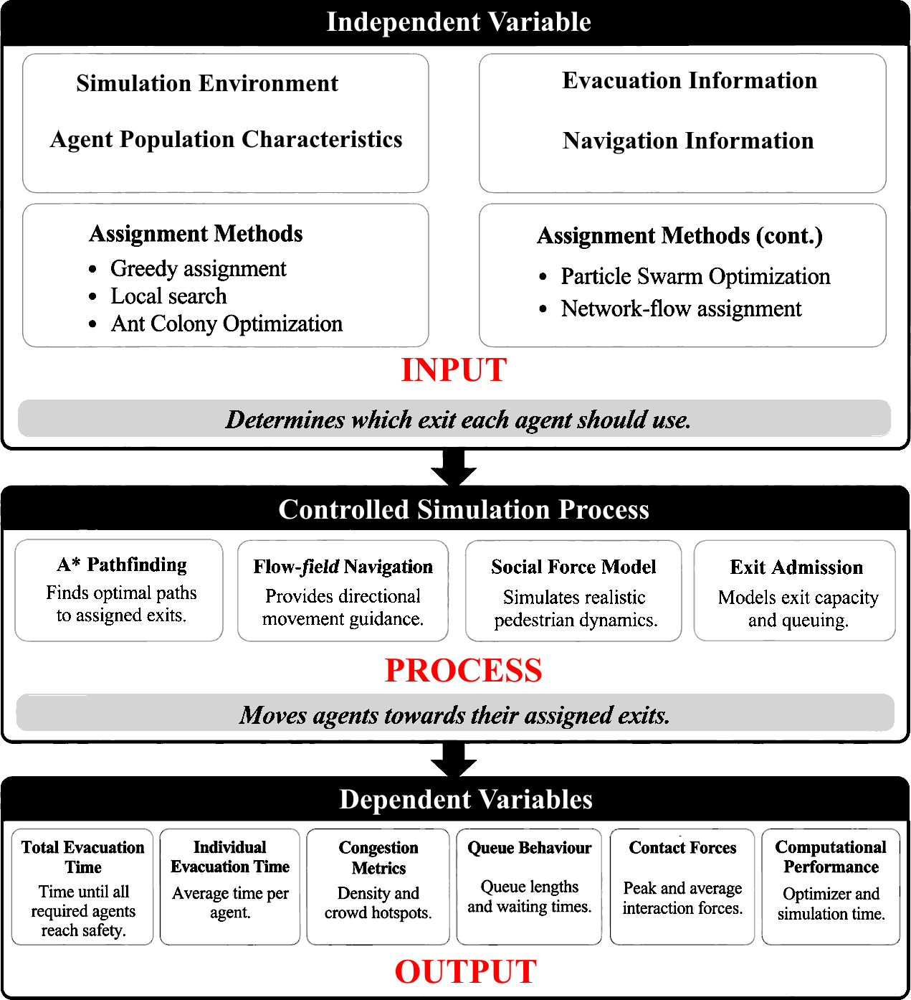

# **Comparative Evaluation of Multi-Exit Evacuation Assignment Algorithms Using a Congestion-Aware Agent-Based Pedestrian Simulation**

**Group 7 — STEM Capstone**

> **Revision note (project tracking, 24 November 2026).** This is the revised manuscript. Headings carry one of five tags: **[REVISED]** (rewritten against the implemented program), **[EDITED]** (small corrections), **[UNCHANGED]** (retained as written), **[BLUEPRINT]** (a specification of what the section must contain; final prose depends on data that do not exist yet), or **[PROVISIONAL]** (a recommendation that must be confirmed after the experiment). The section-by-section status and the reason for every change are in **Appendix A** and **Appendix B**. Remove the tags and the appendices before submission.

---

# **TABLE OF CONTENTS** {#table-of-contents} [REVISED]

- [Chapter 1 — Introduction](#chapter-1-introduction)
  - [1.1 Background of the Study](#background-of-the-study)
  - [1.2 Theoretical Background](#theoretical-background)
  - [1.3 Conceptual Framework](#conceptual-framework)
  - [1.4 Scope and Delimitations](#scope-and-delimitations)
  - [1.5 Statement of the Problem](#statement-of-the-problem)
  - [1.6 Objectives of the Study](#objectives-of-the-study)
  - [1.7 Hypotheses](#hypothesis)
  - [1.8 Significance of the Study](#significance-of-the-study)
- [Chapter 2 — Review of Related Literature and Studies](#chapter-2-review-of-related-literature-and-studies)
- [Chapter 3 — Research Methodology](#chapter-3-research-methodology)
- [Chapter 4 — Results and Discussion](#results-and-discussion)
- [Chapter 5 — Recommendations](#recommendations)
- [References](#references)
- [Appendix A — Revision Status by Section](#appendix-a-revision-status-by-section)
- [Appendix B — Revision Log and Evidence](#appendix-b-revision-log-and-evidence)

---

# **CHAPTER 1 — INTRODUCTION** {#chapter-1-introduction} [REVISED]

### **1.1 Background of the Study** {#background-of-the-study} [EDITED]

Evacuation planning is an important aspect of building and public safety, particularly in environments where large numbers of individuals may need to leave an area within a limited period. During an emergency, the availability of multiple exits does not automatically guarantee an efficient evacuation. When many evacuees are directed toward the same exit or pathway, congestion and queues may develop, potentially increasing the time required for individuals to reach designated safe areas.

Conventional pathfinding algorithms, such as A\* and Dijkstra's algorithm, determine routes based on distance or assigned travel costs. These algorithms are useful for finding paths through an environment. However, selecting the individually nearest or shortest route does not necessarily produce the most efficient evacuation outcome for an entire population. The combined effect of assigning many individuals to the same pathways and exits must also be considered.

Evacuation simulation provides a controlled means of examining these conditions. Agent-based models represent evacuees as individual computational agents whose movement and interactions can produce collective behaviours, including congestion and queuing. These simulations allow different evacuation strategies to be examined under consistent environmental conditions without requiring actual occupants to participate in potentially dangerous experiments.

The assignment problem is difficult for reasons that go beyond route length. Individual decisions interact: every additional agent assigned to an exit changes the queue, the density on the approach, and the travel time of other agents. The effect is non-linear because congestion reduces walking speed and throughput. The objective is collective, so an assignment that is optimal for one agent can be poor for the population. The best assignment also depends on how the crowd model represents movement, so an algorithm's own cost estimate cannot be treated as the outcome. These features make multi-destination assignment a combinatorial problem with emergent, capacity-dependent costs, which is why it must be studied separately from pathfinding.

Previous studies, such as Nirwana et al. (2024) and Yang et al. (2025), explored different approaches to evacuation route optimization and congestion reduction. The Social Force Model (Helbing & Molnár, 1995; Helbing et al., 2000) provides a widely used basis for simulating pedestrian movement and interactions during evacuation.

Existing work has examined evacuation routing, exit choice, and congestion-aware optimization, but the studies reviewed in Chapter 2 do not report a controlled comparison of several multi-exit assignment methods under the same pedestrian model, navigation layer, objective, and budget rule with both predicted and measured outcomes. This study addresses that narrower gap.

This study uses a three-dimensional voxel-based agent simulation developed in the Godot game engine to compare **multi-exit assignment** methods under a common pedestrian-level simulation. The comparison includes an unassisted logit control, two simple assignment controls (nearest exit and equal split), two greedy heuristics (capacity-aware and congestion-aware), local search, two metaheuristics (Ant Colony Optimization and Particle Swarm Optimization), and two network-flow models (static minimum-cost flow and time-expanded minimum-cost flow). A\* and flow-field navigation are **not** treated as assignment algorithms; they are held constant as the navigation layer that carries agents to whichever exit the assignment method chooses.

The study measures evacuation completion time, individual evacuation time, exit distribution, local density, queue behaviour, contact-force exposure, and computational cost. It also compares the optimizer's **predicted** completion time with the simulator's **measured** completion time. The latter is a distinct contribution: an assignment method can lower its own predicted cost while making the measured evacuation worse, so prediction error must be reported rather than assumed away.

### **1.2 Theoretical Background** {#theoretical-background} [REVISED]

This study is grounded in agent-based modelling, pedestrian dynamics, multi-destination assignment, congestion-aware optimization, network-flow theory, and queueing. The sections below explain the concepts that justify the research design. The implemented equations, constants, and numerical rules are specified in **Section 3.13**; this chapter keeps the theoretical argument, and the methodology keeps the auditable specification.

| Function | Question answered | Implementation in this study |
|---|---|---|
| **Exit assignment** | Which exit should each agent or group use? | The optimizer: baselines, greedy heuristics, local search, ACO, PSO, and two flow models |
| **Pathfinding / navigation** | How does an agent travel to the assigned exit? | Weighted A\* over the voxel navigation graph; optional shared per-exit flow fields |
| **Pedestrian movement** | How does the agent physically move and interact? | Reciprocal Social Force Model, kinematic ground-probe locomotion, exit admission policy |

A\* is part of the experimental **apparatus**, not a competing assignment method. Conflating the three functions would make the comparison meaningless.

#### **Agent-Based Modelling**

Agent-based modelling represents a system through individual entities that follow defined behavioural rules and interact with other agents and their environment. In this simulation, each agent represents an evacuee with an individual desired walking speed, a sampled pre-movement delay, a body radius and mass, a per-exit familiarity value, and a behavioural state (pre-movement, idle, wandering, seeking an exit, queued, arrived, evacuated, or dead). Interactions among agents produce collective phenomena such as lane formation, arching at exits, congestion, and queuing. The approach is appropriate because the research question is about how individual destinations produce a collective outcome, not about the behaviour of a single shortest path.

#### **Pedestrian Dynamics and the Social Force Model**

The simulator represents local movement with the Social Force Model of Helbing and Molnár (1995) and Helbing, Farkas, and Vicsek (2000). Conceptually, each agent has a desired velocity toward its current waypoint and is acted on by four forces: a psychological repulsion from other pedestrians, a body-contact force when bodies overlap, a sliding-friction force, and a repulsion from walls. The psychological force is anisotropic: an agent is affected less by people behind it than by people in front, which allows lanes and directional flow to emerge. The contact force is a soft force, not a hard collision, and the default locomotion is a kinematic ground probe rather than engine collision.

Two behavioural inputs matter for the comparison. First, free walking speed is sampled from a truncated normal distribution based on Weidmann's (1993) empirical mean and spread. Second, pre-movement delay is sampled from a lognormal distribution, so agents do not start at the same time. Both are held constant across assignment conditions.

The model is a **movement layer**, not a validated representation of a specific building. It does not model panic, group cohesion, leadership, smoke visibility, or injury. The study therefore does not claim that the simulated crowd is behaviourally realistic; it claims that the same crowd model is used for every assignment condition. The equations, parameters, and numerical scheme are in **Section 3.13.1–3.13.2**.

#### **Pathfinding and Navigation**

A\* (Hart et al., 1968), Dijkstra's algorithm (Dijkstra, 1959), and breadth-first search are established graph-search methods. A\* uses a heuristic estimate of the remaining cost; Dijkstra's algorithm expands by accumulated cost; breadth-first search is appropriate for unweighted graphs. In evacuation simulation, these methods determine how an agent travels to a destination, not which destination it should use.

The simulator builds a weighted graph over the voxel grid. The graph allows straight, diagonal, and one-block stair moves, and it penalises walls, exposed gaps, stairs, and slabs differently. The navigation layer returns the cheapest route for the current weights. One shared flow field per exit can be baked when flow fields are enabled; the current test scene disables them, so agents use A\* paths. In either mode, there is one cheapest route per (agent, exit) pair, and the optimizer cannot choose between parallel corridors to the same exit. A reactive congestion heat, built from agents' stuck reports, can raise path costs; it is a memory of recent difficulty, not a prediction of a proposed assignment. The navigation setting is held constant across conditions. Details are in **Section 3.13.3**.

#### **Multi-Exit Assignment and Combinatorial Optimization**

Multi-exit assignment is the problem of distributing a population among exits so that the collective evacuation is efficient. It is not a pathfinding problem. Individual decisions interact through shared corridors and exits: assigning one more agent to an exit changes the queue, the density on the approach, and the travel time of other agents. The objective is therefore collective, and the best assignment for one agent may be poor for the population.

With *N* agents and *E* exits, per-agent enumeration has *E<sup>N</sup>* possibilities (4<sup>600</sup> in the target scenario). The implementation groups agents into spatial cohorts and searches over cohort-to-exit vectors, expanding to agents only when assignments are applied. The cohort count is capped, and the search space is therefore much smaller than the per-agent space.

The implemented methods fall into five families:

| Family | Methods in this study | Role |
|---|---|---|
| Behavioural control | Unassisted logit exit choice | The system's default behaviour; optimizer off |
| Simple assignment controls | Nearest exit; equal split | Show whether global assignment adds anything beyond distance or even counts |
| Greedy heuristics | Capacity-aware greedy; congestion-aware greedy | Fast, deterministic, interpretable baselines |
| Search methods | Local search (single moves + pair swaps); ACO; PSO | Improve on greedy seeds; ACO and PSO are hybrids seeded by local search/greedy congestion, and ACO adds a final polish |
| Network optimization | Static minimum-cost flow; time-expanded minimum-cost flow | Expose the assignment as a capacity/time flow problem; both are relaxations rounded to one exit per cohort |

Exhaustive search is an **exact reference**, not a main condition: it is feasible only for small cohort counts and is used to verify that the heuristic results are not better than exact. "Flow assignment" in the codebase is a shared rounding/initialisation helper for the two flow models, not a separate selectable method.

The optimizer scores an assignment with a weighted sum of predicted makespan, predicted corridor congestion delay per agent, and predicted exit waiting per agent. Only those three terms are implemented; contact-force, route-switching, and hazard terms are not. A lower score means a better **predicted** assignment under the model, not a better evacuation. The distinction between predicted cost and measured outcome is central to this study. The objective, weights, and normalisation are in **Section 3.13.4**.

Network-flow formulations treat assignment as a capacity-constrained transportation problem, while queueing theory treats exit service as a server that admits arrivals at a finite rate. The implemented static and time-expanded flow models represent the first; the deterministic FIFO model represents the second. Both are relaxations or approximations of the pedestrian process, not measurements of it.

#### **Congestion, Capacity, and Queueing**

Congestion occurs when the number of pedestrians attempting to use a pathway or exit exceeds the movement or admission rate represented by the simulation. In this simulator, local density is measured from same-floor neighbours within a fixed radius. This is a local crowding probe, not a spatial average or a door-specific density.

The optimizer uses a deterministic demand-to-capacity predictor over the cells a candidate route crosses. It estimates a lane width from the navigation field, converts cohort demand into a peak flow, compares it with a modelled capacity, and converts the excess into agent-seconds. The predictor is a ranking model, not a measurement. The simulator separately records the actual local density, so predicted and measured congestion can be compared.

Exit admission is a policy model, not door geometry. Each exit is a trigger volume; with a configured service rate, arrivals enter a first-in, first-out queue and are admitted at a fixed interval. A rate of zero means unlimited admission, in which case the optimizer's queue term is zero by definition. A queue limit can reject over-limit arrivals, but the optimizer treats it as a steep penalty rather than a hard constraint. Receiving capacity binds only when evacuated agents are retained. These semantics are why the experiment must configure finite service rates: otherwise it cannot test queue-aware assignment. The formulas and policy details are in **Section 3.13.5–3.13.6**.

#### **Summary of the Implemented Model**

- A reciprocal Social Force Model at 30 Hz, with kinematic locomotion and a seeded per-agent random stream.
- A lognormal pre-movement delay and a logit baseline for exit choice when the optimizer is off.
- Weighted A\* navigation, with optional shared flow fields; no alternative-route enumeration.
- Cohort-to-exit assignment with three predicted cost terms: makespan, congestion delay, and queue waiting.
- Ten experimental conditions: one behavioural baseline and nine selectable assignment methods.
- Measured outcomes recorded independently of the optimizer's prediction.
- No hazard, route-level, or injury claims.

### **1.3 Conceptual Framework** {#conceptual-framework} [REVISED]

This study is guided by an Input–Process–Output–Feedback (IPO-F) model rather than a one-way IPO model, because the implemented system can re-solve during a run.



**Figure 1.** Input–Process–Output–Feedback framework for the comparative evaluation of multi-exit assignment methods. The figure is the group's existing framework; the caption and the labels below have been aligned with the implemented system.

| Component | Contents |
|---|---|
| **Input** | A fixed voxel environment with exits and spawn cells; 300 agents in the primary scenarios (600 in the scale replication); desired-speed and pre-movement distributions; exit admission rates; navigation graph and flow fields; assignment method and objective weights; cohort size and search budget; fixed random seed |
| **Process** | Build spatial cohorts → bake one cost field per exit → evaluate candidate cohort-to-exit assignments with the common objective → validate and apply assignments → simulate Social Force movement and exit admission → re-solve on the configured schedule or disruption → record snapshots and events |
| **Output** | Measured evacuation time (total, average, median, P95, maximum), exit distribution, local density, queue behaviour, contact-force exposure, route changes, computational time, and the gap between predicted and measured completion time |
| **Feedback** | Periodic and triggered re-solve (exit change, environment change, queue growth, spawn wave); assignment persistence, a 4 m commitment radius, and a 2 s minimum gap between solves |

The framework supports two comparisons. The **primary** comparison holds the environment fixed and compares assignment methods. The **secondary** comparison introduces one pre-registered disruption (an exit is disabled mid-run) to examine whether re-solving helps. These are different experiments and are not pooled.

The framework also separates the research variables from the software workflow:

- **Independent variable:** the assignment condition (ten levels: the unassisted logit baseline and nine selectable assignment methods).
- **Controlled variables:** the map, exits and service rates, agent population, desired-speed and pre-movement distributions, navigation layer, objective weights, cohort size and cap, search budget, and seed.
- **Dependent variables:** total evacuation completion time (primary), average/median/P95/maximum individual time, exit distribution, local density, queue behaviour, contact-force exposure, route changes, solver and pipeline time, and predicted-versus-measured error.
- **Feedback:** periodic or triggered re-solve under the configured policy.

A fixed environment and a fixed assignment are not the same thing. A run can have a fixed map and still re-solve as congestion changes; conversely, the primary scenarios here disable re-solving so that the comparison isolates the assignment method. The secondary disruption experiment changes the environment and enables re-solving. This distinction is stated again in Chapter 3.

### **1.4 Scope and Delimitations** {#scope-and-delimitations} [REVISED]

#### **Scope**

This study develops and evaluates a 3D voxel-based evacuation simulation in the Godot engine (Godot Engine, 2026) to compare multi-exit **assignment** methods under a common pedestrian-level simulation. The primary comparison holds the environment fixed and includes the following conditions:

1. unassisted logit exit choice (optimizer off);
2. nearest exit;
3. equal split;
4. capacity-aware greedy;
5. congestion-aware greedy;
6. local search;
7. Ant Colony Optimization (ACO);
8. Particle Swarm Optimization (PSO);
9. static minimum-cost network flow; and
10. time-expanded minimum-cost network flow.

Exhaustive search is used only as an exact reference on small synthetic instances. A\*, flow-field navigation, and the Social Force Model are held constant and are not experimental conditions.

The study evaluates the conditions on total evacuation completion time (primary outcome), average and distributional individual evacuation time, exit distribution, local density, exit queue length and waiting time, contact-force exposure, route changes, and computational execution time. It also evaluates the agreement between the optimizer's predicted completion time and the measured completion time.

The primary experiment consists of two fixed-environment scenarios (S1 symmetric and S2 asymmetric), each with 300 agents and four exits, and both use explicitly configured finite service rates. S3 (600-agent scale replication) and S4 (exit-disruption) are secondary experiments with their own analyses; they are not pooled with the primary comparison. If S3 or S4 is not completed, it will be reported as omitted rather than as a null result. All runs use the balanced objective preset, 4 m cohorts, a maximum of 60 cohorts, the same navigation and crowd parameters, and the same 2000 ms budget for the budgeted search methods. Because the primary scenarios use finite rates, the queue term is active; a zero rate would make queue-aware claims invalid.

#### **Delimitations**

The study is limited to computer-based simulation. It does not involve real evacuation drills, real building occupants, or empirically calibrated crowd data. Panic, queuing culture, group cohesion, leadership, wayfinding uncertainty, smoke visibility, fire spread, structural damage, and injury are not part of the experiment. The simulator contains separate gas/smoke/heat and water systems, but they are not coupled to the optimizer's cost model and are not recorded as hazard exposures in this study; they are therefore outside its scope.

The optimizer chooses **exits, not corridors**. It cannot split a cohort across parallel corridors to the same exit, because the navigation layer provides one cheapest path per (agent, exit) pair. Authored waypoint routes and route-level optimization are outside the scope.

Exit throughput is a modelled single-server admission rate, not a measured door. Receiving capacity is a policy limit on retained agents, not a geometric area. Contact force is a soft-body simulation diagnostic in newtons, not a validated injury metric. The study therefore compares **relative simulated performance**; it does not claim real-world predictive accuracy or operational recommendations for actual buildings.

The study is also limited by its conditions: one simulator, one implementation of each algorithm, one objective preset in the primary comparison, and a finite number of seeds. The findings are conditional on these choices.

### **1.5 Statement of the Problem** {#statement-of-the-problem} [REVISED]

This study aims to determine the differences in simulated evacuation performance among conventional and optimization-based multi-exit assignment methods using a congestion-aware agent-based pedestrian simulation. Specifically, it seeks to answer the following questions:

1. **Primary.** Is there a significant difference in total evacuation completion time among the tested multi-exit assignment conditions?
2. How do the conditions compare in average individual evacuation time, its distribution (median, P95, maximum), and the distribution of evacuees among available exits (accepted counts and shares, and assigned counts)?
3. What differences can be observed in congestion-related measurements (peak and time-weighted mean local density), exit queue behaviour (current and peak queue length, average and maximum waiting time, utilization), and contact-force exposure (peak force, loaded P99, agent-seconds above 2 kN and 3 kN) among the conditions?
4. How do the conditions compare in computational execution time (solver time per solve and cumulative pipeline time), and how stable are their evacuation outcomes across repeated seeds (across-seed coefficient of variation and same-seed repeatability, defined in Section 3.12)?
5. **Exploratory.** How closely does each method's predicted completion time agree with the measured completion time, and does the prediction error differ systematically among methods?

### **1.6 Objectives of the Study** {#objectives-of-the-study} [REVISED]

The general objective of this study is to comparatively evaluate multi-exit evacuation assignment methods using a congestion-aware agent-based pedestrian simulation.

Specifically, the study aims to:

1. Measure and compare the total evacuation completion time produced by each assignment condition.
2. Determine and compare average individual evacuation time, its distribution, and the distribution of evacuees among available exits.
3. Examine differences in peak and time-weighted mean local density, exit queue behaviour, and contact-force exposure during simulated evacuations.
4. Evaluate solver and pipeline computational time and determine the stability of evacuation outcomes across repeated seeds using the statistics defined in Section 3.12.
5. Quantify the agreement between predicted and measured completion times for each method and identify systematic over- or under-prediction.

### **1.7 Hypotheses** {#hypothesis} [REVISED]

The primary outcome is total evacuation completion time. The null and alternative hypotheses are:

**H₀:** There is no statistically significant difference in total evacuation completion time among the tested multi-exit assignment conditions under the specified simulation conditions.

**H₁:** At least one tested multi-exit assignment condition produces a statistically significant difference in total evacuation completion time compared with at least one other condition under the specified simulation conditions.

Secondary outcomes (average time, density, queue behaviour, contact exposure, computational time, and prediction error) are analysed as **exploratory comparisons**. They are reported with effect sizes and multiplicity control, but they are not framed as confirmatory tests. This prevents the study from claiming significance for whichever secondary metric happens to separate by chance.

The unit of analysis, the repeated-measures structure, the primary test, the post-hoc procedure, the multiplicity adjustment, the effect-size measures, and the handling of incomplete runs are specified in **Section 3.12**. Ten seeds per condition is a resource-constrained design choice, not a power calculation; the study reports uncertainty, treats non-significant differences as inconclusive rather than as evidence of equivalence, and does not claim more precision than the data support.

### **1.8 Significance of the Study** {#significance-of-the-study} [REVISED]

This study examines how different multi-exit assignment methods influence simulated evacuation performance within a common agent-based simulation. It may provide information about the relationship between exit assignment, pedestrian congestion, evacuation time, and computational cost, without claiming real-world predictive validity.

**1. Students and Future Researchers.** The study may serve as a reference for students and researchers interested in evacuation simulation, pedestrian dynamics, multi-destination assignment, and computational modelling. It documents a reproducible comparison protocol and a measurement vocabulary that later studies can reuse.

**2. Educators and Academic Institutions.** The simulation may serve as an educational resource for demonstrating the application of mathematical, computational, and engineering concepts to evacuation-related problems, including the difference between pathfinding and assignment.

**3. Software Developers and Simulation Researchers.** The findings may clarify the performance trade-offs among greedy heuristics, local search, metaheuristics, and network-flow relaxations when applied to the same assignment problem, under a common objective and a defined budget rule, with the same simulator. The study also documents where the optimizer's prediction diverges from the simulation's measurement.

**4. Building Administrators and Emergency Planning Researchers.** The study may provide preliminary, simulation-only insights into how exit-assignment strategies affect modelled evacuation. The findings must not be interpreted as direct operational recommendations for real buildings without calibration and real-world validation.

**5. The Community.** The study may promote awareness of evacuation planning and of the effects of crowd congestion during emergencies.

---

# **CHAPTER 2 — REVIEW OF RELATED LITERATURE AND STUDIES** {#chapter-2-review-of-related-literature-and-studies} [REVISED]

This chapter reviews literature on evacuation simulation, pedestrian dynamics, pathfinding, multi-exit assignment, congestion and exit capacity, and validation. It is organised thematically and critically: each section states what the reviewed work establishes, what it does not establish, and why that matters for the present study. The chapter ends with a comparison matrix and a scoped gap statement.

The review is **purposive, not systematic**. It covers the sources cited here and does not claim to exhaust the field. The gap statement in Section 2.8 is therefore limited to the studies reviewed.

### **2.1 Evacuation Simulation Tools and Their Validation**

Smažinka et al. (2026) reviewed evacuation simulation tools and examined platforms such as Pathfinder, MassMotion, LEGION, buildingEXODUS, and FDS+Evac. The tools differ in modelling approach, behavioural representation, visualisation, and integration capability. The review identified persistent challenges in behavioural realism, empirical validation, standardisation, and interoperability. Its most important implication for the present study is that simulation tools are not interchangeable: results depend on the model, not only on the algorithm being tested.

Cuesta et al. (2017) compared the configuration and validation of egress modelling tools using school evacuation data collected through observations and video recordings between 2011 and 2014. The data included pre-movement times, routes, walking speeds, and arrival times. The compared tools produced different results even under similar initial conditions. This supports two design decisions in the present study: a single simulator must be used for all algorithm conditions, and measured outcomes must be reported separately from optimizer predictions.

Zheng, Zhong, and Liu (2009) compared seven methodological approaches to building evacuation modelling, and Duives, Daamen, and Hoogendoorn (2013) reviewed the state of the art in crowd motion simulation. Both reviews show that model choice changes the phenomena a simulator can represent: cellular models emphasise local occupancy, continuous models emphasise interaction forces, and network models emphasise route and capacity. None of these reviews establishes that one model is universally valid. The present study therefore treats the simulator as a controlled experimental apparatus, not as a validated replica of a specific building.

These studies also make an important distinction that the present study adopts. **Validation** asks whether a simulator reproduces observed behaviour. **Comparison** asks whether one decision rule performs better than another under the same simulator. This study addresses the second question. Using one simulator improves internal consistency, but it does not establish empirical accuracy.

### **2.2 Agent-Based Modelling and Pedestrian Dynamics**

Agent-based modelling represents each evacuee as an individual entity with characteristics and behavioural rules. Smažinka et al. (2026) note that agent-based models can represent individual differences and interactions that aggregate models cannot. Senanayake, Kieu, Zou, and Dirks (2024) provide a systematic review of agent-based pedestrian evacuation simulation, which is a useful entry point to the model families used here. When many agents independently choose the same corridor or exit, congestion can emerge without any central instruction. This is directly relevant to the present study, where the assignment method changes individual destinations and the crowd model produces the collective consequences.

The Social Force Model (Helbing & Molnár, 1995) describes pedestrian movement through a desired-motion term and interaction forces from other pedestrians and boundaries. Helbing, Farkas, and Vicsek (2000) extended the analysis to escape panic and showed how individual interactions can produce collective crowd phenomena, including arching and clogging at exits. Helbing, Buzna, Johansson, and Werner (2005) combined experiments, simulations, and design solutions for self-organised crowd dynamics. Weidmann (1993) provides the empirical basis for the free walking-speed distribution used here. Moussaïd, Helbing, and Theraulaz (2011) discuss how simple local rules can produce lane formation and crowd disasters.

The Social Force Model has known limitations. It is a continuous force model with parameters that are often transferred from a small number of experiments; it does not represent group cohesion, leadership, wayfinding knowledge, or smoke visibility; and its contact force is not a validated injury measure. Haghani and Sarvi (2016) show that exit choice in normal egress and emergency evacuation differs in ways that a simple distance-and-density rule does not capture. Lovreglio, Borri, dell'Olio, and Ibeas (2014) model exit choice with a random-utility discrete-choice formulation, which is the same family as the logit baseline used here. This is why the present study treats the crowd model as a fixed movement layer and the logit exit choice as a behavioural baseline, not as a validated model of a specific population.

The model is appropriate for this study for a narrower reason: it produces local interactions, congestion, and queuing, and it can be held constant while the assignment layer changes. The study does not test whether the Social Force Model is behaviourally realistic. It tests whether assignment methods differ under the same movement model.

### **2.3 Pathfinding and Navigation**

A\* (Hart et al., 1968), Dijkstra's algorithm (Dijkstra, 1959), and breadth-first search are established graph-search methods. A\* uses a heuristic estimate of the remaining cost; Dijkstra's algorithm expands by accumulated cost; breadth-first search is appropriate for unweighted graphs. In evacuation simulation, these methods determine how an agent travels to a destination.

The crucial distinction for this study is that pathfinding does not decide **which** destination an agent should use. A shortest path to an overloaded exit can be individually rational and collectively poor. Nirwana et al. (2024) make a related distinction at the graph level: they formulate evacuation as a multi-vertex, multi-goal problem and use Ant Colony Optimization to search across multiple origins and destinations, rather than solving a single shortest path.

Pathfinding also differs from assignment in its treatment of cost. A route planner can respond to static weights or to dynamic congestion, but it still returns a path for a given destination. Assignment changes the destination itself, which changes the demand on every shared corridor and exit. This is why an assignment method can improve or worsen congestion even when every agent follows its own shortest path.

The present simulator uses weighted A\* over a voxel navigation graph and supports one shared flow field per exit. The current test scene disables flow fields and therefore uses A\* paths; the experiment holds that setting constant. In either mode, the optimizer cannot choose among parallel corridors to the same exit. This is a deliberate scope limit, and it is stated rather than hidden.

### **2.4 Multi-Exit Assignment in Buildings**

A body of work has addressed exit selection and evacuation assignment at the building level. Abdelghany, Abdelghany, Mahmassani, and Alhalabi (2014) proposed an optimisation framework for evacuating large crowded pedestrian facilities. Song, Sun, Xie, Li, Wang, and Han (2018) improved the Social Force Model with a characteristic-time term and proposed an exit-assignment strategy for pedestrian evacuation. Hao, Zhang, Shao, and Xing (2014) studied exit-selection strategies in multi-exit pedestrian simulations. Fu, Shi, Zeng, Zhang, Liu, and Liu (2021) examined pedestrian evacuation optimisation in a multi-exit building, and Wu, Wang, Jiang, Wang, and Zhou (2021) optimised a multi-exit subway station through overall partition and local railing design.

Other studies address adjacent decisions. Kurdi, Al-Megren, Althunyan, and Almulifi (2018) examined how exit placement affects evacuation plans, which is a layout decision rather than an assignment rule. Guo (2018) formulated potential-based dynamic pedestrian flow assignment, and Zhang and Jia (2020) proposed an optimal guidance strategy for crowd evacuation with multiple exits using hybrid multiscale modelling. These studies establish that multi-exit assignment and guidance are active research problems, and that the decision variable can be an exit, a route, a sign, a guide, or a physical partition.

Comparative studies also exist. Chen and Zhan (2008) used agent-based modelling to compare simultaneous and staged urban evacuation strategies, and Koo, Kim, Kim, and Christensen (2013) compared high-rise evacuation strategies for people with disabilities. These studies compare strategies at the urban or building-strategy level; they do not compare assignment-algorithm families inside one pedestrian simulator with a common objective.

The studies differ in what they hold constant and what they measure. Some evaluate a proposed assignment rule inside a pedestrian model; others optimise a network or a layout; others study guidance or signage. Their reported outcomes are often evacuation time, flow rate, or route cost. The studies reviewed here do not report a controlled comparison of several assignment-algorithm families inside the same pedestrian-level simulator, with the same navigation layer, objective, and defined budget rule, and with both predicted and measured outcomes. That combination is the space the present study investigates; it is not a claim that no related study exists.

Three limitations recur across this group. First, the decision variable is often a route, a sign, or a layout rather than the exit assignment itself. Second, evaluation is often a single strategy or a single model, without a common objective across competing methods. Third, the optimizer's predicted cost is rarely paired with the measured pedestrian outcome. These limitations motivate the present comparison.

### **2.5 Assignment Algorithms and Optimisation**

Vermuyten, Beliën, De Boeck, Reniers, and Wauters (2016) reviewed optimisation models for pedestrian evacuation and design problems and showed that the literature spans different decision problems and solution methods, with different objective functions. This supports the present study's decision to compare method families rather than declare one family superior.

Nirwana et al. (2024) combined a multi-vertex, multi-goal formulation with ACO and compared ACO with Dijkstra's algorithm and breadth-first search on evacuation route problems with multiple starting points and destinations. They reported that ACO achieved the lowest evacuation time and highest efficiency among the compared algorithms in their experiments. The study demonstrates that optimisation can improve multi-origin, multi-destination routing. Its reported evaluation, however, is at the graph/route level rather than a pedestrian-level crowd simulation with density and contact measurements.

Yang et al. (2025) developed an emergency evacuation route optimisation model for flood disasters by coupling a hydrodynamic model with intelligent optimisation and a road-congestion model. Their work shows that congestion-aware routing is not novel in itself. What remains open is how different assignment methods behave inside a pedestrian-level simulation, where congestion is an emergent consequence of movement rather than a road-link cost.

Ishida and Miki (2026) developed a geographic evacuation route optimisation method for natural disasters. Their system uses geographic information, geocoding, disaster- and flood-risk mapping, road-network analysis, and route calculation toward shelters, and evaluates usability with the System Usability Scale. It addresses route planning at the geographic scale, not multi-exit assignment inside a building. It is relevant because it shows how environmental risk can be incorporated into routing, which is a natural extension of the present work but not part of its experiment.

ACO (Dorigo & Gambardella, 1997) and PSO (Kennedy & Eberhart, 1995) are established metaheuristics for combinatorial search. Minimum-cost flow is a classical network optimisation problem (Ahuja et al., 1993). The present study includes these families not to claim that one family is universally superior, but to compare them under a common objective and simulator, with a common wall-clock limit for the budgeted search methods and reported effort for every condition.

Two methodological points follow from the literature. First, the implemented ACO and PSO are **hybrids**: both are seeded by a local search that starts from the congestion-aware greedy assignment, and ACO also runs a final polish while PSO's global best starts at the seed. The study therefore compares implemented hybrid configurations, not pure textbook ACO or PSO. Seed cost and final cost must be reported separately. Second, a network-flow model is a **relaxation**: it may split a cohort between exits, and the result must be rounded to a feasible one-exit assignment. The rounding rule, the split count, and the kept-seed decision must be reported.

### **2.6 Congestion, Exit Capacity, and Queueing**

Congestion in crowd simulation is an emergent property of local interactions and exit capacity. Helbing et al. (2000) show how clogging and arching can appear at bottlenecks even when individuals are trying to move efficiently. Hoogendoorn and Daamen (2005) studied pedestrian behaviour at bottlenecks and showed that capacity and walking behaviour depend on the geometry and the composition of the crowd. Seyfried, Steffen, Klingsch, and Boltes (2005) revisited the pedestrian fundamental diagram, and Vanumu, Rao, and Tiwari (2017) reviewed fundamental diagrams across studies. Together they establish the density–speed–flow relationship that makes crowding a non-linear constraint rather than a simple count.

This literature explains why balancing the **number** of people across exits does not necessarily balance evacuation performance. Two exits with equal counts can have different approach widths, queue disciplines, and walking speeds. A capacity-constrained assignment must consider flow, not only counts. Daamen and Hoogendoorn (2012) further show that emergency door capacity depends on door width, population composition, and stress level, which is why the present study treats exit service rates as modelled constraints rather than as measured door geometry.

In the present simulator, congestion is measured as local density (agents within 1.4 m on the same floor), and exit capacity is modelled as a single-server admission rate. These are different constructs from road-link congestion and from a fundamental-diagram measurement. The optimizer's congestion term is a demand-to-capacity prediction over candidate routes, and its queue term is a deterministic FIFO model. Neither is a measurement. The study therefore reports predicted and measured congestion separately.

A second issue is that default exits have no configured service rate. When the rate is zero, admission is unlimited and the queue term is zero by definition. An experiment that leaves the default in place would compare methods on travel time and predicted corridor load only, and would not test queue-aware assignment. The methodology therefore configures finite service rates for the primary scenarios and states them as modelled constraints.

### **2.7 Reproducibility, Verification, and Standardisation**

Smažinka et al. (2026) identify standardisation and validation as open problems. Cuesta et al. (2017) show that different tools can diverge under similar conditions. A comparative study therefore needs more than a single successful run. It needs seeded repetitions, documented parameters, software verification, and a clear statement of what is and is not measured.

The present simulator supports this in three ways. First, each agent owns a random stream seeded from the run seed and the agent serial, so spawn positions, speeds, and pre-movement delays are reproducible for a fixed seed and layout. Second, the recorder stores run metadata, exit configuration, crowd and navigation parameters, per-agent samples, route assignments, evacuation events, optimizer events, and a final summary. Third, the optimizer can be disabled entirely, leaving the original logit behaviour as a control.

Determinism is not absolute. Real-time repath timers and frame scheduling can change trajectories even with the same seed, and a single-run contact-force peak is not a stable statistic. The methodology therefore treats repeated seeds and same-seed repeats as separate sources of variability, and it defines the stability statistic rather than calling results "consistent" by inspection.

### **2.8 Synthesis and Research Gap**

The literature establishes four points. Evacuation simulation is sensitive to modelling assumptions. Pedestrian dynamics can generate congestion and clogging from local interactions. Multi-exit assignment, exit choice, and guidance have each been studied at the building, network, or behavioural level. A\*, ACO, PSO, local search, and network flow are each well established in isolation.

The gap is narrower than "no one has studied congestion". Within the studies reviewed here, the literature does not report a controlled comparison of several multi-exit assignment approaches inside **one pedestrian-level simulator**, using the same pedestrian model, navigation layer, objective, and defined budget rule, and reporting both the optimizer's predicted cost and the measured evacuation outcome. Some studies compare algorithms on abstract graphs; some optimise a layout or a guidance strategy; some evaluate one assignment rule inside a crowd model. Those are related contributions, but they do not provide the specific comparison this study proposes.

This study addresses that gap. It does not claim that congestion-aware assignment is new, and it does not claim to be the first comparative study. It claims a comparative evaluation protocol: one simulator, one objective, multiple algorithm families, measured outcomes, and an explicit prediction-error analysis. The strongest contribution is the paired analysis of predicted and measured performance. A method can lower its internal objective while worsening the simulated evacuation; reporting both makes that visible.

The three claims of the study are therefore:

1. **Common environment (strong).** Comparing several assignment approaches under the same pedestrian model, navigation, map, objective, and seed set is a controlled experimental contribution.
2. **Predicted versus measured performance (strong, and central).** Reporting both the optimizer's estimate and the simulator's outcome, and analysing their error, is more informative than ranking methods by their own objective.
3. **Comparative algorithm evaluation (plausible, not a priority claim).** Comparing greedy, local-search, metaheuristic, and network-flow methods is useful, but the review does not establish that no closely related comparison exists. The study must not claim priority.

**Table 1. Comparison matrix of related studies**

> Rows are based on the cited records and abstracts; the full texts still need to be checked before the method and evaluation columns are treated as final (see Appendix B, B.4).

| Study | Main problem | Method | Simulation level | Evaluation | Relevance or limitation |
|---|---|---|---|---|---|
| Abdelghany et al. (2014) | Optimal evacuation of large crowded facilities | Optimisation framework for facility evacuation | Building / network | Evacuation plan performance | Directly relevant to assignment; not a multi-family pedestrian-level comparison |
| Song et al. (2018) | Exit assignment in pedestrian evacuation | Improved Social Force Model and exit-assignment strategy | Pedestrian simulation | Evacuation performance | Directly relevant; evaluates a proposed strategy rather than several families |
| Hao et al. (2014) | Exit selection with multiple exits | Exit-selection strategy | Pedestrian simulation | Evacuation simulation outcomes | Relevant to multi-exit choice; not a common-objective algorithm comparison |
| Fu et al. (2021) | Evacuation optimisation in a multi-exit building | Simulation-based optimisation | Building | Evacuation performance | Relevant setting; conference-level study |
| Wu et al. (2021) | Multi-exit subway station evacuation | Partition and local railing optimisation | Building / station | Evacuation performance | Layout optimisation rather than assignment-algorithm comparison |
| Kurdi et al. (2018) | Effect of exit placement on evacuation | Exit-placement optimisation | Building | Evacuation plans | Relevant to exit configuration, not assignment rules |
| Guo (2018) | Dynamic pedestrian flow assignment | Potential-based flow assignment | Pedestrian flow model | Assignment behaviour | Directly relevant to dynamic assignment; not a multi-family empirical comparison |
| Zhang and Jia (2020) | Guidance with multiple exits | Hybrid multiscale optimisation | Pedestrian / guidance | Evacuation performance | Relevant to multi-exit control; guidance rather than assignment comparison |
| Chen and Zhan (2008) | Simultaneous vs staged urban evacuation | Agent-based simulation | Urban road network | Comparative strategy performance | Comparative, but urban scale |
| Koo et al. (2013) | Evacuation strategies for people with disabilities | Comparative simulation | High-rise building | Strategy performance | Comparative, but building-strategy level |
| Vermuyten et al. (2016) | Review of evacuation optimisation models | Literature review | Multiple levels | Methods and objectives | Supports the need for controlled comparison; not an experiment |
| Hoogendoorn and Daamen (2005) | Pedestrian behaviour at bottlenecks | Empirical and modelling study | Pedestrian | Capacity and behaviour | Supports bottleneck and capacity assumptions |
| Seyfried et al. (2005) | Fundamental diagram of pedestrian flow | Empirical measurement | Pedestrian | Density–speed–flow | Supports congestion measurement and capacity limits |
| Nirwana et al. (2024) | Multi-origin, multi-destination routing | MVMG with ACO; comparison with Dijkstra and BFS | Graph / route network | Reported evacuation time and efficiency | Supports optimisation for multi-destination routing; not pedestrian-level |
| Yang et al. (2025) | Flood evacuation routing | Hydrodynamic model plus congestion-aware optimisation | Road network | Route optimisation outcomes | Shows congestion-aware routing is established; different scale |
| Ishida and Miki (2026) | Hazard-aware route planning to shelters | Geographic information, risk mapping, road-network analysis | Geographic / road network | Route planning and usability | Different focus from indoor multi-exit assignment |
| Cuesta et al. (2017) | Validation of egress models | Comparison of several tools against school drill data | Building egress | Observed versus simulated outcomes | Supports validation and single-simulator design |
| Smažinka et al. (2026) | Review of evacuation simulation tools | Literature review | Multiple levels | Capabilities and challenges | Establishes validation and standardisation gaps |
| Helbing and Molnár (1995) | Pedestrian movement model | Social Force Model | Continuous pedestrian | Model behaviour | Provides the movement layer; not an assignment method |
| Helbing et al. (2000) | Escape panic and crowd dynamics | Social Force Model with panic effects | Continuous pedestrian | Emergent clogging and arching | Explains why capacity and density matter |
| Helbing et al. (2005) | Self-organised crowd dynamics | Experiments, simulations, design solutions | Pedestrian / building | Crowd dynamics and design | Supports the SFM and design motivation |
| Weidmann (1993) | Free walking-speed distribution | Empirical measurements | Pedestrian | Speed distribution | Source of the desired-speed distribution |
| Moussaïd et al. (2011) | Simple rules and crowd disasters | Behavioural modelling and analysis | Pedestrian | Lane formation and crowd phenomena | Supports anisotropic local interaction |
| Haghani and Sarvi (2016) | Exit choice in normal and emergency egress | Empirical behavioural study | Pedestrian | Exit-choice behaviour | Shows why a simple distance rule is incomplete |
| Lovreglio et al. (2014) | Exit choice in emergency evacuation | Random-utility discrete-choice model | Pedestrian | Choice model | Supports the logit baseline's behavioural form |
| **This study** | **Comparison of multi-exit assignment methods** | **Ten conditions under one objective and simulator; common wall-clock budget for budgeted methods** | **Pedestrian-level 3D voxel simulation** | **Measured time, density, queues, contact, computation, prediction error** | **Adds a controlled comparison and prediction-error analysis; exit-only, simulation-only** |

**Table 2. What the literature establishes and what this study adds**

| Established in the literature | Still open | How this study addresses it |
|---|---|---|
| Pedestrian interactions generate congestion and clogging | How much of the outcome is attributable to the assignment method rather than the crowd model | Holds the crowd model, map, seeds, and parameters constant across conditions |
| Congestion-aware routing improves network-level evacuation in some studies | Whether assignment methods differ at the pedestrian level once queues and density are measured | Compares distance-only, capacity-aware, congestion-aware, search, metaheuristic, and flow methods on measured outcomes |
| Multi-exit assignment and guidance have been studied at building, network, and behavioural levels | Whether several algorithm families have been compared under one objective and simulator with a defined budget rule | Uses a common objective and a defined budget rule; reports seed/final costs and actual effort |
| ACO, PSO, local search, and network flow are established methods | How they compare when their implementations are hybrids or relaxations | Reports seed cost, final cost, split cohorts, and rounding |
| Simulation results depend on model assumptions | Whether optimizer predictions agree with simulated outcomes | Reports predicted-versus-measured completion time and its error |
| Validation requires observed data | Whether an indoor multi-exit assignment comparison can be validated without a real drill | States the limitation explicitly: software verification and internal consistency only |

# **CHAPTER 3 — RESEARCH METHODOLOGY** {#chapter-3-research-methodology} [BLUEPRINT]

> **Status.** This chapter is a specification of what the final methodology must contain, with the values the implementation can actually support. It is written as a blueprint because the experiment has not yet been run. Every table below is a required table, not an optional appendix. Replace bracketed placeholders with the final values after the pilot.

### **3.1 Research Design** [BLUEPRINT]

The study uses a quantitative, experimental, comparative design. The independent variable is the assignment condition (ten levels). The primary dependent variable is total evacuation completion time. Secondary dependent variables are average and distributional evacuation time, exit distribution, peak and time-weighted mean density, queue length and waiting time, contact-force exposure, route changes, solver time, pipeline time, and predicted-versus-measured error.

The design is **repeated-measures across seeds**: every condition is run with the same seed list so that spawn positions, speeds, and pre-movement delays are matched as closely as the implementation allows. The environment is fixed within a scenario. Scenario is a blocking factor, not a treatment. The primary analysis uses the two fixed-environment scenarios; the scale and disruption scenarios are secondary and are analysed separately. The primary inferential test is run separately for S1 and S2, not pooled across scenarios.

The design supports causal language about **differences among the implemented conditions under the specified simulation**, not about evacuation in real buildings.

### **3.2 Research Variables** [BLUEPRINT]

**Table 3. Variables and controls**

| Type | Variable | Operationalisation |
|---|---|---|
| Independent | Assignment condition | Ten levels: logit baseline (optimizer off), nearest, equal split, greedy capacity, greedy congestion, local search, ACO, PSO, static flow, time-expanded flow |
| Blocking | Random seed | Fixed list of ten seeds, identical across conditions within a scenario |
| Blocking | Scenario | Symmetric four-exit (S1), asymmetric four-exit (S2); scale (S3) and disruption (S4) analysed separately |
| Primary dependent | Total evacuation completion time | Last admission minus run start, in simulation seconds |
| Secondary dependent | Average, median, P95, maximum individual evacuation time | Spawn-to-admission per evacuated agent |
| Secondary dependent | Exit distribution | Accepted count and share per exit; assigned count at end |
| Secondary dependent | Congestion | Peak local density; time-weighted mean of the per-sample mean local density |
| Secondary dependent | Queue behaviour | Current and peak queue length; average and maximum wait; utilisation when service rate > 0 |
| Secondary dependent | Contact exposure | Peak force; loaded P99; agent-seconds above 2 kN and 3 kN; non-zero sample fraction |
| Secondary dependent | Stability | Route changes and route switches per agent; same-seed repeat differences |
| Secondary dependent | Computational cost | Solver time per solve; cumulative pipeline time (capture + solve + apply) |
| Secondary dependent | Prediction error | Measured minus predicted completion time; absolute and percentage error |
| Controlled | Map, spawn cells, population, speed distribution, pre-movement distribution | Same save/layout and same seed across conditions |
| Controlled | Crowd model and navigation parameters | Same Social Force, kinematic, graph, flow-field, and congestion-heat settings |
| Controlled | Exit configuration | Same exits, positions, service rates, queue limits, retention policy |
| Controlled | Objective and search settings | Balanced weights (1.0, 0.4, 0.3); 4 m cohorts; 60 cohort cap; 2000 ms wall-clock limit for C5–C7; actual effort reported for all |
| Controlled | Measurement settings | 30 Hz physics; 0.25 s recording interval; same run horizon |
| Measured nuisance | Real-time scheduling | Same-seed repeat sub-study; report variance rather than assuming determinism |

### **3.3 Flow of the Study** [BLUEPRINT]

1. Prepare and freeze the scenario save: map, exits, spawn cells, service rates, spawner quotas, and runtime exports.
2. Verify the build: run the headless harnesses; confirm the scenario loads with no live agents and the expected exit set.
3. For each scenario, for each seed, for each condition:
   1. load the frozen save and reset the run;
   2. set the seed and confirm the population parameters;
   3. configure the condition (optimizer off, or optimizer on with the specified algorithm);
   4. start the recording and the run;
   5. run to completion or to the pre-registered horizon;
   6. stop/reset and label the demo with scenario, condition, seed, and build;
   7. export the summary, per-agent records, per-exit records, and optimizer events.
4. Validate each run against the A/B checklist: same seed, same layout, same exit configuration, same objective and budget settings, no manual edits.
5. Run the same-seed repeat sub-study on one condition to estimate scheduling variance.
6. Analyse in external statistical software; produce tables and figures; do not analyse inside the engine.
7. Report all conditions, including those that perform poorly; do not select the best run.

### **3.4 Research Environment** [BLUEPRINT]

**Table 4. Research environment**

| Item | Value |
|---|---|
| Engine | Godot 4.7.2 stable |
| Renderer | `mobile` |
| Physics | 30 Hz, fixed timestep |
| Operating system | Windows 11 (record exact build) |
| Hardware | Record CPU, GPU, RAM, storage; pilot used an NVIDIA RTX 5060 Laptop GPU |
| Scenario size | Four exits; 300 agents in S1/S2; 600 agents in S3 |
| Exit geometry | 1 m radius, 2 m tall trigger cylinder; service rate as configured |
| Recording | `SimRecorder`, 0.25 s sampling, paths recorded |
| Analysis | Python (pandas, SciPy, statsmodels) or R; record versions |

The hardware is part of the environment because solver and pipeline times are wall-clock measurements. If the analysis machine differs from the experiment machine, only the recorded times are used.

**System-level pilot (not a study result).** A 600-agent, four-exit baseline run of the simulator, used only to confirm that the scenario completes and to size the horizon, evacuated all 600 agents with 0 deaths and 0 failed paths. It produced an average evacuation time of 22.0 s, a median of 20.6 s, a P95 of 45.6 s, and a maximum of 75.4 s; exit shares were 29/27/23/20%; peak local density was 1.95 persons/m²; and the single-run peak contact force was 2.98 kN. The crowd solver cost 3.8–4.4 ms per 30 Hz tick. These are verification-run figures, not the algorithm comparison, and the contact peak is a single-run maximum rather than a stable statistic. They justify a 300 s horizon but must not be reported as findings.

### **3.5 Research Instruments** [BLUEPRINT]

**Table 5. Instruments and their role**

| Instrument | What it provides | Role in the study |
|---|---|---|
| Simulation scene | Voxel map, exits, spawners/populator, agents | Runs the experiment |
| Social Force solver | Pair forces, contact force, density | Produces the movement and congestion outcomes |
| Navigation graph and flow fields | Weighted A\* paths; optional per-exit flow fields | Held constant; carries agents to assigned exits |
| Optimizer panel | Condition, objective, cohort size, budget, solve controls, assignment overlay | Sets and monitors the treatment |
| Optimizer bridge | Snapshot, solve, validate, apply, re-solve, adoption | Applies assignments and records the solve |
| `SimRecorder` | Run metadata, 0.25 s agent/exit samples, route/evacuation/queue/contact/optimizer events, summary | Source of all measured outcomes |
| Demo Player | Timeline, agent inspection, route/exit/density/contact views | Inspection and diagnosis, not statistical input |
| Demo Comparer | Synchronized 2–6 run comparison, final summary, verdict, configuration diff | Cross-run checks and figures |
| F4 results panel | Measured summary and predicted makespan | Quick verification of predicted-versus-measured |
| Headless harnesses | Optimizer, navigation, recording, restore, scale tests | Software verification before data collection |
| External statistics | Descriptive and inferential analysis | Treatment of data |

### **3.6 Experimental Conditions** [BLUEPRINT]

**Table 6. Conditions and implementation details**

| ID | Condition | Family | What it decides | Notes |
|---|---|---|---|---|
| C0 | Logit baseline | Behavioural control | Each agent draws an exit from the logit model | Optimizer off; the system's default |
| C1 | Nearest exit | Control | Each cohort to the shortest-travel exit | Ignores queues and crowding |
| C2 | Equal split | Control | Balance assigned counts across exits | Ignores geometry |
| C3 | Capacity-aware greedy | Greedy | Largest cohorts first, full objective per candidate exit | Fast and deterministic |
| C4 | Congestion-aware greedy | Greedy | Price the marginal queue and corridor delay of each placement | Congestion-aware baseline |
| C5 | Local search | Local optimisation | Single-cohort moves and pair swaps from a greedy seed | Practical reference; seeded and budgeted |
| C6 | ACO | Metaheuristic | ACS construction, congestion-priced heuristic, local-search seed, polish | Hybrid; report seed cost and final cost |
| C7 | PSO | Metaheuristic | Random-key swarm seeded by local search | Hybrid; report seed cost and final cost |
| C8 | Static min-cost flow | Network optimisation | Source–cohort–exit–sink flow with FIFO service bins | Relaxation; rounded to one exit per cohort |
| C9 | Time-expanded min-cost flow | Time-dependent network optimisation | Exit–time-bin network with holdover and service arcs | Relaxation; includes arrival timing |
| — | Exhaustive search | Exact reference | All cohort-to-exit combinations | Small synthetic instances only; not a main condition |
| — | Flow assignment | Helper | Rounds and initialises the flow models | Not a separate condition |

The experiment has **ten conditions** (C0–C9): one behavioural baseline and nine selectable assignment methods. The two rows marked “—” are references, not conditions. The paper does not call all ten conditions “optimization algorithms”.

All optimised conditions use the same balanced weights, cohort size (4 m), cohort cap (60), and search budget (2000 ms for local search, ACO, and PSO). The flow models are fixed two-pass models and do not use the budget. The budget is chosen so that local search is not starved while completing its seed; a 250 ms sensitivity check is reported separately for the three iterative methods.

Algorithm settings are fixed and recorded: the standalone local-search condition uses four passes with single-cohort moves and pair swaps (the ACO/PSO seed uses two passes); ACO uses 16 ants, 40 iterations, ACS selection with *q*₀ = 0.7, α = 1, β = 2, evaporation 0.1, and a stagnation reset after 12 iterations; PSO uses 24 particles, 60 iterations, inertia 0.72, *c*₁ = *c*₂ = 1.49, and velocity clamp 0.35. ACO and PSO reserve 70% of the budget for their local-search seed; ACO uses the middle portion for ants and the last 15% for polish, while PSO uses the remainder for the swarm. Both use a private random stream seeded from the run seed and environment version, never the crowd's stream. The number of iterations completed, whether the budget stopped the search, the seed cost, the final cost, and the nearest-exit guard are recorded for every solve.

#### **3.6.1 Control Conditions and Their Information Sets**

The first three conditions are distinct reference policies, not interchangeable algorithms. Their interpretation depends on what information they use.

- **C0 — Logit baseline.** Each agent draws an exit from a multinomial logit model over distance, local exit density, visibility, and per-agent familiarity, with Gumbel noise. It represents the simulator's default behaviour with the optimizer off. It has no solver. Its across-seed variation therefore combines crowd stochasticity, choice noise, and real-time scheduling; it is reported separately and is not attributed to search.
- **C1 — Nearest exit.** Each cohort is assigned to the exit with the shortest predicted travel time. The rule is deterministic and uses distance only; it ignores queues, density, visibility, and familiarity. It tests whether global assignment improves on a distance-only rule.
- **C2 — Equal split.** Assigned counts are balanced across exits. The rule is deterministic and uses counts only; it ignores geometry, queues, and density. It tests whether even distribution alone improves on distance-based assignment.

These controls answer different questions. C0 versus C1 isolates global assignment from local choice. C1 versus C3/C4 isolates the value of capacity and congestion information. C3/C4 versus C5–C9 isolates the value of search or flow optimisation. The study must not describe C0 as an optimizer, or C1/C2 as approximations of the logit policy.

#### **3.6.2 What “Common Budget” Means**

“Common budget” in this study means a **wall-clock limit inside the budgeted search algorithms**, not equal computational effort across all families.

- The 2000 ms limit applies to C5 (local search), C6 (ACO), and C7 (PSO). It covers seed construction, the search loop, and any final polish (ACO), as enforced inside those algorithms.
- It does **not** cover snapshot capture, per-exit cost-field baking, the manager's final evaluation of the returned assignment, or applying assignments. Those are reported separately as **pipeline time**.
- C0 is a stochastic behavioural control with no solver; C1–C4 are deterministic or greedy. None is budgeted. Their actual solver and pipeline times are reported.
- C8 and C9 are fixed two-pass flow models and are not budgeted. Their actual times are reported, including seeding, flow solving, rounding, congestion repricing, and final selection.

For every solve, the study reports solver time, pipeline time, number of objective evaluations, initial seed cost, final cost, best-so-far cost over time for iterative methods, and the termination reason (budget, iteration limit, or early stop). Equal wall-clock time does not imply equal evaluation counts; the evaluation count is the auditable measure of effort. The main comparison uses 2000 ms so that local search is not starved while completing its seed; a 250 ms sensitivity check is reported separately for C5–C7.

#### **3.6.3 Rounding of Network-Flow Outputs**

The two flow models are relaxations: a cohort may split between exits. The result is rounded to the exit with the largest flow for that cohort, with travel time as the deterministic tie-break. The number of split cohorts is reported. Rounding is performed inside the flow solver and is included in the reported flow-model time; it is not charged against the 2000 ms search budget because the flow models are not budgeted. After rounding, both models run a congestion-repricing pass and return the better of the rounded flow result and the congestion-aware greedy seed. The flow cost, seed cost, kept-seed flag, and split count are recorded, so the reported assignment is auditable.

### **3.7 Scenarios and Exit Configuration** [BLUEPRINT]

**Table 7. Scenarios**

| Scenario | Agents | Exits | Service rates (persons/s) | Solve policy | Purpose |
|---|---:|---:|---|---|---|
| S1 symmetric | 300 | 4 | 1.2 / 1.2 / 1.2 / 1.2 | Population at run start; one solve at t≈0; re-solve off | Primary comparison with balanced capacity |
| S2 asymmetric | 300 | 4 | 1.6 / 1.1 / 0.7 / 0.4 | Population at run start; one solve at t≈0; re-solve off | Primary comparison with unequal capacity |
| S3 scale | 600 | 4 | 1.2 / 1.2 / 1.2 / 1.2 | Auto-solve 1 s; re-solve every 15 s | Secondary scale and late-spawn coverage; four conditions only (C0, C1, C5, C9) |
| S4 disruption | 300 | 4 | 1.2 / 1.2 / 1.2 / 1.2 | Auto-solve 1 s; re-solve every 15 s; one exit disabled at 20 s | Secondary dynamic-response check; four conditions only (C0, C1, C4, C6) |

Justification for finite service rates: with the default rate of zero, admission is unlimited and the queue term is zero, so queue-aware methods cannot be distinguished from distance-only methods. Finite rates make the assignment problem include a modelled bottleneck. The rates are declared as model inputs, not door measurements. All primary scenarios in Table 7 use finite rates; no primary run uses rate 0. If a run used rate 0, the queue term would be identically zero and the condition would not be described as queue-aware.

Justification for 300 agents in S1/S2: the one-shot population tool enforces a 1.5 m spawn clearance, so 600 pre-populated agents do not fit the test floor. Creating the population at run start removes late-spawn confounding from the primary comparison. This requires the runner to create the population after the run starts (or to freeze agents until Start), so no agent moves before time zero; a pre-populated crowd that walks before Start would corrupt every time measurement. The 600-agent scale replication uses spawners and the re-solve policy, which is the intended deployment mode.

### **3.8 Data-Gathering Procedure** [BLUEPRINT]

1. **Freeze the build and scenario.** Record the project version, engine version, renderer, physics tick, map save, exit ids, and runtime exports. Do not edit placeables between runs.
2. **Reset cleanly.** Confirm no live agents, no retained agents, and no queued agents before each run.
3. **Set the seed.** Use the pre-registered seed list (for example, 1001–1010). The population tool reseeds only when no agents are alive, so reset first.
4. **Set the condition.** For C0, leave the optimizer off. For C1–C9, enable the optimizer, select the condition, balanced mode, cohort size 4 m, max cohorts 60, 2000 ms budget, and the scenario's solve policy. In S1/S2, request the single solve immediately after Start (`Run once`) so that no agent walks under the logit choice before assignment; the solve still happens outside the physics tick.
5. **Start recording and run.** Start the run, let it reach completion or the 300 s horizon, then stop/reset. A run that does not evacuate every spawned agent is marked incomplete; it is not treated as a fast run.
6. **Label and export.** Name the demo `S1-C5-seed1001`, record the condition and seed in the description, and export the summary, per-agent records, per-exit records, optimizer solves, and convergence trace. If the export tool is not yet available, use a documented extraction script and record its version.
7. **Repeat.** Run every condition with every seed. Do not skip a condition because it performs poorly.
8. **Repeat a subset for reliability.** Run C0, C1, and C5 three times with the same seed (for example, 1001). C0's repeats estimate the combined choice-noise and scheduling variation of the behavioural baseline; C1 and C5 estimate scheduling variation for deterministic and search-based conditions.
9. **Validate the run.** Check the manifest for the seed, layout, exit configuration, navigation/flow-field setting, objective weights, cohort settings, budget, and optimizer configuration. Reject any run with a changed map, a different objective, or a different service rate.

**Run horizon, completion, and incomplete runs.** The horizon is 300 simulation seconds. A run is **complete** when every spawned agent has an evacuation record. A run is **incomplete** when at least one spawned agent lacks an evacuation record at the horizon; it is retained in the descriptive table and is not treated as a fast run. The primary complete-case test uses complete runs only. A sensitivity analysis assigns the horizon as the completion time for incomplete runs and includes them; if the conclusion changes, both results are reported. Individual evacuation times are not imputed. A run aborted by a software error is excluded and logged separately; it is not counted as an incomplete evacuation.

### **3.9 Measurement Definitions** [BLUEPRINT]

**Table 8. Operational definitions of measurements**

| Measurement | Operational definition | Unit | Source |
|---|---|---|---|
| Total evacuation completion time | Last recorded admission minus run start; 0 if nobody evacuated, treated as missing/incomplete, not as fast | s | `summary.total_evacuation_time` |
| Individual evacuation time | Spawn to admission for an evacuated agent; includes pre-movement | s | `evacuation.evacuation_time` |
| Average / median / P95 / maximum | Summary statistics over evacuated agents; report the evacuated count | s | `summary` fields |
| Exit distribution | Accepted count and share per exit; assigned count at end | agents; % | exit rows and summary |
| Local density | Same-floor agents within 1.4 m divided by π(1.4)² | agents/m² | per-agent density |
| Peak density | Maximum local density over all agents and samples | agents/m² | `summary.global_max_density` |
| Time-weighted mean density | Time-weighted mean of the per-sample mean local density | agents/m² | `summary.global_average_density` |
| Queue length | Agents waiting at an exit | agents | exit current/peak queue |
| Queue waiting time | Enqueue to service start for admitted agents; rejected agents counted separately | s | exit average/max wait |
| Utilisation | Admission rate divided by configured service rate; undefined when rate = 0 | ratio / % | exit row |
| Contact force | Soft-body force in newtons; report peak, loaded P99, and exposure above 2 kN and 3 kN | N; agent-s | contact statistics |
| Route changes / switches | Number of route assignments and destination switches per agent | count | agent row, summary |
| Solver time | `computation_time_ms` for the solve only | ms | optimizer result |
| Pipeline time | Snapshot capture + solve + apply, measured at the bridge | ms | optimizer event `total_usec` |
| Cumulative solver time | Sum over all solves in a run | ms | optimizer events |
| Predicted completion time | Optimizer's FIFO/makespan estimate for the accepted assignment | s | optimizer result |
| Prediction error | Measured total minus predicted; also absolute and percentage error | s; % | derived |
| Run consistency | Across-seed coefficient of variation with 95% CI; same-seed absolute difference and ICC(2,1) | - | derived |

Two limitations must remain explicit: service rate is a modelled admission policy, not door geometry; and contact force is a simulation diagnostic, not an injury measure.

### **3.10 Scoring Procedures** [BLUEPRINT]

Two scores are reported and never conflated.

**Optimizer score.** The optimizer minimises *J* = *w<sub>T</sub>T* + *w<sub>D</sub>(D/N)* + *w<sub>Q</sub>(Q/N)* plus violation penalties. *T* is the predicted makespan; *D* and *Q* are predicted congestion and queue agent-seconds, divided by the number of assigned agents. The balanced preset is used for all conditions. The raw totals, the normalised terms, and the weights are recorded. A lower *J* means a better **predicted** assignment under the model, not a better evacuation.

**Measured score.** The primary measured score is total evacuation completion time. Secondary measured scores are the outcomes in Table 8. The measured score is what the inferential analysis compares.

**Fairness rules.** All conditions use the same objective, weights, cohort size, cohort cap, map, exits, service rates, and seed set. The budget is a 2000 ms wall-clock limit inside C5–C7 only; C0 has no solver, C1–C4 are deterministic or greedy and reported at their actual time, and C8–C9 are fixed two-pass models reported at their actual time. Equal wall-clock time does not imply equal computational effort, so every solve also reports objective evaluations, initial seed cost, final cost, best-so-far cost over time, and termination reason. ACO and PSO are reported as hybrids: the seed cost, final cost, iteration count, budget status, and nearest-exit guard are recorded. The flow models report flow cost, seed cost, kept-seed flag, split cohorts, and rounding. No condition is compared using a different objective or a different simulator. The full rule is in Sections 3.6.2–3.6.3.

### **3.11 Predicted-versus-Measured Analysis** [BLUEPRINT]

For each condition and scenario, compute:

- bias = mean(measured − predicted);
- MAE and RMSE;
- MAPE where the measured value is non-zero;
- Pearson and Spearman correlations across seeds;
- a Bland–Altman summary (bias and limits of agreement).

Report the error by condition. A method that lowers predicted cost while increasing measured time is a substantive finding, not a nuisance.

### **3.12 Treatment of Data** [BLUEPRINT]

1. **Unit of analysis and design.** One simulation run is one observation. Each primary scenario is analysed separately because S1 and S2 use different service rates; pooling them would confound scenario with condition. Within each scenario, the design is a one-factor repeated-measures design: condition (ten levels) is within-subject and seed (ten levels) is the blocking/repeated unit. The primary test is run separately for S1 and S2. A pooled model with scenario as an additional within factor may be reported as a secondary descriptive check, but it is not the primary test.
2. **Descriptive statistics.** For every condition and scenario: n, mean, standard deviation, median, interquartile range, minimum, maximum, and 95% confidence interval. Report the number of complete and incomplete runs and the number of non-evacuated agents.
3. **Assumption checks and decision rule.** Inspect distributions and outliers. Use Shapiro–Wilk on the residuals and Mauchly's test for sphericity. If both assumptions are acceptable, use a one-way repeated-measures ANOVA with seed as the subject and Greenhouse–Geisser correction when sphericity is violated. Otherwise use the Friedman test. This rule is fixed before the data are analysed; the test is not chosen after seeing the p-value.
4. **Primary test and effect size.** Report the test statistic, degrees of freedom, p-value, and effect size: partial η² for the ANOVA or Kendall's W for Friedman, with a 95% confidence interval where the method supports one.
5. **Post-hoc comparisons.** There are 45 pairwise comparisons per scenario among ten conditions. Use Wilcoxon signed-rank tests with Holm–Bonferroni correction, or paired t-tests with Holm correction if the normality assumption holds. Report the raw mean difference in seconds, the percentage difference, the 95% confidence interval (or Hodges–Lehmann estimate for the median difference), the adjusted p-value, and a rank-biserial or Cohen's *d*<sub>z</sub> effect size. The family-wise alpha is .05, two-sided.
6. **Secondary outcomes.** Use the same procedure within each outcome family (time distribution, exit distribution, density, queue, contact, computation, prediction error), label the results exploratory, and apply Holm correction within the family. Do not claim confirmatory significance for a secondary outcome.
7. **Consistency and stability.** Define the across-seed stability statistic as the coefficient of variation of total evacuation time (SD/mean) with its 95% confidence interval. For same-seed repeats, report the absolute differences and the ICC(2,1) absolute-agreement coefficient. A condition is described as "stable" only if its CV is below 10% and every run in the condition is complete; this threshold is a descriptive convention, not a significance test. C0's variation combines choice noise with scheduling noise and is reported separately from C1–C9.
8. **Missing data and incomplete runs.** Do not impute individual evacuation times. The primary complete-case test uses complete runs only. A sensitivity analysis assigns the horizon (300 s) as the completion time for incomplete runs and includes them; if the conclusion changes, both results are reported. A run aborted by a software error is excluded and logged; it is not treated as an incomplete evacuation.
9. **Software and reproducibility.** Record the analysis software and versions; keep the extraction script and the exported tables with the manuscript. Report exact p-values, not only significance stars, and report all conditions, including those that perform poorly.

**Sensitivity.** Ten seeds per condition is a small repeated-measures design. The study does not claim a priori statistical power. After the pilot, the observed standard deviation will be used to report the minimum detectable difference at α = .05 and power = .80 as a descriptive sensitivity check, so readers can judge precision. A non-significant result is reported as inconclusive, not as evidence of equivalence.

No statistical significance is claimed from a single run. No "best run" is reported as the condition's result.

### **3.13 Implemented Simulation and Optimizer Specification** [BLUEPRINT]

This section records the implementation that the experiment holds constant. It is the technical reference for Chapters 1 and 3: the equations, parameters, and numerical rules are here, while Chapter 1 keeps the conceptual argument.

#### **3.13.1 Crowd Model**

For agents *i* and *j*, with body radii *r<sub>i</sub>*, *r<sub>j</sub>*, centre distance *d<sub>ij</sub>*, *r<sub>ij</sub>* = *r<sub>i</sub>* + *r<sub>j</sub>*, unit normal **n**<sub>*ij*</sub> from *j* to *i*, and tangential unit vector **t**<sub>*ij*</sub>:

```
f_ij = A exp((r_ij - d_ij)/B) w_ij n_ij                  (psychological repulsion)
     + k g(r_ij - d_ij) n_ij                             (body contact)
     + kappa g(r_ij - d_ij) [(v_j - v_i) . t_ij] t_ij    (sliding friction)
     + c [(v_j - v_i) . n_ij] n_ij                       (numerical dashpot)
```

where *g*(*x*) = max(0, *x*) and the anisotropic weight is

```
w_ij = lambda + (1 - lambda)(1 + cos(phi_ij))/2
```

with *φ<sub>ij</sub>* the angle between agent *i*'s desired direction and the direction toward *j*. The dashpot is a numerical damping term, not part of the published model. The force is evaluated once per pair and applied to both agents; the psychological magnitudes differ because the weight is per-agent, while contact and friction are equal and opposite.

The driving term is *dv<sub>i</sub>/dt* = (**v**<sub>*i*</sub><sup>0</sup> − **v**<sub>*i*</sub>)/*τ<sub>i</sub>* + **a**<sub>*i*</sub><sup>social</sup> + **a**<sub>*i*</sub><sup>wall</sup>, with *τ* = 0.5 s. Walls are the voxel grid: eight horizontal rays are sampled to 0.8 m from the body centre, and the first solid cell contributes −*A<sub>w</sub>* exp((*r<sub>i</sub>* − *d<sub>w</sub>*)/*B<sub>w</sub>*). A single one-block rise is a climbable step, not a wall.

The fixed crowd parameters are: *A* = 2000 N, *B* = 0.08 m, *λ* = 0.35, *k* = 120 000 N/m, *κ* = 240 000 kg/(m·s), *τ* = 0.5 s, body radius 0.25 m, body mass 78 kg, social cutoff 1.2 m, wall constants *A<sub>w</sub>* = 2000 N and *B<sub>w</sub>* = 0.08 m, acceleration clamp 120 m/s², and horizontal-speed clamp 4.0 m/s. The simulation runs at 30 Hz physics with three integration substeps (effective 90 Hz for the contact term).

#### **3.13.2 Desired Speed, Pre-Movement, and Baseline Exit Choice**

Desired speed is sampled once per agent from a truncated normal distribution with mean 1.34 m/s and standard deviation 0.26 m/s, clamped to 0.6–2.2 m/s (Weidmann, 1993). Pre-movement delay is lognormal with a configurable arithmetic mean (6.0 s default; 2.0 s in the test scenario), shape 0.7, and a 45 s truncation. These are literature-based priors, not a calibration to a specific building.

When the optimizer is off, exit choice is a multinomial logit draw over

```
U_j = -0.012 d_j - 3.0 rho_j + 1.5 visible_j + familiarity_j
```

where *d<sub>j</sub>* is the baked route length (or 1.2 × straight-line distance when no cost field exists), *ρ<sub>j</sub>* is local density at the exit within 2.0 m, *visible<sub>j</sub>* is a line-of-sight test, and *familiarity<sub>j</sub>* is a stable per-agent, per-exit value. The temperature is 0.35. An assigned agent bypasses this draw until the assignment is cleared by rejection, path failure, exit unavailability, admission, or a mode change.

#### **3.13.3 Navigation**

A\* uses up to 16 neighbour moves: four straight, four flat diagonals with a corner rule, and eight one-block stair steps. Weighted costs penalise walls and exposed gaps and distinguish stairs (0.75), slabs (0.9), and full blocks (1.0). When flow fields are enabled, one cost field is baked per exit target cell and shared by every agent assigned to that exit; when disabled, each agent requests an A\* path. The current test scene sets `enable_flow_fields = false`; the experiment holds that setting constant. There is no per-group field and no alternative-route enumeration.

A reactive congestion heat is maintained from agents' stuck reports. Heat decays at 0.35/s, spreads to neighbours, and can raise path cost by up to a factor of three at full heat. It is a memory of recent difficulty, not a prediction of a proposed assignment.

#### **3.13.4 Assignment Problem and Objective**

The implementation groups agents into spatial cohorts at a 4 m bucket edge, with a default cap of 60 cohorts. Per-agent enumeration would be *E<sup>N</sup>*; the cohort search is much smaller. The objective is

```
J = w_T T + w_D (D/N) + w_Q (Q/N) + violation penalties
```

where *T* is the predicted makespan in seconds, *D* is predicted corridor congestion delay in agent-seconds, *Q* is predicted exit waiting in agent-seconds, and *N* is the number of assigned agents. *D* and *Q* are divided by *N* so that per-agent seconds are comparable to the makespan. The balanced preset used in all optimized conditions is *w<sub>T</sub>* = 1.0, *w<sub>D</sub>* = 0.4, *w<sub>Q</sub>* = 0.3. Contact-force, route-switching, and hazard terms are not implemented; the "safety" and "disruption" presets reweight only the three implemented terms.

Exhaustive search is exact for small cohort counts. The two flow models are relaxations: a cohort may split between exits, and the result is rounded to the exit with the largest flow for that cohort, with travel time as the tie-break. The flow models are seeded with the congestion-aware greedy assignment, run a congestion-repricing pass from the rounded assignment, and return the better of the flow result and the seed. The split count, flow cost, seed cost, and kept-seed flag are recorded.

#### **3.13.5 Congestion Predictor**

For each cell crossed by a candidate route, lane width is a heuristic count of open downhill orthogonal neighbours (1–3 cells). Capacity is *q<sub>max</sub>* × width × cell length, with *q<sub>max</sub>* = 1.3 persons/(m·s). A compact cohort crosses a cell over its own length, not over the whole route, so the crossing time is `(platoon_length + cell_length)/speed`, floored by the route time. The predicted delay is multiplied by the cohort size to produce agent-seconds, then normalised per agent in the objective. Current measured heat is used only as a small prior (0.5 × heat), never as the prediction.

#### **3.13.6 Exit Admission and Queueing**

Each exit is a trigger cylinder (1 m radius, 2 m tall). With `exit_service_rate = 0`, admission is unlimited and the queue term is zero. With a finite rate *r*, arrivals enter a FIFO queue and are admitted one every 1/*r* simulation seconds; predicted completion is `max(arrival_i, completion_{i-1} + 1/r)`. A queue limit can reject over-limit arrivals, but it is modelled as a steep penalty rather than a hard constraint because a large crowd can make a hard limit infeasible. Receiving capacity binds only when evacuated agents are retained; it is therefore non-binding in the default configuration and is not a door width.

#### **3.13.7 Settings Held Constant**

The experiment fixes the 30 Hz physics tick, the crowd parameters above, the desired-speed and pre-movement distributions, the navigation weights and flow-field setting, the objective weights, the 4 m cohort size, the 60-cohort cap, the 0.25 s recording interval, and the 2000 ms search budget for C5–C7. Scenario-specific values (agent count, exits, service rates) are declared in Table 7. Any deviation is recorded in the run manifest and invalidates the run.

### **3.14 Verification, Reliability, and Validity** [BLUEPRINT]

**Software verification.** The implementation is checked by headless harnesses covering cohort construction, the objective, the FIFO queue model, congestion prediction, reachability, determinism, exactness on small instances, all algorithm registrations, application and recording, demo restore, and a 600-agent scale test. The exact-search reference is used to confirm that no heuristic returns a better-than-exact cost on small instances, and that ACO/PSO/flow never return worse than their own seed or the nearest-exit guard. These checks establish that the code behaves as specified; they do not establish real-world validity.

**Internal consistency.** Same-seed repeats and across-seed repetitions quantify scheduling and seed variability. The study reports both rather than claiming bit-exact replay.

**Construct validity.** Total evacuation time is measured from run start to last admission, not from first movement; pre-movement is therefore included. Density is a local probe, not a spatial average. Contact force is a soft-body force. These definitions are stated so that the constructs are not overinterpreted.

**External validity.** The study uses one simulator, one implementation per algorithm, one objective preset in the primary comparison, and synthetic scenarios. It does not claim that the results transfer to real buildings, other crowd models, or other objective weights.

### **3.15 Ethical Considerations** [BLUEPRINT]

The study uses simulated agents only. It involves no human participants, no personal data, and no real evacuation drills. The scenarios are synthetic and the exits are modelled. Findings are reported with their limitations and are not presented as operational safety advice.

---

# **CHAPTER 4 — RESULTS AND DISCUSSION** {#results-and-discussion} [BLUEPRINT — TO BE COMPLETED]

> **Status.** No experimental results are reported here. The original draft contained sentence fragments; they have been removed rather than filled with invented numbers. This chapter must be written only after the runs in Chapter 3 are complete.

### **4.1 Summary of Key Findings** [BLUEPRINT]

The final chapter must contain, at minimum:

**Table 9. Descriptive outcomes by condition and scenario**

| Condition | n runs | Complete / incomplete | Total time mean (SD) | Median [IQR] | P95 | Average time | Peak density | Peak contact | Mean queue wait | Solver time | Prediction error |
|---|---:|---|---:|---:|---:|---:|---:|---:|---:|---:|---:|
| C0 Logit baseline | | | | | | | | | | | — |
| C1 Nearest | | | | | | | | | | | |
| C2 Equal split | | | | | | | | | | | |
| C3 Greedy capacity | | | | | | | | | | | |
| C4 Greedy congestion | | | | | | | | | | | |
| C5 Local search | | | | | | | | | | | |
| C6 ACO | | | | | | | | | | | |
| C7 PSO | | | | | | | | | | | |
| C8 Static flow | | | | | | | | | | | |
| C9 Time-expanded flow | | | | | | | | | | | |

**Table 10. Primary inferential result**

| Comparison | Test | Statistic | df | p | Effect size | Decision on H₀ |
|---|---|---|---|---|---|---|
| S1 and S2 separately: ten conditions, total time | Friedman or repeated-measures ANOVA | | | | | |

**Table 11. Post-hoc differences from the best-performing condition**

| Condition | Mean difference (s) | % difference | 95% CI | Adjusted p | Effect size |
|---|---:|---:|---|---:|---:|
| | | | | | |

**Table 12. Prediction error by condition**

| Condition | Predicted mean (s) | Measured mean (s) | Bias (s) | MAE (s) | RMSE (s) | MAPE (%) | Correlation |
|---|---:|---:|---:|---:|---:|---:|---:|
| | | | | | | | |

**Figures required.** Box or violin plots of total time by condition; survival/arrival curves; exit-share stacked bars; density and queue time series; predicted-versus-measured scatter with the identity line; Bland–Altman plot; convergence curves for local search, ACO, and PSO; screenshots of the assignment overlay from the live simulation, the Demo Player, and the Demo Comparer.

### **4.2 Discussion and Interpretation of Results** [BLUEPRINT]

The discussion must answer, in this order:

1. Did any assignment condition reduce measured total evacuation time relative to the logit baseline and nearest exit, and by how much?
2. Did congestion-aware methods outperform distance-only methods, or did the predictive congestion term fail to translate into measured benefit?
3. Did local search, ACO, and PSO differ at the same budget, and how much of their result came from the shared seed rather than the search?
4. Did the flow models produce competitive assignments despite being relaxations, and what did their split/rounding behaviour cost?
5. Did conditions with lower predicted cost also have lower measured time, or did the prediction-reality gap change the ranking?
6. How did density, queue behaviour, and contact exposure trade off against time?
7. Did the scale replication reproduce the direction of the S1/S2 results?
8. Did re-solving after an exit was disabled reduce the disruption's effect, and did assignment churn increase?
9. Which differences are statistically supported, which are only descriptive, and which are inconclusive because of seed count or variance?

The discussion must not treat a non-significant difference as proof of equivalence, and must not generalise beyond the implemented conditions.

### **4.3 Limitations of the Results** [BLUEPRINT]

Report, at minimum: number of seeds and the descriptive minimum detectable difference; incomplete runs; same-seed scheduling variance; C0 choice-noise variance; single objective preset; exit-only decision space; finite service rates as a model; cohort granularity; one implementation per algorithm; one map family; absence of empirical validation; and hardware dependence of computational times.

---

# **CHAPTER 5 — RECOMMENDATIONS** {#recommendations} [PROVISIONAL]

> **Status.** These recommendations are provisional. They follow from the implemented system and the reviewed literature; they must be checked against the results before submission.

1. **Report assignment methods as a family, not a winner.** Compare baselines, greedy, local search, metaheuristics, and flow models under the same objective; use a common wall-clock limit for budgeted methods and report actual effort. Do not report a metaheuristic against only a nearest-exit baseline.
2. **Report hybrids honestly.** If ACO or PSO is used, report the seed cost and the final cost separately, and state that the seed supplies part of the result.
3. **Keep the exact and local references.** Use exhaustive search on small instances and local search on large instances so that a metaheuristic result has a reference.
4. **Treat predicted cost as a plan estimate.** Always report the measured outcome and the prediction error; never label a predicted makespan as a measurement.
5. **Configure exits deliberately.** Use finite service rates when queue-aware assignment is being tested, and state that the rates are modelled constraints, not door geometry.
6. **Extend the decision space only with evidence.** Corridor-level or route-level optimization requires a route model (waypoint routes or painted navigation costs) and a validated measurement of the benefit. Do not claim route optimization while the optimizer chooses only exits.
7. **Add hazard coupling only after the assignment loop is validated.** The simulator has separate gas/smoke/heat systems, but they are not in the optimizer's cost model; coupling them is future work.
8. **Automate the experiment.** A batch runner, a tidy export, and an analysis script are required to make a ten-condition, ten-seed study reproducible. These are engineering prerequisites, not optional conveniences.
9. **Validate externally when possible.** A bottleneck or door-flow calibration against published specific-flow data would strengthen the model; without it, keep the claims simulation-relative.

---

# **REFERENCES** {#references} [REVISED]

Abdelghany, A. F., Abdelghany, K. F., Mahmassani, H. S., & Alhalabi, W. S. (2014). Modeling framework for optimal evacuation of large-scale crowded pedestrian facilities. *European Journal of Operational Research, 237*(3), 1105–1118. https://doi.org/10.1016/j.ejor.2014.02.054

Ahuja, R. K., Magnanti, T. L., & Orlin, J. B. (1993). *Network flows: Theory, algorithms, and applications*. Prentice Hall.

Chen, X. W., & Zhan, F. B. (2008). Agent-based modelling and simulation of urban evacuation: Relative effectiveness of simultaneous and staged evacuation strategies. *Journal of the Operational Research Society, 59*(1), 25–33. https://doi.org/10.1057/palgrave.jors.2602321

Cuesta, A., Ronchi, E., Gwynne, S. M. V., Kinsey, M. J., Hunt, A. L. E., & Alvear, D. (2017). School egress data: Comparing the configuration and validation of five egress modelling tools. *Fire and Materials, 41*(5), 535–554. https://doi.org/10.1002/fam.2405

Daamen, W., & Hoogendoorn, S. P. (2012). Emergency door capacity: Influence of door width, population composition and stress level. *Fire Technology, 48*(1), 55–71. https://doi.org/10.1007/s10694-010-0202-9

Dijkstra, E. W. (1959). A note on two problems in connexion with graphs. *Numerische Mathematik, 1*, 269–271. https://doi.org/10.1007/BF01386390

Dorigo, M., & Gambardella, L. M. (1997). Ant colony system: A cooperative learning approach to the traveling salesman problem. *IEEE Transactions on Evolutionary Computation, 1*(1), 53–66. https://doi.org/10.1109/4235.585892

Duives, D. C., Daamen, W., & Hoogendoorn, S. P. (2013). State-of-the-art crowd motion simulation models. *Transportation Research Part C: Emerging Technologies, 37*, 193–209. https://doi.org/10.1016/j.trc.2013.02.005

Fu, Y., Shi, W., Zeng, Y., Zhang, H., Liu, X., & Liu, Y. (2021). Simulation study on pedestrian evacuation optimization in a multi-exit building. *Journal of Physics: Conference Series, 1780*(1), Article 012024. https://doi.org/10.1088/1742-6596/1780/1/012024

Godot Engine. (2026). *Godot Engine* (Version 4.7.2) [Computer software]. https://godotengine.org

Guo, R.-Y. (2018). Potential-based dynamic pedestrian flow assignment. *Transportation Research Part C: Emerging Technologies, 91*, 263–275. https://doi.org/10.1016/j.trc.2018.04.011

Haghani, M., & Sarvi, M. (2016). Human exit choice in crowded built environments: Investigating underlying behavioural differences between normal egress and emergency evacuations. *Fire Safety Journal, 85*, 1–9. https://doi.org/10.1016/j.firesaf.2016.07.003

Hao, Y., Zhang, B., Shao, C., & Xing, Y. (2014). Exit selection strategy in pedestrian evacuation simulation with multi-exits. *Chinese Physics B, 23*(5), Article 050512. https://doi.org/10.1088/1674-1056/23/5/050512

Hart, P. E., Nilsson, N. J., & Raphael, B. (1968). A formal basis for the heuristic determination of minimum cost paths. *IEEE Transactions on Systems Science and Cybernetics, 4*(2), 100–107. https://doi.org/10.1109/TSSC.1968.300136

Helbing, D., Buzna, L., Johansson, A., & Werner, T. (2005). Self-organized pedestrian crowd dynamics: Experiments, simulations, and design solutions. *Transportation Science, 39*(1), 1–24. https://doi.org/10.1287/trsc.1040.0108

Helbing, D., Farkas, I., & Vicsek, T. (2000). Simulating dynamical features of escape panic. *Nature, 407*, 487–490. https://doi.org/10.1038/35035023

Helbing, D., & Molnár, P. (1995). Social force model for pedestrian dynamics. *Physical Review E, 51*(5), 4282–4286. https://doi.org/10.1103/PhysRevE.51.4282

Hoogendoorn, S. P., & Daamen, W. (2005). Pedestrian behavior at bottlenecks. *Transportation Science, 39*(2), 147–159. https://doi.org/10.1287/trsc.1040.0102

Ishida, T., & Miki, H. (2026). Development of an evacuation route optimization method in anticipation of natural disasters. In L. Barolli, E. G. M. Petrakis, & F. Hussain (Eds.), *Advances in Internet, Data & Web Technologies* (Lecture Notes on Data Engineering and Communications Technologies, Vol. 290, pp. 231–240). Springer. https://doi.org/10.1007/978-3-032-22795-9_21

Kennedy, J., & Eberhart, R. (1995). Particle swarm optimization. In *Proceedings of ICNN'95 — International Conference on Neural Networks* (Vol. 4, pp. 1942–1948). IEEE. https://doi.org/10.1109/ICNN.1995.488968

Koo, J., Kim, Y. S., Kim, B.-I., & Christensen, K. (2013). A comparative study of evacuation strategies for people with disabilities in high-rise building evacuation. *Expert Systems with Applications, 40*(2), 408–417. https://doi.org/10.1016/j.eswa.2012.07.017

Kurdi, H. A., Al-Megren, S., Althunyan, R., & Almulifi, A. (2018). Effect of exit placement on evacuation plans. *European Journal of Operational Research, 269*(2), 749–759. https://doi.org/10.1016/j.ejor.2018.01.050

Lovreglio, R., Borri, D., dell’Olio, L., & Ibeas, A. (2014). A discrete choice model based on random utilities for exit choice in emergency evacuations. *Safety Science, 62*, 418–426. https://doi.org/10.1016/j.ssci.2013.10.004

Moussaïd, M., Helbing, D., & Theraulaz, G. (2011). How simple rules determine pedestrian behavior and crowd disasters. *Proceedings of the National Academy of Sciences, 108*(17), 6884–6888. https://doi.org/10.1073/pnas.1016507108

Nirwana, H., Firgiawan, W., Cokrowibowo, S., & Zainuddin, Z. (2024). An intelligent optimazitation method for evacuation route planning in the occurrence of natural disasters. *Engineering, Technology & Applied Science Research, 14*(6), 17696–17703. https://doi.org/10.48084/etasr.8538

Senanayake, G., Kieu, M., Zou, Y., & Dirks, K. N. (2024). Agent-based simulation for pedestrian evacuation: A systematic literature review. *International Journal of Disaster Risk Reduction, 111*, Article 104705. https://doi.org/10.1016/j.ijdrr.2024.104705

Seyfried, A., Steffen, B., Klingsch, W., & Boltes, M. (2005). The fundamental diagram of pedestrian movement revisited. *Journal of Statistical Mechanics: Theory and Experiment, 2005*(10), Article P10002. https://doi.org/10.1088/1742-5468/2005/10/P10002

Smažinka, D., Kavan, Š., Hrinko, M., Stýblová, E., & Ščurek, R. (2026). State-of-the-art review of evacuation simulation tools: Approaches, benefits and challenges. *International Journal of Safety and Security Engineering, 16*(3), 569–579. https://doi.org/10.18280/ijsse.160310

Song, X., Sun, J., Xie, H., Li, Q., Wang, Z., & Han, D. (2018). Characteristic time based social force model improvement and exit assignment strategy for pedestrian evacuation. *Physica A: Statistical Mechanics and its Applications, 505*, 530–548. https://doi.org/10.1016/j.physa.2018.03.085

Vanumu, L. D., Rao, K. R., & Tiwari, G. (2017). Fundamental diagrams of pedestrian flow characteristics: A review. *European Transport Research Review, 9*(4), Article 49. https://doi.org/10.1007/s12544-017-0264-6

Vermuyten, H., Beliën, J., De Boeck, L., Reniers, G., & Wauters, T. (2016). A review of optimisation models for pedestrian evacuation and design problems. *Safety Science, 87*, 167–178. https://doi.org/10.1016/j.ssci.2016.04.001

Weidmann, U. (1993). *Transporttechnik der Fussgänger* (Schriftenreihe des IVT 90). ETH Zürich.

Wu, P., Wang, Y., Jiang, J., Wang, J., & Zhou, R. (2021). Evacuation optimization of a typical multi-exit subway station: Overall partition and local railing. *Simulation Modelling Practice and Theory, 115*, Article 102425. https://doi.org/10.1016/j.simpat.2021.102425

Yang, W., Yan, X., Hu, D., Jiang, X., Song, J., Lang, R., Xu, K., & Lian, J. (2025). A novel emergency evacuation route optimization model in flood disasters using hydrodynamic model and intelligent algorithm. *Safety Science, 182*, Article 106709. https://doi.org/10.1016/j.ssci.2024.106709

Zhang, Z., & Jia, L. (2020). Optimal guidance strategy for crowd evacuation with multiple exits: A hybrid multiscale modeling approach. *Applied Mathematical Modelling, 90*, 488–504. https://doi.org/10.1016/j.apm.2020.08.075

Zheng, X., Zhong, T., & Liu, M. (2009). Modeling crowd evacuation of a building based on seven methodological approaches. *Building and Environment, 44*(3), 437–445. https://doi.org/10.1016/j.buildenv.2008.04.002

---

# **APPENDIX A — REVISION STATUS BY SECTION** {#appendix-a-revision-status-by-section}

> **Not part of the manuscript.** This table tells the group and the adviser exactly which text changed on 24 November 2026 and which text did not.

| Section | Status | What changed / what remains |
|---|---|---|
| Title | **REVISED** | Uses the assignment-focused title; A\* removed from the comparison |
| Table of contents | **REVISED** | Rebuilt to include the actual chapters and appendices |
| 1.1 Background | **REVISED** | Added the academic justification of the assignment problem before the simulator description; kept the algorithm distinction and predicted-versus-measured aim |
| 1.2 Theoretical background | **REVISED** | Condensed to the conceptual foundations; implementation equations, constants, navigation weights, objective formula, congestion predictor, and queue rules moved to §3.13 |
| 1.3 Conceptual framework | **REVISED** | Changed IPO to IPO-Feedback; added explicit independent, controlled, and dependent variables; separated fixed-environment from disruption experiments |
| 1.4 Scope and delimitations | **REVISED** | Fixed the algorithm list; S1/S2 are the primary experiment, S3/S4 secondary with separate analyses; finite rates in every primary scenario; model-only capacity; contact-force caveat; route and hazard exclusions |
| 1.5 Statement of the problem | **REVISED** | Replaced the four questions with four aligned questions plus an exploratory prediction-error question; made the primary outcome explicit |
| 1.6 Objectives | **REVISED** | Aligned one-to-one with the research questions |
| 1.7 Hypotheses | **REVISED** | Kept the total-time null/alternative; labelled secondary outcomes exploratory; pointed to the statistical model and the ten-seed caveat |
| 1.8 Significance | **REVISED** | Narrowed claims; removed operational recommendations that the design cannot support |
| Chapter 2 — RRL | **REVISED** | Reorganised into eight themes; added directly related indoor multi-exit assignment, bottleneck, fundamental-diagram, exit-choice, and evacuation-optimisation literature; added a scoped gap statement and a purposive-review caveat; corrected the Yang et al. author list |
| Chapter 3 — Methodology | **BLUEPRINT** | Added §3.6.1 control-condition information sets, §3.6.2 the operational definition of the common budget, §3.6.3 flow rounding, §3.12 the primary statistical model and incomplete-run rule, and §3.13 the implementation specification; renumbered verification and ethics |
| Chapter 4 — Results | **BLUEPRINT** | Removed sentence fragments; added the required tables, figures, discussion questions, and limitations. No results were invented |
| Chapter 5 — Recommendations | **PROVISIONAL** | Added nine provisional recommendations grounded in the implemented system and the literature |
| References | **REVISED** | Corrected the Yang et al. authors; added 21 directly relevant sources on multi-exit assignment, pedestrian flow, bottlenecks, exit choice, comparative strategies, and optimisation reviews; retained the verified Nirwana title as published |
| Appendix A | **NEW** | This status table |
| Appendix B | **NEW** | Revision log and evidence |

---

# **APPENDIX B — REVISION LOG AND EVIDENCE** {#appendix-b-revision-log-and-evidence}

> **Not part of the manuscript.** This appendix records why each change was made, so the group can defend the revision and so a second writer does not undo a correction.

## B.1 Corrections that change the study's claims

1. **A\* was removed from the assignment comparison.** A\* is the navigation layer, not an assignment method. The previous text listed A\*, ACO, PSO, local search, and network flow as if they were comparable. Keeping A\* in that list would have made the comparison invalid. The revised condition list has ten assignment conditions (the unassisted baseline plus nine selectable methods); exhaustive search is a separate exact reference, and A\* and flow fields are held constant.
2. **The algorithm list is now the implemented list.** The implemented selectable methods are nearest, equal split, capacity-aware greedy, congestion-aware greedy, exhaustive, local search, ACO, PSO, static minimum-cost flow, and time-expanded minimum-cost flow. "Flow assignment" is a helper for the flow models, not a separate method. Exhaustive search is an exact reference for small instances, not a main condition.
3. **ACO and PSO are described as hybrids.** Both are seeded by a local search that starts from the congestion-aware greedy assignment; ACO also runs a final polish, and PSO's global best starts at the seed. The previous draft implied a pure metaheuristic comparison. The revised text requires seed cost and final cost to be reported separately.
4. **The objective is stated exactly.** Only time, congestion, and queue terms are implemented; contact force, route switching, and hazard terms are not. The "safety" and "disruption" presets reweight the three implemented terms, so the study does not claim a safety-optimised or hazard-aware result.
5. **The congestion predictor is described as a prediction, not a measurement.** The previous text said congestion-related costs were incorporated without saying how. The revised text gives the demand-to-capacity model, the lane-width heuristic, the platoon correction, and the per-agent normalisation, and keeps measured density separate.
6. **Queue semantics are corrected.** `exit_service_rate = 0` means unlimited admission and a zero queue term; a finite rate is a single-server interval. Receiving capacity binds only when agents are retained. The previous text implied that exit capacity was always active.
7. **The result is now a measured outcome, not the optimizer's score.** The primary outcome is the last recorded admission minus run start. The optimizer's predicted makespan is a separate quantity, and the prediction error is an explicit exploratory question.
8. **The study does not claim real-world validity.** The scope now states that the results are simulation-relative and that service rates and contact forces are models, not measurements.
9. **The study does not claim route optimization.** The optimizer chooses exits only. Parallel corridors to the same exit cannot be split. Route authoring is outside scope.
10. **The study does not claim hazard awareness.** Gas/smoke/heat and water systems exist in the program but are not coupled to the optimizer and are not recorded as hazard exposure. They are excluded, not silently ignored.

## B.2 Corrections to the literature review

1. **Yang et al. (2025) author list corrected.** The previous reference listed "Yang, X., Zhu, H., Wan, J., Li, Y., & Chen, Z." The published article is by Yang, W., Yan, X., Hu, D., Jiang, X., Song, J., Lang, R., Xu, K., and Lian, J. The reference was corrected against the DOI record.
2. **The Nirwana et al. (2024) title is retained as published.** The publisher's record contains "Optimazitation"; this is the published spelling, not a transcription error introduced here. Do not "fix" it without checking the publisher's version of record.
3. **The "20 datasets" claim was softened.** The reviewed abstract and record do not establish that number. The revised text says "in their experiments" and does not assert a dataset count.
4. **The review is now thematic and comparative.** The previous chapter summarised papers one by one. The revised chapter groups them by problem, compares their simulation level and evaluation, and ends with an explicit gap.
5. **Algorithm-family references were added.** A\*, Dijkstra, ACO, PSO, and network flow now have standard citations, so the study does not rely only on application papers for method definitions.
6. **Directly related evacuation literature was added.** The revised chapter cites indoor multi-exit assignment (Abdelghany et al., 2014; Song et al., 2018; Hao et al., 2014; Fu et al., 2021), multi-exit station and exit-placement studies (Wu et al., 2021; Kurdi et al., 2018), dynamic assignment and guidance (Guo, 2018; Zhang & Jia, 2020), comparative strategy studies (Chen & Zhan, 2008; Koo et al., 2013), optimisation reviews (Vermuyten et al., 2016), pedestrian-flow and bottleneck work (Seyfried et al., 2005; Hoogendoorn & Daamen, 2005; Vanumu et al., 2017; Daamen & Hoogendoorn, 2012), exit-choice behaviour (Haghani & Sarvi, 2016; Lovreglio et al., 2014), and crowd-model reviews (Zheng et al., 2009; Duives et al., 2013; Helbing et al., 2005; Senanayake et al., 2024).
7. **The gap statement was scoped.** The chapter now says explicitly that the review is purposive, not systematic, and that the gap is limited to the studies reviewed. It claims a comparison protocol, not priority.

## B.3 What was deliberately not changed

1. **The general topic and the simulator.** The study remains a comparative evaluation of multi-exit assignment in a Godot voxel simulation.
2. **The Social Force Model as the movement layer.** It was already the correct model; the revision only makes the implemented equations, parameters, and limitations explicit.
3. **The primary outcome.** Total evacuation completion time remains the primary outcome, as in the original hypothesis.
4. **The reference list's core sources.** Cuesta et al., Helbing and Molnár, Helbing et al., Ishida and Miki, Nirwana et al., Smažinka et al., and Yang et al. remain; only errors and missing method references were corrected.
5. **The qualitative significance claims about students, educators, and the community.** They were retained, with the operational claims narrowed.

## B.4 What still must be done by the group

1. Run the experiments in Chapter 3 and fill Chapter 4. Do not fabricate results.
2. Decide whether the scale and disruption scenarios remain secondary or are dropped for time; if dropped, say so in the scope.
3. Confirm the seed count with the statistician or adviser; ten seeds is a resource-constrained plan, not a power calculation.
4. Confirm the finite service rates with the panel; they are model inputs, not measurements.
5. Verify every remaining reference against its DOI or publisher record. The new multi-exit, bottleneck, fundamental-diagram, and exit-choice sources were checked against OpenAlex/Crossref records; the full texts still need to be read before their method and evaluation columns are treated as final.
6. Remove the revision tags and Appendices A and B before submission.
7. If the group keeps the phrase "route optimization" in the title or abstract, justify it as exit assignment or change the phrase. The current title avoids the ambiguity.

## B.5 Response to the second review

| Review issue | What was changed | Where |
|---|---|---|
| Theoretical background reads like implementation documentation | Chapter 1 now keeps the conceptual argument; the force equations, constants, navigation weights, objective formula, congestion predictor, and queue rules were moved to a new implementation-specification section | §1.2, §3.13 |
| “Common objective and budget” was underspecified | The budget is defined as a 2000 ms wall-clock limit inside C5–C7 only; deterministic/greedy and flow conditions are reported at their actual time. Every solve reports solver time, pipeline time, objective evaluations, seed cost, final cost, best-so-far cost, and termination reason | §3.6.2, §3.10 |
| ACO/PSO hybrids and flow rounding were not auditable | Seed cost and final cost are required; flow relaxation, largest-flow rounding, split count, repricing, kept-seed flag, and rounding time are specified | §3.6.3, §3.13.4 |
| Controls were not interpretable | C0, C1, and C2 are defined as distinct reference policies with different information sets; C0's choice-noise variation is separated from search variation | §3.6.1, §3.8, §3.12 |
| Repeated seeds were over-interpreted | Stability is defined as across-seed CV with a 95% CI and same-seed ICC(2,1); the 10% “stable” threshold is descriptive; ten seeds is explicitly not a power calculation | §1.7, §3.12 |
| Incomplete runs and censoring were ambiguous | Completion, incomplete runs, complete-case primary analysis, horizon-censored sensitivity analysis, and software-error exclusion are pre-specified | §3.8, §3.12 |
| Primary statistical question was underspecified | The unit of analysis, separate-by-scenario repeated-measures design, assumption-check decision rule, primary test, 45 pairwise post-hoc comparisons, Holm correction, effect sizes, and alpha are specified | §3.12 |
| Literature gap was too broad | The review is labelled purposive, not systematic; the gap is limited to the studies reviewed; the study claims a comparison protocol, not priority | §2.8 |
| Queue-aware claims could be inconsistent | Every primary scenario uses finite service rates; no primary run uses rate 0; a zero rate would make the queue term zero and the condition would not be called queue-aware | §1.4, §3.7 |
| Chapter 2 lacked directly relevant literature | Added indoor multi-exit assignment, multi-exit building/subway, exit placement, dynamic flow assignment, guidance, bottleneck, fundamental-diagram, door-capacity, exit-choice, and optimisation-review sources | §2.2–2.6, Table 1, References |
