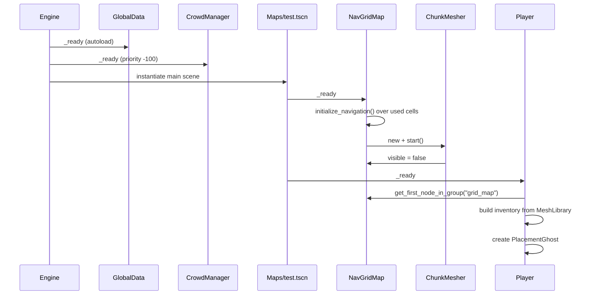
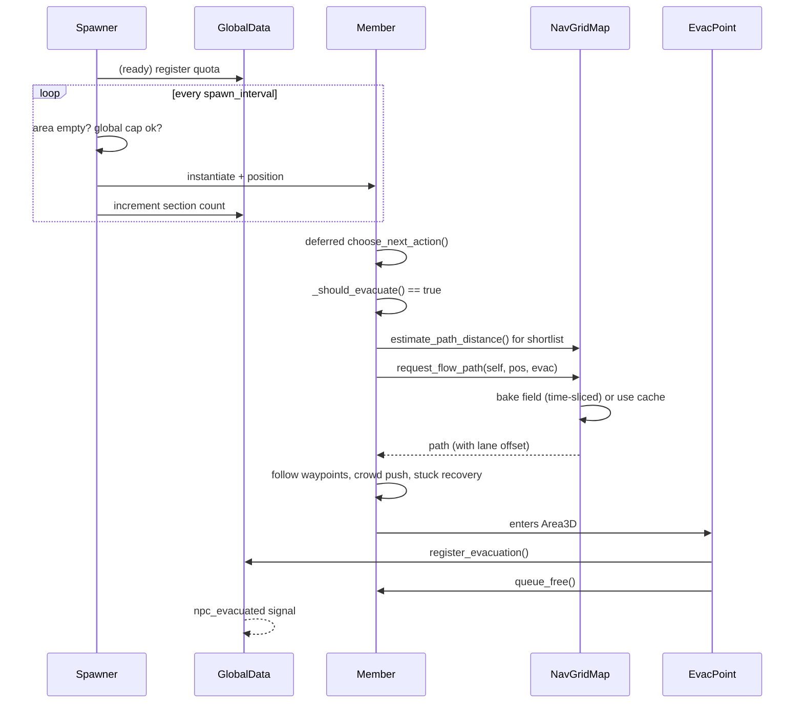

# Codebase Analysis — Evacuation Route Optimizer

> Snapshot: 2026-10-31 · Godot **4.7.2.stable.steam** · Renderer `mobile` · No git repository, no README, no tests.
>
> This document describes what the code actually does, how the systems fit together, and where the implementation diverges from the apparent intent. Every claim below was checked against the source and, where noted, against a live run of the project.

---

## Contents

1. [Executive summary](#1-executive-summary)
2. [What the project is trying to be](#2-what-the-project-is-trying-to-be)
3. [Runtime topology](#3-runtime-topology)
4. [Systems in depth](#4-systems-in-depth)
5. [Data and asset pipeline](#5-data-and-asset-pipeline)
6. [Key execution flows](#6-key-execution-flows)
7. [Complexity and performance profile](#7-complexity-and-performance-profile)
8. [Coupling and boundaries](#8-coupling-and-boundaries)
9. [Findings](#9-findings)
10. [Intent vs. implementation](#10-intent-vs-implementation)
11. [Recommendations](#11-recommendations)
12. [Verification log](#12-verification-log)
- [Appendix A — File inventory](#appendix-a--file-inventory)
- [Appendix B — Input map](#appendix-b--input-map)
- [Appendix C — Project settings](#appendix-c--project-settings)
- [Appendix D — Unused assets](#appendix-d--unused-assets)

---

## 1. Executive summary

**What exists.** A single-scene Godot 4 voxel sandbox with a player who can place and break blocks, plus a crowd simulator that spawns NPCs, routes them through a grid-based navigation graph, and removes them when they reach an evacuation point. The navigation layer is the strongest and most original part of the codebase: weighted A*, cached flow fields, path smoothing with physics validation, and "parallel lane" path offsets to spread a crowd across a corridor.

**What is missing.** The "optimizer" half of the title is not implemented. There are counts (alive, evacuated, per-section spawned) but no evacuation timing, throughput, congestion measurement, bottleneck detection, scenario comparison, or save/load. The shipped main scene is a 26-cell test platform, not a level. Nothing spawns or evacuates until the player manually places a spawner and an evac point and starts spawning from a debug console.

**Overall health.** The core runtime works end-to-end — verified: 6 NPCs spawned, pathed, and evacuated on the test platform with one baked flow field. The code is heavily commented and mostly well-structured, but it carries two generations of features: an older NPC/audio/combat design (rock-paper-scissors classes, TV/Sax voice sets) that was abandoned mid-port, and the current evacuation design. The leftovers are the main source of dead code and broken references.

**Biggest risks.**

| Risk | Where |
|---|---|
| `EvacuationManager` is referenced but does not exist (empty file, not autoloaded) | `scripts/NPCstuff/Member.gd:136`, `evacuation_manager.gd` |
| `SoundManager` cannot run: depends on `GlobalData.RPS` and `read_state_flags()` that do not exist | `scripts/NPCstuff/SoundManager.gd:132,224,439` |
| There is no in-game way to start a simulation; only the debug console can call `start_spawning()` | `scripts/GlobalData.gd:73`, `scenes/console_text.gd` |
| The placeable property editor will try to write resource objects (e.g. `npc_scene`) back as text | `scenes/hud.gd:317-334,352-373` |
| `WANDERING`, `SEEKING_FOOD`, `SEEKING_REST` are unreachable because `_should_evacuate()` is always true for an evacuee | `scripts/NPCstuff/Member.gd:701-703` |

---

## 2. What the project is trying to be

The evidence points to a **spatial evacuation sandbox**, not a Minecraft-like survival game:

- The title is *Evacuation Route Optimizer*.
- The block palette is institutional — classroom window frames, floor tiles, concrete brick in warning colours, off-white walls (`textures/blocks/`).
- The only meaningful simulation outcome is "NPC reached an `EvacPoint` and was removed" (`scenes/evac_point.gd`).
- Navigation deliberately penalises walls and exposed gaps rather than simply finding the shortest line (`scripts/gridmap.gd:223-257`), and it fans agents into parallel lanes so a crowd does not form a single file (`scripts/gridmap.gd:34-38,884-1043`).
- There is crush damage when local density exceeds a threshold (`scripts/NPCstuff/Member.gd:607-614`).
- The HUD has a statistics panel for active units, evacuated totals, and per-section spawn quotas (`scenes/Statistics_hud.gd`).
- The player has creative building tools and can place `Spawner` and `EvacPoint` as objects (`scenes/hud.gd:49-55`).

So the implied loop is: **build a floor plan → place crowd sources and exits → run the evacuation → measure how well it went → change the layout**. Steps 1–3 exist. Step 4 ("measure", and therefore "optimize") is a counter, not an analysis.

A second layer of intent is visible in the assets: a 1970s/PSX aesthetic (CRT addon, pixel shader, posterisation shader, PSX shader globals, serif pixel font, day/night plugin). Almost none of that is wired into a scene. It reads as an art direction chosen but not yet applied.

---

## 3. Runtime topology

### 3.1 Autoloads

| Name | Script | Role |
|---|---|---|
| `GlobalData` | `scripts/GlobalData.gd` | Run-wide counters, spawn quotas, spawn gate, evacuation signal |
| `CrowdManager` | `scripts/CrowdManager.gd` | Spatial hash of NPCs, neighbour/density queries, crush input |

`EvacuationManager` is **not** autoloaded; `project.godot` lists only the two above. See finding **F1**.

### 3.2 Main scene (`Maps/test.tscn`, UID `uid://bbtjdcwal7ax6`)

```
Test (Node3D)
├── CycleController (Node3D, day_and_night_cycle addon)
│   ├── WorldEnvironment
│   └── DirectionalLight3D
├── GridMap (NavGridMap + MeshLibrary, 26 embedded cells)
└── Player (CharacterBody3D)
    ├── HUD (CanvasLayer) → HUD (Control, HUDManager)
    │   ├── Inventory (blocks / placeables / filters / property rows)
    │   ├── Label ("Selected Block: …")
    │   ├── Statistics_Hud (RichTextLabel, F3)
    │   └── Control → ConsoleOutput + ConsoleText + Outputgetter
    ├── CollisionShape3D, head/Camera3D, Hand
    ├── HealthComponent
    └── 7 × AudioStreamPlayer3D
```

At runtime the grid also creates a sibling `ChunkMeshes` node (`ChunkMesher`), and the player creates a `PlacementGhost` under the current scene (`scripts/player.gd:271-282`).

**Verified default state** (live run):

```
root children : CycleController, GridMap, ChunkMeshes, Player, PlacementGhost
groups        : grid_map=1, player=1, npc=0, Members=0, EvacPoint=0, placeables=0
spawning      : false
used cells    : 26
nav points    : 26
```

### 3.3 Groups

| Group | Producer | Consumer |
|---|---|---|
| `npc` | `Member._ready` | `CrowdManager`, `Statistics_hud`, `Member` deps |
| `Members` | `Member.tscn` | `NPCSpawner` occupancy check, global cap count |
| `player` | `player.gd:_ready` | HUD, console |
| `Player` | `player.tscn` | listed in `[global_group]`, not queried by code |
| `grid_map` | `NavGridMap._ready` | player, NPCs |
| `EvacPoint` | `evac_point.tscn` (root and Area3D) | `Member._route_to_closest_evac_point` |
| `placeables` | spawner/evac scenes; player on placement | break-block traversal |
| `Air_migration_nodes` | configured only | `ParticleAttractorStateMachine` (unused) |

### 3.4 Physics layers

| Layer | Used by | Notes |
|---|---|---|
| 1 | GridMap/world | default |
| 2 | `Member` (`collision_layer=2`) | NPC bodies; temporarily removed from an NPC's own mask when stuck |
| 3 | Player (`collision_layer=3`) | overlaps NPC layer |
| 4 | Spawner/EvacPoint `Area3D` (`collision_layer=7`) | 7 = layers 1+2+3 |
| 5 (bit 16) | Player mask only | no producer found |

| Body | Layer | Mask |
|---|---|---|
| Player | 1+2 | 1+2+16 |
| Member | 2 | 1+2 |
| Spawner/Evac area | 1+2+3 | 1+2 |

---

## 4. Systems in depth

### 4.1 Voxel world — `NavGridMap` (`scripts/gridmap.gd`, 1 579 lines)

A `GridMap` subclass that fuses three responsibilities: block storage, navigation graph, and chunk persistence API.

**Block storage.** `place_block` / `remove_block` wrap `set_cell_item`, update a chunk index (`_chunk_cells`), mark the chunk dirty for meshing, and refresh navigation locally (`gridmap.gd:1101-1133`).

**Walkability rule.** A cell is walkable when it has a block and the cell above is empty (`gridmap.gd:1093-1095`). Agents therefore walk on top of blocks, and the "level" of a corridor is the block layer.

**Navigation graph.**
- `AStar3D` with a bidirectional `cell ↔ point id` map; ids are recycled via `free_ids` (`gridmap.gd:58-62,180-186`).
- 16 movement offsets: 4 orthogonal, 4 flat diagonals, 8 one-block stair steps (`gridmap.gd:85-102`).
- Flat diagonals are only connected when **both** orthogonal side cells are walkable, preventing corner cutting (`gridmap.gd:206-220`).
- Point weight = `max(wall_penalty, gap_penalty)` (`gridmap.gd:238-242`):
  - wall penalty 1.0→2.0 as the four sides become more enclosed (`:223-231`);
  - gap penalty 1.0→3.0 as sides lose both wall and floor, i.e. walking beside a drop (`:234-257`).
  Using `max` means the two do not compound.

**Flow fields.** For shared destinations such as exits, the map bakes a Dijkstra field once and every NPC follows it:
- `request_flow_path` queues a request; `_calculate_flow_path` uses a cached field or starts a background bake (`gridmap.gd:269-329`).
- Baking is time-sliced at `flow_bake_budget_usec` = 1.5 ms/frame, capped at `flow_field_max_cells` = 10 000 (`:32,434-480`).
- The field stores `cell → next cell`; `get_flow_direction` steers from the agent's real position, not the cell centre, to avoid zig-zag (`:334-359`).
- Fields are invalidated when a block edit touches the field, its target, or a neighbouring cell (`:554-603`). Cache holds 32 fields, evicted arbitrarily (`:540-551`).

**Path post-processing.**
- `_physics_smooth_path` performs a line-of-sight simplification with up to 16 waypoints of lookahead (`:768-802`).
- A shortcut is only accepted if the whole segment has walkable ground under it and **three** rays (centre + one agent radius to each side) are clear (`:805-877`). This prevents smoothing from cutting corners over holes or through walls.
- `_trim_path_start` removes the initial backwards step toward the cell centre (`:751-765`).

**Parallel lanes.** When a requester exposes a non-zero `lane_offset`, the path is resampled and shifted sideways; the shift fades in/out at the ends, is clamped by wall clearance, falls back to the centreline where there is no safe ground, and retries at half offset twice before giving up (`:884-1086`). This is the mechanism that makes a crowd spread out rather than file along one line.

**Chunk API.** `serialize_chunk` packs 5 ints per block into a `PackedInt32Array` (local x, y, local z, item, orientation); `load_chunk` replaces a chunk and rebuilds navigation in one batch; `unload_chunk`, `save_dirty_chunks`, `save_all_chunks` exist (`:1394-1547`). **No gameplay code calls any of them.** There is no save file and `saves/` is empty.

### 4.2 Rendering — `ChunkMesher` (`ChunkMesher.gd`, 837 lines)

`ChunkMesher` is a `RefCounted` owned by `NavGridMap` that replaces GridMap rendering with one merged mesh per 16×16 column chunk:

1. On `start()` it hides the GridMap (`_grid.visible = false`) and creates a sibling `ChunkMeshes` node (`:71-95`).
2. Block placement/removal marks the owning chunk (and neighbouring chunks at borders) dirty (`:165-208`).
3. `process()` spends up to 4 ms/frame rebuilding dirty chunks (`:118-136`).
4. Cube-shaped items are greedy-meshed per face direction and slice (`:351-528`); non-cube items (slabs, stairs) are emitted from their source mesh with their transform (`:670-781`).
5. Only complete rebuilds are committed to the `MeshInstance3D` (`:788-828`).

Item classification is geometric, not metadata-driven: a mesh is a "cube" only if its bounds match the cell size **and** its triangles cover ≥97 % of all six box faces (`:215-316`). That correctly rejects stairs, whose bounding box is a cube.

GridMap collision stays active even while rendering is hidden, so physics does not depend on mesh rebuild timing.

### 4.3 Crowd — `CrowdManager` (`scripts/CrowdManager.gd`, 113 lines)

- Spatial hash on X/Z with `cell_size = 1.5`; `get_nearby_npcs` scans the 3×3 neighbourhood and caps at `default_max_neighbors = 20` (`:48-72`).
- The whole grid is **rebuilt from scratch every physics frame** (`:17-45`), before NPCs move (`process_physics_priority = -100`).
- Density is recomputed for every NPC every `crowd_tick_rate = 0.1 s` and pushed into `Member.set_local_density` (`:102-113`).

### 4.4 NPC AI — `Member` (`scripts/NPCstuff/Member.gd`, 1 013 lines)

**State machine:** `IDLE`, `WANDERING`, `SEEKING_FOOD`, `SEEKING_REST`, `SEEKING_EVAC`, `ARRIVED`, `DEAD` (`:62-70`). In practice only `IDLE`, `SEEKING_EVAC`, `ARRIVED` and `DEAD` occur: `_should_evacuate()` returns `is_evacuee and not has_evacuation_target`, which is true from the moment an evacuee spawns (`:701-703,688-699`). Food/rest/wander states are aspirational.

**Per-frame motion** (`:183-275`):
- gravity, path waypoint advance, direction to waypoint;
- crowd separation applied **only laterally** to the movement direction, capped at 35 % of speed, so pushing cannot reverse navigation (`:212-227`);
- velocity smoothing (15/s on the ground, 6/s in the air), `look_at` toward velocity;
- `move_and_slide`, then obstacle hop and stuck detection;
- brain tick every `LOGIC_TICK_RATE = 0.15 s`, phase-staggered at spawn.

**Evacuation selection** (`:783-871`):
1. Collect all `EvacPoint` nodes, filter out points on personal cooldown (5 s).
2. Sort by straight-line distance, take the closest `evac_shortlist_size = 3`.
3. Ask the grid for **A\* path distance** to each (not straight line), pick the best.
4. Collect all candidates within `evac_choice_tolerance = 5×` the best distance and pick one at random. This is what distributes a crowd across multiple exits instead of every NPC stampeding to the nearest one.
5. Request a flow-field path; on failure mark the point failed and retry after a cooldown; after 3 failures, give up and return to `IDLE`.

**Arrival.** `_finish_path` sets `ARRIVED`, waits `evac_confirm_timeout = 3 s`, and notifies `EvacuationManager` **if it exists** (`:343-359`). Actual removal is done by the `EvacPoint` area, not by the NPC.

**Stuck handling** (`:439-546`):
- Detect insufficient progress toward the current waypoint over 0.5 s.
- Strike 1: random hop. Strike 2: hop + repath. Strike 3+: hop and restore collision.
- On every strike the NPC removes layer 2 from its own mask, i.e. temporarily stops colliding with other NPCs so it can squeeze through a crowd (`:495-505`).
- In `SEEKING_EVAC` a strike also counts as an evacuation failure.

**Obstacle hop** (`:365-432`): only when against a wall, the next waypoint is higher, and a ray at jump apex is clear (or hits another character). Prevents jumping into ceilings while allowing stair edges.

**Runtime map edits** (`:922-1013`): on `navigation_changed`, if any changed cell lies within 1.2 cells of the remaining path, the NPC schedules a repath after 50–500 ms of jitter. This desynchronises repaths across the crowd.

**Individuality.** At spawn, each NPC randomises speed (+0–1.5), separation radius (+0–0.5), separation push (+0–1), and `lane_offset` (±1 × `lane_offset_strength` + random extra × cell size) (`:119-148`). This is the second half of the anti-single-file design.

### 4.5 Spawning and evacuation bookkeeping

**`NPCSpawner`** (`scenes/spawner.gd`):
- On `_ready`, registers either an independent quota or a shared `spawn_section` quota with `GlobalData` (`:21-29`).
- Spawns on an interval while the global gate is open, the quota is not exhausted, the Area3D contains no NPC, and the global cap (700) is not reached (`:32-87`).
- Spawn position is a random point in a disc of `spawn_radius` around the spawner (`:70-72`).
- The area check intentionally serialises spawning in small spaces.

**`GlobalData`** (`scripts/GlobalData.gd`):
- `npcs_evacuated`, `global_unit_cap = 700`, `is_spawning_enabled = false` by default (`:3-5`).
- Quotas are registered per spawner; shared sections are registered once and the first quota wins (`:25-28`).
- `get_total_max_spawns()` sums quotas, returning -1 ("unlimited") if any is negative (`:32-48`).
- `start_spawning()`, `stop_spawning()`, `reset_spawning()`; reset clears counts and emits `spawning_reset` (`:73-84`).

**`EvacPoint`** (`scenes/evac_point.gd`, 9 lines): an `Area3D` that on `body_entered` checks for group `npc`, calls `GlobalData.register_evacuation()`, and frees the body. This is the entire "success" path.

### 4.6 Player — `scripts/player.gd` (750 lines)

A movement-first character controller with a creative building mode bolted on.

| Subsystem | Behaviour | Lines |
|---|---|---|
| Walk/sprint/crouch | 5 / 8 / 2.5 m/s, acceleration 10, friction 10 | `:24-30,520-541` |
| Jump / coyote? | simple jump on floor, ledge jump, wall jump | `:500-518` |
| Slide | crouch while above walk speed → 12 m/s slide, camera tilt, SFX | `:559-583` |
| Wall run | ray to each side, valid if surface is near-vertical and moving forward; reduced gravity, camera tilt, stamina | `:585-618,487-498` |
| Wall jump | normal-based launch, stamina cost 25 (new wall) or 65 (same wall), regen delay | `:643-656` |
| Ledge mantle | forward wall ray + down ray; computes vertical velocity for the ledge height | `:703-731` |
| Noclip | debug-only, `V`, mouse wheel adjusts speed | `:214-228` |
| Zoom | hold `Z`, FOV 75→40 | `:543-557` |
| Head bob / camera | procedural, tween-driven, damage tilt, death fall | `:230-257,670-701` |
| Building | ghost preview, place/break, item cycling, inventory, placeables | `:259-485` |

Building details:
- `BUILD_REACH = 6`, physics ray from the camera with `collide_with_areas = true` (`:404-417`).
- Ghost block is a translucent `MeshInstance3D` added to the current scene; turns red when the target cell would overlap the player (`:284-345,473-485`).
- Breaking first walks up the collider's parents looking for group `placeables`; otherwise removes a grid block (`:419-437`).
- Placeables are instantiated, exported properties are overwritten from the HUD rows, then added to the scene and group (`:457-471`).

### 4.7 UI — `HUDManager`, statistics, console

**Inventory** (`scenes/hud.gd`, 392 lines):
- Two categories: **Blocks** (from the MeshLibrary) and **Placeables** (spawner + evac point, with room for more scenes) (`:43-57`).
- Block/placeable filtering is derived from **item names**, not metadata: strips `Auto_`, recognises `Slab_Top` / `Slab_Bottom`, and treats the first remaining token as a material tag (`:116-139`). Example: `Auto_Slab_Top_concrete_brick_red` → `Slab_Top` + `Concrete`, and must match all of its tags to be shown (`:165-172`).
- Selecting a placeable builds a property editor from the script's exported properties and writes values back as text (`:309-389`).

**Statistics** (`scenes/Statistics_hud.gd`): toggled with F3; shows alive/global cap, total evacuated/max spawns, and per-section spawned/quota. Redraws every frame while visible.

**Console** (`scenes/console_text.gd`, `console_output.gd`, `Outputgetter.gd`):
- Shift+`/` toggles a console overlay and releases/recaptures the mouse.
- `console_text` parses `/command args`, echoes to the output pane, and dynamically calls any public method on `GlobalData` (`:74-138`). That makes `/start_spawning`, `/stop_spawning`, `/reset_spawning`, `/setglobalunitcap 700` available without dedicated UI.
- `Outputgetter` tails `user://logs/godot.log` (file logging is enabled in `project.godot`) and colours `ERROR`/`WARNING` lines into the console (`scenes/Outputgetter.gd`).

### 4.8 Presentation

**`LeanAnimator`** (`scripts/NPCstuff/LeanAnimator.gd`, 521 lines) extends `ProceduralAnimator` and animates the NPC's visual child without an AnimationPlayer:
- lean into horizontal velocity, walk bob/roll, hurt kickback and red emissive flash, health darkening, death bounce/squash/sink;
- camera culling: skips animation when off-screen or farther than 45 m (`:169-183,258-274`);
- state is read from the parent via `current_state` and the parent script's `State` constant map (`:127-142`).

**`ProceduralAnimator`** (`scripts/NPCstuff/ProceduralAnimator.gd`) is the base class: syncs parent velocity/floor/state each physics tick and auto-connects a `HealthComponent`'s `damaged` signal.

**Day/night** (`addons/day_and_night_cycle/scripts/cycle_controller.gd`): drives sun angle, energy curve, sky colours, and optional sky cover from `CycleData` presets. Emits `day_started` / `night_started`; nothing subscribes yet.

**CRT addon** (`addons/crt/crt.gd`): a full-screen `CanvasLayer` shader. Enabled in project settings but **never instanced** in any scene.

**Audio.** The player has 7 `AudioStreamPlayer3D` nodes and plays footsteps, jump, land, slide, wall jump. NPC audio exists only as an orphaned `SoundManager` (see F2).

---

## 5. Data and asset pipeline

```
textures/blocks/*.png  (34 textures, 16×16 pixel art)
        │
        │  scripts/block_generator.gd  (EditorScript, run manually)
        ▼
models/Blocks/blocks.tscn  (313 nodes: full block + top/bottom slab + stairs per texture)
        │
        │  copied/exported into a MeshLibrary (manual step; not automated in repo)
        ▼
resources/blocks/.tres  (MeshLibrary, 104 items)
        │
        ▼
scenes/grid_map.tscn  →  GridMap.mesh_library
```

**Item IDs.** `0 = Debug_Box`, `1 = Stair_Echidna`, `2…103 = Auto_<texture>` plus slab variants. IDs are stored raw in the GridMap's embedded `data`, so **inserting or reordering items invalidates existing scenes**.

**Naming conventions encoded in code.**
- `Auto_` prefix = generated.
- `Slab_Top_` / `Slab_Bottom_` = half-height block, recognised by HUD and inventory labels.
- Remaining token = material tag used by the filter UI.
- `Stair_Echidna` and `Debug_Box` are hand-made exceptions and appear in the palette.

**Mismatch:** `block_generator.gd` generates `Auto_Stairs_*` items (`GENERATE_STAIRS = true`, `:18-21,90-95`), but the shipped MeshLibrary contains **no** `Auto_Stairs_*` item — only `Stair_Echidna`. The generator and the current asset library are out of sync.

**Fragile filename:** the MeshLibrary is literally named `resources/blocks/.tres` (leading dot). It works because `grid_map.tscn` references it by UID, but it is hidden from casual browsing, looks like a temp file, and is easy to lose in a copy/archive.

**Block generator details** (`scripts/block_generator.gd`, 465 lines): iterates `res://textures/blocks/*.png`, builds `BoxMesh`-derived `ArrayMesh` geometry with nearest-neighbour materials, offsets slab vertices in code, creates two-box stairs plus matching collision, sets scene ownership recursively, and repacks `blocks.tscn` (`:35-131`). It updates existing `Auto_*` nodes when `UPDATE_EXISTING_BLOCKS = true`.

---

## 6. Key execution flows

### 6.1 Boot



Note: `GlobalData.is_spawning_enabled` stays `false`, so a fresh run has no NPCs until something calls `start_spawning()`.

### 6.2 Spawn → evacuate → removal



### 6.3 Block edit → nav + mesh update

1. Player calls `grid.place_block(cell, item)` or `remove_block(cell)`.
2. `NavGridMap` mutates the GridMap, updates `_chunk_cells`, marks the chunk dirty.
3. `_refresh_nav_around` refreshes walkability in an expanded neighbourhood, rebuilds connections, updates weights, invalidates affected flow fields, emits `navigation_changed` (≈40 cells for one edit).
4. Every NPC checks whether the change is near its remaining path; if so it repaths after jitter.
5. Next frame, `ChunkMesher.process()` rebuilds the dirty chunk(s) within 4 ms.

### 6.4 Console command

`Shift+/` → type `/start_spawning` → `console_text` splits tokens → `GlobalData.has_method("start_spawning")` → `callv` → `is_spawning_enabled = true` → all spawners begin their intervals.

---

## 7. Complexity and performance profile

| System | Cost | Bound / mitigation |
|---|---|---|
| Crowd grid rebuild | O(N) allocation + insert **every physics frame** | `N ≤ global_unit_cap = 700`; ~42 k inserts/s at 60 Hz, plus per-frame arrays |
| Density pass | O(N × K), K ≤ 20, every 0.1 s | ~140 k distance checks/s at cap |
| Per-NPC brain | O(K) every 0.15 s, staggered | phase offset at spawn |
| Path requests | global queue, 2 ms/frame budget | `path_budget_usec` |
| Flow bake | Dijkstra with FIFO queue (SPFA-like), 1.5 ms/frame | `flow_field_max_cells = 10 000`, 32 cached fields |
| Flow invalidation | O(fields × affected cells) | can spike on chunk load (thousands of affected cells) |
| Chunk meshing | greedy quads, 4 ms/frame | `build_budget_usec` |
| Path smoothing | 3 rays per candidate + ground sampling every half cell | lookahead 16, per request |
| Lane generation | resample + 1 ray per sample + validation | up to 3 attempts per path |

**Observations.**

- The crowd system is the main scaling risk: rebuilding the hash every frame is simple and correct but wasteful when most NPCs barely move. It also allocates a new `Array[Node]` from `get_nodes_in_group("npc")` each frame.
- Flow-field baking uses a plain FIFO queue rather than a priority queue. It is correct (costs are relaxed on re-visit) but can revisit cells many times; the 1.5 ms budget hides this, at the cost of more frames to finish a field.
- Large terrain edits are the worst case: `_refresh_nav_region` expands thousands of cells, then `_invalidate_flow_fields` loops every cached field over every affected cell (`gridmap.gd:554-603,1567-1579`). Loading a chunk explicitly suppresses the signal, which avoids the NPC-side cost but not the field-loop cost.
- With the current 26-cell test map these costs are invisible. None of them has been measured at the 700-NPC cap.

---

## 8. Coupling and boundaries

| From | To | Mechanism | Assessment |
|---|---|---|---|
| `Member` | `GlobalData`, `CrowdManager` | `/root/...` polling in `_ready` | acceptable for two autoloads |
| `Member` | `NavGridMap` | group lookup + signal | good, but cached per NPC |
| `Member` | `EvacuationManager` | optional `/root/...` | dead dependency (F1) |
| `EvacPoint` | `GlobalData` | direct singleton call | simple and fine |
| `NPCSpawner` | `GlobalData` | direct singleton call | quota snapshot problem (F6) |
| `player` | `NavGridMap` | group lookup | fine |
| `HUDManager` | `player` | group lookup + `set_movement_enabled` | UI reaches back into gameplay |
| `console_text` | `GlobalData` | dynamic method call | powerful debug tool; also a backdoor |
| `LeanAnimator` | parent script | reads `current_state`, `State` map, `velocity` | implicit, but documented and works |
| `SoundManager` | parent, `GlobalData.RPS` | implicit + missing enum | broken (F2) |
| `CycleController` | `WorldEnvironment`, `DirectionalLight3D` | exported node paths | clean |

**General pattern:** direct singleton access and group lookups dominate; signals are used only for `navigation_changed`, `npc_evacuated`, health, and spawn reset. There is no event bus and no dependency injection. For a project of this size that is workable, but it means almost every system knows about `GlobalData`.

**Two NPC identity groups** (`npc` and `Members`) and two player groups (`player` and `Player`) are a recurring source of near-misses; see F11.

---

## 9. Findings

Severity: **Critical** = blocks the intended product loop; **High** = broken behaviour or data loss risk; **Medium** = correctness/perf debt; **Low** = hygiene.

### Critical

**F1 — `EvacuationManager` does not exist.**
`Member` looks up `/root/EvacuationManager` (`Member.gd:136`) and calls `notify_npc_arrived`, `notify_evacuation_target_chosen`, `notify_evacuation_failed` (`:351-355,728-731,739-741`). The repo contains `evacuation_manager.gd` at the root with **0 bytes**, and `project.godot` does not autoload it. Runtime check: `has_evac_manager_autoload = false`. All three calls are silently skipped. The only working success path is the `EvacPoint` area freeing the body. Either the manager was deleted mid-refactor or never implemented; as it stands the code has a phantom subsystem.

**F2 — `SoundManager` is incompatible with the current codebase.**
`SoundManager.gd` iterates `GlobalData.RPS.values()` (`:132`) and switches on `GlobalData.RPS.ROCK/PAPER/SCISSORS/GUN` (`:439-446`). `GlobalData` has no `RPS` enum (runtime check: `"RPS" in GlobalData == false`). It also calls `_animator.read_state_flags()` (`:224,227`), but `LeanAnimator` / `ProceduralAnimator` do not define it (runtime check: `false`). The script is attached to no scene, so the game does not crash today — but any attempt to add it will. This is the clearest fossil of an earlier rock-paper-scissors NPC game.

**F3 — There is no product-level way to start or reset a simulation.**
`GlobalData.is_spawning_enabled` defaults to `false` (`GlobalData.gd:5`). No scene places a spawner or evac point. The only entry point is the debug console (`/start_spawning`) or a script. A player opening the game sees an empty platform with no instruction. Verified default state: 0 NPCs, 0 evac points, 0 placeables.

**F4 — The main scene is a test fixture, not a level.**
`Maps/test.tscn` embeds 26 blocks (`grid_map.tscn:9-11`), with a player spawn at `(0, 6, 0)`. There is no building, no exits, no spawn rooms, no signage. The "game" cannot demonstrate evacuation without manual construction.

### High

**F5 — The placeable property editor will corrupt resource-typed exports.**
`_show_adjustable_vars` enumerates every exported script property (`hud.gd:317-334`), and `_parse_value` only understands int/float/bool/vector/string (`:352-373`). `Spawner.npc_scene` is a `PackedScene`; it is displayed as text and written back as a `String`, which either errors on `set()` or replaces the packed scene with an invalid value. The same applies to `spawn_container_path` (`NodePath`). In practice the panel is only safe for numeric properties, but it does not filter.

**F6 — Spawn quotas are snapshotted at `_ready` and cannot be changed.**
`NPCSpawner._ready` registers `spawn_quota` (`spawner.gd:21-29`); `GlobalData.register_section` ignores later registrations for the same section (`GlobalData.gd:25-28`). Changing `spawn_quota` at runtime (or through the HUD after instantiation) leaves `GlobalData` reporting the old quota. Verified: a spawner created with scene default 5 and then set to 6 still yielded `total_max_spawns = 5`, while the spawner itself spawned 6. Statistics then display `6/5`.

**F7 — Most of the NPC state machine is unreachable.**
`choose_next_action` always routes to `SEEKING_EVAC` while `_should_evacuate()` is true, and it is true until `has_evacuation_target` is set (`Member.gd:688-703`). `WANDERING`, `SEEKING_FOOD`, `SEEKING_REST` are never entered (the `WANDERING` branch at `:586-591` can only run if something else sets it). Hunger and energy are decremented (`:560-563`) but never consumed. Either the evacuee flag is meant to be conditional, or those states should be deleted.

**F8 — Density measurement saturates at 20 neighbours, so crush damage is inaccurate.**
`CrowdManager.get_density` first caps the neighbour list at 20 and only then applies the radius filter (`:75-92`). In a dense crowd this means density is capped long before the real count, while `Member` compares it to `crowd_threshold = 10` (`Member.gd:607-614`). The damage will trigger, but the value is not a true local density and cannot be used for analytics.

**F9 — No persistence despite a complete serialization API.**
`serialize_chunk`, `load_chunk`, `unload_chunk`, `save_dirty_chunks`, `save_all_chunks` exist (`gridmap.gd:1394-1547`) and are unused. `saves/` is empty. Player builds are lost on exit. For a layout-optimization tool this is a core missing feature, not a polish item.

**F10 — The crowd hash is rebuilt every frame.**
`CrowdManager._physics_process` calls `_rebuild_grid()` unconditionally (`:17-24`), which clears a dictionary, calls `get_nodes_in_group("npc")`, and re-inserts every NPC at 60 Hz. At the 700-unit cap this is the first thing that will show up in a profile, and it makes the density pass more expensive than it needs to be.

**F11 — Duplicate/ambiguous group names.**
NPCs belong to both `npc` (runtime) and `Members` (scene), and different systems use different ones: `CrowdManager`/statistics use `npc`; spawner occupancy and global cap use `Members`. The player belongs to `Player` (scene) and `player` (runtime); `[global_group]` lists the capitalised version while all code queries lowercase. Nothing breaks today, but a typo in either direction silently disables a feature.

### Medium

**F12 — FIFO Dijkstra for flow fields.**
`_step_bake_job` appends neighbours to a plain array and relaxes on improvement (`gridmap.gd:434-480`). This is SPFA-like: correct, but can re-expand cells many times. A binary heap or `AStar3D` reversed search would reduce bake time substantially.

**F13 — Flow-field eviction is arbitrary.**
`_enforce_flow_field_cache_limit` removes the first key returned by the dictionary (`:540-551`), which is insertion order, not least-recently-used. A hot exit can be evicted while a stale one survives.

**F14 — Point-weight refresh is incomplete.**
`_refresh_point_weights_around` updates the changed cell, cells below it, and cells one step down in the four wall directions (`:1140-1151`). But `_point_weight_scale` depends on walls/floors two steps away in four directions; the expanded nav set is larger than the weight set. Weight changes can therefore lag an edit. Effect is subtle route preference drift, not a crash.

**F15 — `has_evacuation_target` is never cleared on success.**
It is set in `request_evacuation_target` (`:709`) and cleared only in `_fail_evacuation` (`:744`). If an NPC reaches an evac area but is not freed (e.g. the point is removed at the wrong moment, or the area misses), it enters `IDLE` and then wanders forever because `_should_evacuate()` is false.

**F16 — `CrowdManager.get_density` neighbour count is off by one.**
`Member._update_crowd_push` computes `neighbor_count = nearby.size() - 1` (`:605`), assuming the query result always contains self. Because `get_nearby_npcs` caps at 20 and scans cells in an arbitrary order, self may be absent, undercounting by one near the threshold.

**F17 — Console and inventory fight over mouse capture and movement.**
`HUDManager.update_build_ui` captures/releases the mouse when the inventory opens/closes (`hud.gd:281-293`); `console_text` does the same for the console (`console_text.gd:24-36`). Closing one while the other is open restores player movement and mouse capture incorrectly. No shared UI-state owner exists.

**F18 — Wall-slide loop uses the wall-run-start stream.**
`sfx_wall_slide_loop = $WallRunStart` (`player.gd:13`), the same node as `sfx_wall_run_start`. If a wall slide is ever wired up it will cut off the run sound.

**F19 — Debug noclip ships enabled.**
`DEBUG_MODE = true` (`player.gd:100`) and `ui_noclip` is bound to `V`. There is no build-time switch; a release export still allows flying through geometry.

**F20 — Raycasts without collision masks.**
Wall run, ledge detection, and obstacle-hop rays use the default mask (`player.gd:614-618,736-741`; `Member.gd:412-432`). They can hit NPCs or placeable areas instead of terrain, producing false wall/ledge detections. `_get_build_hit` explicitly enables areas, which is correct for building but not for movement probes.

**F21 — Collision and visual mesh can diverge briefly.**
`ChunkMesher` hides the GridMap (`:93`) and renders its own meshes, while collision stays on the GridMap. A block edit updates collision immediately but the visual chunk is rebuilt up to a frame or more later. Movement is correct; the player can appear to stand on invisible geometry for a frame.

**F22 — `ProceduralAnimator.is_in_state_named` is inverted.**
It returns `false` whenever a `State` map exists, i.e. always for `Member` (`ProceduralAnimator.gd:63-70`). It is currently unused, but it is a trap for future animation work.

**F23 — Two independent on-screen notifiers.**
`Member.tscn` has a `VisibleOnScreenNotifier3D` connected to `LeanAnimator`, and `LeanAnimator._setup_camera_culling` creates a second one (`:169-183`). Harmless duplication, but signal bookkeeping will be confusing later.

### Low / hygiene

| ID | Issue |
|---|---|
| F24 | `block_generator.gd` generates `Auto_Stairs_*`; the MeshLibrary has none. Generator and asset library drifted. |
| F25 | MeshLibrary filename `resources/blocks/.tres` begins with a dot — hidden, looks temporary, only resolvable by UID. |
| F26 | Leftover editor temp files: `Maps/empty_playground.tscn*.tmp`, `Maps/test.tscn*.tmp`. |
| F27 | Orphaned scenes: `scenes/menu/main_menu.tscn`, `scenes/menu/handy.tscn`, `scenes/scatter.tscn` (empty). |
| F28 | Orphaned scripts: `SoundManager.gd`, `Boid_attractor.gd`, `scatter.gd`, `hint.gd`, `InteractableComponent.gd`, `inventory_slot.gd`, `hand_item.gd` (empty), `evacuation_manager.gd` (empty). |
| F29 | Unused shaders: `pixel`, `posterization`, `Sprite_Extruder`, `televisor`; PSX shader globals in `project.godot` but no shader reads them. |
| F30 | CRT addon enabled but never instanced. |
| F31 | ~70 unreferenced audio files (see Appendix D) — the abandoned TV/Sax/RPS sound set. |
| F32 | `config/features` says `Forward Plus` while `rendering/renderer/rendering_method = "mobile"`. |
| F33 | Unused input actions: `interact`, `drop`, `reload`, `scroll_up/down`, `ui_1..4`, `ui_maximize` (bound to Up), `ui_minimize` (bound to Down), `primary_use`, `secondary_use`. |
| F34 | `sprint` is bound to Ctrl and `crouch` to Shift, the inverse of the usual convention. |
| F35 | Mixed layout: core classes in `scripts/`, scene scripts in `scenes/`, three scripts at repo root; PascalCase files (`ChunkMesher.gd`, `Member.gd`) beside snake_case. |
| F36 | No README, no tests, no CI, no `.editorconfig`, no export presets. |
| F37 | `hand_item.gd` is attached to `Hand` but contains only empty `_ready`/`_process`. |
| F38 | `Maps/Boid_attractor.gd` (a particle attractor state machine) is a complete little system with no scene using it; `Air_migration_nodes` is empty. |

---

## 10. Intent vs. implementation

| Inferred goal | Implemented? | Evidence |
|---|---|---|
| Voxel building sandbox | **Yes** | GridMap, 104-item palette, ghost preview, break/place, filters |
| Crowd simulation | **Yes** | 700 cap, spatial hash, separation, crush damage, stuck recovery |
| Multi-exit route choice | **Yes** | A* shortlist + tolerance + random tie-break |
| Route quality (avoid walls/drops) | **Yes** | Wall/gap cost weights, lane offsets |
| Shared-destination performance | **Yes** | Baked flow fields, time-sliced |
| Evacuation success accounting | **Partial** | Count increments; `EvacuationManager` missing |
| Simulation controls | **No** | Only debug console can start it |
| Level / scenario content | **No** | 26-cell test platform |
| Evacuation metrics (time, rate, bottlenecks) | **No** | Stats are counts only |
| Scenario save/load | **No API used** | Chunk serialization unused; `saves/` empty |
| Comparison / optimization loop | **No** | No baseline, no replay, no heatmap |
| NPC audio/personality | **Abandoned** | `SoundManager` targets removed systems |
| PSX/CRT art direction | **Assets only** | Shaders and addon installed, never used |

The gap is clearest in the name: routing is optimized *locally* (per-path cost, lanes, flow fields), but the **route network is never optimized or evaluated**. The tool cannot answer "is exit B better than exit A?" because it never records when an NPC spawned, when it arrived, or how long it was congested.

---

## 11. Recommendations

### P0 — Make the current loop coherent (1–2 days)

1. **Resolve the EvacuationManager question.** Either implement it as an autoload that records per-NPC spawn/arrival times and exit usage, or delete every reference in `Member.gd` and keep `EvacPoint` as the single success path. Do not leave a phantom dependency.
2. **Add a simulation control surface.** A small panel or keybind that calls `GlobalData.start_spawning()` / `stop_spawning()` / `reset_spawning()`, plus an on-screen hint. The console can remain as a debug tool, not the primary UX.
3. **Filter the placeable property editor.** Only expose `TYPE_INT`, `TYPE_FLOAT`, `TYPE_BOOL`, `TYPE_STRING`, `TYPE_VECTOR2/3`; skip `Object`, `Resource`, `NodePath`, arrays. (`hud.gd:309-389`)
4. **Fix or delete `SoundManager`.** If NPC audio is wanted, strip RPS, replace `read_state_flags()` with the existing `parent_state`/`is_dead` data, and attach it to `Member.tscn`. Otherwise move it to an `archive/` folder so it stops looking supported.
5. **Make quotas mutable.** Add `GlobalData.update_section_quota(section, quota)` and call it when `spawn_quota` changes, or document that quotas are construction-time only and hide the field in the property editor.

### P1 — Correctness and performance (3–5 days)

6. **Decide the NPC behaviour model.** If wandering/food/rest are future features, gate `is_evacuee` and implement the transitions; otherwise delete the unused states and the hunger/energy counters so the state machine reflects reality.
7. **Make the crowd hash incremental.** Maintain the hash from NPC `_enter_tree`/`_exit_tree` (or a `Member.register/unregister`) and update only on cell change. This removes the largest per-frame cost before population scales.
8. **Measure density without the 20-neighbour cap.** Either count within the radius in the spatial hash (no result cap) or use a coarse density grid. Then the crush threshold becomes meaningful and reusable for analytics.
9. **Replace the flow-bake queue with a priority queue** (or reuse `AStar3D`), and make the cache LRU. Add a debug counter for bake time and cache hit rate.
10. **Fix weight refresh scope** to cover the same expanded neighbourhood used by navigation invalidation.
11. **Move `DEBUG_MODE` to a project setting or feature tag** and remove `ui_noclip` from release builds.
12. **Give movement raycasts an explicit world mask** (layer 1 only) to stop false wall/ledge hits on NPCs and areas.
13. **Unify groups and layers**: one `npc` group, one `player` group, a named layer constant script. Remove the capitalised duplicates.
14. **Clear `has_evacuation_target`** when an NPC is freed, or make `EvacPoint` call a `Member.on_evacuated()` before freeing.

### P2 — Turn it into the product the title promises (1–2 weeks)

15. **Instrument the run.** Record per-NPC `spawn_time`, `arrival_time`, chosen exit, path length, time stuck, peak local density. Derive: average/median evacuation time, exit throughput (agents/min), exit utilisation, congestion episodes, failed-path count.
16. **Add a results panel.** Per-exit table plus a simple time-series chart. Persist the last run in `GlobalData` so the player can compare before/after.
17. **Add scenario save/load** using the existing chunk API: `save_all_chunks` to `user://saves/<scenario>/`, plus a small JSON sidecar for spawner/evac/player placement and run settings.
18. **Build one real level.** A school floor with classrooms, corridors, two stairwells and blocked alternatives. This is the minimum content needed to demonstrate route optimization.
19. **Add authoring aids:** exit capacity labels, spawner population presets, a top-down overview camera, optional path visualisation (debug draw of lanes and flow fields).
20. **Add a "compare layouts" mode:** freeze one layout as baseline, edit, re-run, show deltas.
21. **Tests.** Pure-logic tests for walkability, diagonal rule, cost weights, quota math, lane clamping, and chunk round-trip. These are all headless-friendly.

### P3 — Hygiene (ongoing)

22. Write a `README.md` with the build/run loop, controls, and the current limitations called out honestly.
23. Delete or archive unreferenced scenes/scripts/shaders/audio (Appendix D). If the RPS sound set is wanted later, keep it in `archive/`.
24. Rename `resources/blocks/.tres` to something discoverable (`blocks_meshlibrary.tres`) and update the UID reference.
25. Remove `Maps/*.tmp` and add `*.tmp` to `.gitignore`.
26. Reconcile the block generator with the MeshLibrary (either generate stairs into the library or set `GENERATE_STAIRS = false`).
27. Pick one renderer and make `config/features` agree with `rendering_method`.
28. Prune unused input actions or implement them.
29. Consider a top-level folder scheme: `game/`, `systems/`, `ui/`, `assets/`, `tools/`, `docs/`.

---

## 12. Verification log

All checks were run on 2026-10-31 with Godot 4.7.2 (Steam build) via the Godot MCP runtime bridge. No project files were modified by these tests; runtime nodes were created in memory only.

| Check | Result |
|---|---|
| `check_project` | Godot 4.7.2, project recognized, 17 scenes / 32 scripts / 139 assets |
| `opencode mcp list` | `✓ godot connected` |
| Default run (background) | scene `Test`, 0 NPCs, 0 evac points, 0 placeables, spawning disabled |
| Grid introspection | `used_cells = 26`, `nav_points = 26`, `cell_size = (1.5, 1.5, 1.5)` |
| Player ground position | `(0, 2.5, 0)` on the platform |
| Spawner/evac test (first attempt) | 6 spawned at `(4, 6, 4)` over empty cells → fell into the void; no evacuation. Confirms `NavGridMap` has no ground outside the 26 cells, and that NPCs do not recover from falling. |
| Spawner/evac test (valid placement) | spawner at `(-1.5, 2.5, -1.5)`, evac at `(1.5, 1.8, 1.5)` → **6/6 evacuated**, `npcs_evacuated = 6`, `flow_fields = 1`, 0 alive after ~10 s |
| Quota snapshot test | spawner scene default 5, set to 6 before `_ready` → `total_max_spawns = 5`, spawned 6 (F6 confirmed) |
| `GlobalData.RPS` | `false` (F2 confirmed) |
| `LeanAnimator.read_state_flags` | `false` (F2 confirmed) |
| `EvacuationManager` autoload | `false` (F1 confirmed) |
| Script validation | Core scripts parse. `spawner.gd`, `Statistics_hud.gd`, `evac_point.gd`, `SoundManager.gd` report `Identifier not found: GlobalData` only when validated in isolation, because the offline validator does not inject autoload singletons. The game itself resolves `GlobalData` at runtime, so this is a tooling artifact except in `SoundManager`, where the RPS reference fails later at runtime. |

---

## Appendix A — File inventory

### Core (used at runtime)

| File | Lines | Role |
|---|---:|---|
| `scripts/gridmap.gd` | 1 579 | Blocks, A*, flow fields, path smoothing, lanes, chunk API |
| `ChunkMesher.gd` | 837 | Greedy chunk meshing; replaces GridMap rendering |
| `scripts/NPCstuff/Member.gd` | 1 013 | NPC movement, state machine, evacuation logic, stuck recovery |
| `scripts/player.gd` | 750 | Player controller, building, ghost, placeables |
| `scripts/NPCstuff/LeanAnimator.gd` | 521 | Procedural NPC animation, hurt/death, culling |
| `scripts/NPCstuff/SoundManager.gd` | 496 | **Orphaned**, incompatible audio system |
| `scripts/block_generator.gd` | 465 | `@tool`/`EditorScript` block+slab+stair generator |
| `scenes/hud.gd` | 392 | Inventory, filters, placeable property editor |
| `addons/day_and_night_cycle/scripts/cycle_controller.gd` | 167 | Sun/sky cycle |
| `Maps/Boid_attractor.gd` | 167 | **Unused** particle attractor state machine |
| `scenes/console_text.gd` | 138 | Console command parser |
| `scripts/CrowdManager.gd` | 113 | Spatial hash, density |
| `scenes/spawner.gd` | 100 | NPC spawner |
| `scripts/GlobalData.gd` | 84 | Counters, quotas, spawn gate |
| `scripts/NPCstuff/ProceduralAnimator.gd` | 70 | Animator base class |
| `scenes/inventory/inventory_item.gd` | 67 | Inventory cell UI |
| `inventory_slot.gd` (repo root) | 58 | **Unused** older slot UI |
| `scenes/Statistics_hud.gd` | 53 | Statistics panel |
| `scenes/Outputgetter.gd` | 53 | Tails `user://logs/godot.log` into console |
| `scripts/NPCstuff/HealthComponent.gd` | 43 | Health/damage signals |
| `scenes/console_output.gd` | 20 | Console text pane |
| `scripts/interactables/InteractableComponent.gd` | 17 | **Unused** interaction component |
| `scenes/inventory/inventory_check_box.gd` | 16 | Filter checkbox |
| `scenes/evac_point.gd` | 9 | Evacuation success trigger |
| `scenes/hand_item.gd` | 11 | Empty placeholder |
| `evacuation_manager.gd` | 0 | **Empty**, not autoloaded |

### Scenes

| Scene | Role |
|---|---|
| `Maps/test.tscn` | **Main scene** (26-cell sandbox) |
| `scenes/player.tscn` | Player + HUD + console + audio |
| `scenes/grid_map.tscn` | GridMap with MeshLibrary and embedded cells |
| `scenes/npcs/Member.tscn` | NPC body, glTF visual, health, animator |
| `scenes/spawner.tscn` | Spawner placeable |
| `scenes/evac_point.tscn` | Evacuation area placeable |
| `scenes/inventory/*.tscn` | Inventory item, filter, property row |
| `scenes/menu/*.tscn` | **Unused** menu/handy scenes |
| `scenes/scatter.tscn` | **Unused** empty scene |
| `utils/CSGStairMaker3D.tscn` | **Unused** CSG utility |
| `models/Blocks/blocks.tscn` | Source scene for MeshLibrary (313 nodes) |
| `models/wiggly_hair.tscn` | **Unused** hair model |

### Resources

| File | Role |
|---|---|
| `resources/blocks/.tres` | MeshLibrary, 104 items |
| `scenes/inventory/Hud_element.tres` | Theme + pixel font |
| `textures/environment/brick.tres` | **Unused** material |
| `default_bus_layout.tres` | Default audio bus layout |

---

## Appendix B — Input map

| Action | Binding | Used by |
|---|---|---|
| `left` / `right` / `up` / `down` | A / D / W / S (+ left stick) | movement |
| `jump` | Space (+ A/joy 0) | jump, wall jump, ledge |
| `sprint` | **Ctrl** (+ joy 7) | speed 8 |
| `crouch` | **Shift** (+ arrow-left?) | slide, height |
| `look_left/right/up/down` | right stick | **unused** |
| `zoom` | Z | FOV zoom |
| `interact` | E | **unused** |
| `drop` | Q | **unused** |
| `reload` | R | **unused** |
| `scroll_up/down` | `,` / `.` | **unused** |
| `primary_use` | LMB | **unused** (build uses `break_block`) |
| `secondary_use` | RMB | **unused** (build uses `place_block`) |
| `place_block` | RMB | building |
| `break_block` | LMB | building |
| `next_block` / `prev_block` | 1 / 2 | item cycle |
| `toggle_build_mode` | B | building |
| `toggle_inventory` | Shift+R | inventory |
| `ui_noclip` | V | debug noclip |
| `ui_statistics_toggle` | F3 | statistics |
| `ui_console_toggle` | Shift+/? | console |
| `ui_maximize` | Up | **unused** |
| `ui_minimize` | Down | **unused** |
| `ui_1..4` | 1..4 | **unused** |

---

## Appendix C — Project settings

| Setting | Value | Note |
|---|---|---|
| Main scene | `uid://bbtjdcwal7ax6` (`Maps/test.tscn`) | test platform |
| Features | `4.7`, `Forward Plus` | conflicts with renderer `mobile` |
| Render method | `mobile` | Forward Mobile |
| Textures | Nearest filter, repeat on | pixel-art intent |
| Physics gravity | 12.0 | heavier than default 9.8 |
| Occlusion culling | on | no occluders authored |
| Window | mode 2 (maximised), stretch `viewport` | |
| Custom cursor | `cursor.png` | |
| Audio | file logging on, default bus layout | feeds console log tailer |
| Autoloads | `GlobalData`, `CrowdManager` | `EvacuationManager` absent |
| Editor plugins | `crt`, `day_and_night_cycle` | CRT unused |
| Shader globals | `psx_affine_strength`, `psx_bit_depth`, `psx_fog_*`, `psx_snap_distance` | no shader reads them |
| Global groups | `Player`, `Members`, `Air_migration_nodes`, `EvacPoint`, `placeables` | capitalisation drift |

---

## Appendix D — Unused assets

Summarised from a reference scan of every `.tscn`, `.tres`, `.gd`, and `project.godot`:

- **Audio (~70 files):** the entire `sounds/entities/Members/` set (TV/Sax voices, RPS hits, parade marches, gunshots, footsteps), `sounds/entities/False Boids/`, `sounds/terminal/*`, `sounds/items/*`, and two extra player footsteps (`hollow_step`, `metal_step`). None is referenced by a scene; `SoundManager` is the only consumer and is not instanced.
- **Models:** `models/hair.glb`, `models/disguise-glasses.glb`, `models/Specialblocks/stair.gltf`, `models/wiggly_hair.tscn`, `models/Member_0.png`.
- **Scenes:** `scenes/menu/main_menu.tscn`, `scenes/menu/handy.tscn`, `scenes/scatter.tscn`, `utils/CSGStairMaker3D.tscn`.
- **Shaders:** `shaders/pixel.gdshader`, `shaders/posterization.gdshader`, `shaders/Sprite_Extruder.gdshader`, `shaders/televisor.gdshader`.
- **Textures:** `textures/environment/cobblestone.png`, `concrete.png`, `dirt.png`, `Red_Brick_Wall.png`, `debug_star.png`, `textures/environment/brick.tres`, `textures/Edge_overlay.png`, `textures/double_edge_overlay.png`.
- **Misc:** `preview.png`, `icon.png`, `cursor.png` (used by project setting), `font/Notetoselfcredit the fotnslater.txt`.

---

*End of document.*
