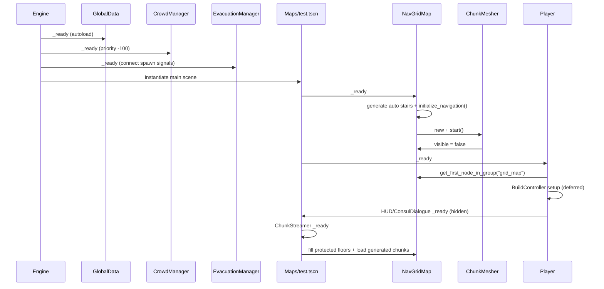
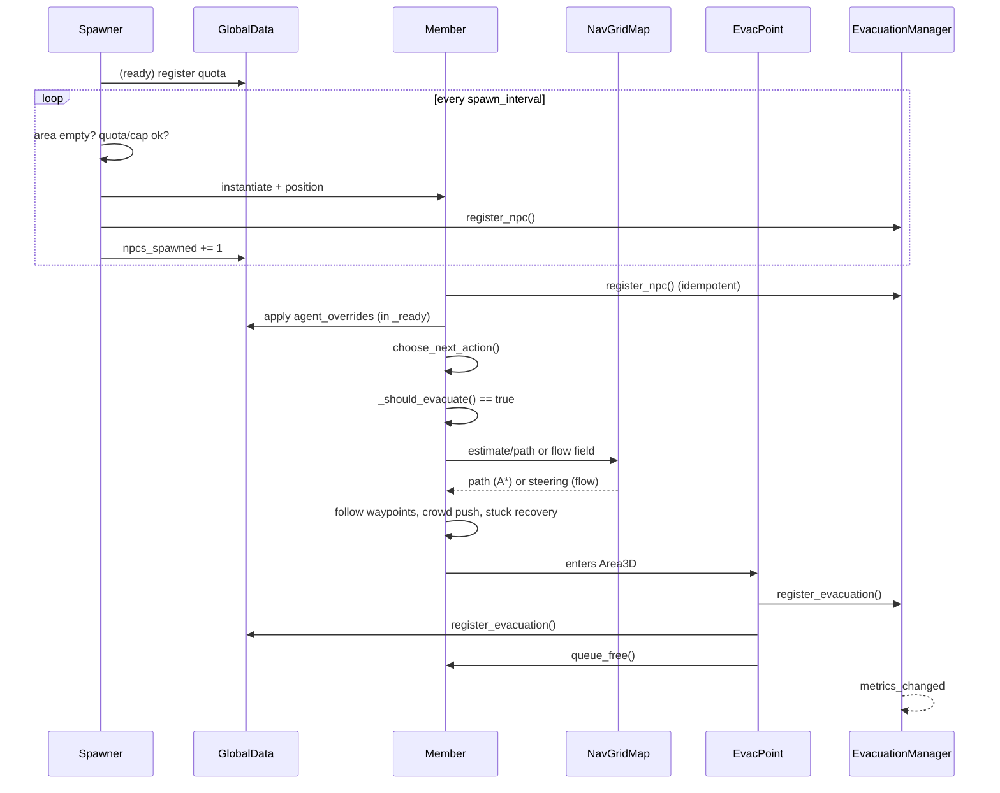
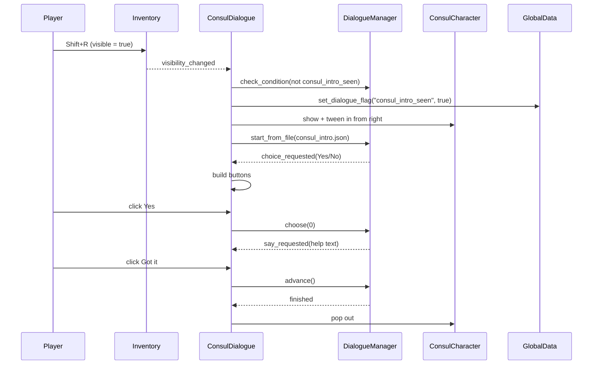

# Codebase Analysis — Evacuation Route Optimizer

> Snapshot: **2026-11-06** · Godot **4.7.2.stable.steam** · Renderer `mobile` · Git repository initialized (initial commit `c9a5e40`, dirty working tree) · No README, no tests.
>
> This revision supersedes the 2026-11-02 audit, kept at `docs/archive/CODEBASE_ANALYSIS_2026-11-02.md`, which in turn superseded the 2026-10-31 audit. The 2026-11-02 document described the build before the Consul dialogue system existed, and it reported the 4,674-cell GridMap *resource* as the live map. The current `Maps/test.tscn` overrides that grid with an 80-cell platform, so the map-related numbers in the archive no longer describe the shipped scene.
>
> Claims below were checked against the current source and, where noted, against a live run of the project. Sections that changed substantially in this revision: **1** (health), **3.2** (live map), **4.1/4.2** (streaming, chunk mesh budget), **4.11** (chunk streaming), **7** (600-NPC measurements), **9** (new limits), **12** (verification).

---

## Contents

1. [Executive summary](#1-executive-summary)
2. [What the project is trying to be](#2-what-the-project-is-trying-to-be)
3. [Runtime topology](#3-runtime-topology)
4. [Systems in depth](#4-systems-in-depth)
5. [Data and asset pipeline](#5-data-and-asset-pipeline)
6. [Key execution flows](#6-key-execution-flows)
7. [Complexity and performance profile](#7-complexity-and-performance-profile)
8. [Coupling and boundaries](#8-coupling-and-boundaries)
9. [Findings](#9-findings)
10. [Intent vs. implementation](#10-intent-vs-implementation)
11. [Recommendations](#11-recommendations)
12. [Verification log](#12-verification-log)
- [Appendix A — File inventory](#appendix-a--file-inventory)
- [Appendix B — Input map](#appendix-b--input-map)
- [Appendix C — Project settings](#appendix-c--project-settings)
- [Appendix D — Unused assets](#appendix-d--unused-assets)

---

## 1. Executive summary

**What exists.** A single-scene Godot 4 voxel sandbox with a character controller, block building, a crowd simulator, a simulation control panel, an Agents editor, an evacuation results panel, and a first-run Consul dialogue/onboarding overlay. The simulation loop is implemented end-to-end:

```
Simulation/Agents panel → spawn NPCs → choose an exit → path/flow to it → EvacPoint → metrics
```

The shipped scene now starts with an **80-cell platform**. Flat-floor generation is **disabled for now**: `ChunkStreamer` only loads chunks that already exist in `user://world/chunks`, out to a 64-chunk radius. The existing saved chunks still provide ground around much of the test scene, but a fresh chunk store leaves empty space. A live 600-agent sprite run with evacuation disabled settled at **~131 FPS** at 30 Hz physics.

**What is measured.** `EvacuationManager` records per-NPC spawn/arrival times, chosen exit, distance travelled, stuck time, failed paths, and peak local density. It derives average, median, p95, min/max evacuation time, per-exit arrivals, share, average time, and throughput per minute. The archived 2026-11-02 run (60 NPCs, 42 evacuated by ~26 s, average 22.5 s, p95 24.8 s) was measured on the old 4,674-cell map; the current saved-chunk world makes the same loop playable where those chunks exist.

**What is still missing.** The “optimizer” half of the title: no simulation save/load, no baseline/replay, no before/after layout comparison, no bottleneck heatmap, no obstacle-rich level, and no tests. The flat demo island is no longer generated at runtime, so the test scene depends on the built/saved chunks.

**Overall health.** The simulation core is intact and the previous off-map regression is resolved by streaming. Actual **64-chunk full terrain generation** is not achievable with the current per-cell GridMap: it reached 9,150 chunks / 2.34 M cells / 2.3 GB and then crashed when 600 agents were added. Flat-floor generation is disabled for now, the load radius is 64 (saved chunks only), and a 4,096-chunk safety cap prevents runaway memory. Behavioural debts from the previous audit remain: flow-field mode has no crowd spreading or stuck recovery, exit choice uses straight-line distance instead of path distance, and resetting a run leaves live NPCs that corrupt the next run’s metrics.

**Recent changes — 2026-11-06.**

- **Consul dialogue system added.** `DialogueManager` (JSON step interpreter), `ConsulCharacter` (971-line procedural eye/eyelid/emotion/hand rig), and `ConsulDialogue` (HUD overlay) are wired into `scenes/hud.tscn`. The intro plays once per application session when the inventory first opens, marks `consul_intro_seen` in `GlobalData.dialogue_flags`, and teaches the console/statistics/results keys.
- **Main map shrunk, then streamed.** The GridMap instance in `Maps/test.tscn` still serialises 80 cells (10 × 8 at x −5…4, z −3…4) instead of the resource's 4,674 cells. `ChunkStreamer` loads saved chunks out to a 64-chunk radius; flat-floor generation is disabled for now. `scenes/grid_map.tscn` still contains the old 4,674-cell platform.
- **MeshLibrary expanded.** 40 block textures → **162 items** (40 × 4 shapes + `Debug_Box` + `Stair_Echidna`), 3.98 MB, all with previews.
- **Realistic sprite variants added.** Members can switch from the 3D model to a baked `AnimatedSprite3D`; `RealisticSpriteLibrary` discovers scenes in `scenes/npcs/realistic_npcs/`, with `sherwin` and `mark_m` available. Both use their own normal map atlases. `sprite_offset` nudges the sprite onto the floor.
- **Sprite rim/bounce lighting added.** The 2D Consul rim/bounce shader is ported to a 3D mix overlay; `SpriteLight3D` feeds the camera-projected sun direction, rim strength, and complementary bounce tint through global shader parameters. Both edge strengths scale with the directional light's `light_energy`, so they fade with the day/night cycle.
- **Chunk streaming added.** `ChunkStreamer` loads saved chunks within a 64-chunk radius around the player, meshes only nearby chunks, and builds navigation only near the player. Flat-floor generation is disabled for now, so missing chunks stay empty. Physics now runs at 30 Hz to keep 600 agents stable.
- **Spawner batching and sprite culling added.** Spawners emit six agents per interval, reserve distinct nearby nav-cell positions with a 1.5 m clearance, and scatter them across a 5 m radius; sprite NPCs pause animation and drop the rim overlay beyond 45 m, but the script applies no render-range culling. The 600-agent spawn time fell from ~18.5 s to ~5.8 s; toggling the same 600 agents between sprite and 3D mode measured ~131 FPS vs ~107 FPS with the normal map enabled.
- **Git initialized.** Initial commit `c9a5e40`; the dialogue, HUD, `GlobalData`, `Consul`, and MeshLibrary changes are currently uncommitted.
- **Prior change — stair snapping removed (2026-11-02).** `MovementComponent.gd` and its `StairsAhead`/`StairsBelow` raycasts are gone. Player and NPCs rely on `move_and_slide()`, gravity, jumping, and (for NPCs) the obstacle-hop routine.

**Biggest risks.**

| Risk | Where |
|---|---|
| A full 64-chunk generated world is not sustainable: 9,150 chunks used 2.3 GB and crashed with 600 agents; generation is capped to 8 chunks by default | `ChunkStreamer.gd`, `gridmap.gd` |
| The 4,096-chunk safety cap silently stops loading a larger saved radius | `ChunkStreamer.gd:max_loaded_chunks` |
| The Consul intro is triggered by opening the inventory, not by a dedicated onboarding trigger; it marks itself seen before it finishes | `scenes/dialogue/ConsulDialogue.gd` |
| Dialogue flags live only in memory, so the “seen” state resets every launch | `scripts/GlobalData.gd`, `scripts/dialogue_manager.gd` |
| NPC collisions are steering-only by default (`Member.allow_collision_disable = true`, mask 1); set it off to force mask 3 | `scenes/npcs/Member.tscn`, `scripts/NPCstuff/Member.gd` |
| Flow-field mode has no lane offsets, stuck detection, or obstacle hop | `scripts/NPCstuff/Member.gd`, `scripts/gridmap.gd` |
| Exit selection ignores path distance | `scripts/NPCstuff/Member.gd:_route_to_closest_evac_point` |
| Reset leaves live NPCs and clears records, producing 0 s arrival times | `scripts/GlobalData.gd`, `evacuation_manager.gd` |
| Demo quota remains 9 × 1,000 at 0.1 s, 9,000 total vs. a 700 cap | `Maps/test.tscn`, `scenes/spawner.tscn` |

---

## 2. What the project is trying to be

The evidence still points to a **spatial evacuation sandbox**, not a Minecraft-like survival game:

- The title is *Evacuation Route Optimizer*.
- The block palette is institutional — classroom window frames, floor tiles, warning-coloured concrete brick, off-white walls.
- The meaningful outcome is “NPC reached an `EvacPoint` and was removed”.
- Navigation penalises walls and exposed gaps instead of only minimising distance, and lane offsets spread agents sideways.
- The HUD has a simulation panel for start/reset/quota/cap/mode and a results panel for timing, exit usage, throughput, distance, and failures.
- The HUD has an Agents category that edits the Member exports for live and future NPCs.
- Placeables include a foliage scene generator that creates one billboard or crossed-plane sprite placeable per texture.
- The player has creative building tools and can place `Spawner` and `EvacPoint` as objects.
- A first-run Consul dialogue greets the player and explains the console/statistics/results keys, so onboarding is now part of the intended experience.

The implied loop is: **build a floor plan → place crowd sources and exits → run the evacuation → measure how it went → change the layout**. All five steps exist in code, but the shipped map currently has no floor under its actors. The comparison/optimization step still does not exist.

A second layer of intent is visible in the assets: a 1970s/PSX aesthetic (CRT addon, pixel shader, posterisation shader, PSX shader globals, serif pixel font, day/night plugin). Almost none of it is wired into a scene. The new Consul character is the first substantial piece of authored 2D presentation actually used at runtime.

---

## 3. Runtime topology

### 3.1 Autoloads

| Name | Script | Role |
|---|---|---|
| `GlobalData` | `scripts/GlobalData.gd` | Run-wide counters, spawn quotas, spawn gate, evacuation mode, signals |
| `CrowdManager` | `scripts/CrowdManager.gd` | Spatial hash of NPCs, neighbour/density queries |
| `EvacuationManager` | `evacuation_manager.gd` | Per-NPC records, run summary, exit aggregates, metrics signal |

`EvacuationManager` is registered in `project.godot` and was present at runtime.

`DialogueManager` is **not** an autoload. It is a plain `Node` with `class_name DialogueManager`, instanced under `scenes/dialogue/consul_dialogue.tscn`. Dialogue flags are stored on `GlobalData.dialogue_flags`, so every scene-local manager writes to the same in-memory dictionary.

### 3.2 Main scene (`Maps/test.tscn`, UID `uid://bbtjdcwal7ax6`)

```
Test (Node3D)
├── CycleController (Node3D, day_and_night_cycle)
│   ├── WorldEnvironment
│   └── DirectionalLight3D (SpriteLight3D → sprite shader globals)
├── GridMap (NavGridMap + 162-item MeshLibrary; scene instance overrides data with 80 cells)
├── Player (CharacterBody3D, player.tscn)
│   ├── HUD (CanvasLayer) → HUD (HUDManager)
│   │   ├── Inventory → Blocks / Placeables / Simulation / Agents
│   │   ├── Label ("Selected Block: …")
│   │   ├── Statistics_Hud (F3)
│   │   ├── EvacuationResults (F4)
│   │   ├── Console (Shift+/)
│   │   └── ConsulDialogue (hidden first-run Consul overlay)
│   ├── CollisionShape3D, head/CameraSmooth/Camera3D, Hand
│   ├── HealthComponent
│   ├── BuildController
│   └── 7 × AudioStreamPlayer3D
├── EvacPoint (Node3D) → Area3D
├── Spawner  … Spawner9 (Node3D, x = 31.33, z = −18.67 … 28, quota 1,000 each)
├── ChunkStreamer (Node, load radius 64, mesh radius 16, nav radius 8,
│                   flat-floor generation disabled, min y = −256)
```

At runtime the grid creates a sibling `ChunkMeshes` node (`ChunkMesher`), and `BuildController` creates a `PlacementGhost` under the current scene.

**Verified default state** (live run):

```
root children : CycleController, GridMap, ChunkMeshes, Player, PlacementGhost,
                EvacPoint, Spawner .. Spawner9, ChunkStreamer
HUD children  : Inventory, Label, Statistics_Hud, EvacuationResults, Console,
                ConsulDialogue
groups        : grid_map=1, player=1, npc=0, Members=0, EvacPoint=2, placeables=10
spawning      : false
used cells    : 80 initially; plus whatever saved chunks exist
populated     : saved chunks only; no runtime floor generation
nav points    : nav chunks for loaded saved chunks within nav radius 8
mesh items    : 162 (all with previews)
flow fields   : 0 baked, enable_flow_fields = false
total quota   : 9,000 (9 spawners × 1,000)
live cap      : 700
```

**The scene starts at 80 cells and then loads saved chunks.** `scenes/grid_map.tscn` still embeds the old 82 × 57 platform (4,674 cells at y = 0), but `Maps/test.tscn` instances that GridMap and overrides `data.cells` with 80 entries. `ChunkStreamer` protects those initial chunks and loads chunks already saved under `user://world/chunks`; it no longer fills missing chunks with a generated flat floor. Existing saved chunks cover much of the test scene, but a fresh store leaves the spawners and evac point without ground.

The load radius is configured to **64 chunks**; `max_loaded_chunks` is 4,096. Full 64-chunk *generation* was measured at 9,150 chunks / 2.34 M cells / 2.3 GB and crashed when 600 agents were added, which is why runtime generation is disabled for now. The previous off-map defect (**N11**) is mitigated by saved chunks, not by runtime generation.

The GridMap serialises its cells through the `data` dictionary as a flat `PackedInt32Array` with **3 ints per cell**: `(packed_xy, z, item)`, where `packed_xy = (y << 16) | (x & 0xFFFF)` and the z entry is the signed 16-bit z coordinate. For both single-layer maps every triple is `(x & 0xFFFF, z & 0xFFFF, 44)`. Writing `x, y, z, item` (4 ints) or a raw `x, y, z` triple produces a corrupt or empty map — regenerate with the packed format. Because the main scene stores its own override, editing `scenes/grid_map.tscn` alone does **not** change the level the game runs.

### 3.3 Groups

| Group | Producer | Consumer |
|---|---|---|
| `npc` | `Member._ready` | `CrowdManager`, `Statistics_hud`, `EvacuationManager`, `SimulationPanel`, `AgentPanel`, `Member` |
| `Members` | `Member.tscn` | `NPCSpawner` occupancy check, global cap count |
| `player` | `player.gd:_ready` | HUD, console, BuildController |
| `Player` | `player.tscn` | listed in `[global_group]`, not queried by code |
| `grid_map` | `NavGridMap._ready` | player, NPCs, build, console |
| `EvacPoint` | `evac_point.tscn` (root and Area3D) | `Member._route_to_closest_evac_point`, `RandomPopulator` |
| `placeables` | spawner/evac scenes; player on placement | break-block traversal |
| `spawners` | `NPCSpawner._ready` | console/debug, not required by the panel |
| `foliage` | generated foliage scenes | foliage queries/debug |
| `Air_migration_nodes` | configured only | `ParticleAttractorStateMachine` (unused) |

Two NPC identity groups (`npc` and `Members`) and two player groups (`player` and `Player`) remain a recurring source of near-misses. `EvacPoint` deliberately has two nodes in the group (root and Area3D); code that iterates the group therefore sees each exit twice.

### 3.4 Physics layers

| Layer | Used by | Notes |
|---|---|---|
| 1 | GridMap/world | default |
| 2 | `Member` (`collision_layer=2`) | NPC bodies |
| 3 | Player (`collision_layer=3`) | overlaps NPC layer |
| 4 | Spawner/EvacPoint `Area3D` (`collision_layer=7`) | 7 = layers 1+2+3 |
| 5 (bit 16) | Player mask only | no producer found |

| Body | Layer | Mask | Consequence |
|---|---|---|---|
| Player | 1+2 | 1+2+16 | Collides with world, NPCs, and unused layer 5 |
| Member | 2 | **1 (default)** | Collides with world and player, **not with other NPCs** |
| Spawner/Evac area | 1+2+3 | 1+2 | Detects NPC bodies |

The `Member` mask is not set in `Member.tscn`, so Godot’s default mask of 1 applies. `Member._disable_layer_2()` clears a bit that is already absent; it is currently dead code. This is finding **N1**.

---

## 4. Systems in depth

### 4.1 Voxel world - `NavGridMap` (`scripts/gridmap.gd`, 2,665 lines)

A `GridMap` subclass that fuses block storage, navigation graph, flow-field cache, debug drawing, and chunk persistence.

**Block storage.** `place_block` / `remove_block` / `place_blocks` / `remove_blocks` wrap `set_cell_item`, update `_chunk_cells`, mark chunks dirty for meshing, refresh navigation locally, and emit `navigation_changed`.

**Walkability rule.** A cell is walkable when it has a block and the cell above is empty. Agents walk on top of blocks; the corridor level is the block layer.

**Navigation graph.**
- `AStar3D` with bidirectional cell ↔ point-id maps; ids are recycled through `free_ids`.
- 16 movement offsets: 4 orthogonal, 4 flat diagonals, 8 one-block stair steps.
- Flat diagonals are connected only when both orthogonal side cells are walkable, preventing corner cutting.
- Point weight = `max(wall_penalty, gap_penalty)`:
  - wall penalty 1.0 → 2.0 as the four sides become more enclosed;
  - gap penalty 1.0 → 3.0 as sides lose both wall and floor.
- `_refresh_point_weights_around` now updates the changed cell and the cells whose wall/gap tests depend on it. The old “weights lag an edit” finding is resolved.

**Flow fields.**
- `enable_flow_fields` defaults to `true` in the script, but both `scenes/grid_map.tscn` and the `Maps/test.tscn` instance set it to `false`. The shipped map uses per-NPC A*.
- `ensure_flow_field_cell` starts a Dijkstra-like bake from the exit; `_advance_bake_jobs` spends `flow_bake_budget_usec` = 1.5 ms/frame.
- The field stores `cell → next cell`; `get_flow_direction_for_cell` steers from the agent’s current position to the next cell centre.
- Fields are invalidated when an edit touches a field cell, its target, or a neighbour.
- The cache holds 32 fields and evicts the first dictionary key, not the least-recently used.
- The bake queue is a plain FIFO with relaxation on improvement (SPFA-like): correct, but can re-expand cells.

**Path post-processing.**
- `_physics_smooth_path` performs line-of-sight simplification with up to 16 waypoints of lookahead.
- A shortcut is accepted only if walkable ground exists under the centre line **and** under `path_ground_radius` to each side, plus three rays (centre + one agent radius to each side) that hit nothing. The side ground checks use a tighter height tolerance so a shortcut cannot clip a corner and put part of the body over a ledge.
- `_trim_path_start` removes the initial backwards step toward the cell centre.
- When the request queue is at least 32 entries, `_process` sets `fast_paths = true` and skips **both** smoothing and lane offsets (`gridmap.gd:_process`). This is exactly the mass-spawn case.

**Parallel lanes.**
- If the requester exposes a non-zero `lane_offset`, `_apply_requester_lane` resamples the path and shifts it sideways.
- The shift fades in/out at the ends, is clamped by wall clearance, falls back to the centreline where there is no safe ground, and retries at half offset twice.
- Flow-field steering bypasses this entirely: there is no path object to shift, and `get_flow_direction_for_cell` returns a single next-cell direction. With flow fields on, agents converge into one line.

**Congestion routing.**
- `report_congestion(world_pos)` converts a stuck report into per-cell heat (0..1). The centre receives the full amount; cardinal neighbours 45 %, diagonals 20 %. A stuck event reports both the agent and its blocker.
- Hot cells multiply the AStar point weight: `weight = wall/gap weight × (1 + heat × congestion_penalty_max)`, with `congestion_penalty_max = 2`. A fully hot cell is 3× more expensive to enter, not an order of magnitude.
- Heat decays at `congestion_decay_per_sec = 0.35` and is refreshed every `congestion_tick_interval = 0.5 s`; below 0.02 the cell returns to its base weight. `congestion_max_cells = 512` bounds the map.
- `is_ground_path_supported(from, to)` samples the whole segment at 0.35-cell intervals. The yield and steering ledge guards use it, so a diagonal move cannot pass through an unsupported corner between two valid endpoint probes.

**Debug drawing.** `debug_show_paths` draws recent A* paths and flow arrows; the console exposes `/show_paths` and `/path_mode astar|flow`. This is the main authoring aid.

**Editor tools.** `NavGridMap` is a `@tool` script and exposes two inspector buttons: **Reload Editor World** rebuilds the `ChunkStreamer` editor preview from `user://world/chunks`, and **Save Editor World** forces the editable preview's changed chunks to disk. Both are no-ops outside the editor; runtime navigation still updates through the normal block-edit path.

**Auto stairs.** `_generate_auto_stairs` refreshes `Auto_Stairs_<texture>` items in the MeshLibrary at runtime from `models/Specialblocks/stair.gltf`. The block generator now also writes stairs into the MeshLibrary, so this is a runtime safety net rather than the only source.

**Chunk API.** `serialize_chunk`, `load_chunk`, `unload_chunk`, `save_dirty_chunks`, `save_all_chunks` exist and are robust (versioned, packed 5 ints per block, batched nav refresh). `ChunkStreamer` and `ChunkFileStore` now use them for streamed loading and saving.

**Streaming/navigation LOD.** `load_chunk(data, emit_nav_signal, build_navigation)` can load cells without adding them to AStar; `build_chunk_navigation(chunk)` adds them later when the player nears. `_nav_chunks` tracks which chunks are in the graph, so unloads only refresh navigation that exists. `min_block_y`/`max_block_y` default to −256/255 and reject out-of-range block placement and chunk cells.

### 4.2 Rendering - `ChunkMesher` (`ChunkMesher.gd`, 907 lines)

`ChunkMesher` is a `RefCounted` owned by `NavGridMap` that replaces GridMap rendering with one merged mesh per 16×16 column chunk:

1. On `start()` it hides the GridMap and creates a sibling `ChunkMeshes` node.
2. Block placement/removal marks the owning chunk (and neighbouring border chunks) dirty.
3. `process()` spends up to 4 ms/frame rebuilding dirty chunks.
4. Cube-shaped items are greedy-meshed per face direction and slice; non-cube items (slabs, stairs) are emitted from their source mesh with their transform.
5. Only complete rebuilds are committed to the `MeshInstance3D`.
6. `set_view_center(chunk, radius)` keeps `mesh_radius_chunks` around the player: far chunk meshes are freed, and only populated chunks inside the radius are queued. The streamer sets radius 16.

Item classification is geometric, not metadata-driven: a mesh is a “cube” only if its bounds match the cell size and its triangles cover ≥97 % of all six box faces. That correctly rejects stairs, whose bounding box is a cube.

GridMap collision stays active while rendering is hidden, so physics does not depend on mesh rebuild timing. The visual can lag collision by a frame or more.

### 4.3 Crowd — `CrowdManager` (`scripts/CrowdManager.gd`, 114 lines)

- Spatial hash on X/Z with `cell_size = 1.5`; `get_nearby_npcs` scans the 3×3 neighbourhood and caps at 20 by default.
- The grid is rebuilt from `get_nodes_in_group("npc")` every `crowd_tick_rate = 0.1 s`, not every physics frame.
- The rebuild runs at `process_physics_priority = -100`, before NPC movement.
- `get_density` caps the neighbour list at 20 **before** applying its 2 m radius filter, so it cannot report more than 20.
- `Member._update_crowd_push` computes `neighbor_count = nearby.size() - 1`, assuming the query includes self. Because the query is capped and scan order is arbitrary, self may be absent; the count is not reliable near the threshold.

### 4.4 NPC AI - `Member` (`scripts/NPCstuff/Member.gd`, 2,115 lines)

**State machine:** `IDLE`, `WANDERING`, `SEEKING_FOOD`, `SEEKING_REST`, `SEEKING_EVAC`, `ARRIVED`, `DEAD`.

In practice only `IDLE`, `WANDERING`, `SEEKING_EVAC`, `ARRIVED`, and `DEAD` occur. `SEEKING_FOOD` and `SEEKING_REST` are never entered. `WANDERING` is now reachable when `GlobalData.evacuation_mode` is off (or `set_evacuation_mode(false)` is called), because `_should_evacuate()` returns `is_evacuee and not has_evacuation_target`. Hunger and energy are still decremented/accumulated but never consumed.

**Per-frame motion.**
- Gravity, waypoint advance, direction to waypoint.
- Crowd separation is applied only laterally to the movement direction, capped at 35 % of speed, so pushing cannot reverse navigation.
- Velocity smoothing (15/s on the ground, 6/s in the air), `look_at` toward velocity.
- Waypoint arrival radius is `0.3 m`. Once a waypoint is passed, the agent advances to the next one instead of turning back into the crowd. If it was pushed more than `CORNER_REPATH_DISTANCE = 0.75 m` sideways, it requests a fresh path from its current position (throttled to once per second) so it does not cut the missed corner.
- **Ledge guard.** Before the move, `_guard_ledge()` probes the final steering vector `0.55 × cell_size` ahead. If that spot has no walkable ground it keeps the forward component of the path direction; if that is also unsupported it stops for the tick. After `move_and_slide()`, `_keep_on_walkable_ground()` reverts small crowd-depenetration shoves that end on unsupported ground. This catches the case where NPC-vs-NPC collision resolution pushes an agent sideways off an edge after a safe steering decision.
- `move_and_slide()` every physics tick; steering decisions run at `movement_rate = 30 Hz` with a phase-staggered brain tick at `LOGIC_TICK_RATE = 0.15 s`.
- **No stair snapping.** The former `MovementComponent` (probe rays, `try_snap_down`, `try_step_up`) is gone. Agents do not auto-step onto slabs or snap down to stairs. The player must jump; NPCs rely on `_try_obstacle_hop` when blocked by a climbable edge.

**Evacuation selection.**
1. Collect all `EvacPoint` nodes; each exit contributes its root and Area3D, so the group has two entries per exit.
2. Filter out points on personal cooldown (5 s); if all are on cooldown, clear cooldowns and retry after 2 s.
3. Sort by **straight-line** distance and take the closest `evac_shortlist_size = 3`.
4. Within `evac_choice_tolerance = 5×` the best straight-line distance, pick one at random.
5. Request an A* path or start/steer a flow field; after 3 failures, give up and return to `IDLE`.
6. This is no longer A* path distance. On a non-convex floor plan, a “close” exit can be behind a wall. This is **N3**.

**Arrival.** `_finish_path` / `_complete_flow_arrival` set `ARRIVED`, wait `evac_confirm_timeout = 3 s`, and notify `EvacuationManager`. Actual removal is done by the `EvacPoint` area. If the area misses the body, the `ARRIVED` timeout clears `has_evacuation_target` so the NPC can try again instead of wandering forever.

**Flow-field mode.** When `gridmap.enable_flow_fields` is true:
- `current_path` stays empty;
- `_update_stuck_detection` samples the agent's nav cell and its distance to `_flow_target`, so a jam is detected when the agent stays in one cell without making progress;
- `_try_obstacle_hop` works on a stuck strike;
- lane offsets are not applied;
- if the next flow cell is congested, the agent requests a congestion-weighted A* detour and temporarily leaves the field.

So flow mode now has crowd recovery and can sidestep a jam, but it still has no parallel-lane spreading and converges agents toward one line. This is **N2**.

**Stuck handling.**
- Detect insufficient progress toward the current waypoint over 0.5 s. In flow mode there is no waypoint index, so progress is sampled by nav cell: crossing into a new cell resets the timer, and staying in the same cell for 0.5 s without closing on `_flow_target` counts as a jam.
- **Right-of-way yield.** Before collision changes, `_try_deadlock_yield()` looks for a head-on or slow corner blocker within `YIELD_DETECT_RADIUS = 1.0 m`. The higher instance ID backs away diagonally at `YIELD_SPEED_SCALE = 0.55` for `YIELD_DURATION = 0.8 s`; the lower ID keeps moving, so the pair separates without disabling collision. The yield step is rejected if both the diagonal and straight-back paths have no ground, so it cannot walk off a ledge.
- **Congestion detour.** A stuck event also calls `NavGridMap.report_congestion()` for the agent and blocker. After a yield, and whenever the next flow cell or the next portion of an A* path is hot, the agent requests a fresh congestion-weighted A* route. This is what prevents a yielding agent from walking back into the same jam, and makes incoming agents prefer a different corridor. The check runs at `CONGESTION_CHECK_INTERVAL = 0.35 s` per agent, and repaths are throttled to `CONGESTION_REPATH_INTERVAL = 2 s`. A path-mode detour is rejected if it is longer than the current remaining route plus `max(3 m, 20 %)`, or if its first step is more than 1 m behind the current heading, so congestion avoidance stays local instead of backtracking across the map.
- When `allow_collision_disable = true`, a successful stuck event still uses the legacy `_disable_layer_2()` path. When it is `false`, `_disable_layer_2()` is a no-op and the yield is the only crowd escape, so NPC-vs-NPC collision stays on.
- Strike 1: yield if possible, otherwise random hop. Strike 2: hop + repath. Strike 3+: hop and restore collision.
- In `SEEKING_EVAC`, a non-yield strike also counts as an evacuation failure. A yield instead schedules the post-yield congestion detour and does not increment the failure counter.
- When collision restore is enabled, it now runs a physics shape query first and refuses to re-enable NPC collision while another body is within 1 m. This prevents the upward depenetration launch seen when two agents spawn overlapped.

**Obstacle hop.** Only when against a wall, the next waypoint is higher (or a strike exists), and a ray at jump apex is clear (or hits another character). In flow mode, a hop requires an actual stuck strike because there is no waypoint to compare heights with. Prevents jumping into ceilings while allowing stair edges.

**Runtime map edits.** On `navigation_changed`, if a changed cell lies within 1.2 cells of the remaining path, the NPC schedules a repath after 50–500 ms of jitter. In flow mode it re-ensures the field instead.

**Fall-out death.** Every 0.25 s each NPC asks `NavGridMap.get_chunk_lowest_block_y()` for its current chunk and compares its height against `lowest_y − 5 × cell_size.y`. An empty chunk falls back to world `y = 0`. Falling below the threshold calls the normal death path (`_on_health_depleted`), which notifies `EvacuationManager` and frees the NPC.

**Individuality.** At spawn, each NPC randomises speed (+0–1.5), separation radius (+0–0.5), separation push (+0–1), and `lane_offset` (±1 × `lane_offset_strength` + random extra × cell size). `lane_offset_strength` defaults to 0, but `max_extra_lane_offset = 0.5` adds up to half a cell of extra offset, so small lanes are active by default in A* mode.

**Agent overrides.** `Member._ready` applies `GlobalData.agent_overrides` before recomputing the derived speed/separation/lane values. The public `apply_agent_overrides()` does the same for a live agent and is what the Agents category calls when Apply is pressed. `is_evacuee` is deliberately excluded because the Simulation panel owns evacuation mode.

**Sprite visual mode.** `realistic_sprites_mode` switches an NPC from the 3D model to a baked `AnimatedSprite3D`:
- `realistic_sprite` selects a scene by ID from `res://scenes/npcs/realistic_npcs/` (`sherwin`, `mark_m`) or uses the `random` sentinel to pick one of the available variants per agent. The chosen random variant is stable for that agent until its requested ID changes. `RealisticSpriteLibrary` discovers every `*.tscn` in that folder, so adding a variant needs no Member code change.
- Every variant scene owns its atlas/SpriteFrames and must expose the eight clips `front/back/left/right` × `idle/walk` (four-frame walk cycles).
- `SpriteMemberVisual` picks the row from the camera-relative body facing and plays the matching clip; the sprite uses a fixed-Y billboard and alpha discard. It is **shaded by default** so world lighting applies; `sprite_shaded` can switch it to unshaded rendering.
- Per-variant geometry is exported on the scene (`frame_cell_height`, `frame_columns`, `frame_bottom`, `idle_columns`, `walk_columns`), so a future sheet may use a different cell/grid layout without editing the controller.
- The sprite is created lazily in `_ensure_sprite_visual()`, so 3D-mode NPCs pay no extra node cost. Changing `realistic_sprite` while sprite mode is on rebuilds the visual.
- While active, `blockbench_export.visible = false` and `LeanAnimator` has physics processing disabled, removing the 3D skinning/animation work.
- `sprite_pixel_size` (default `0.0042`, matching the 2 m 3D model), `sprite_walk_fps` (default `5.0`), `sprite_shaded` (default `true`), and `sprite_offset` (`Vector3`, local-space nudge) are exposed to the Agents panel. Use `sprite_offset.y` to lift or sink a sprite onto the floor; a variant scene can also bake its own `floor_offset`.
- `sherwin.tscn` sets `normal_map` to `textures/NPC/NPC_Sherwin_n.png`, and `mark_m.tscn` sets it to `textures/NPC/NPC_Mark_M_n.png`. Both are 1200 × 2800 tangent-space atlases with the same 3 × 4 cell layout. `AnimatedSprite3D` has no normal-map slot, so the controller attaches a `StandardMaterial3D` override with the albedo and normal atlases, alpha scissor, disabled culling, and fixed-Y billboarding. The sprite mesh already emits atlas-space UVs for the current frame, so both textures sample the same cell without extra UV remapping. `normal_strength` scales the effect; the atlases are imported as RGTC normal maps.
- Per-agent lighting controls are exported on `Member` and forwarded to `SpriteMemberVisual`: `sprite_rim_strength` and `sprite_bounce_strength` multiply the shared `SpriteLight3D` rim/bounce values, while `sprite_normal_enabled` and `sprite_normal_strength` control the sprite's normal map. The rim shader clamps both edge amounts after the per-agent multiplier.
- The 2D-style rim/bounce effect is ported as a 3D mix overlay (`shaders/realistic_sprite_rim.gdshader`). `SpriteLight3D.gd` on the `DirectionalLight3D` pushes the camera-projected sun direction, rim strength, and complementary bounce tint to global shader parameters once per frame. Both strengths are multiplied by `light_energy`: the rim uses `rim_strength * energy`, and the bounce uses `bounce_strength * energy * 0.5` (bounce default `0.35`). Each sprite updates its atlas/region uniforms when its frame changes; the shader converts the atlas UV into a 0–1 UV for that frame and clamps every rim/bounce sample, so it never reads a neighbouring sheet cell.
- The rim mixes the texture with the **DirectionalLight3D's actual colour** (`light_mix = 0.5`) instead of adding white. The bounce uses the same mix with the complementary sunlight hue. Both are colour mixes, not additive glows.
- The overlay replicates `BILLBOARD_FIXED_Y` in its vertex shader. `AnimatedSprite3D` billboards through its base material, and `material_overlay` is a separate pass, so without the matching transform the rim would stay on the un-rotated quad.
- Feet are anchored per atlas frame from `frame_bottom`; a hurt event flashes the sprite instead of calling `LeanAnimator.play_hurt()`. The 3D health-darkening effect is not mirrored on sprites.
- Distance culling pauses `AnimatedSprite3D` playback past `animation_cull_distance` and removes the rim overlay material past `rim_cull_distance` (both 45 m). The controller applies no render-range culling, so distant sprites stop animating and lose the overlay draw but remain rendered.

**Metrics snapshot.** `get_evacuation_snapshot()` returns distance, stuck time, peak density, stuck strikes, state, and last target. `EvacuationManager` consumes it when the NPC enters an exit.

### 4.5 Spawning and evacuation bookkeeping

**`NPCSpawner`** (`scenes/spawner.gd`, 272 lines):
- Registers either an independent quota keyed by instance id or a shared `spawn_section` quota.
- The `spawn_quota` setter updates the registered quota at runtime; quotas are now mutable. The old “snapshot only” finding is resolved.
- Spawns in batches of `spawn_batch_size = 6` on the interval, with one area check and one live-count check per batch. This amortises `get_overlapping_bodies()` / `get_node_count_in_group("Members")` across the batch and avoids the old per-spawn overhead.
- Prefers a random walkable nav cell within `spawn_scatter_radius = 5.0` instead of a tight 1.5 m disc. Each slot is rejected if a physics shape query finds another body within `spawn_clearance = 1.5 m`, then reserved through `GlobalData.reserve_spawn_position()` so two spawners cannot choose the same spot in the same frame (new bodies are not in the physics space yet). Reservations expire after 400 ms.
- Still respects the global gate, independent/section quotas, global quota, Area3D occupancy, and the global cap.
- Unregisters its quota on `_exit_tree`.
- The scene default is `spawn_quota = 5`, `spawn_interval = 0.1`; the test map overrides quota to 1,000.

**`GlobalData`** (`scripts/GlobalData.gd`, 235 lines):
- `npcs_evacuated`, `npcs_spawned`, `global_unit_cap = 700`, `global_spawn_quota = -1`, `evacuation_mode = true`, `is_spawning_enabled = false`.
- `agent_overrides`: exported `Member` values applied to every new spawn. `set_agent_overrides()` also pushes them to live agents and returns the number updated; `clear_agent_overrides()` only affects future spawns.
- Independent quotas keyed by spawner instance id; shared sections keyed by name with a per-spawner registration set.
- `get_total_max_spawns()` sums quotas, or returns the global cap if one is set; returns -1 (“unlimited”) if any quota is negative.
- `start_spawning()`, `stop_spawning()`, `reset_spawning()`, `reset_all()`, `set_evacuation_mode()`.
- `dialogue_flags` plus `get_dialogue_flag()` / `set_dialogue_flag()`. The dictionary is **in-memory only**; nothing writes it to `user://`. This is part of **N12**.
- `reset_spawning()` clears counters and emits `spawning_reset` but **does not despawn live NPCs**. `reset_all()` also clears registrations without telling spawners, so `/reset_all` from the console can break quota bookkeeping until reload. This is **N4**.

**`EvacPoint`** (`scenes/evac_point.gd`, 15 lines): an `Area3D` that on `body_entered` checks for group `npc`, calls `EvacuationManager.register_evacuation(body, self)` if present, then `GlobalData.register_evacuation()`, then frees the body. This is the success path. The trigger volume is a 3 m radius, 2 m tall cylinder centred on the marker (local `y = 0`), so it reaches NPCs standing on the 1.0 m floor; a higher centre left them 0.5 m below the volume and no arrival registered.

**`EvacuationManager`** (`evacuation_manager.gd`, 306 lines):
- `_records` keyed by NPC instance id; `_arrivals` for timing stats; `_exits` aggregated by node path.
- `begin_run` on `spawning_started`; `reset_run` on `spawning_reset`.
- `register_npc` is idempotent; both `Member._ready` and `NPCSpawner._try_spawn`/`RandomPopulator` call it.
- `register_evacuation` reads the NPC snapshot, computes `now - spawn_ms`, updates the exit aggregate, and emits `metrics_changed`.
- `get_summary()` returns running/complete, elapsed, spawned/evacuated/alive, quota, active records, failed paths, deaths, peak density, distance, stuck time/strikes, timing statistics, and per-exit rows.
- `complete` requires `spawned > 0`, `total_quota >= 0`, `spawned >= total_quota`, and `alive == 0`. Random-Populate runs on a scene with spawner quotas, and unlimited-quota runs, can therefore never show `COMPLETE`. This is **N9**.
- Records are erased on evacuation and death; an NPC freed by other means leaks a record until reset.

**`SimulationPanel`** (`scenes/inventory/SimulationPanel.gd`, 153 lines):
- Start, Reset, Evacuation Mode toggle.
- Global quota and active cap spin boxes.
- Random Populate: member count, start mode (evacuation/wandering), “needs exit path” filter, Populate button, status line.
- Syncs from `GlobalData` and listens to spawn/reset/evacuation signals.
- The panel lives inside the inventory (`Shift+R`), not on the HUD itself.

**`AgentPanel`** (`scenes/inventory/AgentPanel.gd`, 307 lines):
- Reads the exported properties of `Member.tscn` (primitive types only) and builds one `AdjustableVariableRow` per property.
- Boolean exports render as checkboxes, and `realistic_sprite` renders as an `OptionButton` with **Random** plus the IDs from `RealisticSpriteLibrary.get_ids()`. Random picks a different available variant per agent at spawn/rebuild, while an explicit ID keeps that one sprite. Every other editable type stays a text field.
- This is what exposes **Realistic Sprites Mode**, **Realistic Sprite**, **Sprite Offset**, **Sprite Pixel Size**, **Sprite Walk FPS**, **Sprite Rim Strength**, **Sprite Bounce Strength**, **Sprite Normal Enabled**, and **Sprite Normal Strength**.
- Skips `is_evacuee`, because the Simulation panel owns evacuation mode.
- Apply stores the values in `GlobalData.agent_overrides` and calls `apply_agent_overrides()` on every live `npc`; future spawns read the same dictionary in `Member._ready`.
- Reset clears the override dictionary and reapplies the Member scene defaults to live agents.
- The panel lives beside the Simulation panel in the inventory and has Apply / Reset / status footer.

**`RandomPopulator`** (`scripts/RandomPopulator.gd`, 110 lines):
- One-shot population on random walkable nav cells.
- Can filter to cells with a path to any `EvacPoint` using `grid.estimate_path_distance`.
- Respects `global_unit_cap` and `global_spawn_quota`.
- Registers each spawned NPC with `EvacuationManager`.
- The path filter runs a synchronous A* query per candidate per exit; on a map with many unreachable cells this can freeze a frame. Repeated Populate clicks accumulate NPCs. This is **N8**.

### 4.6 Player and building

`scripts/player.gd` (478 lines) owns movement, camera, wall run, wall jump, slide, mantle, zoom, noclip, stamina, health feedback, and audio triggers.

| Subsystem | Behaviour |
|---|---|
| Walk / sprint / crouch | 5 / 8 / 2.5 m/s, acceleration 10, friction 10 |
| Jump | Space, `JUMP_VELOCITY = 4.5`; no step-up assist |
| Slide | crouch while above walk speed → 12 m/s slide, camera tilt, SFX |
| Wall run | ray to each side, near-vertical surface, forward motion; reduced gravity, tilt, stamina |
| Wall jump | normal-based launch, stamina cost 25 (new wall) or 65 (same wall) |
| Ledge mantle | forward wall ray + down ray; computes vertical velocity for the ledge |
| Noclip | debug-only, `V`, mouse wheel adjusts speed |
| Zoom | hold `Z`, FOV 75 → 40 |
| Head bob / camera | procedural, tween-driven, damage tilt, death fall |
| Building | delegated to `BuildController` |

**Stair snapping removed.** `player.gd` no longer looks up a `MovementComponent`, no longer connects a `stepped` signal, and no longer calls `try_snap_down` / `try_step_up`. `player.tscn` no longer has `MovementComponent`, `StairsAhead`, or `StairsBelow`. Low slabs must be jumped onto; walking down a step uses normal gravity.

`scripts/BuildController.gd` (802 lines) owns placement/removal:

- `build_reach = 6`; physics ray from the camera with `collide_with_areas = true`.
- Ghost preview is a `MultiMeshInstance3D` under the current scene; translucent blue for placement, red for destruction/overlap.
- Click-and-hold unlocks a drag-plane selection on a floor or wall plane (`switch_axis` toggles the plane); the anchor stays fixed and the far corner follows the cursor.
- `max_build_area_volume = 512`, with a binary-search clamp so a near-parallel view cannot generate a huge loop.
- Breaking first walks up the collider’s parents looking for group `placeables`; otherwise removes grid blocks. A ray that stops on an NPC or other body does not delete blocks behind it.
- Placeables are instantiated, exported properties are overwritten from the HUD rows, then added to the scene and group.
- Stairs are auto-oriented toward the player (`auto_stairs`, `stair_front_axis`), based on the item name containing “stair”. The direction comes from the player's world position relative to the stair cell (or the drag selection centre), snapped to the dominant cardinal axis.

### 4.7 UI

**Inventory / HUD** (`scenes/hud.gd`, 673 lines):
- Categories: **Blocks** (MeshLibrary), **Placeables** (spawner, evac point, generated foliage scenes), **Simulation**, **Agents**.
- Block/placeable filtering is derived from item names: strips `Auto_`, recognises `Slab_Top` / `Slab_Bottom` / `Stairs`, treats the first remaining token as a material tag.
- Search matches item names and tags.
- Selecting a placeable builds a property editor from exported script properties and writes values back as text.
- The property editor filters to int/float/bool/string/StringName/Vector2/Vector3, skipping resources and node paths. The old “will corrupt `npc_scene`” finding is resolved.
- The Agents category edits the Member scene’s exports and applies them to live and future NPCs (see 4.5).
- UI font size is at least 16 px everywhere: the theme sets `default_font_size = 16`, and every explicit override is 16 or larger. Block and placeable group headers are uppercase, show their item count, and sit above a thin gold rule.
- Inventory visibility toggles mouse capture and `player.set_movement_enabled()`, and the console does the same independently. Opening one while the other is open can leave movement/mouse in the wrong state.
- `ConsulDialogue` is the last HUD child. It is hidden at boot and listens to the **Inventory** node's `visibility_changed` signal, so `Shift+R` both opens the inventory and triggers the first-run intro (see 4.8).

**Simulation panel** — see 4.5.

**Agents panel** — see 4.5.

**Statistics** (`scenes/Statistics_hud.gd`, 62 lines): toggled with F3; shows alive/cap, spawned, evacuated, total quota, and per-section spawned/quota. Redraws every frame while visible.

**Results** (`scenes/EvacuationResults_hud.gd`, 139 lines): toggled with F4; refreshes at 5 Hz while visible. Shows state (RUNNING / STOPPED / COMPLETE), elapsed, spawned/evacuated/alive, quota, completion %, average/median/p95/min/max time, failed paths, deaths, peak density, total/average distance, stuck time/strikes, and per-exit arrivals, share, average time, throughput.

**Console** (`scenes/console_text.gd`, 200 lines):
- Shift+`/` toggles the overlay and releases/recaptures the mouse.
- Parses `/command args`; `/help`, `/setglobalunitcap`, `/debug_greedy`, `/path_mode`, `/show_paths`, `/clear`.
- Falls back to dynamically calling any public method on `GlobalData` (`/start_spawning`, `/stop_spawning`, `/reset_spawning`, `/reset_all`, …), which makes it a powerful debug backdoor.
- `Outputgetter` tails `user://logs/godot.log` (file logging is enabled) and colours ERROR/WARNING lines.

### 4.8 Dialogue and Consul

The onboarding layer is three cooperating files plus one JSON script.

**`DialogueManager`** (`scripts/dialogue_manager.gd`, 349 lines, `class_name DialogueManager`) is a step-based interpreter with no UI:
- `start(steps)` normalises the array, indexes `label` steps, and runs each step until a step blocks.
- Blocking steps emit a signal and return: `say` → `say_requested`, `choice` → `choice_requested`, `move_to` → `move_requested`, `point_at` → `point_requested`. The view calls `advance()`/`choose(index)` when the player continues.
- Non-blocking steps: `set_flag` (+`value`), `emote`, `gesture` (+`hand`), `wave`, `gaze` (+`gaze_target`, `gaze_radius`), `wait` (timer), `goto`, `label`, `end`.
- `condition` supports `{flag, equals}`, `{not_flag}`, `{all:[…]}`, `{any:[…]}`.
- `load_dialogue` / `save_dialogue` / `steps_from_json` / `steps_to_json` convert JSON to runtime `NodePath`/`Vector2` values and back.
- Flags read/write `GlobalData.dialogue_flags` through `get_flag`/`set_flag`.
- `stop()` clears the script and index; a pending `wait` timer returns harmlessly because `_running` is false.

**`ConsulCharacter`** (`scenes/menu/Consul.gd`, 971 lines, `class_name ConsulCharacter`) is a `Control`-based character rig:
- A procedural eye: iris follows a target with speed-dependent lag and simplex jitter, and is foreshortened as if on a sphere.
- A shader-cut eyelid (`scenes/menu/consul_eyelid.gdshader`) carves the eye opening; the hole follows the iris and squashes during blinks.
- Ten emotions (`neutral`, `happy`, `angry`, `sad`, `surprised`, `sleepy`, `scared`, `suspicious`, `excited`, `bored`) blend eyelid width/height and optionally swap hand gestures.
- Nine hand gestures (`fist_rest`, `fist`, `point_side`, `point_up`, `okay`, `palm_explain`, `palm_falter`, `palm_jazzed`, `palm_stern`) with separate left/right sprites.
- Gaze modes `AUTO`, `CURSOR`, `RANDOM`, `TARGET`, `DEFAULT`; public helpers `point_at_node`, `point_at_screen`, `wave_goodbye`, `move_toward_node`, `look_at_position`, `follow_cursor`.
- Idle breathing, vertical bob, blink squash, emotion squash/bounce, gesture hover sway.
- No collision, raycast, navigation, or gameplay effect. `ConsulDialogue` disables `_process` while the overlay is hidden.

**`ConsulDialogue`** (`scenes/dialogue/ConsulDialogue.gd`, 492 lines) is the view and lifecycle owner:
- `_ready` hides the overlay, positions Consul off-screen right, builds the text/button UI inside `scenes/menu/textbox.tscn`, connects every `DialogueManager` signal, and listens to the sibling `Inventory.visibility_changed`.
- Opening the inventory with `consul_intro_seen` false calls `start_intro()`: sets the flag, shows Consul, tweens him in, then starts `res://resources/dialogue/consul_intro.json`.
- `say` shows a rich-text line plus a continue button; `choice` builds one button per option and calls `DialogueManager.choose(index)`.
- `emote`/`gesture`/`gaze` are mapped by name to `ConsulCharacter` enums and calls. `move_to` and `point_at` await a fixed 0.6–0.7 s timer before advancing.
- Closing the inventory while the dialogue is active calls `_dismiss()`, which stops the manager and hides everything. If the script finishes first it pops Consul out and leaves the overlay inactive.
- `{console}`, `{statistics}`, and `{results}` in dialogue text are replaced from the live `InputMap` bindings.
- `_build_intro()` is a hard-coded fallback with the same content as the JSON. If the JSON is missing, it is used and then written to `INTRO_PATH`.

**Intro script** (`resources/dialogue/consul_intro.json`, 41 lines) has two labels, `help` and `bye`: a `choice` between “Yes”/“No”, a `say` that explains the console, F3, and F4, and an optional wave before `end`.

**Current limitations.** The intro is tied to the inventory rather than a dedicated first-run trigger, so it opens *over* the inventory. `consul_intro_seen` is set as soon as the intro starts, so closing the inventory early permanently skips the rest for that session. Flags are in-memory only: the intro replays on every application launch. The JSON and `_build_intro()` are two sources of truth. There is no pause, input lock, typewriter reveal, localization, or test coverage.

### 4.9 Presentation

**`LeanAnimator`** (525 lines) extends `ProceduralAnimator` and animates the NPC’s visual child without an `AnimationPlayer`:
- lean into horizontal velocity, walk bob/roll, hurt kickback and red emissive flash, health darkening, death bounce/squash/sink;
- camera culling: skips animation when off-screen or farther than 45 m;
- state read from the parent via `current_state` and the parent script’s `State` constant map.

`ProceduralAnimator` (82 lines) is the base class: syncs parent velocity/floor/state each physics tick and auto-connects a `HealthComponent`’s `damaged` signal. `is_in_state_named()` still returns `false` whenever a `State` map exists (always for `Member`); it is unused but a trap.

**Day/night** (`addons/day_and_night_cycle/scripts/cycle_controller.gd`) drives sun angle, energy curve, sky colours, and optional sky cover. Emits `day_started` / `night_started`; nothing subscribes.

**CRT addon** (`addons/crt/crt.gd`): full-screen `CanvasLayer` shader. Enabled in project settings but never instanced.

**Audio.** The player has 7 `AudioStreamPlayer3D` nodes and plays footsteps, jump, land, slide, wall jump. NPC audio exists only as an orphaned `SoundManager` (still incompatible with the current code).

### 4.10 Foliage scene generator — `foliage_generator.gd` (276 lines)

An `@tool extends EditorScript` modeled on `block_generator.gd`:

- Scans `textures/placeables/foilage/*.png`.
- Creates or updates **one placeable scene per texture** in `scenes/placeables/foilage/` and removes generated scenes whose source texture no longer exists (or whose `_billboard` suffix changed).
- Each generated scene contains a `Node3D` root, one or two `Sprite3D` nodes, and a small `SelectionArea` `Area3D` for build-tool selection/removal.
- Texture names ending in `_billboard` use a single `Sprite3D` with `BILLBOARD_FIXED_Y`. Every other texture uses two `Sprite3D` quads crossed at ±45° with billboarding disabled, like a Minecraft grass/plant cross.
- Sprites use `ALPHA_CUT_DISCARD`, nearest filtering, double-sided rendering, double-sided shadows, and unshaded rendering by default.
- One texture pixel equals one block-texture pixel: `1.0 / 16 = 0.0625 m`. `pixel_size` is set to that value, each sprite is centred at half its world height, and its base sits on the placeable origin.
- `HUDManager` scans `scenes/placeables/foilage/` and appends every generated scene to the **Placeables** category. There is no runtime scatter node or MultiMesh in the final design.
- Generated roots are in the `placeables` and `foliage` groups.
- Run it from the editor (`Script > Run`) or call `FoliageSceneGenerator.generate_all()`.
- Foliage is visual only: the sprite has no collision and does not affect navigation or evacuation.

Because the voxel scale is 1.0 m per 16 px, the generated heights are exact: the 144 px bush is 9 m, the 431–475 px trees are roughly 26.9–29.7 m tall, and the small/tall grass are 1.125 m and 2.5625 m. Change `VOXEL_TEXTURE_SIZE` (or the source texture resolution) if the intended art scale differs. The seven current textures have no `_billboard` suffix, so they generate as crossed sprites; rename a texture to `..._billboard.png` and rerun the generator to switch that one to a billboard.

### 4.11 Chunk streaming — `ChunkStreamer.gd` (733 lines)

`ChunkStreamer` is a child of `Maps/test.tscn` that keeps a moving window of chunk data around the player:
- `load_radius_chunks = 64`, `unload_radius_chunks = 66`, `mesh_radius_chunks = 16`, `nav_radius_chunks = 8`.
- Loads saved chunks through `ChunkFileStore` (`user://world/chunks/<x>_<z>.chunk`). Flat-floor generation is disabled for now (`generate_flat_floor = false`), so missing chunks stay empty instead of being filled at runtime.
- Work is budgeted: four chunk loads, eight unloads, two nav builds, and 2.5 ms per frame. The load queue is sorted by distance; unloads save dirty chunks before removal.
- Data outside `nav_radius` is loaded but not added to AStar. `build_chunk_navigation()` adds it when the player returns. Data outside `mesh_radius` has no mesh.
- Initial scene chunks are protected from unloading, but a saved chunk for the same column is authoritative: it is queued and replaces the scene's starter cells when loaded.
- `max_loaded_chunks = 4096` is a safety ceiling. It is well below the 12,853 chunk columns inside a 64-radius circle, so a large saved world stops loading and warns instead of exhausting memory.
- The script is `@tool`. In the editor it builds an ownerless `EditorSavedChunks` GridMap from the scene cells plus saved chunks, hides the main GridMap, and auto-selects the preview so the GridMap editor can edit it. Every `editor_save_interval` (default 0.5 s) changed chunks are written back to `user://world/chunks`; `NOTIFICATION_EDITOR_PRE_SAVE` forces a final save and restores the main GridMap's visibility so the scene file is not saved with it hidden. The preview is capped by `editor_preview_max_chunks` (default 256) and is never serialized. Runtime streaming stays disabled in the editor. Saved chunks now override matching starter chunks at runtime, so editor edits are authoritative.

---

## 5. Data and asset pipeline

```
textures/blocks/*.png  (40 textures, 16×16 pixel art)
        │
        │  scripts/block_generator.gd  (EditorScript, run manually)
        ▼
models/Blocks/blocks.tscn  (162 nodes: full block + top/bottom slab + stairs per texture)
        │
        │  BlockUVMapper.apply()  (cell-space UVs: partial faces crop, never stretch)
        │
        │  BlockMeshLibrarySync.sync_from_blocks()  (automatic)
        ▼
resources/blocks/.tres  (MeshLibrary, 162 items; all with previews)
        │
        ▼
scenes/grid_map.tscn  →  GridMap.mesh_library
        │
        │  runtime safety net
        ▼
NavGridMap._generate_auto_stairs()  →  refreshes Auto_Stairs_<texture> items
```

**Item IDs.** `0 = Debug_Box`, `1 = Stair_Echidna`, then the generated full blocks, slabs, and stairs. Existing IDs are preserved when the library syncs; new nodes are appended with fresh IDs. IDs are stored raw in the GridMap’s embedded data, so inserting or reordering items invalidates existing scenes.

**Naming conventions encoded in code.**
- `Auto_` prefix = generated.
- `Slab_Top_` / `Slab_Bottom_` = half-height block, recognised by HUD and inventory labels.
- `Stairs_` / `Stair_` = stair shape tag.
- Remaining token = material tag used by the filter UI.
- `Stair_Echidna` and `Debug_Box` are hand-made exceptions.

**MeshLibrary sync.** `block_generator.gd` now calls `BlockMeshLibrarySync.sync_from_blocks()` after saving `blocks.tscn`. It matches items by name, updates meshes, mesh transforms, and collision shapes in place, preserves existing item IDs/previews/navigation data, and appends fresh IDs for new nodes. It renders new/changed block previews through `EditorInterface.make_mesh_previews()` so the inventory keeps scene previews rather than flat texture thumbnails; if that is unavailable, it falls back to a nearest-filtered, decompressed 64×64 texture preview. The saved `.tres` is the same resource the GridMap references, so the library stays in sync automatically; the generator also runs the sync when no blocks changed.

**Slab/stair UVs.** `BlockUVMapper` replaces the BoxMesh UVs with a cell-space planar projection. A full block still samples the whole texture; a slab or stair face samples only the part of the texture that lies under it. The bottom slab samples the bottom half of the texture and the top slab the top half, so faces are cropped rather than stretched.

**Runtime stair generation.** `NavGridMap._generate_auto_stairs` refreshes missing `Auto_Stairs_*` items from `models/Specialblocks/stair.gltf`, but `scenes/grid_map.tscn` now sets `auto_stair_replace_existing = false`. Existing synced stairs keep the cropped UVs and box collision from the block generator. The library file has 162 items (40 textures × 4 shapes + `Debug_Box` + `Stair_Echidna`), all with previews.

**Collision shapes must match the visual mesh.** A collider larger than its mesh makes the build ray stop on the invisible collider *before* the visual face, so `get_hit_cell()` reports the empty neighbour cell and `get_place_cell()` returns the cell after it — the ghost then appears exactly one block away from the face the player aimed at. This was live for `Debug_Box` (item 0, the default build item) and all 40 `Auto_Stairs_*` items, whose colliders were still 1.5 m while their meshes were 1.0 m. `BlockUVMapper.normalize_block_collisions()` repairs the scene and resyncs the library: stairs get the two-box step collider rebuilt from the current cell size, full-cube items get one cell-sized box, legacy 1.5 m meshes are scaled onto the cell, and items with an authored concave hull (`Stair_Echidna`) keep it. `_update_stairs()` now rebuilds stair collision instead of only moving it, so regeneration cannot reintroduce the drift.

**Fragile filename.** The MeshLibrary is `resources/blocks/.tres` (leading dot), hidden from casual browsing and only resolvable by UID. It is 3.98 MB.

**New block textures.** Since the 2026-11-02 audit the palette added `concrete_flat_white`, `planks_big_darkbrown`, `grass_dirtier`, and `grass_rockier`. The generated names are `Auto_<texture>`, `Auto_Slab_Top_<texture>`, `Auto_Slab_Bottom_<texture>`, and `Auto_Stairs_<texture>`; the last generated IDs are 158–161 for `planks_big_darkbrown`.

**Foliage assets.** `textures/placeables/foilage/` contains seven transparent cutouts (large bush, four thin trees, small grass, tall grass). `foliage_generator.gd` turns each one into a separate placeable scene under `scenes/placeables/foilage/`; the inventory loads those scenes directly.

**Dialogue assets.** `textures/Consul/` supplies the body, eyeball, iris, shadow, and nine hand sprites used by `Consul.gd`; `textures/menu/textbox_*.png` supplies the four textbox pieces used by `scenes/menu/textbox.tscn`. `resources/dialogue/consul_intro.json` is the editable intro script. `textures/Consul/Handy.png`, `Iris.png` (capitalised), and `eye.pdn` are unused duplicates/source files, as is `textures/NPC/NPC_Sherwin.png`.

---

## 6. Key execution flows

### 6.1 Boot



`GlobalData.is_spawning_enabled` stays `false`, so a fresh run has no NPCs until the Simulation panel or the console starts spawning.

### 6.2 Spawn → evacuate → metrics



**Current build note.** The scene starts with an 80-cell platform. `ChunkStreamer` loads saved chunks but no longer generates a flat island, so the nine spawners and the `EvacPoint` only have ground where chunks already exist in the user store. Clear `user://world/chunks` to start from the bare platform (and build the ground yourself). The load radius is 64 for saved chunks; see §9 for the 64-chunk memory limit.

### 6.3 Block edit → nav + mesh update

1. `BuildController` calls `grid.place_blocks(cells, item, orientation)` or `grid.remove_blocks(cells)`. Hover/drag previews now update in `_process` (render rate) instead of `_physics_process` (30 Hz).
2. `NavGridMap` mutates the GridMap, updates `_chunk_cells` and the incremental `_chunk_min_y` cache, marks chunks dirty.
3. `_refresh_nav_region` refreshes walkability in an expanded neighbourhood, rebuilds connections, updates weights, invalidates affected flow fields, emits `navigation_changed`.
4. Every NPC checks whether the change is near its remaining path; if so it repaths after jitter, or re-ensures its flow field.
5. Next frame, `ChunkMesher.process()` rebuilds the dirty chunk(s) within 4 ms. The queue processes newest edits first, so the block you just placed is rebuilt before older streamed chunks.

### 6.4 Console command

`Shift+/` → type `/start_spawning` → `console_text` splits tokens → special-case handlers for `/path_mode`, `/show_paths`, etc. → otherwise `GlobalData.has_method(name)` → `callv` → effect. The console also owns mouse capture and player movement while visible.

### 6.5 First-run Consul dialogue



Closing the inventory while the intro runs calls `_dismiss()` instead; it stops the manager and hides Consul without playing the exit tween.

---

## 7. Complexity and performance profile

| System | Cost | Bound / mitigation |
|---|---|---|
| Crowd grid rebuild | O(N) allocation + insert every 0.1 s | N ≤ 700; ~7 k inserts/s |
| Density pass | O(N × K), K ≤ 20, every 0.1 s | ~140 k distance checks/s at cap |
| Per-NPC brain | O(K) every 0.15 s, staggered | phase offset at spawn |
| NPC sprite visual | 4-frame `AnimatedSprite3D` playback plus 12 Hz clip selection | only when `realistic_sprites_mode` is on; animation paused and rim overlay removed beyond 45 m |
| Spawner batching | 6 agents per interval, one area/count check per batch, 1.5 m reserved spacing | spread over nearby nav cells; 600 agents reached in ~5.8 s |
| Sprite rim/bounce overlay | mix pass with three frame-clamped atlas samples; atlas uniforms refresh on frame change | sun globals set once per frame; rim mixes texture with actual sun colour, bounce mixes complementary tint; one extra draw per visible sprite |
| Path requests | global queue, 2 ms/frame budget | `path_budget_usec` |
| Path smoothing | 3 rays per candidate + centre and side ground sampling every half cell | lookahead 16, `path_ground_radius = 0.3`, skipped when queue ≥ 32 |
| Lane generation | resample + 1 ray per sample + validation | up to 3 attempts; skipped when queue ≥ 32 |
| Flow bake | Dijkstra with FIFO queue, 1.5 ms/frame | `flow_field_max_cells = 10 000`, 32 cached fields |
| Flow invalidation | O(fields × affected cells) | can spike on chunk load |
| Chunk meshing | greedy quads, 4 ms/frame; only chunks inside mesh radius | `build_budget_usec`, `mesh_radius_chunks = 16` |
| Chunk streaming | 4 loads / 8 unloads / 2 nav builds per frame, 2.5 ms budget | `ChunkStreamer`; load radius 64, generation disabled, cap 4096 |
| Chunk navigation LOD | only nav radius 8 chunks enter AStar | `load_chunk(..., build_navigation=false)` + `build_chunk_navigation` |
| 600-agent physics | 30 Hz physics, 600 NPCs | older 197-chunk saved world: ~127-135 FPS; current 1,682-cell dense test world: ~44 FPS at ~600 agents wandering after congestion checks were throttled to 0.35 s per agent (density is far higher, about one agent per three cells) |
| Crowd deadlock yield | one yield check per stuck-progress event (not per frame); O(K) neighbour scan, K ≤ `max_neighbors` | yield 0.8 s at 55 % speed; ledge-probed; disabled when `allow_collision_disable = true` |
| Ledge containment | one grid support lookup per physics tick per grounded agent, plus a second lookup only when the new spot fails | pre-move `_guard_ledge` steering probe, post-move depenetration revert |
| Congestion routing | O(1) per stuck report; decay over ≤512 heated cells every 0.5 s; one heat lookup per agent every 0.35 s | hot cell = 3× A* entry weight; flow agents detour via A* only when the next cell is hot; path-mode detours capped to the current route length + 3 m/20 % |
| Foliage placeables | one or two `Sprite3D` nodes per placed item; generated once, no per-frame cost | seven generated scenes available in Placeables |
| Consul eye/eyelid | iris lerp, two noise samples, shader parameter updates, hand/body tweens every frame | only while the dialogue overlay is visible; `_process` is disabled otherwise |
| Dialogue interpreter | one step at a time; `wait` uses a scene timer | negligible; one manager per dialogue view |
| Random Populate | synchronous A* per candidate per exit | unbounded; can freeze a frame |
| Results refresh | sort all arrivals + scan group at 5 Hz | grows with arrivals (≤ quota) |

**Observations.**

- The crowd hash is no longer rebuilt every frame, but it is still a full rebuild rather than incremental.
- The density value is capped at 20 and is used both for crush damage (disabled by default) and the results panel’s “peak density”.
- Flow-field baking uses a FIFO queue rather than a priority queue. It is correct but can revisit cells; the 1.5 ms budget hides this at the cost of more frames.
- `fast_paths` makes mass-spawn routing cheaper by dropping smoothing and lane offsets, which also drops the crowd-spreading behaviour when it is most needed.
- Large terrain edits are still the worst case: `_refresh_nav_region` expands thousands of cells, then `_invalidate_flow_fields` loops every cached field over every affected cell. `load_chunk` suppresses `navigation_changed`, which avoids the NPC-side cost but not the field-loop cost.
- 600 sprite agents with normal maps settled at ~127–135 FPS at 30 Hz physics on the older 197-chunk saved world. Toggling the same 600 agents between sprite and 3D mode measured ~131 FPS vs ~107 FPS. Batched spawners reached 600 agents in ~5.8 s (previously ~18.5 s), with a peak agent height of 2.55 m instead of the earlier depenetration launches. The current saved test world is much smaller (1,682 cells), so 586–596 agents sit at roughly one agent per three cells; the same test measured ~45–52 FPS and is a density stress test, not a direct regression from the older island number.
- Deadlock/ledge validation in that dense world: 60 wandering agents stayed at 59-60 alive for 38 s with 0-1 stuck and `max_strikes` 0-1; 600 wandering agents stayed at 596 → 593 alive over 30 s with 8-21 stuck at samples and `max_strikes` never above 1. Before the post-move ledge revert the same 600-agent run lost 10 agents over 30 s; after it, 3. With evacuation on, 60 agents all reached an exit by 32 s with no stuck agents or deaths; 600 agents now evacuate 599 (A*) or 597 (flow) out of 600 with 1 death each. Tuned congestion routing adds only 2.1 % average travel distance versus routing off (86.0 m vs 84.2 m), while removing the long cross-map detours the stronger setting produced. The remaining losses are crowd depenetration on a very small map, not headed-off-route falls.
- Full 64-chunk generation is memory-bound, not just CPU-bound. A live attempt reached 9,150 chunks / 2.34 M cells / 2.3 GB and crashed when 600 agents were added. The 4,096-chunk cap remains; 64 is only the saved-chunk load radius. Runtime floor generation is disabled for now.
- Lowering physics from 60 to 30 Hz was the largest single win: the same 600-agent sprite scene went from ~14 FPS to ~98 FPS because the engine stopped running multiple catch-up physics ticks per frame.

---

## 8. Coupling and boundaries

| From | To | Mechanism | Assessment |
|---|---|---|---|
| `Member` | `GlobalData`, `CrowdManager`, `EvacuationManager` | `/root/...` lookups in `_ready` | acceptable for three autoloads |
| `Member` | `NavGridMap` | group lookup + signal | good, cached per NPC |
| `Member` | `SpriteMemberVisual` / `realistic_npcs/*.tscn` | preload + instantiate; `call()` for `tick`/`set_active` | lazy; one node per sprite-mode NPC |
| `Member` | `RealisticSpriteLibrary` | static `get_scene(id)` | filename-based variant lookup; cached |
| `SpriteMemberVisual` | `realistic_sprite_rim.gdshader` | `ShaderMaterial` overlay | per-sprite material; atlas uniforms only on frame change |
| `SpriteLight3D` | all sprite overlays | global shader parameters | one light update feeds every sprite |
| `ChunkStreamer` | `NavGridMap`, `ChunkMesher`, player | exported node paths + chunk APIs | drives load/mesh/nav LOD |
| `ChunkStreamer` | `ChunkFileStore` | `user://world/chunks/*.chunk` | saves dirty unloaded chunks; loads saved chunks |
| `ChunkFileStore` | `FileAccess` / `DirAccess` | Variant dictionaries | simple, versioned by the grid's chunk format |
| `EvacPoint` | `GlobalData`, `EvacuationManager` | direct singleton calls | simple and fine |
| `NPCSpawner` | `GlobalData`, `EvacuationManager` | direct calls | quota bookkeeping fixed; reset semantics still weak |
| `player` | `NavGridMap` | group lookup | fine |
| `BuildController` | `HUDManager`, `NavGridMap` | node path + group lookup | clean ownership split from `player` |
| `HUDManager` | `player` | group lookup + `set_movement_enabled` | UI reaches back into gameplay; conflicts with console |
| `SimulationPanel` | `GlobalData`, `RandomPopulator` | signals + direct calls | good |
| `AgentPanel` | `GlobalData`, live `Member` nodes | `set_agent_overrides` + `apply_agent_overrides` | single writer for agent tuning |
| `FoliageSceneGenerator` | textures, `ResourceSaver` | one-shot scene generation | editor tool; no runtime coupling |
| `EvacuationResults_hud` | `EvacuationManager` | `/root` + signal | good |
| `console_text` | `GlobalData` | dynamic method call | powerful debug tool; also a backdoor |
| `LeanAnimator` | parent script | reads `current_state`, `State`, `velocity` | implicit, documented, works |
| `ConsulDialogue` | `DialogueManager` | signals + `advance()`/`choose()` | clean view/interpreter split |
| `ConsulDialogue` | sibling `Inventory`, `ConsulCharacter` | parent `get_node_or_null("Inventory")`, typed class | fragile node-name and scene-shape coupling |
| `DialogueManager` | `GlobalData` | direct flag get/set | acceptable, but makes dialogue state process-global |
| `ConsulCharacter` | texture files | `preload()` constants | self-contained; no gameplay coupling |
| `SoundManager` | parent, `GlobalData.RPS` | implicit + missing enum | broken and orphaned |
| `CycleController` | `WorldEnvironment`, `DirectionalLight3D` | exported node paths | clean |

**General pattern:** direct singleton access and group lookups dominate; signals are used for `navigation_changed`, `npc_evacuated`, `npc_spawned`, `spawning_started/stopped/reset`, `metrics_changed`, health, flow-field baked, and every dialogue step. There is no event bus or dependency injection. For this size that is workable, but almost every system knows about `GlobalData`, and the dialogue view additionally depends on being a named sibling of `Inventory`.

**Two NPC identity groups** (`npc` and `Members`) and two player groups (`player` and `Player`) remain a recurring source of near-misses. `EvacPoint`’s two group members per exit are also a trap for selection code.

---

## 9. Findings

Severity: **Critical** = blocks the intended product loop; **High** = broken behaviour or data loss risk; **Medium** = correctness/perf debt; **Low** = hygiene.

### 9.1 Current findings

**N1 — NPCs do not collide with each other.** (High) — **Resolved.**
`Member` now exposes `allow_collision_disable` (default `false`) in the **Collision** group; the Agents panel lists it automatically. With `true`, a stuck NPC may drop NPC-vs-NPC collision (`_disable_layer_2()` clears mask bit 2) and `_restore_layer_2()` brings it back after recovery. With `false`, `_apply_collision_policy()` forces mask bit 2 on and `_disable_layer_2()` is a no-op, so the NPC always collides with every other NPC. Because collision can no longer be dropped in the default mode, head-on deadlocks are broken by the deterministic right-of-way yield instead (`_try_deadlock_yield()`: higher instance ID backs off, lower keeps moving). A 600-agent dense-world run stayed at `max_strikes = 1`, i.e. agents recovered before the forced pass-through strike.

**N2 — Flow-field mode has no lane spreading.** (Medium — recovery fixed)
With `enable_flow_fields = true`, `current_path` stays empty, so the old `_update_stuck_detection()` and `_try_obstacle_hop()` returned early. That recovery gap is now closed: flow agents use their nav cell as a progress sample, can detect a jam, yield, hop, and request a congestion-weighted A* detour when the next flow cell is hot. `get_flow_direction_for_cell()` still gives one next cell and ignores `lane_offset`, so flow mode still converges agents into a single line and has no parallel-lane spreading. Either add per-agent offsets/lane sampling to the field or keep A* + lanes as the high-quality path.

**N3 — Exit selection ignores path distance.** (High)
`_route_to_closest_evac_point()` sorts by straight-line distance and randomly picks among points within 5× the best straight-line distance. It never asks A* for path cost until the route is requested. On a non-convex floor plan this can choose an exit that is close through a wall. The old audit describes A* path distance here; the code has regressed. Restore A* distance for the shortlist (cache per exit) or rename the feature to “nearest exit as the crow flies.”

**N4 — Reset is not a clean new run.** (High)
`GlobalData.reset_spawning()` zeroes counters but leaves live NPCs. `EvacuationManager.reset_run()` clears records, so surviving NPCs that later reach an exit are registered with `spawn_ms = now` and a duration of 0 s. `evacuated` can grow while `spawned` restarts at 0, so completion can exceed 100 %. `reset_all()` is worse: it clears quota registrations while spawners still believe they are registered, so `get_total_max_spawns()` / quota updates stop matching reality until reload. Make Reset stop spawning, despawn live NPCs, clear metrics, and reset spawners atomically. Make `/reset_all` either do the same or be removed.

**N5 — Lane spreading and smoothing are skipped during spawn bursts.** (Medium)
`gridmap.gd:_process` sets `fast_paths = request_queue.size() >= 32` and then skips both `_physics_smooth_path` and `_apply_requester_lane`. Nine spawners at 0.1 s create exactly that burst. The crowd-spreading feature is therefore off when a crowd is forming. Keep lane offsets (or at least deterministic per-agent offsets) in fast mode, or raise/remove the threshold.

**N6 — “Peak density” is a capped neighbour count.** (Medium)
`CrowdManager.get_density()` caps the neighbour query at 20 before filtering by radius, so it cannot report more than 20. `Member.set_local_density()` stores that as `_peak_density`, and the results panel labels it “Peak density.” It is not a density per unit area and saturates. Either compute the true count within the radius (no result cap, or a coarse density grid) or relabel it “peak neighbours.”

**N7 — The demo preset is a stress test.** (Medium)
`Maps/test.tscn` places nine spawners, each with `spawn_quota = 1000`, and `spawner.tscn` sets `spawn_interval = 0.1`. Total quota is 9,000 against a 700 live cap; Start can flood the platform in seconds. The map has one exit, so it demonstrates throughput rather than route optimization. Provide a small default simulation (2–4 spawners, quota 50–100, interval 0.5–1 s) and put the stress preset behind a separate action.

**N8 — Random Populate blocks the frame on path queries.** (Medium)
`RandomPopulator.populate()` runs `grid.estimate_path_distance()` per candidate per exit synchronously. On a map with many unreachable cells, up to `candidates.size() * 2` A* queries can run in one frame. Repeated Populate clicks also accumulate NPCs rather than setting a target population. Budget/defer the queries, or precompute a reachable-cell set once per exit.

**N9 — COMPLETE is quota-based, not outcome-based.** (Medium)
`EvacuationManager.get_summary()` only marks `complete` when `spawned >= total_quota` and `alive == 0`. On the shipped scene, Random-Populate runs (50–100 spawned vs. 9,000 spawner quota) and unlimited-quota runs can never show `COMPLETE` even after every NPC evacuated. Derive completeness from spawned/evacuated/alive (and a “spawning finished” flag), not only quota.

**N10 — Small correctness/hygiene issues.** (Low)
- `Member`’s exported `is_evacuee` is overwritten from `GlobalData.evacuation_mode` in `_ready`, so a designer-set per-instance value is inert.
- `_fail_evacuation` skips cooldown marking when the last target is `Vector3.ZERO` (an exit at the world origin).
- `EvacuationManager._records` leaks if an NPC is freed without evacuation or death.
- The inventory and console independently capture/release the mouse and player movement; closing one while the other is open restores the wrong state.
- No README; the Consul intro is the only in-game hint, and it is gated behind opening the inventory.
- `ProceduralAnimator.is_in_state_named()` is inverted.
- `Member.tscn` and `LeanAnimator` each create a `VisibleOnScreenNotifier3D`.
- `sfx_wall_slide_loop` points at `$WallRunStart`.
- `DEBUG_MODE = true` and `ui_noclip` still ship enabled.
- Movement rays (player wall/ledge, NPC obstacle hop) use default collision masks; `_get_build_hit` enables areas and bodies, which is correct for building but not for movement probes.
- The dialogue text box is built at runtime with hard-coded pixel offsets and only checked at the 1152×648 viewport.

**N11 — The shipped map has no floor under its actors.** (Critical) — **Mitigated only by saved chunks.**
The GridMap instance in `Maps/test.tscn` still overrides `data.cells` with 80 cells at x −5…4, z −3…4, and the nine spawners/evac point are 27–38 m outside that original platform. Runtime flat-floor generation is now disabled, so those actors only have ground where `user://world/chunks` already contains chunks. A fresh chunk store reproduces the “everything falls” state; build a floor or restore saved chunks before relying on the spawn → evacuate loop.

**N14 — Full 64-chunk generation is memory-bound.** (Known limit)
The load radius is 64, but generating every chunk is not viable with the current per-cell GridMap. A live run at generation radius 64 reached 9,150 chunks / 2.34 M cells / 2.3 GB and crashed when 600 agents were added; even without agents it was down to ~46 FPS while still loading. Runtime generation is disabled for now, `max_loaded_chunks` is 4,096, and saved chunks can still load out to 64. A true 64-chunk world needs chunk LOD/proxies, a compact heightmap/paletted format, or native/multithreaded meshing rather than a `Dictionary` cell per voxel.

**N12 — The Consul intro is inventory-coupled and session-only.** (Medium)
`ConsulDialogue` starts the intro from the sibling `Inventory.visibility_changed` signal, so the tutorial opens *over* the block inventory, and it marks `consul_intro_seen` before the first line is shown. Closing the inventory early permanently skips the rest for that session. `GlobalData.dialogue_flags` is a plain dictionary with no save file, so the intro replays on every application launch. Move the trigger to a dedicated first-run hook, set the flag on completion, and persist flags to `user://` (or the eventual save system).

**N13 — The intro script has two sources of truth.** (Low)
`resources/dialogue/consul_intro.json` is the curated script, but `ConsulDialogue._build_intro()` contains a second copy and overwrites the JSON when the file is missing or empty. If the JSON is edited, the fallback silently goes stale. Generate the fallback from one source, or fail loudly when the JSON cannot load.

### 9.2 Carried over from the 2026-10-31 audit

**Resolved:** F1 (`EvacuationManager` missing), F3 (no simulation controls), F5 (property editor corrupting resources), F6 (immutable quotas), F9 (chunk save/load now used by `ChunkStreamer`), F10 (crowd hash every frame), F14 (incomplete weight refresh), F15 (`has_evacuation_target` never cleared), F21 (collision/mesh divergence; every library collider now fits its cell). The P2 items “instrument the run” and “results panel” are also done.

**Partially resolved:** F4 (the 4,674-cell resource still exists; the scene starts at 80 cells and loads saved chunks, but there is no authored floor plan and runtime floor generation is disabled), F7 (wandering is reachable; food/rest are still dead), F24 (runtime stair generation partly compensates for generator/library drift).

**Still open:** F2 (`SoundManager` references `GlobalData.RPS` and `read_state_flags`), F8 (density capped at 20), F11 (duplicate groups), F12 (FIFO flow bake), F13 (arbitrary cache eviction), F16 (`neighbor_count = size - 1`), F17 (console/inventory mouse+movement conflict), F18 (wall-slide SFX alias), F19 (debug noclip), F20 (untyped movement rays), F22 (inverted `is_in_state_named`), F23 (duplicate on-screen notifier), F25 (hidden `.tres`), F26 (editor `.tmp` files), F27 (orphan scenes; `consul.tscn` and `textbox.tscn` are now used, but `main_menu.tscn` and `handy.tscn` remain orphaned), F28 (orphan scripts; `evacuation_manager.gd` is no longer empty), F29 (unused shaders; `consul_eyelid.gdshader` is now used), F30 (CRT not instanced), F31 (~70 unused audio files), F32 (`Forward Plus` feature vs `mobile` renderer), F33 (unused input actions), F34 (sprint/crouch inverted), F35 (mixed folder/file naming), F36 (no README/tests/CI/export presets; git is now initialized), F37 (empty `hand_item.gd`), F38 (unused `Boid_attractor`).

**Removed:** the `MovementComponent` stair-snapping system (probe rays, snap-down, step-up) and its scene wiring. It is no longer a finding, but it is a design decision: there is no automatic step traversal left.

---

## 10. Intent vs. implementation

| Inferred goal | Implemented? | Evidence |
|---|---|---|
| Voxel building sandbox | **Yes** | GridMap, 162-item palette + runtime stairs, ghost preview, drag placement, break/place, filters |
| Crowd simulation | **Yes** | 700 cap, spatial hash, separation, stuck recovery, optional crush damage |
| Multi-exit route choice | **Partial** | Multiple exits, but straight-line shortlist rather than path cost |
| Route quality (avoid walls/drops) | **Yes** | Wall/gap cost weights, A* smoothing, lane offsets (A* mode only) |
| Shared-destination performance | **Optional** | Baked flow fields exist and are time-sliced, but are disabled in the shipped map |
| Evacuation success accounting | **Yes** | `EvacuationManager` + `EvacPoint` + results panel |
| Simulation controls | **Yes** | Simulation panel: start/reset/quota/cap/mode/populate |
| Agent configuration | **Yes** | Agents category edits Member exports for live and future NPCs; bool rows are checkboxes |
| NPC visual mode | **Yes** | Per-agent 3D model or one of up to six baked `AnimatedSprite3D` variants; sprite mode disables LeanAnimator |
| Sprite rim/bounce lighting | **Yes** | `DirectionalLight3D` → global shader params → 3D mix overlay (unshaded rim + complementary bounce) |
| Foliage placeables | **Yes** | Billboard or crossed-plane `Sprite3D` placeables, selected by the texture `_billboard` suffix |
| Onboarding / tutorial | **Partial** | Consul intro explains the console/F3/F4, but is inventory-coupled, session-only, and opens over the inventory |
| Dialogue authoring | **Partial** | JSON step interpreter with labels, choices, flags, conditions, emotions, gestures, gaze, movement; one intro script only |
| Persistent story state | **No** | `GlobalData.dialogue_flags` is in-memory; no save file |
| Chunk streaming | **Yes** | 64-chunk saved-chunk load radius, mesh/nav LOD, 4,096-chunk cap; runtime floor generation disabled |
| Level / simulation content | **Partial** | Nine spawners and one exit, but ground depends on saved/built chunks; no authored floor plan |
| Evacuation metrics (time, rate, bottlenecks) | **Partial** | Timing, per-exit throughput/share, distance, failures; no bottleneck heatmap |
| Simulation save/load | **Partial** | Dirty chunks save to `user://world/chunks`; no full-run save or replay |
| Comparison / optimization loop | **No** | No baseline, replay, or layout diff |
| NPC audio/personality | **Abandoned** | `SoundManager` targets removed systems |
| PSX/CRT art direction | **Partial** | Shaders and addon installed but unused; Consul is the first authored runtime presentation layer |

The gap is still clearest in the name: routing is optimised locally (per-path cost, lanes, flow fields), but the route network is never compared across layouts. The tool can now answer “how did this run go?” but not yet “is exit B better than exit A?”

---

## 11. Recommendations

### P0 — Make the current loop trustworthy (1–2 days)

1. **Keep the streamed floor runnable.** The generated 8-chunk island now puts the spawners and evac point on a floor. Verify 600 agents land, path, and evacuate; replace the flat island with a real floor plan when content work starts.
2. **Decide NPC collision.** Set `Member.collision_mask = 3` if bodies should collide, then re-test crowd jams. Otherwise delete `_disable_layer_2` / `_restore_layer_2` and document steering-only crowds.
3. **Make flow mode first-class or remove it.** Stuck detection, obstacle-hop support, and congestion detours now work in flow steering; remaining work is per-agent lateral offsets/lane sampling, or delete the toggle and keep A* + lanes as the single supported route model.
4. **Restore path-distance-based exit choice.** Cache A* distance per exit for the shortlist; keep straight-line only as a prefilter.
5. **Make Reset atomic.** Stop spawning, despawn live NPCs, clear `EvacuationManager`, reset spawner counters, and never leave surviving NPCs to pollute the next run. Align `/reset_all` or remove it.
6. **Calm the demo scene.** Two to four spawners, quota 50–100, interval 0.5–1 s, global quota set to a sane number. Add a visible `Shift+R` / `F4` hint.

### P1 — Correctness and performance (3–5 days)

7. Replace the capped density with a true radius/area density (or relabel it).
8. Keep lane offsets during mass-spawn bursts; raise or remove the 32-request fast-path threshold.
9. Make the crowd hash incremental; add an LRU flow-field cache and a priority queue for bakes.
10. Budget or defer `RandomPopulator` path queries; make Populate set a target population.
11. Derive `COMPLETE` from spawned/evacuated/alive and a “spawning finished” flag.
12. Add simulation save/load using the chunk API, plus one real floor plan (classrooms, corridors, two stairwells, a blocked alternative).
13. Add a compare-layout mode: freeze a baseline, edit, re-run, show deltas.
14. Decouple the Consul intro from the inventory: trigger it once from a first-run hook, mark `consul_intro_seen` only after `finished`, persist `dialogue_flags` to `user://`, and remove the duplicate `_build_intro()` copy.

**Before raising the 64-chunk radius to full generation:** add a far-chunk LOD/proxy layer, use a compact heightmap/paletted chunk format instead of a Dictionary entry per voxel, and mesh on WorkerThreadPool. The current per-cell `GridMap` reached 2.3 GB at 9,150 chunks and crashed with 600 agents; the 4,096-chunk cap is a safety valve, not the target.

### P2 — Product and content (1–2 weeks)

15. Build the obstacle-rich level the title implies; the generated flat island cannot demonstrate route optimization.
16. Add authoring aids: exit capacity labels, spawner presets, a top-down overview camera, and a path/flow visualisation toggle on the HUD.
17. Add a congestion heatmap overlay to make the existing per-cell heat readable while tuning bottlenecks.
18. Write headless tests for walkability, diagonal rules, cost weights, quota math, lane clamping, chunk round-trip, reset semantics, and dialogue condition/flag evaluation.

### P3 — Hygiene (ongoing)

19. Write a `README.md` with controls, the Simulation/Results workflow, and current limitations.
20. Archive or fix `SoundManager`; remove the RPS references and `read_state_flags()` dependency.
21. Delete or archive unused scenes/scripts/shaders/audio; remove `*.tmp` files; rename `resources/blocks/.tres` to something discoverable.
22. Make `config/features` agree with `rendering_method`; prune unused input actions.
23. Keep git history current. **Done:** repository initialized with `c9a5e40`; commit the dialogue/HUD/library changes and work in small, reversible steps.

---

## 12. Verification log

Checks were run on 2026-11-06 with Godot 4.7.2.stable.steam through the Godot MCP runtime bridge. No project source files were modified by the runtime scripts; source changes were made directly and validated with the same bridge.

| Check | Result |
|---|---|
| `check_project` | Godot 4.7.2.stable.steam.ed1daf0bf, project recognized, 34 scenes / 48 scripts / 152 assets |
| Script validation | `scenes/menu/Consul.gd`, `scenes/dialogue/ConsulDialogue.gd`, `scripts/GlobalData.gd`, `scripts/NPCstuff/RealisticSpriteLibrary.gd`, `scripts/NPCstuff/SpriteMemberVisual.gd`, `scripts/NPCstuff/SpriteLight3D.gd`, `scripts/world/ChunkStreamer.gd`, `scripts/world/ChunkFileStore.gd`, `scripts/gridmap.gd`, and `ChunkMesher.gd` valid. `scripts/dialogue_manager.gd` standalone validation reports `Identifier not found: GlobalData` at line 205, and `Member.gd` reports the same at line 223, because the offline validator does not inject autoloads; the game resolves them at runtime. |
| Scene validation | `scenes/menu/consul.tscn`, `scenes/menu/textbox.tscn`, `scenes/dialogue/consul_dialogue.tscn`, `scenes/npcs/realistic_npcs/sherwin.tscn`, `scenes/npcs/realistic_npcs/mark_m.tscn`, `scenes/hud.tscn`, and `Maps/test.tscn` valid. |
| Default run | scene `Test`; 0 NPCs; 0 flow fields; 9 spawners; 1 evac point; spawning disabled; cap 700; total quota 9,000 |
| Grid introspection (settled) | `mesh_library_items = 162`; `enable_flow_fields = false`; streamer load radius 64, generation disabled. Populated chunks depend on `user://world/chunks`; the earlier 197-chunk / 50,432-cell island no longer regenerates. |
| Default layout | Player settles at `(0, 2.0, 0)`. Evac at `(−43.33, 2, 16)`. Spawners at x = 31.33, z = 6, 11.33, 0.67, 22.67, 28, 17.33, −13.33, −8, −18.67. Ground under them depends on saved chunks. |
| HUD/Consul boot state | HUD children: `Inventory`, `Label`, `Statistics_Hud`, `EvacuationResults`, `Console`, `ConsulDialogue`. `ConsulDialogue.visible = false`; `Inventory.visible = false`; `consul_intro_seen = false`. |
| Consul intro trigger | Setting `Inventory.visible = true` emitted `visibility_changed`; `ConsulDialogue` became visible, Consul moved to `(982, 362.88)`, `DialogueManager.is_running() = true`, the flag became `true`, and the first screen offered **Yes** / **No**. A screenshot confirmed the textbox and character render at 1152×648. |
| Dialog JSON | `resources/dialogue/consul_intro.json` exists, 41 lines, 7 step objects, labels `help` and `bye`. |
| Chunk streaming | Saved-chunk loading only; `generate_flat_floor = false`; `max_loaded_chunks = 4096`; store `user://world/chunks`. The streamer still exposes `desired = 12,853` at radius 64 without loading empty far chunks. |
| Physics/600 agents | 30 Hz physics; 600 wandering sprite agents with normal maps settled at **~127–135 FPS** on the saved-chunk world. Paired mode A/B: **~131 FPS** sprites vs **~107 FPS** 3D. |
| Spawner batching | Nine spawners with `spawn_batch_size = 6`, `spawn_scatter_radius = 5.0`, and `spawn_clearance = 1.5` reached 600 agents in ~5.8 s (previously ~18.5 s). Physics queries plus 400 ms cross-spawner reservations kept the peak agent height at 2.55 m (no depenetration launch). |
| Sprite distance culling | A near sprite kept its rim overlay and animation; a sprite 100 m away had `material_overlay = null` and `AnimatedSprite3D.is_playing() = false` but stayed visible. No script-applied render-range culling exists. |
| Sprite normal map | `sherwin.tscn` loaded `NPC_Sherwin_n.png` and `mark_m.tscn` loaded `NPC_Mark_M_n.png` (both 1200 × 2800 RGTC). All 600 sprite agents reported a `StandardMaterial3D` override with `normal_enabled = true`; the sprite still rendered and animated with the normal atlas bound. |
| Sprite vs 3D performance | Toggling the same 600 agents between modes: realistic sprites with normal maps averaged ~131 FPS (127 / 135 across two windows, 134–150 draw calls); the 3D model mode averaged ~107 FPS (99 / 114, 274–299 draw calls). Sprites remained ~23% faster with roughly half the draw calls. |
| 64-radius limit | Generation radius 64 reached 9,150 chunks / 2.34 M cells / 2.3 GB and crashed when 600 agents were added; no-agent load was ~46 FPS at 20 s and still loading. The safety cap is 4,096 chunks; 64 remains a saved-chunk load radius, not a generated-world target. Runtime generation is now disabled. |
| Build responsiveness | `BuildController` hover/drag previews moved from `_physics_process` (30 Hz) to `_process` (render rate). `ChunkMesher` now processes the newest dirty chunks first. A placed/removed block's chunk mesh appeared on the next rendered frame (~5 ms in the live test). Single `place_blocks`/`remove_blocks` calls measured ~37 µs average; a 100-cell batch measured ~3.5 ms to place and ~0.8 ms to remove. |
| Stair facing | A `Stair_Echidna` placed at cell `(5, 0, 5)` with the player near the origin snapped its front to `(-1, 0, 0)`; the dot with the player direction was `0.707` (the best possible for a diagonal). The direction now comes from the player's world position, not where the camera happens to be looking. |
| Fall kill | An NPC in chunk `(-1, -1)` (lowest block `y = 0`, floor `y = 0.5`) stayed alive at `y = 0.5 − 4`, reported `_is_below_chunk_floor() = false`, then was freed after being moved to `y = 0.5 − 5.25` and waiting for the 0.25 s check. The check uses the incremental `_chunk_min_y` cache instead of scanning the chunk. |
| Flat-floor generation | `ChunkStreamer.generate_flat_floor = false` and `Maps/test.tscn` no longer overrides it to true. Missing chunks stay empty; only `user://world/chunks` loads. |
| Editor saved-chunk editing | `ChunkStreamer` is `@tool` and builds an ownerless `EditorSavedChunks` GridMap from the scene cells plus saved chunks. A live check loaded 2,323 preview cells; adding a block at `(100, 10, 100)` and forcing `_save_editor_preview_changes(true)` wrote a chunk file containing that cell. The test store was deleted afterwards; the real grid visibility was restored. |
| GridMap editor buttons | `NavGridMap` is `@tool` and exposes **Reload Editor World** and **Save Editor World** tool buttons. A runtime lookup check found the sibling `ChunkStreamer`; the editor no longer runs the runtime `_ready`/`_process` path. |
| Sprite sheet | `NPC_Sherwin.png` and `NPC_Mark_M.png` are both 1200 × 2800; 3 × 4 cells of 400 × 700. Both scenes expose eight clips: `front/back/left/right` × `idle/walk`. |
| Mark sprite | `RealisticSpriteLibrary.get_ids()` returned `["mark_m", "sherwin"]`. Live Mark agents produced a `SpriteVisual` with albedo `NPC_Mark_M.png`, normal `NPC_Mark_M_n.png`, `normal_enabled = true`, and Mark's per-cell `frame_bottom` values; 9 agents stayed alive for 5 s. |
| Corner-safe smoothing | A 1-cell-wide test strip accepted a centre-line shortcut (`_segment_has_ground = true`) but rejected the same path shifted toward the edge (`false`) with `path_ground_radius = 0.3`. This is the check that prevents smoothed paths from clipping a corner and dropping half the agent's body over a ledge. |
| Realistic sprites mode | Live `Member` with `realistic_sprites_mode = true` and `realistic_sprite = "sherwin"` created a child `AnimatedSprite3D` (`back_idle`/`front_idle` selected by camera-relative facing), hid `blockbench_export`, and left `LeanAnimator.is_physics_processing() = false`. Sprite bottom matched the 3D model AABB bottom at `y = 0.7502`. |
| Sprite/3D toggle | Applying the mode through the Agents panel toggled live NPCs to sprites; re-applying `false` restored `blockbench_export.visible = true`, `LeanAnimator` physics, and hid the sprite. Future spawns inherited the override from `GlobalData.agent_overrides`. |
| Sprite library/offset | `RealisticSpriteLibrary.get_ids()` returned `["mark_m", "sherwin"]`, `default_id()` returned `sherwin`, and `pick_random_id()` returned one of the available IDs. `sprite_offset = (0, 0.1, 0)` moved the sprite from `y = 1.218` to `1.318`; applying `(0, -0.1, 0)` through the Agents panel moved it to `1.118`. |
| Sprite shading | Sprite mode created `AnimatedSprite3D` with `shaded = true`; applying `sprite_shaded = false` switched the live sprite to unshaded rendering. |
| Sprite rim/bounce | `SpriteVisual.material_overlay` used `realistic_sprite_rim.gdshader`; the overlay received atlas size `1200 × 2800`. Changing from `back_idle` to `front_walk` frame 1 changed `sprite_region` from `(0, 700, 400, 700)` to `(400, 0, 400, 700)`, and the shader clamped its rim/bounce samples inside that frame. `Maps/test.tscn`'s `DirectionalLight3D` runs `SpriteLight3D.gd` and writes the `sprite_*` shader globals. A screenshot showed the rim using a 50/50 mix of the sprite texture with the actual DirectionalLight3D colour and the bounce using the same mix with the complementary tint instead of a white additive glow. |
| Per-agent sprite lighting | `GlobalData.set_agent_overrides()` with `sprite_rim_strength = 0.25`, `sprite_bounce_strength = 2.0`, `sprite_normal_enabled = true`, and `sprite_normal_strength = 0.5` updated live NPCs; the rim material reported the matching shader uniforms and the surface material reported `normal_enabled`/`normal_scale`. Setting rim/bounce to `0` and normal to disabled cleared those values live, and re-applying restored them. |
| Sun-energy scaling | `SpriteLight3D` now computes both edge alphas from `light_energy`: rim = `rim_strength * energy`, bounce = `bounce_strength * energy * 0.5`. At the sampled peak (`energy ≈ 0.996`) the default rim/bounce alphas are `1.0` and `0.175`; at dawn (`energy ≈ 0.515`) they fall to `0.515` and `0.090`. The bounce default was lowered from `0.5` to `0.35` so it remains a subtle tint. |
| Sprite billboard alignment | The overlay vertex shader now applies `BILLBOARD_FIXED_Y` to match `AnimatedSprite3D`. After rotating the player camera to yaw `0.65`, the rim still followed the sprite silhouette instead of staying on a fixed quad. |
| Agents rows | `AgentPanel` built 41 rows. `Realistic Sprites Mode` rendered as a `CheckBox`, `Realistic Sprite` as an `OptionButton` containing `Random`, `mark_m`, and `sherwin`, `Sprite Shaded` and `Sprite Normal Enabled` as checkboxes, and `Sprite Offset` as a `Vector3` field. The `Sprite Rim Strength`, `Sprite Bounce Strength`, and `Sprite Normal Strength` float fields appeared alongside the existing sprite rows. Apply stored the sprite ID, offset, shading, mode, lighting, and normal settings together. |
| Random sprite selection | With `realistic_sprite = "random"`, 20 spawned agents kept the requested ID `"random"` and resolved to a mix of Mark and Sherwin albedos (12 Mark / 8 Sherwin in one run). The Agents panel dropdown exposed `Random`, `mark_m`, and `sherwin`, and selecting Random reported metadata `"random"`. |
| No-backtrack waypoints | A synthetic agent placed past waypoint 2 with a 1 m lateral push advanced `path_index` from 1 to 2 and started the 1 s corner-repath timer instead of turning back; this removes the previous-point backtracking that caused crowd deadlocks. |
| Right-of-way deadlock yield | Two agents were placed head-on at 1 m with `allow_collision_disable = false`. The higher instance ID returned `true`, set `_yield_timer = 0.8`, and selected a diagonal retreat; the lower ID returned `false` and kept its path. A second synthetic test put the higher-ID agent behind a stopped lower-ID agent going the same way; the higher ID detected the slow blocker and yielded while the lower ID did not. A synthetic no-ground check rejects a diagonal yield onto a hole. |
| Ledge containment | `_guard_ledge()` accepted a steering line with ground under the 0.55-cell probe and rejected a line pointing off the strip. `_keep_on_walkable_ground()` then reverted a simulated 0.2 m depenetration shove from a valid cell onto an unsupported cell, restoring the pre-move position and zeroing horizontal velocity. |
| Dense crowd stability | 60 random-sprite agents, `allow_collision_disable = false`: 59–60 alive through 38 s, 0–1 stuck, `max_strikes` 0–1, 0–2 yielding. Wandering 600 agents on the 1,682-cell test world: 596 → 593 alive over 30 s, 8–21 stuck at samples, `max_strikes` never above 1, ~23–39 yielding, ~45–52 FPS. Before the post-move ledge revert the same 600-agent run lost 10 agents; after it, 3. |
| Dense evacuation | 60 agents with evacuation on: all 60 evacuated by 32 s with 0 stuck, 0 strikes, 0 deaths. 600 agents on the same micro-world with tuned congestion: A* evacuated 599/600 with 1 death by 45 s; flow evacuated 597/600 with 1 death (two remained on the exit approach). Both ended with 0 stuck and 0 stale targets. Average travel distance was 86.0 m with congestion routing versus 84.2 m with it disabled, a 2.1 % increase rather than the earlier long detours. |
| 600-agent motion containment | The post-move revert now also fires when a grounded agent is pushed off and begins to fall (it previously required `is_on_floor()` after the move, so the tick that started the fall escaped). That cut evacuation-crush deaths from 47 to 31 before congestion routing, then to 1 after the tuned congestion cap. Intentional jumps (`velocity.y > 0`) still leave the ground normally. |
| Congestion-weighted A* | A synthetic U-shaped map had a straight 10-cell corridor and a 2-cell detour. Before heat, A* returned the straight path (`(120.5, 61, 120.5) → (130.5, 61, 120.5)`). After reporting congestion on the middle three cells, the same query returned the detour via `z = 122.5`. The centre cell weight rose from 2.0 to 6.0 (3×), the cardinal neighbours shared 45 % heat per report, and heat decayed to ~0.56 after 2 s. |
| Detour length cap | A path-mode agent with 4 m of route remaining rejected a 20 m detour (old path kept, repath cooldown raised to 3 s) and accepted a 5.2 m local detour. This is what prevents A* from trading a small jam for a cross-map backtrack. |
| Flow-mode recovery | A synthetic flow agent held in one cell for 0.6 s incremented `_stuck_strikes` and reported congestion. With the next flow cell heated, `_maybe_avoid_congestion()` switched `_flow_active` off and queued a congestion-weighted A* detour. |
| Yield edge fallback | On a 1-cell-wide strip near the edge, the diagonal yield probe failed and the higher-ID agent selected the straight-back direction `(-1, 0, 0)` along the strip instead of stepping into the void. |
| Stale-target recovery | A 600-agent flow run exposed agents left in `IDLE`/`WANDERING` with `has_evacuation_target = true` after every exit briefly entered cooldown. The route failure branches now clear the target, and `choose_next_action()` resumes evacuation for a stale target. The rerun reported 0 stale targets. |
| MeshLibrary | 162 items, 162 previews, 40 block textures, file size 3,976,801 bytes (3.98 MB). |
| Git state | Repository initialized on branch `main`, initial commit `c9a5e40` (2026-11-02). Modified: `resources/blocks/.tres`, `scenes/hud.tscn`, `scenes/menu/Consul.gd`, `scenes/menu/consul.tscn`, `scripts/GlobalData.gd`, `scenes/inventory/AgentPanel.gd`, `scripts/NPCstuff/Member.gd`, `Maps/test.tscn`, `project.godot`. Untracked: dialogue scripts/scenes/JSON, Consul/textbox/NPC textures, `SpriteMemberVisual.gd`/`.uid`, `RealisticSpriteLibrary.gd`/`.uid`, `SpriteLight3D.gd`, `shaders/realistic_sprite_rim.gdshader`, `scripts/world/ChunkStreamer.gd`, `scripts/world/ChunkFileStore.gd`, and `scenes/npcs/realistic_npcs/`. |
| GDScript warnings | Not re-run in this revision. The archived 2026-11-02 log recorded 0 warnings across 35 scripts with all default-enabled warnings promoted to errors. New dialogue scripts were syntax-validated only. |
| `SoundManager` | Still references `GlobalData.RPS` and `read_state_flags()`; not instanced. |

**Historical metrics.** The 2026-11-02 A* and flow-field runs (10/20/40 NPCs, 4,674-cell map) remain valid for the archived build and are preserved in `docs/archive/CODEBASE_ANALYSIS_2026-11-02.md`. The current scene uses the generated 8-chunk island instead, so those timings are not directly comparable.

**Caveat:** the live checks were run in background mode, so the Godot process logged MCP-bridge screen-size errors (`p_screen = 0 is out of bounds`). They are bridge artifacts, not project errors. The Consul intro was exercised programmatically by toggling inventory visibility, not with a physical `Shift+R` press.

---

## Appendix A — File inventory

### Core (used at runtime)

| File | Lines | Role |
|---|---:|---|
| `scripts/block_generator.gd` | 524 | Editor block/slab/stair generator; syncs the MeshLibrary |
| `scripts/block_mesh_library_sync.gd` | 140 | Mirrors blocks.tscn nodes into the MeshLibrary |
| `scripts/block_uv_mapper.gd` | 460 | Cell-space UV cropping, 1.0 m rescale and collision normalization |
| `scripts/gridmap.gd` | 2,665 | Blocks, A*, flow fields, width-aware path smoothing, lanes, congestion heat and dynamic A* weights, segment ground validation, debug draw, auto stairs, chunk/nav LOD API, per-chunk lowest-Y cache, editor reload/save buttons |
| `scripts/world/ChunkStreamer.gd` | 733 | Budgeted load/unload, mesh/nav LOD, saved-chunk store, editable tool-mode editor preview with chunk save-back; runtime floor generation disabled |
| `scripts/world/ChunkFileStore.gd` | 95 | `user://world/chunks` Variant file store |
| `scripts/NPCstuff/Member.gd` | 2,115 | NPC movement, corner-safe no-backtrack waypoint following, deterministic right-of-way deadlock yield, congestion heat reporting, capped congestion-weighted detours, flow-mode stuck detection, pre/post-move ledge containment, state machine, evacuation logic, stuck recovery, safe collision restore, fall-out-of-world kill, agent overrides, sprite/3D visual mode, per-agent sprite lighting, metrics snapshot |
| `scripts/NPCstuff/RealisticSpriteLibrary.gd` | 93 | Discovers realistic NPC sprite scenes by filename ID; per-agent random selection |
| `scripts/NPCstuff/SpriteMemberVisual.gd` | 473 | AnimatedSprite3D controller, normal-map surface material, per-agent rim/bounce strengths, rim overlay, animation/rim distance culling, per-variant atlas metadata |
| `scripts/NPCstuff/SpriteLight3D.gd` | 59 | Feeds actual 3D sun colour/direction and energy-scaled rim/bounce strengths to shader globals |
| `ChunkMesher.gd` | 907 | Greedy chunk meshing; mesh-radius LOD; newest-edit-first dirty queue; replaces GridMap rendering |
| `scripts/BuildController.gd` | 802 | Drag-plane building, render-rate ghost preview, placeables, player-facing auto stairs |
| `scripts/foliage_generator.gd` | 276 | EditorScript: generates billboard/cross foliage placeable scenes |
| `scenes/placeables/foilage/*.tscn` | 7 scenes | Generated billboard/cross foliage placeables |
| `scenes/hud.gd` | 673 | Inventory, filters, simulation/agents panel hookup, placeable property editor, group headers |
| `scripts/dialogue_manager.gd` | 349 | Step-based dialogue interpreter, JSON I/O, flags, conditions |
| `scenes/menu/Consul.gd` | 971 | Consul character rig: eye tracking, eyelid shader, emotions, gestures |
| `scenes/dialogue/ConsulDialogue.gd` | 492 | HUD dialogue overlay, intro trigger, textbox/choice UI |
| `scripts/player.gd` | 478 | Player controller (movement, wall run, slide, mantle, noclip, audio) |
| `evacuation_manager.gd` | 306 | Per-run records, timing/exit/throughput metrics |
| `scenes/console_text.gd` | 200 | Console command parser and debug toggles |
| `scripts/GlobalData.gd` | 235 | Counters, quotas, spawn gate, evacuation mode, agent overrides, spawn reservations, dialogue flags |
| `scenes/inventory/AgentPanel.gd` | 307 | Edits Member exports for live and future NPCs; bool checkboxes, sprite dropdown with Random, lighting controls |
| `scenes/inventory/SimulationPanel.gd` | 153 | Start/reset/quota/cap/mode/populate UI |
| `scenes/spawner.gd` | 272 | NPC spawner with mutable quotas, batched emission, reserved nav-cell slots |
| `scenes/EvacuationResults_hud.gd` | 139 | F4 results panel |
| `scripts/CrowdManager.gd` | 114 | Spatial hash, density |
| `scripts/RandomPopulator.gd` | 110 | One-shot random population |
| `scenes/Statistics_hud.gd` | 62 | F3 statistics panel |
| `scenes/Outputgetter.gd` | 53 | Tails `user://logs/godot.log` into the console |
| `scripts/NPCstuff/ProceduralAnimator.gd` | 82 | Animator base class |
| `scenes/evac_point.gd` | 15 | Evacuation success trigger |
| `scenes/hand_item.gd` | 11 | Empty placeholder |
| `addons/day_and_night_cycle/scripts/cycle_controller.gd` | 191 | Sun/sky cycle |
| `scripts/NPCstuff/LeanAnimator.gd` | 525 | Procedural NPC animation, hurt/death, culling |
| `scripts/NPCstuff/SoundManager.gd` | 496 | **Orphaned**, incompatible audio system |
| `scripts/NPCstuff/HealthComponent.gd` | 43 | Health/damage signals |
| `scenes/inventory/inventory_item.gd` | 82 | Inventory cell UI; square aspect-fit icons |
| `scenes/console_output.gd` | 20 | Console text pane |
| `scenes/inventory/inventory_check_box.gd` | 16 | Filter checkbox |
| `Maps/Boid_attractor.gd` | 167 | **Unused** particle attractor state machine |
| `scripts/hint.gd` | 13 | **Unused** hint label helper |
| `scripts/interactables/InteractableComponent.gd` | 17 | **Unused** interaction component |
| `inventory_slot.gd` (repo root) | 58 | **Unused** older slot UI |
| `scenes/scatter.gd` | 46 | **Unused** scatter helper |

### Scenes

| Scene | Role |
|---|---|
| `Maps/test.tscn` | **Main scene**: 80-cell starting platform (GridMap data override), 9 spawners, 1 evac point, `ChunkStreamer`; loads saved chunks only (generation disabled) |
| `scenes/player.tscn` | Player, HUD, BuildController, health, audio (no MovementComponent) |
| `scenes/grid_map.tscn` | GridMap with MeshLibrary and the 4,674-cell base platform |
| `scenes/npcs/Member.tscn` | NPC body, glTF visual, health, animator (no stair probes); sprite mode creates a child dynamically |
| `scenes/npcs/realistic_npcs/sherwin.tscn` | Baked AnimatedSprite3D: front/back/left/right idle + walk clips, `NPC_Sherwin_n.png` normal atlas |
| `scenes/npcs/realistic_npcs/mark_m.tscn` | Baked AnimatedSprite3D for `NPC_Mark_M.png`, `NPC_Mark_M_n.png` normal atlas, per-cell `frame_bottom` overrides |
| `scenes/npcs/realistic_npcs/*.tscn` | Realistic-sprite variant folder; filename is the ID used by `realistic_sprite`. Add a scene plus its normal map to register a new variant |
| `scenes/spawner.tscn` | Spawner placeable |
| `scenes/evac_point.tscn` | Evacuation area placeable (3 m × 2 m cylinder trigger) |
| `scenes/hud.tscn` | HUD with inventory, statistics, results, console, ConsulDialogue |
| `scenes/console.tscn` | Console overlay |
| `scenes/inventory/*.tscn` | Inventory item, filter, property row, SimulationPanel, AgentPanel |
| `scenes/menu/consul.tscn` | Consul character (body, eye, eyelid, shadow, hands, textbox) |
| `scenes/menu/textbox.tscn` | Four-sprite textbox art used by Consul |
| `scenes/dialogue/consul_dialogue.tscn` | Consul + DialogueManager overlay, instanced by `hud.tscn` |
| `scenes/menu/main_menu.tscn`, `scenes/menu/handy.tscn` | **Unused** menu/handy scenes |
| `scenes/scatter.tscn` | **Unused** empty scene |
| `utils/CSGStairMaker3D.tscn` | **Unused** CSG utility |
| `models/Blocks/blocks.tscn` | Source scene for MeshLibrary (162 mesh nodes) |
| `models/wiggly_hair.tscn` | **Unused** hair model |

### Resources

| File | Role |
|---|---|
| `resources/blocks/.tres` | MeshLibrary, 162 items (all with previews) |
| `resources/dialogue/consul_intro.json` | Consul first-run script (7 steps, labels `help`/`bye`) |
| `shaders/realistic_sprite_rim.gdshader` | 96 lines; per-frame, fixed-Y-billboard 3D rim/bounce colour-mix overlay |
| `textures/NPC/NPC_Sherwin.png` | 3 × 4 NPC pose sheet used by the realistic sprite mode |
| `scenes/inventory/Hud_element.tres` | Theme + pixel font |
| `textures/environment/brick.tres` | **Unused** material |
| `default_bus_layout.tres` | Default audio bus layout |

### Removed in the 2026-11-02 revision

| File / nodes | Note |
|---|---|
| `scripts/MovementComponent.gd` (+ `.uid`) | Deleted with the stair-snapping system |
| `Player/MovementComponent`, `Player/StairsAhead`, `Player/StairsBelow` | Removed from `player.tscn` |
| `Member/MovementComponent`, `Member/StairsAhead`, `Member/StairsBelow` | Removed from `Member.tscn` |

---

## Appendix B — Input map

| Action | Binding | Used by |
|---|---|---|
| `left` / `right` / `up` / `down` | A / D / W / S (+ left stick) | movement |
| `jump` | Space (+ A/joy 0) | jump, wall jump, ledge |
| `sprint` | Ctrl (+ joy 7) | speed 8 |
| `crouch` | Shift | slide, height |
| `look_left/right/up/down` | right stick | unused |
| `zoom` | Z | FOV zoom |
| `interact` | E | unused |
| `drop` | Q | unused |
| `reload` | R | unused |
| `scroll_up/down` | `,` / `.` | unused |
| `primary_use` | LMB | unused (build uses `break_block`) |
| `secondary_use` | RMB | unused (build uses `place_block`) |
| `place_block` | RMB | building |
| `break_block` | LMB | building |
| `next_block` / `prev_block` | 1 / 2 | item cycle |
| `toggle_build_mode` | B | building |
| `toggle_inventory` | Shift+R | inventory + Simulation/Agents categories |
| `switch_axis` | `/` (keycode 4194328) | floor/wall build plane |
| `ui_noclip` | V | debug noclip |
| `ui_statistics_toggle` | F3 | statistics |
| `ui_results_toggle` | F4 | results panel |
| `ui_console_toggle` | Shift+`/` | console |
| `ui_maximize` | Up | unused |
| `ui_minimize` | Down | unused |
| `ui_1..4` | 1..4 | unused |

Note: `next_block` / `prev_block` share keys 1/2 with `ui_1`/`ui_2`; the build actions win while in build mode. The Consul dialogue defines no new actions; it reads the current bindings for `ui_console_toggle`, `ui_statistics_toggle`, and `ui_results_toggle` and substitutes them into `{console}` / `{statistics}` / `{results}` placeholders.

---

## Appendix C — Project settings

| Setting | Value | Note |
|---|---|---|
| Main scene | `uid://bbtjdcwal7ax6` (`Maps/test.tscn`) | 80-cell starting platform + `ChunkStreamer` saved-chunk loading (generation disabled) |
| Features | `4.7`, `Forward Plus` | conflicts with `mobile` renderer |
| Render method | `mobile` | Forward Mobile |
| Textures | Nearest filter, repeat on | pixel-art intent |
| Physics gravity | 12.0 | heavier than default 9.8 |
| Physics tick rate | 30 Hz | `common/physics_ticks_per_second=30`; keeps 600 agents from multi-tick catch-up |
| Max physics steps | 4 | `common/max_physics_steps_per_frame=4` |
| Occlusion culling | on | no occluders authored |
| Window | mode 2 (maximised), stretch `viewport` | |
| Custom cursor | `cursor.png` | |
| File logging | on | feeds `Outputgetter` |
| Autoloads | `GlobalData`, `CrowdManager`, `EvacuationManager` | `DialogueManager` is scene-local, not an autoload |
| Editor plugins | `crt`, `day_and_night_cycle` | CRT unused; day/night used |
| Shader globals | `psx_affine_strength`, `psx_bit_depth`, `psx_fog_*`, `psx_snap_distance`; `sprite_sun_dir`, `sprite_sun_color`, `sprite_bounce_color` | PSX globals unused; sprite globals feed `realistic_sprite_rim.gdshader` (`sun_color.a` = rim strength, `bounce_color.rgb/a` = tint/strength) |
| Global groups | `Player`, `Members`, `Air_migration_nodes`, `EvacPoint`, `placeables` | capitalisation drift |

---

## Appendix D — Unused assets

Summarised from a reference scan of every `.tscn`, `.tres`, `.gd`, and `project.godot`:

- **Audio (~70 files):** the entire `sounds/entities/Members/` set (TV/Sax voices, RPS hits, parade marches, gunshots, footsteps), `sounds/entities/False Boids/`, `sounds/terminal/*`, `sounds/items/*`, and two extra player footsteps (`hollow_step`, `metal_step`). None is referenced by a scene; `SoundManager` is the only consumer and is not instanced.
- **Models:** `models/hair.glb`, `models/disguise-glasses.glb`, `models/wiggly_hair.tscn`, `models/Member_0.png`. `models/Specialblocks/stair.gltf` is now used by runtime auto stairs; `models/Member.gltf` is used by `Member.tscn`.
- **Scenes:** `scenes/menu/main_menu.tscn`, `scenes/menu/handy.tscn`, `scenes/scatter.tscn`, `utils/CSGStairMaker3D.tscn`. `scenes/menu/consul.tscn` and `scenes/menu/textbox.tscn` are now used.
- **Shaders:** `shaders/pixel.gdshader`, `shaders/posterization.gdshader`, `shaders/Sprite_Extruder.gdshader`, `shaders/televisor.gdshader`. `scenes/menu/consul_eyelid.gdshader` and `shaders/realistic_sprite_rim.gdshader` are now used.
- **Textures:** `textures/environment/cobblestone.png`, `concrete.png`, `dirt.png`, `Red_Brick_Wall.png`, `debug_star.png`, `textures/environment/brick.tres`, `textures/Edge_overlay.png`, `textures/double_edge_overlay.png`, `textures/menu/logo.png`, `textures/Consul/Handy.png`, `textures/Consul/Iris.png` (capitalised duplicate), and `textures/Consul/eye.pdn`. The seven `textures/placeables/foilage/*` cutouts, the 13 Consul + 4 textbox sprites, and `textures/NPC/NPC_Sherwin.png` are used.
- **Misc:** `preview.png`, `icon.png`, `cursor.png` (used by project setting), `font/Notetoselfcredit the fotnslater.txt`, and the ~100 generated scripts under `.mcp/godot-runtime/scripts/` (tooling artifacts, gitignored).
- **Editor temp files:** 15 `*.tmp` files under `Maps/`, `scenes/`, `scenes/npcs/`, plus `.godot/imported/*.tmp`.

---

*End of document.*
